# Robotics & Computer Engineering (RCE) Curriculum

A comprehensive, mathematically rigorous, hands-on curriculum bridging first-principles theory and real-world physical systems engineering across 5 academic tiers, 8 hardware capstones, and residential laboratory safety protocols.

---

## Table of Contents

- [Curriculum Architecture & Overview](#curriculum-architecture--overview)
- [Tier 1: 100-Level Freshman Foundation](#tier-1-100-level-freshman-foundation)
- [Tier 2: 200-Level Sophomore Engineering Core](#tier-2-200-level-sophomore-engineering-core)
- [Tier 3: 300-Level Junior Specialization Tracks](#tier-3-300-level-junior-specialization-tracks)
  - [Track A: Silicon, Embedded Systems, Computer Architecture & Systems Software](#track-a-silicon-embedded-systems-computer-architecture--systems-software)
  - [Track B: Microelectronics, Optoelectronics, DSP & RF](#track-b-microelectronics-optoelectronics-dsp--rf)
  - [Track C: Mechanical Design, Thermo-Fluids & Structural Analysis](#track-c-mechanical-design-thermo-fluids--structural-analysis)
  - [Track D: Robotics Kinematics, Digital Control & Spatial Perception](#track-d-robotics-kinematics-digital-control--spatial-perception)
- [Tier 4: 400-Level Senior Advanced Systems](#tier-4-400-level-senior-advanced-systems)
- [Tier 5: 500-Level Graduate Synthesis & Autonomous Machines](#tier-5-500-level-graduate-synthesis--autonomous-machines)
- [Capstone Project Listing](#capstone-project-listing)
- [Phased Home-Lab Infrastructure & Safety Protocols](#phased-home-lab-infrastructure--safety-protocols)

---

## Curriculum Architecture & Overview

```mermaid
flowchart TD
    subgraph T1["Tier 1: 100-Level Freshman Foundation"]
        M101["MATH 101: Single Variable Calculus"]
        M102["MATH 102: Multivariable & Vector Calculus"]
        P101["PHYS 101: Mechanics"]
        P102["PHYS 102: Electromagnetism"]
        P103["PHYS 103: Waves, Optics & Modern Physics"]
        CS101["CS 101: Scientific Computing & Python"]
        CS102["CS 102: Discrete Mathematics"]
        MATS101["MATS 101: Materials Science"]
        ME101["ME 101: Engineering Statics"]
        ENGR101["ENGR 101: Parametric CAD & GD&T"]
    end

    subgraph T2["Tier 2: 200-Level Sophomore Core"]
        M201["MATH 201: Linear Algebra"]
        M202["MATH 202: Differential Equations"]
        M203["MATH 203: Probability & Random Processes"]
        M204["MATH 204: Numerical Methods"]
        M205["MATH 205: PDEs & Complex Analysis"]
        CS201["CS 201: Data Structures & Algorithms"]
        CS202["CS 202: Systems Programming & Low-Level C"]
        EE201["EE 201: Linear Circuit Theory & EDA"]
        EE202["EE 202: Signals & Systems"]
        ECE201["ECE 201: Digital Logic & SystemVerilog"]
        ME201["ME 201: Mechanics of Materials"]
        ME202["ME 202: 3D Analytical & Variational Dynamics"]
        ME203["ME 203: Engineering Thermodynamics"]
    end

    subgraph T3["Tier 3: 300-Level Junior Tracks"]
        direction TB
        subgraph TrackA["Track A: Silicon & Systems SW"]
            ECE301["ECE 301: Microarchitecture"]
            ECE302["ECE 302: CMOS VLSI"]
            ECE303["ECE 303: Embedded RTOS"]
            CS301["CS 301: Operating Systems"]
            CS302["CS 302: Compiler Engineering"]
            CS303["CS 303: Networking & ROS 2"]
        end
        subgraph TrackB["Track B: RF & Power"]
            EE301["EE 301: Analog Electronics"]
            EE302["EE 302: Sensors & Data Conversion"]
            EE303["EE 303: Digital Signal Processing"]
            EE304["EE 304: Applied Electromagnetics"]
            EE305["EE 305: RF & Microwave Engineering"]
            EE306["EE 306: Power Electronics"]
        end
        subgraph TrackC["Track C: Mechanical & Thermo-Fluids"]
            ME301["ME 301: Machine Component Design"]
            ME302["ME 302: Mechanical Vibrations"]
            ME303["ME 303: Finite Element Analysis"]
            ME304["ME 304: Fluid Mechanics"]
            ME305["ME 305: Heat Transfer"]
            ME306["ME 306: Rotorcraft Aerodynamics"]
        end
        subgraph TrackD["Track D: Robotics & Controls"]
            ROB301["ROB 301: Lie Groups & Spatial Dynamics"]
            ROB302["ROB 302: Feedback Control Systems"]
            ROB303["ROB 303: 3D Computer Vision"]
            ROB304["ROB 304: Lie-Group State Estimation"]
            ROB305["ROB 305: Digital Control & System ID"]
        end
    end

    subgraph T4["Tier 4: 400-Level Senior Systems"]
        ENGR401["ENGR 401: Systems Integration & HIL"]
        ECE401["ECE 401: High-Speed PCB & EMC"]
        EE401["EE 401: Antenna & Phased Arrays"]
        EE402["EE 402: Digital Wireless & SDR"]
        EE403["EE 403: Battery Management Systems"]
        EE404["EE 404: Field-Oriented Servo Drives"]
        ROB401["ROB 401: Nonlinear & Geometric Control"]
        ROB402["ROB 402: Algorithmic Motion Planning"]
        ROB403["ROB 403: Optimal Control & MPC"]
    end

    subgraph T5["Tier 5: 500-Level Graduate Synthesis"]
        ROB501["ROB 501: Underactuated Robotics"]
        ROB502["ROB 502: Deep Learning for Robotics"]
        ROB503["ROB 503: Reinforcement Learning & Sim-to-Real"]
    end

    subgraph Capstones["Capstone Projects"]
        C1["Capstone 1: RISC-V SoC & RTOS"]
        C2["Capstone 2: SDR Transceiver Link"]
        C3["Capstone 3: Smart 6S BMS & PDU"]
        C4["Capstone 4: QDD Actuator & FOC Drive"]
        C5["Capstone 5: 6-DOF Robot Arm & F/T Wrist"]
        C6["Capstone 6: VIO-LiDAR SLAM Pod"]
        C7["Capstone 7: Sub-250g Ducted Quadrotor"]
        C8["Capstone 8: 12-DOF Quadruped / Biped (Apex)"]
    end

    M101 --> M102
    M101 --> P101
    M101 --> CS101
    P101 & M102 --> P102
    P101 & P102 & M102 --> P103
    P101 --> MATS101
    P101 & M102 --> ME101
    M102 --> M201
    M102 & M201 --> M202
    M102 & M201 & CS102 --> M203
    M201 & M202 & CS101 --> M204
    M102 & M202 --> M205
    CS101 & CS102 --> CS201
    CS101 --> CS202
    P102 & M201 & M202 --> EE201
    EE201 & M201 & M205 --> EE202
    ME101 & MATS101 & M202 --> ME201
    ME101 & M201 & M202 --> ME202
    P101 & M102 --> ME203
    CS102 & EE201 --> ECE201

    ECE201 & CS202 --> ECE301
    ECE201 & EE201 & EE301 --> ECE302
    ECE201 & ECE301 & CS201 & CS202 --> ECE303
    CS201 & CS202 & ECE301 --> CS301
    CS201 & CS202 & ECE301 --> CS302
    CS201 & CS301 --> CS303
    EE201 --> EE301
    EE301 & EE202 & P103 & M203 --> EE302
    EE202 --> EE303
    P102 & EE201 & M205 --> EE304
    EE304 & EE202 & EE301 --> EE305
    EE201 & EE202 & EE301 --> EE306
    ME201 & ME202 & ENGR101 --> ME301
    ME201 & ME202 & M202 & M205 --> ME302
    ME201 & ME302 & M204 --> ME303
    ME202 & ME203 & M205 --> ME304
    ME203 & ME304 & M202 & M205 --> ME305
    ME304 & ME202 --> ME306
    M201 & M204 & ME202 --> ROB301
    EE202 & M201 & M202 --> ROB302
    M201 & M203 & M204 & CS201 & ROB301 --> ROB303
    M201 & M203 & M204 & ROB301 --> ROB304
    ROB302 & EE303 --> ROB305

    ECE303 & CS303 & EE306 & ME301 & ROB305 --> ENGR401
    ECE301 & EE304 --> ECE401
    EE304 & EE305 --> EE401
    EE303 & EE305 & M203 --> EE402
    EE306 & ME305 & M203 & ROB302 & ROB304 --> EE403
    P102 & M201 & EE306 & ROB305 & ME301 --> EE404
    ROB301 & ROB302 --> ROB401
    ROB301 & CS201 & M203 & M204 --> ROB402
    ROB301 & ROB305 & ROB401 & M204 --> ROB403

    ROB401 & ROB403 --> ROB501
    ROB303 & M201 & M203 --> ROB502
    ROB304 & ROB403 & ROB502 --> ROB503

    ECE302 & ECE303 & ECE401 & CS301 & CS302 --> C1
    EE401 & EE402 --> C2
    EE403 --> C3
    EE404 --> C4
    ME303 & ROB401 & ROB402 & EE302 & C4 --> C5
    CS303 & ROB303 & ROB304 & ROB502 --> C6
    ME306 & ROB401 & ROB501 & C2 --> C7
    C1 & C2 & C3 & C4 & C6 & ROB501 & ROB503 & ENGR401 --> C8
```

---

## Tier 1: 100-Level Freshman Foundation

### MATH 101: Single Variable Calculus
- **Prerequisites**: None
- **Texts & Reading Scope**: James Stewart – *Calculus: Early Transcendentals* (Ch. 1–11 and Appendices A–E; skip Ch. 12–16 and Appendices F–H covered in MATH 102, and Ch. 17 on second-order ODEs covered in MATH 202).
- **Core Topics**: Functions, limits, continuity, differentiation rules, optimization, definite and indefinite integrals, integration techniques, first-order separable/linear differential equations, parametric/polar curves, and infinite series.

### MATH 102: Multivariable & Vector Calculus
- **Prerequisites**: MATH 101
- **Texts & Reading Scope**: James Stewart – *Calculus: Early Transcendentals* (Ch. 12–16 and Appendices F–H; skip Ch. 1–11 and Appendices A–E covered in MATH 101, and Ch. 17 on second-order ODEs covered in MATH 202).
- **Core Topics**: 3D coordinate geometry, dot and cross products, space curves, partial derivatives, gradients, Lagrange multipliers, double and triple integrals in cylindrical/spherical coordinates, line and surface integrals, Green’s theorem, Stokes’ theorem, and the Divergence theorem.

### PHYS 101: Mechanics
- **Prerequisites**: Co-requisite MATH 101
- **Texts & Reading Scope**: Randall D. Knight – *Physics for Scientists and Engineers: A Strategic Approach* (Ch. 1–13 and 15; skip Ch. 14 on elasticity and fluids covered in ME 201 and ME 304, Ch. 16–19 on thermodynamics covered in ME 203, and Ch. 20–42 covered in PHYS 102 and PHYS 103).
- **Core Topics**: 1D and 2D kinematics, Newtonian dynamics, impulse and linear momentum conservation, work and kinetic/potential energy, fixed-axis rigid-body rotation, static equilibrium, gravitation, and simple harmonic oscillations.

### PHYS 102: Electromagnetism
- **Prerequisites**: PHYS 101, MATH 102
- **Texts & Reading Scope**: Randall D. Knight – *Physics for Scientists and Engineers: A Strategic Approach* (Ch. 22–27 and 29–31; skip Ch. 1–15 covered in PHYS 101, Ch. 16–19 on thermodynamics covered in ME 203, Ch. 20–21 and 33–42 covered in PHYS 103, and Ch. 28 and 32 on DC and AC circuit analysis covered in EE 201).
- **Core Topics**: Electric charge, Coulomb's law, electric fields, Gauss’s law, electric potential, capacitance, magnetic fields, Ampère's law, Faraday's law of electromagnetic induction, displacement current, and Maxwell's equations.

### PHYS 103: Waves, Optics & Modern Physics
- **Prerequisites**: PHYS 101, PHYS 102, MATH 102
- **Texts & Reading Scope**: Randall D. Knight – *Physics for Scientists and Engineers: A Strategic Approach* (Ch. 20–21, 33–35, and 37–40; skip Ch. 1–15 covered in PHYS 101, Ch. 16–19 on thermodynamics covered in ME 203, Ch. 22–32 covered in PHYS 102, Ch. 36 on relativity, and Ch. 41–42 on nuclear and particle physics).
- **Core Topics**: Travelling mechanical and acoustic waves, superposition, standing waves, wave interference, circular-aperture diffraction limits, ray optics, thin lenses and optical instruments, photoelectric effect, and introductory quantum wave-particle duality.

### CS 101: Scientific Computing & Modular Programming
- **Prerequisites**: Co-requisite MATH 101
- **Texts & Reading Scope**: Hans Petter Langtangen – *A Primer on Scientific Programming with Python* (Ch. 1–9 and Appendices A–H complete).
- **Core Topics**: Python syntax, procedural and object-oriented programming, NumPy array vectorization, SciPy/Matplotlib visualization, SymPy symbolic manipulation, numerical integration and difference equations, automated unit testing (`pytest`/`unittest`), and Git version control.

### CS 102: Discrete Mathematics for Engineering
- **Prerequisites**: None
- **Texts & Reading Scope**: Susanna S. Epp – *Discrete Mathematics with Applications* (Ch. 1–12; skip probability subsections in Ch. 9 covered in MATH 203).
- **Core Topics**: Propositional and predicate logic, digital logic circuits and Boolean algebra, mathematical induction, finite-state machines and invariants, number theory, directed and undirected graph theory, recurrence relations, and combinatorics.

### MATS 101: Materials Science & Mechanical Selection
- **Prerequisites**: PHYS 101
- **Texts & Reading Scope**: Michael F. Ashby, Hugh Shercliff & David Cebon – *Materials: Engineering, Science, Processing and Design* (Ch. 1–13 and 17–18; skip Ch. 14–16 on thermal, electrical, optical, and magnetic properties and Ch. 19–20 on environmental and industrial design).
- **Core Topics & Lab**: Atomic bonding and interatomic force-potential curves, crystal structures and lattice defects, elastic/plastic deformation, dislocation mechanics, fracture, fatigue, creep failure modes, and Ashby material selection charts and performance indices; home lab execution involves destructive stress-strain and creep tests on 3D-printed polymers (PLA, PETG-CF, PA-CF) and aluminum coupons using a 2020-extrusion lever rig, a 50 kg HX711 load cell, and a digital dial indicator.

### ME 101: Engineering Statics
- **Prerequisites**: PHYS 101, MATH 102
- **Texts & Reading Scope**: Russell C. Hibbeler – *Engineering Mechanics: Statics* (Ch. 1–11 complete).
- **Core Topics**: 3D force and moment vector systems, equivalent force-couple systems and wrenches, 3D rigid-body static equilibrium and free-body diagrams, structural analysis of trusses (method of joints and sections), frames and machines, internal axial-force, shear-force, and bending-moment diagrams, centroids, distributed loads, area moments of inertia and parallel-axis theorem, dry Coulomb friction (wedges, screws, flat belts, bearings), and method of virtual work.

### ENGR 101: Parametric CAD, GD&T & Tolerance Analysis
- **Prerequisites**: None
- **Texts & Reading Scope**: David A. Madsen & David P. Madsen – *Engineering Drawing and Design* (Ch. 1–10 and 12; skip Ch. 11 on fasteners covered in ME 301 and Ch. 13–28 on weldments, piping, structural, civil, and architectural drafting).
- **Core Topics**: Master-model parametric part and assembly CAD, technical engineering drawings, ASME Y14.5 geometric dimensioning and tolerancing (GD&T) datums and feature control frames, and 1D/3D worst-case and RSS statistical tolerance stack-ups.

---

## Tier 2: 200-Level Sophomore Engineering Core

### MATH 201: Linear Algebra & Matrix Theory
- **Prerequisites**: MATH 102
- **Texts & Reading Scope**: Gilbert Strang – *Introduction to Linear Algebra* (Ch. 1–9; skip Ch. 10–12 on circuits, numerical linear algebra, and probability covered in EE 201, MATH 204, and MATH 203).
- **Core Topics**: Vector spaces, four fundamental subspaces, inner products, orthogonality, projections, linear least squares, LU, QR, and SVD factorizations, eigenvalues/eigenvectors, and positive definite matrices.

### MATH 202: Ordinary Differential Equations & Transforms
- **Prerequisites**: MATH 102, MATH 201
- **Texts & Reading Scope**: Dennis G. Zill – *Differential Equations with Boundary-Value Problems* (Ch. 1–8 and 10; skip Ch. 9 on numerical ODE solvers covered in MATH 204 and Ch. 11–15 on Fourier series and PDEs covered in MATH 205).
- **Core Topics**: First-order and higher-order linear ODEs, physical mechanical and electrical modeling, systems of coupled first-order linear equations, matrix exponentials, autonomous nonlinear systems and phase plane stability analysis, power series solutions, and unilateral Laplace transforms.

### MATH 203: Probability & Random Processes
- **Prerequisites**: MATH 102, MATH 201, CS 102
- **Texts & Reading Scope**: Dimitri P. Bertsekas & John N. Tsitsiklis – *Introduction to Probability* (Ch. 1–9 complete).
- **Core Topics**: Probability spaces, discrete and continuous random variables, joint and conditional PDFs, covariance matrices, conditional expectation, limit theorems, Bernoulli and Poisson processes, finite-state Markov chains, and Bayesian and classical statistical inference (MAP, LMS, and maximum likelihood estimation).

### MATH 204: Numerical Methods for Engineers
- **Prerequisites**: MATH 201, MATH 202, CS 101
- **Texts & Reading Scope**: Steven C. Chapra & David E. Clough – *Applied Numerical Methods with Python for Engineers and Scientists* (Ch. 1–15 and 17–24; skip Ch. 16 on Fourier analysis covered in MATH 205 and EE 202).
- **Core Topics**: Floating-point representation and conditioning, direct and iterative linear system solvers, nonlinear root finding and multivariable Newton-Raphson, cubic spline interpolation, Gauss quadrature, finite difference approximations, and adaptive Runge-Kutta ODE integration.

### MATH 205: Partial Differential Equations & Complex Analysis
- **Prerequisites**: MATH 102, MATH 202
- **Texts & Reading Scope**: Dennis G. Zill – *Advanced Engineering Mathematics (6th Ed.)* (Ch. 12–15 and 17–20; skip Ch. 1–11 on ODEs, linear algebra, and vector calculus covered in MATH 102, MATH 201, and MATH 202, and Ch. 16 on numerical PDEs).
- **Core Topics**: Orthogonal functions, Fourier series and Fourier integrals, canonical wave, heat, and Laplace PDEs in rectangular, cylindrical, and spherical coordinates, separation of variables, complex analytic functions, Cauchy-Riemann equations, Laurent series, contour integration, Cauchy's residue theorem, and conformal mappings.

### CS 201: Data Structures & Algorithms
- **Prerequisites**: CS 101, CS 102
- **Texts & Reading Scope**: Michael T. Goodrich, Roberto Tamassia & Michael H. Goldwasser – *Data Structures and Algorithms in Python* (Ch. 1–14; skip Ch. 15 on external memory and B-trees).
- **Core Topics**: Asymptotic complexity, recursion, array-based and linked sequences, stacks, queues, binary heaps and priority queues, hash tables and skip lists, self-balancing search trees (AVL, splay, red-black), sorting and selection, dynamic programming and greedy algorithms, and graph algorithms (DFS, BFS, topological sort, Dijkstra and Bellman-Ford shortest paths, Prim and Kruskal minimum spanning trees).

### CS 202: Systems Programming & Low-Level C
- **Prerequisites**: CS 101
- **Texts & Reading Scope**: K.N. King – *C Programming: A Modern Approach (2nd Ed.)* (Ch. 1–20 and 22; skip Ch. 21 and 23–27 on auxiliary standard library reference headers).
- **Core Topics**: C99/C11 language standards, two's complement integer and IEEE 754 floating-point bit representations, bitwise manipulation, pointers and pointer arithmetic, arrays and strings, structs/unions and memory alignment/padding, dynamic heap allocation (`malloc`/`free` and custom arena/pool allocators), function pointers and callbacks, `volatile` and `const` type qualifiers, file I/O streams, multi-file compilation and linking, `Makefile` and `CMake` build systems, and debugging/profiling with `GDB`, `Valgrind`, and AddressSanitizer (ASan).

### EE 201: Linear Circuit Theory, Network Analysis & EDA
- **Prerequisites**: PHYS 102, MATH 201, MATH 202
- **Texts & Reading Scope**: Charles K. Alexander & Matthew N.O. Sadiku – *Fundamentals of Electric Circuits* (Ch. 1–16; skip Ch. 17–18 on Fourier analysis covered in EE 202 and Ch. 19 on two-port networks covered in EE 305); Peter Dalmaris – *KiCad Like a Pro* (Parts 1–8; skip Parts 9–12 on standalone hobbyist projects).
- **Core Topics & Lab**: Kirchhoff's laws, nodal and mesh matrix analysis, Thévenin/Norton equivalents, ideal op-amp topologies, RLC transient responses, AC steady-state phasor analysis, balanced three-phase circuits, mutual inductance and ideal/linear transformers, complex-frequency ( $s$ ) Laplace circuit analysis, frequency response and Bode plots, schematic capture, and 2-layer/4-layer PCB layout in KiCad; home lab execution uses a 4-channel DSO, arbitrary waveform generator, and LTspice/Ngspice.

### EE 202: Continuous & Discrete Signals and Systems
- **Prerequisites**: EE 201, MATH 201, MATH 205
- **Texts & Reading Scope**: B.P. Lathi & Roger Green – *Linear Systems and Signals (3rd Ed.)* (Ch. 1–10 complete).
- **Core Topics**: Continuous-time and discrete-time LTI systems, impulse response, convolution integrals and sums, Fourier series, continuous-time and discrete-time Fourier transforms (CTFT, DTFT), bilateral Laplace transforms, Z-transforms, poles and zeros, transfer functions, the Nyquist-Shannon sampling theorem, and continuous-time and discrete-time state-space representations.

### ECE 201: Digital Logic Design & SystemVerilog RTL
- **Prerequisites**: CS 102, EE 201
- **Texts & Reading Scope**: David Harris & Sarah Harris – *Digital Design and Computer Architecture (RISC-V Edition)* (Ch. 1–5; skip Ch. 6–8 on RISC-V architecture, microarchitecture, and memory systems covered in ECE 301).
- **Core Topics & Lab**: Combinational and sequential logic design, finite state machines (FSMs), static timing analysis, metastability and clock-domain synchronizers, synthesizable SystemVerilog RTL modeling (`always_ff`, `always_comb`), and testbench verification; home lab execution involves synthesis onto an FPGA board (Sipeed Tang Nano 20K / Artix-7) verified using Verilator, Cocotb, GTKWave, and an 8-channel USB logic analyzer.

### ME 201: Mechanics of Materials
- **Prerequisites**: ME 101, MATS 101, MATH 202
- **Texts & Reading Scope**: Russell C. Hibbeler – *Mechanics of Materials* (Ch. 1–14 complete).
- **Core Topics**: 3D Cauchy stress and infinitesimal strain tensors, generalized Hooke's law, axial loading and statically indeterminate thermal stresses, Saint-Venant torsion of circular and thin-walled shafts, pure and asymmetric beam bending, transverse shear stress, 3D stress/strain transformations and Mohr's circle, thin-walled pressure vessels, beam deflection differential equations and strain-energy methods (Castigliano's theorem), Euler column buckling, and von Mises / Tresca yield criteria.

### ME 202: 3D Analytical & Variational Dynamics
- **Prerequisites**: ME 101, MATH 201, MATH 202
- **Texts & Reading Scope**: Haim Baruh – *Analytical Dynamics* (Ch. 1–10; skip Ch. 11 on lightly flexible bodies covered in ME 302 and ME 303).
- **Core Topics**: 3D kinematics in moving and rotating reference frames, transport theorem, Coriolis and centrifugal accelerations, 3D inertia tensors and principal axes, Newton-Euler rigid-body equations of motion, torque-free motion and gyroscopic precession, calculus of variations (functionals, extremals, and the Euler-Lagrange differential equation), virtual displacements and virtual work, D'Alembert's principle, Hamilton's principle of least action, Lagrange's equations of motion with holonomic and non-holonomic constraints (Lagrange multipliers), quasi-velocities, and Kane's equations.

### ME 203: Classical & Engineering Thermodynamics
- **Prerequisites**: PHYS 101, MATH 102
- **Texts & Reading Scope**: Yunus A. Çengel & Michael A. Boles – *Thermodynamics: An Engineering Approach* (Ch. 1–10; skip Ch. 11–16 on refrigeration, psychrometrics, and combustion chemistry, Ch. 17 on compressible flow covered in ME 304, and Ch. 18 on renewable energy).
- **Core Topics**: Thermodynamic system definitions and state postulates, pure substances and phase-change property tables, ideal and real-gas equations of state, First Law of Thermodynamics for closed systems (internal energy, enthalpy, specific heats $c_p$ and $c_v$ ), steady-state and transient control-volume mass and energy balances (nozzles, diffusers, turbines, compressors, throttling valves, heat exchangers), Second Law of Thermodynamics, Carnot, Rankine, and Brayton cycles, Clausius inequality, entropy generation, isentropic efficiencies, and exergy (availability) analysis.

---

## Tier 3: 300-Level Junior Specialization Tracks

### Track A: Silicon, Embedded Systems, Computer Architecture & Systems Software

#### ECE 301: Computer Organization & Processor Microarchitecture
- **Prerequisites**: ECE 201, CS 202
- **Texts & Reading Scope**: David Harris & Sarah Harris – *Digital Design and Computer Architecture (RISC-V Edition)* (Ch. 6–8; skip Ch. 1–5 on digital logic and SystemVerilog RTL covered in ECE 201).
- **Core Topics**: Single-cycle, multi-cycle, and 5-stage pipelined RISC-V datapaths, structural/data/control hazards, forwarding units, branch prediction, multi-level cache hierarchies, virtual memory address translation (MMU/TLB), C-to-assembly calling conventions, and Spike/QEMU ISA co-simulation.

#### ECE 302: CMOS VLSI Design
- **Prerequisites**: ECE 201, EE 201, EE 301
- **Texts & Reading Scope**: Neil H.E. Weste & David M. Harris – *CMOS VLSI Design: A Circuits and Systems Perspective* (Ch. 1–8 and 14; skip Ch. 9–13 and 15 on custom transistor-level array subsystems and manufacturing test).
- **Core Topics & Lab**: MOSFET current-voltage equations, subthreshold leakage, velocity saturation, CMOS inverter DC and switching characteristics, dynamic and leakage power dissipation, logical effort path optimization, standard-cell layout, clock-tree synthesis (CTS), static timing analysis (STA), and design rule checking (DRC); home lab execution uses the open-source OpenLane/LibreLane flow targeting the SkyWater 130 nm PDK, with optional tapeout through Tiny Tapeout.

#### ECE 303: Embedded Real-Time Firmware & RTOS
- **Prerequisites**: ECE 201, ECE 301, CS 201, CS 202
- **Texts & Reading Scope**: Jonathan W. Valvano – *Embedded Systems: Real-Time Operating Systems for ARM Cortex-M Microcontrollers* (Ch. 1–5 and 7–9; skip Ch. 6 on digital signal processing covered in EE 303 and Ch. 10 on PID control covered in ROB 302).
- **Core Topics**: Bare-metal startup code, linker scripts, nested vectored interrupt controllers (NVIC), multi-channel DMA pipelines, lock-free ring buffers, real-time preemptive RTOS kernel scheduling, priority inversion protocols, memory protection units (MPU), flash file systems, and low-level peripheral drivers for CAN-FD, SPI, I2C, and UART.

#### CS 301: Operating Systems & Systems Programming
- **Prerequisites**: CS 201, CS 202, ECE 301
- **Texts & Reading Scope**: Remzi H. Arpaci-Dusseau & Andrea C. Arpaci-Dusseau – *Operating Systems: Three Easy Pieces (OSTEP)* (Ch. 1–46; skip Ch. 47–51 on distributed file systems); Russ Cox, Frans Kaashoek & Robert Morris – *xv6: A Simple, Unix-Like Teaching Operating System (RISC-V)* (Ch. 1–10 complete).
- **Core Topics**: Virtual memory page table management, kernel traps and system calls, context switching, preemptive multi-threading, concurrency primitives (semaphores, mutexes, condition variables), deadlocks, I/O interrupt handlers, and POSIX file systems.

#### CS 302: Compiler Engineering
- **Prerequisites**: CS 201, CS 202, ECE 301
- **Texts & Reading Scope**: Keith D. Cooper & Linda Torczon – *Engineering a Compiler* (Ch. 1–13 complete).
- **Core Topics**: Regular expressions, deterministic finite automata (DFA), lexical scanning, context-free grammars, LL/LR parsing, abstract syntax trees (AST), static single assignment (SSA) intermediate representation, control-flow graphs (CFG), data-flow optimization passes, graph-coloring register allocation, and RISC-V assembly code generation.

#### CS 303: Computer Networking & Robotic Middleware
- **Prerequisites**: CS 201, CS 301
- **Texts & Reading Scope**: James F. Kurose & Keith W. Ross – *Computer Networking: A Top-Down Approach* (Ch. 1–6; skip Ch. 7–8 on cellular wireless and network cryptography); Francisco Martín Rico – *A Concise Introduction to Robot Programming with ROS2* (Ch. 1–3 and 6–7; skip Ch. 4–5 on 3D TF transforms and reactive navigation covered in Track D, and Ch. 8 on community contributions).
- **Core Topics**: Layered network architecture, Ethernet LAN switching, IP routing, UDP and TCP socket programming, zero-copy inter-process communication (IPC), IEEE 1588 Precision Time Protocol (PTP) synchronization, Data Distribution Service (DDS) pub/sub topologies and QoS policies, behavior trees, and ROS 2 communication nodes, executors, lifecycle nodes, services, and actions.

---

### Track B: Microelectronics, Optoelectronics, DSP & RF

#### EE 301: Semiconductor Devices & Analog Electronics
- **Prerequisites**: EE 201
- **Texts & Reading Scope**: Behzad Razavi – *Fundamentals of Microelectronics* (Ch. 1–15; skip Ch. 16 on digital CMOS circuits covered in ECE 302 and Ch. 17 on alternative CMOS-first amplifier coverage).
- **Core Topics**: PN-junction physics, small-signal and large-signal BJT/MOSFET modeling, current mirrors, differential pairs, high-gain output stages, operational amplifier frequency compensation and phase margin, LC/VCO oscillators, active filters, precision voltage references, and low-noise analog signal conditioning.

#### EE 302: Sensors, Metrology & Data Conversion
- **Prerequisites**: EE 301, EE 202, PHYS 103, MATH 203
- **Texts & Reading Scope**: Ramon Pallàs-Areny & John G. Webster – *Sensors and Signal Conditioning* (Ch. 1–9 complete).
- **Core Topics**: Wheatstone strain-gauge bridges, optical and magnetic shaft encoders, MEMS capacitive accelerometers and gyroscopes, photodiode transimpedance amplifiers (TIAs) for LiDAR/time-of-flight, instrumentation amplifiers, anti-aliasing filters, Successive Approximation Register (SAR) and oversampled Sigma-Delta ( $\Sigma\Delta$ ) ADCs, quantization noise shaping, and input-referred noise characterization.

#### EE 303: Digital Signal Processing (DSP)
- **Prerequisites**: EE 202
- **Texts & Reading Scope**: Richard G. Lyons – *Understanding Digital Signal Processing* (Ch. 1–13 complete).
- **Core Topics**: Discrete-time processing of continuous-time signals, decimation and interpolation, FIR linear-phase filter synthesis (Parks-McClellan), bilinear IIR filter synthesis, Fast Fourier Transform (FFT) algorithms, CORDIC math architectures, cascaded integrator-comb (CIC) decimators, and fixed-point finite word-length effects.

#### EE 304: Applied Electromagnetics, Transmission Lines & Wave Propagation
- **Prerequisites**: PHYS 102, EE 201, MATH 205
- **Texts & Reading Scope**: Fawwaz T. Ulaby & Umberto Ravaioli – *Fundamentals of Applied Electromagnetics* (Ch. 1–8; skip Ch. 9–10 on Antennas and Radiowave Propagation covered in EE 401).
- **Core Topics**: Vector differential operators, electrostatic and magnetostatic field equations in dielectric and ferromagnetic media, time-varying Maxwell's equations in differential and integral form, electromagnetic boundary conditions, time-domain and sinusoidal steady-state transmission line telegrapher equations, characteristic impedance, reflection coefficients, VSWR, transient bounce diagrams, Smith chart graphical impedance matching, plane wave propagation in lossless and lossy media, skin depth, Poynting theorem power flow, wave polarization, normal/oblique reflection and refraction, and rectangular waveguides.

#### EE 305: RF & Microwave Engineering
- **Prerequisites**: EE 304, EE 202, EE 301
- **Texts & Reading Scope**: David M. Pozar – *Microwave Engineering* (Ch. 3–8 and 10–13; skip Ch. 1–2 review covered in EE 304, Ch. 9 on ferrimagnetic components, and Ch. 14 on radar/radiometer systems).
- **Core Topics & Lab**: Microstrip, stripline, and coplanar waveguide (CPW) geometry synthesis, multi-port microwave network theory ( $Z, Y, ABCD$ , and $S$ parameter matrices), signal flow graphs, lumped and distributed impedance matching networks, microwave resonators, directional couplers, Wilkinson power dividers, planar microwave filters, low-noise amplifiers (LNAs, noise figure circles, Rollett stability factor and stability circles), diode/FET mixers, and phase-locked loop (PLL) local oscillators; home lab characterization uses a LiteVNA 64, tinySA Ultra, and openEMS 3D FDTD field simulations.

#### EE 306: Power Electronics & Switched-Mode Converters
- **Prerequisites**: EE 201, EE 202, EE 301
- **Texts & Reading Scope**: Robert W. Erickson & Dragan Maksimović – *Fundamentals of Power Electronics (3rd Ed.)* (Ch. 1–12; skip Ch. 13–23 on extra-element theorem extensions, line-commutated rectifiers, and soft-switching resonant converters).
- **Core Topics**: Non-isolated buck, boost, and buck-boost topologies, isolated flyback and forward converters, power MOSFET/diode and wide-bandgap Gallium Nitride (GaN) switching losses, state-space averaging, small-signal control transfer functions, magnetic circuit reluctance, core loss, and planar inductor/transformer design, high-side bootstrap and isolated gate drivers, and switching transient layout management.

---

### Track C: Mechanical Design, Thermo-Fluids & Structural Analysis

#### ME 301: Machine Component Design & Tribology
- **Prerequisites**: ME 201, ME 202, ENGR 101
- **Texts & Reading Scope**: Richard G. Budynas & J. Keith Nisbett – *Shigley's Mechanical Engineering Design* (Ch. 1–18; skip Ch. 19 on FEA covered in ME 303 and Ch. 20 on GD&T covered in ENGR 101).
- **Core Topics & Lab**: High-cycle fatigue life calculations (Goodman/Soderberg criteria), shaft and housing design, rolling-element bearing selection and preload, planetary and cycloidal gear reduction mechanics, fastener mechanics, and structural loop stiffness; home lab uses CoreXY PA-CF 3D printing and SendCutSend cloud CNC manufacturing.

#### ME 302: Mechanical Vibrations & Modal Analysis
- **Prerequisites**: ME 201, ME 202, MATH 202, MATH 205
- **Texts & Reading Scope**: Daniel J. Inman – *Engineering Vibration* (Ch. 1–7; skip Ch. 8 on the Finite Element Method covered in ME 303).
- **Core Topics & Lab**: Free and forced response of 1-DOF undamped and viscously/structurally damped systems, harmonic excitation, base excitation and transmissibility, vibration isolation, multi-DOF mass/stiffness matrix eigenvalue problems, modal orthogonality, modal decoupling, distributed-parameter beam/rod vibrations, frequency-response functions (FRFs), and experimental modal tap testing using MEMS accelerometers and FFT analysis.

#### ME 303: Finite Element Analysis (FEA)
- **Prerequisites**: ME 201, ME 302, MATH 204
- **Texts & Reading Scope**: Daryl L. Logan – *A First Course in the Finite Element Method* (Ch. 1–11 and 16; skip Ch. 12–15 on plate-shell elements, porous-media seepage, and thermal-fluid FEA).
- **Core Topics & Lab**: Direct stiffness and Galerkin variational formulations, 1D bar, truss, and Euler-Bernoulli/Timoshenko beam elements, 2D plane-stress and plane-strain constant-strain triangle (CST) and bilinear quadrilateral elements, 3D tetrahedral and hexahedral isoparametric solid elements, global stiffness and consistent mass matrix assembly, Gauss-Legendre numerical quadrature, mesh convergence, and computational structural/modal FEA validation in FreeCAD CalculiX/PrePoMax.

#### ME 304: Fluid Mechanics
- **Prerequisites**: ME 202, ME 203, MATH 205
- **Texts & Reading Scope**: Frank M. White – *Fluid Mechanics* (Ch. 1–9; skip Ch. 10 on open-channel flow and Ch. 11 on turbomachinery).
- **Core Topics**: Fluid statics and manometry, integral Reynolds transport theorem for conservation of mass, linear/angular momentum, and energy, differential continuity and Navier-Stokes equations, dimensional analysis and Buckingham Pi similitude ( $\mathrm{Re}, \mathrm{Ma}, \mathrm{Pr}$ ), viscous internal pipe flow, laminar and turbulent boundary layer theory and flow separation, external aerodynamic drag and lift over airfoils, and 1D compressible isentropic and normal-shock flow.

#### ME 305: Thermal Engineering & Heat Transfer
- **Prerequisites**: ME 203, ME 304, MATH 202, MATH 205
- **Texts & Reading Scope**: Frank P. Incropera & David P. DeWitt – *Fundamentals of Heat and Mass Transfer* (Ch. 1–13; skip Ch. 14 on chemical species mass diffusion).
- **Core Topics & Lab**: Control-volume thermal energy balances, steady and transient multidimensional heat conduction PDEs, thermal contact resistance networks, laminar and turbulent forced/natural convective boundary layers, fin and heat-pipe heat sink design, heat exchangers, and radiative surface exchange; home lab logging uses thermocouples and a USB-C thermal camera.

#### ME 306: Rotorcraft Aerodynamics & Flight Mechanics
- **Prerequisites**: ME 304, ME 202
- **Texts & Reading Scope**: J. Gordon Leishman – *Principles of Helicopter Aerodynamics (2nd Ed.)* (Ch. 1–8, 10, and 14; skip Ch. 9 on dynamic stall and Ch. 11–13 on full-scale fuselage interactions, autogiros, and wind turbines).
- **Core Topics & Lab**: 1D actuator-disk momentum theory in hover, vertical climb, descent, and forward flight, swirl and induced power losses, Blade Element Theory (BET) and combined Blade Element Momentum Theory (BEMT) for multirotor propellers, unsteady airfoil aerodynamics, vortex wake structure, ground effect, and ducted fan / shrouded rotor aerodynamics; home lab testing uses an instrumented thrust/torque stand paired with OpenFOAM CFD simulations.

---

### Track D: Robotics Kinematics, Digital Control & Spatial Perception

#### ROB 301: Modern Robotics: Lie Groups, Spatial Dynamics & Simulation
- **Prerequisites**: MATH 201, MATH 204, ME 202
- **Texts & Reading Scope**: Kevin M. Lynch & Frank C. Park – *Modern Robotics: Mechanics, Planning, and Control* (Ch. 1–8; skip Ch. 9–10 on trajectory generation and motion planning covered in ROB 402, Ch. 11 on robot control covered in ROB 302 and ROB 401, and Ch. 12–13 on frictional grasping and wheeled mobile robots).
- **Core Topics & Lab**: Rotation matrices and matrix exponentials in $\mathrm{SO}(3)$ , homogeneous transformations and twists in $\mathrm{SE}(3)$ , Product of Exponentials (PoE) forward and numerical Newton-Raphson inverse kinematics, geometric and analytical Jacobians, spatial inertia matrices, recursive Newton-Euler dynamics (RNEA), URDF modeling, and multibody physics simulation in MuJoCo and Drake.

#### ROB 302: Feedback Control Systems
- **Prerequisites**: EE 202, MATH 201, MATH 202
- **Texts & Reading Scope**: Gene F. Franklin, J. David Powell & Abbas Emami-Naeini – *Feedback Control of Dynamic Systems* (Ch. 1–7 and 10; skip Ch. 8 on Digital Control covered in ROB 305 and Ch. 9 on Nonlinear Systems covered in ROB 401).
- **Core Topics**: Dynamic electromechanical modeling, frequency-domain transfer functions, root-locus design, Bode and Nyquist stability criteria, gain/phase margins, PID loop shaping and lead-lag compensation, linear state-space models, reachability and observability, state feedback pole placement, Linear Quadratic Regulator (LQR) optimal control, and Luenberger state observers.

#### ROB 303: 3D Computer Vision & Multi-View Geometry
- **Prerequisites**: MATH 201, MATH 203, MATH 204, CS 201, ROB 301
- **Texts & Reading Scope**: Peter Corke – *Robotics, Vision and Control: Fundamental Algorithms in Python (3rd Ed.)* (Ch. 10–14; skip Ch. 1–9 on kinematics, dynamics, and localization covered in ROB 301 and ROB 304, and Ch. 15–16 on visual servoing and applications).
- **Core Topics**: Pinhole perspective camera models, intrinsic/extrinsic calibration, radial/tangential lens distortion correction, feature extraction and matching, RANSAC outlier rejection, epipolar geometry on $\mathrm{SE}(3)$ , fundamental and essential matrices, calibrated stereo disparity algorithms, dense and sparse optical flow, sparse Gauss-Newton/Levenberg-Marquardt bundle adjustment, and Iterative Closest Point (ICP) 3D point-cloud registration.

#### ROB 304: Lie-Group State Estimation & Factor-Graph SLAM
- **Prerequisites**: MATH 201, MATH 203, MATH 204, ROB 301
- **Texts & Reading Scope**: Timothy D. Barfoot – *State Estimation for Robotics (2nd Ed.)* (Ch. 1–5 and 7–11; skip Ch. 6 on Gaussian variational inference).
- **Core Topics**: Recursive Bayesian filtering, linear Kalman Filters, Extended and Unscented Kalman Filters (EKF/UKF), sensor bias and outlier handling, matrix Lie group uncertainty and manifold Error-State Kalman Filters (ESKF) on $\mathrm{SO}(3)$ and $\mathrm{SE}(3)$ , maximum a posteriori (MAP) nonlinear Gauss-Newton smoothing, continuous-time trajectory estimation, factor graphs using GTSAM/iSAM2, multi-sensor spatial-temporal extrinsic calibration (Kalibr), visual-inertial odometry (VIO), and LiDAR SLAM.

#### ROB 305: Digital Control & System Identification
- **Prerequisites**: ROB 302, EE 303
- **Texts & Reading Scope**: Gene F. Franklin, J. David Powell & Michael L. Workman – *Digital Control of Dynamic Systems* (Ch. 1–12 and 14; skip Ch. 13 on nonlinear control covered in ROB 401).
- **Core Topics**: Zero-Order Hold (ZOH) discretization, stability mapping from the $s$ plane to the $z$ plane, discrete-time state-space control and observer design, computational delay compensation, integrator anti-windup, ADC/DAC quantization effects, and experimental frequency/time-domain parameter system identification.

---

## Tier 4: 400-Level Senior Advanced Systems

### ENGR 401: Systems Integration, Wire Harnessing & HIL Testing
- **Prerequisites**: ECE 303, CS 303, EE 306, ME 301, ROB 305
- **Texts & Reading Scope**: Alexander Kossiakoff, Steven M. Biemer, Samuel J. Seymour & David A. Flanigan – *Systems Engineering Principles and Practice (3rd Ed.)* (Ch. 1–17; skip Ch. 18–22 on post-development production, enterprise, and cybersecurity).
- **Core Topics**: Requirements decomposition, trade studies and SWaP-C budgets, Failure Modes and Effects Analysis (FMEA), fault-tolerant hardware watchdog architectures, high-flex robotic cable harnessing (Molex/JST crimping, shielding, strain relief), interface control documents (ICDs), and hardware-in-the-loop (HIL) automated verification test benches.

### ECE 401: High-Speed Digital Design, Signal Integrity & EMC
- **Prerequisites**: ECE 301, EE 304
- **Texts & Reading Scope**: Clayton R. Paul – *Introduction to Electromagnetic Compatibility (2nd Ed.)* (Ch. 1–11 complete).
- **Core Topics**: Controlled-impedance multi-layer PCB stackups, high-speed digital signal propagation and reflections, ground return current paths, inductive/capacitive multi-conductor crosstalk, Power Distribution Network (PDN) target impedance optimization, decoupling capacitor placement, via inductance, conducted and radiated emissions, RF shielding, and ground bounce mitigation.

### EE 401: Antenna Theory & Phased Array Design
- **Prerequisites**: EE 304, EE 305
- **Texts & Reading Scope**: Warren L. Stutzman & Gary A. Thiele – *Antenna Theory and Design (3rd Ed.)* (Ch. 1–11 and 13; skip Ch. 12 on base-station antennas and Ch. 14–16 on computational electromagnetics).
- **Core Topics**: Radiation integrals and auxiliary vector potentials, directivity, gain, effective aperture, Friis transmission equation and link budget analysis, linear wire dipoles and monopoles, resonant microstrip patch antenna synthesis, axial ratio polarization, two-element and planar phased array factor synthesis, electronic beam steering, and $S_{11}$ return-loss / radiation pattern characterization.

### EE 402: Digital Wireless Communications & Software-Defined Radio (SDR)
- **Prerequisites**: EE 303, EE 305, MATH 203
- **Texts & Reading Scope**: Michael Rice – *Digital Communications: A Discrete-Time Approach* (Ch. 1–10 and Appendices A–C complete).
- **Core Topics**: Baseband and passband discrete-time SDR transceiver architectures, root-raised-cosine pulse shaping, intersymbol interference (ISI) and eye diagrams, matched filtering, AWGN bit-error-rate (BER) link analysis, BPSK/QPSK/QAM and OFDM modulation, Costas loop carrier phase/frequency synchronization, Gardner timing error detector symbol recovery, and frame synchronization.

### EE 403: Battery Management Systems & Pack Protection
- **Prerequisites**: EE 306, ME 305, MATH 203, ROB 302, ROB 304
- **Texts & Reading Scope**: Gregory L. Plett – *Battery Management Systems* (Vol. I: *Battery Modeling*, Ch. 1–2 and 7; skip Ch. 3–6 on continuum porous-electrode PDE models; Vol. II: *Equivalent-Circuit Methods*, Ch. 1–7 complete).
- **Core Topics & Lab**: Electrochemistry fundamentals, equivalent-circuit cell modeling (Randles models), online Extended/Sigma-Point Kalman Filter (EKF/SPKF) State-of-Charge (SoC) and State-of-Health (SoH) estimation, active/passive cell balancing, pre-charge circuits, solid-state bidirectional e-fuses, TI BQ769x2 AFE integration, and isolated CAN-FD telematics.

### EE 404: Electric Machinery & Field-Oriented Servo Drives
- **Prerequisites**: PHYS 102, MATH 201, EE 306, ROB 305, ME 301
- **Texts & Reading Scope**: Sang-Hoon Kim – *Electric Motor Control: DC, AC, and BLDC Motors* (Ch. 1–10 complete).
- **Core Topics**: Magnetic reluctance and electromechanical energy conversion, reference frame transformations ( $dq0$ Clarke and Park transforms), Permanent Magnet Synchronous Machine (PMSM) dynamic equations, Space Vector PWM (SVPWM), inverter dead-time compensation, high-bandwidth cascaded current/velocity/position loop tuning, and field-weakening control.

### ROB 401: Nonlinear & Geometric Control
- **Prerequisites**: ROB 301, ROB 302
- **Texts & Reading Scope**: Jean-Jacques E. Slotine & Weiping Li – *Applied Nonlinear Control* (Ch. 1–9 complete).
- **Core Topics**: Phase plane portraits, Lyapunov stability theory, Barbalat's lemma and invariant set theorems, Control Lyapunov Functions (CLFs), input-state and input-output feedback linearization, sliding mode control, adaptive manipulator control, passivity-based and Cartesian manipulator impedance control, and Lie-group attitude/pose tracking on $\mathrm{SO}(3)$ and $\mathrm{SE}(3)$ manifolds.

### ROB 402: Algorithmic Motion Planning
- **Prerequisites**: ROB 301, CS 201, MATH 203, MATH 204
- **Texts & Reading Scope**: Steven M. LaValle – *Planning Algorithms* (Ch. 1–8 and 13–14; skip Ch. 9–12 on POMDP decision-theoretic planning and Ch. 15 on control theory covered in ROB 302 and ROB 401).
- **Core Topics**: Discrete heuristic graph search (A*), configuration space ( $\mathcal{C}$ space) topology and obstacle representations, cell decomposition and combinatorial roadmaps, potential fields and navigation functions, sampling-based motion planning (Probabilistic Roadmaps / PRM, Rapidly-exploring Random Trees / RRT, asymptotically optimal RRT*, and $k$ -d tree nearest-neighbor indexing), differential constraints, and minimum-snap/minimum-jerk spline trajectory smoothing.

### ROB 403: Optimal Control & Model Predictive Control (MPC)
- **Prerequisites**: ROB 301, ROB 305, ROB 401, MATH 204
- **Texts & Reading Scope**: James B. Rawlings, David Q. Mayne & Moritz M. Diehl – *Model Predictive Control: Theory, Computation, and Design (2nd Ed.)* (Ch. 1–2 and 8; skip Ch. 3–7 on tube-based robust, moving-horizon estimation, output-feedback, distributed, and explicit multiparametric MPC).
- **Core Topics**: Constrained numerical optimization and Quadratic Programming (QP), finite-horizon and infinite-horizon Linear Quadratic Regulators (LQR), iterative LQR (iLQR) and Differential Dynamic Programming (DDP), linear and nonlinear receding-horizon Model Predictive Control (MPC), Lyapunov terminal-cost recursive feasibility and stability guarantees, and real-time embedded solver deployment (OSQP/acados).

---

## Tier 5: 500-Level Graduate Synthesis & Autonomous Machines

### ROB 501: Underactuated Robotics & Trajectory Optimization
- **Prerequisites**: ROB 401, ROB 403
- **Texts & Reading Scope**: Russ Tedrake – *Underactuated Robotics: Algorithms for Walking, Running, Swimming, Flying, and Manipulation* (Ch. 1–17; skip Ch. 18–19 on system identification and state estimation covered in ROB 304 and ROB 305, and Ch. 20–21 on policy search and imitation learning covered in ROB 503).
- **Core Topics**: Underactuated mechanical systems, acrobot/pendulum swing-up, energy shaping and partial feedback linearization, limit cycles, Poincaré maps, hybrid zero dynamics for legged locomotion, centroidal momentum and Zero-Moment Point (ZMP) dynamics, contact-implicit planning, and direct transcription/collocation trajectory optimization.

### ROB 502: Deep Learning for Robotic Perception & Visuomotor Policies
- **Prerequisites**: ROB 303, MATH 201, MATH 203
- **Texts & Reading Scope**: Simon J.D. Prince – *Understanding Deep Learning* (Ch. 1–18; skip Ch. 19 on Reinforcement Learning covered in ROB 503 and Ch. 20–21 on theoretical overparameterization and AI ethics).
- **Core Topics**: Automatic differentiation and backpropagation, stochastic gradient optimization (AdamW), convolutional neural networks (CNNs) and residual networks (ResNets), semantic segmentation and 3D point-cloud backbones, self-attention and Vision Transformers (ViTs), variational autoencoders, denoising diffusion probabilistic models (DDPMs), and diffusion-based visuomotor action policies.

### ROB 503: Reinforcement Learning & Sim-to-Real Control
- **Prerequisites**: ROB 304, ROB 403, ROB 502
- **Texts & Reading Scope**: Richard S. Sutton & Andrew G. Barto – *Reinforcement Learning: An Introduction* (Ch. 1–13 and 16–17; skip Ch. 14–15 on psychology and neuroscience).
- **Core Topics**: Finite Markov Decision Processes (MDPs), Bellman expectation and optimality equations, value and policy iteration, Monte Carlo and Temporal-Difference (TD) learning, deep Q-networks (DQN), policy gradient theorem, Generalized Advantage Estimation (GAE), actor-critic policy gradients (PPO, SAC), parallel GPU physics simulation (Isaac Lab / MuJoCo MJX), domain randomization, and Sim-to-Real reinforcement learning transfer.

---

## Capstone Project Listing

| Capstone | Title | Unlocking Courses | Scope & Deliverables | Estimated BOM |
| :--- | :--- | :--- | :--- | :--- |
| **1** | **Custom 32-Bit RISC-V SoC, 6-Layer PCB, Compiler & Preemptive RTOS** | ECE 302, ECE 303, ECE 401, CS 301, CS 302 | Synthesize a custom 5-stage pipelined RISC-V CPU on an FPGA; design a 6-layer controlled-impedance carrier PCB in KiCad with onboard SDRAM and QSPI Flash; verify PCB trace impedance via TDR on a LiteVNA; port a C compiler backend and boot a custom preemptive RTOS kernel (optional Tiny Tapeout Sky130 ASIC submission). | \$120–\$250 |
| **2** | **Custom 915 MHz / 2.4 GHz ISM SDR Transceiver & Patch Array Link** | EE 401, EE 402 | Design and assemble an RF front-end PCB and microstrip patch antenna array tuned for the 915 MHz ISM band; validate link performance over coax using 30 dB SMA attenuators or under legal sub-1 mW ISM radiated limits; characterize $S_{11}$ reflection and spectral emissions on LiteVNA and tinySA Ultra. | \$80–\$150 |
| **3** | **Smart 6S LiFePO4 BMS & Multi-Rail Power Distribution Unit** | EE 403 | Build a 6S ( $< 25.2\text{ V}$ SELV limit) smart BMS PCB integrating a TI BQ769x2 Analog Front-End, STM32 supervisor MCU, isolated CAN-FD transceiver, solid-state bidirectional e-fuse, and high-efficiency synchronous buck converters; implement an online EKF for real-time State-of-Charge estimation, validated on a 150W DC electronic load. | \$100–\$180 |
| **4** | **High-Torque Quasi-Direct-Drive (QDD) Actuator & 20 kHz FOC Drive** | EE 404 | Pair a pancake frameless BLDC motor (5010/8108 size) with an integrated 8:1 cycloidal reducer fabricated from PA-CF 3D prints, ground steel dowel pins, thin-section bearings, and cloud-milled aluminum plates; build a 24V 3-phase inverter PCB with DFN5x6 MOSFETs and a 14-bit magnetic encoder (AS5047P), closing a 20 kHz Field-Oriented Control (FOC) torque loop on an STM32G4 MCU. | \$90–\$140 / act. |
| **5** | **Desktop 6-DOF Precision Robot Arm & 6-Axis Force/Torque Wrist** | ME 303, ROB 401, ROB 402, EE 302, Capstone 4 | Assemble a 500 mm reach desktop 6-DOF industrial robot arm driven by 6x Capstone 4 actuators, 3K carbon-fiber structural tubes, and SendCutSend CNC aluminum brackets; design, FEA-optimize, and calibrate a Maltese-cross wrist flexure outfitted with 6 mini load cells and a 24-bit ADC (ADS1256); implement real-time gravity compensation, Cartesian impedance control, and RRT* obstacle avoidance. | \$600–\$900 |
| **6** | **Synchronized Visual-Inertial-LiDAR SLAM & Spatial AI Pod** | CS 303, ROB 303, ROB 304, ROB 502 | Build a rigid sensor payload containing dual OV9281 global-shutter monochrome cameras (stereo baseline), an industrial BMI088 6-axis IMU, and a Livox Mid-360 or RPLiDAR unit; implement sub-microsecond hardware trigger and IEEE 1588 PTP synchronization using an MCU/FPGA; calibrate spatial-temporal transforms using Kalibr; execute real-time ROS 2 factor-graph visual-inertial-LiDAR odometry (VIO/SLAM) and spatial neural network object detection. | \$250–\$650 |
| **7** | **Sub-250g Ducted Carbon-Fiber Quadrotor with Custom Flight Computer** | ME 306, ROB 401, ROB 501, Capstone 2 | Fabricate a sub-250g prop-guarded airframe using SendCutSend CNC carbon-fiber plates and energy-absorbing 3D-printed TPU ducts; develop a custom STM32 flight controller PCB, low-noise IMU, and 915 MHz SDR teleoperation link (Capstone 2); deploy coordinate-free $\mathrm{SE}(3)$ geometric tracking control and optical flow/VIO indoor collision-avoidance algorithms within safety netting or tethered harnesses. | \$180–\$280 |
| **8** | **Apex Thesis: Desktop-Scale 12-DOF Torque-Controlled Quadruped / Wheeled-Biped** | ROB 501, ROB 503, ENGR 401, Capstones 1, 2, 3, 4, 6 | Build an 8–10 kg dynamic legged quadruped (MIT Mini-Cheetah / ODRI Solo-12 class) serving as the system-level convergence of Capstone 1 (central compute brain), Capstone 2 (wireless telemetry), Capstone 3 (smart BMS power rail), Capstone 4 (12x quasi-direct-drive joint actuators), and Capstone 6 (spatial SLAM pod); execute dynamic trot, jump, and rough-terrain gaits suspended under a doorway pull-up bar safety bungee gantry using convex Model Predictive Control (MPC) and Sim-to-Real reinforcement learning policies. | \$900–\$1,500 incr. |

---

## Phased Home-Lab Infrastructure & Safety Protocols

### Workbench Tooling Blueprint

#### 1. Electronics & SMD Bench (~USD 500–900 phased over curriculum)
- **Oscilloscope**: 4-channel 70–100 MHz digital storage oscilloscope (e.g., Rigol DHO804 or Siglent SDS1104X-E).
- **Power & Load**: 30V/5A programmable dual-channel current-limited DC bench power supply paired with a 150W DC programmable electronic load.
- **Logic & Debugging**: \$15 USB 24 MHz 8-channel logic analyzer (Sigrok/PulseView compatible), hardware ST-Link/JTAG programmer-debuggers, and a USB-to-CAN-FD interface adapter.
- **Assembly & Soldering**: Temperature-controlled soldering iron (Pinecil or Hakko), MHP30 mini reflow hotplate, hot-air SMD rework station, stainless steel solder stencils, and Engineer PA-09/PA-24 ratcheting crimp tools for Molex Micro-Fit, JST-GH, and XT30 connectors.

#### 2. RF & Metrology Bench (~USD 250 phased in Tier 3)
- **Vector Network Analyzer & Spectrum Analyzer**: LiteVNA 64 (50 kHz to 6.3 GHz) with an SMA Open/Short/Load calibration kit (for $S_{11}$ / $S_{21}$ sweeps and TDR PCB trace impedance analysis); tinySA Ultra spectrum analyzer (up to 5.3 GHz).
- **RF Accessories**: 20 dB and 30 dB SMA inline attenuators for direct coaxial cable transmitter verification without unshielded radiation.
- **Metrology**: Digital vernier calipers, 0.01 mm dial indicator with a heavy magnetic base, and a budget USB-C thermal camera ( \$150 ) for monitoring thermal boundaries.

#### 3. Mechanical Prototyping Bench (~USD 400–800)
- **Additive Manufacturing**: Enclosed CoreXY 3D printer with a hardened steel nozzle capable of extruding engineering filaments (PA-CF, PETG-CF, polycarbonate, TPU).
- **Hardware Fasteners & Bearings**: Heat-set insert press, assortment of metric socket-head screws, ground shoulder bolts, steel dowel pins, and thin-section precision ball bearings.
- **Mechanical Test Rig**: Modular 2020-extrusion frame with an HX711-interfaced 50 kg load cell for destructive tensile/creep coupons (MATS 101) and propeller thrust/torque measurements (ME 306).
- **Cloud Digital Manufacturing**: Turnkey on-demand laser cutting, CNC sheet bending, and 5-axis aluminum milling services (SendCutSend, JLCCNC, PCBWay CNC) for 6061-T6 aluminum and 3K carbon-fiber brackets.

### Residential Safety Protocols

#### Electrical & Energy Storage Safety
- **SELV Voltage Ceiling**: All battery configurations are strictly limited to 6S ( $< 25.2\text{ V}$ ) to maintain all exposed circuits and busbars within Safe Extra-Low Voltage (SELV) regulations.
- **Current-Limited Bring-Up**: Initial hardware bring-up of motor drives, inverters, power distribution boards, and BMS circuits must always be conducted using a current-limited bench power supply before connecting live chemistry.
- **Battery Storage & Charging Containment**: Lithium-based battery packs must be charged and stored inside fiberglass fireproof LiPo bags or sealed steel ammo cans.
- **Emergency Stop (E-Stop)**: An emergency physical mushroom shut-off switch (E-stop) must be wired directly in series with the battery pack power feed.

#### Mechanical & Flight Testing Safety
- **Firmware Guardrails**: High-torque actuators (Capstone 4), multi-axis arms (Capstone 5), multirotors (Capstone 7), and legged platforms (Capstone 8) must be configured with hard software velocity, current, and travel limits in firmware.
- **Enclosed Flight Testing**: Aerial vehicle dynamic testing must take place strictly indoors inside protective safety netting or tethered to the ceiling.
- **Overhead Bungee Gantry**: Dynamic legged robots must be suspended from an overhead doorway pull-up bar using an elastic bungee gantry during all gait bring-up, tuning, and reinforcement learning policy deployments.
