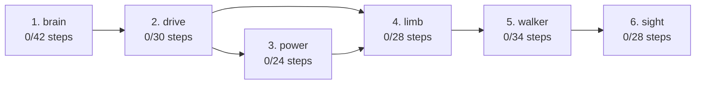

# Apex Engineering Roadmap

Generated from [`roadmap.yaml`](./roadmap.yaml). Tracks **6 integrated subsystems** and **186 engineering milestones** (**154 design & simulation** `83%` / **32 bench sessions**) for a unified hardware platform (About 2.5 kg Desktop Research Class (about 35 cm long, < 22V touch-safe power, < 2.5 N·m finger-safe joints)).

---

## Overall Progress

- **Total Completion**: `░░░░░░░░░░░░░░░░` **0 / 186 steps** (`0.0%`)
- **Design & Simulation**: **0 / 154** · **Hardware Bench Sessions**: **0 / 32**
- **Active Step**: **`brain-01`** (🛋️ Couch, 🔍 In Review) — Hardware Simulator Toolchain & Golden RISC-V Reference Emulator

| # | Subsystem | Role | Progress | Design / Bench | Est. Timeline | Workspace |
| :---: | :--- | :--- | :--- | :---: | :---: | :--- |
| **1** | [`brain`](#brain-custom-cpu-on-fpga-6-layer-circuit-board-c-compiler--real-time-os) — Custom CPU on FPGA, 6-Layer Circuit Board, C Compiler & Real-Time OS | Real-time spinal cord and locomotion processor (also operates standalone as a custom FPGA computer) | `░░░░░░░░░░` 0/42 (`0%`) | 36 / 6 | 10–12 weeks (8–12 hr/wk) | [./systems/brain/](./systems/brain/) |
| **2** | [`drive`](#drive-force-controlled-brushless-motor-driver--81-gearbox) — Force-Controlled Brushless Motor Driver & 8:1 Gearbox | Backdrivable, finger-safe robotic joint actuator (< 2.5 N·m; 12x used in final quadruped) | `░░░░░░░░░░` 0/30 (`0%`) | 24 / 6 | 7–8 weeks | [./systems/drive/](./systems/drive/) |
| **3** | [`power`](#power-smart-power-distribution-soft-startup--electronic-breaker-spine) — Smart Power Distribution, Soft Startup & Electronic Breaker Spine | Pre-charge limiter, microsecond electronic circuit breaker, and battery fuel gauge protecting all electronics | `░░░░░░░░░░` 0/24 (`0%`) | 19 / 5 | 5–6 weeks | [./systems/power/](./systems/power/) |
| **4** | [`limb`](#limb-3-joint-force-controlled-leg--tabletop-hopping-stand) — 3-Joint Force-Controlled Leg & Tabletop Hopping Stand | 3D leg kinematics, Cartesian impedance, and soft impact landings on a linear rail; becomes Front-Left Leg #1 | `░░░░░░░░░░` 0/28 (`0%`) | 23 / 5 | 6–7 weeks | [./systems/limb/](./systems/limb/) |
| **5** | [`walker`](#walker-4-legged-autonomous-quadruped-dynamics-balance--learned-locomotion) — 4-Legged Autonomous Quadruped (Dynamics, Balance & Learned Locomotion) | Integrates brain, power, and four legs into an untethered 2.5 kg dynamic quadruped | `░░░░░░░░░░` 0/34 (`0%`) | 28 / 6 | 8–10 weeks | [./systems/walker/](./systems/walker/) |
| **6** | [`sight`](#sight-synchronized-stereo-vision-3d-mapping--autonomous-navigation) — Synchronized Stereo Vision, 3D Mapping & Autonomous Navigation | High-level perception head that maps indoor obstacles and steers walker autonomously | `░░░░░░░░░░` 0/28 (`0%`) | 24 / 4 | 6–8 weeks | [./systems/sight/](./systems/sight/) |

---

## System Dependency Graph

---

## Safety Guardrails & Phased Procurement

- **Touch-Safe Voltage (< 22V DC)**: Powered by a 6-cell series lithium-iron-phosphate battery pack (6S LiFePO4: 19.2V nominal, 21.9V max), well below the 60V DC shock threshold.
- **Stable Battery Chemistry & Current-Limited Bench Power**: Lithium-iron-phosphate (LiFePO4) cells resist thermal runaway, and 95% of indoor testing runs from a current-limited bench power supply before a battery pack is connected.
- **Finger-Safe Backdrivable Joints (< 2.5 N·m)**: At roughly 2.5 kg total mass, every joint can be moved manually when unpowered or compliant, operates quietly indoors, and tests inside a compact tabletop slotted-aluminum frame.
- **Zero-Fume Factory Fabrication**: External board houses handle surface-mount assembly (turnkey PCBA) and industrial suppliers fabricate powder-fused nylon and milled aluminum parts (MJF/CNC), eliminating solder-paste and high-temperature polymer fumes indoors.

| Stage | Est. Cost | Components & Equipment |
| :--- | :---: | :--- |
| **System 1: brain (Months 1–3)** | **\$290** | Tang Primer 20K FPGA dock + plug-in compute module (\$45), 8-channel USB logic analyzer (\$15), 2x factory-assembled 6-layer Spine boards (\$115), and LiteVNA 64 vector network analyzer for trace-impedance testing (\$115) |
| **Core Bench Instruments (Month 4, 1x if needed)** | **\$310–\$540** | 4-channel 70–100 MHz oscilloscope (\$160–\$390), 30V/10A current-limited bench power supply (\$55), and USB-C soldering iron, digital multimeter, and wire crimpers (\$95) |
| **System 2: drive (Months 4–5)** | **\$130** | 1x flat pancake brushless motor, contactless magnetic angle sensor, bearings, nylon/aluminum gearbox housing, and 2x factory-assembled 4-layer motor-driver boards |
| **System 3: power (Month 6)** | **\$150** | 2x factory-assembled 4-layer power/breaker boards, physical mushroom E-stop switch, and 6-cell LiFePO4 battery, charger, and fire-safe storage bag |
| **System 4: limb (Months 7–8)** | **\$185** | 2x additional motors, housings, carbon-fiber leg tubes, timing belts, and tabletop slotted-aluminum linear-rail stand |
| **System 5: walker (Months 9–10)** | **\$520** | 9x motors (\$200), 10x batch motor-driver boards (\$140), and carbon tubes, bearings, milled torso plates, and tabletop bungee safety gantry (\$180) |
| **System 6: sight (Months 11–12)** | **\$220** | 2x synchronized global-shutter stereo cameras, compact Linux/NPU vision computer, and 3D-printed stereo mount |

---

## System-by-System Execution Plan

### 1. `brain` — Custom CPU on FPGA, 6-Layer Circuit Board, C Compiler & Real-Time OS

- **Role**: Real-time spinal cord and locomotion processor (also operates standalone as a custom FPGA computer)
- **Workspace**: [`./systems/brain/`](./systems/brain/)
- **Builds On**: None (Entry Subsystem)
- **Integration Milestone**: Boots from persistent QSPI Flash into 32 MB SDRAM on the custom 6-layer board running the custom SysC compiler and RTOS: interactive ash shell, deterministic 1,000 Hz tilt/PID loop (< 2 µs jitter), and < 0.6 ms neural locomotion inference via the custom mac instruction.
- **Progress**: `░░░░░░░░░░░░` **0 / 42** (`36` design / `6` bench)

| Phase | Steps Done | Design / Bench | Progress |
| :--- | :---: | :---: | :--- |
| **Phase 1: Simulator Tools, Reference CPU & Digital Building Blocks** | 0 / 5 | 4 / 1 | `░░░░░░░░░░` `0%` |
| **Phase 2: Basic RISC-V CPU, AI Multiplier & Interrupt Handling** | 0 / 6 | 6 / 0 | `░░░░░░░░░░` `0%` |
| **Phase 3: 5-Stage Pipelined Processor & FPGA Timing Closure** | 0 / 5 | 5 / 0 | `░░░░░░░░░░` `0%` |
| **Phase 4: 6-Layer Circuit Board Design & Factory Launch** | 0 / 7 | 6 / 1 | `░░░░░░░░░░` `0%` |
| **Phase 5: External RAM/Flash Controllers & Robot Motor/Sensor Ports** | 0 / 6 | 5 / 1 | `░░░░░░░░░░` `0%` |
| **Phase 6: From-Scratch C Compiler, Assembler & Linker** | 0 / 6 | 6 / 0 | `░░░░░░░░░░` `0%` |
| **Phase 7: Strict-Deadline Real-Time OS & Neural Walking Workload** | 0 / 4 | 4 / 0 | `░░░░░░░░░░` `0%` |
| **Phase 8: Custom 6-Layer Board Smoke Test, Trace-Echo Sweep & Graduation** | 0 / 3 | 0 / 3 | `░░░░░░░░░░` `0%` |

<strong>View All 42 Steps for <code>brain</code></strong>

#### Phase 1: Simulator Tools, Reference CPU & Digital Building Blocks

- [ ] **`brain-01`** — **Hardware Simulator Toolchain & Golden RISC-V Reference Emulator** *(🛋️ Couch · 🔍 In Review · [PR](https://github.com/Ethanex8/apex/pull/1))*
  - **Deliverables**: `systems/brain/scripts/setup_tools.sh (installs Verilator digital simulator, Yosys/nextpnr FPGA compiler, Icarus, and pytest/cocotb in .tools/)`; `systems/brain/sim/oracle.py (instruction-by-instruction Python reference CPU emulator supporting RV32IM integer/multiply, machine-mode control registers Zicsr, CLINT timer, UART console & custom mac instruction)`; `systems/brain/tb/test_oracle.py (unit tests covering arithmetic, branches, memory loads/stores, interrupt traps & custom mac)`
  - **Verify**: `uv run --with pytest --with pytest-cov pytest --cov=systems/brain/sim --cov-report=term-missing --cov-fail-under=95 systems/brain/tb/test_oracle.py && which verilator yosys nextpnr-himbaechel`
  - **First Principles**: Instruction bit-field decoding, architectural CPU state (Program Counter + 32 registers + Control/Status Registers), two's complement arithmetic & comparing real hardware against a golden software oracle *(Harris & Harris (RISC-V Ed.), Ch. 6)*
- [ ] **`brain-02`** — **32-Bit Combinational Arithmetic Logic Unit (ALU) & Single-Cycle Bit Shifter** *(🛋️ Couch · ⬜ Pending)*
  - **Deliverables**: `systems/brain/rtl/core/alu.sv`; `systems/brain/tb/test_alu.py (Cocotb + Verilator exhaustive edge-case & randomized property testbench)`
  - **Verify**: `make -C systems/brain/tb MODULE=test_alu`
  - **First Principles**: Ripple-carry vs. carry-lookahead addition, arithmetic (sign-preserving) vs. logical right shifts, signed (SLT) vs. unsigned (SLTU) comparisons, and stateless always_comb logic-gate synthesis rules *(Harris & Harris (RISC-V Ed.), Ch. 1–2 & 5)*
- [ ] **`brain-03`** — **32x32 CPU Register File & Instruction Constant Sign-Extender** *(🛋️ Couch · ⬜ Pending)*
  - **Deliverables**: `systems/brain/rtl/core/regfile.sv (dual-port read, clocked write, x0 hardwired zero register)`; `systems/brain/rtl/core/imm_gen.sv (extracts and sign-extends RISC-V I/S/B/U/J constant bit-fields)`; `systems/brain/tb/test_regfile_imm.py`
  - **Verify**: `make -C systems/brain/tb MODULE=test_regfile_imm`
  - **First Principles**: Clock-edge flip-flop storage, non-blocking (`<=`) synchronous assignment, why signal propagation must beat the clock period (`T_clk >= t_pcq + t_pd + t_setup`), and FPGA lookup-table RAM vs. flip-flop synthesis *(Harris & Harris (RISC-V Ed.), Ch. 3–4)*
- [ ] **`brain-04`** — **Cross-Clock Synchronizer, Clean Reset & 16x-Oversampled Serial Console (UART)** *(🛋️ Couch · ⬜ Pending)*
  - **Deliverables**: `systems/brain/rtl/periph/cdc_sync.sv (two-flip-flop synchronizer preventing half-voltage glitches across unsynchronized wires + clean reset bridge)`; `systems/brain/rtl/periph/uart.sv (115200/2M baud serial transmitter/receiver with 16x oversampling & small byte FIFO buffers)`; `systems/brain/rtl/uart_echo_top.sv (standalone FPGA bitstream wrapper for Tang Primer 20K)`; `systems/brain/tb/test_uart.py`
  - **Verify**: `make -C systems/brain/tb MODULE=test_uart && yosys -p "read_verilog -sv systems/brain/rtl/periph/cdc_sync.sv systems/brain/rtl/periph/uart.sv systems/brain/rtl/uart_echo_top.sv; synth_gowin -top uart_echo_top"`
  - **First Principles**: Why reading an asynchronous pin can leave a flip-flop undecided (metastability MTBF), serial start/stop byte framing, and sampling each bit 16x to tolerate clock drift *(Harris & Harris (RISC-V Ed.), Ch. 3.5 (Timing & Metastability))*
- [ ] **`brain-05`** — **Bench 1: Order Tang Primer 20K FPGA + Logic Analyzer & Flash Serial Echo** *(🔧 Bench · ⬜ Pending)*
  - **Deliverables**: `Order Sipeed Tang Primer 20K Dock Kit (Core SOM + Dock baseboard, $45), 8-ch 24 MHz FX2LP USB logic analyzer ($15), and male-to-female 2.54 mm Dupont jumper wires ($6)`; `Flash uart_echo_top bitstream onto Tang Primer 20K and capture live serial frames in PulseView`
  - **Verify**: `Serial terminal echoes typed characters cleanly at 115200 baud and logic analyzer decodes valid 8N1 UART timing`
  - **First Principles**: Connecting simulated logic-gate waveforms to physical 3.3V copper pins and baud clock accuracy *(systems/brain/pcb/BOM.md (Order 1))*

#### Phase 2: Basic RISC-V CPU, AI Multiplier & Interrupt Handling

- [ ] **`brain-06`** — **Instruction Decoder & Conditional Branch Comparator** *(🛋️ Couch · ⬜ Pending)*
  - **Deliverables**: `systems/brain/rtl/core/decoder.sv (translates RV32IM, Zicsr, and custom-0 mac opcodes into typed control signals)`; `systems/brain/rtl/core/branch_unit.sv (evaluates beq/bne/blt/bge/bltu/bgeu branch conditions)`; `systems/brain/tb/test_decoder.py`
  - **Verify**: `make -C systems/brain/tb MODULE=test_decoder`
  - **First Principles**: Control-path decoding truth tables, catching invalid machine instructions as hardware traps, and choosing next PC (PC+4 vs. branch/jump target) *(Harris & Harris (RISC-V Ed.), Ch. 7.2)*
- [ ] **`brain-07`** — **Byte/Halfword/Word Memory Aligner & On-Chip Block RAM (BRAM)** *(🛋️ Couch · ⬜ Pending)*
  - **Deliverables**: `systems/brain/rtl/core/lsu.sv (Load-Store Unit handling lb/lbu/lh/lhu/lw/sb/sh/sw lane alignment & byte-write masks)`; `systems/brain/rtl/mem/bram_32k.sv (inferred fast on-chip FPGA Block RAM; 32 KB bank in single-cycle core, dual-banked to 64 KB at 0x1000_0000 in full SoC for zero-wait-state RTOS stacks & 48.1 KB INT16 neural weights)`; `systems/brain/tb/test_lsu.py`
  - **Verify**: `make -C systems/brain/tb MODULE=test_lsu`
  - **First Principles**: Little-endian byte ordering inside 32-bit memory words, 4-bit partial-word write masks, sign- vs. zero-extension on loads, and misaligned-address trap detection *(Harris & Harris (RISC-V Ed.), Ch. 6.2 & 7.3)*
- [ ] **`brain-08`** — **Single-Cycle RISC-V Core & 10k-Instruction Lockstep Verification** *(🛋️ Couch · ⬜ Pending)*
  - **Deliverables**: `systems/brain/rtl/core/cpu_single_cycle.sv`; `systems/brain/tb/test_single_cycle.py (runs 10,000 random & directed RV32I instructions lockstep against oracle.py)`
  - **Verify**: `make -C systems/brain/tb MODULE=test_single_cycle`
  - **First Principles**: Composing fetch -> decode -> execute -> memory -> writeback in one clock tick and understanding why that long chain caps clock frequency *(Harris & Harris (RISC-V Ed.), Ch. 7.3)*
- [ ] **`brain-09`** — **Multi-Cycle Hardware Multiplier & Divider (RV32M)** *(🛋️ Couch · ⬜ Pending)*
  - **Deliverables**: `systems/brain/rtl/core/muldiv.sv (32-cycle shift-and-add multiplier & divider with valid/ready backpressure handshake)`; `systems/brain/tb/test_muldiv.py (corner cases: INT_MIN / -1, divide-by-zero per RISC-V spec, signed/unsigned cross-products)`
  - **Verify**: `make -C systems/brain/tb MODULE=test_muldiv`
  - **First Principles**: Binary shift-and-add multiplication vs. restoring division, and stalling the CPU via valid/ready handshakes when an operation takes multiple clock ticks *(Harris & Harris (RISC-V Ed.), Ch. 5.2)*
- [ ] **`brain-10`** — **Custom Neural Fixed-Point Dot-Product Unit (Xapex mac Instruction)** *(🛋️ Couch · ⬜ Pending)*
  - **Deliverables**: `systems/brain/rtl/core/mac_unit.sv (packed dual-int16 SIMD multiply-accumulate into internal EX-stage saturating 32-bit accumulator written back to rd, mapped onto FPGA hardware MULT18X18 DSP blocks using only 2 register-file read ports)`; `systems/brain/tb/test_mac_unit.py (verifies quantized neural-layer dot-products bit-for-bit vs. NumPy int16 reference)`
  - **Verify**: `make -C systems/brain/tb MODULE=test_mac_unit`
  - **First Principles**: Hardware-software co-design: why packing two 16-bit multiply-adds into one custom instruction with an internal EX accumulator cuts walking-network runtime from about 25 ms to < 0.6 ms without needing a 3-read-port register file *(Harris & Harris (RISC-V Ed.), Ch. 5.5 (DSP Blocks))*
- [ ] **`brain-11`** — **Privileged Control/Status Registers (CSRs) & 64-Bit Cycle Timer (CLINT)** *(🛋️ Couch · ⬜ Pending)*
  - **Deliverables**: `systems/brain/rtl/core/csr_file.sv (machine-mode registers: mstatus, mie, mip, mtvec, mepc, mcause, mtval, mscratch, mcycle, minstret)`; `systems/brain/rtl/periph/clint.sv (64-bit mtime & mtimecmp memory-mapped timer interrupt alarm)`; `systems/brain/tb/test_csr_clint.py`
  - **Verify**: `make -C systems/brain/tb MODULE=test_csr_clint`
  - **First Principles**: Atomic control-register read-modify-write semantics, jumping to trap handlers (mtvec), returning via mret, and hardware performance counters (mcycle/minstret) *(RISC-V Privileged Spec Vol. II, Ch. 3 (Machine-Level ISA))*

#### Phase 3: 5-Stage Pipelined Processor & FPGA Timing Closure

- [ ] **`brain-12`** — **5-Stage Pipelined CPU Skeleton (IF/ID, ID/EX, EX/MEM, MEM/WB)** *(🛋️ Couch · ⬜ Pending)*
  - **Deliverables**: `systems/brain/rtl/core/cpu_pipelined.sv (5-stage instruction assembly line with per-stage stall and flush controls)`; `systems/brain/tb/test_pipeline_nop.py (verifies instruction flow with NOP spacing)`
  - **Verify**: `make -C systems/brain/tb MODULE=test_pipeline_nop`
  - **First Principles**: Throughput vs. latency in a 5-stage CPU pipeline, slicing combinational logic delay evenly across clock cycles, and inserting harmless bubbles *(Harris & Harris (RISC-V Ed.), Ch. 7.5)*
- [ ] **`brain-13`** — **Pipeline Data Forwarding Network (Bypass Muxes)** *(🛋️ Couch · ⬜ Pending)*
  - **Deliverables**: `systems/brain/rtl/core/forwarding_unit.sv`; `Wire bypass multiplexers into systems/brain/rtl/core/cpu_pipelined.sv`; `systems/brain/tb/test_forwarding.py (back-to-back ALU-to-ALU, ALU-to-store & double-hazard priority tests)`
  - **Verify**: `make -C systems/brain/tb MODULE=test_forwarding`
  - **First Principles**: Read-After-Write (RAW) data dependencies across adjacent instructions and why newer EX/MEM results must override older MEM/WB results *(Harris & Harris (RISC-V Ed.), Ch. 7.5.3)*
- [ ] **`brain-14`** — **Pipeline Hazard Controller (Load-Use Stalls, Multi-Cycle Busy & Trap Flushes)** *(🛋️ Couch · ⬜ Pending)*
  - **Deliverables**: `systems/brain/rtl/core/hazard_unit.sv`; `Integrate load-use, multiplier/bus wait-state stalls, branch flush, and precise CSR interrupt/trap flush in cpu_pipelined.sv`; `systems/brain/tb/test_hazards.py`
  - **Verify**: `make -C systems/brain/tb MODULE=test_hazards`
  - **First Principles**: Why reading from memory followed immediately by using that register needs a 1-cycle stall even with bypass wires, and cleanly canceling speculatively fetched instructions on branches or interrupts *(Harris & Harris (RISC-V Ed.), Ch. 7.5.3–7.5.4)*
- [ ] **`brain-15`** — **100k-Instruction Randomized Hazard & Async Interrupt Stress Test** *(🛋️ Couch · ⬜ Pending)*
  - **Deliverables**: `systems/brain/tb/test_cpu_torture.py (100k randomized RV32IM+MAC instructions + async timer interrupts + random bus wait states vs. oracle.py)`
  - **Verify**: `make -C systems/brain/tb MODULE=test_cpu_torture`
  - **First Principles**: Instruction-retirement lockstep comparison, measuring effective Cycles Per Instruction (CPI = 1 + stalls/instruction), and catching subtle interrupt-vs-branch race conditions *(Harris & Harris (RISC-V Ed.), Ch. 7.5)*
- [ ] **`brain-16`** — **FPGA Logic Compilation (Synthesis), Chip Utilization & 50 MHz Timing Closure** *(🛋️ Couch · ⬜ Pending)*
  - **Deliverables**: `systems/brain/scripts/synth_core.sh (Yosys logic synthesis + nextpnr-himbaechel timing-driven placement/routing for Tang Primer 20K GW2A-18, asserting f_max >= 50 MHz with positive timing slack and <= 65% LUT4 utilization)`; `Critical-path optimization pass in RTL if max clock speed f_max < 50 MHz`
  - **Verify**: `bash systems/brain/scripts/synth_core.sh`
  - **First Principles**: How SystemVerilog compiles into 4-input lookup tables (LUT4s) and flip-flops, wire routing delay vs. logic delay, timing margin (slack), and dynamic chip power `P = alpha * C * V^2 * f` *(Harris & Harris (RISC-V Ed.), Ch. 5.6)*

#### Phase 4: 6-Layer Circuit Board Design & Factory Launch

- [ ] **`brain-17`** — **Spine Board Pin Assignments & Step-Down (Buck) Power Regulator Design** *(🛋️ Couch · ⬜ Pending)*
  - **Deliverables**: `systems/brain/pcb/pinout_gw2a.csv (locked 204-pin SOM edge-socket pinout for SDRAM, QSPI Flash, Dual CAN-FD, SPI motion sensor, camera sync, UART & debug header)`; `systems/brain/pcb/power_budget.py (sizes TPS563201 3.3V step-down buck inductor ripple, output capacitor internal resistance/ESR, USB-C 5V negotiation resistors & heat dissipation)`
  - **Verify**: `python3 systems/brain/pcb/power_budget.py --verify`
  - **First Principles**: How fast transistor switching smoothed by an inductor and capacitor steps 5V down to 3.3V efficiently (V = L dI/dt, I = C dV/dt), plus USB-C 5.1 kOhm power negotiation *(Erickson & Maksimovic, Ch. 2; Alexander & Sadiku, Ch. 6–7)*
- [ ] **`brain-18`** — **6-Layer Circuit Board Stackup, Signal-Integrity & Power-Cache (PDN) Solver** *(🛋️ Couch · ⬜ Pending)*
  - **Deliverables**: `systems/brain/pcb/calc_si_pdn.py (computes 50-ohm copper trace widths, critical rise-time length before reflections occur, echo coefficient Gamma, and decoupling capacitor network impedance)`
  - **Verify**: `python3 systems/brain/pcb/calc_si_pdn.py --verify`
  - **First Principles**: Why fast digital edges travel along copper traces as electromagnetic waves (Z0 = sqrt(L'/C')), reflections at mismatched ends Gamma = (ZL - Z0)/(ZL + Z0), and why local capacitors act as an L1 charge cache *(Clayton Paul, Introduction to Electromagnetic Compatibility, Ch. 4–5)*
- [ ] **`brain-19`** — **Programmatic KiCad Schematic 1: Power Rails, Charge-Cache Caps & FPGA Socket** *(🛋️ Couch · ⬜ Pending)*
  - **Deliverables**: `systems/brain/pcb/gen_sch_power_som.py (generates USB-C + 5V spine power-ORing, TPS563201 3.3V buck regulator, decoupling capacitors & 204-pin FPGA SOM socket schematic + SVG preview)`
  - **Verify**: `python3 systems/brain/pcb/gen_sch_power_som.py && kicad-cli sch erc --exit-code-violations systems/brain/pcb/brain_carrier.kicad_sch`
  - **First Principles**: High-frequency current return paths under chips, multi-decade ceramic capacitor charge caches (MLCC decoupling), and zero-current voltage-sense routing (Kelvin feedback) *(Clayton Paul, Ch. 6 & 9; Dalmaris, KiCad Like a Pro)*
- [ ] **`brain-20`** — **Programmatic KiCad Schematic 2: RAM, Flash, Dual CAN-FD, IMU & Trace-Echo Coupons** *(🛋️ Couch · ⬜ Pending)*
  - **Deliverables**: `systems/brain/pcb/gen_sch_periph.py (adds W9825G6KH 32MB SDRAM, W25Q128 16MB QSPI Flash, dual TCAN1044V CAN-FD drivers w/ 120-ohm trunk-root termination, ICM-42688-P motion sensor, camera sync + 2 Mbps UART1 sight header, USB-UART0 & dual SMA coax test coupons)`
  - **Verify**: `python3 systems/brain/pcb/gen_sch_periph.py && kicad-cli sch erc --exit-code-violations systems/brain/pcb/brain_carrier.kicad_sch`
  - **First Principles**: Series damping resistors that tame signal ringing, 120-ohm differential bus echo termination, and building an intentional ground-slot test coupon to visualize return-path inductance *(Clayton Paul, Ch. 5 & 11)*
- [ ] **`brain-21`** — **6-Layer Controlled-Impedance Copper Layout, Length Matching & Layer SVGs** *(🛋️ Couch · ⬜ Pending)*
  - **Deliverables**: `systems/brain/pcb/gen_layout.py (places chips, enforces unbroken L2/L6 ground reference planes, routes length-matched 50-ohm SDRAM/QSPI traces, 120-ohm CAN pairs & SMA test coupons, exports per-layer SVGs)`
  - **Verify**: `python3 systems/brain/pcb/gen_layout.py --verify-lengths`
  - **First Principles**: 6-layer stackup symmetry (Signal/Ground/Signal/Signal/Power/Ground), 3x-trace-width spacing to prevent crosstalk, clock-to-data skew budgets, and return-path stitching vias at layer jumps *(Clayton Paul, Ch. 9 & 11)*
- [ ] **`brain-22`** — **Automated Board Design-Rule Check (DRC), Factory Exports & 35-Point Audit** *(🛋️ Couch · ⬜ Pending)*
  - **Deliverables**: `systems/brain/pcb/REVIEW_CHECKLIST.md (completed 35-point schematic and copper-layout audit)`; `systems/brain/pcb/export_fab.sh (runs KiCad DRC, generates Gerber copper/mask layers, drill files, JLCPCB parts BOM & pick-and-place CPL rotation CSV)`
  - **Verify**: `kicad-cli pcb drc --exit-code-violations systems/brain/pcb/brain_carrier.kicad_pcb && bash systems/brain/pcb/export_fab.sh`
  - **First Principles**: Design-for-Manufacturing (DFM) copper clearances, solder-mask bridges preventing shorts between tight pins, thermal-relief spokes, and verifying chip Pin-1 orientation before factory assembly *(Dalmaris, KiCad Like a Pro, Part 7–8)*
- [ ] **`brain-23`** — **Bench 2 (Fab Trigger): Order 6-Layer Factory Spine Boards & LiteVNA 64** *(🔧 Bench · ⬜ Pending)*
  - **Deliverables**: `Upload fab zip + parts BOM + placement CPL to JLCPCB selecting the JLC06161H-3313 6-layer controlled-impedance stackup`; `Order LiteVNA 64 network analyzer + SMA Open/Short/Load calibration plugs (board manufactures/ships while Phases 5–7 run in simulation)`
  - **Verify**: `JLCPCB online 3D/DFM preview passes with verified chip Pin-1 polarities and controlled-impedance confirmation`
  - **First Principles**: Pipelining hardware manufacturing lead time alongside virtual simulation & compiler work *(systems/brain/pcb/BOM.md (Order 2))*

#### Phase 5: External RAM/Flash Controllers & Robot Motor/Sensor Ports

- [ ] **`brain-24`** — **Memory-Mapped System Bus Crossbar & Wait-State Arbitrator** *(🛋️ Couch · ⬜ Pending)*
  - **Deliverables**: `systems/brain/rtl/soc/soc_bus.sv (valid/ready wait-state interconnect routing 16 KB Boot ROM, 64 KB BRAM, 32 MB SDRAM, 16 MB QSPI Flash, CLINT timer, UART0 console, SPI0 IMU, Dual CAN-FD, Camera Sync + UART1 sight link & GPIO)`; `systems/brain/tb/test_soc_bus.py`
  - **Verify**: `make -C systems/brain/tb MODULE=test_soc_bus`
  - **First Principles**: Address-range decoding (turning pointer addresses into chip selects), multi-cycle wait states for slow off-chip peripherals, and preventing bus protocol deadlocks *(Harris & Harris (RISC-V Ed.), Ch. 8.5)*
- [ ] **`brain-25`** — **Quad-SPI (QSPI) Persistent Flash Controller & Behavioral Chip Model** *(🛋️ Couch · ⬜ Pending)*
  - **Deliverables**: `systems/brain/rtl/mem/qspi_ctrl.sv (memory-mapped 4-wire-parallel Flash read/Execute-In-Place & command engine)`; `systems/brain/tb/models/w25q128_model.sv & systems/brain/tb/test_qspi.py`
  - **Verify**: `make -C systems/brain/tb MODULE=test_qspi`
  - **First Principles**: Bidirectional 4-bit serial I/O pin direction turnaround cycles, SPI clock-phase conventions, and copying persistent Flash programs into fast RAM on boot *(W25Q128JV Datasheet Timing Diagrams)*
- [ ] **`brain-26`** — **16-Bit External Dynamic RAM (SDRAM) Controller & Behavioral Chip Model** *(🛋️ Couch · ⬜ Pending)*
  - **Deliverables**: `systems/brain/rtl/mem/sdram_ctrl.sv (100 us power-on init, auto-precharge, bank/row state machine, 32-bit 2-beat bursts & 64 ms refresh scheduler)`; `systems/brain/tb/models/sdr_sdram_model.sv & systems/brain/tb/test_sdram.py`
  - **Verify**: `make -C systems/brain/tb MODULE=test_sdram`
  - **First Principles**: Why DRAM capacitor cells leak charge and require 8,192 refreshes every 64 ms, row-opening latency (`t_RCD`), column CAS latency, and closing rows (`t_RP`) *(W9825G6KH-6 Datasheet State Diagram & Timing Spec)*
- [ ] **`brain-27`** — **Robot Spine Peripherals: Motion Sensor SPI, Sub-µs Camera Sync & CAN-FD Engine** *(🛋️ Couch · ⬜ Pending)*
  - **Deliverables**: `systems/brain/rtl/periph/spi_master.sv (for 1 kHz ICM-42688-P motion-sensor bursts)`; `systems/brain/rtl/periph/sync_trigger.sv (sub-microsecond camera exposure pulse + exact mtime clock latch paired with 2 Mbps UART1 sight link at 0x8005_0000)`; `systems/brain/rtl/periph/can_ctrl.sv (lightweight CAN/CAN-FD TX/RX packet engine with bit-stuffing & CRC-15/17 error checks)`; `systems/brain/tb/test_spine_periphs.py`
  - **Verify**: `make -C systems/brain/tb MODULE=test_spine_periphs`
  - **First Principles**: Cyclic redundancy checks (polynomial division mod 2), automatic edge injection (bit-stuffing) to keep receiver clocks locked without a separate clock wire, and hardware sensor timestamping *(Bosch CAN-FD Specification & ICM-42688-P SPI Timing)*
- [ ] **`brain-28`** — **Full System-on-Chip (SoC) Integration, PLL Clocking & Flash-to-RAM Boot Sim** *(🛋️ Couch · ⬜ Pending)*
  - **Deliverables**: `systems/brain/rtl/soc_top.sv (connects pipelined RV32IM+MAC core, PLL phase-shifted SDRAM clock, Boot ROM & all peripherals)`; `systems/brain/tb/test_soc_boot.py (simulates power-on reset -> Boot ROM -> QSPI Flash read -> SDRAM execute -> UART print)`
  - **Verify**: `make -C systems/brain/tb MODULE=test_soc_boot && bash systems/brain/scripts/synth_soc.sh`
  - **First Principles**: Using a Phase-Locked Loop (PLL) to phase-shift the external SDRAM clock so data transitions land cleanly in the center of the FPGA's capture window *(Harris & Harris (RISC-V Ed.), Ch. 8)*
- [ ] **`brain-29`** — **Bench 3: Compile & Boot Full System-on-Chip (On-Chip RAM) on Starter FPGA Dock** *(🔧 Bench · ⬜ Pending)*
  - **Deliverables**: `Flash soc_top bitstream (on-chip BRAM boot mode) to Tang Primer 20K Dock`; `Verify USB serial banner, CLINT timer tick & hardware mcycle/minstret instructions-per-cycle readout`
  - **Verify**: `Dock boots over USB serial printing live hardware IPC counter values and passing interactive serial echo`
  - **First Principles**: Observing real FPGA clock speed and peripheral behavior on physical silicon before the custom 6-layer board arrives *(systems/brain/README.md)*

#### Phase 6: From-Scratch C Compiler, Assembler & Linker

- [ ] **`brain-30`** — **From-Scratch Two-Pass RISC-V+MAC Assembler & Memory-Map Linker** *(🛋️ Couch · ⬜ Pending)*
  - **Deliverables**: `systems/brain/toolchain/asm_link.py (supports RV32IM, CSR ops, custom mac instruction, %hi/%lo address relocations, .text/.rodata/.data/.bss sections & flat ROM/RAM binaries)`; `systems/brain/tb/test_asm_link.py`
  - **Verify**: `uv run --with pytest pytest systems/brain/tb/test_asm_link.py`
  - **First Principles**: Two-pass forward label resolution, PC-relative branch jump-range encoding, splitting 32-bit addresses across AUIPC+ADDI (%hi/%lo), and copying initialized globals from Flash (LMA) to RAM (VMA) *(Cooper & Torczon, Engineering a Compiler, Ch. 11–12)*
- [ ] **`brain-31`** — **SysC Lexer, Recursive-Descent Parser & Static Type Checker** *(🛋️ Couch · ⬜ Pending)*
  - **Deliverables**: `systems/brain/toolchain/sysc_lex_parse.py (supports int/uint/char/void, pointers, arrays, structs, volatile hardware-register pointers, while/for/if, functions, __mac_i16)`; `systems/brain/tb/test_sysc_parser.py`
  - **Verify**: `uv run --with pytest pytest systems/brain/tb/test_sysc_parser.py`
  - **First Principles**: Tokenizing state machines (DFAs), recursive-descent + Pratt operator-precedence parsing, lexical symbol scopes, and C pointer type rules *(Cooper & Torczon, Ch. 2–4)*
- [ ] **`brain-32`** — **AST-to-Three-Address Intermediate Representation (IR) & Control-Flow Graph** *(🛋️ Couch · ⬜ Pending)*
  - **Deliverables**: `systems/brain/toolchain/sysc_ir.py (lowers AST to 3-address SSA-lite basic blocks, pointer stride scaling, struct field offsets & short-circuit branches)`; `systems/brain/tb/test_sysc_ir.py`
  - **Verify**: `uv run --with pytest pytest systems/brain/tb/test_sysc_ir.py`
  - **First Principles**: Basic blocks, Control-Flow Graphs (CFGs), scaling pointer math (`p + i -> addr + i*sizeof(*p)`), and stack slots vs. virtual registers *(Cooper & Torczon, Ch. 5 & 7)*
- [ ] **`brain-33`** — **Compiler Optimization Passes (Constant Folding, Strength Reduction & DCE)** *(🛋️ Couch · ⬜ Pending)*
  - **Deliverables**: `systems/brain/toolchain/sysc_opt.py (constant folding, multiply-to-shift strength reduction, copy propagation & dead-code elimination that respects volatile hardware I/O)`; `systems/brain/tb/test_sysc_opt.py`
  - **Verify**: `uv run --with pytest pytest systems/brain/tb/test_sysc_opt.py`
  - **First Principles**: Iterative data-flow fixed-point analysis and why volatile Memory-Mapped I/O reads/writes must act as unmovable optimization barriers *(Cooper & Torczon, Ch. 8–10)*
- [ ] **`brain-34`** — **Liveness Analysis, Register Allocator & RV32IM+MAC Code Generator** *(🛋️ Couch · ⬜ Pending)*
  - **Deliverables**: `systems/brain/toolchain/sysc_codegen.py (backward liveness, linear-scan register allocator over t0–t6/s0–s11/a0–a7, stack-frame prologue/epilogue & mac instruction emission)`; `systems/brain/tb/test_sysc_codegen.py`
  - **Verify**: `uv run --with pytest pytest systems/brain/tb/test_sysc_codegen.py`
  - **First Principles**: Variable live-range intervals, caller-saved vs. callee-saved calling conventions (ABI), and spilling variables to stack RAM when registers run out *(Cooper & Torczon, Ch. 13)*
- [ ] **`brain-35`** — **End-to-End Compiler Verification vs. Golden Emulator & Verilator Hardware** *(🛋️ Couch · ⬜ Pending)*
  - **Deliverables**: `systems/brain/toolchain/sysc.py (unified CLI compiler driver)`; `systems/brain/tb/test_sysc_e2e.py (compiles recursion, structs, function pointers, MMIO drivers & mac dot-products; asserts bit-identical execution on Python Oracle and Verilator soc_top)`
  - **Verify**: `uv run --with pytest pytest systems/brain/tb/test_sysc_e2e.py`
  - **First Principles**: Translation validation: proving custom compiler output runs bit-for-bit identically on both the software oracle and simulated SystemVerilog silicon *(Cooper & Torczon, Ch. 12–13)*

#### Phase 7: Strict-Deadline Real-Time OS & Neural Walking Workload

- [ ] **`brain-36`** — **Bare-Metal Startup (crt0), Flash-to-RAM Bootloader & 31-Reg Context Switcher** *(🛋️ Couch · ⬜ Pending)*
  - **Deliverables**: `systems/brain/rtos/crt0.S & systems/brain/rtos/boot_qspi.c (copies .data, zeroes .bss, loads RTOS image from QSPI Flash to 32MB SDRAM)`; `systems/brain/rtos/trap.S (atomic 31-register + mepc return-address save/restore via mscratch for preemptive multitasking)`; `systems/brain/tb/test_trap_switch.py`
  - **Verify**: `make -C systems/brain/tb MODULE=test_trap_switch`
  - **First Principles**: Why every CPU register must be saved verbatim across asynchronous interrupts and how mscratch enables re-entrant kernel stack swapping *(xv6-riscv, Ch. 4 (Traps and System Calls))*
- [ ] **`brain-37`** — **Preemptive Priority Scheduler, Priority-Inheritance Mutexes & Ring Buffers** *(🛋️ Couch · ⬜ Pending)*
  - **Deliverables**: `systems/brain/rtos/kernel.c & rtos.h (fixed-priority + round-robin scheduler, mtimecmp timer sleep, priority-inheritance mutexes, lock-free single-producer/single-consumer UART/CAN ring buffers)`; `systems/brain/tb/test_rtos_scheduler.py`
  - **Verify**: `make -C systems/brain/tb MODULE=test_rtos_scheduler`
  - **First Principles**: Priority inversion (a low-priority task blocking a critical control task) and how priority inheritance + lock-free ring buffers guarantee bounded latency *(Valvano, Real-Time Operating Systems, Ch. 4 & 8; xv6 Ch. 6–7)*
- [ ] **`brain-38`** — **Interactive ash Debug Shell & 1 kHz Motion-Sensor Tilt / PID Control Loop** *(🛋️ Couch · ⬜ Pending)*
  - **Deliverables**: `systems/brain/apps/ash_shell.c (commands: ps, jitter, ipc, memtest, imu, can, peek, poke)`; `systems/brain/apps/task_imu_pid.c (1 kHz fixed-point Q16.16 Mahony/complementary tilt filter + PID loop + cycle-counter jitter histogram)`; `systems/brain/tb/test_rtos_imu_pid.py`
  - **Verify**: `make -C systems/brain/tb MODULE=test_rtos_imu_pid`
  - **First Principles**: Integer Q16.16 fractional math, fusing fast-drifting gyroscope rates with noisy accelerometer gravity vectors, and profiling interrupt latency histograms *(Lyons, Understanding Digital Signal Processing, Ch. 12)*
- [ ] **`brain-39`** — **Quantized Neural Walking Network (mac Accelerated) & Full SoC Soak Test** *(🛋️ Couch · ⬜ Pending)*
  - **Deliverables**: `systems/brain/apps/task_neural_mlp.c (48 -> 128 -> 128 -> 12 INT16/ReLU neural network compiled with SysC __mac_i16)`; `systems/brain/tb/test_brain_graduation_sim.py (full Verilator soak test running all 3 concurrent tasks from QSPI->SDRAM, proving < 0.6 ms MLP runtime & < 2 µs 1 kHz jitter)`
  - **Verify**: `make -C systems/brain/tb MODULE=test_brain_graduation_sim`
  - **First Principles**: 16-bit integer neural weight/activation quantization without accuracy collapse, and verifying strict real-time deadlines under heavy external RAM traffic *(systems/brain/README.md)*

#### Phase 8: Custom 6-Layer Board Smoke Test, Trace-Echo Sweep & Graduation

- [ ] **`brain-40`** — **Bench 4: Current-Limited Smoke Test, Power Ripple & Chip Loopback** *(🔧 Bench · ⬜ Pending)*
  - **Deliverables**: `Power arrived 6-layer Spine board via current-limited 5V/1A bench supply before snapping in the FPGA SOM`; `Measure 3.3V buck regulator startup & voltage ripple; verify ICM-42688-P WHO_AM_I chip ID & CAN-FD bus loopback`
  - **Verify**: `Idle rail currents within budget, 3.3V ripple < 30 mVpp, IMU WHO_AM_I = 0x47, CAN-FD loopback clean`
  - **First Principles**: Disciplined hardware bring-up order: verify power rails first, clocks second, and digital data links third before plugging in expensive compute *(systems/brain/pcb/REVIEW_CHECKLIST.md)*
- [ ] **`brain-41`** — **Bench 5: LiteVNA 64 Calibration & Time-Domain Reflectometry (TDR) Sweep** *(🔧 Bench · ⬜ Pending)*
  - **Deliverables**: `Run SMA Open/Short/Load calibration on LiteVNA 64 and capture Inverse-FFT Time-Domain Reflectometry (TDR) echo plots`; `Compare clean 50-ohm SMA coax test trace against intentional ground-slot coupon and check against brain-18 solver predictions`
  - **Verify**: `Clean trace measures 50 +/- 5 Ohm along its span; ground-slot coupon clearly displays an inductive impedance spike right at the slot coordinate`
  - **First Principles**: Observing transmission-line impedance reflections in physical copper: why interrupting a ground return plane creates a measurable discontinuity echo *(Clayton Paul, Ch. 4–5)*
- [ ] **`brain-42`** — **Bench 6 (brain Graduation): Boot SysC RTOS from Flash/RAM & Capture < 2 µs Jitter** *(🔧 Bench · ⬜ Pending)*
  - **Deliverables**: `Snap Tang Primer 20K SOM into 6-layer Spine board, flash QSPI NOR with SysC-compiled RTOS image, and run memtest + ash shell`; `Tilt board to watch live 1 kHz motion-sensor attitude + 50 Hz neural network output frames on CAN-FD and capture < 2 µs task jitter on logic analyzer`
  - **Verify**: `32 MB SDRAM memtest passes 100%, ash shell reports < 0.6 ms MLP inference, and logic analyzer confirms < 2 µs 1 kHz control loop jitter`
  - **First Principles**: Full-stack convergence: custom SystemVerilog -> custom 6-layer PCB -> custom C compiler -> custom RTOS operating together as one deterministic physical machine *(VISION.md)*

### 2. `drive` — Force-Controlled Brushless Motor Driver & 8:1 Gearbox

- **Role**: Backdrivable, finger-safe robotic joint actuator (< 2.5 N·m; 12x used in final quadruped)
- **Workspace**: [`./systems/drive/`](./systems/drive/)
- **Builds On**: `brain`
- **Integration Milestone**: A haptic wheel behaving as a programmable spring and damper under live 1,000 Hz commands from brain.
- **Progress**: `░░░░░░░░░░░░` **0 / 30** (`24` design / `6` bench)

| Phase | Steps Done | Design / Bench | Progress |
| :--- | :---: | :---: | :--- |
| **Phase 1: Brushless Motor Physics & Force-Control Simulation** | 0 / 6 | 6 / 0 | `░░░░░░░░░░` `0%` |
| **Phase 2: 4-Layer 24V Motor-Driver Circuit Board & Factory Launch** | 0 / 8 | 7 / 1 | `░░░░░░░░░░` `0%` |
| **Phase 3: Bare-Metal 20 kHz Current/Force Firmware & Motor Bus Protocol** | 0 / 7 | 7 / 0 | `░░░░░░░░░░` `0%` |
| **Phase 4: 8:1 Gearbox 3D CAD, Stress Analysis & Factory Launch** | 0 / 5 | 4 / 1 | `░░░░░░░░░░` `0%` |
| **Phase 5: Driver Smoke Test, Gearbox Assembly & Torque Bench Verification** | 0 / 4 | 0 / 4 | `░░░░░░░░░░` `0%` |

<strong>View All 30 Steps for <code>drive</code></strong>

#### Phase 1: Brushless Motor Physics & Force-Control Simulation

- [ ] **`drive-01`** — **Brushless Motor Physics & Differential-Equation (ODE) Simulator** *(🛋️ Couch · ⬜ Pending)*
  - **Deliverables**: `systems/drive/sim/pmsm_model.py (models 3-phase spinning-magnet back-voltage, coil resistance/inductance, torque constant K_t & rotor inertia)`; `systems/drive/tb/test_pmsm_model.py`
  - **Verify**: `uv run --with pytest pytest systems/drive/tb/test_pmsm_model.py`
  - **First Principles**: Why magnetic force is proportional to coil current (`tau = K_t * i_q`), why spinning magnets push voltage back against the battery (back-EMF), and electrical-to-mechanical energy conservation *(Sang-Hoon Kim, Electric Motor Control, Ch. 1–3)*
- [ ] **`drive-02`** — **Rotating Motor Coordinate Transforms (Clarke & Park: abc -> alpha-beta -> dq0)** *(🛋️ Couch · ⬜ Pending)*
  - **Deliverables**: `systems/drive/sim/foc_transforms.py (amplitude-preserving Clarke & Park coordinate rotations and inverses)`; `systems/drive/tb/test_foc_transforms.py`
  - **Verify**: `uv run --with pytest pytest systems/drive/tb/test_foc_transforms.py`
  - **First Principles**: How changing into a rotor-locked rotating coordinate frame turns 3 oscillating AC sine-wave currents into two constant DC numbers—pure torque (`i_q`) and wasted radial squeeze (`i_d`)—for simple PI control *(Sang-Hoon Kim, Ch. 4–5)*
- [ ] **`drive-03`** — **Hexagonal Switching Modulator (Space-Vector PWM) & Dead-Time Ripple** *(🛋️ Couch · ⬜ Pending)*
  - **Deliverables**: `systems/drive/sim/svpwm.py (min-max common-mode centering achieving 15.5% higher voltage headroom from the same battery + dead-time distortion compensation)`; `systems/drive/tb/test_svpwm.py`
  - **Verify**: `uv run --with pytest pytest systems/drive/tb/test_svpwm.py`
  - **First Principles**: Representing 8 three-phase transistor states as vectors on a hexagon, centering waveforms to squeeze 15.5% more voltage from a 20V bus, and why brief switch-off gaps (dead-time) cause low-speed ripple *(Sang-Hoon Kim, Ch. 6)*
- [ ] **`drive-04`** — **20 kHz Coil-Current Loop & 1 kHz Virtual Spring-Damper (Impedance) Sim** *(🛋️ Couch · ⬜ Pending)*
  - **Deliverables**: `systems/drive/sim/foc_sim.py (nested 20 kHz i_d/i_q Field-Oriented Control loop + 1 kHz joint spring-damper law tau = kp*(q_des - q) + kd*(dq_des - dq) + tau_ff)`; `systems/drive/tb/test_foc_sim.py`
  - **Verify**: `uv run --with pytest pytest systems/drive/tb/test_foc_sim.py`
  - **First Principles**: Tuning inner current loops by canceling motor coil RL poles (`K_p = omega_c * L, K_i = omega_c * R`) and making a rigid motor behave like a programmable spring and shock absorber *(Sang-Hoon Kim, Ch. 7–8)*
- [ ] **`drive-05`** — **Measuring Motor Coil Current: Precision Sense Resistors & ADC Timing Math** *(🛋️ Couch · ⬜ Pending)*
  - **Deliverables**: `systems/drive/sim/current_sense_budget.py (shunt resistor heat loss, INA240 amplifier bandwidth, ADC signal-to-noise ratio & switching-valley sample timing)`
  - **Verify**: `python3 systems/drive/sim/current_sense_budget.py --verify`
  - **First Principles**: Reading Ohm's-law millivolt drops across tiny sense resistors (shunts), why bottom-leg shunts only see current when lower switches are ON, and triggering Analog-to-Digital (ADC) reads during quiet PWM valleys *(Pallàs-Areny & Webster, Sensors and Signal Conditioning, Ch. 3)*
- [ ] **`drive-06`** — **Motor Bus (CAN-FD) Packet Layout & Fixed-Point Integer (Q-Format) Spec** *(🛋️ Couch · ⬜ Pending)*
  - **Deliverables**: `systems/drive/firmware/can_proto.h & systems/drive/sim/test_can_proto.py (shared bit-exact packed frames between brain and drive)`
  - **Verify**: `uv run --with pytest pytest systems/drive/sim/test_can_proto.py`
  - **First Principles**: Packing angle, speed, spring/damper gains, and torque into tight 8/16-byte bus packets using integer scaling (Q-format) without floating-point overhead *(VISION.md (Locked Interface Contracts))*

#### Phase 2: 4-Layer 24V Motor-Driver Circuit Board & Factory Launch

- [ ] **`drive-07`** — **Transistor Switch Losses, High-Side Charge Pump (Bootstrap) & Heat Budget** *(🛋️ Couch · ⬜ Pending)*
  - **Deliverables**: `systems/drive/pcb/inverter_calc.py (DFN5x6/3x3 MOSFET conduction + switching heat, gate charge Q_g, high-side bootstrap capacitor sizing & spike snubber math)`
  - **Verify**: `python3 systems/drive/pcb/inverter_calc.py --verify`
  - **First Principles**: Comparing steady `I^2*R` resistance heat against switching transition energy, and why upper N-channel switches need a flying capacitor charge pump (bootstrap) to turn fully ON above 20V *(Erickson & Maksimovic, Ch. 4)*
- [ ] **`drive-08`** — **KiCad Schematic 1: 3-Phase 24V Transistor Bridges, Gate Drivers & Current Sense** *(🛋️ Couch · ⬜ Pending)*
  - **Deliverables**: `systems/drive/pcb/gen_sch_powerstage.py (generates power input, bulk DC-link capacitors, 3x transistor half-bridges, current-sense amplifiers + SVG preview)`
  - **Verify**: `python3 systems/drive/pcb/gen_sch_powerstage.py && kicad-cli sch erc --exit-code-violations systems/drive/pcb/drive_foc.kicad_sch`
  - **First Principles**: Shrinking high-speed current-switching (di/dt) loop area to prevent inductive voltage spikes and routing zero-current sense lines (Kelvin connections) straight to shunt pads *(Clayton Paul, Ch. 6)*
- [ ] **`drive-09`** — **KiCad Schematic 2: Motor MCU (STM32G4), Magnetic Angle Chip & CAN-FD Driver** *(🛋️ Couch · ⬜ Pending)*
  - **Deliverables**: `systems/drive/pcb/gen_sch_ctrl.py (adds STM32G431 microcontroller, 10V/5V/3.3V regulators, SWD debug header, AS5047P magnetic encoder, temp thermistor & TCAN1044V CAN-FD chip w/ jumper-selectable 120-ohm termination JP_TERM + ERC)`
  - **Verify**: `python3 systems/drive/pcb/gen_sch_ctrl.py && kicad-cli sch erc --exit-code-violations systems/drive/pcb/drive_foc.kicad_sch`
  - **First Principles**: Separating noisy motor-power ground currents from sensitive millivolt ADC ground references, hardware overcurrent shutoff comparators, and closing 120-ohm CAN-FD termination only at the final distal joint of each bus trunk *(STM32G431 Datasheet & Hardware Design Guide)*
- [ ] **`drive-10`** — **Compact 4-Layer Circular Motor-Back Circuit Board Layout** *(🛋️ Couch · ⬜ Pending)*
  - **Deliverables**: `systems/drive/pcb/gen_layout.py (4-layer thick 2oz-outer copper motor-back circle, isolated quiet analog island & heat-draining thermal vias + layer SVGs)`
  - **Verify**: `python3 systems/drive/pcb/gen_layout.py --verify`
  - **First Principles**: Sizing thick copper pours for 30A peaks without overheating, drilling copper thermal-via arrays to spread transistor heat, and keeping gate-drive loops tiny to prevent ringing *(IPC-2152 Current-Carrying Capacity & Clayton Paul, Ch. 11)*
- [ ] **`drive-11`** — **Motor-Driver Board Rule Check (DRC), Factory Exports & Safety Sign-Off** *(🛋️ Couch · ⬜ Pending)*
  - **Deliverables**: `systems/drive/pcb/export_fab.sh (runs KiCad DRC and outputs JLCPCB 4-layer Gerbers, parts BOM & placement CPL)`
  - **Verify**: `kicad-cli pcb drc --exit-code-violations systems/drive/pcb/drive_foc.kicad_pcb && bash systems/drive/pcb/export_fab.sh`
  - **First Principles**: Copper spacing margins for 24V motor switching transients and stencil solder-paste apertures for bottom thermal pads *(systems/drive/README.md)*
- [ ] **`drive-12`** — **Analog Circuit Simulation (SPICE) of Switch Ringing & Gate-Resistor Damping** *(🛋️ Couch · ⬜ Pending)*
  - **Deliverables**: `systems/drive/sim/half_bridge_spice.py (Ngspice transient sweep of gate resistor R_g vs. switch voltage overshoot and edge speed dV/dt)`
  - **Verify**: `python3 systems/drive/sim/half_bridge_spice.py --verify`
  - **First Principles**: How stray trace inductance + transistor capacitance ring like an LC bell (f = 1 / 2pi sqrt(LC)) and choosing a gate resistor that damps spikes without overheating the switch *(Erickson & Maksimovic, Ch. 4)*
- [ ] **`drive-13`** — **Motor Firmware Scaffold & Host GCC Unit-Test Harness** *(🛋️ Couch · ⬜ Pending)*
  - **Deliverables**: `systems/drive/firmware/foc_math.c & systems/drive/tb/test_foc_c.py (compiled with host gcc/pytest to verify fixed-point Q-math FOC core before flashing microcontroller)`
  - **Verify**: `uv run --with pytest pytest systems/drive/tb/test_foc_c.py`
  - **First Principles**: Fast integer CORDIC/lookup-table trigonometry and overflow-safe Q15/Q31 fixed-point math inside a strict 50 µs interrupt budget *(Lyons, Ch. 13 (CORDIC))*
- [ ] **`drive-14`** — **Bench 7 (Fab Trigger): Order 2x Factory 4-Layer Motor Boards + 1x Motor/Magnet** *(🔧 Bench · ⬜ Pending)*
  - **Deliverables**: `Order 2x factory-assembled 4-layer FOC motor-driver boards from JLCPCB`; `Order 1x 3508/4006 flat brushless motor, AS5047P diametric magnet, thin-section bearings & M3 hardware`
  - **Verify**: `JLCPCB placement preview clean and motor/encoder parts list matched`
  - **First Principles**: Centering tolerances between a rotating diametric magnet and the stationary magnetic-field sensor chip *(systems/drive/README.md)*

#### Phase 3: Bare-Metal 20 kHz Current/Force Firmware & Motor Bus Protocol

- [ ] **`drive-15`** — **Microcontroller Startup, Clocks & Hardware-Synced 20 kHz PWM + ADC Trigger** *(🛋️ Couch · ⬜ Pending)*
  - **Deliverables**: `systems/drive/firmware/hal_pwm_adc.c & systems/drive/tb/test_hal_pwm_adc.py (TIM1 20 kHz triangle-wave PWM + hardware trigger firing ADC1/2 phase-current reads right in the quiet switching valley)`
  - **Verify**: `uv run --with pytest pytest systems/drive/tb/test_hal_pwm_adc.py`
  - **First Principles**: Timer-to-ADC hardware synchronization: eliminating CPU interrupt latency so current is always sampled mid-pulse away from switching noise *(STM32G4 Reference Manual (TIM1 & ADC Triggering))*
- [ ] **`drive-16`** — **High-Speed Magnetic Angle Sensor (AS5047P) Driver & Smooth Speed Observer** *(🛋️ Couch · ⬜ Pending)*
  - **Deliverables**: `systems/drive/firmware/encoder.c (14-bit SPI angle read, parity check, multi-turn wraparound tracking & 2nd-order PLL speed observer)`; `systems/drive/tb/test_encoder_pll.py`
  - **Verify**: `uv run --with pytest pytest systems/drive/tb/test_encoder_pll.py`
  - **First Principles**: Why naive finite-difference speed (dq/dt) turns 14-bit quantization steps into huge spikes at 20 kHz, and how a tracking Phase-Locked Loop (PLL) yields clean velocity *(Franklin, Powell & Emami-Naeini, Feedback Control, Ch. 7)*
- [ ] **`drive-17`** — **Auto-Calibration: Coil R/L Measurement, Pole Count & Magnet Eccentricity Table** *(🛋️ Couch · ⬜ Pending)*
  - **Deliverables**: `systems/drive/firmware/calibrate.c (voltage-step R/L measurement, slow open-loop sweep finding magnetic zero offset & off-center distortion lookup table)`; `systems/drive/tb/test_calibrate.py`
  - **Verify**: `uv run --with pytest pytest systems/drive/tb/test_calibrate.py`
  - **First Principles**: Measuring first-order coil step rise i(t) = (V/R)(1 - e^{-Rt/L}) to auto-tune current gains, and mapping out off-axis magnet mounting wobble *(Sang-Hoon Kim, Ch. 7)*
- [ ] **`drive-18`** — **20 kHz Hard Real-Time Force-Control Interrupt (ISR) & Magnetic Notch Smoothing** *(🛋️ Couch · ⬜ Pending)*
  - **Deliverables**: `systems/drive/firmware/foc_isr.c & systems/drive/tb/test_foc_isr.py (Clarke/Park -> PI coil current -> SVPWM -> hardware current/temp/communication watchdogs + anticogging LUT; asserts < 18 µs ISR cycle budget)`
  - **Verify**: `uv run --with pytest pytest systems/drive/tb/test_foc_isr.py`
  - **First Principles**: Canceling permanent-magnet stator-slot bumpiness (anticogging) and zeroing motor torque immediately if CAN-FD messages from brain pause > 50 ms *(Sang-Hoon Kim, Ch. 8)*
- [ ] **`drive-19`** — **5 Mbps CAN-FD Bus Driver & 1 kHz brain Command/Telemetry Handler** *(🛋️ Couch · ⬜ Pending)*
  - **Deliverables**: `systems/drive/firmware/fdcan_node.c (hardware ID filter, unpacks q_des/dq_des/kp/kd/tau_ff, replies with packed state at 5 Mbps)`; `systems/drive/tb/test_fdcan_codec.py`
  - **Verify**: `uv run --with pytest pytest systems/drive/tb/test_fdcan_codec.py`
  - **First Principles**: Dual-rate CAN-FD packets (1 Mbps collision-arbitration header + 5 Mbps data payload) and packing 6 joints cleanly into each 1 ms bus tick *(Bosch CAN-FD Spec)*
- [ ] **`drive-20`** — **Firmware Fault-Protection Regression & Watchdog Safety Suite** *(🛋️ Couch · ⬜ Pending)*
  - **Deliverables**: `systems/drive/tb/test_drive_safety.py (tests overcurrent trip, thermal power rollback, CAN silence timeout & finger-safe torque clamp)`
  - **Verify**: `uv run --with pytest pytest systems/drive/tb/test_drive_safety.py`
  - **First Principles**: Defense-in-depth limits right inside the motor driver so an upstream software bug can never overheat coils or snap a joint *(systems/drive/README.md)*
- [ ] **`drive-21`** — **Motor Firmware Release Build & Debug-Probe Flash Tooling Check** *(🛋️ Couch · ⬜ Pending)*
  - **Deliverables**: `systems/drive/firmware/Makefile & flash.sh (compiles release .elf/.bin for STM32G431 and verifies static RAM/Flash footprint)`
  - **Verify**: `make -C systems/drive/firmware all size`
  - **First Principles**: Using linker scripts to pin the 20 kHz control interrupt and trig lookup tables inside zero-wait-state fast SRAM (CCM-SRAM) *(STM32G4 Memory Architecture)*

#### Phase 4: 8:1 Gearbox 3D CAD, Stress Analysis & Factory Launch

- [ ] **`drive-22`** — **Parametric 8:1 Gearbox Geometry & Tooth Profile Math** *(🛋️ Couch · ⬜ Pending)*
  - **Deliverables**: `systems/drive/cad/gen_gearbox_profile.py (computes play-controlled involute/cycloidal tooth curves, pin circles & bearing seats)`; `systems/drive/tb/test_gearbox_geom.py`
  - **Verify**: `uv run --with pytest pytest systems/drive/tb/test_gearbox_geom.py`
  - **First Principles**: Why a roughly 8:1 quasi-direct-drive (QDD) ratio gives strong joint torque while keeping reflected rotor inertia (`N^2 * J_rotor`) small enough to feel floor impacts back through the gears *(Budynas & Nisbett, Shigley's Mechanical Engineering Design, Ch. 13)*
- [ ] **`drive-23`** — **Parametric 3D Actuator CAD (Rotor Bell Adapter, Housing & Output Flange)** *(🛋️ Couch · ⬜ Pending)*
  - **Deliverables**: `systems/drive/cad/actuator_cad.py (CadQuery/build123d parametric STEP/STL 3D assembly integrating motor, 8:1 stage, thin bearings & rear driver board mount)`
  - **Verify**: `python3 systems/drive/cad/actuator_cad.py --check-clearances`
  - **First Principles**: Choosing shaft/hole mechanical tolerances (ISO clearance/transition fits) for thin-section bearings and concentric magnet air-gaps *(Shigley's, Ch. 7 & 11)*
- [ ] **`drive-24`** — **Gear Tooth & Housing Structural Stress Simulation (FEA via CalculiX)** *(🛋️ Couch · ⬜ Pending)*
  - **Deliverables**: `systems/drive/cad/run_fea.sh (runs CalculiX finite-element stress & flex analysis under 3x peak stall torque = 7.5 N·m, asserting safety factor >= 2.5 in PA12/7075-T6 and radial deflection < 0.05 mm)`
  - **Verify**: `bash systems/drive/cad/run_fea.sh`
  - **First Principles**: Combined shear/bending stress (Von Mises), pinpoint gear-tooth contact pressure (Hertzian stress), and stiffness-to-weight scaling *(Logan, First Course in Finite Element Method, Ch. 1–3)*
- [ ] **`drive-25`** — **Manufacturing Tolerances (GD&T), Stack-Up Math & 3D Parts Export** *(🛋️ Couch · ⬜ Pending)*
  - **Deliverables**: `systems/drive/cad/tolerance_stack.py & exported STEP/STL factory archive`
  - **Verify**: `python3 systems/drive/cad/tolerance_stack.py --verify`
  - **First Principles**: Worst-case vs. statistical (RSS) tolerance stack-up math so stacked manufacturing variances neither pinch bearings tight nor leave loose axial rattle *(Shigley's, Ch. 20 (GD&T))*
- [ ] **`drive-26`** — **Bench 8: Order Industrial Nylon (MJF PA12) & Milled Aluminum Actuator Parts** *(🔧 Bench · ⬜ Pending)*
  - **Deliverables**: `Upload actuator STEP/STL exports to JLCPCB 3D-printing and CNC-milling service`
  - **Verify**: `Order confirmed with zero thin-wall manufacturability flags`
  - **First Principles**: Designing parts for industrial powder-fused nylon (MJF PA12) vs. aluminum CNC milling with zero indoor plastic fumes *(systems/drive/README.md)*

#### Phase 5: Driver Smoke Test, Gearbox Assembly & Torque Bench Verification

- [ ] **`drive-27`** — **Bench 9: Current-Limited Motor-Driver Smoke Test & Scope Switching Check** *(🔧 Bench · ⬜ Pending)*
  - **Deliverables**: `Power FOC PCB from current-limited bench PSU (20V / 0.5A cap), flash STM32G4 & probe 3-phase PWM edges + dead-time on oscilloscope`
  - **Verify**: `Clean 3.3V/10V rails, crisp complementary PWM dead-time with zero switch shoot-through voltage spikes`
  - **First Principles**: Comparing real transistor switching edges on an oscilloscope directly against the drive-12 SPICE simulation *(systems/drive/README.md)*
- [ ] **`drive-28`** — **Bench 10: Motor R/L Auto-ID, Magnetic Zeroing & Open-Loop Bench Spin** *(🔧 Bench · ⬜ Pending)*
  - **Deliverables**: `Mount diametric magnet, spin bare motor on desk, run auto-calibration and inspect d/q current step response`
  - **Verify**: `Measured R/L matches datasheet +/-10%; q-axis current tracks 1 kHz step cleanly with zero magnetic cogging buzz`
  - **First Principles**: Aligning physical permanent-magnet rotor north pole with the software Park rotation angle *(Sang-Hoon Kim, Ch. 7)*
- [ ] **`drive-29`** — **Bench 11: Assemble 8:1 Gearbox Actuator & Measure Hand-Backdrive Friction** *(🔧 Bench · ⬜ Pending)*
  - **Deliverables**: `Assemble bearings, 8:1 gearbox, motor & rear driver PCB; measure static backdrive torque and tooth play (backlash)`
  - **Verify**: `Smooth manual backdrivability (< 0.12 N·m friction) and backlash < 0.3 deg`
  - **First Principles**: Observing how low reflected inertia and low friction turn motor coil current into a clean torque sensor *(systems/drive/README.md)*
- [ ] **`drive-30`** — **Bench 12 (drive Graduation): brain-Driven Haptic Wheel & Torque Step Test** *(🔧 Bench · ⬜ Pending)*
  - **Deliverables**: `Connect drive to brain CAN-FD Bus A; run SysC haptic virtual-spring/damper demo and verify 2.5 N·m step torque`
  - **Verify**: `1 kHz closed-loop CAN-FD telemetry runs drop-free while fingers feel crisp programmable stiffness and damping`
  - **First Principles**: Closing the first physical closed-loop actuator control path across the custom RISC-V SoC and brushless FOC drive *(VISION.md)*

### 3. `power` — Smart Power Distribution, Soft Startup & Electronic Breaker Spine

- **Role**: Pre-charge limiter, microsecond electronic circuit breaker, and battery fuel gauge protecting all electronics
- **Workspace**: [`./systems/power/`](./systems/power/)
- **Builds On**: `drive`
- **Integration Milestone**: Survives 12-actuator startup surges and intentional dead-shorts in < 5 µs while accurately estimating battery State of Charge under load.
- **Progress**: `░░░░░░░░░░░░` **0 / 24** (`19` design / `5` bench)

| Phase | Steps Done | Design / Bench | Progress |
| :--- | :---: | :---: | :--- |
| **Phase 1: Battery Modeling, Startup Surge Math & Fuel-Gauge Filter** | 0 / 6 | 6 / 0 | `░░░░░░░░░░` `0%` |
| **Phase 2: 4-Layer Power & Electronic Breaker Board & Factory Launch** | 0 / 8 | 7 / 1 | `░░░░░░░░░░` `0%` |
| **Phase 3: Safety Protection Firmware & Live Battery Estimator** | 0 / 5 | 5 / 0 | `░░░░░░░░░░` `0%` |
| **Phase 4: Fault-Injection Bring-Up, 150W Load & E-Stop Verification** | 0 / 5 | 1 / 4 | `░░░░░░░░░░` `0%` |

<strong>View All 24 Steps for <code>power</code></strong>

#### Phase 1: Battery Modeling, Startup Surge Math & Fuel-Gauge Filter

- [ ] **`power-01`** — **6-Cell LiFePO4 Battery Circuit Model & Resting Voltage Curve** *(🛋️ Couch · ⬜ Pending)*
  - **Deliverables**: `systems/power/sim/cell_randles_model.py (1-RC Randles equivalent circuit modeling internal resistance R_0 and slow chemical recovery RC branch)`; `systems/power/tb/test_cell_model.py`
  - **Verify**: `uv run --with pytest pytest systems/power/tb/test_cell_model.py`
  - **First Principles**: Why battery voltage sags under load (`V_term = OCV(z) - I*R_0 - V_rc`) and why LiFePO4's nearly flat resting-voltage (OCV) plateau breaks naive voltage-only battery gauges *(Plett, Battery Management Systems Vol. II, Ch. 2)*
- [ ] **`power-02`** — **Startup Capacitor Surge (Inrush) & Motor Braking Energy Physics Solver** *(🛋️ Couch · ⬜ Pending)*
  - **Deliverables**: `systems/power/sim/inrush_regen_sim.py (models 12x motor-driver capacitors charging on power-up, pre-charge resistor heating E = 0.5*C*V^2 & braking energy clamp)`
  - **Verify**: `python3 systems/power/sim/inrush_regen_sim.py --verify`
  - **First Principles**: Why plugging 21.9V straight into 2,400 uF of empty low-resistance capacitors pulls > 200A weld sparks without a soft pre-charge resistor, and where regenerative braking energy goes *(Alexander & Sadiku, Fundamentals of Electric Circuits, Ch. 7)*
- [ ] **`power-03`** — **Real-Time Extended Kalman Filter (EKF) Battery Fuel-Gauge Estimator** *(🛋️ Couch · ⬜ Pending)*
  - **Deliverables**: `systems/power/sim/soc_ekf.py (linearized EKF fusing current-integration Coulomb counting with Randles terminal voltage feedback to estimate State of Charge)`; `systems/power/tb/test_soc_ekf.py`
  - **Verify**: `uv run --with pytest pytest systems/power/tb/test_soc_ekf.py`
  - **First Principles**: Integrating outgoing amps over time (Coulomb counting) while correcting accumulated drift using the battery's nonlinear resting-voltage curve *(Plett, Battery Management Systems Vol. II, Ch. 3)*
- [ ] **`power-04`** — **Microsecond Electronic Circuit Breaker (Solid-State E-Fuse) & Surge Math** *(🛋️ Couch · ⬜ Pending)*
  - **Deliverables**: `systems/power/sim/efuse_spice.py (Ngspice analog simulation of back-to-back N-MOSFET switch, gate charge pump, shunt trip comparator & < 5 µs surge-clamped cutoff)`
  - **Verify**: `python3 systems/power/sim/efuse_spice.py --verify`
  - **First Principles**: Why snapping off 40A in microseconds causes wire inductance to kick back with a high-voltage spike (V = L dI/dt), and how fast Transient Voltage Suppression (TVS) diodes safely clamp it *(Erickson & Maksimovic, Ch. 4)*
- [ ] **`power-05`** — **Stable 22V -> 5.0V / 4A Step-Down (Buck) Logic Regulator Loop Design** *(🛋️ Couch · ⬜ Pending)*
  - **Deliverables**: `systems/power/sim/buck_5v_loop.py (sizes inductor saturation current and Type-II/III feedback compensation holding >= 55 deg phase margin for brain + sight)`
  - **Verify**: `python3 systems/power/sim/buck_5v_loop.py --verify`
  - **First Principles**: Control-theory Bode stability for switching regulators: keeping >= 55 deg phase margin so 12-motor voltage dips never ring or brown out the 5V computer rail *(Erickson & Maksimovic, Ch. 7 & 9)*
- [ ] **`power-06`** — **Power Spine Telemetry Protocol & Safety State-Machine Spec** *(🛋️ Couch · ⬜ Pending)*
  - **Deliverables**: `systems/power/firmware/power_proto.h & systems/power/tb/test_power_fsm.py (PRECHARGE -> RUN -> ESTOP_LATCHED -> FAULT state invariants)`
  - **Verify**: `uv run --with pytest pytest systems/power/tb/test_power_fsm.py`
  - **First Principles**: Fail-safe hardware latching: why pressing the physical red mushroom E-stop must kill transistor gate power in hardware even if firmware hangs *(systems/power/README.md)*

#### Phase 2: 4-Layer Power & Electronic Breaker Board & Factory Launch

- [ ] **`power-07`** — **KiCad Schematic 1: Two-Way E-Fuse, Pre-Charge & Physical Mushroom E-Stop** *(🛋️ Couch · ⬜ Pending)*
  - **Deliverables**: `systems/power/pcb/gen_sch_power_path.py (XT60 battery plug, soft pre-charge FET, back-to-back N-MOSFET breaker, hardware short-circuit latch & E-stop loop + SVG)`
  - **Verify**: `python3 systems/power/pcb/gen_sch_power_path.py && kicad-cli sch erc --exit-code-violations systems/power/pcb/power_spine.kicad_sch`
  - **First Principles**: Why a single MOSFET leaks current backward through its built-in body diode, requiring two transistors wired back-to-back to block current in both directions *(systems/power/README.md)*
- [ ] **`power-08`** — **KiCad Schematic 2: 4x Leg Bus Channels, 5V Buck, Current Sense & Supervisor** *(🛋️ Couch · ⬜ Pending)*
  - **Deliverables**: `systems/power/pcb/gen_sch_ctrl.py (adds per-leg INA current/voltage monitors, 5V/4A buck regulator, braking surge TVS bank, STM32 supervisor & CAN-FD Bus B Node ID 13 transceiver w/ jumper-selectable 120-ohm termination + ERC)`
  - **Verify**: `python3 systems/power/pcb/gen_sch_ctrl.py && kicad-cli sch erc --exit-code-violations systems/power/pcb/power_spine.kicad_sch`
  - **First Principles**: Isolating 30A motor switching transients away from tiny millivolt sense-resistor measurement traces *(Clayton Paul, Ch. 6)*
- [ ] **`power-09`** — **4-Layer Thick-Copper Power Spine PCB Layout & Thermal Via Grid** *(🛋️ Couch · ⬜ Pending)*
  - **Deliverables**: `systems/power/pcb/gen_layout.py (2oz thick copper bus pours, star-ground zero-current Kelvin sensing, surge-clamp diode placement & layer SVGs)`
  - **Verify**: `python3 systems/power/pcb/gen_layout.py --verify`
  - **First Principles**: Minimizing `I^2*R` voltage drop and copper trace temperature rise under 30A continuous / 60A peak walking loads *(IPC-2152 Copper Trace Thermal Curves)*
- [ ] **`power-10`** — **Thermal Resistance & Stray Wire Inductance Audit on Power Bus** *(🛋️ Couch · ⬜ Pending)*
  - **Deliverables**: `systems/power/pcb/audit_thermal_inductance.py (computes copper pour resistance, steady-state transistor temperature rise delta-T & turn-off voltage overshoot)`
  - **Verify**: `python3 systems/power/pcb/audit_thermal_inductance.py --verify`
  - **First Principles**: Modeling heat flow like an electric circuit using thermal resistance (R_thetaJA) to verify chips stay cool without physical guesswork *(Incropera & DeWitt, Heat Transfer, Ch. 3)*
- [ ] **`power-11`** — **Power Spine Board Rule Check (DRC), Factory Exports & Safety Audit** *(🛋️ Couch · ⬜ Pending)*
  - **Deliverables**: `systems/power/pcb/export_fab.sh (runs KiCad DRC and outputs JLCPCB 4-layer Gerbers, parts BOM & placement CPL)`
  - **Verify**: `kicad-cli pcb drc --exit-code-violations systems/power/pcb/power_spine.kicad_pcb && bash systems/power/pcb/export_fab.sh`
  - **First Principles**: High-current copper clearance margins and checking physical orientation/polarity of power MOSFETs, TVS clamp diodes & shunt resistors *(systems/power/README.md)*
- [ ] **`power-12`** — **Supervisor Firmware Scaffold & Fixed-Point Fuel-Gauge Host Test Harness** *(🛋️ Couch · ⬜ Pending)*
  - **Deliverables**: `systems/power/firmware/ekf_soc.c & systems/power/tb/test_ekf_c.py (verifies C EKF fuel gauge matches Python reference to < 0.2% State of Charge)`
  - **Verify**: `uv run --with pytest pytest systems/power/tb/test_ekf_c.py`
  - **First Principles**: Keeping 2x2 covariance matrix updates numerically positive and drift-free in embedded C *(Plett, Vol. II, Ch. 3)*
- [ ] **`power-13`** — **Fault-Latching Black-Box Event Ring & CAN Telemetry Broadcaster** *(🛋️ Couch · ⬜ Pending)*
  - **Deliverables**: `systems/power/firmware/fault_log.c & systems/power/tb/test_fault_log.py`
  - **Verify**: `uv run --with pytest pytest systems/power/tb/test_fault_log.py`
  - **First Principles**: Saving a circular pre-trigger ring buffer of the last 50 ms of voltage/current samples before an overcurrent trip for root-cause post-mortem *(systems/power/README.md)*
- [ ] **`power-14`** — **Bench 13 (Fab Trigger): Order 2x Factory Power Boards + 6S LiFePO4 Pack + E-Stop** *(🔧 Bench · ⬜ Pending)*
  - **Deliverables**: `Order 2x factory-assembled 4-layer Power Spine boards from JLCPCB`; `Order physical mushroom E-stop switch, 6-cell LiFePO4 battery pack, smart balance charger & fiberglass fire-safe storage bag`
  - **Verify**: `PCBA manufacturability verified and LiFePO4 pack rated <= 21.9V max with individual cell balance leads`
  - **First Principles**: Why lithium-iron-phosphate (LiFePO4) cathodes resist thermal runaway compared to standard lithium-polymer (LiPo) drone packs *(VISION.md (Home Safety Guardrails))*

#### Phase 3: Safety Protection Firmware & Live Battery Estimator

- [ ] **`power-15`** — **Soft Pre-Charge Ramp, Inrush Timeout & Short-Circuit Guard State Machine** *(🛋️ Couch · ⬜ Pending)*
  - **Deliverables**: `systems/power/firmware/power_fsm.c (checks that bus voltage reaches 95% of battery voltage within 50 ms before closing main MOSFETs; aborts on short)`; `systems/power/tb/test_power_fsm_c.py`
  - **Verify**: `uv run --with pytest pytest systems/power/tb/test_power_fsm_c.py`
  - **First Principles**: Catching a dead short safely through the high-resistance pre-charge path before ever turning on the 30A main switches *(systems/power/README.md)*
- [ ] **`power-16`** — **DMA Analog-to-Digital (ADC) Voltage/Current/Temp Sampling & Calibration** *(🛋️ Couch · ⬜ Pending)*
  - **Deliverables**: `systems/power/firmware/telemetry_adc.c & systems/power/tb/test_adc_cal.py`
  - **Verify**: `uv run --with pytest pytest systems/power/tb/test_adc_cal.py`
  - **First Principles**: Converting nonlinear temperature-sensor resistance (NTC thermistor) via Steinhart-Hart curves and boosting ADC precision by oversampling *(Pallàs-Areny & Webster, Ch. 2 & 8)*
- [ ] **`power-17`** — **CAN-FD Power Telemetry Broadcaster & brain Brownout Warning Integration** *(🛋️ Couch · ⬜ Pending)*
  - **Deliverables**: `systems/power/firmware/can_power.c & systems/brain/apps/power_monitor.c`; `systems/power/tb/test_can_power.py`
  - **Verify**: `uv run --with pytest pytest systems/power/tb/test_can_power.py`
  - **First Principles**: Graceful brownout protocol: warning brain to lower leg stiffness cleanly before battery undervoltage cutoff triggers *(VISION.md)*
- [ ] **`power-18`** — **Power Firmware Build & Complete Fault-Scenario Unit Test Suite** *(🛋️ Couch · ⬜ Pending)*
  - **Deliverables**: `systems/power/firmware/Makefile & systems/power/tb/test_fault_scenarios.py`
  - **Verify**: `make -C systems/power/firmware all && uv run --with pytest pytest systems/power/tb/test_fault_scenarios.py`
  - **First Principles**: Simulating every failure mode (shorted pre-charge, overcurrent spike, low battery, E-stop switch bounce) deterministically *(systems/power/README.md)*
- [ ] **`power-19`** — **24V Current-Limited Bench Bring-Up & Fault-Injection Test Protocol** *(🛋️ Couch · ⬜ Pending)*
  - **Deliverables**: `systems/power/pcb/BRINGUP_PROTOCOL.md & systems/power/tb/test_bringup_protocol.py (step-by-step current-limited test matrix, oscilloscope probe points & expected e-fuse trip times cross-checked against SPICE/EKF numbers)`
  - **Verify**: `uv run --with pytest pytest systems/power/tb/test_bringup_protocol.py`
  - **First Principles**: Writing a rigorous verification test plan before applying real energy to high-current power electronics *(systems/power/README.md)*

#### Phase 4: Fault-Injection Bring-Up, 150W Load & E-Stop Verification

- [ ] **`power-20`** — **Host Battery Telemetry Plotter & Automated 150W Pulse Load Script** *(🛋️ Couch · ⬜ Pending)*
  - **Deliverables**: `systems/power/sim/bench_ekf_eval.py (plots real vs. EKF battery State of Charge and captures UART/CAN fault frames during bench testing)`
  - **Verify**: `uv run --with pytest pytest systems/power/tb/test_bench_eval.py`
  - **First Principles**: Quantifying State-of-Charge estimation root-mean-square error across realistic walking current pulses *(Plett, Vol. II, Ch. 3)*
- [ ] **`power-21`** — **Bench 14: Current-Limited Power Spine Bring-Up & 5V Rail Load Test** *(🔧 Bench · ⬜ Pending)*
  - **Deliverables**: `Energize the Power Spine PCB from a 20V / 0.5A current-limited bench PSU, flash supervisor MCU & measure 5V buck voltage ripple under a 3A load`
  - **Verify**: `5.0V +/- 2% regulation with < 40 mVpp ripple and clean soft pre-charge ramp into capacitive dummy load`
  - **First Principles**: Validating transient step-load voltage stability on physical switching regulators *(systems/power/pcb/BRINGUP_PROTOCOL.md)*
- [ ] **`power-22`** — **Bench 15: Mushroom E-Stop & Hard-Short E-Fuse Oscilloscope Capture** *(🔧 Bench · ⬜ Pending)*
  - **Deliverables**: `Press physical mushroom E-stop and trigger controlled electronic short; capture < 5 µs bus cutoff & TVS surge clamp on oscilloscope`
  - **Verify**: `E-fuse disconnects fault within < 5 µs with peak switch overshoot safely < 32V`
  - **First Principles**: Observing real inductive voltage clamping on scope traces and verifying hardware safety cutoffs before connecting a live battery *(systems/power/pcb/BRINGUP_PROTOCOL.md)*
- [ ] **`power-23`** — **Bench 16: Live 6S LiFePO4 Discharge & Online Fuel-Gauge Validation** *(🔧 Bench · ⬜ Pending)*
  - **Deliverables**: `Connect 6S LiFePO4 pack through series E-stop, run dynamic pulse load & evaluate real-time EKF battery State-of-Charge error`
  - **Verify**: `Online EKF tracks true Coulomb-counted State of Charge within < 2% error despite LiFePO4 flat voltage plateau`
  - **First Principles**: Seeing Kalman filtering overcome noisy voltage spikes on real electrochemical battery cells *(Plett, Vol. II, Ch. 3)*
- [ ] **`power-24`** — **Bench 17 (power Graduation): Integrated brain + power + drive Harness Test** *(🔧 Bench · ⬜ Pending)*
  - **Deliverables**: `Power brain (from 5V rail) and drive (from 19.2V bus) off power spine; run rapid torque reversals without 5V brownout`
  - **Verify**: `brain runs uninterrupted 1 kHz CAN-FD telemetry and ash shell while drive pulls peak torque pulses and braking currents`
  - **First Principles**: Proving clean electrical isolation between high-power motor transients and low-noise digital compute *(VISION.md)*

### 4. `limb` — 3-Joint Force-Controlled Leg & Tabletop Hopping Stand

- **Role**: 3D leg kinematics, Cartesian impedance, and soft impact landings on a linear rail; becomes Front-Left Leg #1
- **Workspace**: [`./systems/limb/`](./systems/limb/)
- **Builds On**: `drive`, `power`
- **Integration Milestone**: Leg #1 mounted on a compact linear rail floats under gravity compensation and hops smoothly, driven by SysC firmware on brain.
- **Progress**: `░░░░░░░░░░░░` **0 / 28** (`23` design / `5` bench)

| Phase | Steps Done | Design / Bench | Progress |
| :--- | :---: | :---: | :--- |
| **Phase 1: 3D Leg Geometry, Force-Torque Mapping & Gravity Compensation** | 0 / 7 | 7 / 0 | `░░░░░░░░░░` `0%` |
| **Phase 2: Physics-Simulator Hopping & Foot-Contact Detection** | 0 / 7 | 7 / 0 | `░░░░░░░░░░` `0%` |
| **Phase 3: Lightweight Leg 3D CAD, Impact Stress Check & Parts Order** | 0 / 7 | 6 / 1 | `░░░░░░░░░░` `0%` |
| **Phase 4: Porting Code to brain, Rail Assembly & Live Hopping** | 0 / 7 | 3 / 4 | `░░░░░░░░░░` `0%` |

<strong>View All 28 Steps for <code>limb</code></strong>

#### Phase 1: 3D Leg Geometry, Force-Torque Mapping & Gravity Compensation

- [ ] **`limb-01`** — **3D Rotation Matrices (SO(3)), Rigid-Body Transforms (SE(3)) & Screw Motion** *(🛋️ Couch · ⬜ Pending)*
  - **Deliverables**: `systems/limb/sim/se3_math.py (skew-symmetric cross-product matrices, Rodrigues rotation formula, matrix exp/log & velocity frame maps)`; `systems/limb/tb/test_se3_math.py`
  - **Verify**: `uv run --with pytest pytest systems/limb/tb/test_se3_math.py`
  - **First Principles**: Why 3x3 orthogonal rotation matrices on the curved SO(3) group avoid Euler-angle axis collapse (gimbal lock) and how 6D velocity vectors (twists) cleanly unify 3D spin and translation *(Lynch & Park, Modern Robotics, Ch. 3)*
- [ ] **`limb-02`** — **Product-of-Exponentials (PoE) Forward Kinematics for a 3-Joint Leg** *(🛋️ Couch · ⬜ Pending)*
  - **Deliverables**: `systems/limb/sim/leg_kinematics.py (chains 3 joint rotations from hip to foot [q_abad, q_hip, q_knee] -> 3D foot position p_foot)`; `systems/limb/tb/test_leg_kinematics.py`
  - **Verify**: `uv run --with pytest pytest systems/limb/tb/test_leg_kinematics.py`
  - **First Principles**: Computing where the foot sits in 3D space purely from each joint hinge axis at rest (Product-of-Exponentials), avoiding tangled local coordinate frame conventions *(Lynch & Park, Ch. 4)*
- [ ] **`limb-03`** — **Closed-Form Inverse Kinematics (IK) & Straight-Knee Singularity Guard** *(🛋️ Couch · ⬜ Pending)*
  - **Deliverables**: `systems/limb/sim/leg_ik.py (solves joint angles for a target 3D foot coordinate with reachable-workspace clamping and knee-bend branch selection)`; `systems/limb/tb/test_leg_ik.py`
  - **Verify**: `uv run --with pytest pytest systems/limb/tb/test_leg_ik.py`
  - **First Principles**: Using law-of-cosines triangle geometry to map a desired foot point back to joint angles while smoothly clamping near full leg extension where velocity math blows up (singularity) *(Lynch & Park, Ch. 6)*
- [ ] **`limb-04`** — **Foot Velocity Jacobian & Force-Torque Duality (tau = J^T F)** *(🛋️ Couch · ⬜ Pending)*
  - **Deliverables**: `systems/limb/sim/leg_jacobian.py (analytical 3x3 velocity sensitivity matrix J(q), directional force-leverage ellipsoids & joint-torque map)`; `systems/limb/tb/test_leg_jacobian.py`
  - **Verify**: `uv run --with pytest pytest systems/limb/tb/test_leg_jacobian.py`
  - **First Principles**: Conservation of virtual work: why transposing the matrix that maps joint speeds to foot velocity (J^T) turns a desired 3D foot push force F directly into exact motor torques *(Lynch & Park, Ch. 5)*
- [ ] **`limb-05`** — **Recursive Newton-Euler (RNEA) Inverse Dynamics & Gravity Cancellation** *(🛋️ Couch · ⬜ Pending)*
  - **Deliverables**: `systems/limb/sim/leg_rnea.py (computes exact leg-acceleration inertia, swinging Coriolis/centrifugal & gravity feedforward torques)`; `systems/limb/tb/test_leg_rnea.py`
  - **Verify**: `uv run --with pytest pytest systems/limb/tb/test_leg_rnea.py`
  - **First Principles**: Sweeping joint speeds and accelerations outward from hip to foot, then sweeping reaction forces inward from foot to hip in O(N) time to predict exact motion torques *(Lynch & Park, Ch. 8)*
- [ ] **`limb-06`** — **3D Virtual Spring-Damper Foot Controller (Cartesian Impedance)** *(🛋️ Couch · ⬜ Pending)*
  - **Deliverables**: `systems/limb/sim/cartesian_impedance.py (tau = J^T * (K_cart*(p_des - p) + D_cart*(v_des - v)) + tau_grav)`; `systems/limb/tb/test_cartesian_impedance.py`
  - **Verify**: `uv run --with pytest pytest systems/limb/tb/test_cartesian_impedance.py`
  - **First Principles**: Programming a rigid carbon-and-aluminum leg to behave like a software-tunable 3D spring and hydraulic shock absorber at the foot tip *(Slotine & Li, Applied Nonlinear Control, Ch. 9)*
- [ ] **`limb-07`** — **3-Joint Leg Model (URDF) & MuJoCo Vertical Rail Physics Simulator** *(🛋️ Couch · ⬜ Pending)*
  - **Deliverables**: `systems/limb/sim/leg_hopper.xml (MuJoCo rigid-body model matching link masses, lengths & 8:1 gearbox rotor inertia)`; `systems/limb/tb/test_mujoco_leg.py`
  - **Verify**: `uv run --with pytest pytest systems/limb/tb/test_mujoco_leg.py`
  - **First Principles**: Checking our analytical RNEA and Jacobian equations against an independent 3D rigid-body contact simulator (MuJoCo), including how an 8:1 gearbox magnifies motor rotor inertia by 64x *(Lynch & Park, Ch. 8)*

#### Phase 2: Physics-Simulator Hopping & Foot-Contact Detection

- [ ] **`limb-08`** — **Sensorless Momentum-Based Ground Contact Estimator** *(🛋️ Couch · ⬜ Pending)*
  - **Deliverables**: `systems/limb/sim/contact_observer.py (estimates 3D ground reaction force F_ext from motor currents and joint motion without fragile foot switches)`; `systems/limb/tb/test_contact_observer.py`
  - **Verify**: `uv run --with pytest pytest systems/limb/tb/test_contact_observer.py`
  - **First Principles**: Generalized momentum observer: comparing expected leg momentum against measured joint speeds to isolate ground-impact force without noisy velocity differentiation *(systems/limb/README.md)*
- [ ] **`limb-09`** — **Smooth Polynomial Swing-Foot Curve (Bézier) & Soft Touchdown Logic** *(🛋️ Couch · ⬜ Pending)*
  - **Deliverables**: `systems/limb/sim/swing_trajectory.py (smooth acceleration-continuous C2 Bézier foot arcs reaching zero vertical impact velocity at touchdown)`; `systems/limb/tb/test_swing_trajectory.py`
  - **Verify**: `uv run --with pytest pytest systems/limb/tb/test_swing_trajectory.py`
  - **First Principles**: Shaping swing-foot velocity and acceleration profiles with polynomial splines so the foot meets the floor gently instead of hammering the gearbox *(Lynch & Park, Ch. 9)*
- [ ] **`limb-10`** — **Spring-Pogo Model (SLIP) & Raibert Hopping Controller in MuJoCo** *(🛋️ Couch · ⬜ Pending)*
  - **Deliverables**: `systems/limb/sim/hopper_ctrl.py (stance push-off energy regulation + mid-air leg tuck + soft landing compliance)`; `systems/limb/tb/test_hopper_sim.py (proves sustained cyclic hopping to target apex height in MuJoCo)`
  - **Verify**: `uv run --with pytest pytest systems/limb/tb/test_hopper_sim.py`
  - **First Principles**: Treating a hopping leg like a pogo stick (Spring-Loaded Inverted Pendulum / SLIP) and topping up mechanical energy each bounce to cancel ground damping losses *(Tedrake, Underactuated Robotics, Ch. 4)*
- [ ] **`limb-11`** — **Fixed-Point (Q16.16) Leg Kinematics & Spring Library for brain (SysC)** *(🛋️ Couch · ⬜ Pending)*
  - **Deliverables**: `systems/limb/firmware/leg_ctrl.c & systems/limb/tb/test_leg_sysc.py (compiles with the custom SysC compiler and verifies bit-accurate torque match vs. Python floats)`
  - **Verify**: `uv run --with pytest pytest systems/limb/tb/test_leg_sysc.py`
  - **First Principles**: Encoding decimal fractions inside 32-bit integers (16 integer bits, 16 fractional bits / Q16.16) so custom integer-only RISC-V silicon solves trig and matrices inside a 1 ms tick *(systems/brain/README.md)*
- [ ] **`limb-12`** — **SysC + Verilator Chip-to-Physics Co-Simulation Driving MuJoCo Leg** *(🛋️ Couch · ⬜ Pending)*
  - **Deliverables**: `systems/limb/tb/test_verilator_mujoco_leg.py (simulated brain chip running compiled SysC firmware exchanges 1 kHz motor frames with a live MuJoCo leg)`
  - **Verify**: `uv run --with pytest pytest systems/limb/tb/test_verilator_mujoco_leg.py`
  - **First Principles**: Hardware-in-the-loop silicon-to-physics co-simulation catching integer overflow or bus-timing bugs before machining any metal *(VISION.md)*
- [ ] **`limb-13`** — **Hip-Mounted Knee Belt/Linkage Geometry & Lower-Leg Inertia Budget** *(🛋️ Couch · ⬜ Pending)*
  - **Deliverables**: `systems/limb/cad/transmission_math.py (computes coaxial hip-knee pulley spacing, belt center distance & swinging leg inertia)`
  - **Verify**: `python3 systems/limb/cad/transmission_math.py --verify`
  - **First Principles**: Why bolting the heavy knee motor at the hip and driving the knee via a toothed belt cuts lower-leg rotational inertia by > 5x for fast, agile foot swings *(Shigley's, Ch. 17 (Belts))*
- [ ] **`limb-14`** — **Drop-Test Shock & Carbon-Tube Buckling Sizing for 2.5 kg Leg** *(🛋️ Couch · ⬜ Pending)*
  - **Deliverables**: `systems/limb/cad/impact_sizing.py (peak landing impulse force, carbon-fiber tube column buckling & bending safety factors)`
  - **Verify**: `python3 systems/limb/cad/impact_sizing.py --verify`
  - **First Principles**: Calculating landing deceleration forces from impulse-momentum conservation and checking slender carbon tubes against sudden sideways collapse (Euler column buckling) *(Hibbeler, Mechanics of Materials, Ch. 13)*

#### Phase 3: Lightweight Leg 3D CAD, Impact Stress Check & Parts Order

- [ ] **`limb-15`** — **Modular Hip Side-Swing + Forward-Pitch Bracket CAD (Shared Leg #1 Mount)** *(🛋️ Couch · ⬜ Pending)*
  - **Deliverables**: `systems/limb/cad/hip_assembly_cad.py (code-driven 3D CAD hip bracketry bolted identically to both the desk test rail and future quadruped torso)`
  - **Verify**: `python3 systems/limb/cad/hip_assembly_cad.py --check-clearances`
  - **First Principles**: Standardizing one shared mechanical bolt interface from Day 1 so Leg #1 unbolts from the desk stand and drops straight onto the 4-legged torso *(VISION.md)*
- [ ] **`limb-16`** — **Upper Leg (Femur), Lower Leg (Tibia), Coaxial Knee & Rubberized Foot CAD** *(🛋️ Couch · ⬜ Pending)*
  - **Deliverables**: `systems/limb/cad/leg_links_cad.py (carbon-fiber tube clamps, belt/4-bar knee drive, protected internal wire channel & compliant TPU rubberized foot)`
  - **Verify**: `python3 systems/limb/cad/leg_links_cad.py --check-clearances`
  - **First Principles**: Routing moving joint cables along the hinge bending centerline (neutral axis) so thousands of knee flexes never snap copper wire strands *(systems/limb/README.md)*
- [ ] **`limb-17`** — **3-Joint Leg Landing Impact Stress Simulation (CalculiX FEA)** *(🛋️ Couch · ⬜ Pending)*
  - **Deliverables**: `systems/limb/cad/run_leg_fea.sh (simulates 4g landing shock load across hip, upper-leg & knee brackets, asserting safety factor >= 2.5 across all printed/milled brackets)`
  - **Verify**: `bash systems/limb/cad/run_leg_fea.sh`
  - **First Principles**: Using Finite Element Analysis (FEA) stress meshes to spot sharp-corner tear hotspots at rounded fillets and bolt bosses before ordering parts *(Logan, FEA, Ch. 6–8)*
- [ ] **`limb-18`** — **Tabletop Slotted-Aluminum (2020) Vertical Linear-Rail Test Stand CAD** *(🛋️ Couch · ⬜ Pending)*
  - **Deliverables**: `systems/limb/cad/rail_stand_cad.py (compact desk 2020 aluminum rail frame + MGN12 precision ball-bearing carriage + rubber hard-stop bumpers)`
  - **Verify**: `python3 systems/limb/cad/rail_stand_cad.py --check-clearances`
  - **First Principles**: Locking out unwanted 3D tipping onto one low-friction vertical guide rail so single-leg hopping experiments stay safe on a desk *(systems/limb/README.md)*
- [ ] **`limb-19`** — **Leg Fabrication Export & Exact Hardware Parts List (BOM)** *(🛋️ Couch · ⬜ Pending)*
  - **Deliverables**: `systems/limb/cad/export_fab.sh & BOM for 2x additional drive actuators, carbon tubes, belts, bearings & 2020 rail parts`
  - **Verify**: `bash systems/limb/cad/export_fab.sh`
  - **First Principles**: Cross-checking every bolt length, brass heat-set threaded insert, and bearing spacer shim before placing factory manufacturing orders *(systems/limb/README.md)*
- [ ] **`limb-20`** — **Software Joint Travel Walls & Impact Current Clamp Firmware** *(🛋️ Couch · ⬜ Pending)*
  - **Deliverables**: `systems/limb/firmware/leg_safety.c & systems/limb/tb/test_leg_safety.py (enforces soft virtual joint walls, speed caps & instant fault cutoff)`
  - **Verify**: `uv run --with pytest pytest systems/limb/tb/test_leg_safety.py`
  - **First Principles**: Adding springy software end-stops inside torque space so an errant control command brakes smoothly before slamming metal brackets together *(VISION.md)*
- [ ] **`limb-21`** — **Bench 18: Order 2x More Motor Kits, Printed/Milled Leg Parts & 2020 Rail** *(🔧 Bench · ⬜ Pending)*
  - **Deliverables**: `Order Leg #1 powder-fused nylon (MJF) / milled aluminum (CNC) brackets, carbon tubes, TPU foot, MGN12 rail parts + 2x extra drive motor kits`
  - **Verify**: `Orders confirmed with matched toothed-belt pitch/length and ball-bearing sizes`
  - **First Principles**: Batch procurement workflow for scaling cleanly from 1 benchtop actuator to 1 complete 3-joint leg *(systems/limb/README.md)*

#### Phase 4: Porting Code to brain, Rail Assembly & Live Hopping

- [ ] **`limb-22`** — **SysC 1 kHz Leg Compliance & Hopping Application on brain** *(🛋️ Couch · ⬜ Pending)*
  - **Deliverables**: `systems/brain/apps/app_leg_hopper.c (integrates leg_ctrl, contact observer & CAN-FD Bus A 3-joint loop in SysC)`; `systems/limb/tb/test_app_leg_hopper.py`
  - **Verify**: `uv run --with pytest pytest systems/limb/tb/test_app_leg_hopper.py`
  - **First Principles**: Scheduling 3 bidirectional 1 kHz CAN-FD motor messages reliably inside each 1 ms tick without dropping interactive ash shell logs *(systems/brain/README.md)*
- [ ] **`limb-23`** — **Live Foot-Trajectory & Ground-Force Telemetry Plotter** *(🛋️ Couch · ⬜ Pending)*
  - **Deliverables**: `systems/limb/sim/plot_leg_telemetry.py (parses brain serial stream to plot commanded vs. actual foot height, torque & impact force)`
  - **Verify**: `uv run --with pytest pytest systems/limb/tb/test_telemetry_parser.py`
  - **First Principles**: Closing the hardware debug loop by measuring real joint friction and belt stretch directly from step-response plots vs. simulation *(systems/limb/README.md)*
- [ ] **`limb-24`** — **Bench 19: Build 2x More drives & Assemble Leg #1 on Tabletop Rail** *(🔧 Bench · ⬜ Pending)*
  - **Deliverables**: `Calibrate 2x additional drive actuators, assemble 3-joint Leg #1 & bolt onto 2020 vertical linear rail stand`
  - **Verify**: `All 3 joints swing smoothly by hand with zero belt rub and clean CAN-FD IDs 1, 2, 3`
  - **First Principles**: Mechanical zeroing and setting proper coaxial belt tension without overloading motor bearings *(systems/limb/README.md)*
- [ ] **`limb-25`** — **Joint Zero-Offset Calibration & Right-Hand Sign Convention Test Suite** *(🛋️ Couch · ⬜ Pending)*
  - **Deliverables**: `systems/limb/firmware/leg_zero.c & systems/limb/tb/test_leg_zero.py (verifies right-hand rule rotation signs across hip/knee joints vs. URDF)`
  - **Verify**: `uv run --with pytest pytest systems/limb/tb/test_leg_zero.py`
  - **First Principles**: Why flipping a single minus sign in one joint angle turns gentle spring damping into runaway positive feedback *(Lynch & Park, Ch. 4)*
- [ ] **`limb-26`** — **Bench 20: Weightless Gravity Compensation & 3D Virtual Foot Spring Test** *(🔧 Bench · ⬜ Pending)*
  - **Deliverables**: `Run SysC leg_ctrl on brain (powered by current-limited bench PSU through power spine); verify floating leg feel & programmable 3D foot stiffness`
  - **Verify**: `Leg floats effortlessly wherever placed by hand and snaps smoothly back to virtual equilibrium when deflected`
  - **First Principles**: Experiencing tau = J^T F and RNEA gravity cancellation firsthand as rigid electric motors behave like compliant biological muscle *(systems/limb/README.md)*
- [ ] **`limb-27`** — **Bench 21: Single-Drop Soft Landing & Momentum Touchdown Detection** *(🔧 Bench · ⬜ Pending)*
  - **Deliverables**: `Drop rail carriage from 15 cm onto tabletop mat; verify contact observer catches floor impact and virtual damper absorbs bounce cleanly`
  - **Verify**: `Measured ground-impact overshoot settles within < 150 ms without hard bottoming out`
  - **First Principles**: Comparing simulated MuJoCo landing damping against real-world gearbox friction and belt compliance *(systems/limb/README.md)*
- [ ] **`limb-28`** — **Bench 22 (limb Graduation): Autonomous Cyclic Hopping on Tabletop Rail** *(🔧 Bench · ⬜ Pending)*
  - **Deliverables**: `Execute continuous autonomous hopping driven in SysC on brain while logging apex height & motor current telemetry`
  - **Verify**: `Leg sustains >= 30 consecutive stable hops with consistent apex height and safe joint temperatures`
  - **First Principles**: Leg #1 (front-left) is hardware- and software-proven—ready to replicate x4 directly into walker *(VISION.md)*

### 5. `walker` — 4-Legged Autonomous Quadruped (Dynamics, Balance & Learned Locomotion)

- **Role**: Integrates brain, power, and four legs into an untethered 2.5 kg dynamic quadruped
- **Workspace**: [`./systems/walker/`](./systems/walker/)
- **Builds On**: `limb`
- **Integration Milestone**: Untethered 2.5 kg quadruped stands autonomously, recovers from lateral perturbations, and trots across indoor flooring using a quantized neural policy running natively on brain.
- **Progress**: `░░░░░░░░░░░░` **0 / 34** (`28` design / `6` bench)

| Phase | Steps Done | Design / Bench | Progress |
| :--- | :---: | :---: | :--- |
| **Phase 1: Full 12-Joint Robot Simulation & Body Speed Estimator** | 0 / 7 | 7 / 0 | `░░░░░░░░░░` `0%` |
| **Phase 2: Predictive Whole-Body Balance & Trotting in Simulation** | 0 / 7 | 7 / 0 | `░░░░░░░░░░` `0%` |
| **Phase 3: Parallel Physics AI Training & Exporting Weights to brain** | 0 / 8 | 8 / 0 | `░░░░░░░░░░` `0%` |
| **Phase 4: Torso Frame CAD, Wire Harnesses & Building Legs #2–#4** | 0 / 6 | 5 / 1 | `░░░░░░░░░░` `0%` |
| **Phase 5: Safety-Frame Bring-Up, Live Neural Walking & Untethered Field Tests** | 0 / 6 | 1 / 5 | `░░░░░░░░░░` `0%` |

<strong>View All 34 Steps for <code>walker</code></strong>

#### Phase 1: Full 12-Joint Robot Simulation & Body Speed Estimator

- [ ] **`walker-01`** — **Full 12-Joint (2.5 kg) Quadruped Model (URDF) & MuJoCo Physics Assembly** *(🛋️ Couch · ⬜ Pending)*
  - **Deliverables**: `systems/walker/sim/quadruped.xml (accurate torso, battery, brain/power mass inertia & 4x identical limb assemblies)`; `systems/walker/tb/test_quadruped_model.py`
  - **Verify**: `uv run --with pytest pytest systems/walker/tb/test_quadruped_model.py`
  - **First Principles**: Representing an unanchored floating body (6 free torso pose axes + 12 motor angles = 18 degrees of freedom / DOF) and combining torso, battery, and circuit-board masses into a composite inertia matrix *(Lynch & Park, Ch. 8)*
- [ ] **`walker-02`** — **Floating-Base Error-State Kalman Filter (ESKF) Speed & Height Estimator** *(🛋️ Couch · ⬜ Pending)*
  - **Deliverables**: `systems/walker/sim/state_eskf.py (fuses 1 kHz motion sensor accel/gyro with planted-foot geometry to estimate torso speed v and height without GPS)`; `systems/walker/tb/test_state_eskf.py`
  - **Verify**: `uv run --with pytest pytest systems/walker/tb/test_state_eskf.py`
  - **First Principles**: Why integrating noisy acceleration alone drifts within seconds—and how pinning velocity to zero relative to whichever feet are planted on the floor cancels drift every millisecond *(Barfoot, State Estimation for Robotics, Ch. 7)*
- [ ] **`walker-03`** — **Smooth Stand-Up Trajectory & Static Balance Posture Controller** *(🛋️ Couch · ⬜ Pending)*
  - **Deliverables**: `systems/walker/sim/standup_ctrl.py (interpolates crouched rest pose -> standing height with even weight sharing across 4 legs)`; `systems/walker/tb/test_standup_sim.py`
  - **Verify**: `uv run --with pytest pytest systems/walker/tb/test_standup_sim.py`
  - **First Principles**: Keeping the center of mass inside the support polygon formed by the four feet while splitting torso weight evenly across stance legs *(Tedrake, Ch. 11)*
- [ ] **`walker-04`** — **Whole-Body Roll/Pitch/Height Balance Solver (Quadratic Program) in MuJoCo** *(🛋️ Couch · ⬜ Pending)*
  - **Deliverables**: `systems/walker/sim/balance_qp.py (solves optimal foot push forces F_1..F_4 inside traction limits to hold body level under shoves)`; `systems/walker/tb/test_balance_qp.py`
  - **Verify**: `uv run --with pytest pytest systems/walker/tb/test_balance_qp.py`
  - **First Principles**: Framing 4-leg balance as a tiny constrained Quadratic Program (QP): feet can only push down (`f_z >= 0`, never pull) and sideways force must stay inside the static friction cone (`|f_xy| <= mu*f_z`) so feet never slip *(Tedrake, Ch. 11)*
- [ ] **`walker-05`** — **Gait Step-Timing Scheduler & Raibert Capture-Point Foothold Planner** *(🛋️ Couch · ⬜ Pending)*
  - **Deliverables**: `systems/walker/sim/gait_scheduler.py (diagonal trot/crawl leg offsets, stance duty factor & speed-proportional foothold targets)`; `systems/walker/tb/test_gait_scheduler.py`
  - **Verify**: `uv run --with pytest pytest systems/walker/tb/test_gait_scheduler.py`
  - **First Principles**: Why placing each swinging foot ahead of the body center by `v * T_stance/2 + k*(v - v_cmd)` catches forward tipping momentum to stabilize dynamic trotting *(Tedrake, Ch. 4 & 11)*
- [ ] **`walker-06`** — **Motor Speed-Torque Ceiling & Bus-Delay Simulator Realism Layer** *(🛋️ Couch · ⬜ Pending)*
  - **Deliverables**: `systems/walker/sim/actuator_realism.py (models 21.9V generator back-EMF ceiling, CAN-FD delay & geared rotor inertia in MuJoCo)`; `systems/walker/tb/test_actuator_realism.py`
  - **Verify**: `uv run --with pytest pytest systems/walker/tb/test_actuator_realism.py`
  - **First Principles**: Closing the Sim-to-Real gap early: why an idealized simulator cheats unless fast-spinning motor back-EMF voltage limits and communication latency are modeled *(systems/walker/README.md)*
- [ ] **`walker-07`** — **Manual Remote-Control Input & Fall-Protection Supervisor** *(🛋️ Couch · ⬜ Pending)*
  - **Deliverables**: `systems/walker/sim/safety_supervisor.py (roll/pitch > 50 deg fall detection, speed ramp limits & soft torque damping mode)`; `systems/walker/tb/test_safety_supervisor.py`
  - **Verify**: `uv run --with pytest pytest systems/walker/tb/test_safety_supervisor.py`
  - **First Principles**: Switching to gentle viscous damping during an unrecoverable tip-over instead of thrashing full motor torque against the floor *(VISION.md)*

#### Phase 2: Predictive Whole-Body Balance & Trotting in Simulation

- [ ] **`walker-08`** — **Single-Rigid-Body Centroidal Dynamics Linearization** *(🛋️ Couch · ⬜ Pending)*
  - **Deliverables**: `systems/walker/sim/centroidal_model.py (discrete linear state-space matrices A_d, B_d mapping 4 foot forces to torso pose & spin momentum)`; `systems/walker/tb/test_centroidal_model.py`
  - **Verify**: `uv run --with pytest pytest systems/walker/tb/test_centroidal_model.py`
  - **First Principles**: Approximating a 12-joint quadruped as one rigid brick pushed by 4 massless legs so predictive balance math turns linear and solves in under a millisecond *(Rawlings, Mayne & Diehl, Model Predictive Control, Ch. 1–2)*
- [ ] **`walker-09`** — **Look-Ahead Convex Model Predictive Control (MPC via OSQP)** *(🛋️ Couch · ⬜ Pending)*
  - **Deliverables**: `systems/walker/sim/convex_mpc.py (10-step 200 ms horizon QP over upcoming stance/swing contact schedule with friction-cone bounds)`; `systems/walker/tb/test_convex_mpc.py`
  - **Verify**: `uv run --with pytest pytest systems/walker/tb/test_convex_mpc.py`
  - **First Principles**: Why planning foot push forces 200 ms into the future across upcoming liftoffs and touchdowns keeps the torso balanced during brisk trotting *(Rawlings, Mayne & Diehl, Ch. 1–2 & 8)*
- [ ] **`walker-10`** — **Stance-Force MPC + Swing-Foot Tracking Integrated Trot in MuJoCo** *(🛋️ Couch · ⬜ Pending)*
  - **Deliverables**: `systems/walker/sim/mpc_trot_sim.py (combines ESKF state + MPC stance forces + Bezier swing legs; verifies omni-directional trot & push recovery in sim)`; `systems/walker/tb/test_mpc_trot_sim.py`
  - **Verify**: `uv run --with pytest pytest systems/walker/tb/test_mpc_trot_sim.py`
  - **First Principles**: Coordinating two complementary controllers: MPC optimizes whole-body momentum through planted stance feet while Cartesian PD+RNEA guides swinging feet cleanly to the next foothold *(Tedrake, Ch. 11)*
- [ ] **`walker-11`** — **Uneven-Step & Shove-Recovery Stress Benchmark (MPC Baseline)** *(🛋️ Couch · ⬜ Pending)*
  - **Deliverables**: `systems/walker/tb/test_mpc_disturbances.py (lateral push impulses + 3 cm step obstacles in MuJoCo; logs baseline survival rate & energy use)`
  - **Verify**: `uv run --with pytest pytest systems/walker/tb/test_mpc_disturbances.py`
  - **First Principles**: Measuring energy efficiency per distance moved (mechanical cost-of-transport) and maximum push survival as a quantitative baseline for RL comparison *(systems/walker/README.md)*
- [ ] **`walker-12`** — **Automatic Foot-Slip Detection & Compliant Recovery Reflex** *(🛋️ Couch · ⬜ Pending)*
  - **Deliverables**: `systems/walker/sim/slip_reflex.py & systems/walker/tb/test_slip_reflex.py`
  - **Verify**: `uv run --with pytest pytest systems/walker/tb/test_slip_reflex.py`
  - **First Principles**: Spotting sudden sideways foot sliding during stance and tightening the friction-cone limit immediately before the leg washes out *(systems/walker/README.md)*
- [ ] **`walker-13`** — **Telemetry Replay & Automated Gait-Stability Grading Suite** *(🛋️ Couch · ⬜ Pending)*
  - **Deliverables**: `systems/walker/sim/gait_metrics.py (computes velocity tracking RMSE, torso pitch/roll wobble & motor torque saturation metrics)`
  - **Verify**: `uv run --with pytest pytest systems/walker/tb/test_gait_metrics.py`
  - **First Principles**: Grading gait controllers objectively across speed-tracking error, torso steadiness, and peak motor phase current *(systems/walker/README.md)*
- [ ] **`walker-14`** — **Side-by-Side Comparison: Fixed-Path Playback Trot vs. Predictive Force (MPC)** *(🛋️ Couch · ⬜ Pending)*
  - **Deliverables**: `systems/walker/sim/compare_mpc_vs_kinematic.py (generates side-by-side shove-recovery plots and energy-consumption budgets)`
  - **Verify**: `python3 systems/walker/sim/compare_mpc_vs_kinematic.py --verify`
  - **First Principles**: Visualizing why dynamic force optimization stays upright under sideways shoves where blind position-playback gaits immediately tip over *(Tedrake, Ch. 11)*

#### Phase 3: Parallel Physics AI Training & Exporting Weights to brain

- [ ] **`walker-15`** — **Reinforcement Learning Environment (MDP): 48 Sensor Inputs & 12 Joint Actions** *(🛋️ Couch · ⬜ Pending)*
  - **Deliverables**: `systems/walker/sim/rl_env.py (vectorized gym environment matching exact brain IMU + 12-encoder inputs and joint target outputs)`; `systems/walker/tb/test_rl_env.py`
  - **Verify**: `uv run --with pytest pytest systems/walker/tb/test_rl_env.py`
  - **First Principles**: Formulating walking as a partially observable Markov Decision Process (MDP) using only real onboard IMU and encoder readings—never hidden simulator ground truth *(Sutton & Barto, Reinforcement Learning, Ch. 3)*
- [ ] **`walker-16`** — **From-Scratch PPO Policy Trainer & Generalized Advantage Estimation (GAE)** *(🛋️ Couch · ⬜ Pending)*
  - **Deliverables**: `systems/walker/sim/ppo_trainer.py (clipped surrogate PPO objective, value critic, GAE lambda-returns & compact 48->128->128->12 actor network)`; `systems/walker/tb/test_ppo_math.py`
  - **Verify**: `uv run --with pytest pytest systems/walker/tb/test_ppo_math.py`
  - **First Principles**: Policy gradient updates with trust-region ratio clipping (Proximal Policy Optimization / PPO) so large weight steps never destroy a working gait, paired with bias-variance tuning via GAE *(Sutton & Barto, Ch. 13)*
- [ ] **`walker-17`** — **Domain Randomization, Rough-Step Curriculum & Smooth-Motion Reward Shaping** *(🛋️ Couch · ⬜ Pending)*
  - **Deliverables**: `systems/walker/sim/domain_rand.py (randomizes payload mass, joint friction, link center-of-mass, floor bounce, CAN-FD latency & push impulses)`; `systems/walker/tb/test_domain_rand.py`
  - **Verify**: `uv run --with pytest pytest systems/walker/tb/test_domain_rand.py`
  - **First Principles**: Training one neural policy across thousands of slightly imperfect simulated robots so it walks reliably on real hardware instead of memorizing one idealized simulator *(systems/walker/README.md)*
- [ ] **`walker-18`** — **Train 50 Hz Walking Policy in GPU-Parallel MuJoCo (MJX) & Evaluate Tracking** *(🛋️ Couch · ⬜ Pending)*
  - **Deliverables**: `systems/walker/sim/train_walk.py & saved float32 policy checkpoint passing omni-directional speed & step-terrain eval (< 8% velocity error across +/- 0.8 m/s & uneven tiles)`
  - **Verify**: `python3 systems/walker/sim/train_walk.py --eval-only`
  - **First Principles**: Tracking exploration randomness (entropy), value-network fit (explained variance), and joint-jerk penalties across thousands of parallel GPU physics rollouts *(Sutton & Barto, Ch. 13)*
- [ ] **`walker-19`** — **Fixed-Point INT16 Neural Export to brain SysC Arrays & mac Intrinsics** *(🛋️ Couch · ⬜ Pending)*
  - **Deliverables**: `systems/walker/sim/export_sysc_mlp.py (quantizes weights/activations to scaled 16-bit integer Q-format C arrays ready for brain's custom mac unit)`; `systems/walker/tb/test_quantized_mlp.py (verifies < 1% action drift between float32 PyTorch/NumPy and INT16 SysC)`
  - **Verify**: `uv run --with pytest pytest systems/walker/tb/test_quantized_mlp.py`
  - **First Principles**: Symmetric per-layer INT16 scaling and clamping (saturating) arithmetic so integer-only custom silicon matches float32 walking behavior within 1% *(systems/brain/README.md)*
- [ ] **`walker-20`** — **Closed-Loop Silicon-to-Physics Test (Verilator brain Walks in MuJoCo)** *(🛋️ Couch · ⬜ Pending)*
  - **Deliverables**: `systems/walker/tb/test_brain_walks_mujoco.py (compiled SysC ESKF + 50 Hz RL neural network running inside Verilator chip sim drives the 12-joint MuJoCo quadruped)`
  - **Verify**: `uv run --with pytest pytest systems/walker/tb/test_brain_walks_mujoco.py`
  - **First Principles**: Verifying end-to-end that the custom CPU, compiler, RTOS, and quantized neural network locomote a full physics model prior to physical leg bring-up *(VISION.md)*
- [ ] **`walker-21`** — **On-Robot SysC 12-Joint Dual CAN-FD Spine Scheduler & Safety Envelope** *(🛋️ Couch · ⬜ Pending)*
  - **Deliverables**: `systems/brain/apps/app_walker_spine.c (1 kHz dual-bus CAN-FD dispatcher + ESKF + 50 Hz RL task + sight velocity listener)`; `systems/walker/tb/test_walker_spine_sim.py`
  - **Verify**: `uv run --with pytest pytest systems/walker/tb/test_walker_spine_sim.py`
  - **First Principles**: Interleaving 6 joints on Bus A and 6 joints on Bus B cleanly inside a strict 1 ms real-time budget with zero deadline misses *(VISION.md)*
- [ ] **`walker-22`** — **Emergency Fall-Detection & Watchdog Integration Test in Verilator** *(🛋️ Couch · ⬜ Pending)*
  - **Deliverables**: `systems/walker/tb/test_walker_faults_verilator.py (simulates dropped CAN-FD joint, tilted body > 50 deg & power brownout)`
  - **Verify**: `uv run --with pytest pytest systems/walker/tb/test_walker_faults_verilator.py`
  - **First Principles**: Verifying every fault-protection reflex inside simulated chip silicon prior to energizing 12 physical brushless actuators *(VISION.md)*

#### Phase 4: Torso Frame CAD, Wire Harnesses & Building Legs #2–#4

- [ ] **`walker-23`** — **Lightweight 2.5 kg Torso Chassis CAD (4x Leg Mounts, Brain, Power & Battery Bay)** *(🛋️ Couch · ⬜ Pending)*
  - **Deliverables**: `systems/walker/cad/torso_cad.py (carbon top/bottom sandwich plates, MJF/CNC spine ribs, brain + power mounts, E-stop bracket & 6-cell LiFePO4 bay)`
  - **Verify**: `python3 systems/walker/cad/torso_cad.py --check-clearances`
  - **First Principles**: Packing the heavy battery and circuit boards near the torso center of mass to keep rotational inertia tight and predictable *(systems/walker/README.md)*
- [ ] **`walker-24`** — **Torso Twist & Drop-Impact Structural Stress Simulation (CalculiX FEA)** *(🛋️ Couch · ⬜ Pending)*
  - **Deliverables**: `systems/walker/cad/run_torso_fea.sh (verifies stiffness under diagonal-trot twisting moments and 4g landing loads, asserting safety factor >= 2.5 and hip-to-hip torsional twist < 0.5 deg)`
  - **Verify**: `bash systems/walker/cad/run_torso_fea.sh`
  - **First Principles**: Why a torsionally stiff torso linking front and rear hips prevents frame flex from corrupting leg-kinematics height estimates during diagonal trotting *(Hibbeler, Mechanics of Materials, Ch. 5; Logan, FEA)*
- [ ] **`walker-25`** — **High-Flex Wire Harness Spec (Power + Dual CAN-FD Pinouts & Routing)** *(🛋️ Couch · ⬜ Pending)*
  - **Deliverables**: `systems/walker/cad/HARNESS_ICD.md & systems/walker/tb/test_harness_icd.py (exact wire gauges, XT30 power & Molex Micro-Fit/JST-GH locking plug pinouts, flex loops & endpoint-only 120-ohm CAN-FD termination jumpers cross-checked 1:1 against brain, power & drive schematics)`
  - **Verify**: `uv run --with pytest pytest systems/walker/tb/test_harness_icd.py`
  - **First Principles**: Keeping electromagnetic switching noise (EMI crosstalk) out of data wires by twisting CAN-FD signal pairs, routing them away from 24V motor power leads, and closing 120-ohm termination jumpers only at trunk ends *(Clayton Paul, Ch. 6 & 9)*
- [ ] **`walker-26`** — **Tabletop Slotted-Aluminum (2020) Bungee Safety Gantry CAD** *(🛋️ Couch · ⬜ Pending)*
  - **Deliverables**: `systems/walker/cad/gantry_cad.py (compact portable 2020 aluminum overhead frame with elastic bungee sling for indoor walking bring-up)`
  - **Verify**: `python3 systems/walker/cad/gantry_cad.py --check-clearances`
  - **First Principles**: Catching falls gently in mid-air during early walking trials using a slack bungee tether that applies zero upward pull while standing *(VISION.md (Home Safety Guardrails))*
- [ ] **`walker-27`** — **Batch Fabrication & Parts Package for Legs #2–#4 + Torso** *(🛋️ Couch · ⬜ Pending)*
  - **Deliverables**: `systems/walker/cad/export_fab.sh & complete batch BOM (9x motors, 10x FOC driver PCBAs, carbon tubes, bearings, milled torso plates & harness plugs)`
  - **Verify**: `bash systems/walker/cad/export_fab.sh`
  - **First Principles**: Ordering exact spares (+1 motor and +1 driver board) alongside production parts so one damaged solder joint or bearing never stalls assembly for weeks *(systems/walker/README.md)*
- [ ] **`walker-28`** — **Bench 23: Order Batch of 9x Motors, 10x FOC Driver Boards, Milled Torso & Legs #2–#4** *(🔧 Bench · ⬜ Pending)*
  - **Deliverables**: `Place batch orders for remaining 9 actuators, milled aluminum / carbon-fiber torso plates, harness connectors & tabletop 2020 gantry`
  - **Verify**: `Batch PCBA manufacturability (DFM) and mechanical parts-list (BOM) quantities confirmed`
  - **First Principles**: Production batch discipline and spare-part planning *(systems/walker/README.md)*

#### Phase 5: Safety-Frame Bring-Up, Live Neural Walking & Untethered Field Tests

- [ ] **`walker-29`** — **Bench 24: Assemble 9x drives, Legs #2–#4, Torso Frame & Wire Harnesses** *(🔧 Bench · ⬜ Pending)*
  - **Deliverables**: `Flash/calibrate 9x FOC drives, assemble Legs #2–#4, bolt Leg #1 + Legs #2–#4 + brain + power onto torso & crimp harnesses`
  - **Verify**: `Total mass about 2.5 kg, all 12 joints move smoothly, zero wire pinch across full workspace`
  - **First Principles**: Clean modular integration where desktop Leg #1, brain, and power drop straight onto the chassis with zero throwaway parts *(systems/walker/cad/HARNESS_ICD.md)*
- [ ] **`walker-30`** — **Bench 25: 12-Joint Dual CAN-FD Bus Enumeration, Zeroing & Bench-PSU Bring-Up** *(🔧 Bench · ⬜ Pending)*
  - **Deliverables**: `Power robot via current-limited bench PSU + mushroom E-stop; verify 1 kHz dual CAN-FD loop & right-hand zero offsets across all 12 joints`
  - **Verify**: `brain reports 0 dropped CAN-FD frames over 60 seconds and smooth joint gravity compensation on all 4 legs`
  - **First Principles**: Validating full-spine deterministic bus timing across physical FPGA silicon and 12 motor drives *(systems/walker/README.md)*
- [ ] **`walker-31`** — **Bench 26: Suspended Gantry Stand-Up & Push-Compliant Squat Test** *(🔧 Bench · ⬜ Pending)*
  - **Deliverables**: `Suspend walker under tabletop 2020 bungee gantry; execute smooth stand-up and interactive roll/pitch/height squats`
  - **Verify**: `Robot smoothly rises to standing height and maintains level body posture while manually pushed`
  - **First Principles**: Testing closed-chain 4-leg force sharing safely on a current-limited bench power supply before dynamic stepping *(systems/walker/README.md)*
- [ ] **`walker-32`** — **Bench 27: First Live Sim-to-Real RL Policy Trot on brain (Gantry Tethered)** *(🔧 Bench · ⬜ Pending)*
  - **Deliverables**: `Deploy INT16 PPO walking policy on brain under slack bungee safety sling; record live gait telemetry & IMU attitude`
  - **Verify**: `Robot executes steady in-place and forward/lateral trotting on carpet powered by the custom RISC-V+MAC System-on-Chip`
  - **First Principles**: Executing a GPU-trained RL policy natively via custom mac instructions on custom FPGA silicon *(VISION.md)*
- [ ] **`walker-33`** — **Real-World Telemetry Diff & Simulator Physics Fine-Tune** *(🛋️ Couch · ⬜ Pending)*
  - **Deliverables**: `systems/walker/sim/analyze_real_gait.py & systems/walker/tb/test_analyze_real_gait.py (compares logged physical joint/IMU trajectories vs. MuJoCo, tightens sim motor damping/latency, and re-verifies updated quantized SysC weights)`
  - **Verify**: `uv run --with pytest pytest systems/walker/tb/test_analyze_real_gait.py`
  - **First Principles**: Data-driven system identification: shrinking remaining Sim-to-Real mismatch from real sensor logs rather than guessing gains *(systems/walker/README.md)*
- [ ] **`walker-34`** — **Bench 28 (walker Graduation): Untethered 6-Cell LiFePO4 Walking & Shove Recovery** *(🔧 Bench · ⬜ Pending)*
  - **Deliverables**: `Install 6-cell LiFePO4 battery pack, remove umbilical PSU cable, and run untethered omni-directional walking + shove recovery + small threshold climbs`
  - **Verify**: `Stable untethered trotting, rapid recovery from lateral shoves, and healthy EKF battery telemetry`
  - **First Principles**: A complete self-contained walking robot built from custom RTL, custom circuit boards, custom compiler, custom RTOS, custom FOC drives & custom RL *(VISION.md)*

### 6. `sight` — Synchronized Stereo Vision, 3D Mapping & Autonomous Navigation

- **Role**: High-level perception head that maps indoor obstacles and steers walker autonomously
- **Workspace**: [`./systems/sight/`](./systems/sight/)
- **Builds On**: `walker`
- **Integration Milestone**: Hardware-synced stereo camera pod maps an indoor space in 3D, mounts onto walker, and navigates autonomously around obstacles to a target waypoint.
- **Progress**: `░░░░░░░░░░░░` **0 / 28** (`24` design / `4` bench)

| Phase | Steps Done | Design / Bench | Progress |
| :--- | :---: | :---: | :--- |
| **Phase 1: Camera Geometry, Calibration & 2-Camera Stereo Depth** | 0 / 6 | 6 / 0 | `░░░░░░░░░░` `0%` |
| **Phase 2: Camera + Motion-Sensor Tracking & 3D Room Obstacle Grid** | 0 / 7 | 7 / 0 | `░░░░░░░░░░` `0%` |
| **Phase 3: Path Planning, Person/Obstacle Detection & brain Sync Link** | 0 / 7 | 7 / 0 | `░░░░░░░░░░` `0%` |
| **Phase 4: Stereo Camera Pod Build, Room Mapping & Autonomous Walking** | 0 / 8 | 4 / 4 | `░░░░░░░░░░` `0%` |

<strong>View All 28 Steps for <code>sight</code></strong>

#### Phase 1: Camera Geometry, Calibration & 2-Camera Stereo Depth

- [ ] **`sight-01`** — **Pinhole Camera Geometry & Radial/Tangential Lens Distortion Model** *(🛋️ Couch · ⬜ Pending)*
  - **Deliverables**: `systems/sight/sim/camera_model.py (camera intrinsics matrix K, Brown-Conrady barrel/tilt distortion inversion & pixel Jacobian)`; `systems/sight/tb/test_camera_model.py`
  - **Verify**: `uv run --with pytest pytest systems/sight/tb/test_camera_model.py`
  - **First Principles**: Mapping 3D points in front of a lens onto 2D image pixels (pinhole projection) and mathematically flattening wide-angle lens curvature (Brown-Conrady distortion) *(Corke, Robotics, Vision and Control, Ch. 13)*
- [ ] **`sight-02`** — **Stereo Row Alignment (Epipolar Rectification) & Disparity Depth Triangulation** *(🛋️ Couch · ⬜ Pending)*
  - **Deliverables**: `systems/sight/sim/stereo_depth.py (Essential/Fundamental camera-pair matrices, stereo image rectification & Z = f*B / d depth formula)`; `systems/sight/tb/test_stereo_depth.py`
  - **Verify**: `uv run --with pytest pytest systems/sight/tb/test_stereo_depth.py`
  - **First Principles**: Warping left/right frames onto matching horizontal rows (epipolar rectification) so 3D depth reduces to a 1D pixel-shift search, and why depth uncertainty grows with range squared *(Corke, Ch. 14)*
- [ ] **`sight-03`** — **Corner Tracking, Optical Flow & Random-Consensus Outlier Rejection (RANSAC)** *(🛋️ Couch · ⬜ Pending)*
  - **Deliverables**: `systems/sight/sim/feature_tracker.py (FAST/Shi-Tomasi corner points, KLT frame-to-frame optical flow & 5-point RANSAC motion solver)`; `systems/sight/tb/test_feature_tracker.py`
  - **Verify**: `uv run --with pytest pytest systems/sight/tb/test_feature_tracker.py`
  - **First Principles**: Using fast random minimal sampling (RANSAC) to filter out false pixel matches and moving pets so only rigid room geometry drives camera motion estimates *(Corke, Ch. 14)*
- [ ] **`sight-04`** — **Motion-Sensor (IMU) Pre-Integration Between 30 Hz Camera Frames** *(🛋️ Couch · ⬜ Pending)*
  - **Deliverables**: `systems/sight/sim/imu_preint.py (bundles delta-R, delta-v, delta-p motion increments on SO(3) with bias correction derivatives)`; `systems/sight/tb/test_imu_preint.py`
  - **Verify**: `uv run --with pytest pytest systems/sight/tb/test_imu_preint.py`
  - **First Principles**: Compressing 30+ high-rate 1 kHz accelerometer/gyro samples between camera snapshots into one reusable summary step so optimization never re-integrates raw ticks from scratch *(Barfoot, State Estimation for Robotics, Ch. 7–8)*
- [ ] **`sight-05`** — **Camera-to-IMU Physical Offset (Extrinsics) & < 50 µs Clock-Sync Calibration** *(🛋️ Couch · ⬜ Pending)*
  - **Deliverables**: `systems/sight/sim/calib_cam_imu.py (solves 6-axis T_cam_imu mount transform and verifies < 50 µs clock skew using brain hardware pulse)`; `systems/sight/tb/test_calib_cam_imu.py`
  - **Verify**: `uv run --with pytest pytest systems/sight/tb/test_calib_cam_imu.py`
  - **First Principles**: Why even 5 ms of clock mismatch between shutter exposure and IMU readings breaks visual-inertial tracking during sharp footsteps—solved by brain's hardware FPGA trigger pulse *(Barfoot, Ch. 8)*
- [ ] **`sight-06`** — **Synthetic Stereo-IMU Benchmark Dataset Generator** *(🛋️ Couch · ⬜ Pending)*
  - **Deliverables**: `systems/sight/sim/synth_vio_dataset.py (generates ground-truth 3D room paths, stereo pixel tracks & realistic noisy 1 kHz IMU logs)`
  - **Verify**: `uv run --with pytest pytest systems/sight/tb/test_synth_vio_dataset.py`
  - **First Principles**: Building a controlled synthetic test dataset with exact ground-truth poses to measure estimator drift before assembling physical cameras *(systems/sight/README.md)*

#### Phase 2: Camera + Motion-Sensor Tracking & 3D Room Obstacle Grid

- [ ] **`sight-07`** — **Manifold Error-State Kalman Filter (ESKF) Visual-Inertial Odometry (VIO)** *(🛋️ Couch · ⬜ Pending)*
  - **Deliverables**: `systems/sight/sim/vio_eskf.py (tightly fuses stereo landmark pixel errors with IMU propagation on SE(3))`; `systems/sight/tb/test_vio_eskf.py`
  - **Verify**: `uv run --with pytest pytest systems/sight/tb/test_vio_eskf.py`
  - **First Principles**: Representing tiny 3D orientation corrections in the flat 3-axis tangent space (Lie algebra) so Kalman covariance matrices never drift out of valid rotation form *(Barfoot, Ch. 7 & 10)*
- [ ] **`sight-08`** — **Sliding-Window Nonlinear Factor-Graph Smoother (Bundle Adjustment)** *(🛋️ Couch · ⬜ Pending)*
  - **Deliverables**: `systems/sight/sim/factor_graph_vio.py (sparse Levenberg-Marquardt / Gauss-Newton optimizer jointly refining recent camera poses & 3D landmarks)`; `systems/sight/tb/test_factor_graph_vio.py`
  - **Verify**: `uv run --with pytest pytest systems/sight/tb/test_factor_graph_vio.py`
  - **First Principles**: Exploiting the sparse block structure of landmark-to-camera equations via Gaussian elimination (Schur complement) so multi-frame optimization finishes in real time *(Barfoot, Ch. 8 & 10)*
- [ ] **`sight-09`** — **Visual Place Recognition & Loop-Closure Trajectory Correction** *(🛋️ Couch · ⬜ Pending)*
  - **Deliverables**: `systems/sight/sim/loop_closure.py (visual feature bag-of-words matching + SE(3) pose-graph relaxation eliminating accumulated map drift)`; `systems/sight/tb/test_loop_closure.py`
  - **Verify**: `uv run --with pytest pytest systems/sight/tb/test_loop_closure.py`
  - **First Principles**: Recognizing a previously visited room corner from visual descriptors and distributing accumulated walking drift smoothly back around the loop *(Barfoot, Ch. 10)*
- [ ] **`sight-10`** — **Real-Time Log-Odds 2.5D Elevation & 3D Obstacle Occupancy Grid** *(🛋️ Couch · ⬜ Pending)*
  - **Deliverables**: `systems/sight/sim/occupancy_map.py (projects stereo depth points into a rolling robot-centered 2.5D step-height & obstacle costmap)`; `systems/sight/tb/test_occupancy_map.py`
  - **Verify**: `uv run --with pytest pytest systems/sight/tb/test_occupancy_map.py`
  - **First Principles**: Adding Bayesian log-odds probabilities (log(p/(1-p))) in each 3D grid cell so fleeting stereo noise cancels out while real chair legs and door thresholds solidify *(systems/sight/README.md)*
- [ ] **`sight-11`** — **CPU/NPU Benchmark & Fixed-Rate Pipeline Profiling (30 Hz Stereo + 200 Hz Pose)** *(🛋️ Couch · ⬜ Pending)*
  - **Deliverables**: `systems/sight/perception/pipeline_bench.py (measures end-to-end latency across stereo rectification, tracking, VIO & map update)`
  - **Verify**: `uv run --with pytest pytest systems/sight/tb/test_pipeline_bench.py`
  - **First Principles**: Bounding worst-case perception processing delay (tail latency) so obstacle avoidance reacts well inside the robot's physical stopping distance *(systems/sight/README.md)*
- [ ] **`sight-12`** — **Simulated Room SLAM Drift & Metric Scale Verification** *(🛋️ Couch · ⬜ Pending)*
  - **Deliverables**: `systems/sight/tb/test_vio_accuracy.py (asserts < 1% Absolute Trajectory Error / ATE drift across closed indoor loops)`
  - **Verify**: `uv run --with pytest pytest systems/sight/tb/test_vio_accuracy.py`
  - **First Principles**: Locking in true metric meters (rather than arbitrary scale) by fusing known stereo camera spacing B with Earth's gravity vector from the IMU *(Barfoot, Ch. 10)*
- [ ] **`sight-13`** — **brain ↔ sight Framed Velocity Link & Sub-Microsecond Sync Bridge** *(🛋️ Couch · ⬜ Pending)*
  - **Deliverables**: `systems/sight/perception/brain_link.py & systems/brain/apps/sight_link.c (2 Mbps UART1 full-duplex bridge: 1 kHz IMU + FPGA frame_seq exposure timestamp stream brain -> sight, and CRC-16 [vx, vy, wz] velocity commands sight -> brain)`; `systems/sight/tb/test_brain_link.py`
  - **Verify**: `uv run --with pytest pytest systems/sight/tb/test_brain_link.py`
  - **First Principles**: Tagging every camera frame with brain's hardware exposure sequence ID and streaming 1 kHz IMU ticks over a dedicated 2 Mbps UART1 link so vision snapshots align to exact millisecond inertial readings without OS clock jitter *(VISION.md (Locked Interface Contracts))*

#### Phase 3: Path Planning, Person/Obstacle Detection & brain Sync Link

- [ ] **`sight-14`** — **Obstacle Padding (Configuration-Space Inflation) & `A*` / `RRT*` Path Planner** *(🛋️ Couch · ⬜ Pending)*
  - **Deliverables**: `systems/sight/perception/planner.py (expands obstacles by quadruped body radius and plans collision-free global paths)`; `systems/sight/tb/test_planner.py`
  - **Verify**: `uv run --with pytest pytest systems/sight/tb/test_planner.py`
  - **First Principles**: Expanding every furniture obstacle by the robot's footprint radius (Minkowski inflation) so the 3D robot shrinks mathematically to a point in Configuration Space (C-space) *(LaValle, Planning Algorithms, Ch. 2 & 5)*
- [ ] **`sight-15`** — **Smooth Velocity-Command ([vx, vy, wz]) Dynamic-Window Path Tracker** *(🛋️ Couch · ⬜ Pending)*
  - **Deliverables**: `systems/sight/perception/local_follower.py (pure-pursuit lookahead + dynamic-window clearance filter outputting smooth bounded speeds)`; `systems/sight/tb/test_local_follower.py`
  - **Verify**: `uv run --with pytest pytest systems/sight/tb/test_local_follower.py`
  - **First Principles**: Evaluating short-horizon forward/sideways/turn velocity candidates (Dynamic Window) that obey quadruped acceleration limits around furniture corners *(LaValle, Ch. 14)*
- [ ] **`sight-16`** — **Quantized (INT8) Neural Person & Moving-Obstacle Detector** *(🛋️ Couch · ⬜ Pending)*
  - **Deliverables**: `systems/sight/perception/semantic_det.py (8-bit integer INT8 depth-aware detector flagging people/pets for extra safety clearance on NPU)`; `systems/sight/tb/test_semantic_det.py`
  - **Verify**: `uv run --with pytest pytest systems/sight/tb/test_semantic_det.py`
  - **First Principles**: Projecting 2D INT8 neural bounding boxes onto stereo depth clouds so the planner widens safety bubbles dynamically around moving humans and pets *(Prince, Understanding Deep Learning, Ch. 10)*
- [ ] **`sight-17`** — **Watchdog Timeout & Autonomous Safe-Stop Behavior State Machine** *(🛋️ Couch · ⬜ Pending)*
  - **Deliverables**: `systems/sight/perception/nav_fsm.py (IDLE -> NAVIGATE -> OBSTACLE_WAIT -> SAFE_STOP with 150 ms brain link timeout)`; `systems/sight/tb/test_nav_fsm.py`
  - **Verify**: `uv run --with pytest pytest systems/sight/tb/test_nav_fsm.py`
  - **First Principles**: Guaranteeing that if the high-level vision process ever crashes or stalls, brain's real-time watchdog halts the robot smoothly in place within 150 ms *(VISION.md)*
- [ ] **`sight-18`** — **Full Closed-Loop Navigation Simulation (sight -> brain -> MuJoCo walker)** *(🛋️ Couch · ⬜ Pending)*
  - **Deliverables**: `systems/sight/tb/test_full_autonomy_sim.py (navigates walker autonomously through cluttered virtual room around moving obstacles)`
  - **Verify**: `uv run --with pytest pytest systems/sight/tb/test_full_autonomy_sim.py`
  - **First Principles**: Closing the full perception-planning-locomotion loop in physics simulation before mounting stereo cameras onto the physical quadruped *(VISION.md)*
- [ ] **`sight-19`** — **Dual OV9281 Simultaneous-Shutter Stereo Spacing & Field-of-View Sizing** *(🛋️ Couch · ⬜ Pending)*
  - **Deliverables**: `systems/sight/cad/stereo_baseline_calc.py (optimizes camera separation B vs. 0.3 m – 4.0 m indoor depth precision and downward floor view)`
  - **Verify**: `python3 systems/sight/cad/stereo_baseline_calc.py --verify`
  - **First Principles**: Deriving left-to-right camera spacing B and lens focal length directly from target close-range obstacle depth accuracy *(Corke, Ch. 14)*
- [ ] **`sight-20`** — **Stereo Head Pod CAD (Dual OV9281 + Companion Vision Computer + Sync Tap)** *(🛋️ Couch · ⬜ Pending)*
  - **Deliverables**: `systems/sight/cad/head_enclosure_cad.py (rigid carbon/MJF stereo bar bolted cleanly onto walker torso front plate + cooling airflow)`
  - **Verify**: `python3 systems/sight/cad/head_enclosure_cad.py --check-clearances`
  - **First Principles**: Why a torsionally rigid stereo bar between left and right cameras is essential so walking vibrations never flex the lenses out of row-aligned calibration *(systems/sight/README.md)*

#### Phase 4: Stereo Camera Pod Build, Room Mapping & Autonomous Walking

- [ ] **`sight-21`** — **Stereo Sync Trigger Harness & 5V Power-Rail Budget Spec** *(🛋️ Couch · ⬜ Pending)*
  - **Deliverables**: `systems/sight/cad/SIGHT_HARNESS_ICD.md & systems/sight/tb/test_sight_harness_icd.py (5V/4A power from power spine + 3.3V FPGA FSYNC trigger + 2 Mbps UART1 wiring cross-checked 1:1 against brain and power schematics)`
  - **Verify**: `uv run --with pytest pytest systems/sight/tb/test_sight_harness_icd.py`
  - **First Principles**: Keeping 3.3V digital camera-exposure trigger edges crisp and noise-free across the torso interconnect harness *(VISION.md)*
- [ ] **`sight-22`** — **Head Pod Fabrication Export & Asymmetric Calibration Grid Generator** *(🛋️ Couch · ⬜ Pending)*
  - **Deliverables**: `systems/sight/cad/export_fab.sh & AprilGrid calibration target PDF generator`
  - **Verify**: `bash systems/sight/cad/export_fab.sh`
  - **First Principles**: Why asymmetric coded fiducial grids (AprilGrid) prevent 180-degree upside-down pattern confusion when calibrating stereo cameras *(systems/sight/README.md)*
- [ ] **`sight-23`** — **Automated Calibration & Handheld SLAM Verification Script** *(🛋️ Couch · ⬜ Pending)*
  - **Deliverables**: `systems/sight/perception/calib_runner.py & systems/sight/tb/test_calib_runner.py`
  - **Verify**: `uv run --with pytest pytest systems/sight/tb/test_calib_runner.py`
  - **First Principles**: Checking that mean pixel reprojection error stays below 0.3 pixels automatically before trusting live room mapping *(systems/sight/README.md)*
- [ ] **`sight-24`** — **Bench 29: Order Dual OV9281 Cameras, Companion SBC/NPU & MJF Stereo Bar** *(🔧 Bench · ⬜ Pending)*
  - **Deliverables**: `Order dual external-trigger OV9281 monochrome simultaneous-shutter (global-shutter) cameras, companion SBC/NPU module & MJF head bar`
  - **Verify**: `Confirmed matched lens focal lengths and hardware external FSYNC exposure trigger pin`
  - **First Principles**: Why simultaneous-exposure (global-shutter) monochrome sensors avoid wavy motion skew (rolling shutter) during sharp quadruped footsteps *(systems/sight/README.md)*
- [ ] **`sight-25`** — **Bench 30: Assemble Stereo Head & Run Hardware-Synced Camera-IMU Calibration** *(🔧 Bench · ⬜ Pending)*
  - **Deliverables**: `Assemble cameras + SBC/NPU + brain sync tap; wave AprilGrid calibration board and run calib_runner.py`
  - **Verify**: `Mean stereo reprojection error < 0.3 px and measured camera-to-IMU clock offset < 50 µs`
  - **First Principles**: Verifying sub-microsecond FPGA hardware exposure synchronization on physical cameras and IMU silicon *(systems/sight/README.md)*
- [ ] **`sight-26`** — **Bench 31: Handheld Living-Room VIO SLAM & 3D Obstacle Map Test** *(🔧 Bench · ⬜ Pending)*
  - **Deliverables**: `Walk around room carrying powered sight pod; verify live loop closure and 2.5D furniture occupancy grid accuracy`
  - **Verify**: `Closed-loop endpoint drift < 1% of path length and clean detection of chairs, table legs & doorways`
  - **First Principles**: Proving real-time 3D mapping and pose tracking independently by hand before giving sight steering control over walker *(systems/sight/README.md)*
- [ ] **`sight-27`** — **Autonomous Navigation Pre-Flight Guardrails & Live Map Telemetry Dashboard** *(🛋️ Couch · ⬜ Pending)*
  - **Deliverables**: `systems/sight/perception/nav_dashboard.py (live 2.5D map + planned path + brain RL state viewer + bounded speed cap for indoor trials)`
  - **Verify**: `uv run --with pytest pytest systems/sight/tb/test_nav_dashboard.py`
  - **First Principles**: Enforcing conservative indoor speed ceilings and live path visualization before untethered autonomous navigation runs *(VISION.md)*
- [ ] **`sight-28`** — **Bench 32 (Final Apex Graduation): Autonomous Point-to-Point Obstacle-Avoiding Quadruped** *(🔧 Bench · ⬜ Pending)*
  - **Deliverables**: `Bolt sight head onto walker, command a 5-meter indoor goal across furniture obstacles & verify autonomous VIO + planning + RL walking`
  - **Verify**: `Robot walks untethered from start to goal, avoids static and moving obstacles smoothly, and halts cleanly on target`
  - **First Principles**: Full-stack convergence: custom SystemVerilog -> custom compiler & RTOS -> 6-layer circuit board -> FOC drives -> power spine -> Sim-to-Real RL -> autonomous spatial navigation *(VISION.md)*

