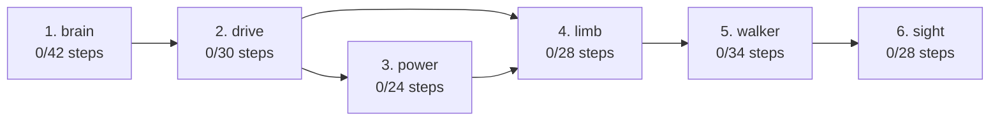

# Apex Engineering Roadmap (Couch-to-Silicon)

Generated from [`roadmap.yaml`](./roadmap.yaml). Tracks **6 integrated systems** and **186 atomic steps** (**154 couch** `83%` / **32 bench**) building one cohesive `~2.5 kg Desktop Research Class (~35 cm body length, < 22V SELV, < 2.5 N·m backdrivable joints)`.

---

## Overall Progress

- **Total Completion**: `░░░░░░░░░░░░░░░░` **0 / 186 steps** (`0.0%`)
- **Couch Steps**: **0 / 154** · **Bench Sessions**: **0 / 32**
- **Active Step**: **`brain-01`** (🛋️ Couch, ⬜ Pending) — RTL/FPGA User-Space Toolchain & Golden RV32IM+Zicsr+MAC Reference Oracle

| # | System | Role | Progress | Couch / Bench | Est. Timeline | Workspace |
| :---: | :--- | :--- | :--- | :---: | :---: | :--- |
| **1** | [`brain`](#brain-custom-risc-vmac-soc-6-layer-spine-pcb-compiler--real-time-os) — Custom RISC-V+MAC SoC, 6-Layer Spine PCB, Compiler & Real-Time OS | Real-time cerebellum & 12-motor CAN-FD spinal cord (standalone FPGA computer first) | `░░░░░░░░░░` 0/42 (`0%`) | 36 / 6 | 10–12 weeks (8–12 hr/wk) | [./systems/brain/](./systems/brain/) |
| **2** | [`drive`](#drive-24v-brushless-foc-servo-pcb--quasi-direct-drive-actuator) — 24V Brushless FOC Servo PCB & Quasi-Direct-Drive Actuator | Single torque-controlled joint (< 2.5 N·m backdrivable; 12x used in final robot) | `░░░░░░░░░░` 0/30 (`0%`) | 24 / 6 | 7–8 weeks | [./systems/drive/](./systems/drive/) |
| **3** | [`power`](#power-24v-smart-power-distribution-pre-charge--solid-state-e-stop) — 24V Smart Power Distribution, Pre-Charge & Solid-State E-Stop | Vascular & hardware-safety spine protecting brain, sight, and 12x drives | `░░░░░░░░░░` 0/24 (`0%`) | 19 / 5 | 5–6 weeks | [./systems/power/](./systems/power/) |
| **4** | [`limb`](#limb-3-dof-torque-controlled-leg--vertical-jumping-hopper) — 3-DOF Torque-Controlled Leg & Vertical Jumping Hopper | Masters 3D leg dynamics & compliance on a tabletop rail; becomes Leg #1 of 4 | `░░░░░░░░░░` 0/28 (`0%`) | 23 / 5 | 6–7 weeks | [./systems/limb/](./systems/limb/) |
| **5** | [`walker`](#walker-12-dof-dynamic-quadruped-with-convex-mpc--sim-to-real-rl) — 12-DOF Dynamic Quadruped with Convex MPC & Sim-to-Real RL | Integrates brain + power + 4x limb into an untethered walking robot | `░░░░░░░░░░` 0/34 (`0%`) | 28 / 6 | 8–10 weeks | [./systems/walker/](./systems/walker/) |
| **6** | [`sight`](#sight-hardware-synced-stereo-inertial-slam--navigation-head) — Hardware-Synced Stereo-Inertial SLAM & Navigation Head | High-level visual cortex commanding autonomous obstacle-avoiding navigation | `░░░░░░░░░░` 0/28 (`0%`) | 24 / 4 | 6–8 weeks | [./systems/sight/](./systems/sight/) |

---

## System Dependency Graph

---

## Home Safety & Phased Procurement

- **Touch-Safe Voltage (< 22V DC)**: Powered by a 6S LiFePO4 battery pack (19.2V nominal, 21.9V max), well below the 60V DC Safe Extra-Low Voltage shock limit.
- **Non-Volatile Chemistry & PSU-First Bring-Up**: LiFePO4 cells resist cobalt thermal runaway, and 95% of indoor bring-up runs off a current-limited bench power supply before any battery is connected.
- **Finger-Safe Backdrivable Mechanics (< 2.5 N·m)**: Desktop ~2.5 kg scale allows hand-backdrivable joints, quiet operation on carpet, and testing inside a compact tabletop 2020 aluminum gantry (no ceiling or doorway drilling).
- **Zero-Fume Turnkey Fabrication**: JLCPCB turnkey SMT board assembly and industrial MJF Nylon (PA12) + CNC aluminum eliminate indoor solder-paste reflow and high-temp polymer fumes.

| Stage | Est. Cost | What You Order |
| :--- | :---: | :--- |
| **System 1: brain (Months 1–3)** | **$290** | Tang Primer 20K Dock + SOM ($45), 8-ch USB logic analyzer ($15), 2x turnkey 6-layer Spine PCBs ($115), LiteVNA 64 + SOL cal kit ($115) |
| **Core Bench Instruments (Month 4, 1x if needed)** | **$310–$540** | 4-ch 70–100 MHz oscilloscope ($160–$390), 30V/10A current-limited bench PSU ($55), Pinecil USB-C iron + multimeter + JST/Molex crimpers ($95) |
| **System 2: drive (Months 4–5)** | **$130** | 1x 3508/4006 pancake BLDC motor, AS5047P encoder, thin-section bearings, MJF/CNC housing, 2x turnkey 4-layer FOC PCBs |
| **System 3: power (Month 6)** | **$150** | 2x turnkey 4-layer Power/E-Fuse PCBs, physical mushroom E-stop, 6S LiFePO4 pack + charger + fire-safe storage bag |
| **System 4: limb (Months 7–8)** | **$185** | 2x motors + housings + CF leg tubes + belts/pulleys + tabletop 2020 linear-rail test stand |
| **System 5: walker (Months 9–10)** | **$520** | 9x motors ($200), 10x batch FOC PCBs ($140), CF tubes/bearings/CNC torso + tabletop 2020 bungee gantry ($180) |
| **System 6: sight (Months 11–12)** | **$220** | Dual OV9281 global-shutter stereo cameras + companion SBC/NPU head + MJF enclosure |

---

## System-by-System Execution Plan

### 1. `brain` — Custom RISC-V+MAC SoC, 6-Layer Spine PCB, Compiler & Real-Time OS

- **Role**: Real-time cerebellum & 12-motor CAN-FD spinal cord (standalone FPGA computer first)
- **Workspace**: [`./systems/brain/`](./systems/brain/)
- **Builds On**: None (Start Here)
- **Graduation Demo**: Boot from QSPI Flash into 32 MB SDRAM on your custom 6-layer Spine PCB running your scratch SysC-compiled RTOS: interactive ash shell, < 2 µs-jitter 1 kHz IMU attitude/PID loop, and < 0.6 ms quantized quadruped walking MLP inference via custom mac instruction.
- **Progress**: `░░░░░░░░░░░░` **0 / 42** (`36` couch / `6` bench)

| Phase | Steps Done | Couch / Bench | Progress |
| :--- | :---: | :---: | :--- |
| **Phase 1: Simulation Harness, Golden Oracle & Digital Building Blocks** | 0 / 5 | 4 / 1 | `░░░░░░░░░░` `0%` |
| **Phase 2: Single-Cycle RV32IM + Custom Neural MAC & Privileged Traps** | 0 / 6 | 6 / 0 | `░░░░░░░░░░` `0%` |
| **Phase 3: 5-Stage Pipelined Processor & FPGA Timing Closure** | 0 / 5 | 5 / 0 | `░░░░░░░░░░` `0%` |
| **Phase 4: Future-Proofed 6-Layer Spine PCB & Fab Launch** | 0 / 7 | 6 / 1 | `░░░░░░░░░░` `0%` |
| **Phase 5: Memory Controllers, Robot Spine I/O & Full SoC** | 0 / 6 | 5 / 1 | `░░░░░░░░░░` `0%` |
| **Phase 6: Scratch SysC Compiler, Assembler & Linker** | 0 / 6 | 6 / 0 | `░░░░░░░░░░` `0%` |
| **Phase 7: Preemptive Real-Time OS & Neural Cerebellum Workload** | 0 / 4 | 4 / 0 | `░░░░░░░░░░` `0%` |
| **Phase 8: Custom 6-Layer Spine PCB Bring-Up, TDR Metrology & Graduation** | 0 / 3 | 0 / 3 | `░░░░░░░░░░` `0%` |

<strong>View All 42 Steps for <code>brain</code></strong>

#### Phase 1: Simulation Harness, Golden Oracle & Digital Building Blocks

- [ ] **`brain-01`** — **RTL/FPGA User-Space Toolchain & Golden RV32IM+Zicsr+MAC Reference Oracle** *(🛋️ Couch · ⬜ Pending)*
  - **Deliverables**: `systems/brain/scripts/setup_tools.sh (installs Verilator, Yosys, nextpnr-himbaechel, Icarus, pytest/cocotb in .tools/)`; `systems/brain/sim/rv32_oracle.py (cycle-accurate reference emulator for RV32IM, Machine-Mode CSRs, CLINT timer, UART & custom mac opcode)`; `systems/brain/tb/test_oracle.py (unit tests covering arithmetic, branches, loads/stores, traps & custom mac)`
  - **Verify**: `uv run --with pytest pytest systems/brain/tb/test_oracle.py && which verilator yosys nextpnr-himbaechel`
  - **First Principles**: Instruction bit-field encoding, architectural state (PC + 32 GPRs + CSRs), two's complement arithmetic & differential verification *(Harris & Harris (RISC-V Ed.), Ch. 6)*
- [ ] **`brain-02`** — **32-Bit Combinational ALU & Single-Cycle Barrel Shifter** *(🛋️ Couch · ⬜ Pending)*
  - **Deliverables**: `systems/brain/rtl/core/alu.sv`; `systems/brain/tb/test_alu.py (Cocotb + Verilator exhaustive edge-case & randomized property testbench)`
  - **Verify**: `make -C systems/brain/tb MODULE=test_alu`
  - **First Principles**: Ripple-carry vs. carry-lookahead addition, arithmetic vs. logical right shifts, signed (SLT) vs. unsigned (SLTU) flags, and combinational always_comb synthesis rules *(Harris & Harris (RISC-V Ed.), Ch. 1–2 & 5)*
- [ ] **`brain-03`** — **32x32 Register File & Immediate Sign-Extender** *(🛋️ Couch · ⬜ Pending)*
  - **Deliverables**: `systems/brain/rtl/core/regfile.sv (dual combinational/sync read, synchronous write, x0 hardwired zero)`; `systems/brain/rtl/core/imm_gen.sv (I, S, B, U, J RISC-V immediate bit-shuffling)`; `systems/brain/tb/test_regfile_imm.py`
  - **Verify**: `make -C systems/brain/tb MODULE=test_regfile_imm`
  - **First Principles**: Edge-triggered flip-flops, non-blocking (<=) sequential semantics, setup/hold timing equation (T_clk >= t_pcq + t_pd + t_setup), and LUTRAM vs. register inference *(Harris & Harris (RISC-V Ed.), Ch. 3–4)*
- [ ] **`brain-04`** — **Clock-Domain Synchronizer, Reset Conditioner & 16x-Oversampled UART** *(🛋️ Couch · ⬜ Pending)*
  - **Deliverables**: `systems/brain/rtl/periph/cdc_sync.sv (2-FF metastability synchronizer + reset bridge)`; `systems/brain/rtl/periph/uart.sv (115200/2M baud TX/RX with 16x oversampling & small FIFO)`; `systems/brain/rtl/uart_echo_top.sv (standalone bitstream wrapper for Tang Primer 20K)`; `systems/brain/tb/test_uart.py`
  - **Verify**: `make -C systems/brain/tb MODULE=test_uart && yosys -p "synth_gowin -top uart_echo_top" systems/brain/rtl/uart_echo_top.sv systems/brain/rtl/periph/*.sv`
  - **First Principles**: Metastability Mean Time Between Failures (MTBF), asynchronous serial start/stop framing, and 16x center-bit clock drift tolerance *(Harris & Harris (RISC-V Ed.), Ch. 3.5 (Timing & Metastability))*
- [ ] **`brain-05`** — **Bench 1: Order Tang Primer 20K + Logic Analyzer & Flash UART Echo** *(🔧 Bench · ⬜ Pending)*
  - **Deliverables**: `Procure Sipeed Tang Primer 20K Dock + Core SOM ($45) and 8-ch USB logic analyzer ($15)`; `Flash uart_echo_top bitstream onto Tang Primer 20K and capture live serial frames in PulseView`
  - **Verify**: `Serial terminal echoes typed characters cleanly at 115200 baud and logic analyzer decodes valid 8N1 UART timing`
  - **First Principles**: Connecting virtual RTL timing waveforms to physical 3.3V logic voltages and baud clock accuracy *(systems/brain/pcb/BOM.md (Order 1))*

#### Phase 2: Single-Cycle RV32IM + Custom Neural MAC & Privileged Traps

- [ ] **`brain-06`** — **Instruction Decoder & Branch Condition Comparator** *(🛋️ Couch · ⬜ Pending)*
  - **Deliverables**: `systems/brain/rtl/core/decoder.sv (decodes RV32IM, Zicsr, and custom-0 mac into typed control bundle)`; `systems/brain/rtl/core/branch_unit.sv (beq/bne/blt/bge/bltu/bgeu)`; `systems/brain/tb/test_decoder.py`
  - **Verify**: `make -C systems/brain/tb MODULE=test_decoder`
  - **First Principles**: Control-path truth tables, illegal-instruction trap detection, and PC+4 vs. branch/JAL/JALR target muxing *(Harris & Harris (RISC-V Ed.), Ch. 7.2)*
- [ ] **`brain-07`** — **Byte/Halfword/Word Load-Store Aligner & Synchronous BRAM** *(🛋️ Couch · ⬜ Pending)*
  - **Deliverables**: `systems/brain/rtl/core/lsu.sv (lb/lbu/lh/lhu/lw/sb/sh/sw lane shifting & byte-enable strobes)`; `systems/brain/rtl/mem/bram_32k.sv (FPGA block-RAM inference)`; `systems/brain/tb/test_lsu.py`
  - **Verify**: `make -C systems/brain/tb MODULE=test_lsu`
  - **First Principles**: Little-endian byte addressing, 4-bit write-enable masks, sign- vs. zero-extension on loads, and misaligned-access detection *(Harris & Harris (RISC-V Ed.), Ch. 6.2 & 7.3)*
- [ ] **`brain-08`** — **Single-Cycle RV32I Core & 10k-Instruction Lockstep Differential Test** *(🛋️ Couch · ⬜ Pending)*
  - **Deliverables**: `systems/brain/rtl/core/cpu_single_cycle.sv`; `systems/brain/tb/test_single_cycle.py (runs 10,000 random & directed RV32I instructions lockstep against rv32_oracle.py)`
  - **Verify**: `make -C systems/brain/tb MODULE=test_single_cycle`
  - **First Principles**: Single-cycle datapath composition and understanding why memory-read -> ALU -> regfile limits clock frequency *(Harris & Harris (RISC-V Ed.), Ch. 7.3)*
- [ ] **`brain-09`** — **Sequential Hardware Multiplier & Divider (RV32M)** *(🛋️ Couch · ⬜ Pending)*
  - **Deliverables**: `systems/brain/rtl/core/muldiv.sv (32-cycle radix-2 mul/mulh/mulhsu/mulhu/div/divu/rem/remu with valid/ready handshake)`; `systems/brain/tb/test_muldiv.py (corner cases: INT_MIN / -1, div-by-zero per RISC-V spec, signed/unsigned cross-products)`
  - **Verify**: `make -C systems/brain/tb MODULE=test_muldiv`
  - **First Principles**: Shift-and-add multiplication vs. restoring binary division, and multi-cycle busy/ready backpressure *(Harris & Harris (RISC-V Ed.), Ch. 5.2)*
- [ ] **`brain-10`** — **Custom Neural Fixed-Point Dot-Product Unit (Xapex mac Instruction)** *(🛋️ Couch · ⬜ Pending)*
  - **Deliverables**: `systems/brain/rtl/core/mac_unit.sv (packed dual-int16 SIMD multiply-accumulate into 32-bit/64-bit accumulator using Gowin DSP blocks)`; `systems/brain/tb/test_mac_unit.py (verifies quantized MLP layer dot-products vs. NumPy int16 reference)`
  - **Verify**: `make -C systems/brain/tb MODULE=test_mac_unit`
  - **First Principles**: Hardware-software co-design: why a single SIMD MAC instruction cuts neural quadruped inference from ~25 ms to < 0.6 ms *(Harris & Harris (RISC-V Ed.), Ch. 5.5 (DSP Blocks))*
- [ ] **`brain-11`** — **Machine-Mode Privileged CSRs & 64-Bit CLINT Timer** *(🛋️ Couch · ⬜ Pending)*
  - **Deliverables**: `systems/brain/rtl/core/csr_file.sv (mstatus, mie, mip, mtvec, mepc, mcause, mtval, mscratch, mcycle, minstret)`; `systems/brain/rtl/periph/clint.sv (64-bit mtime & mtimecmp memory-mapped timer interrupt)`; `systems/brain/tb/test_csr_clint.py`
  - **Verify**: `make -C systems/brain/tb MODULE=test_csr_clint`
  - **First Principles**: Atomic CSR read-modify-write semantics, interrupt vectoring (mtvec), mret privilege restoration, and hardware IPC counters *(RISC-V Privileged Spec Vol. II, Ch. 3 (Machine-Level ISA))*

#### Phase 3: 5-Stage Pipelined Processor & FPGA Timing Closure

- [ ] **`brain-12`** — **5-Stage Pipeline Registers (IF/ID, ID/EX, EX/MEM, MEM/WB)** *(🛋️ Couch · ⬜ Pending)*
  - **Deliverables**: `systems/brain/rtl/core/cpu_pipelined.sv (base 5-stage datapath skeleton with per-stage stall/flush ports)`; `systems/brain/tb/test_pipeline_nop.py (verifies instruction flow with NOP spacing)`
  - **Verify**: `make -C systems/brain/tb MODULE=test_pipeline_nop`
  - **First Principles**: Pipelining throughput vs. latency, balancing combinational delay across 5 clock stages, and synchronous bubble insertion *(Harris & Harris (RISC-V Ed.), Ch. 7.5)*
- [ ] **`brain-13`** — **Data Forwarding Network (EX/MEM & MEM/WB Bypass Muxes)** *(🛋️ Couch · ⬜ Pending)*
  - **Deliverables**: `systems/brain/rtl/core/forwarding_unit.sv`; `Wire bypass muxes into systems/brain/rtl/core/cpu_pipelined.sv`; `systems/brain/tb/test_forwarding.py (back-to-back ALU-to-ALU, ALU-to-store & double-hazard priority tests)`
  - **Verify**: `make -C systems/brain/tb MODULE=test_forwarding`
  - **First Principles**: Read-After-Write (RAW) data hazards and why EX/MEM must take priority over MEM/WB when both write the same register *(Harris & Harris (RISC-V Ed.), Ch. 7.5.3)*
- [ ] **`brain-14`** — **Hazard Controller (Load-Use Stall, Multi-Cycle Busy & Trap/Branch Flush)** *(🛋️ Couch · ⬜ Pending)*
  - **Deliverables**: `systems/brain/rtl/core/hazard_unit.sv`; `Integrate load-use, muldiv/bus stall, branch flush, and precise CSR interrupt/trap flush in cpu_pipelined.sv`; `systems/brain/tb/test_hazards.py`
  - **Verify**: `make -C systems/brain/tb MODULE=test_hazards`
  - **First Principles**: Why a load-use dependency requires a 1-cycle bubble even with forwarding, and how precise exceptions flush younger instructions cleanly *(Harris & Harris (RISC-V Ed.), Ch. 7.5.3–7.5.4)*
- [ ] **`brain-15`** — **100k-Instruction Randomized Hazard & Async Interrupt Torture Test** *(🛋️ Couch · ⬜ Pending)*
  - **Deliverables**: `systems/brain/tb/test_cpu_torture.py (100k randomized RV32IM+MAC instructions + async CLINT interrupts + bus wait states vs. rv32_oracle.py)`
  - **Verify**: `make -C systems/brain/tb MODULE=test_cpu_torture`
  - **First Principles**: Retire-commit lockstep differential verification, measuring effective CPI = 1 + stalls/instruction, and catching subtle trap-vs-branch races *(Harris & Harris (RISC-V Ed.), Ch. 7.5)*
- [ ] **`brain-16`** — **FPGA Synthesis, Resource Utilization & Static Timing Closure (GW2A-18)** *(🛋️ Couch · ⬜ Pending)*
  - **Deliverables**: `systems/brain/scripts/synth_core.sh (Yosys + nextpnr-himbaechel timing-driven P&R for Tang Primer 20K)`; `Critical-path optimization pass in RTL if f_max < 50 MHz`
  - **Verify**: `bash systems/brain/scripts/synth_core.sh (achieves f_max >= 50 MHz with positive timing slack and <= 65% LUT4 utilization)`
  - **First Principles**: LUT4/DFF mapping, routing delay vs. logic delay, static timing slack reports, and CMOS dynamic switching power P = alpha * C * V^2 * f *(Harris & Harris (RISC-V Ed.), Ch. 5.6)*

#### Phase 4: Future-Proofed 6-Layer Spine PCB & Fab Launch

- [ ] **`brain-17`** — **Spine Carrier Pinout Freeze & Buck Power-Tree Design** *(🛋️ Couch · ⬜ Pending)*
  - **Deliverables**: `systems/brain/pcb/pinout_gw2a.csv (locked SODIMM-204 pin assignments for SDRAM, QSPI, Dual CAN-FD, SPI IMU, Sync, UART, Logic Header)`; `systems/brain/pcb/power_budget.py (computes TPS563201 inductor ripple, output cap ESR/capacitance, USB-C CC resistors & 5V/3.3V thermal dissipation)`
  - **Verify**: `python3 systems/brain/pcb/power_budget.py --verify`
  - **First Principles**: Inductor volt-second balance (V = L dI/dt), capacitor ripple (I = C dV/dt), synchronous buck efficiency, and USB-C 5.1k pull-down negotiation *(Erickson & Maksimovic, Ch. 2; Alexander & Sadiku, Ch. 6–7)*
- [ ] **`brain-18`** — **6-Layer JLC06161H-3313 Stackup & Signal-Integrity / PDN Solver** *(🛋️ Couch · ⬜ Pending)*
  - **Deliverables**: `systems/brain/pcb/calc_si_pdn.py (computes 50-ohm microstrip/stripline trace widths, critical rise-time length, reflection coeff Gamma, and decoupling target impedance)`
  - **Verify**: `python3 systems/brain/pcb/calc_si_pdn.py --verify`
  - **First Principles**: Transmission line impedance Z0 = sqrt(L'/C'), critical length l_crit = t_r / (2*t_pd), reflection Gamma = (ZL - Z0)/(ZL + Z0), and via loop inductance *(Clayton Paul, Introduction to Electromagnetic Compatibility, Ch. 4–5)*
- [ ] **`brain-19`** — **Programmatic KiCad Schematic 1: Power Rails, Decoupling & SOM Socket** *(🛋️ Couch · ⬜ Pending)*
  - **Deliverables**: `systems/brain/pcb/gen_sch_power_som.py (generates USB-C + 5V spine ORing, TPS563201 3.3V buck, decoupling caps & SODIMM-204 SOM schematic sheets + SVG preview)`
  - **Verify**: `python3 systems/brain/pcb/gen_sch_power_som.py && kicad-cli sch erc --exit-code-violations systems/brain/pcb/brain_carrier.kicad_sch`
  - **First Principles**: Return-current paths for high-speed digital ICs, multi-decade MLCC decoupling, and Kelvin-sensed buck feedback layout *(Clayton Paul, Ch. 6 & 9; Dalmaris, KiCad Like a Pro)*
- [ ] **`brain-20`** — **Programmatic KiCad Schematic 2: SDRAM, QSPI, Dual CAN-FD, IMU & TDR Coupons** *(🛋️ Couch · ⬜ Pending)*
  - **Deliverables**: `systems/brain/pcb/gen_sch_periph.py (adds W9825G6KH SDRAM, W25Q128 QSPI, Dual TCAN1044V CAN-FD w/ 120-ohm termination, ICM-42688-P IMU, camera sync buffer, USB-UART & dual SMA TDR coupons)`
  - **Verify**: `python3 systems/brain/pcb/gen_sch_periph.py && kicad-cli sch erc --exit-code-violations systems/brain/pcb/brain_carrier.kicad_sch`
  - **First Principles**: Source-series damping resistors, differential CAN termination, SPI signal loading, and how a deliberate ground-slot test coupon visualizes return-path inductance *(Clayton Paul, Ch. 5 & 11)*
- [ ] **`brain-21`** — **6-Layer Controlled-Impedance PCB Layout, Length Matching & Layer SVGs** *(🛋️ Couch · ⬜ Pending)*
  - **Deliverables**: `systems/brain/pcb/gen_layout.py (places components, enforces unbroken L2/L6 GND planes, routes length-matched 50-ohm SDRAM/QSPI, 120-ohm CAN pairs & dual SMA TDR coupons, exports per-layer SVGs)`
  - **Verify**: `python3 systems/brain/pcb/gen_layout.py --verify-lengths`
  - **First Principles**: Stackup symmetry (Sig/GND/Sig/Sig/PWR/GND), crosstalk 3W spacing rules, clock-to-DQ skew budgets, and stitching vias near layer transitions *(Clayton Paul, Ch. 9 & 11)*
- [ ] **`brain-22`** — **Automated KiCad DRC, JLCPCB PCBA Exports & 35-Point Pre-Fab Audit** *(🛋️ Couch · ⬜ Pending)*
  - **Deliverables**: `systems/brain/pcb/REVIEW_CHECKLIST.md (completed 35-point schematic/layout audit)`; `systems/brain/pcb/export_fab.sh (runs KiCad DRC, generates Gerbers, drill files, JLC BOM & CPL pick-and-place CSV)`
  - **Verify**: `kicad-cli pcb drc --exit-code-violations systems/brain/pcb/brain_carrier.kicad_pcb && bash systems/brain/pcb/export_fab.sh`
  - **First Principles**: Design-for-Manufacturing (DFM) clearances, solder-mask dams, thermal reliefs, and turnkey PCBA rotation/polarity verification *(Dalmaris, KiCad Like a Pro, Part 7–8)*
- [ ] **`brain-23`** — **Bench 2 (Fab Trigger): Order 6-Layer JLCPCB Spine PCBA & LiteVNA 64** *(🔧 Bench · ⬜ Pending)*
  - **Deliverables**: `Upload fab zip + BOM + CPL to JLCPCB selecting JLC06161H-3313 6-layer controlled-impedance stackup`; `Order LiteVNA 64 + SMA Open/Short/Load calibration kit (fabricates/ships while Phases 5–7 run on the couch)`
  - **Verify**: `JLCPCB DFM preview passes with verified component polarities and controlled-impedance confirmation`
  - **First Principles**: Supply-chain critical-path pipelining and real-world fab engineering tolerances *(systems/brain/pcb/BOM.md (Order 2))*

#### Phase 5: Memory Controllers, Robot Spine I/O & Full SoC

- [ ] **`brain-24`** — **Memory-Mapped SoC Crossbar & Bus Arbitrator** *(🛋️ Couch · ⬜ Pending)*
  - **Deliverables**: `systems/brain/rtl/soc/soc_bus.sv (valid/ready wait-state bus routing Boot ROM, BRAM, SDRAM, QSPI, CLINT, UART, SPI-IMU, Dual CAN-FD, Sync & GPIO)`; `systems/brain/tb/test_soc_bus.py`
  - **Verify**: `make -C systems/brain/tb MODULE=test_soc_bus`
  - **First Principles**: Address-map decoding, split-cycle wait states for slow external peripherals, and bus deadlock prevention *(Harris & Harris (RISC-V Ed.), Ch. 8.5)*
- [ ] **`brain-25`** — **QSPI NOR Flash Controller & Behavioral Flash Model** *(🛋️ Couch · ⬜ Pending)*
  - **Deliverables**: `systems/brain/rtl/mem/qspi_ctrl.sv (memory-mapped Quad-SPI read/XIP & command engine)`; `systems/brain/tb/models/w25q128_model.sv & systems/brain/tb/test_qspi.py`
  - **Verify**: `make -C systems/brain/tb MODULE=test_qspi`
  - **First Principles**: Quad-I/O bidirectional tristate turnaround cycles, SPI Mode 0/3 clock phase, and Flash-to-RAM copy bootloading *(W25Q128JV Datasheet Timing Diagrams)*
- [ ] **`brain-26`** — **16-Bit SDR SDRAM Controller & Behavioral SDRAM Model** *(🛋️ Couch · ⬜ Pending)*
  - **Deliverables**: `systems/brain/rtl/mem/sdram_ctrl.sv (100 us init, auto-precharge, row-hit/miss bank state machine, 32-bit 2-beat bursts & 64 ms refresh scheduler)`; `systems/brain/tb/models/sdr_sdram_model.sv & systems/brain/tb/test_sdram.py`
  - **Verify**: `make -C systems/brain/tb MODULE=test_sdram`
  - **First Principles**: Why DRAM cells leak charge and require 8192 refreshes per 64 ms, row activation (t_RCD), CAS latency, and precharge (t_RP) timing *(W9825G6KH-6 Datasheet State Diagram & Timing Spec)*
- [ ] **`brain-27`** — **Robot Spine Peripherals: SPI IMU Master, Sub-us Sync Trigger & CAN-FD Engine** *(🛋️ Couch · ⬜ Pending)*
  - **Deliverables**: `systems/brain/rtl/periph/spi_master.sv (for 1 kHz ICM-42688-P bursts)`; `systems/brain/rtl/periph/sync_trigger.sv (sub-microsecond camera exposure pulse + mtime latching)`; `systems/brain/rtl/periph/can_ctrl.sv (lightweight CAN/CAN-FD TX/RX frame engine with bit-stuffing & CRC-15/17)`; `systems/brain/tb/test_spine_periphs.py`
  - **Verify**: `make -C systems/brain/tb MODULE=test_spine_periphs`
  - **First Principles**: Cyclic redundancy checks (polynomial division over GF(2)), NRZ bit-stuffing & resynchronization, and deterministic sensor timestamping *(Bosch CAN-FD Specification & ICM-42688-P SPI Timing)*
- [ ] **`brain-28`** — **Full SoC Top Integration, PLL Clocking & QSPI-to-SDRAM Boot Simulation** *(🛋️ Couch · ⬜ Pending)*
  - **Deliverables**: `systems/brain/rtl/soc_top.sv (connects pipelined RV32IM+MAC core, PLL phase-shifted SDRAM clock, Boot ROM & all peripherals)`; `systems/brain/tb/test_soc_boot.py (simulates power-on reset -> Boot ROM -> QSPI read -> SDRAM execute -> UART print)`
  - **Verify**: `make -C systems/brain/tb MODULE=test_soc_boot && bash systems/brain/scripts/synth_soc.sh`
  - **First Principles**: Phase-shifted SDRAM clock generation to center data valid windows inside FPGA input setup/hold limits *(Harris & Harris (RISC-V Ed.), Ch. 8)*
- [ ] **`brain-29`** — **Bench 3: Synthesize & Boot Full SoC (BRAM Mode) on Tang Primer 20K Dock** *(🔧 Bench · ⬜ Pending)*
  - **Deliverables**: `Flash soc_top bitstream (BRAM boot mode) to Tang Primer 20K Dock`; `Verify UART banner, CLINT timer tick & hardware mcycle/minstret IPC readout`
  - **Verify**: `Dock boots over USB-UART printing live IPC counter values and passing interactive serial echo`
  - **First Principles**: Observing real FPGA clock frequency and peripheral behavior on physical hardware before custom PCB arrival *(systems/brain/README.md)*

#### Phase 6: Scratch SysC Compiler, Assembler & Linker

- [ ] **`brain-30`** — **Custom Two-Pass RV32IM+Zicsr+MAC Assembler & Memory-Map Linker** *(🛋️ Couch · ⬜ Pending)*
  - **Deliverables**: `systems/brain/toolchain/asm_link.py (supports RV32IM, CSR ops, mac instruction, %hi/%lo relocations, .text/.rodata/.data/.bss sections & flat ROM/RAM images)`; `systems/brain/tb/test_asm_link.py`
  - **Verify**: `uv run --with pytest pytest systems/brain/tb/test_asm_link.py`
  - **First Principles**: Two-pass symbol resolution, PC-relative branch/JAL encoding limits, AUIPC+ADDI %hi/%lo splitting, and LMA-to-VMA data initialization *(Cooper & Torczon, Engineering a Compiler, Ch. 11–12)*
- [ ] **`brain-31`** — **SysC Lexer, Recursive-Descent Parser & Static Type Checker** *(🛋️ Couch · ⬜ Pending)*
  - **Deliverables**: `systems/brain/toolchain/sysc_lex_parse.py (supports int/uint/char/void, pointers, arrays, structs, volatile MMIO, while/for/if, functions, __mac_i16)`; `systems/brain/tb/test_sysc_parser.py`
  - **Verify**: `uv run --with pytest pytest systems/brain/tb/test_sysc_parser.py`
  - **First Principles**: Lexical DFAs, recursive-descent + Pratt operator precedence parsing, symbol scopes, and C pointer type compatibility *(Cooper & Torczon, Ch. 2–4)*
- [ ] **`brain-32`** — **AST-to-Three-Address IR & Control-Flow Graph Lowering** *(🛋️ Couch · ⬜ Pending)*
  - **Deliverables**: `systems/brain/toolchain/sysc_ir.py (lowers AST to 3-address SSA-lite basic blocks, pointer stride arithmetic, struct field offsets & short-circuit branches)`; `systems/brain/tb/test_sysc_ir.py`
  - **Verify**: `uv run --with pytest pytest systems/brain/tb/test_sysc_ir.py`
  - **First Principles**: Basic blocks, control-flow graphs (CFGs), pointer scaling (p + i -> addr + i*sizeof(*p)), and stack-slot vs. virtual-register lowering *(Cooper & Torczon, Ch. 5 & 7)*
- [ ] **`brain-33`** — **IR Optimization Passes (Constant Folding, Algebraic Simp & DCE)** *(🛋️ Couch · ⬜ Pending)*
  - **Deliverables**: `systems/brain/toolchain/sysc_opt.py (constant folding, strength reduction to shifts, copy propagation & dead-code elimination preserving volatile MMIO)`; `systems/brain/tb/test_sysc_opt.py`
  - **Verify**: `uv run --with pytest pytest systems/brain/tb/test_sysc_opt.py`
  - **First Principles**: Iterative data-flow fixed points and why volatile memory accesses act as optimization barriers *(Cooper & Torczon, Ch. 8–10)*
- [ ] **`brain-34`** — **Liveness Analysis, Register Allocator & RV32IM+MAC Code Generator** *(🛋️ Couch · ⬜ Pending)*
  - **Deliverables**: `systems/brain/toolchain/sysc_codegen.py (backward liveness, linear-scan/graph allocator over t0–t6/s0–s11/a0–a7, prologue/epilogue stack frames & mac emission)`; `systems/brain/tb/test_sysc_codegen.py`
  - **Verify**: `uv run --with pytest pytest systems/brain/tb/test_sysc_codegen.py`
  - **First Principles**: Live-range intervals, caller-saved vs. callee-saved ABI contracts, and spilling under register pressure *(Cooper & Torczon, Ch. 13)*
- [ ] **`brain-35`** — **End-to-End Differential Compiler Torture Suite vs. Golden Oracle & Verilator** *(🛋️ Couch · ⬜ Pending)*
  - **Deliverables**: `systems/brain/toolchain/sysc.py (unified CLI driver)`; `systems/brain/tb/test_sysc_e2e.py (compiles recursion, structs, function pointers, MMIO drivers & mac dot-products; asserts bit-identical execution on Oracle and Verilator soc_top)`
  - **Verify**: `uv run --with pytest pytest systems/brain/tb/test_sysc_e2e.py`
  - **First Principles**: Translation validation: proving custom compiler semantics match hardware RTL bit-for-bit *(Cooper & Torczon, Ch. 12–13)*

#### Phase 7: Preemptive Real-Time OS & Neural Cerebellum Workload

- [ ] **`brain-36`** — **Bare-Metal crt0 Startup, QSPI-to-SDRAM Bootloader & 31-Reg Trap Context Switcher** *(🛋️ Couch · ⬜ Pending)*
  - **Deliverables**: `systems/brain/rtos/crt0.S & systems/brain/rtos/boot_qspi.c (copies .data, zeroes .bss, loads RTOS image from QSPI to SDRAM)`; `systems/brain/rtos/trap.S (atomic 31-register + mepc save/restore via mscratch for preemptive scheduling)`; `systems/brain/tb/test_trap_switch.py`
  - **Verify**: `make -C systems/brain/tb MODULE=test_trap_switch`
  - **First Principles**: Why every caller/callee register must be preserved across asynchronous preemption and how mscratch enables re-entrant stack swapping *(xv6-riscv, Ch. 4 (Traps and System Calls))*
- [ ] **`brain-37`** — **Preemptive Priority Scheduler, Inheritance Mutexes & SPSC Ring Buffers in SysC** *(🛋️ Couch · ⬜ Pending)*
  - **Deliverables**: `systems/brain/rtos/kernel.c & rtos.h (fixed-priority + round-robin scheduler, mtimecmp tick sleep, priority-inheritance mutexes, lock-free SPSC UART/CAN ring buffers)`; `systems/brain/tb/test_rtos_scheduler.py`
  - **Verify**: `make -C systems/brain/tb MODULE=test_rtos_scheduler`
  - **First Principles**: Priority inversion and why priority inheritance restores bounded real-time latency, plus single-producer/single-consumer ring buffer ordering *(Valvano, Real-Time Operating Systems, Ch. 4 & 8; xv6 Ch. 6–7)*
- [ ] **`brain-38`** — **Interactive ash Shell & 1 kHz Fixed-Point IMU Attitude / PID Loop** *(🛋️ Couch · ⬜ Pending)*
  - **Deliverables**: `systems/brain/apps/ash_shell.c (commands: ps, jitter, ipc, memtest, imu, can, peek, poke)`; `systems/brain/apps/task_imu_pid.c (1 kHz Q16.16 Mahony/complementary attitude filter + PID loop + mcycle jitter histogram)`; `systems/brain/tb/test_rtos_imu_pid.py`
  - **Verify**: `make -C systems/brain/tb MODULE=test_rtos_imu_pid`
  - **First Principles**: Fixed-point Q16.16 scaling, fusing fast-drifting gyroscope rates with noisy gravity vectors, and profiling interrupt latency histograms *(Lyons, Understanding Digital Signal Processing, Ch. 12)*
- [ ] **`brain-39`** — **Quantized Neural Walking MLP (mac Accelerated) & Full Verilator Soak Test** *(🛋️ Couch · ⬜ Pending)*
  - **Deliverables**: `systems/brain/apps/task_neural_mlp.c (48 -> 128 -> 128 -> 12 INT16/ReLU MLP compiled with SysC __mac_i16)`; `systems/brain/tb/test_brain_graduation_sim.py (full Verilator soak test running all 3 concurrent tasks from QSPI->SDRAM, proving < 0.6 ms MLP runtime & < 2 µs 1 kHz jitter)`
  - **Verify**: `make -C systems/brain/tb MODULE=test_brain_graduation_sim`
  - **First Principles**: INT16 activation/weight quantization without accuracy collapse, and verifying hard real-time preemption under sustained memory bus traffic *(systems/brain/README.md)*

#### Phase 8: Custom 6-Layer Spine PCB Bring-Up, TDR Metrology & Graduation

- [ ] **`brain-40`** — **Bench 4: Current-Limited Smoke Test, Power Ripple & Peripheral Loopback** *(🔧 Bench · ⬜ Pending)*
  - **Deliverables**: `Power arrived 6-layer Spine PCB via current-limited 5V/1A bench supply before seating SOM`; `Measure 3.3V buck startup & ripple; verify ICM-42688-P WHO_AM_I & CAN-FD bus loopback`
  - **Verify**: `Idle rail currents within budget, 3.3V ripple < 30 mVpp, IMU WHO_AM_I = 0x47, CAN-FD loopback clean`
  - **First Principles**: Safe disciplined hardware bring-up: power rails first, clocks second, digital I/O third *(systems/brain/pcb/REVIEW_CHECKLIST.md)*
- [ ] **`brain-41`** — **Bench 5: LiteVNA 64 Calibration & TDR Impedance Sweep on SMA Coupons** *(🔧 Bench · ⬜ Pending)*
  - **Deliverables**: `Run SMA Open/Short/Load calibration on LiteVNA 64 and capture IFFT Time-Domain Reflectometry plots`; `Compare clean 50-ohm SMA microstrip coupon against intentional ground-slot coupon and compare to brain-18 predictions`
  - **Verify**: `Clean trace measures 50 +/- 5 Ohm along its span; ground-slot coupon clearly displays inductive impedance spike at the slot coordinate`
  - **First Principles**: Connecting Maxwell/transmission-line impedance theory directly to physical copper trace geometry in time-domain reflectometry *(Clayton Paul, Ch. 4–5)*
- [ ] **`brain-42`** — **Bench 6 (brain Graduation): Boot SysC RTOS from QSPI/SDRAM & Capture < 2 µs Jitter** *(🔧 Bench · ⬜ Pending)*
  - **Deliverables**: `Seat Tang Primer 20K SOM on 6-layer Spine PCB, flash QSPI NOR with SysC-compiled RTOS image, and run memtest + ash shell`; `Tilt board to watch live 1 kHz IMU attitude + 50 Hz neural MLP output frames on CAN-FD and capture < 2 µs task jitter on logic analyzer`
  - **Verify**: `32 MB SDRAM memtest passes 100%, ash shell reports < 0.6 ms MLP inference, and logic analyzer confirms < 2 µs 1 kHz control loop jitter`
  - **First Principles**: Full-stack convergence: custom RTL + custom 6-layer PCB + custom compiler + custom RTOS operating together as a deterministic physical machine *(VISION.md)*

### 2. `drive` — 24V Brushless FOC Servo PCB & Quasi-Direct-Drive Actuator

- **Role**: Single torque-controlled joint (< 2.5 N·m backdrivable; 12x used in final robot)
- **Workspace**: [`./systems/drive/`](./systems/drive/)
- **Builds On**: `brain`
- **Graduation Demo**: Virtual spring/damper haptic wheel and step-torque dynamometer test driven at 1 kHz over CAN-FD by brain.
- **Progress**: `░░░░░░░░░░░░` **0 / 30** (`24` couch / `6` bench)

| Phase | Steps Done | Couch / Bench | Progress |
| :--- | :---: | :---: | :--- |
| **Phase 1: Brushless Physics, dq0 FOC & SVPWM Simulation** | 0 / 6 | 6 / 0 | `░░░░░░░░░░` `0%` |
| **Phase 2: 4-Layer 24V 30A 3-Phase Inverter PCB & Fab Launch** | 0 / 8 | 7 / 1 | `░░░░░░░░░░` `0%` |
| **Phase 3: Bare-Metal 20 kHz FOC Firmware & CAN-FD Protocol** | 0 / 7 | 7 / 0 | `░░░░░░░░░░` `0%` |
| **Phase 4: Parametric 8:1 Gearbox CAD, Contact FEA & Fab Launch** | 0 / 5 | 4 / 1 | `░░░░░░░░░░` `0%` |
| **Phase 5: Inverter Bring-Up, Actuator Assembly & Torque Bench Verification** | 0 / 4 | 0 / 4 | `░░░░░░░░░░` `0%` |

<strong>View All 30 Steps for <code>drive</code></strong>

#### Phase 1: Brushless Physics, dq0 FOC & SVPWM Simulation

- [ ] **`drive-01`** — **Permanent-Magnet Synchronous Motor (PMSM) Physics & ODE Simulator** *(🛋️ Couch · ⬜ Pending)*
  - **Deliverables**: `systems/drive/sim/pmsm_model.py (3-phase back-EMF, phase resistance/inductance, torque constant K_t & rotor inertia simulator)`; `systems/drive/tb/test_pmsm_model.py`
  - **Verify**: `uv run --with pytest pytest systems/drive/tb/test_pmsm_model.py`
  - **First Principles**: Lorentz torque generation (tau = K_t * i_q), Faraday back-EMF, and electromechanical energy balance *(Sang-Hoon Kim, Electric Motor Control, Ch. 1–3)*
- [ ] **`drive-02`** — **Clarke & Park (abc -> alpha-beta -> dq0) Reference Frame Transforms** *(🛋️ Couch · ⬜ Pending)*
  - **Deliverables**: `systems/drive/sim/foc_transforms.py (power-invariant/amplitude-invariant Clarke & Park transforms and inverses)`; `systems/drive/tb/test_foc_transforms.py`
  - **Verify**: `uv run --with pytest pytest systems/drive/tb/test_foc_transforms.py`
  - **First Principles**: Why rotating reference frames convert sinusoidal 3-phase AC currents into DC torque (i_q) and flux (i_d) vectors controllable by simple PI loops *(Sang-Hoon Kim, Ch. 4–5)*
- [ ] **`drive-03`** — **Space-Vector PWM (SVPWM) Modulator & Dead-Time Distortion Analysis** *(🛋️ Couch · ⬜ Pending)*
  - **Deliverables**: `systems/drive/sim/svpwm.py (min-max zero-sequence injection achieving 15.5% higher bus voltage utilization + dead-time compensation)`; `systems/drive/tb/test_svpwm.py`
  - **Verify**: `uv run --with pytest pytest systems/drive/tb/test_svpwm.py`
  - **First Principles**: Inverter switching vectors on the hexagon, zero-sequence injection, and why shoot-through dead-time creates low-speed torque ripple *(Sang-Hoon Kim, Ch. 6)*
- [ ] **`drive-04`** — **20 kHz Cascaded Current (PI) & Joint Impedance (kp/kd) Loop Simulation** *(🛋️ Couch · ⬜ Pending)*
  - **Deliverables**: `systems/drive/sim/foc_sim.py (closed-loop 20 kHz i_d/i_q control + 1 kHz MIT-style tau = kp*(q_des - q) + kd*(dq_des - dq) + tau_ff)`; `systems/drive/tb/test_foc_sim.py`
  - **Verify**: `uv run --with pytest pytest systems/drive/tb/test_foc_sim.py`
  - **First Principles**: Pole-zero cancellation current tuning (K_p = omega_c * L, K_i = omega_c * R) and how virtual spring/damper impedance enables compliant impact landings *(Sang-Hoon Kim, Ch. 7–8)*
- [ ] **`drive-05`** — **Low-Side vs. Inline Phase Current Sensing & ADC Sampling Window Math** *(🛋️ Couch · ⬜ Pending)*
  - **Deliverables**: `systems/drive/sim/current_sense_budget.py (shunt power dissipation, INA240/op-amp bandwidth, ADC SNR & PWM zero-vector trigger alignment)`
  - **Verify**: `python3 systems/drive/sim/current_sense_budget.py --verify`
  - **First Principles**: Why low-side shunts only conduct when bottom FETs are ON and how center-aligned PWM triggers ADC sampling during quiet zero-vectors *(Pallàs-Areny & Webster, Sensors and Signal Conditioning, Ch. 3)*
- [ ] **`drive-06`** — **CAN-FD Actuator Protocol & Q-Format Telemetry Framing Spec** *(🛋️ Couch · ⬜ Pending)*
  - **Deliverables**: `systems/drive/firmware/can_proto.h & systems/drive/sim/test_can_proto.py (shared bit-exact packed frames between brain and drive)`
  - **Verify**: `uv run --with pytest pytest systems/drive/sim/test_can_proto.py`
  - **First Principles**: Fixed-point packing of position, velocity, kp, kd, and torque into deterministic 8/16-byte CAN-FD frames without floating-point overhead *(VISION.md (Locked Interface Contracts))*

#### Phase 2: 4-Layer 24V 30A 3-Phase Inverter PCB & Fab Launch

- [ ] **`drive-07`** — **Gate Driver Bootstrap, Switching Loss & Thermal Budget Solver** *(🛋️ Couch · ⬜ Pending)*
  - **Deliverables**: `systems/drive/pcb/inverter_calc.py (DFN5x6/3x3 MOSFET conduction + switching loss, gate charge Q_g, bootstrap cap sizing & snubber calculation)`
  - **Verify**: `python3 systems/drive/pcb/inverter_calc.py --verify`
  - **First Principles**: MOSFET R_ds(on) I^2 losses vs. gate-charge switching energy, and why high-side N-FETs need a bootstrap charge pump *(Erickson & Maksimovic, Ch. 4)*
- [ ] **`drive-08`** — **KiCad Schematic 1: 3-Phase 24V Half-Bridges, Gate Driver & Current Sense** *(🛋️ Couch · ⬜ Pending)*
  - **Deliverables**: `systems/drive/pcb/gen_sch_powerstage.py (generates power stage, bulk DC-link caps, 3x half-bridges, current sense amps + SVG preview)`
  - **Verify**: `python3 systems/drive/pcb/gen_sch_powerstage.py && kicad-cli sch erc --exit-code-violations systems/drive/pcb/drive_foc.kicad_sch`
  - **First Principles**: Minimizing high-di/dt half-bridge commutation loop area and Kelvin-connecting shunt sense traces *(Clayton Paul, Ch. 6)*
- [ ] **`drive-09`** — **KiCad Schematic 2: STM32G4 MCU, AS5047P Magnetic Encoder & TCAN1044V CAN-FD** *(🛋️ Couch · ⬜ Pending)*
  - **Deliverables**: `systems/drive/pcb/gen_sch_ctrl.py (adds STM32G431, 10V/3.3V LDO/buck, SWD, SPI magnetic encoder, NTC thermistor & CAN-FD transceiver + ERC)`
  - **Verify**: `python3 systems/drive/pcb/gen_sch_ctrl.py && kicad-cli sch erc --exit-code-violations systems/drive/pcb/drive_foc.kicad_sch`
  - **First Principles**: Analog-to-digital ground partitioning, hardware ADC overcurrent comparator trip paths, and daisy-chain CAN-FD stub limits *(STM32G431 Datasheet & Hardware Design Guide)*
- [ ] **`drive-10`** — **Compact 4-Layer Circular/Motor-Back Motor-Driver PCB Layout** *(🛋️ Couch · ⬜ Pending)*
  - **Deliverables**: `systems/drive/pcb/gen_layout.py (4-layer 2oz-outer copper motor-back form factor, separated quiet analog zone & stitched thermal vias + layer SVGs)`
  - **Verify**: `python3 systems/drive/pcb/gen_layout.py --verify`
  - **First Principles**: High-current copper plane ampacity, thermal vias into inner planes, and keeping gate-drive loops short to avoid ringing *(IPC-2152 Current-Carrying Capacity & Clayton Paul, Ch. 11)*
- [ ] **`drive-11`** — **Inverter PCB DRC, Fabrication Exports & Safety Sign-Off** *(🛋️ Couch · ⬜ Pending)*
  - **Deliverables**: `systems/drive/pcb/export_fab.sh (runs KiCad DRC and outputs JLCPCB 4-layer Gerbers, BOM & CPL)`
  - **Verify**: `kicad-cli pcb drc --exit-code-violations systems/drive/pcb/drive_foc.kicad_pcb && bash systems/drive/pcb/export_fab.sh`
  - **First Principles**: Clearance margins for 24V transient inductive spikes and stencil/solder-paste thermal pads *(systems/drive/README.md)*
- [ ] **`drive-12`** — **SPICE Half-Bridge Switching Transient & Gate-Resistor Damping Sim** *(🛋️ Couch · ⬜ Pending)*
  - **Deliverables**: `systems/drive/sim/half_bridge_spice.py (Ngspice transient check of gate resistor R_g vs. V_ds overshoot and dV/dt)`
  - **Verify**: `python3 systems/drive/sim/half_bridge_spice.py --verify`
  - **First Principles**: Parasitic trace inductance + MOSFET C_oss resonance (f = 1 / 2pi sqrt(LC)) and trading switching loss for clean EMI edges *(Erickson & Maksimovic, Ch. 4)*
- [ ] **`drive-13`** — **FOC Firmware Scaffold & Host Unit-Test Harness (C/CMake)** *(🛋️ Couch · ⬜ Pending)*
  - **Deliverables**: `systems/drive/firmware/foc_math.c & systems/drive/tb/test_foc_c.py (compiled with host gcc/pytest to verify fixed-point Q-math FOC core before flashing MCU)`
  - **Verify**: `uv run --with pytest pytest systems/drive/tb/test_foc_c.py`
  - **First Principles**: Integer CORDIC/LUT sin/cos approximation and overflow-safe Q15/Q31 fixed-point math inside a 50 µs interrupt budget *(Lyons, Ch. 13 (CORDIC))*
- [ ] **`drive-14`** — **Bench 7 (Fab Trigger): Order 2x Turnkey 4-Layer FOC PCBs + 1x Motor/Encoder** *(🔧 Bench · ⬜ Pending)*
  - **Deliverables**: `Order 2x turnkey-assembled 4-layer FOC PCBs from JLCPCB`; `Order 1x 3508/4006 BLDC motor, AS5047P diametric magnet, thin-section bearings & M3 hardware`
  - **Verify**: `JLCPCB placement check clean and motor/encoder BOM matched`
  - **First Principles**: Mechanical-electrical concentricity tolerances for magnetic encoders *(systems/drive/README.md)*

#### Phase 3: Bare-Metal 20 kHz FOC Firmware & CAN-FD Protocol

- [ ] **`drive-15`** — **STM32G4 Bare-Metal Startup, Clocks & 20 kHz Center-Aligned PWM + ADC Trigger** *(🛋️ Couch · ⬜ Pending)*
  - **Deliverables**: `systems/drive/firmware/hal_pwm_adc.c (TIM1 20 kHz center-aligned PWM + TRGO ADC1/2 injected phase-current sampling)`
  - **Verify**: `arm-none-eabi-gcc build cleanly compiles with zero warnings & timing calculation verified`
  - **First Principles**: Hardware timer synchronization: eliminating software jitter between PWM valley and ADC sample-and-hold *(STM32G4 Reference Manual (TIM1 & ADC Triggering))*
- [ ] **`drive-16`** — **High-Speed SPI AS5047P Encoder Driver & Velocity Observer** *(🛋️ Couch · ⬜ Pending)*
  - **Deliverables**: `systems/drive/firmware/encoder.c (14-bit SPI read, parity check, multi-turn unwrapping & PLL angle/velocity tracking observer)`; `systems/drive/tb/test_encoder_pll.py`
  - **Verify**: `uv run --with pytest pytest systems/drive/tb/test_encoder_pll.py`
  - **First Principles**: Why finite-difference velocity (dq/dt) amplifies encoder quantization noise at 20 kHz, and how a 2nd-order PLL observer solves it *(Franklin, Powell & Emami-Naeini, Feedback Control, Ch. 7)*
- [ ] **`drive-17`** — **Auto-Calibration Routine: Phase R/L ID, Pole-Pair Count & Encoder Offset LUT** *(🛋️ Couch · ⬜ Pending)*
  - **Deliverables**: `systems/drive/firmware/calibrate.c (step-voltage R/L measurement, open-loop d-axis sweep for encoder zero & eccentricity LUT)`; `systems/drive/tb/test_calibrate.py`
  - **Verify**: `uv run --with pytest pytest systems/drive/tb/test_calibrate.py`
  - **First Principles**: First-order RL step response (i(t) = (V/R)(1 - e^{-Rt/L})) and compensating off-axis magnet mounting harmonics *(Sang-Hoon Kim, Ch. 7)*
- [ ] **`drive-18`** — **20 kHz Hard Real-Time FOC ISR & Anticogging Compensation** *(🛋️ Couch · ⬜ Pending)*
  - **Deliverables**: `systems/drive/firmware/foc_isr.c (Clarke/Park -> PI current -> SVPWM -> hardware current/temp/watchdogs)`
  - **Verify**: `Cycle-count budget audit confirms ISR executes in < 18 µs inside 50 µs period; host sim passes`
  - **First Principles**: Why watchdog timeouts must zero motor torque immediately if CAN-FD frames from brain pause > 50 ms *(Sang-Hoon Kim, Ch. 8)*
- [ ] **`drive-19`** — **STM32G4 FDCAN Driver & 1 kHz brain Command/Telemetry Handler** *(🛋️ Couch · ⬜ Pending)*
  - **Deliverables**: `systems/drive/firmware/fdcan_node.c (5 Mbps CAN-FD filter, unpacks q_des/dq_des/kp/kd/tau_ff, replies with packed state)`; `systems/drive/tb/test_fdcan_codec.py`
  - **Verify**: `uv run --with pytest pytest systems/drive/tb/test_fdcan_codec.py`
  - **First Principles**: CAN-FD bit-rate switching (arbitration @ 1 Mbps, data payload @ 5 Mbps) and deterministic bus scheduling across 6 joints per bus *(Bosch CAN-FD Spec)*
- [ ] **`drive-20`** — **Hardware-in-the-Loop Firmware Regression & Watchdog Safety Suite** *(🛋️ Couch · ⬜ Pending)*
  - **Deliverables**: `systems/drive/tb/test_drive_safety.py (tests overcurrent trip, thermal derating, CAN loss timeout & torque clamp)`
  - **Verify**: `uv run --with pytest pytest systems/drive/tb/test_drive_safety.py`
  - **First Principles**: Defense-in-depth safety limits at the actuator edge so software bugs upstream cannot damage joints or fingers *(systems/drive/README.md)*
- [ ] **`drive-21`** — **Firmware Binary Build & SWD Flash Tooling Verification** *(🛋️ Couch · ⬜ Pending)*
  - **Deliverables**: `systems/drive/firmware/Makefile & flash.sh (compiles release .elf/.bin for STM32G431 and verifies static RAM/Flash footprint)`
  - **Verify**: `make -C systems/drive/firmware all size`
  - **First Principles**: Linker memory layout for placing time-critical 20 kHz FOC ISR and LUTs in zero-wait-state CCM-SRAM *(STM32G4 Memory Architecture)*

#### Phase 4: Parametric 8:1 Gearbox CAD, Contact FEA & Fab Launch

- [ ] **`drive-22`** — **Parametric 8:1 Planetary/Cycloidal Gearbox Geometry & Involute/Trochoid Math** *(🛋️ Couch · ⬜ Pending)*
  - **Deliverables**: `systems/drive/cad/gen_gearbox_profile.py (computes backlash-controlled involute/cycloidal tooth profiles, pin circles & bearing seats)`; `systems/drive/tb/test_gearbox_geom.py`
  - **Verify**: `uv run --with pytest pytest systems/drive/tb/test_gearbox_geom.py`
  - **First Principles**: Why ~8:1 quasi-direct-drive ratios balance high torque density with low reflected inertia (N^2 * J_rotor) and silent backdrivability *(Budynas & Nisbett, Shigley's Mechanical Engineering Design, Ch. 13)*
- [ ] **`drive-23`** — **Parametric 3D Actuator CAD (Rotor Bell Adapter, Housing & Output Flange)** *(🛋️ Couch · ⬜ Pending)*
  - **Deliverables**: `systems/drive/cad/actuator_cad.py (CadQuery/build123d parametric STEP/STL assembly integrating motor, 8:1 stage, thin-section bearings & rear FOC PCB mount)`
  - **Verify**: `python3 systems/drive/cad/actuator_cad.py --check-clearances`
  - **First Principles**: ISO clearance/transition fits for thin-section bearings and concentric magnet-to-IC air-gap tolerance *(Shigley's, Ch. 7 & 11)*
- [ ] **`drive-24`** — **Gear Tooth & Housing Structural FEA (CalculiX)** *(🛋️ Couch · ⬜ Pending)*
  - **Deliverables**: `systems/drive/cad/run_fea.sh (runs CalculiX static stress/deflection analysis under 3x peak stall torque = 7.5 N·m)`
  - **Verify**: `bash systems/drive/cad/run_fea.sh (safety factor >= 2.5 in PA12/7075-T6 and radial deflection < 0.05 mm)`
  - **First Principles**: Von Mises stress, Hertzian contact stress on gear teeth/pins, and stiffness-to-weight scaling *(Logan, First Course in Finite Element Method, Ch. 1–3)*
- [ ] **`drive-25`** — **GD&T Drawings, Tolerance Stack-Up & MJF/CNC Manufacturing Package** *(🛋️ Couch · ⬜ Pending)*
  - **Deliverables**: `systems/drive/cad/tolerance_stack.py & exported STEP/STL fab archive`
  - **Verify**: `python3 systems/drive/cad/tolerance_stack.py --verify`
  - **First Principles**: Worst-case vs. RSS statistical axial preload stack-up so thin-section bearings neither bind nor rattle *(Shigley's, Ch. 20 (GD&T))*
- [ ] **`drive-26`** — **Bench 8: Order Industrial MJF PA12 / CNC Actuator Parts** *(🔧 Bench · ⬜ Pending)*
  - **Deliverables**: `Upload actuator STEP/STL exports to JLCPCB 3D/CNC service`
  - **Verify**: `Order confirmed with zero thin-wall DFM flags`
  - **First Principles**: Design for additive (MJF Nylon PA12) vs. CNC milling without indoor resin/nylon fumes *(systems/drive/README.md)*

#### Phase 5: Inverter Bring-Up, Actuator Assembly & Torque Bench Verification

- [ ] **`drive-27`** — **Bench 9: Current-Limited Inverter Smoke Test & Gate-Drive Scope Check** *(🔧 Bench · ⬜ Pending)*
  - **Deliverables**: `Power FOC PCB from current-limited bench PSU (20V / 0.5A limit), flash STM32G4 & probe 3-phase PWM edges + dead-time on oscilloscope`
  - **Verify**: `Clean 3.3V/10V rails, crisp complementary PWM dead-time with zero shoot-through spikes`
  - **First Principles**: Observing real switching waveforms and validating your gate-resistor SPICE prediction on copper *(systems/drive/README.md)*
- [ ] **`drive-28`** — **Bench 10: Motor R/L Auto-ID, Encoder Offset Calibration & Open-Loop Spin** *(🔧 Bench · ⬜ Pending)*
  - **Deliverables**: `Mount diametric magnet, spin bare motor on bench, run auto-calibration and inspect d/q current step response`
  - **Verify**: `Measured R/L matches datasheet +/-10%; q-axis current tracks 1 kHz step cleanly with zero cogging buzz`
  - **First Principles**: Aligning physical permanent-magnet rotor flux with software Park transformation angle *(Sang-Hoon Kim, Ch. 7)*
- [ ] **`drive-29`** — **Bench 11: Assemble 8:1 QDD Actuator & Measure Backdrive Friction** *(🔧 Bench · ⬜ Pending)*
  - **Deliverables**: `Assemble bearings, 8:1 gearbox, motor & rear FOC PCB; measure static backdrive torque and backlash`
  - **Verify**: `Smooth manual backdrivability (< 0.12 N·m friction) and backlash < 0.3 deg`
  - **First Principles**: Why low reflected inertia and minimal gearbox friction enable torque estimation directly from phase current without foot load cells *(systems/drive/README.md)*
- [ ] **`drive-30`** — **Bench 12 (drive Graduation): brain-Driven CAN-FD Haptic Wheel & Torque Step Test** *(🔧 Bench · ⬜ Pending)*
  - **Deliverables**: `Connect drive to brain CAN-FD Bus A; run SysC haptic virtual-spring/damper demo and verify 2.5 N·m step torque`
  - **Verify**: `1 kHz closed-loop CAN-FD telemetry runs drop-free while fingers feel crisp programmable stiffness and damping`
  - **First Principles**: Closing the first physical robotic muscle loop across your custom RISC-V SoC and custom brushless FOC drive *(VISION.md)*

### 3. `power` — 24V Smart Power Distribution, Pre-Charge & Solid-State E-Stop

- **Role**: Vascular & hardware-safety spine protecting brain, sight, and 12x drives
- **Workspace**: [`./systems/power/`](./systems/power/)
- **Builds On**: `drive`
- **Graduation Demo**: Survives 12-motor capacitive inrush and dead-short fault injection with < 5 µs E-fuse trip while streaming real-time EKF battery SoC over CAN-FD.
- **Progress**: `░░░░░░░░░░░░` **0 / 24** (`19` couch / `5` bench)

| Phase | Steps Done | Couch / Bench | Progress |
| :--- | :---: | :---: | :--- |
| **Phase 1: LiFePO4 Equivalent-Circuit Modeling, Inrush & EKF Estimation** | 0 / 6 | 6 / 0 | `░░░░░░░░░░` `0%` |
| **Phase 2: 4-Layer Power & Solid-State E-Fuse PCB & Fab Launch** | 0 / 8 | 7 / 1 | `░░░░░░░░░░` `0%` |
| **Phase 3: Supervisor Protection Firmware & EKF Execution** | 0 / 5 | 5 / 0 | `░░░░░░░░░░` `0%` |
| **Phase 4: Fault-Injection Bring-Up, 150W Load & E-Stop Verification** | 0 / 5 | 1 / 4 | `░░░░░░░░░░` `0%` |

<strong>View All 24 Steps for <code>power</code></strong>

#### Phase 1: LiFePO4 Equivalent-Circuit Modeling, Inrush & EKF Estimation

- [ ] **`power-01`** — **6S LiFePO4 Equivalent-Circuit Cell Model & Open-Circuit Voltage Curve** *(🛋️ Couch · ⬜ Pending)*
  - **Deliverables**: `systems/power/sim/cell_randles_model.py (1-RC Randles model capturing series resistance R_0 and polarization RC branch)`; `systems/power/tb/test_cell_model.py`
  - **Verify**: `uv run --with pytest pytest systems/power/tb/test_cell_model.py`
  - **First Principles**: Why battery terminal voltage sags under load (V_term = OCV(z) - I*R_0 - V_rc) and why LiFePO4's flat voltage plateau defeats naive voltage-only fuel gauges *(Plett, Battery Management Systems Vol. II, Ch. 2)*
- [ ] **`power-02`** — **Capacitive Inrush & Regenerative Braking Energy Physics Solver** *(🛋️ Couch · ⬜ Pending)*
  - **Deliverables**: `systems/power/sim/inrush_regen_sim.py (models 12x inverter DC-link capacitance charging, pre-charge resistor heating E = 0.5*C*V^2 & regen bus clamp)`
  - **Verify**: `python3 systems/power/sim/inrush_regen_sim.py --verify`
  - **First Principles**: Why connecting 21.9V directly into 2,400 uF of low-ESR bulk caps creates > 200A weld arcs without staged pre-charge, and where motor braking energy goes *(Alexander & Sadiku, Fundamentals of Electric Circuits, Ch. 7)*
- [ ] **`power-03`** — **Online Extended Kalman Filter (EKF) State-of-Charge & Resistance Estimator** *(🛋️ Couch · ⬜ Pending)*
  - **Deliverables**: `systems/power/sim/soc_ekf.py (linearized Jacobian EKF fusing Coulomb counting with Randles terminal voltage feedback)`; `systems/power/tb/test_soc_ekf.py`
  - **Verify**: `uv run --with pytest pytest systems/power/tb/test_soc_ekf.py`
  - **First Principles**: Predicting state via Ampere-hour integration while correcting drift with nonlinear OCV(SoC) measurement updates *(Plett, Battery Management Systems Vol. II, Ch. 3)*
- [ ] **`power-04`** — **Solid-State Bidirectional E-Fuse & Hardware Short-Circuit Trip Math** *(🛋️ Couch · ⬜ Pending)*
  - **Deliverables**: `systems/power/sim/efuse_spice.py (Ngspice sim of back-to-back N-MOSFET switch, gate charge pump, shunt comparator & < 5 µs TVS-clamped turn-off)`
  - **Verify**: `python3 systems/power/sim/efuse_spice.py --verify`
  - **First Principles**: Inductive kickback V = L * dI/dt when interrupting 40A in microseconds and clamping stored harness energy with TVS diodes *(Erickson & Maksimovic, Ch. 4)*
- [ ] **`power-05`** — **High-Efficiency 22V -> 5.0V / 4A Logic Buck Converter Loop Design** *(🛋️ Couch · ⬜ Pending)*
  - **Deliverables**: `systems/power/sim/buck_5v_loop.py (computes inductor saturation, Type-II/III compensation phase margin >= 55 deg for brain + sight logic rail)`
  - **Verify**: `python3 systems/power/sim/buck_5v_loop.py --verify`
  - **First Principles**: Small-signal averaged switch transfer function, Bode phase margin, and preventing 12-motor voltage dips from browning out the CPU *(Erickson & Maksimovic, Ch. 7 & 9)*
- [ ] **`power-06`** — **Power Spine Telemetry Protocol & Safety State-Machine Spec** *(🛋️ Couch · ⬜ Pending)*
  - **Deliverables**: `systems/power/firmware/power_proto.h & systems/power/tb/test_power_fsm.py (PRECHARGE -> RUN -> ESTOP_LATCHED -> FAULT state invariants)`
  - **Verify**: `uv run --with pytest pytest systems/power/tb/test_power_fsm.py`
  - **First Principles**: Fail-safe latch semantics: why a physical mushroom E-stop must kill MOSFET gate power in hardware regardless of firmware state *(systems/power/README.md)*

#### Phase 2: 4-Layer Power & Solid-State E-Fuse PCB & Fab Launch

- [ ] **`power-07`** — **KiCad Schematic 1: Back-to-Back E-Fuse, Pre-Charge & Physical Mushroom E-Stop** *(🛋️ Couch · ⬜ Pending)*
  - **Deliverables**: `systems/power/pcb/gen_sch_power_path.py (XT60 battery in, active pre-charge FET, back-to-back N-MOSFET e-fuse, hardware overcurrent latch & E-stop loop + SVG)`
  - **Verify**: `python3 systems/power/pcb/gen_sch_power_path.py && kicad-cli sch erc --exit-code-violations systems/power/pcb/power_spine.kicad_sch`
  - **First Principles**: Why single MOSFETs conduct backward through their body diode unless placed back-to-back in common-source topology *(systems/power/README.md)*
- [ ] **`power-08`** — **KiCad Schematic 2: 4x Leg Bus Channels, 5V Buck, Sensing & Supervisor MCU** *(🛋️ Couch · ⬜ Pending)*
  - **Deliverables**: `systems/power/pcb/gen_sch_ctrl.py (adds per-leg current/voltage INA monitoring, 5V/4A buck, regen TVS bank, STM32 supervisor & CAN-FD + ERC)`
  - **Verify**: `python3 systems/power/pcb/gen_sch_ctrl.py && kicad-cli sch erc --exit-code-violations systems/power/pcb/power_spine.kicad_sch`
  - **First Principles**: Isolating high-current motor transients from sensitive ADC millivolt shunt traces *(Clayton Paul, Ch. 6)*
- [ ] **`power-09`** — **4-Layer Heavy-Copper Power Spine PCB Layout & Thermal Via Grid** *(🛋️ Couch · ⬜ Pending)*
  - **Deliverables**: `systems/power/pcb/gen_layout.py (2oz copper bus pours, star-ground Kelvin sensing, TVS placement & layer SVGs)`
  - **Verify**: `python3 systems/power/pcb/gen_layout.py --verify`
  - **First Principles**: Minimizing I^2 R voltage drop and copper trace temperature rise at 30A continuous / 60A peak *(IPC-2152 Copper Trace Thermal Curves)*
- [ ] **`power-10`** — **Thermal & Parasitic Inductance Audit on Power Bus** *(🛋️ Couch · ⬜ Pending)*
  - **Deliverables**: `systems/power/pcb/audit_thermal_inductance.py (computes copper pour resistance, MOSFET steady-state delta-T & inductive turn-off overshoot)`
  - **Verify**: `python3 systems/power/pcb/audit_thermal_inductance.py --verify`
  - **First Principles**: First-principles thermal resistance networks (R_thetaJA) without needing physical thermal guesswork *(Incropera & DeWitt, Heat Transfer, Ch. 3)*
- [ ] **`power-11`** — **Power Spine PCB DRC, Fabrication Exports & Safety Review Checklist** *(🛋️ Couch · ⬜ Pending)*
  - **Deliverables**: `systems/power/pcb/export_fab.sh (runs KiCad DRC and outputs JLCPCB 4-layer Gerbers, BOM & CPL)`
  - **Verify**: `kicad-cli pcb drc --exit-code-violations systems/power/pcb/power_spine.kicad_pcb && bash systems/power/pcb/export_fab.sh`
  - **First Principles**: Creepage/clearance rules and verifying polarity/orientation of power MOSFETs, TVS diodes & shunts *(systems/power/README.md)*
- [ ] **`power-12`** — **Supervisor Firmware Scaffold & Fixed-Point EKF Host Test Harness** *(🛋️ Couch · ⬜ Pending)*
  - **Deliverables**: `systems/power/firmware/ekf_soc.c & systems/power/tb/test_ekf_c.py (verifies C EKF matches Python reference to < 0.2% SoC)`
  - **Verify**: `uv run --with pytest pytest systems/power/tb/test_ekf_c.py`
  - **First Principles**: Numerical stability of 2x2 covariance matrix updates in embedded C *(Plett, Vol. II, Ch. 3)*
- [ ] **`power-13`** — **Fault-Latching Black-Box Event Ring & CAN Telemetry Encoder** *(🛋️ Couch · ⬜ Pending)*
  - **Deliverables**: `systems/power/firmware/fault_log.c & systems/power/tb/test_fault_log.py`
  - **Verify**: `uv run --with pytest pytest systems/power/tb/test_fault_log.py`
  - **First Principles**: Capturing the last 50 ms of bus voltage/current samples before an overcurrent trip for root-cause post-mortem *(systems/power/README.md)*
- [ ] **`power-14`** — **Bench 13 (Fab Trigger): Order 2x Turnkey Power PCBs + 6S LiFePO4 Pack + E-Stop** *(🔧 Bench · ⬜ Pending)*
  - **Deliverables**: `Order 2x turnkey 4-layer Power Spine PCBs from JLCPCB`; `Order physical mushroom E-stop switch, 6S LiFePO4 battery pack, smart charger & fiberglass fire-safe storage bag`
  - **Verify**: `PCBA DFM verified and LiFePO4 pack rated <= 21.9V max with cell balancing leads`
  - **First Principles**: Why LiFePO4 phosphate cathodes prevent thermal runaway compared to standard LiPo packs *(VISION.md (Home Safety Guardrails))*

#### Phase 3: Supervisor Protection Firmware & EKF Execution

- [ ] **`power-15`** — **Pre-Charge Ramp, Inrush Timeout & Overcurrent Supervisor State Machine** *(🛋️ Couch · ⬜ Pending)*
  - **Deliverables**: `systems/power/firmware/power_fsm.c (verifies bus voltage reaches 95% V_bat within 50 ms before closing main MOSFETs; aborts on short)`; `systems/power/tb/test_power_fsm_c.py`
  - **Verify**: `uv run --with pytest pytest systems/power/tb/test_power_fsm_c.py`
  - **First Principles**: Detecting a dead short during low-current pre-charge before ever energizing the 30A main switches *(systems/power/README.md)*
- [ ] **`power-16`** — **ADC DMA Voltage/Current/NTC Acquisition & Calibration Math** *(🛋️ Couch · ⬜ Pending)*
  - **Deliverables**: `systems/power/firmware/telemetry_adc.c & systems/power/tb/test_adc_cal.py`
  - **Verify**: `uv run --with pytest pytest systems/power/tb/test_adc_cal.py`
  - **First Principles**: Steinhart-Hart thermistor linearization and oversampling SNR improvement *(Pallàs-Areny & Webster, Ch. 2 & 8)*
- [ ] **`power-17`** — **CAN-FD Power Telemetry Broadcaster & brain Watchdog Integration** *(🛋️ Couch · ⬜ Pending)*
  - **Deliverables**: `systems/power/firmware/can_power.c & systems/brain/apps/power_monitor.c`; `systems/power/tb/test_can_power.py`
  - **Verify**: `uv run --with pytest pytest systems/power/tb/test_can_power.py`
  - **First Principles**: Coordinated graceful brownout shutdown: warning brain to lower leg stiffness before undervoltage cutoff *(VISION.md)*
- [ ] **`power-18`** — **Firmware Image Build & Complete Fault-Scenario Unit Suite** *(🛋️ Couch · ⬜ Pending)*
  - **Deliverables**: `systems/power/firmware/Makefile & systems/power/tb/test_fault_scenarios.py`
  - **Verify**: `make -C systems/power/firmware all && uv run --with pytest pytest systems/power/tb/test_fault_scenarios.py`
  - **First Principles**: Testing every failure mode (short-circuit pre-charge, overcurrent, undervoltage, E-stop bounce) deterministically *(systems/power/README.md)*
- [ ] **`power-19`** — **24V Bench Bring-Up & Fault-Injection Protocol Document** *(🛋️ Couch · ⬜ Pending)*
  - **Deliverables**: `systems/power/pcb/BRINGUP_PROTOCOL.md (step-by-step current-limited test matrix, scope probe points & expected E-fuse trip times)`
  - **Verify**: `All test matrix acceptance bounds cross-checked against simulated SPICE/EKF numbers`
  - **First Principles**: Verification planning before applying energy to power electronics *(systems/power/README.md)*

#### Phase 4: Fault-Injection Bring-Up, 150W Load & E-Stop Verification

- [ ] **`power-20`** — **Host Telemetry Dashboard & Automated 150W Load Profile Script** *(🛋️ Couch · ⬜ Pending)*
  - **Deliverables**: `systems/power/sim/bench_ekf_eval.py (plots real vs. EKF SoC and captures UART/CAN fault frames during bench testing)`
  - **Verify**: `uv run --with pytest pytest systems/power/tb/test_bench_eval.py`
  - **First Principles**: Quantifying SoC estimation RMSE across realistic dynamic quadruped current pulses *(Plett, Vol. II, Ch. 3)*
- [ ] **`power-21`** — **Bench 14: Current-Limited Power Spine Bring-Up & 5V Rail Load Test** *(🔧 Bench · ⬜ Pending)*
  - **Deliverables**: `Power Power Spine PCB from 20V / 0.5A current-limited bench PSU, flash supervisor MCU & measure 5V buck ripple under 3A load`
  - **Verify**: `5.0V +/- 2% regulation with < 40 mVpp ripple and clean pre-charge ramp into capacitive dummy load`
  - **First Principles**: Validating transient load regulation on physical switching power stages *(systems/power/pcb/BRINGUP_PROTOCOL.md)*
- [ ] **`power-22`** — **Bench 15: Mushroom E-Stop & Hard-Short E-Fuse Scope Capture** *(🔧 Bench · ⬜ Pending)*
  - **Deliverables**: `Trigger physical mushroom E-stop and controlled resistive/electronic fault; capture < 5 µs bus turn-off & TVS clamp on oscilloscope`
  - **Verify**: `E-fuse disconnects fault within < 5 µs with peak V_ds overshoot safely < 32V`
  - **First Principles**: Observing real inductive energy clamping and verifying hardware safety cutoffs before connecting live battery *(systems/power/pcb/BRINGUP_PROTOCOL.md)*
- [ ] **`power-23`** — **Bench 16: Live 6S LiFePO4 Discharge & Online EKF Validation** *(🔧 Bench · ⬜ Pending)*
  - **Deliverables**: `Connect 6S LiFePO4 pack through series E-stop, run dynamic pulse load & evaluate real-time EKF SoC error`
  - **Verify**: `Online EKF tracks true Coulomb-counted SoC within < 2% error despite LiFePO4 flat voltage plateau`
  - **First Principles**: Kalman filtering in practice on real electrochemical cell noise *(Plett, Vol. II, Ch. 3)*
- [ ] **`power-24`** — **Bench 17 (power Graduation): Integrated brain + power + drive Harness Test** *(🔧 Bench · ⬜ Pending)*
  - **Deliverables**: `Power brain (from 5V rail) and drive (from 19.2V bus) off power spine; run rapid torque reversals without 5V brownout`
  - **Verify**: `brain runs uninterrupted 1 kHz CAN-FD telemetry and ash shell while drive pulls peak torque pulses and regen currents`
  - **First Principles**: Proving clean separation of high-power actuator transients and low-noise silicon compute *(VISION.md)*

### 4. `limb` — 3-DOF Torque-Controlled Leg & Vertical Jumping Hopper

- **Role**: Masters 3D leg dynamics & compliance on a tabletop rail; becomes Leg #1 of 4
- **Workspace**: [`./systems/limb/`](./systems/limb/)
- **Builds On**: `drive`, `power`
- **Graduation Demo**: Leg #1 mounted on a tabletop 2020 linear rail executes gravity-compensated feather-touch compliance and cyclic Raibert hopping driven in SysC on brain.
- **Progress**: `░░░░░░░░░░░░` **0 / 28** (`23` couch / `5` bench)

| Phase | Steps Done | Couch / Bench | Progress |
| :--- | :---: | :---: | :--- |
| **Phase 1: 3D Kinematics, Foot Jacobian & Inverse Dynamics** | 0 / 7 | 7 / 0 | `░░░░░░░░░░` `0%` |
| **Phase 2: MuJoCo Vertical Hopper Simulation & Contact Observer** | 0 / 7 | 7 / 0 | `░░░░░░░░░░` `0%` |
| **Phase 3: Low-Inertia Leg CAD, Landing FEA & Batch Fab** | 0 / 7 | 6 / 1 | `░░░░░░░░░░` `0%` |
| **Phase 4: SysC Port on brain, Rail Assembly & Live Hopping** | 0 / 7 | 3 / 4 | `░░░░░░░░░░` `0%` |

<strong>View All 28 Steps for <code>limb</code></strong>

#### Phase 1: 3D Kinematics, Foot Jacobian & Inverse Dynamics

- [ ] **`limb-01`** — **3D Rotations (SO(3)), Homogeneous Transforms (SE(3)) & Exponential Coordinates** *(🛋️ Couch · ⬜ Pending)*
  - **Deliverables**: `systems/limb/sim/se3_math.py (skew-symmetric matrices, Rodrigues rotation formula, matrix exp/log & adjoint transforms)`; `systems/limb/tb/test_se3_math.py`
  - **Verify**: `uv run --with pytest pytest systems/limb/tb/test_se3_math.py`
  - **First Principles**: Why rotation matrices live on the curved SO(3) manifold instead of Euler angles (no gimbal lock) and how twists represent 3D motion *(Lynch & Park, Modern Robotics, Ch. 3)*
- [ ] **`limb-02`** — **Product-of-Exponentials (PoE) Forward Kinematics for 3-DOF Quadruped Leg** *(🛋️ Couch · ⬜ Pending)*
  - **Deliverables**: `systems/limb/sim/leg_kinematics.py (PoE forward kinematics mapping [q_abad, q_hip, q_knee] -> 3D foot position p_foot)`; `systems/limb/tb/test_leg_kinematics.py`
  - **Verify**: `uv run --with pytest pytest systems/limb/tb/test_leg_kinematics.py`
  - **First Principles**: Describing a multi-joint robotic limb purely from zero-position screw axes without coordinate frame confusion *(Lynch & Park, Ch. 4)*
- [ ] **`limb-03`** — **Closed-Form Analytical Inverse Kinematics & Knee-Bend Singularity Handling** *(🛋️ Couch · ⬜ Pending)*
  - **Deliverables**: `systems/limb/sim/leg_ik.py (analytical IK with workspace clamping and branch selection)`; `systems/limb/tb/test_leg_ik.py`
  - **Verify**: `uv run --with pytest pytest systems/limb/tb/test_leg_ik.py`
  - **First Principles**: Law-of-cosines leg geometry and graceful singularity saturation near full leg extension *(Lynch & Park, Ch. 6)*
- [ ] **`limb-04`** — **Geometric Foot Jacobian & Virtual Force-Torque Duality (tau = J^T F)** *(🛋️ Couch · ⬜ Pending)*
  - **Deliverables**: `systems/limb/sim/leg_jacobian.py (analytical 3x3 foot Jacobian J(q), manipulability ellipsoids & joint-torque mapping)`; `systems/limb/tb/test_leg_jacobian.py`
  - **Verify**: `uv run --with pytest pytest systems/limb/tb/test_leg_jacobian.py`
  - **First Principles**: Virtual work conservation: why the transpose of the velocity Jacobian directly converts desired 3D foot ground force into joint torques *(Lynch & Park, Ch. 5)*
- [ ] **`limb-05`** — **Recursive Newton-Euler (RNEA) Inverse Dynamics & Gravity Compensation** *(🛋️ Couch · ⬜ Pending)*
  - **Deliverables**: `systems/limb/sim/leg_rnea.py (computes exact inertial, Coriolis/centrifugal & gravity feedforward torques)`; `systems/limb/tb/test_leg_rnea.py`
  - **Verify**: `uv run --with pytest pytest systems/limb/tb/test_leg_rnea.py`
  - **First Principles**: Propagating spatial velocities/accelerations outward from the hip and wrench forces inward from the foot in O(N) time *(Lynch & Park, Ch. 8)*
- [ ] **`limb-06`** — **Cartesian Virtual Spring-Damper Impedance Controller** *(🛋️ Couch · ⬜ Pending)*
  - **Deliverables**: `systems/limb/sim/cartesian_impedance.py (tau = J^T * (K_cart*(p_des - p) + D_cart*(v_des - v)) + tau_grav)`; `systems/limb/tb/test_cartesian_impedance.py`
  - **Verify**: `uv run --with pytest pytest systems/limb/tb/test_cartesian_impedance.py`
  - **First Principles**: Making a rigid aluminum/carbon leg behave like a programmable 3D mechanical shock absorber at the foot *(Slotine & Li, Applied Nonlinear Control, Ch. 9)*
- [ ] **`limb-07`** — **3-DOF Leg URDF & MuJoCo Vertical Linear-Rail Hopper Model** *(🛋️ Couch · ⬜ Pending)*
  - **Deliverables**: `systems/limb/sim/leg_hopper.xml (MuJoCo model matching mass, link lengths & 8:1 actuator reflection inertia)`; `systems/limb/tb/test_mujoco_leg.py`
  - **Verify**: `uv run --with pytest pytest systems/limb/tb/test_mujoco_leg.py`
  - **First Principles**: Validating analytical RNEA and Jacobian equations independently against a full rigid-body contact physics engine *(Lynch & Park, Ch. 8)*

#### Phase 2: MuJoCo Vertical Hopper Simulation & Contact Observer

- [ ] **`limb-08`** — **Zero-Sensor Momentum-Based Ground Contact Observer** *(🛋️ Couch · ⬜ Pending)*
  - **Deliverables**: `systems/limb/sim/contact_observer.py (estimates 3D ground reaction force F_ext from motor currents and joint dynamics without fragile foot switches)`; `systems/limb/tb/test_contact_observer.py`
  - **Verify**: `uv run --with pytest pytest systems/limb/tb/test_contact_observer.py`
  - **First Principles**: Generalized momentum residuals: isolating true impact contact forces from link accelerations without noisy joint-velocity derivatives *(systems/limb/README.md)*
- [ ] **`limb-09`** — **Smooth Bézier Swing-Foot Trajectory & Impact-Cushioning State Machine** *(🛋️ Couch · ⬜ Pending)*
  - **Deliverables**: `systems/limb/sim/swing_trajectory.py (zero-velocity-touchdown C2 Bézier foot curves)`; `systems/limb/tb/test_swing_trajectory.py`
  - **Verify**: `uv run --with pytest pytest systems/limb/tb/test_swing_trajectory.py`
  - **First Principles**: Shaping foot velocity and acceleration profiles to prevent mechanical impact spikes on touchdown *(Lynch & Park, Ch. 9)*
- [ ] **`limb-10`** — **Spring-Loaded Inverted Pendulum (SLIP) & Raibert Hopping Controller in MuJoCo** *(🛋️ Couch · ⬜ Pending)*
  - **Deliverables**: `systems/limb/sim/hopper_ctrl.py (stance thrust energy regulation + aerial retraction + soft landing compliance)`; `systems/limb/tb/test_hopper_sim.py (proves sustained cyclic hopping to target apex height in MuJoCo)`
  - **Verify**: `uv run --with pytest pytest systems/limb/tb/test_hopper_sim.py`
  - **First Principles**: Conservation of mechanical energy across stance compression and flight apex, and regulating energy injection against surface losses *(Tedrake, Underactuated Robotics, Ch. 4)*
- [ ] **`limb-11`** — **Fixed-Point Q16.16 Leg Kinematics & Impedance Library for brain (SysC)** *(🛋️ Couch · ⬜ Pending)*
  - **Deliverables**: `systems/limb/firmware/leg_ctrl.c & systems/limb/tb/test_leg_sysc.py (compiles with scratch SysC and verifies bit-accurate torque match vs. Python float)`
  - **Verify**: `uv run --with pytest pytest systems/limb/tb/test_leg_sysc.py`
  - **First Principles**: Evaluating trig/matrix operations in Q16.16 fixed point on custom RISC-V hardware within a 1 kHz control tick *(systems/brain/README.md)*
- [ ] **`limb-12`** — **SysC + Verilator Closed-Loop Co-Simulation Driving MuJoCo Leg** *(🛋️ Couch · ⬜ Pending)*
  - **Deliverables**: `systems/limb/tb/test_verilator_mujoco_leg.py (brain Verilator RTL running SysC firmware exchanges 1 kHz frames with live MuJoCo leg)`
  - **Verify**: `uv run --with pytest pytest systems/limb/tb/test_verilator_mujoco_leg.py`
  - **First Principles**: Hardware-in-the-loop silicon-to-physics co-simulation catching fixed-point quantization or timing bugs before cutting metal *(VISION.md)*
- [ ] **`limb-13`** — **Belt/Linkage Knee Transmission Geometry & Distal Inertia Budget** *(🛋️ Couch · ⬜ Pending)*
  - **Deliverables**: `systems/limb/cad/transmission_math.py (computes coaxial hip-knee drive geometry, belt center distance & reflected distal leg inertia)`
  - **Verify**: `python3 systems/limb/cad/transmission_math.py --verify`
  - **First Principles**: Why mounting the heavy knee motor at the hip cuts lower-leg rotational inertia by > 5x for fast agile swings *(Shigley's, Ch. 17 (Belts))*
- [ ] **`limb-14`** — **Drop-Test & Impact Fatigue Sizing for 2.5 kg Leg Structure** *(🛋️ Couch · ⬜ Pending)*
  - **Deliverables**: `systems/limb/cad/impact_sizing.py (peak landing impulse force, CF tube Euler buckling & bending safety factors)`
  - **Verify**: `python3 systems/limb/cad/impact_sizing.py --verify`
  - **First Principles**: Impulse-momentum deceleration over stance travel and Euler column buckling loads on slender carbon tubes *(Hibbeler, Mechanics of Materials, Ch. 13)*

#### Phase 3: Low-Inertia Leg CAD, Landing FEA & Batch Fab

- [ ] **`limb-15`** — **Hip Ab/Ad + Hip Pitch Structural Block CAD (Leg #1 Modular Mount)** *(🛋️ Couch · ⬜ Pending)*
  - **Deliverables**: `systems/limb/cad/hip_assembly_cad.py (CadQuery parametric hip bracketry bolted identically to both tabletop rail and future walker torso)`
  - **Verify**: `python3 systems/limb/cad/hip_assembly_cad.py --check-clearances`
  - **First Principles**: Designing a modular bolt pattern from Day 1 so Leg #1 transfers directly onto the quadruped torso without modification *(VISION.md)*
- [ ] **`limb-16`** — **Upper Femur, Lower Tibia, Coaxial Knee & TPU Sphere Foot CAD** *(🛋️ Couch · ⬜ Pending)*
  - **Deliverables**: `systems/limb/cad/leg_links_cad.py (CF tube clamps, belt/4-bar linkage, internal wire channel & compliant TPU foot)`
  - **Verify**: `python3 systems/limb/cad/leg_links_cad.py --check-clearances`
  - **First Principles**: Strain-relieving moving joint harnesses along the neutral bending axis to avoid wire fatigue *(systems/limb/README.md)*
- [ ] **`limb-17`** — **3-DOF Leg Landing Impact Structural FEA (CalculiX)** *(🛋️ Couch · ⬜ Pending)*
  - **Deliverables**: `systems/limb/cad/run_leg_fea.sh (simulates 4g landing impact load across hip/femur/knee brackets)`
  - **Verify**: `bash systems/limb/cad/run_leg_fea.sh (safety factor >= 2.5 across all printed/CNC brackets)`
  - **First Principles**: Identifying stress concentrations at fillets and fastener bosses before fabrication *(Logan, FEA, Ch. 6–8)*
- [ ] **`limb-18`** — **Tabletop 2020 Aluminum Vertical Linear-Rail Test Stand CAD** *(🛋️ Couch · ⬜ Pending)*
  - **Deliverables**: `systems/limb/cad/rail_stand_cad.py (compact desk-sized 2020 extrusion stand + MGN12 linear carriage + physical hard-stop bumpers)`
  - **Verify**: `python3 systems/limb/cad/rail_stand_cad.py --check-clearances`
  - **First Principles**: Constraining 3D pitch/roll safely onto a low-friction 1D vertical axis during single-leg hopping experiments *(systems/limb/README.md)*
- [ ] **`limb-19`** — **Leg Mechanical & Batch Actuator Manufacturing Archive** *(🛋️ Couch · ⬜ Pending)*
  - **Deliverables**: `systems/limb/cad/export_fab.sh & BOM for 2x additional drive actuators, CF tubes, belts, bearings & 2020 rail parts`
  - **Verify**: `bash systems/limb/cad/export_fab.sh`
  - **First Principles**: Exact BOM reconciliation across fasteners, heat-set inserts, and bearing shims *(systems/limb/README.md)*
- [ ] **`limb-20`** — **Soft-Limit Joint Envelope & Impact Current Clamp Firmware** *(🛋️ Couch · ⬜ Pending)*
  - **Deliverables**: `systems/limb/firmware/leg_safety.c & systems/limb/tb/test_leg_safety.py (enforces joint angle soft walls, velocity limits & instant fault cutoff)`
  - **Verify**: `uv run --with pytest pytest systems/limb/tb/test_leg_safety.py`
  - **First Principles**: Software mechanical end-stops in torque space so a controller bug never slams links into physical brackets *(VISION.md)*
- [ ] **`limb-21`** — **Bench 18: Order 2x Additional Motors/FOC Parts, Leg MJF/CNC Parts & 2020 Rail** *(🔧 Bench · ⬜ Pending)*
  - **Deliverables**: `Order Leg #1 MJF/CNC brackets, CF tubes, TPU foot, MGN12 rail parts + 2x extra drive motor kits`
  - **Verify**: `Orders confirmed with matched belt pitch/length and bearing sizes`
  - **First Principles**: Batch procurement workflow for scaling from 1 actuator to 1 full leg *(systems/limb/README.md)*

#### Phase 4: SysC Port on brain, Rail Assembly & Live Hopping

- [ ] **`limb-22`** — **SysC 1 kHz Leg Impedance & Hopping Application on brain** *(🛋️ Couch · ⬜ Pending)*
  - **Deliverables**: `systems/brain/apps/app_leg_hopper.c (integrates leg_ctrl, contact observer & CAN-FD Bus A 3-joint loop in SysC)`; `systems/limb/tb/test_app_leg_hopper.py`
  - **Verify**: `uv run --with pytest pytest systems/limb/tb/test_app_leg_hopper.py`
  - **First Principles**: Deterministic 1 kHz timing across 3 bidirectional CAN-FD joints without dropping ash telemetry *(systems/brain/README.md)*
- [ ] **`limb-23`** — **Live Foot-Trajectory & Contact-Force Telemetry Plotter** *(🛋️ Couch · ⬜ Pending)*
  - **Deliverables**: `systems/limb/sim/plot_leg_telemetry.py (parses brain UART stream to visualize commanded vs. actual foot height, torque & impact force)`
  - **Verify**: `uv run --with pytest pytest systems/limb/tb/test_telemetry_parser.py`
  - **First Principles**: Closing the debug loop: measuring sim-to-real discrepancies in damping and friction from physical step plots *(systems/limb/README.md)*
- [ ] **`limb-24`** — **Bench 19: Build 2x More drives & Assemble Leg #1 on Tabletop 2020 Rail** *(🔧 Bench · ⬜ Pending)*
  - **Deliverables**: `Calibrate 2x additional drive actuators, assemble 3-DOF Leg #1 & mount onto 2020 linear rail stand`
  - **Verify**: `All 3 joints move smoothly by hand with zero belt rub and clean CAN-FD IDs 1, 2, 3`
  - **First Principles**: Mechanical zeroing and verifying coaxial belt tension *(systems/limb/README.md)*
- [ ] **`limb-25`** — **Zero-Offset Calibration Routine & Joint Sign-Convention Test Suite** *(🛋️ Couch · ⬜ Pending)*
  - **Deliverables**: `systems/limb/firmware/leg_zero.c & systems/limb/tb/test_leg_zero.py (verifies right-hand rule signs across hip/knee joints vs. URDF)`
  - **Verify**: `uv run --with pytest pytest systems/limb/tb/test_leg_zero.py`
  - **First Principles**: Why a single sign flip in one joint transforms compliant damping into explosive positive feedback *(Lynch & Park, Ch. 4)*
- [ ] **`limb-26`** — **Bench 20: Gravity-Compensated Feather-Touch & 3D Virtual Spring Compliance** *(🔧 Bench · ⬜ Pending)*
  - **Deliverables**: `Run SysC leg_ctrl on brain (powered by current-limited PSU through power spine); verify zero-gravity floating & programmable 3D foot stiffness`
  - **Verify**: `Leg floats effortlessly wherever placed by hand and snaps smoothly back to virtual equilibrium when deflected`
  - **First Principles**: Seeing tau = J^T F and RNEA gravity compensation turn rigid actuators into compliant biological muscle *(systems/limb/README.md)*
- [ ] **`limb-27`** — **Bench 21: Single-Drop Soft Landing & Momentum Contact Detection** *(🔧 Bench · ⬜ Pending)*
  - **Deliverables**: `Drop rail carriage from 15 cm onto tabletop mat; verify contact observer catches touchdown and virtual damper absorbs bounce cleanly`
  - **Verify**: `Measured ground-impact overshoot settles within < 150 ms without hard bottoming out`
  - **First Principles**: Comparing simulated MuJoCo impact damping against real hardware friction and belt compliance *(systems/limb/README.md)*
- [ ] **`limb-28`** — **Bench 22 (limb Graduation): Autonomous Cyclic Raibert Hopping on Tabletop Rail** *(🔧 Bench · ⬜ Pending)*
  - **Deliverables**: `Execute continuous autonomous hopping driven in SysC on brain while logging apex height & motor current telemetry`
  - **Verify**: `Leg sustains >= 30 consecutive stable hops with consistent apex height and safe joint temperatures`
  - **First Principles**: Leg #1 (front-left) is hardware- and software-proven—ready to replicate x4 into walker *(VISION.md)*

### 5. `walker` — 12-DOF Dynamic Quadruped with Convex MPC & Sim-to-Real RL

- **Role**: Integrates brain + power + 4x limb into an untethered walking robot
- **Workspace**: [`./systems/walker/`](./systems/walker/)
- **Builds On**: `limb`
- **Graduation Demo**: Untethered ~2.5 kg quadruped executes smooth stand-up, push recovery, and rough-terrain trotting using a GPU-trained Sim-to-Real RL policy compiled onto brain.
- **Progress**: `░░░░░░░░░░░░` **0 / 34** (`28` couch / `6` bench)

| Phase | Steps Done | Couch / Bench | Progress |
| :--- | :---: | :---: | :--- |
| **Phase 1: Full 12-DOF MuJoCo Model & Floating-Base State Estimator** | 0 / 7 | 7 / 0 | `░░░░░░░░░░` `0%` |
| **Phase 2: Centroidal Dynamics & Convex MPC Trotting in Sim** | 0 / 7 | 7 / 0 | `░░░░░░░░░░` `0%` |
| **Phase 3: Parallel GPU Sim-to-Real RL & INT16 Deployment to brain** | 0 / 8 | 8 / 0 | `░░░░░░░░░░` `0%` |
| **Phase 4: Torso Chassis CAD, Harnesses & Batch Build of Legs #2–#4** | 0 / 6 | 5 / 1 | `░░░░░░░░░░` `0%` |
| **Phase 5: Gantry Integration, Live RL Walking & Untethered Field Tests** | 0 / 6 | 1 / 5 | `░░░░░░░░░░` `0%` |

<strong>View All 34 Steps for <code>walker</code></strong>

#### Phase 1: Full 12-DOF MuJoCo Model & Floating-Base State Estimator

- [ ] **`walker-01`** — **Full 12-DOF ~2.5 kg Quadruped URDF & MuJoCo Physics Model** *(🛋️ Couch · ⬜ Pending)*
  - **Deliverables**: `systems/walker/sim/quadruped.xml (accurate torso, battery, brain/power mass inertia & 4x identical limb assemblies)`; `systems/walker/tb/test_quadruped_model.py`
  - **Verify**: `uv run --with pytest pytest systems/walker/tb/test_quadruped_model.py`
  - **First Principles**: Floating-base generalized coordinates (6 torso DOF + 12 joint DOF = 18 DOF) and diagonal composite inertia tensors *(Lynch & Park, Ch. 8)*
- [ ] **`walker-02`** — **Floating-Base Error-State Kalman Filter (ESKF) Body Velocity & Height Estimator** *(🛋️ Couch · ⬜ Pending)*
  - **Deliverables**: `systems/walker/sim/state_eskf.py (fuses 1 kHz IMU accel/gyro with stance-foot kinematics to estimate linear velocity v and body height without GPS)`; `systems/walker/tb/test_state_eskf.py`
  - **Verify**: `uv run --with pytest pytest systems/walker/tb/test_state_eskf.py`
  - **First Principles**: Integrating IMU accelerations while resetting velocity drift every millisecond a foot is planted in stance *(Barfoot, State Estimation for Robotics, Ch. 7)*
- [ ] **`walker-03`** — **Smooth Stand-Up Trajectory & Quasi-Static Posture Controller** *(🛋️ Couch · ⬜ Pending)*
  - **Deliverables**: `systems/walker/sim/standup_ctrl.py (interpolates crouched rest pose -> standing height with even weight distribution)`; `systems/walker/tb/test_standup_sim.py`
  - **Verify**: `uv run --with pytest pytest systems/walker/tb/test_standup_sim.py`
  - **First Principles**: Support polygon stability and equalizing vertical ground reaction forces across all 4 stance feet *(Tedrake, Ch. 11)*
- [ ] **`walker-04`** — **Whole-Body Roll/Pitch/Height Balance & Compliance Controller in MuJoCo** *(🛋️ Couch · ⬜ Pending)*
  - **Deliverables**: `systems/walker/sim/balance_qp.py (solves optimal ground reaction forces F_1..F_4 within friction cones to hold body orientation under shoves)`; `systems/walker/tb/test_balance_qp.py`
  - **Verify**: `uv run --with pytest pytest systems/walker/tb/test_balance_qp.py`
  - **First Principles**: Formulating multi-contact balance as a tiny Quadratic Program (QP) with unilateral pushing (f_z >= 0) and friction pyramids (|f_xy| <= mu*f_z) *(Tedrake, Ch. 11)*
- [ ] **`walker-05`** — **Gait Phase Scheduler & Raibert Footstep Placement Planner** *(🛋️ Couch · ⬜ Pending)*
  - **Deliverables**: `systems/walker/sim/gait_scheduler.py (trot/crawl phase offsets, duty factor & velocity-proportional capture-point footholds)`; `systems/walker/tb/test_gait_scheduler.py`
  - **Verify**: `uv run --with pytest pytest systems/walker/tb/test_gait_scheduler.py`
  - **First Principles**: Why placing swing feet ahead of the center of mass by v * T_stance/2 + k*(v - v_cmd) stabilizes dynamic trotting *(Tedrake, Ch. 4 & 11)*
- [ ] **`walker-06`** — **Actuator Torque-Speed Envelope & Reflected-Inertia Sim Realism Layer** *(🛋️ Couch · ⬜ Pending)*
  - **Deliverables**: `systems/walker/sim/actuator_realism.py (models 21.9V back-EMF voltage ceiling, CAN latency & rotor inertia in MuJoCo)`; `systems/walker/tb/test_actuator_realism.py`
  - **Verify**: `uv run --with pytest pytest systems/walker/tb/test_actuator_realism.py`
  - **First Principles**: Closing the classic Sim-to-Real gap: why an idealized MuJoCo motor cheats unless bus voltage & communication delay are modeled *(systems/walker/README.md)*
- [ ] **`walker-07`** — **Teleoperation Input & Safety Fall-Detection Supervisor** *(🛋️ Couch · ⬜ Pending)*
  - **Deliverables**: `systems/walker/sim/safety_supervisor.py (roll/pitch > 50 deg fall detection, velocity ramp limits & soft torque damping mode)`; `systems/walker/tb/test_safety_supervisor.py`
  - **Verify**: `uv run --with pytest pytest systems/walker/tb/test_safety_supervisor.py`
  - **First Principles**: Graceful collapse damping instead of fighting a tipping fall with max motor torque *(VISION.md)*

#### Phase 2: Centroidal Dynamics & Convex MPC Trotting in Sim

- [ ] **`walker-08`** — **Single-Rigid-Body Centroidal Dynamics Linearization** *(🛋️ Couch · ⬜ Pending)*
  - **Deliverables**: `systems/walker/sim/centroidal_model.py (discrete linear state-space matrices A_d, B_d mapping 4 foot forces to body pose & angular momentum)`; `systems/walker/tb/test_centroidal_model.py`
  - **Verify**: `uv run --with pytest pytest systems/walker/tb/test_centroidal_model.py`
  - **First Principles**: Approximating a 12-DOF quadruped as one rigid torso pushed by 4 massless legs so MPC runs in sub-millisecond time *(Rawlings, Mayne & Diehl, Model Predictive Control, Ch. 1–2)*
- [ ] **`walker-09`** — **Receding-Horizon Convex MPC QP Formulation (OSQP)** *(🛋️ Couch · ⬜ Pending)*
  - **Deliverables**: `systems/walker/sim/convex_mpc.py (10-step horizon QP over future contact schedule with friction-cone inequality constraints)`; `systems/walker/tb/test_convex_mpc.py`
  - **Verify**: `uv run --with pytest pytest systems/walker/tb/test_convex_mpc.py`
  - **First Principles**: Why planning 200 ms into the future over upcoming foot liftoffs/touchdowns prevents tipping during fast trotting *(Rawlings, Mayne & Diehl, Ch. 1–2 & 8)*
- [ ] **`walker-10`** — **Swing-Leg Cartesian PD + Stance-MPC Integrated Trot in MuJoCo** *(🛋️ Couch · ⬜ Pending)*
  - **Deliverables**: `systems/walker/sim/mpc_trot_sim.py (combines ESKF + MPC stance forces + Bezier swing legs; verifies omni-directional trot & push recovery in sim)`; `systems/walker/tb/test_mpc_trot_sim.py`
  - **Verify**: `uv run --with pytest pytest systems/walker/tb/test_mpc_trot_sim.py`
  - **First Principles**: Dual-controller coordination: MPC regulates whole-body momentum via stance feet while PD+RNEA guides swing feet *(Tedrake, Ch. 11)*
- [ ] **`walker-11`** — **Uneven Terrain & External Push-Recovery Stress Benchmark (MPC)** *(🛋️ Couch · ⬜ Pending)*
  - **Deliverables**: `systems/walker/tb/test_mpc_disturbances.py (lateral impulses + 3 cm step obstacles in MuJoCo; logs baseline survival rate & energy efficiency)`
  - **Verify**: `uv run --with pytest pytest systems/walker/tb/test_mpc_disturbances.py`
  - **First Principles**: Measuring exact mechanical cost-of-transport and lateral impulse rejection limits as our baseline for RL comparison *(systems/walker/README.md)*
- [ ] **`walker-12`** — **Automatic Foot-Slip Detection & Compliant Recovery Reflex** *(🛋️ Couch · ⬜ Pending)*
  - **Deliverables**: `systems/walker/sim/slip_reflex.py & systems/walker/tb/test_slip_reflex.py`
  - **Verify**: `uv run --with pytest pytest systems/walker/tb/test_slip_reflex.py`
  - **First Principles**: Detecting sudden horizontal stance foot velocity and tightening friction-cone limits before the leg washes out *(systems/walker/README.md)*
- [ ] **`walker-13`** — **Telemetry Replay & Automated Gait-Stability Regression Suite** *(🛋️ Couch · ⬜ Pending)*
  - **Deliverables**: `systems/walker/sim/gait_metrics.py (automated tracking RMSE, body pitch/roll oscillation & torque saturation metrics)`
  - **Verify**: `uv run --with pytest pytest systems/walker/tb/test_gait_metrics.py`
  - **First Principles**: Quantitative controller grading across velocity tracking, attitude flatness, and peak phase currents *(systems/walker/README.md)*
- [ ] **`walker-14`** — **Controller Ablation Report: Pure Kinematic Trot vs. Convex MPC** *(🛋️ Couch · ⬜ Pending)*
  - **Deliverables**: `systems/walker/sim/compare_mpc_vs_kinematic.py (generates side-by-side push-recovery plots and energy budgets)`
  - **Verify**: `python3 systems/walker/sim/compare_mpc_vs_kinematic.py --verify`
  - **First Principles**: Visualizing why dynamic force optimization vastly outperforms naive position-playback gaits *(Tedrake, Ch. 11)*

#### Phase 3: Parallel GPU Sim-to-Real RL & INT16 Deployment to brain

- [ ] **`walker-15`** — **Markov Decision Process (MDP) & 48-Dim Observation / 12-Dim Action Space** *(🛋️ Couch · ⬜ Pending)*
  - **Deliverables**: `systems/walker/sim/rl_env.py (vectorized gym environment matching exact brain IMU + 12-encoder inputs and joint target outputs)`; `systems/walker/tb/test_rl_env.py`
  - **Verify**: `uv run --with pytest pytest systems/walker/tb/test_rl_env.py`
  - **First Principles**: Formulating locomotion as a partially observable MDP without cheating with simulation-only ground-truth states *(Sutton & Barto, Reinforcement Learning, Ch. 3)*
- [ ] **`walker-16`** — **From-Scratch PPO Actor-Critic & Generalized Advantage Estimation (GAE)** *(🛋️ Couch · ⬜ Pending)*
  - **Deliverables**: `systems/walker/sim/ppo_trainer.py (clipped surrogate PPO objective, value critic, GAE lambda-returns & compact 48->128->128->12 actor MLP)`; `systems/walker/tb/test_ppo_math.py`
  - **Verify**: `uv run --with pytest pytest systems/walker/tb/test_ppo_math.py`
  - **First Principles**: Policy gradient theorem, why trust-region clipping prevents policy collapse, and bias-variance trade-off in GAE *(Sutton & Barto, Ch. 13)*
- [ ] **`walker-17`** — **Domain Randomization, Rough-Terrain Curriculum & Smoothness Reward Shaping** *(🛋️ Couch · ⬜ Pending)*
  - **Deliverables**: `systems/walker/sim/domain_rand.py (randomizes payload mass, joint friction, link COM, ground restitution, CAN latency & push impulses)`; `systems/walker/tb/test_domain_rand.py`
  - **Verify**: `uv run --with pytest pytest systems/walker/tb/test_domain_rand.py`
  - **First Principles**: Teaching one neural policy to succeed across a distribution of physical inaccuracies rather than overfitting to an ideal simulator *(systems/walker/README.md)*
- [ ] **`walker-18`** — **Train 50 Hz Locomotion Policy in Parallel MuJoCo / MJX & Evaluate Velocity Tracking** *(🛋️ Couch · ⬜ Pending)*
  - **Deliverables**: `systems/walker/sim/train_walk.py & saved float32 policy checkpoint passing omni-directional velocity & step-terrain eval`
  - **Verify**: `python3 systems/walker/sim/train_walk.py --eval-only (achieves < 8% velocity error across +/- 0.8 m/s & uneven tiles)`
  - **First Principles**: Monitoring policy entropy, critic explained variance, and mechanical smoothness penalties during parallel RL rollouts *(Sutton & Barto, Ch. 13)*
- [ ] **`walker-19`** — **Quantization-Aware INT16 Export to brain SysC Weights & mac Intrinsics** *(🛋️ Couch · ⬜ Pending)*
  - **Deliverables**: `systems/walker/sim/export_sysc_mlp.py (quantizes weights/activations to Q-format INT16 C arrays ready for brain's custom mac unit)`; `systems/walker/tb/test_quantized_mlp.py (verifies < 1% action drift between float32 PyTorch/NumPy and INT16 SysC)`
  - **Verify**: `uv run --with pytest pytest systems/walker/tb/test_quantized_mlp.py`
  - **First Principles**: Symmetric per-layer INT16 scaling and saturating arithmetic so quantized neural weights preserve smooth gait balance *(systems/brain/README.md)*
- [ ] **`walker-20`** — **Closed-Loop Silicon-to-MuJoCo Verification (brain Verilator Walks the Quadruped!)** *(🛋️ Couch · ⬜ Pending)*
  - **Deliverables**: `systems/walker/tb/test_brain_walks_mujoco.py (compiled SysC ESKF + 50 Hz RL MLP running inside Verilator RTL walks the 12-DOF MuJoCo robot)`
  - **Verify**: `uv run --with pytest pytest systems/walker/tb/test_brain_walks_mujoco.py`
  - **First Principles**: End-to-end verification that your custom CPU, custom compiler, custom RTOS, and custom neural policy actually walk a physics model before touching physical legs *(VISION.md)*
- [ ] **`walker-21`** — **On-Robot SysC 12-Joint CAN-FD Spine Scheduler & Safety Envelope** *(🛋️ Couch · ⬜ Pending)*
  - **Deliverables**: `systems/brain/apps/app_walker_spine.c (1 kHz dual-bus CAN-FD dispatcher + ESKF + 50 Hz RL task + sight command listener)`; `systems/walker/tb/test_walker_spine_sim.py`
  - **Verify**: `uv run --with pytest pytest systems/walker/tb/test_walker_spine_sim.py`
  - **First Principles**: Interleaving 6 joints on Bus A and 6 joints on Bus B cleanly within a 1 ms real-time budget *(VISION.md)*
- [ ] **`walker-22`** — **Emergency Fall-Detection & Watchdog Integration Test in Verilator** *(🛋️ Couch · ⬜ Pending)*
  - **Deliverables**: `systems/walker/tb/test_walker_faults_verilator.py (simulates dropped CAN joint, tilted body > 50 deg & power brownout)`
  - **Verify**: `uv run --with pytest pytest systems/walker/tb/test_walker_faults_verilator.py`
  - **First Principles**: Verifying every fault reflex on simulated silicon before powering 12 actuators in your living room *(VISION.md)*

#### Phase 4: Torso Chassis CAD, Harnesses & Batch Build of Legs #2–#4

- [ ] **`walker-23`** — **Lightweight ~2.5 kg Torso Chassis CAD (4x Limb Mounts, Brain, Power & Battery Bay)** *(🛋️ Couch · ⬜ Pending)*
  - **Deliverables**: `systems/walker/cad/torso_cad.py (carbon top/bottom sandwich plates, MJF/CNC spine ribs, brain + power mounts, E-stop bracket & 6S LiFePO4 bay)`
  - **Verify**: `python3 systems/walker/cad/torso_cad.py --check-clearances`
  - **First Principles**: Placing the battery and compute near the torso geometric center to keep body inertia predictable *(systems/walker/README.md)*
- [ ] **`walker-24`** — **Torso Torsion & Drop-Impact Structural FEA (CalculiX)** *(🛋️ Couch · ⬜ Pending)*
  - **Deliverables**: `systems/walker/cad/run_torso_fea.sh (verifies stiffness under diagonal-trot twisting moments and 4g landing loads)`
  - **Verify**: `bash systems/walker/cad/run_torso_fea.sh (safety factor >= 2.5 and hip-to-hip torsional twist < 0.5 deg)`
  - **First Principles**: Why rigid torso coupling between front and rear hips prevents leg-kinematics estimation errors during diagonal trotting *(Hibbeler, Mechanics of Materials, Ch. 5; Logan, FEA)*
- [ ] **`walker-25`** — **High-Flex Wire Harness Interface Control Document (Power + Dual CAN-FD)** *(🛋️ Couch · ⬜ Pending)*
  - **Deliverables**: `systems/walker/cad/HARNESS_ICD.md (exact wire gauges, XT30/Molex Micro-Fit/JST-GH pinouts, lengths & strain-relief loops for all 4 legs)`
  - **Verify**: `All connector pinouts cross-checked 1:1 against brain, power, and drive schematics`
  - **First Principles**: Minimizing EMI crosstalk by routing twisted CAN-FD data pairs cleanly away from switching 24V motor power leads *(Clayton Paul, Ch. 6 & 9)*
- [ ] **`walker-26`** — **Tabletop 2020 Aluminum Bungee Safety Gantry CAD** *(🛋️ Couch · ⬜ Pending)*
  - **Deliverables**: `systems/walker/cad/gantry_cad.py (compact portable 2020 aluminum overhead frame with elastic bungee sling for indoor gait bring-up)`
  - **Verify**: `python3 systems/walker/cad/gantry_cad.py --check-clearances`
  - **First Principles**: Catching falls smoothly in mid-air during initial gait tuning without pulling upwards during normal standing *(VISION.md (Home Safety Guardrails))*
- [ ] **`walker-27`** — **Batch Manufacturing & Procurement Package for Legs #2–#4 + Torso** *(🛋️ Couch · ⬜ Pending)*
  - **Deliverables**: `systems/walker/cad/export_fab.sh & complete batch BOM (9x motors, 10x FOC PCBAs, CF tubes, bearings, CNC torso plates & harness connectors)`
  - **Verify**: `bash systems/walker/cad/export_fab.sh`
  - **First Principles**: Ordering exact spares (+1 motor/FOC PCB) to avoid multi-week waits if a solder joint or bearing needs swapping *(systems/walker/README.md)*
- [ ] **`walker-28`** — **Bench 23: Order Batch of 9x Motors, 10x FOC PCBAs, CNC Torso & Legs #2–#4** *(🔧 Bench · ⬜ Pending)*
  - **Deliverables**: `Place batch orders for remaining 9 actuators, CNC/CF torso plates, harness connectors & tabletop 2020 gantry`
  - **Verify**: `Batch PCBA DFM and mechanical BOM quantities confirmed`
  - **First Principles**: Production batch discipline and spare-part planning *(systems/walker/README.md)*

#### Phase 5: Gantry Integration, Live RL Walking & Untethered Field Tests

- [ ] **`walker-29`** — **Bench 24: Assemble 9x drives, Legs #2–#4, Torso Chassis & Wire Harnesses** *(🔧 Bench · ⬜ Pending)*
  - **Deliverables**: `Flash/calibrate 9x FOC drives, assemble Legs #2–#4, bolt Leg #1 + Legs #2–#4 + brain + power onto torso & crimp harnesses`
  - **Verify**: `Total mass ~2.5 kg, all 12 joints move smoothly, zero wire pinch across full workspace`
  - **First Principles**: Clean mechanical integration where Leg #1 and brain/power drop straight into place *(systems/walker/cad/HARNESS_ICD.md)*
- [ ] **`walker-30`** — **Bench 25: 12-Joint Dual CAN-FD Enumeration, Zeroing & PSU-First Bring-Up** *(🔧 Bench · ⬜ Pending)*
  - **Deliverables**: `Power robot via bench PSU + mushroom E-stop; verify 1 kHz dual CAN-FD loop & right-hand zero offsets across all 12 joints`
  - **Verify**: `brain reports 0 dropped CAN frames over 60 seconds and smooth joint gravity compensation on all 4 legs`
  - **First Principles**: Validating full-spine deterministic bus timing on physical silicon and 12 motor drives *(systems/walker/README.md)*
- [ ] **`walker-31`** — **Bench 26: Suspended Gantry Stand-Up & Compliant Body-Pose Tracking** *(🔧 Bench · ⬜ Pending)*
  - **Deliverables**: `Suspend walker under tabletop 2020 bungee gantry; execute smooth stand-up and interactive roll/pitch/height squats`
  - **Verify**: `Robot smoothly rises to standing height and maintains level body posture while manually pushed`
  - **First Principles**: Testing multi-leg closed-chain force distribution safely on a bench PSU before dynamic stepping *(systems/walker/README.md)*
- [ ] **`walker-32`** — **Bench 27: First Live Sim-to-Real RL Policy Trot on brain (Gantry Tethered)** *(🔧 Bench · ⬜ Pending)*
  - **Deliverables**: `Deploy INT16 PPO walking policy on brain under slack bungee safety sling; record live gait telemetry & IMU attitude`
  - **Verify**: `Robot executes steady in-place and forward/lateral trotting on carpet powered by your custom RISC-V+MAC SoC`
  - **First Principles**: Observing your GPU-trained RL policy run natively via custom mac instructions on your own FPGA silicon *(VISION.md)*
- [ ] **`walker-33`** — **Real-World Telemetry Diff & Domain-Randomization Policy Fine-Tune** *(🛋️ Couch · ⬜ Pending)*
  - **Deliverables**: `systems/walker/sim/analyze_real_gait.py (compares logged joint/IMU trajectories vs. MuJoCo and tightens sim motor damping/latency if needed)`
  - **Verify**: `Updated quantized SysC weights re-verified in Verilator co-simulation`
  - **First Principles**: Data-driven system identification: shrinking residual Sim-to-Real mismatch systematically rather than guessing gains *(systems/walker/README.md)*
- [ ] **`walker-34`** — **Bench 28 (walker Graduation): Untethered 6S LiFePO4 Walking & Push Recovery** *(🔧 Bench · ⬜ Pending)*
  - **Deliverables**: `Install 6S LiFePO4 battery pack, remove umbilical PSU cable, and run untethered omni-directional walking + shove recovery + small threshold climbs`
  - **Verify**: `Stable untethered trotting, rapid recovery from lateral shoves, and healthy EKF battery telemetry`
  - **First Principles**: A complete self-contained walking robot built from blank RTL, custom PCBs, custom compiler, custom RTOS, custom FOC drives & custom RL *(VISION.md)*

### 6. `sight` — Hardware-Synced Stereo-Inertial SLAM & Navigation Head

- **Role**: High-level visual cortex commanding autonomous obstacle-avoiding navigation
- **Workspace**: [`./systems/sight/`](./systems/sight/)
- **Builds On**: `walker`
- **Graduation Demo**: Hardware-synced stereo SLAM pod bolts onto walker and navigates autonomously around indoor obstacles using framed [vx, vy, wz] velocity commands.
- **Progress**: `░░░░░░░░░░░░` **0 / 28** (`24` couch / `4` bench)

| Phase | Steps Done | Couch / Bench | Progress |
| :--- | :---: | :---: | :--- |
| **Phase 1: Stereo Camera Geometry, Calibration & Epipolar Depth** | 0 / 6 | 6 / 0 | `░░░░░░░░░░` `0%` |
| **Phase 2: Manifold Visual-Inertial Odometry (VIO) & 3D Occupancy Grid** | 0 / 7 | 7 / 0 | `░░░░░░░░░░` `0%` |
| **Phase 3: Path Planning, Quantized Perception & brain Sync Protocol** | 0 / 7 | 7 / 0 | `░░░░░░░░░░` `0%` |
| **Phase 4: Stereo Pod Hardware, Handheld SLAM & Autonomous Robot Navigation** | 0 / 8 | 4 / 4 | `░░░░░░░░░░` `0%` |

<strong>View All 28 Steps for <code>sight</code></strong>

#### Phase 1: Stereo Camera Geometry, Calibration & Epipolar Depth

- [ ] **`sight-01`** — **Pinhole Camera Projection & Radial/Tangential Lens Distortion Model** *(🛋️ Couch · ⬜ Pending)*
  - **Deliverables**: `systems/sight/sim/camera_model.py (intrinsics K, Brown-Conrady distortion/undistortion & Jacobian)`; `systems/sight/tb/test_camera_model.py`
  - **Verify**: `uv run --with pytest pytest systems/sight/tb/test_camera_model.py`
  - **First Principles**: Projecting 3D camera-frame coordinates onto 2D pixels and inverting barrel distortion from wide-angle lenses *(Corke, Robotics, Vision and Control, Ch. 13)*
- [ ] **`sight-02`** — **Stereo Epipolar Geometry, Rectification & Dense Disparity Depth Math** *(🛋️ Couch · ⬜ Pending)*
  - **Deliverables**: `systems/sight/sim/stereo_depth.py (Essential/Fundamental matrices, stereo rectification & Z = f*B / d depth triangulation)`; `systems/sight/tb/test_stereo_depth.py`
  - **Verify**: `uv run --with pytest pytest systems/sight/tb/test_stereo_depth.py`
  - **First Principles**: Why horizontal epipolar alignment turns 2D stereo correspondence into a 1D scanline search and why depth error grows quadratically with range *(Corke, Ch. 14)*
- [ ] **`sight-03`** — **Keypoint Extraction, Optical Flow Tracking & RANSAC Outlier Rejection** *(🛋️ Couch · ⬜ Pending)*
  - **Deliverables**: `systems/sight/sim/feature_tracker.py (FAST/Shi-Tomasi corners, KLT optical flow & 5-point RANSAC essential-matrix pose estimation)`; `systems/sight/tb/test_feature_tracker.py`
  - **Verify**: `uv run --with pytest pytest systems/sight/tb/test_feature_tracker.py`
  - **First Principles**: Rejecting moving objects or false matches geometrically via probabilistic RANSAC consensus *(Corke, Ch. 14)*
- [ ] **`sight-04`** — **IMU Pre-Integration Between Asynchronous Camera Keyframes** *(🛋️ Couch · ⬜ Pending)*
  - **Deliverables**: `systems/sight/sim/imu_preint.py (manifold delta-R, delta-v, delta-p pre-integration on SO(3) with bias Jacobians)`; `systems/sight/tb/test_imu_preint.py`
  - **Verify**: `uv run --with pytest pytest systems/sight/tb/test_imu_preint.py`
  - **First Principles**: Summarizing 30+ high-rate 1 kHz IMU samples between 30 Hz camera frames without re-integrating from scratch on every optimization step *(Barfoot, State Estimation for Robotics, Ch. 7–8)*
- [ ] **`sight-05`** — **Camera-IMU Spatial-Temporal Calibration Math (Extrinsics & Sync Offset)** *(🛋️ Couch · ⬜ Pending)*
  - **Deliverables**: `systems/sight/sim/calib_cam_imu.py (estimates 6-DOF T_cam_imu transform and verifies < 50 µs clock skew using brain hardware sync)`; `systems/sight/tb/test_calib_cam_imu.py`
  - **Verify**: `uv run --with pytest pytest systems/sight/tb/test_calib_cam_imu.py`
  - **First Principles**: Why even 5 ms of uncalibrated camera-to-IMU clock skew breaks VIO during fast quadruped foot impacts—and how brain's FPGA trigger solves it *(Barfoot, Ch. 8)*
- [ ] **`sight-06`** — **Synthetic Stereo-IMU Benchmark Dataset Generator** *(🛋️ Couch · ⬜ Pending)*
  - **Deliverables**: `systems/sight/sim/synth_vio_dataset.py (generates ground-truth 3D room trajectories, stereo feature projections & noisy 1 kHz IMU traces)`
  - **Verify**: `uv run --with pytest pytest systems/sight/tb/test_synth_vio_dataset.py`
  - **First Principles**: Creating noise-controlled synthetic ground truth to verify estimator accuracy before touching physical cameras *(systems/sight/README.md)*

#### Phase 2: Manifold Visual-Inertial Odometry (VIO) & 3D Occupancy Grid

- [ ] **`sight-07`** — **Manifold Error-State Kalman Filter (ESKF) Visual-Inertial Odometry** *(🛋️ Couch · ⬜ Pending)*
  - **Deliverables**: `systems/sight/sim/vio_eskf.py (tightly coupled stereo feature reprojection updates + IMU propagation on SE(3))`; `systems/sight/tb/test_vio_eskf.py`
  - **Verify**: `uv run --with pytest pytest systems/sight/tb/test_vio_eskf.py`
  - **First Principles**: Perturbing orientation in the tiny 3D Lie algebra tangent space so covariance matrices never lose orthogonality *(Barfoot, Ch. 7 & 10)*
- [ ] **`sight-08`** — **Sliding-Window Gauss-Newton Factor-Graph Smoother** *(🛋️ Couch · ⬜ Pending)*
  - **Deliverables**: `systems/sight/sim/factor_graph_vio.py (sparse Levenberg-Marquardt bundle adjustment over keyframes + IMU factors)`; `systems/sight/tb/test_factor_graph_vio.py`
  - **Verify**: `uv run --with pytest pytest systems/sight/tb/test_factor_graph_vio.py`
  - **First Principles**: Exploiting the sparse block structure (Schur complement) of SLAM Hessians for real-time nonlinear optimization *(Barfoot, Ch. 8 & 10)*
- [ ] **`sight-09`** — **Visual Place Recognition & Pose-Graph Loop Closure** *(🛋️ Couch · ⬜ Pending)*
  - **Deliverables**: `systems/sight/sim/loop_closure.py (descriptor bag-of-words matching + SE(3) pose-graph relaxation eliminating accumulated drift)`; `systems/sight/tb/test_loop_closure.py`
  - **Verify**: `uv run --with pytest pytest systems/sight/tb/test_loop_closure.py`
  - **First Principles**: Recognizing a previously visited room corner and distributing accumulated odometry drift smoothly across the trajectory *(Barfoot, Ch. 10)*
- [ ] **`sight-10`** — **Real-Time Log-Odds 2.5D Elevation & 3D Obstacle Occupancy Grid** *(🛋️ Couch · ⬜ Pending)*
  - **Deliverables**: `systems/sight/sim/occupancy_map.py (projects stereo depth clouds into a rolling robot-centric 2.5D step-height & obstacle costmap)`; `systems/sight/tb/test_occupancy_map.py`
  - **Verify**: `uv run --with pytest pytest systems/sight/tb/test_occupancy_map.py`
  - **First Principles**: Bayesian log-odds voxel fusion so transient stereo noise vanishes while real table legs and thresholds solidify *(systems/sight/README.md)*
- [ ] **`sight-11`** — **CPU/NPU Benchmark & Fixed-Rate Pipeline Profiling (30 Hz Stereo + 200 Hz Pose)** *(🛋️ Couch · ⬜ Pending)*
  - **Deliverables**: `systems/sight/perception/pipeline_bench.py (measures end-to-end latency across stereo rectification, tracking, VIO & map update)`
  - **Verify**: `uv run --with pytest pytest systems/sight/tb/test_pipeline_bench.py`
  - **First Principles**: Bounding perception tail latency so obstacle avoidance reacts well inside the robot's stopping distance *(systems/sight/README.md)*
- [ ] **`sight-12`** — **Simulated Room SLAM Drift & Scale-Consistency Verification** *(🛋️ Couch · ⬜ Pending)*
  - **Deliverables**: `systems/sight/tb/test_vio_accuracy.py (asserts < 1% ATE trajectory drift across closed indoor loops)`
  - **Verify**: `uv run --with pytest pytest systems/sight/tb/test_vio_accuracy.py`
  - **First Principles**: Metric scale observability from calibrated stereo baseline + IMU acceleration *(Barfoot, Ch. 10)*
- [ ] **`sight-13`** — **brain <-> sight Framed Link Driver & Sub-us Sync Timestamp Bridge** *(🛋️ Couch · ⬜ Pending)*
  - **Deliverables**: `systems/sight/perception/brain_link.py & systems/brain/apps/sight_link.c (CRC-16 [vx, vy, wz] commands + FPGA frame_seq timestamp alignment)`; `systems/sight/tb/test_brain_link.py`
  - **Verify**: `uv run --with pytest pytest systems/sight/tb/test_brain_link.py`
  - **First Principles**: Pairing hardware exposure trigger sequence numbers with incoming IMU packets to achieve sub-millisecond sensor fusion *(VISION.md (Locked Interface Contracts))*

#### Phase 3: Path Planning, Quantized Perception & brain Sync Protocol

- [ ] **`sight-14`** — **Configuration-Space Obstacle Inflation & A* / RRT* Path Planner** *(🛋️ Couch · ⬜ Pending)*
  - **Deliverables**: `systems/sight/perception/planner.py (inflates obstacles by quadruped footprint radius and plans collision-free global paths)`; `systems/sight/tb/test_planner.py`
  - **Verify**: `uv run --with pytest pytest systems/sight/tb/test_planner.py`
  - **First Principles**: Reducing a 3D walking robot to a point navigating a Minkowksi-inflated configuration-space costmap *(LaValle, Planning Algorithms, Ch. 2 & 5)*
- [ ] **`sight-15`** — **Smooth Local Velocity-Command ([vx, vy, wz]) Dynamic Window Tracker** *(🛋️ Couch · ⬜ Pending)*
  - **Deliverables**: `systems/sight/perception/local_follower.py (pure-pursuit + dynamic-window obstacle clearance outputting smooth bounded velocity commands)`; `systems/sight/tb/test_local_follower.py`
  - **Verify**: `uv run --with pytest pytest systems/sight/tb/test_local_follower.py`
  - **First Principles**: Respecting quadruped acceleration and lateral-speed constraints when turning around furniture corners *(LaValle, Ch. 14)*
- [ ] **`sight-16`** — **Quantized Lightweight Semantic Obstacle & Person Detector** *(🛋️ Couch · ⬜ Pending)*
  - **Deliverables**: `systems/sight/perception/semantic_det.py (INT8 depth-aware bounding box detector flagging moving people/pets for extra safety clearance)`; `systems/sight/tb/test_semantic_det.py`
  - **Verify**: `uv run --with pytest pytest systems/sight/tb/test_semantic_det.py`
  - **First Principles**: Fusing 2D semantic detections with stereo depth to dynamically expand safety radii around humans and pets *(Prince, Understanding Deep Learning, Ch. 10)*
- [ ] **`sight-17`** — **Watchdog Fallback & Autonomous Recovery Behavior State Machine** *(🛋️ Couch · ⬜ Pending)*
  - **Deliverables**: `systems/sight/perception/nav_fsm.py (IDLE -> NAVIGATE -> OBSTACLE_WAIT -> SAFE_STOP with 150 ms brain link timeout)`; `systems/sight/tb/test_nav_fsm.py`
  - **Verify**: `uv run --with pytest pytest systems/sight/tb/test_nav_fsm.py`
  - **First Principles**: Ensuring a crashed high-level vision process causes brain to smoothly halt walker in place within 150 ms *(VISION.md)*
- [ ] **`sight-18`** — **Full Closed-Loop Navigation Simulation (sight -> brain -> MuJoCo walker)** *(🛋️ Couch · ⬜ Pending)*
  - **Deliverables**: `systems/sight/tb/test_full_autonomy_sim.py (navigates walker autonomously through cluttered virtual apartment room around dynamic obstacles)`
  - **Verify**: `uv run --with pytest pytest systems/sight/tb/test_full_autonomy_sim.py`
  - **First Principles**: Closing the complete perception-planning-locomotion loop in simulation before mounting hardware onto the robot *(VISION.md)*
- [ ] **`sight-19`** — **Dual OV9281 Stereo Baseline Sizing & Field-of-View Geometry Check** *(🛋️ Couch · ⬜ Pending)*
  - **Deliverables**: `systems/sight/cad/stereo_baseline_calc.py (optimizes baseline B vs. 0.3 m – 4.0 m indoor depth accuracy and foot-view downward pitch)`
  - **Verify**: `python3 systems/sight/cad/stereo_baseline_calc.py --verify`
  - **First Principles**: Deriving stereo baseline and lens focal length directly from desired close-range obstacle depth precision *(Corke, Ch. 14)*
- [ ] **`sight-20`** — **Visual Cortex Head Enclosure CAD (Dual OV9281 + Companion SBC + Sync Tap)** *(🛋️ Couch · ⬜ Pending)*
  - **Deliverables**: `systems/sight/cad/head_enclosure_cad.py (rigid carbon/MJF stereo bar bolted cleanly onto walker torso front plate + cooling flow)`
  - **Verify**: `python3 systems/sight/cad/head_enclosure_cad.py --check-clearances`
  - **First Principles**: Why rigid baseline mounting between left/right cameras is critical so walking vibrations do not ruin epipolar rectification *(systems/sight/README.md)*

#### Phase 4: Stereo Pod Hardware, Handheld SLAM & Autonomous Robot Navigation

- [ ] **`sight-21`** — **Stereo Sync Trigger Interconnect & Power-Rail Budget Check** *(🛋️ Couch · ⬜ Pending)*
  - **Deliverables**: `systems/sight/cad/SIGHT_HARNESS_ICD.md (5V/4A power from power spine + 3.3V FPGA trigger + 2 Mbps UART/SPI wiring to brain)`
  - **Verify**: `Pinout and voltage levels verified 1:1 against brain and power schematics`
  - **First Principles**: Ensuring crisp 3.3V CMOS exposure trigger edges across the torso interconnect *(VISION.md)*
- [ ] **`sight-22`** — **Head Enclosure Export & Hardware Calibration Target Generator** *(🛋️ Couch · ⬜ Pending)*
  - **Deliverables**: `systems/sight/cad/export_fab.sh & AprilGrid calibration board PDF generator`
  - **Verify**: `bash systems/sight/cad/export_fab.sh`
  - **First Principles**: Why asymmetric AprilGrid targets resolve 180-deg pattern ambiguity during stereo-IMU calibration *(systems/sight/README.md)*
- [ ] **`sight-23`** — **Automated Calibration & Handheld SLAM Verification Script** *(🛋️ Couch · ⬜ Pending)*
  - **Deliverables**: `systems/sight/perception/calib_runner.py & systems/sight/tb/test_calib_runner.py`
  - **Verify**: `uv run --with pytest pytest systems/sight/tb/test_calib_runner.py`
  - **First Principles**: Validating reprojection pixel error < 0.3 px automatically before trusting outdoor/room SLAM *(systems/sight/README.md)*
- [ ] **`sight-24`** — **Bench 29: Order Dual OV9281 Cameras, Companion SBC/NPU & MJF Stereo Mount** *(🔧 Bench · ⬜ Pending)*
  - **Deliverables**: `Order dual hardware-triggerable OV9281 monochrome global-shutter cameras, SBC/NPU module & MJF stereo head bar`
  - **Verify**: `Confirmed matched lens focal lengths and external FSYNC trigger support`
  - **First Principles**: Why global-shutter monochrome sensors avoid rolling-shutter skew during dynamic walking impacts *(systems/sight/README.md)*
- [ ] **`sight-25`** — **Bench 30: Assemble Stereo Head & Run Hardware-Synced Stereo-IMU Calibration** *(🔧 Bench · ⬜ Pending)*
  - **Deliverables**: `Assemble cameras + SBC + brain sync tap; capture AprilGrid sequence and run calib_runner.py`
  - **Verify**: `Mean stereo reprojection error < 0.3 px and measured camera-to-IMU clock offset < 50 µs`
  - **First Principles**: Physical realization of sub-microsecond FPGA sensor synchronization *(systems/sight/README.md)*
- [ ] **`sight-26`** — **Bench 31: Handheld Living-Room VIO SLAM & 3D Obstacle Map Verification** *(🔧 Bench · ⬜ Pending)*
  - **Deliverables**: `Walk around room carrying powered sight pod; verify live loop closure and 2.5D furniture occupancy grid accuracy`
  - **Verify**: `Closed-loop endpoint drift < 1% of path length and clean detection of chairs, table legs & doorways`
  - **First Principles**: Validating real-time spatial perception independently before granting it velocity control over walker *(systems/sight/README.md)*
- [ ] **`sight-27`** — **Autonomous Navigation Pre-Flight Guardrails & Live Telemetry Dashboard** *(🛋️ Couch · ⬜ Pending)*
  - **Deliverables**: `systems/sight/perception/nav_dashboard.py (live map + planned path + brain RL state viewer + bounded speed ceiling for indoor trials)`
  - **Verify**: `uv run --with pytest pytest systems/sight/tb/test_nav_dashboard.py`
  - **First Principles**: Bounding commanded speeds during initial autonomous navigation trials *(VISION.md)*
- [ ] **`sight-28`** — **Bench 32 (Final Apex Graduation): Autonomous Point-to-Point Obstacle-Avoiding Quadruped** *(🔧 Bench · ⬜ Pending)*
  - **Deliverables**: `Bolt sight head onto walker, command a 5-meter indoor goal across furniture obstacles & verify autonomous VIO + planning + RL walking`
  - **Verify**: `Robot walks untethered from start to goal, avoids static and moving obstacles smoothly, and halts cleanly on target`
  - **First Principles**: Full-stack convergence: blank SystemVerilog -> custom compiler & RTOS -> 6-layer PCB -> FOC drives -> power spine -> Sim-to-Real RL -> autonomous spatial navigation *(VISION.md)*

