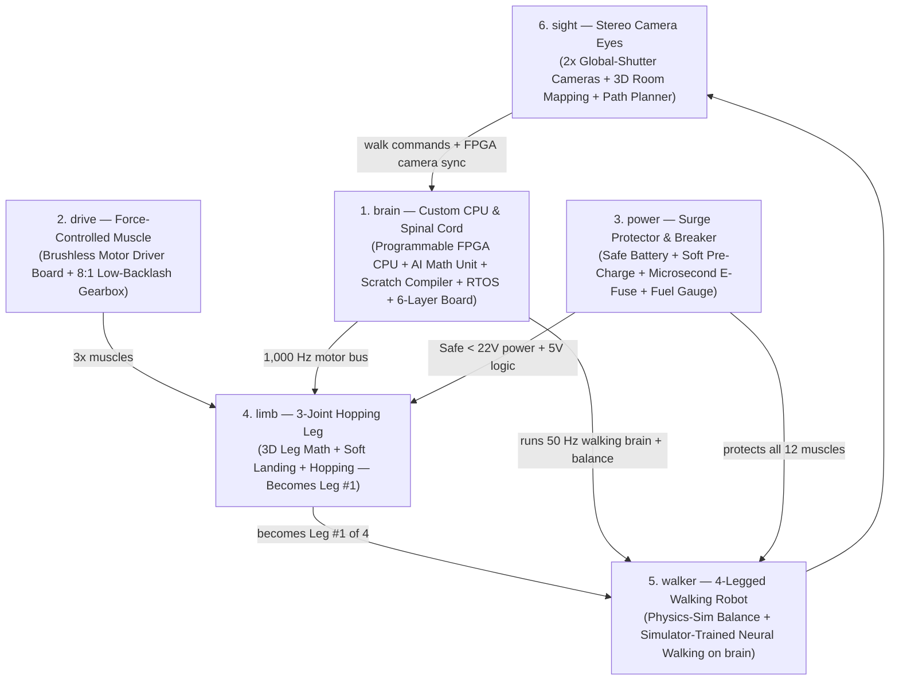

# Apex Vision: From Blank Files to a Walking Robot Dog

**Apex** is a project-first, **"Couch-to-Silicon"** engineering platform where you build every layer of a small, living-room-safe (`~2.5 kg`) autonomous walking robot dog—its computer chip, circuit boards, C compiler, real-time operating system, smart electric muscles, power protection board, and stereo-camera eyes—one small, mobile-reviewable step at a time.

Instead of reading textbooks in isolation for years before touching hardware, every math equation, physics law, compiler pass, circuit trace, and control algorithm is learned **Just-In-Time** right when a real physical subsystem needs it.

---

## Hardware Shorthand in Plain English (For Software Engineers)

If you come from software engineering, hardware terms often sound like an alphabet soup. Here is what the six systems actually mean in everyday language:

1. **Custom CPU & Motherboard on Programmable Silicon (`brain`)**: You write your own open-source **RISC-V** processor (like designing your own tiny ARM/x86 chip) plus an AI multiply-add instruction (**MAC**) in hardware-description code (**SystemVerilog**), load it onto a reprogrammable **FPGA** chip, plug it into a custom **6-layer circuit board (PCB)** with 32 MB of RAM, and run your own **scratch C compiler** and strict-deadline **Real-Time OS (RTOS)** on it.
2. **Force-Controlled Electric Muscles (`drive`)**: Cheap hobby servos blindly jam to a target angle and snap gears on uneven ground. We pair strong drone-style brushless motors with a custom **24V motor-driver board** that controls **exact electrical current = exact physical force** 20,000 times a second (**Field-Oriented Control / FOC**)—turning each joint into a programmable spring and shock absorber.
3. **Surge Protector, Breaker & Fuel Gauge (`power`)**: Twelve motors powering up at once draw a massive surge of electricity that can spark connectors or brown out your CPU. Our **smart power spine** gently pre-charges the motor rail, acts as a microsecond electronic circuit breaker (**e-fuse**) with a big red **E-stop** button, and runs a smart statistical filter (**Kalman filter**) to estimate remaining battery charge.
4. **One Hopping Leg (`limb`)**: Before building 12 joints, we bolt 3 muscles together into a single leg on a desk rail so it can feel gravity, absorb drops softly, and hop—and that exact leg becomes **Leg #1 of 4** with zero thrown-away parts.
5. **Simulator-Trained Walking Robot Dog (`walker`)**: We bolt 4 legs onto a light carbon torso, train a neural walking policy inside a 3D physics simulator (**MuJoCo**), and transfer it directly onto your custom RISC-V CPU (**Sim-to-Real**).
6. **Stereo Camera Eyes (`sight`)**: Two synchronized cameras (like left/right human eyes) measure 3D room depth, map furniture (**SLAM**), and send simple *"walk forward / turn left"* commands down to the spinal-cord CPU.

---

## 1. The 6 Zero-Throwaway Systems

Every subsystem works as a rewarding standalone machine on your desk *and* bolts directly into the final autonomous robot dog with **zero wasted parts and zero circuit-board respins**:

| # | System | What You Build From Scratch (Plain English) | Standalone Desk Demo | Role in Final Robot |
| :---: | :--- | :--- | :--- | :--- |
| **1** | **`brain`** | Your own 5-stage **RISC-V** processor + AI multiply-add unit in SystemVerilog; memory controllers for 32 MB RAM & 16 MB Flash; motor/sensor ports; a **6-layer circuit board** with trace-echo test jacks; and your own **C compiler, assembler, linker & real-time OS** | Boots an interactive terminal (`ash`), runs a rock-steady 1,000 Hz tilt/PID loop (`< 2 µs` jitter), and runs a neural walking network in `< 0.6 ms` | Real-time cerebellum & 12-motor spinal cord |
| **2** | **`drive`** | Custom 4-layer brushless motor-driver board (`24V`, `30A`), bare-metal 20 kHz force-control firmware (`FOC`), and an `8:1` gearbox designed and stress-tested in 3D CAD | A haptic wheel that feels like a programmable spring/damper in your fingers, driven live by `brain` | One joint muscle (`12x` used across 4 legs) |
| **3** | **`power`** | Custom heavy-copper power board with gentle startup pre-charge, `< 5 µs` solid-state circuit breaker (`e-fuse`), physical red E-stop, clean `5V` computer rail & battery fuel-gauge filter | Survives massive startup surges and intentional dead-shorts while accurately tracking remaining battery charge under a 150W load | Safe battery & surge-protection spine (`< 22V`) |
| **4** | **`limb`** | 3-joint carbon/nylon leg hardware, 3D geometry & force math, impact-absorbing soft landing control, and a vertical hopping controller written in your own C language on `brain` | Floats weightlessly when lifted by hand and hops smoothly up and down on a compact desk rail | Front-Left Leg #1 (moves straight onto the robot) |
| **5** | **`walker`** | Light `~2.5 kg` torso frame + wire harnesses, body motion estimator, predictive balance solver (`MPC`), and a neural walking policy trained in a 3D physics simulator and compiled onto `brain` | Stands up on its own, recovers from shoves, and trots untethered across carpet using your custom chip and compiler | The complete dynamic walking robot |
| **6** | **`sight`** | Two synchronized stereo cameras + compact vision computer wired to `brain`'s camera-flash sync pulse, building live 3D room obstacle maps and planning safe paths | Maps a room while carried by hand, then bolts onto `walker` to walk around chairs and obstacles on its own | High-level vision & navigation head |

---

## 2. The Two-Brain Architecture & Cross-System Interface Contracts

Why split compute into **`brain`** (custom RISC-V FPGA SoC) and **`sight`** (companion stereo-SLAM SBC)?

1. **Deterministic Real-Time Cerebellum (`brain`, 50–100 MHz FPGA SoC)**:
   - Proprioceptive Sim-to-Real quadruped walking policies are compact 3-layer MLPs (`48 inputs -> 128 -> 128 -> 12 joint targets` at `50 Hz`) requiring only **$24,064$ multiply-accumulates (MACs)** per step.
   - By adding a single custom packed fixed-point dot-product instruction (`mac`) in RISC-V `custom-0` opcode space to `brain` and teaching our scratch `SysC` compiler to emit it, a 50 MHz soft-core executes the entire neural walking forward pass in **`< 0.6 ms`**, leaving **`> 96%` CPU headroom** for the 1 kHz `ICM-42688-P` IMU attitude filter, dual 5 Mbps CAN-FD motor buses, safety limits, and shell telemetry.
   - Sitting at the **torso center-of-mass** with static memory allocation, `brain`'s `< 2 µs` `1 kHz` motor spine stays physically isolated from variable-latency vision spikes behind a `150 ms` zero-velocity watchdog.
2. **High-Bandwidth Visual Cortex (`sight`, SBC + NPU)**:
   - Stereo depth (`~491M` disparity checks/sec at `640x400 @ 30 Hz`), `FP64` sparse bundle adjustment, and `INT8` semantic detection exceed `brain`'s `20K`-LUT / `103 KB`-SRAM FPGA by `~1,000x`, and mounting `sight` right behind the front lenses keeps `800 Mbps` MIPI camera ribbons `< 4 cm` long away from `30A` motor leads.
   - **Deliberate Division of From-Scratch Labor**: Because `brain`, `drive`, and `power` already build the CPU, PCBs, C compiler, RTOS, and bare-metal motor loops from blank files, `sight` uses embedded Linux (`V4L2` camera DMA, Wi-Fi) and an NPU (`RPi5` + Hailo or Jetson Orin Nano) for silicon I/O and neural throughput while keeping **every spatial & autonomy algorithm 100% from scratch** (`zero ROS`, `zero ORB-SLAM`, `zero Nav2`—every camera model, stereo matcher, manifold `ESKF`, factor graph, loop-closure module, 3D grid, and planner is derived and written from first principles).

### Locked Interface Contracts (Zero Board Respins)

| Interface | Electrical / Physical Spec | Logical / Timing Contract |
| :--- | :--- | :--- |
| **Main Power Bus (`power` $\rightarrow$ `drive`/`brain`)** | `6S LiFePO4` (`19.2V` nom, `21.9V` max, `< 22V` touch-safe SELV) on XT30/XT60 + regulated `5.0V / 4A` logic rail | Pre-charged on boot; `< 5 µs` bidirectional e-fuse cutoff; series physical mushroom E-stop breaks gate drive |
| **Motor Control Spine (`brain` $\leftrightarrow$ `drive`)** | Dual 5 Mbps CAN-FD buses (Bus A: Legs 1–2, Bus B: Legs 3–4), `TCAN1044V` transceivers, $120\ \Omega$ end termination | 1 kHz closed-loop frame: `brain -> drive` (`q_des`, `dq_des`, `kp`, `kd`, `tau_ff` in Q-format); `drive -> brain` (`q`, `dq`, `i_q`, `temp`, `fault`) |
| **Visual Cortex Link (`sight` $\leftrightarrow$ `brain`)** | `3.3V` 2 Mbps UART or 10 MHz SPI + dedicated `3.3V` coaxial/twisted FPGA exposure trigger line | Sub-µs hardware frame timestamp (`frame_seq`, `t_us`); CRC-16 velocity command `[vx, vy, wz]` with `150 ms` watchdog zero-velocity fallback |
| **Carrier Mechanical & SOM Socket (`brain`)** | `100 x 80 mm` 6-layer `JLC06161H-3313` controlled-impedance PCB (`50 Ohm` SE), `SODIMM-204` Tang Primer 20K SOM socket, 4x M3 mounting holes | Drop-in compatible between desktop test stand (Phase 8 of `brain`) and `walker` torso bay |

---

## 3. Home Safety & Pay-As-You-Go Budget

Apex is intentionally engineered at the **`~2.5 kg` Desktop Research Class** (ODRI Solo-12 / Stanford Pupper scale, `~35 cm` body length) so every step is safe in a living room or apartment:

- **Touch-Safe Voltage (`< 22V` DC)** & **Chemically Stable `LiFePO4` Cells**: No high-voltage rails and no volatile cobalt LiPo pouches. **95% of indoor bring-up runs from a current-limited bench power supply** before any battery is ever plugged in.
- **Finger-Safe Joint Torque (`< 2.5 N·m`)**: Easily backdriven by hand; cannot damage furniture or people; tested on a compact **tabletop 2020 aluminum frame** (zero doorway or ceiling drilling).
- **Zero-Fume Turnkey Fabrication**: JLCPCB turnkey SMT assembly and industrial MJF Nylon (`PA12`) + CNC aluminum eliminate indoor solder-paste reflow and high-temperature polymer fumes.
- **Phased Cost (`~$115–$145/mo`)**: `~$290` for all of `brain` (Months 1–3) and `~$1,495` total robot BOM across all 6 systems over ~12 months (plus `~$310–$540` one-time in Month 4 for reusable bench instruments if not already owned).

---

## 4. How the "Couch-to-Silicon" Review Loop Works

You lead the engineering team; the agent handles implementation, simulation, synthesis, and DRC inside the VM—**strictly one atomic step (`~50–150 LOC`) at a time**:

1. **Agent Implements & Verifies**: Builds the next `pending` step in `roadmap.yaml` and runs real tools (`Verilator`, `Yosys`, `nextpnr-himbaechel`, impedance/PDN solvers, KiCad ERC/DRC, MuJoCo, or `pytest`) until 100% passing.
2. **Mobile Review Packet + GitHub PR**: Presents a **5-minute First-Principles Brief**, **interactive HTML/SVG visual diagrams or waveforms**, a guided diff tour + GitHub PR, and **2–3 intuition checks**.
3. **Socratic Q&A & `LGTM` Gate**: Ask any "why?" or "derive that" question right from your phone. The agent never touches Step $N+1$ until you reply **`LGTM`**.
4. **Batched Bench Sessions (`17%` of steps)**: Physical hardware steps (ordering boards, flashing the FPGA, measuring PCB impedance via LiteVNA TDR, dynotesting a motor, walking the robot) are cleanly isolated into weekend bench gates.
