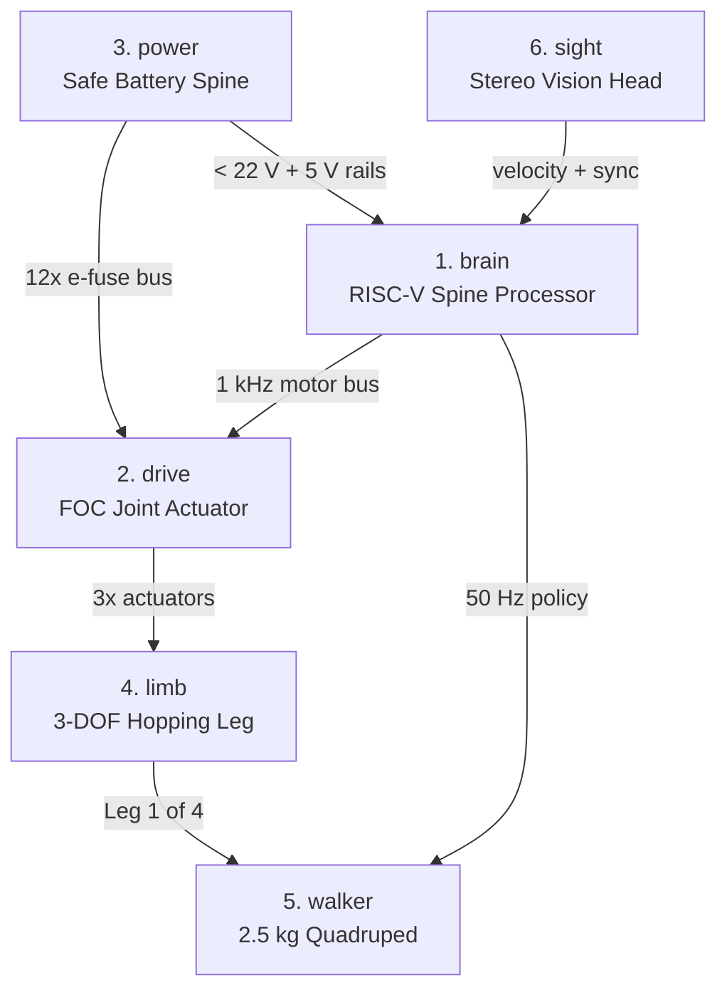

# System Architecture and Contracts

**Apex** is a full-stack hardware and robotics project that builds every layer of a compact, indoor-safe (about 2.5 kg) autonomous quadruped from first principles.
Across six integrated subsystems, we design a custom 32-bit processor on programmable logic, a 6-layer circuit board, a C compiler, a real-time kernel, force-controlled brushless actuators, a solid-state battery protection spine, and a synchronized stereo-vision head.
Each mathematical derivation, circuit layout, compiler pass, and control loop is developed directly alongside the subsystem that requires it, unifying software, electronics, and rigid-body dynamics around one physical machine.

---

## 1. Six Integrated Subsystems

Every subsystem of Apex functions first as a verifiable standalone desktop build and then bolts directly into the final quadruped without circuit-board redesigns or throwaway prototypes.
Those six layers progress bottom-up from custom digital logic and motor power electronics to whole-body locomotion and stereo navigation:

1. **Custom Processor and Spine** (`brain`):
   We design a 32-bit processor implementing the open **Reduced Instruction Set Computer, Fifth Generation** (RISC-V) instruction set in the SystemVerilog hardware-description language and compile it onto a reprogrammable logic chip (**Field-Programmable Gate Array**, or FPGA).
   That processor mounts onto a custom 6-layer **Printed Circuit Board** (PCB) with 32 MB of **Random-Access Memory** (RAM) and executes two-lane 16-bit neural dot products via a custom multiply-accumulate instruction (`mac`).
   Above the hardware, `brain` runs our custom SysC C-subset compiler and a deterministic preemptive task scheduler (**Real-Time Operating System**, or RTOS).
2. **Force-Controlled Brushless Actuators** (`drive`):
   Flat pancake brushless motors pair with a custom 24 V-rated three-phase DC-to-AC motor switching board (**inverter**) and an 8:1 low-backlash planetary gearbox designed in 3D **Computer-Aided Design** (CAD).
   By regulating motor coil current and output torque at 20,000 Hz via **Field-Oriented Control** (FOC), each actuator moves easily by hand when compliant or unpowered (**backdrivable**) and behaves as a finger-safe (under 2.5 N·m) programmable spring and damper.
3. **Battery Spine and Protection** (`power`):
   A heavy-copper power distribution board delivers a touch-safe 19.2 V nominal (21.9 V max) motor bus from a six-cell series lithium-iron-phosphate pack (6S LiFePO4) alongside a regulated 5 V, 4 A logic rail.
   It ramps bus voltage smoothly on startup via a soft pre-charge limiter and isolates short circuits in under 5 µs using a bidirectional solid-state circuit breaker (**electronic fuse**, or e-fuse) interlocked with a physical mushroom **emergency-stop** (E-stop) switch.
   A recursive nonlinear state estimator (**Extended Kalman Filter**, or EKF) tracks remaining battery state of charge online under pulsed motor loads.
4. **Articulated Hopping Leg** (`limb`):
   Before scaling to twelve joints, three `drive` actuators bolt together into a single three-joint (**3-Degree-of-Freedom**, or 3-DOF) leg on a desktop vertical rail to master gravity compensation, impact absorption, and cyclic hopping.
   Once verified on the stand, that exact hardware assembly transfers directly onto the final quadruped chassis as Front-Left Leg 1.
5. **Dynamic Quadruped Platform** (`walker`):
   Four `limb` assemblies, the `power` spine, and the `brain` computer mount into a lightweight carbon-fiber and machined-aluminum torso bay.
   A model-based predictive balance controller and a compact scaled-integer (**quantized**) neural locomotion policy trained in the MuJoCo 3D physics simulator run natively on our custom RISC-V processor.
6. **Stereo Vision and Navigation** (`sight`):
   Two global-shutter cameras phase-locked to `brain`'s hardware shutter pulse measure 3D room depth and fuse visual features with motion-sensor data (**Visual-Inertial Odometry**, or VIO).
   On top of that odometry stream, `sight` builds live 3D obstacle maps (**Simultaneous Localization and Mapping**, or SLAM) and sends bounded velocity commands down to `brain`.

Each subsystem graduates from its own desktop verification rig before integrating into the next mechanical or electrical assembly:

| # | System | Core Engineering Deliverables | Standalone Benchtop Milestone | Role in Final Robot |
| :---: | :--- | :--- | :--- | :--- |
| **1** | **`brain`** | 5-stage RISC-V processor and `mac` dot-product unit in SystemVerilog; external flash and 32 MB RAM controllers; 6-layer PCB; custom SysC compiler, assembler, linker, and RTOS | Boots an interactive shell (`ash`), closes a 1,000 Hz tilt feedback loop (under 2 µs jitter), and runs a neural walking network in under 0.6 ms | Real-time cerebellum and 12-motor spinal cord |
| **2** | **`drive`** | 4-layer brushless inverter board (24 V-rated, 30 A), bare-metal 20 kHz FOC torque firmware, and an 8:1 planetary gearbox analyzed in 3D CAD | A haptic wheel behaving as a programmable spring and damper under live commands from `brain` | Joint actuator (12× across 4 legs) |
| **3** | **`power`** | Heavy-copper power board with soft pre-charge, sub-5 µs bidirectional e-fuse, physical E-stop cutoff, regulated 5 V rail, and EKF fuel gauge | Survives startup surges and intentional dead-shorts while tracking battery state of charge under a 150 W pulse load | Safe battery and surge-protection spine (under 22 V) |
| **4** | **`limb`** | 3-joint carbon and nylon leg structure, 3D screw kinematics and torque mapping, compliant impact control, and vertical hopping firmware in SysC on `brain` | Floats weightlessly under gravity compensation when lifted and hops smoothly along a desktop rail | Front-Left Leg 1 (bolts directly onto torso) |
| **5** | **`walker`** | Lightweight (about 2.5 kg) torso frame and wire harnesses, floating-base state estimator, predictive balance solver, and quantized walking policy on `brain` | Stands autonomously, recovers from lateral pushes, and trots untethered across indoor flooring | Complete 12-joint dynamic quadruped |
| **6** | **`sight`** | Two synchronized global-shutter cameras and compact vision computer phase-locked to `brain`'s shutter pulse for 3D mapping and path planning | Maps a room while carried by hand, then bolts onto `walker` for autonomous obstacle avoidance | High-level perception and navigation head |

---

## 2. Two-Compute Partition and Interface Contracts

Autonomous legged robots run two workloads with fundamentally different timing requirements: joint torque and balance loops must meet strict millisecond deadlines on every tick, whereas stereo depth mapping and path planning process megabytes of image frames at variable latency.
Apex partitions those workloads cleanly between `brain` in the torso and `sight` in the camera head across a hardware-synchronized serial bridge:

1. **Deterministic Real-Time Spinal Cord** (`brain`, 50 to 100 MHz FPGA single-chip computer, or **System-on-Chip** (SoC), combining processor, memory, and peripheral controllers):
   - Three-layer quadruped locomotion networks (with layer neuron widths $48 \to 128 \to 128 \to 12$ evaluated at 50 Hz) require 24,064 **Multiply-Accumulate** (MAC) operations per 20 ms policy tick to update target joint angles for the 1,000 Hz joint controllers.
   - Adding a custom packed two-lane 16-bit `mac` instruction in RISC-V's reserved custom-0 operation-code slot and teaching SysC to emit it lets a 50 MHz processor built from configurable FPGA logic cells complete the forward pass in under 0.6 ms, leaving over 96% processor headroom.
   - Those remaining cycles service the 1,000 Hz 6-axis **Inertial Measurement Unit** (IMU, ICM-42688-P accelerometer and gyroscope), dual 5 Mbps differential motor buses, safety limits, and telemetry.
   - Mounted at the center of the torso with fixed static arrays—requiring zero garbage collection or dynamic memory allocation—`brain` isolates its sub-2 µs, 1,000 Hz control loop behind a 150 ms zero-velocity **watchdog** timeout whenever `sight` goes silent.
2. **High-Bandwidth Visual Cortex** (`sight`, Companion Linux Computer and Neural Accelerator):
   - Dense stereo depth matching evaluates roughly 491 million pixel windows per second at $640 \times 400$ resolution and 30 frames per second, exceeding `brain`'s programmable logic fabric (20,736 4-input boolean truth-table cells, called **Look-Up Tables** or LUT4s, and 103.5 KB of total on-chip **Static RAM**, or SRAM, from which `brain` allocates 64 KB of working memory and 16 KB of startup memory) by about three orders of magnitude.
   - Mounting `sight` directly behind the front lenses also keeps high-speed camera ribbon cables (**Mobile Industry Processor Interface**, or MIPI, **Camera Serial Interface**, or CSI-2, at 800 Mbps) under 4 cm long, physically isolated from 30 A motor switching currents.
   - Embedded Linux handles direct hardware camera frame transfers into memory (**Direct Memory Access**, or DMA) alongside an 8-bit integer **Neural Processing Unit** (NPU) for obstacle detection, while every geometric calibration, stereo matching, visual-inertial filtering, 3D occupancy, and path-planning algorithm is derived and implemented from first principles.

### Locked Interface Contracts

To guarantee that standalone benchtop assemblies bolt directly into the quadruped without circuit-board revisions, every electrical rail, communication frame, and mounting pattern is fixed upfront.
All six subsystems share four locked hardware contracts:

| Interface | Electrical and Physical Specification | Logical and Timing Contract |
| :--- | :--- | :--- |
| **Main Power Bus** (`power` to `drive` and `brain`) | 6-cell lithium-iron-phosphate pack (6S LiFePO4: 19.2 V nominal, 21.9 V max, well below the 60 V touch-safe **Safety Extra-Low Voltage**, or SELV, limit) on polarized high-current XT30 and XT60 plugs plus a regulated 5.0 V, 4 A logic rail | Soft pre-charge ramp on startup prevents connector arcing; sub-5 µs bidirectional solid-state e-fuse; physical mushroom E-stop switch directly cuts transistor gate power |
| **Motor Control Spine** (`brain` with `drive` and `power`) | Two independent 5 Mbps noise-immune differential buses (**Controller Area Network with Flexible Data-Rate**, or CAN-FD; Bus A: Legs 1–2 [IDs 1–6], Bus B: Legs 3–4 [IDs 7–12] plus `power` [ID 13]) using TCAN1044V transceivers and jumper-selectable 120 Ω endpoint termination resistors | 1,000 Hz closed-loop frame: `brain` sends desired angle, velocity, stiffness/damping gains, and feedforward torque (`q_des`, `dq_des`, `kp`, `kd`, `tau_ff`) as scaled fixed-point integers (**Q-format**); `drive` returns measured angle, velocity, current, temperature, and fault flags |
| **Visual Cortex Link** (`sight` with `brain`) | Dedicated 3.3 V, 2 Mbps full-duplex **Universal Asynchronous Receiver-Transmitter** (UART) serial link (UART1, separate from the UART0 USB debug console) plus a dedicated 3.3 V hardware camera-shutter sync wire | Sub-microsecond hardware timestamp latching (`frame_seq`, `t_us`) and a 1,000 Hz ICM-42688-P IMU stream align camera exposures to inertial ticks; `[vx, vy, wz]` velocity commands protected by an error-detecting 16-bit checksum (**Cyclic Redundancy Check**, or CRC-16) zero out after 150 ms of silence |
| **Carrier Mechanics** (`brain` Spine Board) | $100 \times 80\text{ mm}$ 6-layer copper-and-fiberglass circuit board (JLC06161H-3313 layer stackup) with 50 Ω controlled-impedance traces, a 204-pin **Small Outline Dual In-Line Memory Module** (SODIMM-204) edge socket for the plug-in Tang Primer 20K FPGA **System-on-Module** (SOM), and four 3 mm metric M3 mounting holes | Unbolts cleanly from the desktop bring-up stand and mounts directly into the `walker` torso bay with zero rewiring |

---

## 3. Home-Bench Safety and Phased Budget

Apex is sized to the 2.5 kg desktop quadruped class (about 35 cm body length) so assembly, bring-up, and dynamic testing stay safe inside an ordinary home workspace.
Four engineering guardrails govern every physical build step:

- **Touch-Safe Voltage**: Operating below 22 V DC with thermally stable LiFePO4 cells avoids shock hazards and volatile lithium-polymer pouches, and 95% of indoor bring-up runs from a current-limited bench power supply before connecting a battery.
- **Backdrivable Joints**: Peak joint torque stays below 2.5 N·m so every limb moves easily by hand when compliant or unpowered and tests safely inside a tabletop slotted-aluminum gantry.
- **Zero-Fume Turnkey Fabrication**: External circuit-board factories perform automated component placement and solder-paste melting (**Turnkey Printed Circuit Board Assembly**, or turnkey PCBA) so no solder fumes are generated indoors.
  Industrial parts suppliers likewise fabricate powder-fused nylon (**Multi-Jet Fusion**, or MJF) and precision-milled aluminum (**Computer Numerical Control**, or CNC) structures ready to bolt together.
- **Phased Hardware Budget**: Parts average about \$115 to \$145 per month—roughly \$290 for `brain` across Months 1 to 3 and about \$1,495 total across all six systems over twelve months, plus a one-time \$310 to \$540 bench-instrument kit in Month 4 if not already on hand.

---

## 4. Verification and Hardware Bring-Up

Every subsystem advances through bounded, independently testable steps, with roughly 83% of milestones verified purely in simulation and automated checks before ordering or powering hardware.
Three stages connect mathematical models to physical bench measurements:

1. **Simulation-First Verification**: Digital logic and control laws are verified against executable software specification models (**golden reference models**) using `pytest`, the Verilator SystemVerilog simulator, and the MuJoCo physics engine.
   Circuit-board schematics and copper layouts pass automated **Electrical and Design Rule Checks** (ERC and DRC) in KiCad circuit-design software, while FPGA designs pass logic-compilation (**synthesis**) and timing checks in Yosys and nextpnr.
2. **Cohesive Companion Textbook**: Simulation milestones grow incrementally into the 8-part, 34-chapter textbook under `systems/<system>/chapters/`, pairing derivations and interactive visualizers with live-synced source excerpts.
3. **Batched Hardware Labs**: Physical bench steps—turnkey board ordering, FPGA programming, copper trace pulse-echo impedance checks (**Time-Domain Reflectometry**, or TDR) on a handheld radio-frequency **Vector Network Analyzer** (VNA, LiteVNA), motor-load brake (**dynamometer**) torque sweeps, and untethered walking trials—append measured results as closing lab sections.
