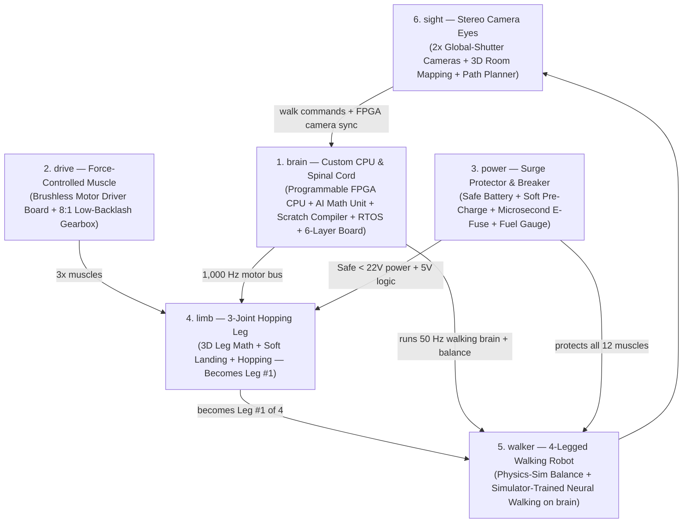

# Apex Vision: From Blank Files to a Walking Robot Dog

**Apex** is a project-first, **"Couch-to-Silicon"** engineering platform where you build every layer of a small, living-room-safe (`~2.5 kg`) autonomous walking robot dog—its computer chip, circuit boards, C compiler, real-time operating system, smart electric muscles, power protection board, and stereo-camera eyes—one small, mobile-reviewable step at a time.

Instead of reading textbooks in isolation for years before touching hardware, every math equation, physics law, compiler pass, circuit trace, and control algorithm is learned **Just-In-Time** right when a real physical subsystem needs it.

---

## Hardware Shorthand in Plain English (For Software Engineers)

If you come from software engineering, hardware terms often sound like an alphabet soup. Here is what the six systems actually mean in everyday language:

1. **Custom CPU & Motherboard on Programmable Silicon (`brain`)**: You write your own open-source **RISC-V** processor (like designing your own tiny ARM/x86 chip) plus an AI multiply-add instruction (**MAC**) in hardware-description code (**SystemVerilog**), load it onto a reprogrammable **FPGA** chip, plug it into a custom **6-layer circuit board (PCB)** with 32 MB of RAM, and run your own **scratch C compiler** and strict-deadline **Real-Time OS (RTOS)** on it.
2. **Force-Controlled Electric Muscles (`drive`)**: Cheap hobby servos blindly jam to a target angle and snap gears on uneven ground. We pair strong drone-style brushless motors with a custom **24V motor-driver board** that controls **exact electrical current = exact physical force** 20,000 times a second (**Field-Oriented Control / FOC**)—turning each joint into a programmable spring and shock absorber.
3. **Surge Protector, Breaker & Fuel Gauge (`power`)**: Twelve motors powering up at once draw a massive surge of electricity that can spark connectors or brown out your CPU. Our **smart power spine** gently pre-charges the motor rail, acts as a microsecond electronic circuit breaker (**e-fuse**) with a big red **E-stop** button, and runs a smart statistical filter (**Kalman filter**) to estimate remaining battery charge.
4. **One Hopping Leg (`limb`)**: Before building 12 joints, we bolt 3 muscles together into a single leg on a desk rail so it can feel gravity, absorb drops softly, and hop—and that exact leg becomes **Leg #1 of 4** with zero thrown-away parts.
5. **Simulator-Trained Walking Robot Dog (`walker`)**: We bolt 4 legs onto a light carbon torso, train a neural walking policy inside a 3D physics simulator (**MuJoCo**), and transfer it directly onto your custom RISC-V CPU (**Sim-to-Real**).
6. **Stereo Camera Eyes (`sight`)**: Two synchronized cameras (like left/right human eyes) measure 3D room depth, map furniture (**SLAM**), and send simple *"walk forward / turn left"* commands down to the spinal-cord CPU.

---

## 1. The 6 Zero-Throwaway Systems

Every subsystem works as a rewarding standalone machine on your desk *and* bolts directly into the final autonomous robot dog with **zero wasted parts and zero circuit-board respins**:

| # | System | What You Build From Scratch (Plain English) | Standalone Desk Demo | Role in Final Robot |
| :---: | :--- | :--- | :--- | :--- |
| **1** | **`brain`** | Your own 5-stage **RISC-V** processor + AI multiply-add unit in SystemVerilog; memory controllers for 32 MB RAM & 16 MB Flash; motor/sensor ports; a **6-layer circuit board** with trace-echo test jacks; and your own **C compiler, assembler, linker & real-time OS** | Boots an interactive terminal (`ash`), runs a rock-steady 1,000 Hz tilt/PID loop (`< 2 µs` jitter), and runs a neural walking network in `< 0.6 ms` | Real-time cerebellum & 12-motor spinal cord |
| **2** | **`drive`** | Custom 4-layer brushless motor-driver board (`24V`, `30A`), bare-metal 20 kHz force-control firmware (`FOC`), and an `8:1` gearbox designed and stress-tested in 3D CAD | A haptic wheel that feels like a programmable spring/damper in your fingers, driven live by `brain` | One joint muscle (`12x` used across 4 legs) |
| **3** | **`power`** | Custom heavy-copper power board with gentle startup pre-charge, `< 5 µs` solid-state circuit breaker (`e-fuse`), physical red E-stop, clean `5V` computer rail & battery fuel-gauge filter | Survives massive startup surges and intentional dead-shorts while accurately tracking remaining battery charge under a 150W load | Safe battery & surge-protection spine (`< 22V`) |
| **4** | **`limb`** | 3-joint carbon/nylon leg hardware, 3D geometry & force math, impact-absorbing soft landing control, and a vertical hopping controller written in your own C language on `brain` | Floats weightlessly when lifted by hand and hops smoothly up and down on a compact desk rail | Front-Left Leg #1 (moves straight onto the robot) |
| **5** | **`walker`** | Light `~2.5 kg` torso frame + wire harnesses, body motion estimator, predictive balance solver (`MPC`), and a neural walking policy trained in a 3D physics simulator and compiled onto `brain` | Stands up on its own, recovers from shoves, and trots untethered across carpet using your custom chip and compiler | The complete dynamic walking robot |
| **6** | **`sight`** | Two synchronized stereo cameras + compact vision computer wired to `brain`'s camera-flash sync pulse, building live 3D room obstacle maps and planning safe paths | Maps a room while carried by hand, then bolts onto `walker` to walk around chairs and obstacles on its own | High-level vision & navigation head |

---

## 2. The Two-Brain Architecture & Cross-System Interface Contracts

Why split compute into **`brain`** (custom RISC-V programmable-silicon processor) and **`sight`** (companion stereo-camera computer)?

1. **Deterministic Real-Time Spinal Cord (`brain`, 50–100 MHz FPGA System-on-Chip)**:
   - Body-balance walking networks (`48 sensor inputs -> 128 -> 128 -> 12 joint targets` running 50 times per second) require only **24,064 multiply-accumulate (`MAC`) operations** per tick.
   - By adding a single custom packed fixed-point dot-product instruction (`mac`) in RISC-V's open `custom-0` instruction slot and teaching our scratch `SysC` compiler to emit it, a 50 MHz soft processor finishes the entire neural forward pass in **`< 0.6 ms`**, leaving **`> 96%` CPU headroom** for the 1,000 Hz 6-axis motion sensor (`ICM-42688-P` accelerometer + gyroscope), dual 5 Mbps motor buses, safety limits, and terminal telemetry.
   - Mounted at the **center of the robot's torso** with static memory allocation (zero garbage collection or OS paging), `brain`'s `< 2 µs` 1,000 Hz motor loop stays physically isolated from variable-latency camera processing behind a `150 ms` zero-velocity safety timeout (**watchdog**).
2. **High-Bandwidth Visual Cortex (`sight`, Compact Linux Computer + Neural Accelerator)**:
   - Stereo depth matching (roughly `491 million` pixel-window checks per second at `640×400` resolution, `30 frames/sec`), double-precision (`FP64`) 3D map optimization (**sparse bundle adjustment**), and 8-bit integer (`INT8`) person/obstacle detection exceed `brain`'s FPGA chip (`20,736` programmable 4-input logic lookup tables / `LUT4`s and `103.5 KB` of on-chip scratchpad `SRAM`) by roughly **`1,000×`**. Mounting `sight` directly behind the front camera lenses also keeps `800 Mbps` high-speed camera ribbon cables (**MIPI CSI-2**) under `4 cm` long, away from `30A` switching motor wires.
   - **Deliberate Division of From-Scratch Labor**: Because `brain`, `drive`, and `power` already build the CPU, circuit boards, C compiler, real-time OS, and bare-metal motor loops from blank files, `sight` uses minimal embedded Linux (for zero-copy camera memory transfers via `V4L2 DMA` and Wi-Fi telemetry) plus a dedicated neural inference chip (**NPU**, e.g., `Raspberry Pi 5 + Hailo` or `Jetson Orin Nano`) for hardware I/O and neural throughput, while keeping **every spatial and autonomy algorithm 100% from scratch** (`zero ROS`, `zero ORB-SLAM`, `zero Nav2`—you derive and write every lens model, stereo depth solver, Kalman pose filter, factor graph, loop-closure module, 3D obstacle grid, and path planner from first principles).

### Locked Interface Contracts (Zero Circuit-Board Redesigns)

| Interface | Electrical / Physical Spec | Logical / Timing Contract |
| :--- | :--- | :--- |
| **Main Power Bus (`power` → `drive`/`brain`)** | 6-cell series lithium-iron-phosphate pack (`6S LiFePO4`: `19.2V` nominal, `21.9V` max, well under the `60V` touch-safe **SELV** limit) on XT30/XT60 power plugs + regulated `5.0V / 4A` computer rail | Gently pre-charged on boot to prevent connector sparks; `< 5 µs` two-way solid-state circuit breaker (**e-fuse**); physical red mushroom **E-stop** button directly cuts transistor gate power |
| **Motor Control Spine (`brain` ↔ `drive`)** | Two independent 5 Mbps noise-immune 2-wire differential motor buses (**CAN-FD**; Bus A: Legs 1–2, Bus B: Legs 3–4) using `TCAN1044V` bus driver chips and `120 Ω` end-of-line echo-absorbing resistors (**termination**) | 1,000 Hz closed-loop frame: `brain -> drive` sends desired angle, speed, spring/damper gains, and feedforward torque (`q_des`, `dq_des`, `kp`, `kd`, `tau_ff`) scaled as integers (**Q-format**); `drive -> brain` returns measured angle, speed, torque current, temperature, and fault flags |
| **Visual Cortex Link (`sight` ↔ `brain`)** | `3.3V` 2 Mbps serial link (**UART**) or 10 MHz synchronous serial (**SPI**) + dedicated `3.3V` twisted/coaxial hardware camera-shutter pulse wire | Sub-microsecond hardware timestamp pairing (`frame_seq`, `t_us`) aligns camera exposures to motion-sensor ticks; error-checked (`CRC-16`) velocity commands `[vx, vy, wz]` fall back to zero after a `150 ms` watchdog silence |
| **Carrier Mechanics & Plug-In CPU Socket (`brain`)** | `100 × 80 mm` 6-layer circuit board (`JLC06161H-3313` copper/fiberglass stackup) with `50 Ω` signal-matched (**controlled-impedance**) traces, a 204-pin laptop-RAM-style edge socket (`SODIMM-204`) for the Tang Primer 20K FPGA module (**SOM**), and 4× M3 mounting holes | Drops straight between the desktop test stand (Phase 8 of `brain`) and the `walker` torso bay with zero rewiring |

---

## 3. Home Safety & Pay-As-You-Go Budget

Apex is engineered at the **2.5 kg Desktop Research Class** (similar to the ODRI Solo-12 or Stanford Pupper, roughly `35 cm` long) so every build and test is safe in an apartment or living room:

- **Touch-Safe Voltage (`< 22V` DC) & Stable `LiFePO4` Cells**: Far below shock thresholds and free of volatile cobalt LiPo pouches. **95% of indoor testing runs from a current-limited bench power supply** before any battery is ever plugged in.
- **Finger-Safe Backdrivable Joints (`< 2.5 N·m`)**: Easily pushed by hand when unpowered or compliant; cannot damage furniture or fingers; tested inside a compact **tabletop slotted-aluminum frame** (`2020 extrusion`) with zero doorway or ceiling drilling.
- **Zero-Fume Turnkey Fabrication**: Sending board files to an external factory for automated surface-mount soldering (**turnkey PCBA**) and ordering industrial powder-fused nylon (`MJF PA12`) and milled (`CNC`) parts eliminates indoor solder-paste reflow and toxic plastic fumes.
- **Phased Cost (about \$115–\$145/mo)**: About \$290 for all of `brain` (Months 1–3) and about \$1,495 for robot parts across all 6 systems over roughly 12 months (plus about \$310–\$540 once in Month 4 for reusable bench test tools if not already owned).

---

## 4. How the "Couch-to-Silicon" Review Loop Works

You lead the engineering team; the agent handles coding, simulation, FPGA chip compilation (**synthesis**), and automated board checking inside the VM—**strictly one atomic step (roughly 50–150 lines of code) at a time**:

1. **Agent Implements & Verifies**: Builds the next `pending` step in `roadmap.yaml` and runs real tools (`Verilator` digital simulator, `Yosys`/`nextpnr` FPGA place-and-route, trace-impedance/power-network solvers, KiCad electrical/layout rule checks `ERC`/`DRC`, `MuJoCo` physics, or `pytest`) until 100% passing.
2. **Mobile Review Packet + GitHub PR**: Presents a **5-minute Textbook-Style First-Principles Brief**, **interactive HTML/SVG visual diagrams, waveforms, or copper-layer renders**, a guided diff tour + GitHub PR, and **2–3 intuition checks**.
3. **Socratic Q&A & `LGTM` Gate**: Ask any "why?" or "derive that" question right from your phone. The agent never touches Step `N+1` until you reply **`LGTM`**.
4. **Batched Bench Sessions (`17%` of steps)**: Physical hardware tasks (ordering factory boards, flashing the FPGA, measuring trace impedance via radar-like `LiteVNA` echo sweeps, testing a motor on a rig, walking the robot) are isolated into clean weekend bench sessions.
