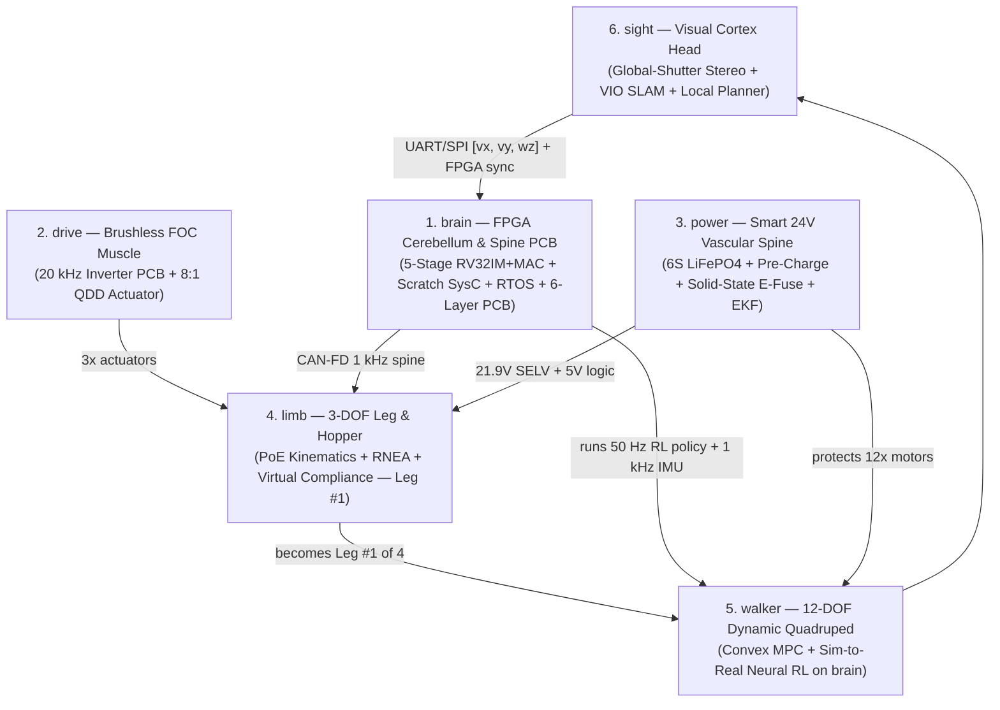

# Apex Vision: From Blank Silicon to an Autonomous Walking Robot

**Apex** is a project-first, **"Couch-to-Silicon"** engineering platform designed to take you from blank files to a **100% custom-engineered, autonomous `~2.5 kg` torque-controlled quadruped**—built one small, verifiable, mobile-reviewable step at a time.

Instead of reading textbooks in isolation for years before touching hardware, every math equation, physics law, compiler pass, PCB trace, and control algorithm is learned **Just-In-Time** at the exact moment a real physical subsystem demands it.

---

## 1. The 6 Zero-Throwaway Systems

Every subsystem works as a rewarding standalone machine on your desk *and* bolts directly into the final autonomous quadruped with **zero wasted parts and zero board respins**:

| # | System | What You Build From Scratch | Standalone Graduation Demo | Role in Final Robot |
| :---: | :--- | :--- | :--- | :--- |
| **1** | **`brain`** | 5-stage pipelined `RV32IM` + `Zicsr` + neural `MAC` CPU in SystemVerilog; 32 MB SDRAM & 16 MB QSPI controllers; dual CAN-FD + IMU + sync RTL; **6-layer controlled-impedance Spine PCB** with SMA TDR coupons; scratch **`SysC` compiler, assembler, linker & preemptive RTOS** | Boots `ash` shell from QSPI into 32 MB SDRAM, runs `< 2 µs`-jitter 1 kHz IMU/PID loop + 500+ Hz neural walking MLP inference | Real-time cerebellum & 12-motor CAN-FD spinal cord |
| **2** | **`drive`** | 4-layer 24V 30A 3-phase inverter PCB, 20 kHz bare-metal Field-Oriented Control (`FOC`) + `SVPWM` firmware, parametric 8:1 low-backlash planetary/cycloidal gearbox + FEA | Virtual spring/damper haptic wheel & step-torque dynamometer test driven over CAN-FD by `brain` | Single joint actuator (`12x` used across 4 legs) |
| **3** | **`power`** | 4-layer heavy-copper Power & Safety Spine PCB with active pre-charge, `< 5 µs` solid-state bidirectional e-fuse, regen clamp, 5V buck, E-stop loop & online `EKF` SoC estimator | Survives 12-motor capacitive inrush & dead-short fault injection; tracks true cell state on a 150W DC load | Battery & safety distribution spine (`< 22V` SELV) |
| **4** | **`limb`** | 3-DOF belt/linkage leg CAD + impact FEA, 3D kinematics (`SE(3)` PoE), foot Jacobian ($\tau = J^\top F$), momentum contact detection & Raibert hopping controller compiled in `SysC` onto `brain` | Gravity-compensated feather-touch compliance & autonomous cyclic hopping on a tabletop 2020 linear rail | Leg #1 of 4 (plus reusable kinematics/control library) |
| **5** | **`walker`** | 12-DOF torso chassis CAD + wire harnesses, floating-base `ESKF` state estimator, Convex Centroidal `MPC`, and GPU-trained `PPO` Sim-to-Real RL policy quantized to `INT16` for `brain`'s `MAC` unit | Stands up, trots untethered, recovers from shoves, and walks rough terrain running your custom `SysC` RTOS + RL policy on `brain` | Full dynamic locomotion platform (`~2.5 kg` desktop scale) |
| **6** | **`sight`** | Dual global-shutter stereo (`OV9281`) + companion SBC/NPU head wired to `brain`'s sub-µs FPGA sync pulse, manifold `VIO` SLAM, 2.5D obstacle grid, `A*`/`RRT*` planner & semantic detector | Handheld room SLAM, then bolts onto `walker` for autonomous point-to-point obstacle-avoiding navigation | High-level visual cortex & path planner |

---

## 2. The Two-Brain Architecture & Cross-System Interface Contracts

Why split compute into **`brain`** (custom RISC-V FPGA SoC) and **`sight`** (companion stereo-SLAM SBC)?

1. **Deterministic Real-Time Cerebellum (`brain`, 50–100 MHz FPGA SoC)**:
   - Proprioceptive Sim-to-Real quadruped walking policies are compact 3-layer MLPs (`48 inputs -> 128 -> 128 -> 12 joint targets` at `50 Hz`) requiring only **$24,064$ multiply-accumulates (MACs)** per step.
   - By adding a single custom packed fixed-point dot-product instruction (`mac`) in RISC-V `custom-0` opcode space to `brain` and teaching our scratch `SysC` compiler to emit it, a 50 MHz soft-core executes the entire neural walking forward pass in **`< 0.6 ms`**, leaving **`> 96%` CPU headroom** for the 1 kHz `ICM-42688-P` IMU attitude filter, dual 5 Mbps CAN-FD motor buses, safety limits, and shell telemetry.
2. **High-Bandwidth Visual Cortex (`sight`, SBC + NPU)**:
   - Stereo image matching, factor-graph VIO, and neural vision run cleanly on an embedded Linux/NPU head (`RPi5` + Hailo or Jetson Orin Nano), receiving **sub-microsecond hardware exposure sync pulses** from `brain`'s FPGA so camera frames align deterministically with IMU timestamps, and streaming compact `[vx, vy, wz]` velocity commands + heartbeat over framed UART/SPI.

### Locked Interface Contracts (Zero Board Respins)

| Interface | Electrical / Physical Spec | Logical / Timing Contract |
| :--- | :--- | :--- |
| **Main Power Bus (`power` $\rightarrow$ `drive`/`brain`)** | `6S LiFePO4` (`19.2V` nom, `21.9V` max, `< 22V` touch-safe SELV) on XT30/XT60 + regulated `5.0V / 4A` logic rail | Pre-charged on boot; `< 5 µs` bidirectional e-fuse cutoff; series physical mushroom E-stop breaks gate drive |
| **Motor Control Spine (`brain` $\leftrightarrow$ `drive`)** | Dual 5 Mbps CAN-FD buses (Bus A: Legs 1–2, Bus B: Legs 3–4), `TCAN1044V` transceivers, $120\ \Omega$ end termination | 1 kHz closed-loop frame: `brain -> drive` (`q_des`, `dq_des`, `kp`, `kd`, `tau_ff` in Q-format); `drive -> brain` (`q`, `dq`, `i_q`, `temp`, `fault`) |
| **Visual Cortex Link (`sight` $\leftrightarrow$ `brain`)** | `3.3V` 2 Mbps UART or 10 MHz SPI + dedicated `3.3V` coaxial/twisted FPGA exposure trigger line | Sub-µs hardware frame timestamp (`frame_seq`, `t_us`); CRC-16 velocity command `[vx, vy, wz]` with `150 ms` watchdog zero-velocity fallback |
| **Carrier Mechanical & SOM Socket (`brain`)** | `100 x 80 mm` 6-layer `JLC06161H-3313` controlled-impedance PCB (`50 Ohm` SE), `SODIMM-204` Tang Primer 20K SOM socket, 4x M3 mounting holes | Drop-in compatible between desktop test stand (Phase 8 of `brain`) and `walker` torso bay |

---

## 3. Home Safety & Pay-As-You-Go Budget

Apex is intentionally engineered at the **`~2.5 kg` Desktop Research Class** (ODRI Solo-12 / Stanford Pupper scale, `~35 cm` body length) so every step is safe in a living room or apartment:

- **Touch-Safe Voltage (`< 22V` DC)** & **Chemically Stable `LiFePO4` Cells**: No high-voltage rails and no volatile cobalt LiPo pouches. **95% of indoor bring-up runs from a current-limited bench power supply** before any battery is ever plugged in.
- **Finger-Safe Joint Torque (`< 2.5 N·m`)**: Easily backdriven by hand; cannot damage furniture or people; tested on a compact **tabletop 2020 aluminum frame** (zero doorway or ceiling drilling).
- **Zero-Fume Turnkey Fabrication**: JLCPCB turnkey SMT assembly and industrial MJF Nylon (`PA12`) + CNC aluminum eliminate indoor solder-paste reflow and high-temperature polymer fumes.
- **Phased Cost (`~$115–$145/mo`)**: `~$290` for all of `brain` (Months 1–3) and `~$1,495` total robot BOM across all 6 systems over ~12 months (plus `~$310–$540` one-time in Month 4 for reusable bench instruments if not already owned).

---

## 4. How the "Couch-to-Silicon" Review Loop Works

You lead the engineering team; the agent handles implementation, simulation, synthesis, and DRC inside the VM—**strictly one atomic step (`~50–150 LOC`) at a time**:

1. **Agent Implements & Verifies**: Builds the next `pending` step in `roadmap.yaml` and runs real tools (`Verilator`, `Yosys`, `nextpnr-himbaechel`, impedance/PDN solvers, KiCad ERC/DRC, MuJoCo, or `pytest`) until 100% passing.
2. **Mobile Review Packet + GitHub PR**: Presents a **5-minute First-Principles Brief**, **interactive HTML/SVG visual diagrams or waveforms**, a guided diff tour + GitHub PR, and **2–3 intuition checks**.
3. **Socratic Q&A & `LGTM` Gate**: Ask any "why?" or "derive that" question right from your phone. The agent never touches Step $N+1$ until you reply **`LGTM`**.
4. **Batched Bench Sessions (`17%` of steps)**: Physical hardware steps (ordering boards, flashing the FPGA, measuring PCB impedance via LiteVNA TDR, dynotesting a motor, walking the robot) are cleanly isolated into weekend bench gates.
