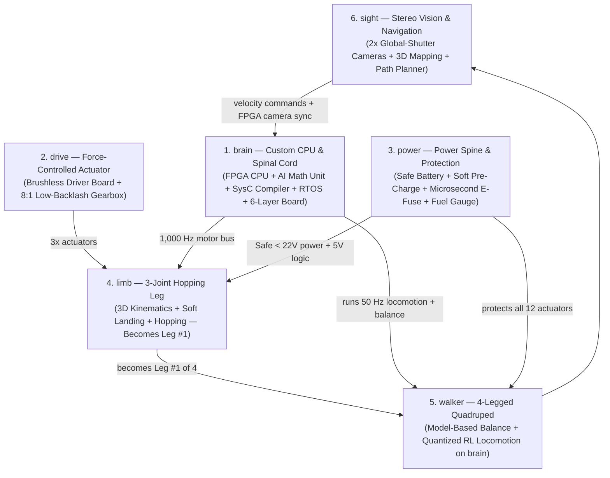

# System Architecture & Engineering Vision

**Apex** is a full-stack hardware and robotics project that builds every layer of a compact, indoor-safe (`about 2.5 kg`) autonomous quadruped from first principles: a custom 32-bit processor on programmable logic, a 6-layer carrier board, a C compiler and real-time operating system, force-controlled brushless actuators, a solid-state power distribution spine, and synchronized stereo vision.

Each mathematical derivation, circuit layout, compiler pass, and control loop is developed directly alongside the subsystem that requires it, unifying software, electronics, and dynamics around one physical machine.

---

## Architectural Overview for Software Engineers

The six subsystems of Apex form a unified vertical hardware-and-software stack:

1. **Custom Processor, Motherboard, Compiler & RTOS (`brain`)**: An open-source **RISC-V** processor extended with a neural multiply-accumulate instruction (**`mac`**) is written in a hardware-description language (**SystemVerilog**), synthesized onto a reprogrammable **Field-Programmable Gate Array (`FPGA`)**, mounted on a custom **6-layer printed circuit board (`PCB`)** with 32 MB of RAM, and programmed using a custom **SysC compiler** and preemptive **Real-Time Operating System (`RTOS`)**.
2. **Force-Controlled Brushless Actuators (`drive`)**: Flat pancake brushless motors pair with a custom **24V inverter board** and an `8:1` low-backlash planetary gearbox. By regulating coil current—and therefore output torque—at 20,000 Hz via **Field-Oriented Control (`FOC`)**, each actuator operates as a backdrivable, finger-safe (`< 2.5 N·m`) programmable spring and damper.
3. **Power Distribution, Soft Pre-Charge & Protection (`power`)**: A heavy-copper power distribution spine delivers a touch-safe `19.2V` (`6S LiFePO4`) motor bus and a regulated `5V / 4A` logic rail, ramps bus voltage smoothly on startup via a soft pre-charge limiter, protects all channels with a microsecond solid-state circuit breaker (**e-fuse**) interlocked with a physical emergency-stop (**E-stop**) switch, and runs an **Extended Kalman Filter (`EKF`)** to track battery **State of Charge (`SoC`)** under dynamic loads.
4. **Single Articulated Leg & Hopping Testbed (`limb`)**: Before scaling to twelve joints, three `drive` actuators bolt together into a single 3-DOF leg on a desktop linear rail to master gravity compensation, impact absorption, and cyclic hopping. That exact hardware assembly transfers directly to the final quadruped as Front-Left Leg #1.
5. **Full Quadruped Dynamics & Locomotion (`walker`)**: Four legs attach to a lightweight carbon-and-aluminum torso bay. A model-based balance controller and a neural locomotion policy trained in 3D physics simulation (**`MuJoCo`**) are quantized and deployed natively onto the custom RISC-V processor (**Sim-to-Real**).
6. **Synchronized Stereo Vision & Navigation (`sight`)**: Two global-shutter cameras measure 3D room depth, fuse visual features with inertial measurements (**Visual-Inertial Odometry / `VIO`**), map obstacles (**`SLAM`**), and send bounded velocity commands down to the spinal-cord CPU.

---

## 1. The Six Integrated Subsystems

Every subsystem is verified first as a standalone benchtop unit and then integrates directly into the final quadruped with zero throwaway hardware or circuit-board revisions:

| # | System | Core Engineering Deliverables | Standalone Benchtop Milestone | Role in Final Robot |
| :---: | :--- | :--- | :--- | :--- |
| **1** | **`brain`** | 5-stage **RISC-V** processor + `mac` dot-product unit in SystemVerilog; 32 MB SDRAM & 16 MB QSPI Flash controllers; motor/sensor peripherals; **6-layer PCB** with trace-echo test coupons; custom **C compiler, assembler, linker & RTOS** | Boots an interactive shell (`ash`), executes a deterministic 1,000 Hz tilt/PID loop (`< 2 µs` jitter), and runs a neural walking network in `< 0.6 ms` | Real-time cerebellum & 12-motor spinal cord |
| **2** | **`drive`** | 4-layer brushless inverter board (`24V`, `30A`), bare-metal 20 kHz force-control firmware (`FOC`), and an `8:1` planetary gearbox designed and stress-analyzed in 3D CAD | A haptic wheel behaving as a programmable spring and damper under live commands from `brain` | Joint actuator (`12x` across 4 legs) |
| **3** | **`power`** | Heavy-copper power distribution board with soft pre-charge, `< 5 µs` bidirectional **e-fuse**, physical E-stop loop, regulated `5V` logic rail & `EKF` fuel gauge | Survives startup surges and intentional dead-shorts while accurately tracking battery charge under a 150W pulse load | Safe battery & surge-protection spine (`< 22V`) |
| **4** | **`limb`** | 3-joint carbon/nylon leg structure, `SE(3)` screw kinematics & Jacobian torque mapping, impact-absorbing impedance control, and vertical hopping firmware in `SysC` on `brain` | Floats under gravity compensation when lifted and hops smoothly along a compact desktop rail | Front-Left Leg #1 (transfers directly onto chassis) |
| **5** | **`walker`** | Lightweight `about 2.5 kg` torso frame + wire harnesses, floating-base state estimator (`ESKF`), convex predictive balance solver (`MPC`), and quantized RL locomotion policy on `brain` | Stands autonomously, recovers from lateral shoves, and trots untethered across indoor flooring | Complete dynamic quadruped platform |
| **6** | **`sight`** | Two synchronized stereo cameras + compact vision computer phase-locked to `brain`'s shutter pulse, building live 3D occupancy maps and planning collision-free paths | Maps a room while carried by hand, then mounts onto `walker` for autonomous obstacle avoidance | High-level perception & navigation head |

---

## 2. The Two-Brain Architecture & Locked Interface Contracts

Why partition compute between **`brain`** (a custom RISC-V FPGA System-on-Chip) and **`sight`** (a companion stereo-vision computer)?

1. **Deterministic Real-Time Spinal Cord (`brain`, 50–100 MHz FPGA System-on-Chip)**:
   - Quadruped locomotion networks (`48 sensor inputs -> 128 -> 128 -> 12 joint targets` at 50 Hz) require only **24,064 multiply-accumulate (`MAC`) operations** per tick.
   - By adding a single custom packed fixed-point dot-product instruction (`mac`) in RISC-V's `custom-0` opcode slot and teaching our `SysC` compiler to emit it, a 50 MHz soft processor completes the neural forward pass in **`< 0.6 ms`**, leaving **`> 96%` CPU headroom** for the 1,000 Hz 6-axis motion sensor (`ICM-42688-P` accelerometer + gyroscope), dual 5 Mbps motor buses, safety envelopes, and telemetry.
   - Mounted at the **center of the torso** with static memory allocation (zero garbage collection or virtual-memory paging), `brain`'s `< 2 µs` 1,000 Hz motor loop remains physically isolated from variable-latency vision processing behind a `150 ms` zero-velocity **watchdog** timeout.
2. **High-Bandwidth Visual Cortex (`sight`, Compact Linux Computer + Neural Accelerator)**:
   - Stereo depth matching (about `491 million` pixel-window evaluations per second at `640×400` resolution, `30 frames/sec`), double-precision (`FP64`) 3D map optimization (**sparse bundle adjustment**), and 8-bit integer (`INT8`) obstacle detection exceed `brain`'s FPGA fabric (`20,736` 4-input logic lookup tables / `LUT4`s and `103.5 KB` of on-chip scratchpad `SRAM`) by roughly **`1,000×`**. Mounting `sight` directly behind the front lenses also keeps `800 Mbps` **MIPI CSI-2** camera ribbons under `4 cm` long, isolated from `30A` motor switching currents.
   - **Compute Stack & First-Principles Algorithms**: `sight` runs on embedded Linux (zero-copy `V4L2 DMA` camera capture and Wi-Fi telemetry) paired with a dedicated neural inference accelerator (**NPU**, e.g., `Raspberry Pi 5 + Hailo` or `Jetson Orin Nano`) for hardware I/O and `INT8` object detection, while every spatial and navigation algorithm—camera calibration, stereo depth matching, visual-inertial Kalman filtering, factor-graph smoothing, loop closure, 3D occupancy grids, and path planning—is derived and implemented directly from first principles.

### Locked Interface Contracts (Zero Circuit-Board Revisions)

| Interface | Electrical / Physical Spec | Logical / Timing Contract |
| :--- | :--- | :--- |
| **Main Power Bus (`power` → `drive`/`brain`)** | 6-cell series lithium-iron-phosphate pack (`6S LiFePO4`: `19.2V` nominal, `21.9V` max, well below the `60V` touch-safe **SELV** limit) on XT30/XT60 connectors + regulated `5.0V / 4A` logic rail | Soft pre-charge ramp on startup to prevent connector arcing; `< 5 µs` bidirectional solid-state **e-fuse**; physical mushroom **E-stop** switch directly cuts transistor gate power |
| **Motor Control Spine (`brain` ↔ `drive`/`power`)** | Two independent 5 Mbps differential motor buses (**CAN-FD**; Bus A: Legs 1–2 [IDs 1–6], Bus B: Legs 3–4 [IDs 7–12] + `power` spine [ID 13]) using `TCAN1044V` (`5V` core / `3.3V` logic I/O) transceivers and jumper-selectable `120 Ω` **termination** resistors closed only at bus endpoints | 1,000 Hz closed-loop frame: `brain -> drive` transmits desired angle, velocity, spring/damper gains, and feedforward torque (`q_des`, `dq_des`, `kp`, `kd`, `tau_ff`) in scaled fixed-point (**Q-format**); `drive -> brain` returns measured angle, velocity, torque current, temperature, and fault flags |
| **Visual Cortex Link (`sight` ↔ `brain`)** | Dedicated `3.3V` 2 Mbps full-duplex serial link (`UART1`, separate from `UART0` USB debug console) + dedicated `3.3V` twisted/coaxial hardware camera-shutter sync wire | Sub-microsecond hardware timestamp pairing (`frame_seq`, `t_us`) + `1,000 Hz` `ICM-42688-P` inertial stream (`brain -> sight`) aligns camera exposures to inertial ticks; `CRC-16` framed velocity commands `[vx, vy, wz]` (`sight -> brain`) fall back to zero after a `150 ms` watchdog silence |
| **Carrier Mechanics & Plug-In CPU Socket (`brain`)** | `100 × 80 mm` 6-layer circuit board (`JLC06161H-3313` copper/fiberglass stackup) with `50 Ω` **controlled-impedance** traces, a 204-pin edge socket (`SODIMM-204`) for the Tang Primer 20K FPGA System-on-Module (`SOM`), and 4× M3 mounting holes | Transfers directly between the desktop test stand (Phase 8 of `brain`) and the `walker` torso bay with zero rewiring |

---

## 3. Laboratory Safety & Phased Hardware Budget

Apex is sized to the **2.5 kg Desktop Research Class** (comparable to the ODRI Solo-12 or Stanford Pupper, about `35 cm` long) so fabrication, bring-up, and dynamic testing remain safe in an indoor workspace:

- **Touch-Safe Voltage (`< 22V` DC) & Stable `LiFePO4` Cells**: Well below DC shock thresholds and free of volatile cobalt LiPo pouches. **95% of indoor testing runs from a current-limited bench power supply** before a battery pack is connected.
- **Finger-Safe Backdrivable Joints (`< 2.5 N·m`)**: Easily moved by hand when unpowered or compliant; tested inside a compact **tabletop slotted-aluminum gantry** (`2020 extrusion`).
- **Zero-Fume Turnkey Fabrication**: External board houses handle automated surface-mount assembly (**turnkey PCBA**), and industrial suppliers fabricate powder-fused nylon (`MJF PA12`) and milled aluminum (`CNC`) structures—eliminating indoor solder-paste reflow and high-temperature polymer fumes.
- **Phased Cost (about \$115–\$145/mo)**: About \$290 for `brain` (Months 1–3) and about \$1,495 for robot parts across all six systems over roughly 12 months (plus about \$310–\$540 once in Month 4 for reusable bench instruments if not already on hand).

---

## 4. Verification & Hardware Bring-Up Methodology

Every subsystem progresses through bounded, independently verifiable milestones—roughly `83%` validated purely in software simulation and automated checks before physical hardware is ordered or powered:

1. **Simulation-First Verification**: Each software, RTL, and circuit-generation module is validated against golden reference models (`Verilator` digital simulation, `Yosys`/`nextpnr` FPGA synthesis and timing closure, transmission-line and PDN solvers, `KiCad` `ERC`/`DRC` checks, `MuJoCo` rigid-body dynamics, and `pytest` suites).
2. **Textbook Documentation**: Each design milestone is paired with a self-contained textbook chapter in `systems/<system>/chapters/` that derives the underlying theory and maps it directly to the verified implementation.
3. **Batched Bench Sessions (`17%` of steps)**: Physical hardware tasks—turnkey PCB ordering, FPGA bitstream flashing, vector network analyzer (`LiteVNA`) TDR sweeps, dynamometer torque calibration, and untethered walking trials—are grouped into discrete bench sessions once all prerequisite simulation gates pass.
