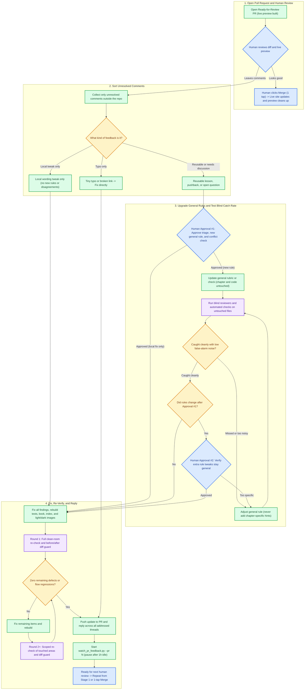

# Apex Couch-to-Silicon PR Review Process

This document defines the canonical **3-Tier, 4-Step Subset-Recall PR Review Protocol** governing every human review cycle across `systems/*`, `book/`, and `scripts/`.

## Overview and Branch Model

- **Protected `main` Branch**: Direct pushes, force-pushes, and deletion are disabled via a GitHub Repository Ruleset (`Protect main`), requiring passing `Apex CI` (`verify-python-roadmap-and-book`) and **100% review thread resolution**.
- **Single PR per Step (`step/<step-id>`)**: Open one Ready-for-Review PR targeting `main` with `step.py approve <step-id> --pr <URL>` pre-staged on the branch so `main` stays `pending` until human merge—zero shadow `review/*` PRs and zero direct-to-`main` pushes.
- **Isolated PR Previews with Inline Reviewing**: Root `https://ethanex8.github.io/apex/` remains strictly `main`-only, while `book.yml` deploys same-repo PR previews to `https://ethanex8.github.io/apex/pr-<N>/` with an always-on two-way inline review overlay—select any sentence or click `+` beside any heading, equation, diagram, or interactive widget to queue native GitHub PR review comments (using a one-time repo-scoped `Pull requests: Read and write` fine-grained PAT reused across all future PRs, or zero-token Markdown export), and view, reply to, or resolve existing PR threads inside the unified Review drawer.
- **Core Tier-2 Invariant**: Before editing any deliverable on a systemic (`Tier 2`) comment, enforce:

$$
U_{\text{tier2}} \subseteq \text{PanelFindings} \cup \text{GateFindings}
$$

Here $U_{\text{tier2}}$ denotes the approved systemic human review comments, `PanelFindings` denotes defects found independently by frozen-prompt isolated clean-room review subagents (`research`), and `GateFindings` denotes failures reported by deterministic static and visual checks (`check_code.py`, `check_book.py`, `check_visuals.py`).
Because `scripts/build_review_plan.py` emits frozen, content-agnostic prompts with overlapping section/code shards, fresh `docs/CHAPTER_INDEX.md` verification, compiled Prior-Section Ledgers, and explicit rubric files (`references/rubric_*.md`)—while historical calibration logs live strictly outside `.agents/skills/` in `docs/calibration/`—neither orchestrator hint-steering nor stale calibration ledgers can bias Step 2 recall or Step 3 convergence.

## End-to-End Review Lifecycle

| Visual Color | Who Acts | Meaning |
| :--- | :--- | :--- |
| **Blue** | Human Reviewer | Reviews diff/preview, approves general rule changes, or taps **Merge** |
| **Amber** | Decision Point | Routes feedback by scope or checks whether a loop has converged |
| **Purple** | Blind Reviewers | Isolated subagents reading frozen prompts with zero access to PR comments |
| **Green** | Agent & Automated Checks | Edits files, runs tests/linters/builds, pushes updates, and replies to threads |

## Detailed Step Reference

### Step 1: Unresolved Comment Triage and 3-Tier Classification (Gate 1)
1. Harvest **unresolved** grouped inline threads, review summaries, and issue comments **outside** the repository workspace using `python3 scripts/harvest_feedback.py --pr <N> --ack-eyes [--since <ISO_TS>] --out /tmp/apex-feedback/pr-<N>.json` (which skips already-resolved threads/bot banners by default, adds a `👀` `eyes` reaction onto newly picked-up inline/issue comments, and freezes the untouched pre-fix `HEAD` commit hash).
2. Evaluate every comment (`U1..Uk`) against the exact deliverable lines (`AGREE`, `CLARIFY`, or respectful `PUSHBACK`), then classify each item:
   - **Tier 0**: Pure mechanical typos or broken links—purge `/tmp` feedback JSON, fix directly, push to the PR branch, and reply across all addressed items (leaving resolution to the reviewer).
   - **Tier 1**: Local editorial phrasing, naming, or single-chapter clarification without rubric edits—if **every** item is unambiguous Tier 1 (`AGREE`, zero `PUSHBACK`/`CLARIFY`), purge `/tmp` feedback JSON and proceed directly to **Step 3**.
   - **Tier 2**: Systemic pedagogical, mathematical, visual, or engineering gap transferable across unrelated chapters or codebases (or recurring across `2+` chapters).
3. Whenever **any** item is **Tier 2**, `PUSHBACK`, or `CLARIFY`: draft edits strictly to the single canonical `.agents/skills/*/references/rubric_*.md`, `SKILL.md`, `GEMINI.md`, or `scripts/check_*.py` file as **universal domain-agnostic principles** (never referencing chapter symbols, hex constants, widget names, or line hints) alongside a **Rule Conflict & Counterbalance Check** identifying any existing rule narrowed or replaced to prevent pendulum swings.
4. Publish the triage table, Tier 1/Tier 2 split, conflict check, and proposed diffs in `pr_<N>_step1_triage.md` and pause at **Human Gate 1** until $U_{\text{agreed}}$ and any Tier-2 rules are approved. Immediately delete `/tmp/apex-feedback/pr-<N>.json` once Gate 1 signs off.

### Step 2: Tier-2 Rule Update and Frozen-Prompt Recall + Precision Check (Conditional Gate 2)
1. Apply only Gate-1-approved skill, rubric, `GEMINI.md`, and static-gate updates, then sync `.agents/skills/*` into `~/.gemini` via `save_skill(overwrite=True)`. Leave deliverables and `docs/calibration/*` **untouched**.
2. Execute `check_code.py`, `check_book.py`, `check_visuals.py`, verify `docs/CHAPTER_INDEX.md` freshness via `python3 scripts/build.py`, and generate the deterministic sharded review manifest via `python3 scripts/build_review_plan.py [--chapter <path>] [--code <files...>]`. Invoke **every** emitted task with `build_review_plan.py`'s **exact frozen prompt**—never hand-write custom prompts highlighting active PR comments, and forbid subagent reads of `docs/calibration/*`, `/tmp/`, triage artifacts, `gh`, or session logs.
3. Map every item in $U_{\text{tier2}}$ semantically to `CAUGHT_BY_GATE`, `CAUGHT_BY_BLIND_SUBAGENT`, or `MISSED`, **and** verify **Precision** (confirming new rules do not trigger noisy or boilerplate false positives on clean passages).
4. If any Tier-2 item is `MISSED` or noisy, generalize or counterbalance the governing rubric, skill, or gate rule cleanly, re-sync skills, and run **fresh** frozen-prompt subagents on affected shards until $U_{\text{tier2}} \subseteq \text{PanelFindings} \cup \text{GateFindings}$ with clean precision.
5. **Conditional Gate 2**: If Step 2 altered any rule prompt beyond Step 1's approved diff, pause at **Human Gate 2** for anti-cheating and precision sign-off; otherwise proceed directly to Step 3.

### Step 3: Deliverable Healing, Diff Guard, and Clean-Room Convergence
1. Fix the **entire** union of panel, static/visual gate, and $U_{\text{agreed}}$ findings across source code, tests, Vue widgets, CSS, and chapter prose, and refresh `approved_date` on the PR branch via `python3 scripts/step.py approve <step-id>` if the date advanced.
2. Append the retrospective root-cause entry (for Tier-2/substantive cycles) to `docs/calibration/<skill>.md` (kept strictly outside `.agents/skills/`).
3. Run `python3 scripts/build.py`, `check_code.py` (AST, Ruff, `mypy`, ShellCheck, C/SV gates), `pytest --cov-fail-under=95`, `sync_book.py --check`, `check_book.py`, `build.py --check`, `BOOK_BASE=/apex/ npm --prefix book run build`, and `check_visuals.py --screenshot-dir .cache/visual-audit` (capturing both light and dark PNGs).
4. Run fresh isolated clean-room `research` subagents with `--base-ref <untouched_head_sha>`: run a **full sweep** on Round 1 (`python3 scripts/build_review_plan.py [--chapter <path>] [--code <files...>] --base-ref <untouched_head_sha>`), and use deterministic **scoped** sweeps (`--changed-since <round_r_sha>`) for localized Round $r+1$ fixes until all emitted reviewers and the `Diff & Flow Regression Guardian` return **zero P0/P1/P2 defects**.

### Step 4: Fast-Forward PR Update, Cross-Channel Replies, and 1-Tap Merge Close-Out
1. Commit and push fast-forward updates strictly to the open `step/<step-id>` PR branch (never directly to `main`, and never force-push reviewed commits).
2. Prefix every agent-authored reply with `🤖 [Antigravity]` and post concise updates on **every** addressed feedback item across all channels (`gh api -X POST repos/<owner>/<repo>/pulls/<N>/comments/<id>/replies` for inline review comments; `gh api -X POST repos/<owner>/<repo>/issues/<N>/comments` with `<!-- apex-preview-reply-to: <root_id> -->` for PR review summaries and conversation items) so both GitHub and the preview overlay distinguish agent responses from human messages under the shared login.
3. **Do not auto-resolve threads**: leave addressed threads open so the human reviewer can pull up the preview widget or PR view, read each response without toggling resolved filters, and click **Resolve** once verified (run `python3 scripts/harvest_feedback.py --pr <N>` to verify every newly raised item has a reply).
4. Confirm `Apex CI` and the `/apex/pr-<N>/` preview deployment succeed, then launch `python3 scripts/watch_pr_feedback.py --pr <N>` as an async non-daemon background task (`IsDaemon=false`, default 1-hour `--max-duration`) before ending the turn so the agent automatically wakes on new human comments, reviews, or **1-tap Merge**—atomically updating `main`, auto-deleting `step/<step-id>`, deploying root `https://ethanex8.github.io/apex/`, and removing `/apex/pr-<N>/`.
5. **Watcher 1-Hour Idle Pause**: If a sandbox command timeout ends `watch_pr_feedback.py` early (`exit -1`) before new activity arrives, verify PR state and re-arm asynchronously (`IsDaemon=false`) while total idle wait since the last push or activity stays under **1 hour**. Once **1 hour** of idle waiting elapses (or `watch_pr_feedback.py` exits `2` on its 1-hour timeout), pause the watcher cleanly, stop automatic restarts, and inform the user so they can resume anytime by replying in chat.
