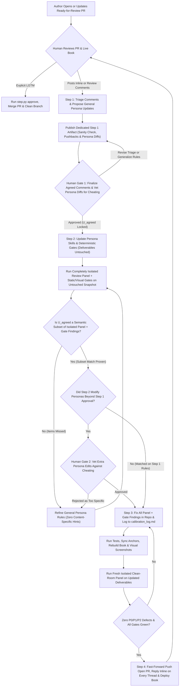

# Apex Couch-to-Silicon PR Review Process

This document defines the canonical **4-Step Subset-Recall PR Review Protocol** governing every human review cycle across `systems/*`, `book/`, and `scripts/`.

## Overview and Core Invariant

Every review cycle enforces one strict engineering invariant before any deliverable file is modified:

$$
U_{\text{agreed}} \subseteq \text{PanelFindings} \cup \text{GateFindings}
$$

Here $U_{\text{agreed}}$ denotes the finalized set of human review comments from the pull request (`PR`), `PanelFindings` denotes defects found independently by isolated clean-room review subagents (`research`), and `GateFindings` denotes failures reported by deterministic static and visual checks (`check_code.py`, `check_book.py`, `check_visuals.py`).
Because the review panel inspects the **untouched** pre-fix snapshot without access to PR comments, calibration ledgers, or chat transcripts, every agreed critique forces an upstream improvement in generalizable reviewer personas or deterministic repository gates before deliverable editing begins.

## End-to-End Review Lifecycle

## Detailed Step Reference

### Step 1: Comment Triage and Anti-Cheating Persona Proposal (Gate 1)
1. Harvest all inline diff comments, review summaries, and issue comments **outside** the repository workspace using `python3 scripts/harvest_feedback.py --pr <N> --out /tmp/apex-feedback/pr-<N>.json`, and freeze the untouched pre-fix `HEAD` commit hash.
2. Sanity-check every human comment against the exact deliverable lines and assign a disposition (`AGREE`, `CLARIFY`, or respectful `PUSHBACK` when a reading may be mistaken—with the human reviewer always holding the final decision).
3. Draft proposed edits to `.agents/skills/*/SKILL.md`, `GEMINI.md`, or deterministic `scripts/check_*.py` gates strictly as **domain-general engineering, pedagogical, mathematical, or visual principles**, never mentioning chapter symbols, hex constants, widget names, or line hints.
4. Publish the triage table and exact proposed persona/gate diffs in a standalone artifact (`pr_<N>_step1_triage.md`) and pause at **Human Gate 1** until the user locks $U_{\text{agreed}}$ and signs off on the non-cheating rules.

### Step 2: Persona Update and Isolated Subset-Recall Loop (Conditional Gate 2)
1. Apply only the Gate-1-approved skill, `GEMINI.md`, and static-gate updates, and sync `.agents/skills/*` into `~/.gemini` via `save_skill(overwrite=True)`. Leave deliverable files and `references/calibration_log.md` **untouched**.
2. Execute `check_code.py`, `check_book.py`, `check_visuals.py`, and the isolated Pass-3 `research` review panel on the untouched snapshot and `.cache/visual-audit/` screenshots, strictly forbidding subagents from reading `/tmp/apex-feedback/`, triage artifacts, `calibration_log.md`, `gh`, or session logs.
3. Map every item in $U_{\text{agreed}}$ semantically to `CAUGHT_BY_GATE`, `CAUGHT_BY_BLIND_SUBAGENT`, or `MISSED`.
4. If any item is `MISSED`, generalize the governing persona or gate rule (without leaking content-specific hints), re-sync skills, and run a **fresh** isolated panel until $U_{\text{agreed}} \subseteq \text{PanelFindings} \cup \text{GateFindings}$.
5. If Step 2 altered any persona prompt beyond Step 1's approved diff, pause at **Human Gate 2** for anti-cheating sign-off; otherwise proceed directly to Step 3.

### Step 3: Deliverable Healing and Clean-Room Convergence
1. Fix the **entire** union of panel, static/visual gate, and $U_{\text{agreed}}$ findings across source code, tests, Vue widgets, CSS, and chapter prose.
2. Append the retrospective root-cause entry to the relevant `.agents/skills/<skill>/references/calibration_log.md` and sync via `save_skill`.
3. Re-run `check_code.py`, `pytest --cov-fail-under=95`, `sync_book.py --check`, `check_book.py`, `build.py --check`, `BOOK_BASE=/apex/ npm --prefix book run build`, and `check_visuals.py --screenshot-dir .cache/visual-audit`.
4. Run fresh isolated clean-room Pass-3 specialist rounds on the updated deliverables and screenshots until a complete round returns **zero P0/P1/P2 defects**.

### Step 4: Fast-Forward PR Update, Thread Resolution, and `LGTM` Close-Out
1. Commit and push fast-forward updates to `main` and the open **Ready for Review** PR branch without closing prematurely or force-pushing reviewed commits.
2. Post concise inline replies on every addressed PR comment (`gh api -X POST repos/<owner>/<repo>/pulls/<N>/comments/<id>/replies`) noting both the deliverable fix and the upstream persona/gate change.
3. Resolve every addressed GitHub review thread via GraphQL `resolveReviewThread`, leaving a thread unresolved **only** when an open question remains for the reviewer.
4. Confirm GitHub Actions CI and GitHub Pages deployment succeed, then return to human review (**Gate 3**). Upon explicit final `LGTM`, run `python3 scripts/step.py approve <step-id> --commit <sha>`, verify `build.py --check`, merge/close the PR, and delete temporary branches locally and on `origin`.
