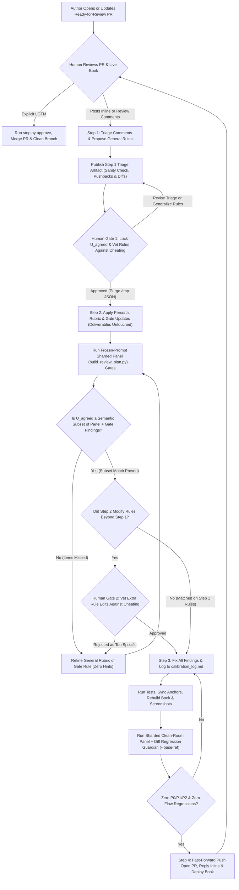

# Apex Couch-to-Silicon PR Review Process

This document defines the canonical **4-Step Subset-Recall PR Review Protocol** governing every human review cycle across `systems/*`, `book/`, and `scripts/`.

## Overview and Core Invariant

Every review cycle enforces one strict engineering invariant before any deliverable file is modified:

$$
U_{\text{agreed}} \subseteq \text{PanelFindings} \cup \text{GateFindings}
$$

Here $U_{\text{agreed}}$ denotes the finalized set of human review comments from the pull request (`PR`), `PanelFindings` denotes defects found independently by frozen-prompt isolated clean-room review subagents (`research`), and `GateFindings` denotes failures reported by deterministic static and visual checks (`check_code.py`, `check_book.py`, `check_visuals.py`).
Because `scripts/build_review_plan.py` emits frozen, content-agnostic prompts with overlapping section shards, compiled Prior-Section Ledgers, and explicit rubric files (`references/rubric_*.md`), neither orchestrator hint-steering nor stale calibration ledgers can bias Step 2 recall or Step 3 convergence.

## End-to-End Review Lifecycle

## Detailed Step Reference

### Step 1: Comment Triage and Anti-Cheating Rule Proposal (Gate 1)
1. Harvest all inline diff comments, review summaries, and issue comments **outside** the repository workspace using `python3 scripts/harvest_feedback.py --pr <N> --out /tmp/apex-feedback/pr-<N>.json`, and freeze the untouched pre-fix `HEAD` commit hash.
2. Evaluate every human comment against the exact deliverable lines (`AGREE`, `CLARIFY`, or respectful `PUSHBACK` when a reading may be mistaken—the human reviewer holds the final call).
3. Draft proposed edits to `.agents/skills/*/SKILL.md`, `.agents/skills/*/references/rubric_*.md`, `GEMINI.md`, or `scripts/check_*.py` strictly as **universal pedagogical, mathematical, visual, or engineering principles**, never referencing chapter symbols, hex constants, widget names, or line hints.
4. Publish the triage table and proposed diffs in `pr_<N>_step1_triage.md` and pause at **Human Gate 1** until $U_{\text{agreed}}$ and the non-cheating rules are approved. Immediately delete `/tmp/apex-feedback/pr-<N>.json` once Gate 1 signs off.

### Step 2: Rule Update and Frozen-Prompt Subset-Recall Loop (Conditional Gate 2)
1. Apply only Gate-1-approved skill, rubric, `GEMINI.md`, and static-gate updates, then sync `.agents/skills/*` into `~/.gemini` via `save_skill(overwrite=True)`. Leave deliverables and `references/calibration_log.md` **untouched**.
2. Execute `check_code.py`, `check_book.py`, `check_visuals.py`, and generate the deterministic sharded review manifest via `python3 scripts/build_review_plan.py --chapter <path>`. Invoke every `research` subagent with its **exact frozen prompt**—never hand-write custom prompts highlighting active PR comments, and forbid subagent reads of `calibration_log.md`, `/tmp/`, triage artifacts, `gh`, or session logs.
3. Map every item in $U_{\text{agreed}}$ semantically to `CAUGHT_BY_GATE`, `CAUGHT_BY_BLIND_SUBAGENT`, or `MISSED`.
4. If any item is `MISSED`, generalize the governing rubric, skill, or gate rule cleanly, re-sync skills, and run **fresh** frozen-prompt subagents on the affected shard(s) until $U_{\text{agreed}} \subseteq \text{PanelFindings} \cup \text{GateFindings}$.
5. If Step 2 altered any rule prompt beyond Step 1's approved diff, pause at **Human Gate 2** for anti-cheating sign-off; otherwise proceed to Step 3.

### Step 3: Deliverable Healing, Diff Guard, and Clean-Room Convergence
1. Fix the **entire** union of panel, static/visual gate, and $U_{\text{agreed}}$ findings across source code, tests, Vue widgets, CSS, and chapter prose.
2. Append the retrospective root-cause entry to `.agents/skills/<skill>/references/calibration_log.md` and sync via `save_skill`.
3. Re-run `check_code.py`, `pytest --cov-fail-under=95`, `sync_book.py --check`, `check_book.py`, `build.py --check`, `BOOK_BASE=/apex/ npm --prefix book run build`, and `check_visuals.py --screenshot-dir .cache/visual-audit`.
4. Generate the regression-guarded manifest (`python3 scripts/build_review_plan.py --chapter <path> --base-ref <untouched_head_sha>`) and run fresh isolated clean-room `research` subagents across every shard, `Global Macro & Dependency Critic`, `Visual Pedagogy Critic`, and the `Diff & Flow Regression Guardian` (`rubric_diff_guardian.md`) until all checks return **zero P0/P1/P2 defects**.

### Step 4: Fast-Forward PR Update, Thread Resolution, and `LGTM` Close-Out
1. Commit and push fast-forward updates to `main` and the open **Ready for Review** PR branch without closing prematurely or force-pushing reviewed commits.
2. Post concise inline replies on every addressed PR comment (`gh api -X POST repos/<owner>/<repo>/pulls/<N>/comments/<id>/replies`) noting both the deliverable fix and the upstream rule/gate update.
3. Resolve every addressed GitHub review thread via GraphQL `resolveReviewThread`, leaving a thread unresolved **only** when an open question remains for the reviewer.
4. Confirm GitHub Actions CI and GitHub Pages deployment succeed, then return to human review (**Gate 3**). Upon explicit final `LGTM`, run `python3 scripts/step.py approve <step-id> --commit <sha>`, verify `build.py --check`, merge/close the PR, and delete temporary branches locally and on `origin`.
