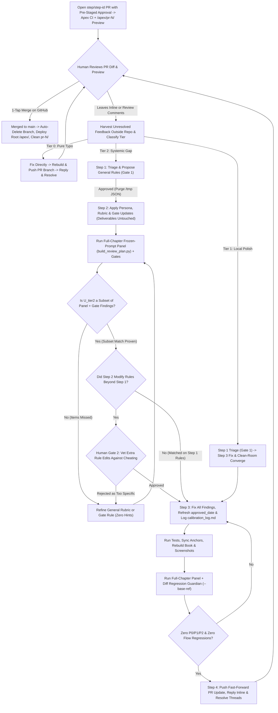

# Apex Couch-to-Silicon PR Review Process

This document defines the canonical **3-Tier, 4-Step Subset-Recall PR Review Protocol** governing every human review cycle across `systems/*`, `book/`, and `scripts/`.

## Overview and Branch Model

- **Protected `main` Branch**: Direct pushes, force-pushes, and deletion are disabled via a GitHub Repository Ruleset (`Protect main`), requiring passing `Apex CI` (`verify-python-roadmap-and-book`) and **100% review thread resolution**.
- **Single PR per Step (`step/<step-id>`)**: Open one Ready-for-Review PR targeting `main` with `step.py approve <step-id> --pr <URL>` pre-staged on the branch so `main` stays `pending` until human merge—zero shadow `review/*` PRs and zero direct-to-`main` pushes.
- **Isolated PR Previews**: Root `https://ethanex8.github.io/apex/` remains strictly `main`-only, while `book.yml` deploys same-repo PR previews to `https://ethanex8.github.io/apex/pr-<N>/` and cleans them up automatically when the PR closes.
- **Core Tier-2 Invariant**: Before editing any deliverable on a systemic (`Tier 2`) comment, enforce:

$$
U_{\text{tier2}} \subseteq \text{PanelFindings} \cup \text{GateFindings}
$$

Here $U_{\text{tier2}}$ denotes the approved systemic human review comments, `PanelFindings` denotes defects found independently by frozen-prompt isolated clean-room review subagents (`research`), and `GateFindings` denotes failures reported by deterministic static and visual checks (`check_code.py`, `check_book.py`, `check_visuals.py`).
Because `scripts/build_review_plan.py` emits frozen, content-agnostic prompts with overlapping section shards, compiled Prior-Section Ledgers, and explicit rubric files (`references/rubric_*.md`), neither orchestrator hint-steering nor stale calibration ledgers can bias Step 2 recall or Step 3 convergence.

## End-to-End Review Lifecycle

## Detailed Step Reference

### Step 1: Unresolved Comment Triage and 3-Tier Classification (Gate 1)
1. Harvest **unresolved** inline diff comments, review summaries, and issue comments **outside** the repository workspace using `python3 scripts/harvest_feedback.py --pr <N> --out /tmp/apex-feedback/pr-<N>.json` (already-resolved threads and preview bot banners are skipped by default; pass `--include-resolved` only when auditing full history), and freeze the untouched pre-fix `HEAD` commit hash.
2. Evaluate every comment (`U1..Uk`) against the exact deliverable lines (`AGREE`, `CLARIFY`, or respectful `PUSHBACK`), then classify each item:
   - **Tier 0**: Pure mechanical typos or broken links—fix directly, push to the PR branch, reply inline, and resolve.
   - **Tier 1**: Local editorial phrasing, naming, or single-chapter clarification—skips rubric/skill edits and Step 2 blind recall (escalate to Tier 2 only if recurring across `2+` subsystem chapters).
   - **Tier 2**: Systemic pedagogical, mathematical, visual, or engineering gap transferable across unrelated chapters.
3. For **Tier 2** items, draft edits to `.agents/skills/*/SKILL.md`, `.agents/skills/*/references/rubric_*.md`, `GEMINI.md`, or `scripts/check_*.py` strictly as **universal domain-agnostic principles**, never referencing chapter symbols, hex constants, widget names, or line hints.
4. Publish the triage table, Tier 1/Tier 2 split, and proposed diffs in `pr_<N>_step1_triage.md` and pause at **Human Gate 1** until $U_{\text{agreed}}$ and any Tier-2 rules are approved. Immediately delete `/tmp/apex-feedback/pr-<N>.json` once Gate 1 signs off.

### Step 2: Tier-2 Rule Update and Full-Chapter Frozen-Prompt Recall (Conditional Gate 2)
1. If every agreed item is Tier 1, proceed directly to **Step 3**. Otherwise, apply only Gate-1-approved skill, rubric, `GEMINI.md`, and static-gate updates, then sync `.agents/skills/*` into `~/.gemini` via `save_skill(overwrite=True)`. Leave deliverables and `references/calibration_log.md` **untouched**.
2. Execute `check_code.py`, `check_book.py`, `check_visuals.py`, and generate the deterministic sharded review manifest via `python3 scripts/build_review_plan.py --chapter <path>`. Invoke **every** emitted shard (`1..K`), `Global Macro & Dependency Critic`, and `Visual Pedagogy Critic` with `build_review_plan.py`'s **exact frozen prompt**—never hand-write custom prompts highlighting active PR comments, and forbid subagent reads of `calibration_log.md`, `/tmp/`, triage artifacts, `gh`, or session logs.
3. Map every item in $U_{\text{tier2}}$ semantically to `CAUGHT_BY_GATE`, `CAUGHT_BY_BLIND_SUBAGENT`, or `MISSED`.
4. If any Tier-2 item is `MISSED`, generalize the governing rubric, skill, or gate rule cleanly, re-sync skills, and run **fresh** frozen-prompt subagents on the affected shard(s) until $U_{\text{tier2}} \subseteq \text{PanelFindings} \cup \text{GateFindings}$.
5. If Step 2 altered any rule prompt beyond Step 1's approved diff, pause at **Human Gate 2** for anti-cheating sign-off; otherwise proceed directly to Step 3.

### Step 3: Deliverable Healing, Diff Guard, and Clean-Room Convergence
1. Fix the **entire** union of panel, static/visual gate, and $U_{\text{agreed}}$ findings across source code, tests, Vue widgets, CSS, and chapter prose, and refresh `approved_date` on the PR branch via `python3 scripts/step.py approve <step-id>` if the date advanced.
2. Append the retrospective root-cause entry (for Tier-2/substantive cycles) to `.agents/skills/<skill>/references/calibration_log.md` and sync via `save_skill`.
3. Re-run `check_code.py`, `pytest --cov-fail-under=95`, `sync_book.py --check`, `check_book.py`, `build.py --check`, `BOOK_BASE=/apex/ npm --prefix book run build`, and `check_visuals.py --screenshot-dir .cache/visual-audit`.
4. Generate the regression-guarded manifest (`python3 scripts/build_review_plan.py --chapter <path> --base-ref <untouched_head_sha>`) and run fresh isolated clean-room `research` subagents across **every shard (`1..K`)**, `Global Macro & Dependency Critic`, `Visual Pedagogy Critic`, and the `Diff & Flow Regression Guardian` (`rubric_diff_guardian.md`) until all checks return **zero P0/P1/P2 defects**.

### Step 4: Fast-Forward PR Update, Thread Resolution, and 1-Tap Merge Close-Out
1. Commit and push fast-forward updates strictly to the open `step/<step-id>` PR branch (never directly to `main`, and never force-push reviewed commits).
2. Post concise inline replies on every addressed PR comment (`gh api -X POST repos/<owner>/<repo>/pulls/<N>/comments/<id>/replies`) noting both the deliverable fix and any upstream rule/gate update.
3. Resolve every addressed GitHub review thread via GraphQL `resolveReviewThread` (required by the `Protect main` ruleset), leaving a thread unresolved **only** when a genuine open question remains for the reviewer.
4. Confirm `Apex CI` and the `/apex/pr-<N>/` preview deployment succeed, then return to human review. Because `step.py approve <step-id> --pr <URL>` is already staged on the PR branch, tapping **Merge pull request** on GitHub completes the step in **one tap**—atomically updating `main`, auto-deleting `step/<step-id>`, deploying root `https://ethanex8.github.io/apex/`, and removing `/apex/pr-<N>/`.
