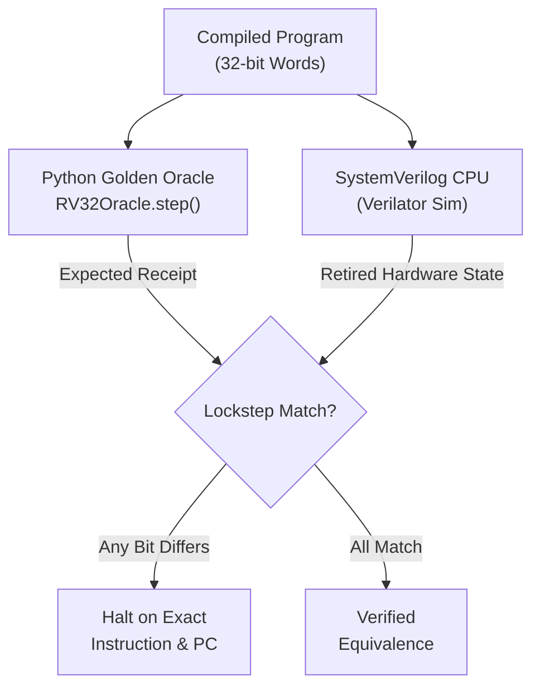
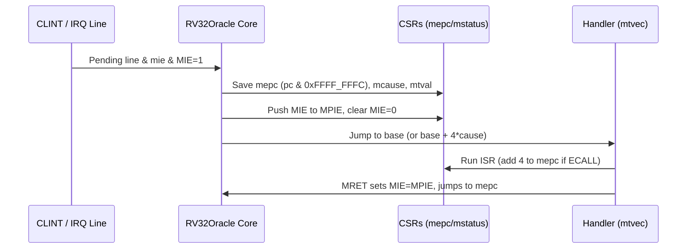

# Chapter 1: The Golden ISA Contract, Fixed-Width Binary Math & Instruction Execution

> **Volume I (`brain`) · Phase 1 · Reading Time**: about 55 minutes  
> **Primary Modules**: [`oracle.py`](../sim/oracle.py) (`1,127` lines) & [`test_oracle.py`](../tb/test_oracle.py) (`789` lines)  
> **Interactive Figures**: *4-Bit Modular Ring Adder*, *Sign Extension & Right-Shift Comparator*, *32-Bit Instruction Inspector*, and *`RV32Oracle.step()` Trace Explorer*

---

## 1. Why Chip Design Starts in Software: The Golden Reference Model

Consider building a production database storage engine or distributed consensus protocol without a formal specification—jumping straight into lock-free pointer arithmetic and hoping unit tests written alongside the optimizations catch subtle ordering bugs. Experienced systems engineers recognize the hazard: when an optimization and its test share the same flawed assumption, both pass while silently corrupting state.

Designing a custom processor in a **Hardware Description Language (`HDL`)** such as `SystemVerilog` multiplies that hazard tenfold. In sequential software, statements execute one after another; in physical silicon, thousands of boolean logic gates, hardware selector switches—the circuit equivalent of `cond ? a : b` (**multiplexers**)—and 1-bit clocked storage latches (**flip-flops**) evaluate **simultaneously on every tick of a `50 MHz` crystal oscillator**. When a pipelined processor fetches Instruction #5 while decoding Instruction #4, computing arithmetic for Instruction #3, reading RAM for Instruction #2, and writing a register for Instruction #1—and an external timer alarm fires mid-flight—we need an unambiguous specification defining what the hardware ought to have done.

Commercial chip teams solve this before writing a single logic gate by building an unambiguous, sequential software model of the processor called a **Golden Reference Model—or Oracle**. [`oracle.py`](../sim/oracle.py) is that golden specification for the `brain` processor. Before we turn the specification into logic gates, software tests execute programs directly against the oracle; later, when the `SystemVerilog` hardware runs inside an open-source hardware simulator that compiles register-transfer designs into fast C++ executables (**Verilator**), both engines execute the exact same machine code in lockstep. On every instruction, [`RV32Oracle.step()`](../sim/oracle.py#L1002-L1109) compares its architectural state transition against the hardware's retired output:



To verify that equivalence without slowing down the pipeline, [`RV32Oracle.step()`](../sim/oracle.py#L1002-L1109) emits a structured commit receipt after each executed instruction—[`StepTrace`](../sim/oracle.py#L308-L328):

<!-- book-sync: StepTrace -->
<<< @/systems/brain/sim/oracle.py#L308-L328

`StepTrace` works like a **write-ahead database log entry**. Instead of waiting for a 10,000-instruction test to finish and produce a wrong final sum, co-simulation compares five fields on every single completed and committed (**retired**) instruction: the fetched instruction address (`pc`, the **Program Counter**) and raw `32`-bit word (`insn`), the post-instruction `next_pc`, the destination register (`rd`) and committed value (`rd_val`), any memory bus payload (`mem_addr`, `mem_val`, `mem_write`), and any exception or interrupt code (`trap_cause`, `interrupt`).

### What an Instruction Set Architecture (`ISA`) Separates

Software relies on crisp abstraction layers: a **POSIX system-call contract** separates user programs from how the Linux kernel schedules threads or lays out disk blocks, and the **Java Virtual Machine (`JVM`) bytecode specification** separates `javac` from how `HotSpot` optimizes loops at runtime. In processor engineering, the boundary separating **all software** (compilers, bootloaders, real-time schedulers, control loops) from **physical silicon** (pipelines, logic gates, clock frequencies) is the **Instruction Set Architecture (`ISA`)**.

An `ISA` defines strictly what machine code can observe:
1. **Architectural State**: The persistent storage containers (registers, program counter, control registers, and addressable memory) that survive from one instruction to the next.
2. **Instruction Binary Encoding**: How operations, register selectors, and constants pack into `32`-bit integers (`0`s and `1`s).
3. **State-Transition Semantics**: Given any state $S_t$ and the 32-bit word fetched at `pc`, the deterministic next state:

$$S_{t+1} = \text{step}(S_t)$$

Because an `ISA` omits internal microarchitecture details—such as whether an operation takes 1 cycle or 32 cycles, or how five pipeline stages overlap—[`oracle.py`](../sim/oracle.py) expresses the entire `brain` processor and its peripherals cleanly in sequential Python. Across the rest of this chapter, we build the `brain` architecture layer by layer: fixed-width binary arithmetic first, registers and instruction families next, 32-bit instruction packing, corner cases in integer and neural math, the memory and peripheral bus, and finally interrupts, traps, and the full execution loop.

---

## 2. Fixed-Width Binary Arithmetic from First Principles

When you evaluate `2**200` or `-5` in Python, the runtime allocates variable-length byte arrays on the heap so integers never overflow. Physical silicon has no heap allocator inside an arithmetic circuit. A 32-bit processor register is **32 parallel copper wires** driven by 32 clocked flip-flops, each holding either a low voltage (`0`) or a high voltage (`1`). Every integer, memory pointer, and packed sensor reading must fit inside those `32` wires (`2^32 = 4,294,967,296` distinct bit patterns).

Play with a miniature **4-bit version** (`16` patterns) in the interactive clock-face adder below before walking through the algebra—notice how both positive and negative numbers wrap seamlessly around the same circle:

<ModularRingAdder />

### Unsigned Binary Integers & Modular Rings (`u32`)

Consider an $N$-bit register holding bits $b_{N-1}, b_{N-2}, \dots, b_0 \in \{0, 1\}$. Under standard positional notation, bit $i$ carries weight $+2^i$, defining the **unsigned integer interpretation**:

$$U_N(b) = \sum_{i=0}^{N-1} b_i \cdot 2^i$$

When all bits are `0`, $U_N = 0$; when all bits are `1`, summing the geometric series $\sum_{i=0}^{N-1} 2^i = 2^N - 1$ gives the maximum value. An $N$-bit unsigned register therefore spans $[0,\; 2^N - 1]$ (for $N = 32$, `0` through `4,294,967,295`).

Now suppose an arithmetic step produces an integer $x \in \mathbb{Z}$ outside $[0, 2^N - 1]$—such as adding two 32-bit numbers whose true sum has a 33rd carry-out bit. By integer division with remainder (*Euclidean division*: dividing any integer $x$ by $2^N$ leaves a unique non-negative remainder $r$ strictly below $2^N$), we write:

$$x = q \cdot 2^N + r, \qquad q \in \mathbb{Z},\quad 0 \le r < 2^N$$

Multiplying $q$ by $2^N$ pushes every bit of $q$ to bit positions $i \ge N$, leaving $r = x \bmod 2^N$ in the bottom $N$ bits $0$ through $N-1$. Because a physical 32-bit register only has wires $0\dots 31$, any upper bits simply vanish off the left edge of the adder. Wrapping integers around $[0, 2^N - 1]$ creates a **modular ring** $\mathbb{Z}_{2^N}$: a finite clock face like the 4-bit `0000`–`1111` wheel above where stepping `1` past `2^N - 1` lands back at `0`, and two integers belong to the same **residue class** whenever they differ by a multiple of $2^N$ and therefore occupy the same clock slot.

In Python, masking with `MASK32 = 0xFFFF_FFFF` ($2^{32} - 1$) projects any Python `int` onto $\mathbb{Z}_{2^{32}}$:

<!-- book-sync: MASK32..s16 -->
<<< @/systems/brain/sim/oracle.py#L129-L152

### Why Two's Complement Won: Negative Numbers on Clock-Face Wires

How should those same $2^N$ bit patterns represent **signed** integers without adding a wire for a `"-"` character? Compare two alternative encodings on `N = 4` bits (`16` patterns):

- **Sign-Magnitude** (*top bit = sign, bottom `N - 1` bits = magnitude*): Wastes one pattern on `-0` (`1000` alongside `+0 = 0000`) and breaks binary addition (`+3` [`0011`] `+` `-5` [`1101`] gives `0000` instead of `-2`), forcing hardware to inspect signs and subtract magnitudes separately.
- **Ones' Complement** (*negate by flipping all bits, so `-5` is `1010`*): Still suffers from two zeros (`0000` and `1111`) and requires routing the top carry-out bit back around into `Bit 0` ("end-around carry").

**Two's complement (`s32` and `s16`)** takes its cue directly from the clock face: stepping **backward by 1** modulo $16$ from `0000` lands on `1111` ($15 \equiv -1 \pmod{16}$), and stepping backward by `5` lands on `1011` ($11 \equiv -5 \pmod{16}$). Algebraically, two's complement keeps positive weights $+2^0, \dots, +2^{N-2}$ on the bottom $N - 1$ bits and assigns the **most-significant bit (`Bit N-1`) a negative weight $-2^{N-1}$**:

$$S_N(b) = -b_{N-1} \cdot 2^{N-1} + \sum_{i=0}^{N-2} b_i \cdot 2^i$$

Writing $L = \sum_{i=0}^{N-2} b_i 2^i \in [0,\; 2^{N-1}-1]$, patterns with $b_{N-1} = 0$ cover $[0,\; 2^{N-1}-1]$ while patterns with $b_{N-1} = 1$ cover $[-2^{N-1},\; -1]$—mapping all $2^N$ patterns one-to-one onto $[-2^{N-1},\; 2^{N-1}-1]$ with **only one zero** (`000...0`). For $N = 32$, that gives `INT32_MIN = -2,147,483,648` (`0x8000_0000`) through `INT32_MAX = +2,147,483,647` (`0x7FFF_FFFF`).

### Contiguous Derivations: `u32`↔`s32`, Negation (`~x + 1`), and Sign-Agnostic Adders

Notice how `s32(val)` and `s16(val)` in [`oracle.py`](../sim/oracle.py#L129-L152 "anchor: MASK32..s16") convert an unsigned bit pattern directly into a Python signed integer (`u - (u >> 31) * (1 << 32)`). We can derive both that formula and why a single binary adder works for signed and unsigned math in one continuous chain:

$$\begin{aligned}
U_N(b) - S_N(b)
&= \left(b_{N-1} 2^{N-1} + \sum_{i=0}^{N-2} b_i 2^i\right)
 - \left(-b_{N-1} 2^{N-1} + \sum_{i=0}^{N-2} b_i 2^i\right)
&& \text{(split } i = N-1 \text{ term; lower sums match)} \\
&= 2 \cdot b_{N-1} \cdot 2^{N-1}
&& \text{(lower } N-1 \text{ terms cancel identically)} \\
&= b_{N-1} \cdot 2^N
&& \text{(combine powers of } 2 \text{)} \\
\implies\quad S_N(b) &= U_N(b) - b_{N-1} \cdot 2^N
&& \text{(exact } \text{s32} \text{ / } \text{s16} \text{ code formula)}
\end{aligned}$$

Two hardware corollaries follow directly from this derivation:

1. **Why Bitwise Negation Is `~x + 1`**: Let $\bar{b}_i = 1 - b_i$ be the bitwise complement of $b$:

$$\begin{aligned}
U_N(\bar{b}) + 1
&= \sum_{i=0}^{N-1} (1 - b_i) 2^i + 1
&& \text{(substitute } \bar{b}_i = 1 - b_i \text{)} \\
&= \left(2^N - 1 - U_N(b)\right) + 1
&& \text{(evaluate } \sum_{i=0}^{N-1} 2^i = 2^N - 1 \text{)} \\
&= 2^N - U_N(b) \equiv -S_N(b) \pmod{2^N}
&& \text{(since } U_N(b) \equiv S_N(b) \pmod{2^N} \text{)}
\end{aligned}$$

Hardware therefore computes subtraction $A - B$ on the **exact same adder circuit** as $A + \bar{B} + 1$ by inverting $B$'s wires and driving carry-in $= 1$.

2. **Why Integer Addition (`ADD`), Subtraction (`SUB`), and Shift Left Logical (`SLL`) Need No Signed/Unsigned Variants**: Because $U_N(b) - S_N(b) = b_{N-1} 2^N$ is always a multiple of $2^N$, any $N$-bit word satisfies $U_N(b) \equiv S_N(b) \pmod{2^N}$. Adding, subtracting, or shifting left (`* 2^k`) any two 32-bit operands modulo $2^{32}$ yields the exact same bottom 32 bits regardless of whether software treats those bits as `u32` or `s32`.

### Right Shifts & Widening Narrow Constants (`sign_extend`)

Unlike addition, three operations **do** depend on signedness: ordered comparisons (`<`, `>=`), right shifts (`>>`), and widening narrow bit widths (`8`, `12`, `16`, or `21` bits) up to `32` bits. Experiment with how Bit 11 fans out across Bits 31..12—and how logical vs. arithmetic right shifts fill vacated upper bits—before checking the proof below:

<SignExtensionShifter />

Notice the sharp split between the two right-shift instructions shown in the widget above: a **logical right shift (`SRLI`)** shifts in `0`s from the left to compute unsigned floor division $\lfloor U_{32}(x) / 2^k \rfloor$ (`u32(x) >> k` in Python), whereas an **arithmetic right shift (`SRAI`)** copies the original sign wire (`Bit 31`) into every vacated upper bit to preserve negative signs when computing signed division toward $-\infty$ ($\lfloor S_{32}(x) / 2^k \rfloor$). Because Python `int` right-shift (`>>`) performs arithmetic sign-replication automatically on negative numbers, [`oracle.py`](../sim/oracle.py) explicitly uses `rs1_u >> shamt` for logical shifts and `rs1_s >> shamt` for arithmetic shifts.

Suppose hardware needs to widen a $k$-bit signed constant ($1 \le k < 32$, such as a 12-bit instruction immediate or 8-bit loaded byte) into a `32`-bit register by copying its top sign bit $b_{k-1}$ onto every upper wire $i \in [k, 31]$. Evaluating the two's complement sum directly proves that zero logic gates are needed—wire $b_{k-1}$ simply fans out to wires `31..k`:

$$\begin{aligned}
S_{32}(\text{extended } b)
&= -b_{k-1} 2^{31} + \sum_{i=k}^{30} b_{k-1} 2^i + b_{k-1} 2^{k-1} + \sum_{i=0}^{k-2} b_i 2^i
&& \text{(assign } b_{k-1} \text{ to Bits } 31\dots k \text{)} \\
&= b_{k-1}\!\left(-2^{31} + (2^{31} - 2^k) + 2^{k-1}\right) + \sum_{i=0}^{k-2} b_i 2^i
&& \text{(geometric series } \sum_{i=k}^{30} 2^i = 2^{31} - 2^k \text{)} \\
&= -b_{k-1} 2^{k-1} + \sum_{i=0}^{k-2} b_i 2^i = S_k(b)
&& \text{(telescope } {-2^k + 2^{k-1}} = -2^{k-1} \text{)}
\end{aligned}$$

Now inspect [`sign_extend`](../sim/oracle.py#L164-L170) in [`oracle.py`](../sim/oracle.py):

<!-- book-sync: sign_extend -->
<<< @/systems/brain/sim/oracle.py#L164-L170

Writing the masked $k$-bit unsigned value as $\text{val} = b_{k-1} s + L$, where $s = 2^{k-1}$ (`sign_bit`) and $L = \sum_{i=0}^{k-2} b_i 2^i \in [0, s - 1]$, bit $k-1$ of $L$ is `0`. XORing with $s$ therefore flips *only* bit $k-1$ without touching $L$:

$$\begin{aligned}
(\text{val} \oplus s) - s
&= \left((1 - b_{k-1}) s + L\right) - s
&& \text{(XOR toggles only } b_{k-1} \mapsto 1 - b_{k-1} \text{)} \\
&= -b_{k-1} s + L = -b_{k-1} 2^{k-1} + \sum_{i=0}^{k-2} b_i 2^i = S_k(b)
&& \text{(cancel } s - s = 0 \text{)}
\end{aligned}$$

### Wrap-Around Overflow vs. Saturating Clamping (`sat32`)

Standard integer `ADD` wraps silently modulo $2^{32}$: `INT32_MAX + 1` flips to `INT32_MIN` (`-2,147,483,648`). While wrap-around works well for pointers and ring buffers, a wrap from max positive torque to max negative torque inside a leg-control neural network would slam a robot joint in the wrong direction. For custom neural accumulation, [`sat32`](../sim/oracle.py#L155-L161) therefore clamps out-of-range integers to `[INT32_MIN, INT32_MAX]`:

<!-- book-sync: sat32 -->
<<< @/systems/brain/sim/oracle.py#L155-L161

---

## 3. Core CPU State, Hardwired `x0`, and the Six Instruction Groups

Before wiring instructions together, establish the core computation state of the CPU: two fundamental storage elements plus the instruction vocabulary they execute. *(Later sections introduce the neural accumulator `mac_acc`, the memory bus and peripherals, and privileged control registers right as we derive their mechanics.)*

Inside [`RV32Oracle.reset()`](../sim/oracle.py#L367-L396), core execution revolves around:
1. **The Program Counter (`self.pc`)**: A single 32-bit register holding the byte address of the *next* instruction to fetch. At boot, `reset()` initializes `self.pc = BOOT_ROM_BASE` (`0x0000_0000`).
2. **The General-Purpose Register File (`self.regs[0..31]`)**: An array of `32` fast 32-bit integer registers named `x0` through `x31` (`128` bytes total). Why `32` registers rather than `8` or `256`? Every instruction must encode each register operand using $\log_2(\text{count})$ bits: `32` registers take **5 bits** per operand, so three operands consume `15` of the `32` instruction wires while leaving `17` bits for opcodes and constants.

### Why Register `x0` Is Hardwired to Zero

Examine [`_set_reg`](../sim/oracle.py#L671-L676), the sole gatekeeper through which every instruction commits register results:

<!-- book-sync: RV32Oracle._set_reg -->
<<< @/systems/brain/sim/oracle.py#L671-L676

In hardware, `x0` is not a flip-flop cleared at boot—its output wires are strapped permanently to `0V` (`0`), and its write-enable wire ignores writes. Dedicating one register to `0` eliminates separate machine opcodes for everyday tasks by turning them into **aliases (*pseudoinstructions*)** of existing base instructions:
- **Do nothing (`nop`)** → `addi x0, x0, 0` (discards write into `x0`)
- **Copy register (`mv rd, rs1`)** → `addi rd, rs1, 0`
- **Load small constant (`li rd, imm`)** → `addi rd, x0, imm`
- **Negate integer (`neg rd, rs1`)** → `sub rd, x0, rs1`
- **Branch if zero (`beqz rs1, off`)** → `beq rs1, x0, off` (compares directly against `x0`—eliminating any hidden CPU flags register like `Zero`/`Carry` that complicates pipelining!)
- **Return from function (`ret`)** → `jalr x0, 0(x1)` (jumps to `x1` while discarding the unused next-instruction return address, called the **link address**, into `x0`)

### Top-Down Map: The Six Instruction Families of `RV32IM + Zicsr + Xapex`

The `brain` processor implements **Reduced Instruction Set Computer — Fifth Generation (`RISC-V`)**, an open specification organized into small modular instruction sets (**RISC-V 32-bit Base Integer / `RV32I`** + `M` hardware multiply/divide + `Zicsr` control registers) alongside one custom extension (`Xapex` packed neural **Multiply-Accumulate / `MAC`**). Every valid 32-bit instruction belongs to one of **six functional groups**:

| # | Functional Group | Example Instructions | What Software Uses It For | Derived In |
| :-: | :--- | :--- | :--- | :---: |
| **1** | **Integer Arithmetic Logic Unit (`ALU`), Shifts & Upper Constants (`RV32I`)** | `add`, `sub`, `addi`, `and`, `or`, `xor`, `sll`, `srl`, `sra`, `slt`, `sltu`, `lui`, `auipc` | Loop counters, array offsets, bit masks, comparisons, building 32-bit addresses | Sec. 4–5 |
| **2** | **Multiply & Divide (`RV32M`)** | `mul`, `mulh`, `mulhsu`, `mulhu`, `div`, `divu`, `rem`, `remu` | Full 64-bit products, fixed-point scaling, remainder/modulo without software loops | Sec. 5 |
| **3** | **Memory Loads & Stores (`RV32I`)** | `lb`, `lbu`, `lh`, `lhu`, `lw`, `sb`, `sh`, `sw` | Reading/writing bytes, halfwords, and 32-bit words in RAM and peripheral registers | Sec. 7 |
| **4** | **Branches & Subroutine Jumps (`RV32I`)** | `beq`, `bne`, `blt`, `bge`, `bltu`, `bgeu`, `jal`, `jalr` | `if`/`while` loops, function calls (saving link `PC + 4`), indirect function pointers | Sec. 4, 8 |
| **5** | **System, Barriers & Control Registers (`RV32I + Zicsr`)** | `ecall`, `ebreak`, `mret`, `wfi` (*Wait For Interrupt*), `fence`, `fence.i`, `csrrw`, `csrrs`, `csrrc` | Syscalls, debugger halts, trap returns, memory ordering, atomic interrupt/timer setup | Sec. 8–9 |
| **6** | **Dual-`int16` Saturating Neural `MAC` (`Xapex`)** | `mac`, `mac.clr`, `mac.set`, `mac.get` | Running the robot's quantized walking neural network within a `< 0.6 ms` real-time tick | Sec. 6 |

---

## 4. Instruction Encoding: Packing 32-Bit Control Words

Every `RISC-V` instruction is a single `32`-bit unsigned integer stored in memory and decoded purely by slicing fixed wire ranges—no variable-length byte streams, prefix bytes, or length tables. Each `32`-bit word breaks into standard fields: a **7-bit primary operation code (`opcode`, Bits 6..0)** naming the broad instruction family, up to three **5-bit register indices (`rd` destination, `rs1`/`rs2` sources)**, **3-bit and 7-bit sub-operation codes (`funct3` and `funct7`)** selecting the specific instruction inside that family, and any remaining **constant operand (*immediate*)**.

All standard 32-bit `RISC-V` opcodes set their bottom two bits (`Bits 1..0`) to `0b11` (`3`), reserving other 2-bit endings for optional 16-bit compressed instructions omitted by this core under strict 4-byte **Instruction Address Alignment (`IALIGN = 32`)**. Inside [`RV32Oracle.step()`](../sim/oracle.py#L1002-L1109), hardware extracts all five common columns simultaneously—before knowing which instruction family just arrived:

<!-- book-sync: RV32Oracle.step['opcode = insn & 0x7F'..'funct7 = (insn >> 25) & 0x7F'] -->
<<< @/systems/brain/sim/oracle.py#L1021-L1026

Before inspecting the math of bit scrambling and 32-bit constant construction, test all six instruction formats interactively in the decoder below—click any instruction preset or format tab to see how every bit slice maps onto the `32`-bit wire layout:

<RiscvBitfieldDecoder />

### Why `S`, `B`, and `J` Formats Scramble Constant Bits

Notice the column discipline in the decoder above and in the six compact encoding layouts below (every `opcode` ends with `Bits 1..0 = 11`; numbers inside brackets give which bits of the constant occupy each fixed instruction wire column `Bits 31..0`):

```
Bits:  31        25 24   20 19   15 14  12 11    7 6      0
R-fmt: [  funct7   ][ rs2  ][ rs1  ][fn3 ][  rd   ][opcode]
I-fmt: [     imm Bits 11..0        ][ rs1  ][fn3 ][  rd   ][opcode]
S-fmt: [ imm 11..5 ][ rs2  ][ rs1  ][fn3 ][imm4..0][opcode]
B-fmt: [12|imm10..5][ rs2  ][ rs1  ][fn3 ][4..1|11][opcode]
U-fmt: [          imm Bits 31..12         ][  rd   ][opcode]
J-fmt: [20| imm 10..1  |11| imm 19..12    ][  rd   ][opcode]
```

If an architect designed each format in isolation, immediates would sit in contiguous bits `31..12` or `24..12`. **Physical hardware pays a heavy multiplexer tax for shifting register selectors across wires**: if `rs1` sat at Bits `19..15` on `R`-type instructions but moved to Bits `27..23` on `S`-type instructions, every single wire feeding the `32`-entry register file read port would need an extra multiplexer switch—stretching the combinational path on every clock cycle. `RISC-V` instead **locks the register columns (`rd` at `11..7`, `rs1` at `19..15`, `rs2` at `24..20`) and keeps the sign bit at `Bit 31` across every format**:

- **Sign bit pinned to `Bit 31`**: Hardware taps `insn[31]` into the sign-extension fan-out tree *in parallel* with opcode decoding—zero gate delay waiting to discover the format first.
- **`S`-type (`Store`)**: Stores read two registers (`rs1` base pointer and `rs2` data) and write no destination register, so the upper 7 bits and lower 5 bits of the 12-bit offset (`Bits 11..0`) split around `rs2`, `rs1`, and `funct3` into instruction `Bits 31..25` and `Bits 11..7`.
- **`B`-type (`Branch`) & `J`-type (`JAL`)**: Conditional branches and jumps target 2-byte (`even`) instruction addresses, so `Bit 0` of the byte offset is always `0` and omitted from the encoding. Pinning the sign bit at `Bit 31` and keeping middle/low offset bits aligned with `S`-type (`Bits 30..25` and `Bits 11..8`) and `U`-type (`Bits 19..12`) wires collapses immediate muxing down to just **two 1-bit wire swaps** (`Bit 7` and `Bit 20`).

The six encoder functions ([`enc_r`](../sim/oracle.py#L173-L182), [`enc_i`](../sim/oracle.py#L185-L193), [`enc_s`](../sim/oracle.py#L196-L207), [`enc_b`](../sim/oracle.py#L210-L223), [`enc_u`](../sim/oracle.py#L226-L229), [`enc_j`](../sim/oracle.py#L232-L243)) plus the custom [`enc_mac`](../sim/oracle.py#L246-L248) packer implement these exact wire placements.

### Building Full 32-Bit Constants: Why `LUI + ADDI` Needs a `+0x800` Bias

An `I`-type constant only holds `12` signed bits (`-2048` to `+2047`), yet programs constantly construct arbitrary 32-bit addresses and masks. `RISC-V` pairs **`LUI` (*Load Upper Immediate*, `U`-type)**—which places a 20-bit constant into `Bits 31..12` and zeroes `Bits 11..0`—with **`ADDI` (*Add Immediate*, `I`-type)**—which adds a **sign-extended** 12-bit constant `lo12 = sign_extend(x & 0xFFF, 12)` modulo $2^{32}$. (A sibling, **`AUIPC`**—*Add Upper Immediate to PC*—adds the shifted 20-bit immediate to `cur_pc` for position-independent code.)

Wait: why can an assembler **not** simply split a 32-bit constant $X$ into `(X >> 12)` for `LUI` and `(X & 0xFFF)` for `ADDI`? Whenever `Bit 11` of $X$ equals `1` (i.e., `lo >= 0x800`), `ADDI` sign-extends `lo` as a **negative** number in $[-2048, -1]$, borrowing `1` from bit 12!

We prove the exact assembler fix using our Section 2 identity $S_{12}(b) = U_{12}(b) - b_{11} 2^{12}$ (where $b_{11} \in \{0, 1\}$ is `Bit 11` of $X$):

$$\begin{aligned}
X &= \text{hi}_{20} \cdot 2^{12} + U_{12}(\text{lo}_{12})
&& \text{(split } X \in \mathbb{Z}_{2^{32}} \text{ at Bit 12)} \\
&= \text{hi}_{20} \cdot 2^{12} + \left(S_{12}(\text{lo}_{12}) + b_{11} \cdot 2^{12}\right)
&& \text{(apply } U_{12} = S_{12} + b_{11} 2^{12} \text{)} \\
&= (\text{hi}_{20} + b_{11}) \cdot 2^{12} + S_{12}(\text{lo}_{12})
&& \text{(factor } 2^{12} \text{ across high bits)} \\
&\implies \text{hi}_{\text{lui}} = \left\lfloor \frac{X + 2^{11}}{2^{12}} \right\rfloor \bmod 2^{20} = \frac{(X + \texttt{0x800}) \mathbin{\&} \texttt{0xFFFF\_F000}}{2^{12}}
&& \text{(adding } 2^{11} \text{ carries } 1 \iff b_{11} = 1 \text{)}
\end{aligned}$$

**Numerical Check**: To synthesize `X = 0x1234_5ABC` (`Bit 11 = 1` because `0xABC >= 0x800`):
- `(0x1234_5ABC + 0x800) & 0xFFFF_F000 = 0x1234_6000` $\to$ `LUI x1, 0x12346` loads `0x1234_6000`.
- `ADDI x1, x1, -1348` (`0xABC` as signed 12-bit $= 2748 - 4096 = -1348 = \texttt{-0x544}$) adds `-0x544`: `0x1234_6000 - 0x544 = 0x1234_5ABC`!

---

## 5. Integer ALU, Shifts & Full 64-Bit Multiplication/Division (`RV32I + RV32M`)

Inside [`_exec_op_imm`](../sim/oracle.py#L826-L859) and [`_exec_op_reg`](../sim/oracle.py#L896-L921), the **Arithmetic Logic Unit (`ALU`)**—combinational adder, comparison, bitwise logic, and shift hardware—executes register-immediate (`OP-IMM`, `opcode = 0x13`) and register-register (`OP`, `opcode = 0x33`) operations in a single step. Five architectural subtleties govern correctness:

1. **5-Bit Masked Barrel Shifter (`& 0x1F`)**: Hardware shifts use a logarithmic multi-stage routing circuit (**barrel shifter**) shifting by `16`, `8`, `4`, `2`, and `1` bits in parallel. Only the bottom 5 bits (`0..31`) of the shift amount register (`rs2_u & 0x1F`) or immediate field (`(insn >> 20) & 0x1F`) wire to the control inputs, so shifting by `35` executes a shift by `3` (`35 & 31 = 3`). On shift-immediates—**Shift Left Logical Immediate (`SLLI`)**, **Shift Right Logical Immediate (`SRLI`)**, and **Shift Right Arithmetic Immediate (`SRAI`)**—Bits `31..25` (`funct7`) hold mode flags (`0x00` logical vs. `0x20` arithmetic); any unrecognized `funct7` returns `None`, causing [`step()`](../sim/oracle.py#L1002-L1109) to raise an illegal-instruction fault.
2. **Signed vs. Unsigned Set-Less-Than (`SLT` / `SLTU` / `SLTI` / `SLTIU`)**: Comparisons write `1` if `rs1 < operand` and `0` otherwise. Beware **`SLTIU`**: hardware **always sign-extends the 12-bit immediate first** (`imm = sign_extend(insn >> 20, 12)`), then reinterprets `u32(imm)` as unsigned! Thus `sltiu rd, rs1, 1` compares `rs1 < 1` unsigned (`rd = 1` iff `rs1 == 0`, forming the **Set if Equal to Zero (`seqz`)** alias), while `sltiu rd, rs1, -1` extends `-1` to `0xFFFF_FFFF` (`4,294,967,295`).
3. **Bitwise Immediate Promotion**: **Exclusive-OR Immediate (`XORI`)**, **`ORI`**, and **`ANDI`** likewise sign-extend the 12-bit constant (`Bits 11..0`) to 32 bits (`u32(imm)`), turning `xori rd, rs1, -1` into full 32-bit bitwise `NOT`.
4. **Register-Register Operations (`OP`)**: Inside [`_exec_op_reg`](../sim/oracle.py#L896-L921), `funct7 = 0x00` dispatches eight standard integer ops (`ADD`, `SLL`, `SLT`, `SLTU`, `XOR`, `SRL`, `OR`, `AND` keyed by `funct3 = 0..7`), while `funct7 = 0x20` enables **`SUB`** (`funct3 = 0`) and arithmetic right-shift **`SRA`** (`funct3 = 5`), reusing the exact same adder and shifter datapaths via inverted `rs2` wires or `Bit 31` fan-out.
5. **Unified Legal-Instruction Gate**: Whenever `funct7` fails validation inside [`_exec_op_imm`](../sim/oracle.py#L826-L859) or [`_exec_op_reg`](../sim/oracle.py#L896-L921), the helper returns `None`, and [`step()`](../sim/oracle.py#L1002-L1109) vectors cleanly to `CAUSE_ILLEGAL_INSN` (`2`) without partially modifying `rd` or `pc`.

### Full 64-Bit Multiplication (`RV32M`): Why `MUL` Has Four Variants

When you multiply two `32`-bit integers, the exact product spans **`64` bits** (`2^32 * 2^32 = 2^64`). One `32`-bit instruction can only write a single `32`-bit destination register `rd`, so the **Hardware Multiply and Divide Extension (`RV32M`, `funct7 = 0x01`)** splits a 64-bit product into low (`MUL`) and high (`MULH`, `MULHSU`, `MULHU`) instructions. Why does addition share one `ADD` opcode for signed and unsigned inputs while `MULH*` needs three?

Apply our Section 2 identity $U_{32}(x) = S_{32}(x) + x_{31} 2^{32}$ to any two 32-bit bit patterns $a, b$ with sign bits $a_{31}, b_{31} \in \{0, 1\}$:

$$\begin{aligned}
U_{32}(a) \cdot U_{32}(b)
&= \left(S_{32}(a) + a_{31} 2^{32}\right)\!\left(S_{32}(b) + b_{31} 2^{32}\right)
&& \text{(substitute } U_{32} = S_{32} + b_{31} 2^{32} \text{)} \\
&= S_{32}(a) \cdot S_{32}(b) + 2^{32}\!\left(a_{31} S_{32}(b) + b_{31} S_{32}(a) + a_{31} b_{31} 2^{32}\right)
&& \text{(expand cross-terms of } 2^{32} \text{)}
\end{aligned}$$

Notice what that single equation reveals:
- **Bottom `32` Bits Match Identically (`MUL`)**: Every sign-correction term carries a factor of $2^{32}$, touching only `Bits 63..32`. Thus `S * S`, `S * U`, and `U * U` produce the **exact same low 32 bits**—requiring only one `MUL` instruction.
- **Top `32` Bits Depend on Operand Signs (`MULH`, `MULHSU`, `MULHU`)**: Setting `a = 0xFFFF_FFFF` (`s32 = -1`, `u32 = 2^32 - 1`) and `b = 0x8000_0000` (`s32 = -2^31`, `u32 = 2^31`) yields three completely different upper 32-bit halves (`>> 32`):
  - **`MULH` (`signed * signed`)**: $(-1) \times (-2^{31}) = +2^{31} = \texttt{0x0000\_0000\_8000\_0000}$ $\to$ upper half = `0x0000_0000`.
  - **`MULHSU` (`signed * unsigned`)**: $(-1) \times (+2^{31}) = -2^{31} = \texttt{0xFFFF\_FFFF\_8000\_0000}$ $\to$ upper half = `0xFFFF_FFFF`!
  - **`MULHU` (`unsigned * unsigned`)**: $(2^{32} - 1) \times 2^{31} = 2^{63} - 2^{31} = \texttt{0x7FFF\_FFFF\_8000\_0000}$ $\to$ upper half = `0x7FFF_FFFF`.

Because signed Python arithmetic right-shift `P >> 32` evaluates $\lfloor P / 2^{32} \rfloor$, it extracts exact `Bits 63..32` of two's-complement negative 64-bit products automatically (for example, `(-2**31) >> 32 = -1`, whose low 32 bits via `_set_reg` equal `0xFFFF_FFFF`).

### Hardware Division Without Traps (`DIV`, `DIVU`, `REM`, `REMU`)

**`RISC-V` integer division never throws a hardware trap** on divide-by-zero or signed overflow (`INT32_MIN / -1`, whose true quotient `+2^31` overflows `INT32_MAX = 2^31 - 1`). Eliminating runtime divide faults lets pipelined hardware avoid speculative trap rollback on divider units; software checks for zero divisors explicitly when language semantics demand an exception.

Watch one critical Python pitfall inside [`_exec_muldiv`](../sim/oracle.py#L861-L894): Python's `//` and `%` **floor toward $-\infty$** (`-7 // 3 == -3`, remainder `+2`), whereas C, Verilog, and `RISC-V` **truncate quotients toward zero** (`-7 / 3 == -2`, remainder `-1`, preserving `q * divisor + rem == dividend`):

<!-- book-sync: RV32Oracle._exec_muldiv['elif funct3 == 4:'..'else:  # REMU'] -->
<<< @/systems/brain/sim/oracle.py#L871-L892

| Instruction | Operand Signedness | Divide by Zero (`rs2 == 0`) | Overflow (`INT32_MIN / -1`) | Normal Rule |
| :--- | :--- | :--- | :--- | :--- |
| **`DIV`** | `s32 / s32` | `-1` (`0xFFFF_FFFF`) | `INT32_MIN` (`0x8000_0000`) | Truncate magnitude toward `0` |
| **`DIVU`** | `u32 / u32` | `0xFFFF_FFFF` (`MASK32`) | *(impossible)* | Unsigned floor `rs1_u // rs2_u` |
| **`REM`** | `s32 % s32` | `rs1_s` (dividend) | `0` | Sign matches **dividend** `rs1_s` |
| **`REMU`** | `u32 % u32` | `rs1_u` (dividend) | *(impossible)* | Unsigned modulo `rs1_u % rs2_u` |

---

## 6. Custom Neural `MAC` Instruction (`Xapex`) & Softcore Real-Time Physics

At runtime, the `brain` CPU executes a compact closed-loop walking neural network (**Multilayer Perceptron / `MLP`**) at `200 Hz` (`< 0.6 ms` inference budget inside each `5 ms` control tick). The policy network shapes **`48 -> 128 -> 128 -> 12`**: `48` normalized proprioceptive inputs (current angles, angular velocities, previous commands across `12` leg motors, plus body orientation and target velocity) feed two `128`-neuron hidden layers to command `12` target joint angles. Multiplying out layer dimensions yields:

$$48 \times 128 + 128 \times 128 + 128 \times 12 = 6{,}144 + 16{,}384 + 1{,}536 = 24{,}064\text{ weights}$$

Storing each neural weight as a quantized signed 16-bit integer (**`int16`**) occupies $24{,}064 \times 2 = 48{,}128\text{ bytes}$ (`47.0 KB`), fitting inside the `64 KB` fast on-chip **Block RAM (`BRAM`)** with zero external memory latency. Why add a custom **`Xapex` Multiply-Accumulate (`MAC`)** instruction (`custom-0`, `opcode = 0x0B`) instead of running plain `RV32IM`?

Because the `brain` CPU is a **softcore**—a processor compiled from `SystemVerilog` (**synthesized**) into physical logic blocks on a reprogrammable **Field-Programmable Gate Array (`FPGA`)** rather than fixed custom silicon—its silicon fabric exposes hard microarchitectural constraints:
1. **Two Register-File Read Ports**: Compact FPGA memory blocks implement our `32`-register file using 4-input **Look-Up Tables (`LUT4`)** or `BRAM` with **two read ports (`rs1`, `rs2`) and one write port (`rd`)**, never three simultaneous read ports (`rs1`, `rs2`, `acc`). Accumulating `acc += a * b` cleanly without shuffling extra registers requires storing `acc` in a dedicated internal register.
2. **2× Parallel Packing on `18 × 18` Hardware Multipliers (`DSP` Slices)**: Reprogrammable FPGA chips include dedicated **Digital Signal Processing (`DSP`)** arithmetic blocks featuring **`18 × 18`-bit signed multiplier arrays**, which naturally ingest `int16` operands with zero wasted bit width. Because each `32`-bit register packs **two `int16` lanes** (`Bits 15..0` and `Bits 31..16`), [`_exec_mac`](../sim/oracle.py#L976-L996) splits `rs1` and `rs2` into `(a0, a1)` and `(b0, b1)`, computes both products simultaneously, accumulates into `self.mac_acc`, and saturates via `sat32`. Replacing `1` dual-lane `mac` instruction in plain `RV32IM` would take `about 12–20` separate unpack shifts, `MUL` instructions, 32-bit additions, and conditional clamping branches—making quantized dot products **about `12×–20×` faster in multiply-add compute** and **about `5×–9×` faster end-to-end** once memory weight loads and nonlinear activations are included:

<!-- book-sync: RV32Oracle._exec_mac -->
<<< @/systems/brain/sim/oracle.py#L976-L996

All four `Xapex` sub-opcodes (`funct7 = 0x00`) share [`enc_mac`](../sim/oracle.py#L246-L248):
- **`mac` (`funct3 = 0`)**: Computes `sat32(mac_acc + a0*b0 + a1*b1)` and returns the new accumulator value to `rd`. Even if `rd == x0`, hardware still updates `self.mac_acc` while `x0` simply discards the copy!
- **`mac.clr` (`funct3 = 1`)**: Starts a fresh layer neuron from `base_acc = 0` (`sat32(a0*b0 + a1*b1)`), avoiding a separate zero-init instruction before every dot product.
- **`mac.set` (`funct3 = 2`)**: Preloads a `32`-bit signed neuron bias `rs1_s` straight into `self.mac_acc` before looping over weight pairs.
- **`mac.get` (`funct3 = 3`)**: Copies `self.mac_acc` into `rd` without modifying the accumulator.

### Proof: Even a Single `mac.clr` Can Overflow `INT32_MAX`

Because every signed 16-bit integer satisfies $-2^{15} \le a_i, b_i \le 2^{15} - 1$ (`-32,768` to `+32,767`—notice the asymmetric negative corner!), two `int16` products summed in one `mac.clr` span:

$$\begin{aligned}
\min(a_0 b_0 + a_1 b_1)
&= 2 \cdot (-2^{15}) \cdot (2^{15} - 1) = -2^{31} + 2^{16} = -2{,}147{,}418{,}112 \ge \text{INT32\_MIN} \\
\max(a_0 b_0 + a_1 b_1)
&= 2 \cdot (-2^{15}) \cdot (-2^{15}) = +2^{31} = 2{,}147{,}483{,}648 = \text{INT32\_MAX} + 1
\end{aligned}$$

When `rs1` and `rs2` both pack `(-32768, -32768)` (`0x8000_8000`), `(-32768)^2 + (-32768)^2 = +2^31` exceeds `INT32_MAX` by `1`. Without `sat32` clamping down to `INT32_MAX`, standard two's-complement wrap-around would flip `+2^31` straight into `-2,147,483,648`!

---

## 7. Unified Memory Map, Endianness, Alignment & Peripherals

In `RISC-V`, the CPU shares a **single 32-bit byte-addressed physical space (`0x0000_0000`–`0xFFFF_FFFF`)** across persistent code storage, scratchpad memory, external DRAM, and device control registers. Using **Memory-Mapped I/O (`MMIO`)**, hardware assigns device control and status registers normal memory addresses so standard `LW`/`SW`/`LB`/`SB` load and store instructions drive timers, serial ports, and motor buses through one unified bus:

| Region | Address Range | Size | Permissions | Purpose in `brain` System-on-Chip |
| :--- | :--- | :--- | :--- | :--- |
| **`Boot ROM`** | `0x0000_0000`–`0x0000_3FFF` | `16 KB` | Read-Only (loader bypassable) | Immutable power-on bootloader initializing clocks & loading firmware |
| **`BRAM`** | `0x1000_0000`–`0x1000_FFFF` | `64 KB` | Read / Write | Single-cycle **Static RAM (`SRAM`)** for stack, **Interrupt Service Routine (`ISR`)** handlers & MLP weights |
| **`QSPI Flash`** | `0x2000_0000`–`0x20FF_FFFF` | `16 MB` | Read-Only (**Execute-In-Place / `XIP`**) | **Quad Serial Peripheral Interface (`QSPI`)** 4-wire persistent code/weight storage |
| **`SDRAM`** | `0x4000_0000`–`0x41FF_FFFF` | `32 MB` | Read / Write | Off-chip **Synchronous Dynamic RAM (`SDRAM`)** for heap & telemetry buffers |
| **`CLINT`** | `0x8000_0000`–`0x8000_FFFF` | `64 KB` (`32b` only) | `R/W` MMIO (`0x00`..`0x0F`) | **Core-Local Interruptor (`CLINT`)** `64`-bit monotonic clock & timer alarm |
| **`UART0`** | `0x8001_0000`–`0x8001_FFFF` | `64 KB` (`8b`/`32b` queue) | `R/W` MMIO (`0x00`..`0x0F`) | **Universal Asynchronous Receiver-Transmitter (`UART0`)** serial debug console |
| **`mmio_stub`** | `0x8002_0000`–`0x8006_FFFF` | `320 KB` (`5 × 64 KB`) | Read / Write | Five reserved pages (`SPI0`, differential motor bus `CAN0`/`CAN1` via **CAN-FD**, `SYNC`, `GPIO`) stubbed as RAM |

For simulation bring-up, [`RV32Oracle`](../sim/oracle.py#L334-L1127) exposes host-side loader and serial inspection methods: [`load_bytes`](../sim/oracle.py#L408-L415) and [`load_words`](../sim/oracle.py#L417-L424) populate `rom`, `bram`, `qspi`, and `sdram` (`_mem_regions`) using `bypass_ro=True` while intentionally excluding `mmio_stub` so firmware images cannot accidentally scribble over device registers; [`push_uart_rx`](../sim/oracle.py#L426-L430), [`read_uart_tx`](../sim/oracle.py#L432-L437), and `uart_tx_callback` inject test console input and capture transmitted bytes. Calling [`RV32Oracle.reset()`](../sim/oracle.py#L367-L396) resets registers, privileged **Control and Status Registers (`CSRs`, Section 8)**, timers, and `UART0` queues while keeping backing memory intact; accessing any unmapped address raises `MemoryAccessFault`, which [`step()`](../sim/oracle.py#L1002-L1109) converts into a fetch, load, or store access fault.

### Alignment Masks & Little-Endian Sparse Demand Paging

Physical 32-bit `SRAM` chips wire four independent byte-enable lanes across aligned 4-byte rows; unaligned multi-byte reads spanning row boundaries either stall the bus or fault cleanly. Here the oracle enforces **strict natural alignment** for instructions (`4`-byte aligned) and data (`width`-byte aligned, $w \in \{1, 2, 4\}$). Writing $w = 2^k$ ($k \in \{0, 1, 2\}$):

$$\text{addr} \equiv 0 \pmod{2^k} \iff \text{bottom } k \text{ bits of } \text{addr} = 0 \iff \text{addr} \mathbin{\&} (w - 1) = 0$$

Inside [`_exec_load`](../sim/oracle.py#L769-L801) and [`_exec_store`](../sim/oracle.py#L803-L824), alignment (`(addr & (width - 1)) != 0`) is checked **before** probing the memory bus so an unaligned pointer inside unmapped space deterministically raises `CAUSE_LOAD_MISALIGNED` (`4`) or `CAUSE_STORE_MISALIGNED` (`6`) rather than an access fault (`5`/`7`).

All mapped storage uses **Little-Endian byte order** (identical to `x86-64` and standard `ARM`): the least-significant byte of a multi-byte integer lives at the lowest address (`addr + 0`):

$$\text{val} = \sum_{i=0}^{w-1} \text{mem}[\text{addr} + i] \cdot 2^{8i}$$

Because `SDRAM` spans `32 MB` and `QSPI Flash` spans `16 MB`, allocating `48 MB` of Python bytearrays per test instance would waste gigabytes of RAM across thousands of fast tests. Instead, [`SparseMemory`](../sim/oracle.py#L258-L305) mimics virtual-memory **4 KB demand paging**: untouched pages return `0`, and allocating pages dynamically on write preserves multi-byte accesses that legitimately cross a `4096`-byte boundary (`SparseMemory.read_bytes` loops byte-by-byte across `i = 0..width-1`):

<!-- book-sync: SparseMemory.read_bytes -->
<<< @/systems/brain/sim/oracle.py#L282-L293

Notice also how [`StepTrace`](../sim/oracle.py#L308-L328) records **`mem_val`** differently on loads versus stores for lockstep comparison:
- On **loads** (`LB`/`LH`/`LW`/`LBU`/`LHU`): `mem_val = u32(val)` holds the final 32-bit sign-extended or zero-extended register value (`lb` of `0xFF` logs `0xFFFF_FFFF`).
- On **stores** (`SB`/`SH`/`SW`): `mem_val` logs the width-truncated bus payload (`rs2_u & 0xFF` for `sb`, `& 0xFFFF` for `sh`, full `u32` for `sw`).

### `CLINT` (`64`-Bit Monotonic Clock) & `UART0` Byte Queues (`FIFOs`)

1. **`CLINT` (`0x8000_0000`, strictly `4`-byte aligned)**: Exposes four 32-bit registers covering a `64`-bit monotonic tick counter (`mtime` at offsets `0x00`/`0x04`) and a `64`-bit comparator alarm (`mtimecmp` at offsets `0x08`/`0x0C`). Why `64` bits instead of `32`? At the `brain` crystal rate of `50 MHz` (`50,000,000` ticks/s):
   - A **`32`-bit** counter wraps every $2^{32} / 50{,}000{,}000 \approx \mathbf{85.9\text{ seconds}}$—forcing tricky rollover logic mid-walk.
   - A **`64`-bit** counter lasts $2^{64} / (50 \times 10^6 \times 86{,}400 \times 365.25) \approx \mathbf{11{,}691\text{ years}}$ without overflowing!
   Because the bus is 32 bits wide, [`_clint_write`](../sim/oracle.py#L454-L465) updates one half via read-modify-write masking while keeping the other 32 bits untouched, and unused offsets inside the `64 KB` window read `0` and ignore writes. Notice also that `reset()` initializes `mtimecmp = (1 << 64) - 1` so `mtime >= mtimecmp` never triggers a phantom boot interrupt.

2. **`UART0` (`0x8001_0000`, `FIFO` Serial Console)**: Connects to two byte-oriented **First-In, First-Out (`FIFO`)** hardware queues (`read_u32` / `write_u32` or byte accesses at offset `0`):
   - **`TXDATA` (`0x00`)**: Accepts `1`-byte (`sb`) or `4`-byte (`sw`) writes pushing `val & 0xFF` onto `uart_tx_buf`; reading `TXDATA` returns `0`.
   - **`RXDATA` (`0x04`)**: Accepts `1`-byte (`lbu`) or `4`-byte (`lw`) reads destructively popping the oldest host-queued byte (returning `0` when empty).
   - **`STATUS` (`0x08`, `4`-byte aligned only)**: Always read-only `0x03 | (rx_valid << 2)` (Bit `0` = TX ready, Bit `1` = TX empty, Bit `2` = RX queue non-empty).
   - **`BAUDDIV` (`0x0C`, `4`-byte aligned only)**: Holds clock ticks per serial bit (initialized to `50_000_000 // 115_200 = 434`; writes clamp `max(1, u32(val))` to prevent divide-by-zero in hardware). Attempting a `1`-byte access on `STATUS` or `BAUDDIV`—or any `2`-byte halfword access anywhere in `UART0`—faults cleanly in [`bus_read`](../sim/oracle.py#L488-L509) and [`bus_write`](../sim/oracle.py#L511-L536).

---

## 8. Control Flow, Privileged Control Registers (`Zicsr`) & Trap Choreography

Sequential programs break out of `pc + 4` in two fundamentally different ways: **explicit software control transfers** (jumps and conditional branches) and **traps** (synchronous hardware faults and asynchronous external interrupts).

### Conditional Branches & Register-Indirect Jumps (`JAL`, `JALR`)

- **Conditional Branches (`BEQ`, `BNE`, `BLT`, `BGE`, `BLTU`, `BGEU`)**: Inside [`_exec_branch`](../sim/oracle.py#L739-L767), hardware compares `rs1` and `rs2` using signed (`BLT`/`BGE`) or unsigned (`BLTU`/`BGEU`) ordering and adds a `13`-bit signed even byte offset to `cur_pc` only when the predicate holds. Crucially, **an untaken branch ignores target alignment**—even if `bne x0, x0, +2` points to a misaligned halfword offset, because the branch is *not* taken, [`_exec_branch`](../sim/oracle.py#L739-L767) skips the alignment check and advances cleanly to `cur_pc + 4`.
- **Direct Jump-and-Link (`JAL`)**: Inside [`_exec_jal`](../sim/oracle.py#L707-L722), hardware computes `target = u32(cur_pc + imm21)`, verifies 4-byte alignment (`target & 3 == 0`), and commits the return link (`cur_pc + 4`) to `rd` (`x1` for standard function calls, or `x0` for unconditional `j` gotos).
- **Indirect Jump-and-Link (`JALR`)**: Inside [`_exec_jalr`](../sim/oracle.py#L724-L737), hardware computes `rs1_u + sign_extend(imm12, 12)` and **clears `Bit 0` first (`& (MASK32 ^ 1)`)**, then checks `(target & 3) != 0`. Clearing `Bit 0` matches the `RISC-V` specification rule allowing odd byte pointers to snap down to 2-byte boundaries before `IALIGN = 32` raises `CAUSE_INSN_MISALIGNED` if `Bit 1` remains set! Notice also that `rs1_u` is latched before `_set_reg(rd, next_pc)` executes, so self-overwriting calls such as `jalr x1, 0(x1)` jump to the **old** `x1` while saving `cur_pc + 4` into `x1`.

### Privileged Control & Status Registers (`Zicsr` & `WARL`)

To manage interrupt masks, trap handlers, and cycle counters without polluting general-purpose registers `x0..x31`, `RISC-V` defines a private `12`-bit address space (`4,096` slots) of **Control and Status Registers (`CSRs`)**, each accessed atomically on a single **Hardware Thread (`hart`)**. Most `CSR` fields follow **`WARL` (*Write Any Values, Reads Legal Values*)**: software may write arbitrary 32-bit bit masks without trapping, and hardware silently masks out unsupported bits so subsequent reads return only legal hardware configurations.

| CSR Addr | Name | Access / `WARL` Rule | Role in the `brain` CPU |
| :---: | :--- | :--- | :--- |
| `0x300` | **`mstatus`** | `WARL`: `MIE` (Bit 3) & `MPIE` (Bit 7) writable; `MPP` fixed `0b11` | Global interrupt enable (`MIE`), prior enable (`MPIE`), and Machine mode (`MPP`) |
| `0x301` | **`misa`** | Read-Only (`0x4080_1100`); writes **trap** | `Bits 31..30 = 0b01` (`RV32`); Bits `25..0` map `A`–`Z` at `ord(c)-ord('A')` (`X=23, M=12, I=8`) |
| `0x304` | **`mie`** | `WARL`: only `MSIE` (3), `MTIE` (7), `MEIE` (11) writable | Per-source enable gates for Software, Timer, and External interrupts |
| `0x305` | **`mtvec`** | `WARL`: `Bits 31..2` base; `mode` snaps `> 1` $\to$ `0` | Trap vector base address + dispatch mode (`0 = Direct`, `1 = Vectored`) |
| `0x340` | **`mscratch`** | Full 32-bit `R/W` | Fast scratch pointer swapped on entry to interrupt handlers |
| `0x341` | **`mepc`** | `WARL`: clears `Bits 1..0` (`IALIGN = 32`) | Exception return `PC` saved automatically on trap entry |
| `0x342` | **`mcause`** | Full 32-bit `R/W` | `Bit 31 = 1` (interrupt) or `0` (exception) + numeric cause ID |
| `0x343` | **`mtval`** | Full 32-bit `R/W` | Fault details: misaligned `PC`/address or offending 32-bit instruction word |
| `0x344` | **`mip`** | `MSIP` (3) & `MEIP` (11) latched; **`MTIP` (7) live wire** | Pending interrupt flags; `_live_mip()` wires `MTIP = (mtime >= mtimecmp)` live |
| `0xB00/B80` | **`mcycle`/`h`** | Full 64-bit `R/W` split across two 32-bit CSRs | Total stepped clock cycles (increments on both instructions and traps) |
| `0xB02/B82` | **`minstret`/`h`** | Full 64-bit `R/W` split across two 32-bit CSRs | Retired non-trapping instructions (explicit writes suppress step tick) |
| `0xF11..F14` | **`mvendorid`..`mhartid`** | Read-Only `0`; writes **trap** | Static Machine vendor, architecture, implementation, and core (`0`) IDs |

Inspect [`_exec_system`](../sim/oracle.py#L923-L974) for how `funct3` decodes immediate vs. register `Zicsr` variants and prevents spurious traps when reading read-only CSRs like `misa` (`CSRR`):

<!-- book-sync: RV32Oracle._exec_system['src_val = rs1'..'csr_addr in (CSR_MINSTRET'] -->
<<< @/systems/brain/sim/oracle.py#L956-L969

Notice how `Bit 2` of `funct3` (`funct3 & 0x4`) selects the 5-bit zero-extended immediate (`uimm`) packed directly inside `Bits 19..15` (`rs1`), while `op = funct3 & 0x3` selects one of three atomic operations:
- **`CSRRW` / `CSRRWI` (`op = 1`)**: Atomic read-and-swap—**always** attempts a write, so `csrw misa, x0` (`CSRRW x0, misa, x0`) traps cleanly with `CAUSE_ILLEGAL_INSN`.
- **`CSRRS` / `CSRRSI` (`op = 2`)** & **`CSRRC` / `CSRRCI` (`op = 3`)**: Read-and-set / read-and-clear bitmasks. Whenever `rs1 == x0` (or immediate `uimm == 0`), `do_write` is `False`: hardware skips `_write_csr()`, turning `csrr rd, misa` (`CSRRS rd, misa, x0`) into a **safe read-only query** with zero side effects! Notice also `CSRRC` uses `MASK32 ^ src_val` rather than Python's `~src_val` so bit-clearing stays purely unsigned in `[0, MASK32]`. Meanwhile, `ECALL`, `EBREAK`, `MRET`, and **Wait For Interrupt (`WFI`)** are matched by **exact 32-bit word equality** inside [`_exec_system`](../sim/oracle.py#L923-L974) so non-zero reserved `rs1`/`rd` bits raise an illegal-instruction trap cleanly.

### Synchronous Exceptions vs. Asynchronous Interrupts & Trap Choreography

When an instruction faults (`EBREAK`, `ECALL`, illegal opcode, misaligned fetch/load/store, or access fault) or an enabled pending interrupt arrives (`mstatus.MIE == 1` and `_live_mip() & mie != 0` in strict hardware priority **`MEIP` (External, `11`) > `MSIP` (Software, `3`) > `MTIP` (Timer, `7`)**), [`_take_trap`](../sim/oracle.py#L636-L656) executes four steps atomically inside a single `step()` call:



Inspect [`_take_trap`](../sim/oracle.py#L636-L656) carefully—notice the interaction between `mepc` and `mtval` on misaligned instruction fetches:

<!-- book-sync: RV32Oracle._take_trap -->
<<< @/systems/brain/sim/oracle.py#L636-L656

1. **`mepc[1:0] = 0` vs. `mtval` Precision**: Because this core fixes `IALIGN = 32`, `mepc` always clears its bottom two bits (`self.pc & 0xFFFF_FFFC`). If software jumps to an unaligned fetch address like `BOOT_ROM_BASE + 2`, `mtval` captures the exact offending address `0x0000_0002` for diagnostics while `mepc` safely stores `0x0000_0000`.
2. **Direct vs. Vectored Dispatch (`mtvec.mode`)**: Synchronous exceptions **always** jump to `base = mtvec & 0xFFFF_FFFC`. Asynchronous interrupts (`is_interrupt == True`) in **Vectored mode (`mode == 1`)** jump directly into a dedicated 4-byte jump-table slot `base + 4 * cause_code`, bypassing a software dispatch `if/else` chain (e.g., Timer cause `7` jumps straight to `base + 28`).
3. **`MIE -> MPIE` Stack & `MRET` Return Address (`mepc` vs. `mepc + 4`)**: Saving `MIE` into `MPIE` and setting `MIE = 0` prevents nested interrupt corruption while running early handler prologue code. Before executing **`MRET`** (which pops `MIE <- MPIE`, sets `MPIE <- 1`, and jumps to `mepc & 0xFFFF_FFFC`), an **interrupt** handler leaves `mepc` untouched so the preempted instruction re-executes cleanly, whereas an **`ECALL` / `EBREAK` trap handler** explicitly advances `mepc += 4` so the program does not re-execute the same syscall forever.

---

## 9. Single-Cycle Execution Loop (`step()` & `run()`) and Lockstep Verification

Trace four complete multi-instruction scenarios inside [`RV32Oracle.step()`](../sim/oracle.py#L1002-L1109) using the interactive explorer below—step forward instruction-by-instruction across subroutine calls (`JAL`/`JALR` + `x0`), little-endian byte/halfword memory lanes, `CSR` trap entry/`CLINT` timer preemption, and custom `Xapex MAC` dot products:

<OracleStepTracer />

Watch the exact pre-fetch ordering at the top of [`RV32Oracle.step()`](../sim/oracle.py#L1002-L1109):

<!-- book-sync: RV32Oracle.step['cur_pc = self.pc'..'insn = fetched'] -->
<<< @/systems/brain/sim/oracle.py#L1004-L1018

Every iteration of `step()` enforces five invariants:
1. **Pre-Fetch Clock Advance (`mcycle`, `mtime`)**: Both `self.mcycle += 1` and `self.mtime += 1` tick **before** sampling interrupts. That way, if `mtime` reaches `mtimecmp` on cycle $t$, [`_check_pending_interrupt`](../sim/oracle.py#L681-L695) detects the live `MTIP` signal immediately before fetching the instruction at `cur_pc`.
2. **Interrupt Preemption Skips `minstret`**: When an enabled interrupt fires (or when `_fetch_instruction` raises a misaligned/access fault), `step()` returns early via `_trap_trace()`—`mcycle` incremented, while `minstret` counts only non-trapping **retired instructions**.
3. **Decode & Operand Latch**: Register reads (`rs1_u`, `rs2_u`) latch before execution modifies `rd` or `pc`, matching combinational register-file read semantics.
4. **Barriers (`FENCE`, `FENCE.I`, `WFI`)**: Because this golden oracle models strictly sequential execution with a coherent unified memory map, memory/instruction barriers (`FENCE` at `opcode = 0x0F, funct3 = 0`, `FENCE.I` at `funct3 = 1`) and Wait For Interrupt (`WFI` at `0x1050_0073`) commit cleanly as architectural no-ops advancing to `cur_pc + 4` (while invalid `funct3` bits on `0x0F` trap as illegal instructions).
5. **`minstret` Write Suppression & Trace Return**: At retirement, `self.minstret` increments unless the instruction itself explicitly wrote `CSR_MINSTRET` or `CSR_MINSTRETH` (`csr_wrote_minstret`), ensuring software counter initialization is not clobbered by `+1` on that same cycle.

For multi-instruction test execution, [`RV32Oracle.run()`](../sim/oracle.py#L1111-L1127) steps up to `max_steps` (default `10,000`), optionally halting when `EBREAK` raises `CAUSE_BREAKPOINT` (`stop_on_ebreak=True`) or when `self.pc` reaches a target breakpoint address (`stop_on_pc`, cleared `self.halted = False` at entry). Passing `stop_on_ebreak=False` lets unit tests inspect trap-handler execution immediately after an `EBREAK` transfers control to `mtvec`.

---

## 10. Exercises & Self-Check Verification

Work each exercise with pencil and paper first before expanding the worked solution and cross-checking against [`test_oracle.py`](../tb/test_oracle.py).

### Exercise 1: Two's Complement Arithmetic & `LUI + ADDI` Bias
1. Given the `32`-bit bit pattern `x = 0x8000_0005`, compute $U_{32}(x)$ and $S_{32}(x)$ using the derived relation $S_{32}(b) = U_{32}(b) - b_{31} \cdot 2^{32}$.
2. Decompose `C = 0xDEAD_BEEF` into a (`LUI`, `ADDI`) instruction pair (`hi20`, `lo12`), showing both decimal signed values and hexadecimal machine operands. Why would omitting `+ 0x800` corrupt the result?

<details>
<summary>Worked Solution — Exercise 1</summary>

1. **Unsigned vs. Signed Conversion**:
   - $U_{32}(\texttt{0x8000\_0005}) = 2^{31} + 5 = 2{,}147{,}483{,}648 + 5 = 2{,}147{,}483{,}653$.
   - Since `Bit 31 = 1` ($b_{31} = 1$), subtract $2^{32} = 4{,}294{,}967{,}296$:
     $$S_{32}(\texttt{0x8000\_0005}) = 2^{31} + 5 - 2^{32} = -2^{31} + 5 = -2{,}147{,}483{,}643$$
2. **`LUI + ADDI` Decomposition of `0xDEAD_BEEF`**:
   - The bottom 12 bits are `0xEEF` (`3823`). Since `Bit 11 = 1` (`0xEEF >= 0x800`), `ADDI` sign-extends `0xEEF` into $S_{12}(\texttt{0xEEF}) = 3823 - 4096 = -273 = -\texttt{0x111}$.
   - Apply the `+ 0x800` bias rule:
     $$(\texttt{0xDEAD\_BEEF} + \texttt{0x800}) \mathbin{\&} \texttt{0xFFFF\_F000} = \texttt{0xDEAD\_C6EF} \mathbin{\&} \texttt{0xFFFF\_F000} = \texttt{0xDEAD\_C000}$$
   - Verify: `LUI rd, 0xDEADC` loads `0xDEAD_C000`, and `ADDI rd, rd, -273` adds `-0x111`:
     $$\texttt{0xDEAD\_C000} - \texttt{0x111} = \texttt{0xDEAD\_BEEF}$$
   - Without `+ 0x800`, `LUI` would load `0xDEAD_B000`, yielding `0xDEAD_B000 - 0x111 = 0xDEAD_AEEF`—off by `4096` (`-0x1000`). Verified by [`test_rv32i_arithmetic_shifts_and_x0`](../tb/test_oracle.py#L98-L153).

</details>

### Exercise 2: Full `64`-Bit Products (`MULH*`) & Hardware Division (`DIV` / `REM`)
1. Let `rs1 = 0xFFFF_FFFF` and `rs2 = 0x8000_0000`. Compute the `32`-bit results written to `rd` by `MUL`, `MULH`, `MULHSU`, and `MULHU`.
2. Let `rs1 = -7` (`0xFFFF_FFF9`) and `rs2 = -3` (`0xFFFF_FFFD`). Compare Python's `(-7) // (-3)` and `(-7) % (-3)` against `RISC-V` `DIV` and `REM`, and evaluate both pairs (`//`, `%` vs. `DIV`, `REM`) when `rs1 = +7, rs2 = -3`.

<details>
<summary>Worked Solution — Exercise 2</summary>

1. **Multiplication (`rs1 = 0xFFFF_FFFF`, `rs2 = 0x8000_0000`)**:
   - Interpretations: $S_{32}(\texttt{rs1}) = -1$, $U_{32}(\texttt{rs1}) = 2^{32} - 1$; $S_{32}(\texttt{rs2}) = -2^{31}$, $U_{32}(\texttt{rs2}) = +2^{31}$.
   - **`MUL`** (all share lower 32 bits): `0x8000_0000`.
   - **`MULH`** (`-1 * -2^31 = +2^31 = 0x0000_0000_8000_0000`): upper 32 bits = **`0x0000_0000`**.
   - **`MULHSU`** (`-1 * +2^31 = -2^31 = 0xFFFF_FFFF_8000_0000`): upper 32 bits = **`0xFFFF_FFFF`**.
   - **`MULHU`** (`(2^32 - 1) * 2^31 = 2^63 - 2^31 = 0x7FFF_FFFF_8000_0000`): upper 32 bits = **`0x7FFF_FFFF`**.
2. **Truncation Toward Zero (`DIV` / `REM`) vs. Python Floor (`//`)**:
   - For `7 / (-3)`: true quotient is `-2.333...`. Python evaluates `7 // (-3) == -3` (rem `-2`), whereas [`_exec_muldiv`](../sim/oracle.py#L861-L894) truncates magnitude toward `0`: **`DIV = -2` (`0xFFFF_FFFE`), `REM = +1`** (`(-2)*(-3) + 1 = 7`).
   - For `(-7) / (-3)`: true quotient is `+2.333...`. Both Python and `RISC-V` give `DIV = +2`, while `REM` follows dividend sign: `(-7) - 2 * (-3) =` **`-1` (`0xFFFF_FFFF`)**. Verified in [`test_adversarial_arithmetic_trace_and_uart_byte_lane`](../tb/test_oracle.py#L716-L789).

</details>

### Exercise 3: `Xapex MAC` Bias Preloading & Saturation Corner
Suppose firmware loads `x2 = u32(-500)`, `x3 = pack_i16(3, 4)`, and `x4 = pack_i16(10, 20)`, executes `mac.set x7, x2` followed by `mac x8, x3, x4`, and then loads `x1 = pack_i16(-32768, -32768)` and runs `mac.clr x10, x1, x1`. What values do `x7`, `x8`, `x10`, and `cpu.mac_acc` hold after each step?

<details>
<summary>Worked Solution — Exercise 3</summary>

1. `mac.set x7, x2`: sets `mac_acc = s32(x2) = -500`, and copies `u32(-500) = 0xFFFF_FE0C` into `x7`.
2. `mac x8, x3, x4`: unpacks `(3, 4)` and `(10, 20)`, computes `-500 + 3*10 + 4*20 = -500 + 30 + 80 = -390`, updates `mac_acc = -390`, and writes `u32(-390) = 0xFFFF_FE7A` to `x8`.
3. `mac.clr x10, x1, x1`: resets `base_acc = 0`, computes `(-32768)*(-32768) + (-32768)*(-32768) = 2 * 2^30 = 2^31 = 2,147,483,648 = INT32_MAX + 1`, and clamps via [`sat32`](../sim/oracle.py#L155-L161) to **`INT32_MAX = 2,147,483,647` (`0x7FFF_FFFF`)** in both `mac_acc` and `x10`. Verified in [`test_interrupt_priority_csr_variants_and_mmio_bounds`](../tb/test_oracle.py#L523-L587) and [`test_adversarial_arithmetic_trace_and_uart_byte_lane`](../tb/test_oracle.py#L716-L789).

</details>

### Exercise 4: `UART0` Bus Width Guards & `CLINT` `32`-Bit Carry
1. Predict which of these bus transactions succeed vs. raise `MemoryAccessFault`: (a) `lbu UART0_RXDATA`, (b) `lw UART0_TXDATA`, (c) `lbu UART0_STATUS`, (d) `sh BRAM_BASE + 1`.
2. If `cpu.mtime = 0xFFFF_FFFF` before calling `cpu.step()`, what do `cpu.read_u32(CLINT_BASE + CLINT_MTIME_LO)` and `cpu.read_u32(CLINT_BASE + CLINT_MTIME_HI)` return afterward?

<details>
<summary>Worked Solution — Exercise 4</summary>

1. **Bus Access Predictions**:
   - **(a) `lbu UART0_RXDATA`** (`addr = 0x8001_0004, width = 1`): **Succeeds**, popping 1 byte from `uart_rx_fifo` (or returning `0` if empty).
   - **(b) `lw UART0_TXDATA`** (`addr = 0x8001_0000, width = 4`): **Succeeds**, returning `0` (`_uart_read` returns `0` for `TXDATA`).
   - **(c) `lbu UART0_STATUS`** (`addr = 0x8001_0008, width = 1`): **Faults (`MemoryAccessFault`)** because [`bus_read`](../sim/oracle.py#L488-L509) explicitly requires `4`-byte access on `UART0_STATUS` and `UART0_BAUDDIV`.
   - **(d) `sh BRAM_BASE + 1`** (`width = 2`): **Raises `CAUSE_STORE_MISALIGNED`** inside `_exec_store` (`(addr & 1) == 1 != 0`).
2. **`CLINT` Carry**: Calling `step()` increments `mtime` pre-fetch from `0x0000_0000_FFFF_FFFF` to `0x0000_0001_0000_0000`. Thus `MTIME_LO` reads **`0x0000_0000`** and `MTIME_HI` reads **`0x0000_0001`**. Verified in [`test_jalr_bit0_untaken_branch_clint_carry_and_page_boundary`](../tb/test_oracle.py#L664-L713).

</details>

### Exercise 5: `JALR` Bit-0 Clearing, Untaken Misaligned Branches & `mepc[1:0]`
Suppose `x2 = BRAM_BASE` (`0x1000_0000`), and `BRAM_BASE` holds `bne x0, x0, +2` (`enc_b(2, 0, 0, 1)`). If the core executes `jalr x2, 1(x2)` followed by that `bne`:
1. Why does `jalr x2, 1(x2)` not trap even though `BRAM_BASE + 1` is odd, and why does overwriting `x2` not corrupt the jump target?
2. Why does `bne x0, x0, +2` not trap with `CAUSE_INSN_MISALIGNED`?
3. What happens differently if software sets `self.pc = BOOT_ROM_BASE + 2` directly and calls `step()`? What are `mepc` and `mtval`?

<details>
<summary>Worked Solution — Exercise 5</summary>

1. Inside [`_exec_jalr`](../sim/oracle.py#L724-L737), hardware reads `rs1_u = 0x1000_0000` *before* writing `rd`, computes `(0x1000_0000 + 1) & (MASK32 ^ 1) = 0x1000_0000` (clearing `Bit 0`), sees `(target & 3) == 0`, jumps to `0x1000_0000`, and saves `BOOT_ROM_BASE + 4` in `x2`.
2. Because `x0 == x0`, `bne x0, x0, +2` evaluates `False`; [`_exec_branch`](../sim/oracle.py#L739-L767) returns `next_pc = cur_pc + 4` immediately without inspecting `(cur_pc + 2) & 3`.
3. Setting `self.pc = 0x0000_0002` fails `_fetch_instruction` with `CAUSE_INSN_MISALIGNED` (`0`). Inside [`_take_trap`](../sim/oracle.py#L636-L656), `mtval` preserves the exact offending PC (**`0x0000_0002`**) while `mepc` clears `Bits 1..0` under `IALIGN = 32` (**`0x0000_0000`**). Verified in [`test_jalr_bit0_untaken_branch_clint_carry_and_page_boundary`](../tb/test_oracle.py#L664-L713) and [`test_adversarial_arithmetic_trace_and_uart_byte_lane`](../tb/test_oracle.py#L716-L789).

</details>

### Exercise 6: `Zicsr` Safety Rules & Asynchronous Timer Trap Latency
1. Explain why `csrrw x0, misa, x0` raises `CAUSE_ILLEGAL_INSN` while `csrrsi x6, misa, 0` succeeds with `x6 = 0x4080_1100`.
2. Suppose `mstatus.MIE = 1`, `mie.MTIE = 1`, `mtvec = BRAM_BASE | 1` (Vectored mode), `mtime = 99`, `mtimecmp = 100`, and `pc = BOOT_ROM_BASE + 8` pointing to an `ADDI` instruction. Walk through every CSR update (`mcycle`, `minstret`, `mtime`, `mepc`, `mcause`, `mstatus`, `pc`) across the next single `step()`, and state what the ISR must or must *not* add to `mepc` before `MRET`.

<details>
<summary>Worked Solution — Exercise 6</summary>

1. `CSRRW` (`op = 1`) sets `do_write = True` unconditionally, calling `_write_csr(CSR_MISA, 0)` which returns `False` and traps. `CSRRSI` (`op = 2` with `uimm = 0`) sets `do_write = (rs1 != 0) = False`, skipping `_write_csr()` and writing `old_val = 0x4080_1100` cleanly to `x6`.
2. In [`RV32Oracle.step()`](../sim/oracle.py#L1002-L1109):
   - Pre-fetch increments tick `mcycle += 1` and **`mtime: 99 -> 100`**.
   - `_live_mip()` immediately sees `mtime (100) >= mtimecmp (100)`, asserting `MTIP` (`Bit 7`).
   - `_check_pending_interrupt` preempts `ADDI` **before fetch**, leaving **`minstret` unchanged**:
     - `mepc = BOOT_ROM_BASE + 8` (address of preempted `ADDI`).
     - `mcause = CAUSE_INT_M_TIMER = 0x8000_0007` (`Bit 31 = 1`, cause `7`).
     - `mtval = 0`.
     - `mstatus`: `MIE -> MPIE` (`1`), `MIE -> 0` (`MPIE=1, MIE=0, MPP=0b11`).
     - `pc`: Vectored target `BRAM_BASE + 4 * 7 = BRAM_BASE + 28` (`0x1000_001C`).
   - Because an interrupt preempted `ADDI` before it executed, the timer ISR **must NOT add `4` to `mepc`**—it clears the alarm (`mtimecmp = future`) and runs `MRET` directly to execute `ADDI` at `BOOT_ROM_BASE + 8`. Verified in [`test_clint_timer_interrupt_and_ecall_traps`](../tb/test_oracle.py#L296-L356) and [`test_warl_edge_cases_csrrw_misa_and_bauddiv_clamp`](../tb/test_oracle.py#L590-L661).

</details>
