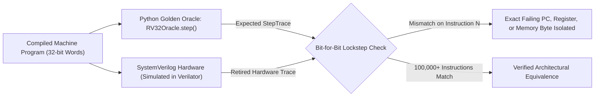
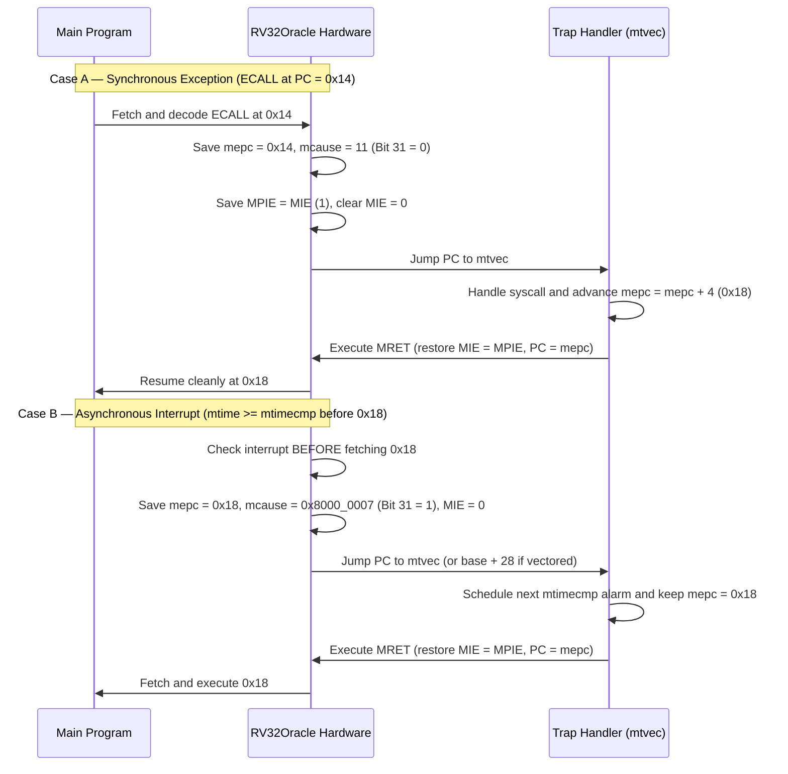

# Chapter 1: The Golden ISA Contract, Fixed-Width Binary Math & Instruction Execution

> **Volume I (`brain`) · Phase 1 · Reading Time**: about 60 minutes  
> **Primary Modules**: [`oracle.py`](../sim/oracle.py) (`1,051` lines) & [`test_oracle.py`](../tb/test_oracle.py) (`585` lines)  
> **Interactive Figures**: *Two's Complement & Sign-Extension Workbench*, *32-Bit Instruction Wire Inspector*, and *`RV32Oracle` Execution & Trap Trace Explorer*

---

## 1. Why Chip Design Starts in Software: The Golden Reference Model

Consider building a production database storage engine or distributed consensus protocol without a formal specification—jumping straight into lock-free pointer arithmetic and hoping unit tests written alongside the optimizations catch subtle ordering bugs. Experienced systems engineers recognize the hazard: when an optimization and its test share the same flawed assumption, both pass while silently corrupting state.

Designing a custom processor in a **Hardware Description Language (`HDL`)** such as `SystemVerilog` multiplies that hazard tenfold. In sequential software, statements execute one after another; in physical silicon, thousands of boolean logic gates, hardware selector switches—the circuit equivalent of `cond ? a : b` (**multiplexers**)—and 1-bit clocked storage latches (**flip-flops**) evaluate **simultaneously on every tick of a `50 MHz` crystal oscillator**. When a pipelined processor is fetching Instruction #5 from memory while decoding Instruction #4, computing arithmetic for Instruction #3, reading RAM for Instruction #2, and writing a register for Instruction #1—and an external timer alarm fires mid-flight—an unambiguous reference is required to define what the hardware ought to have done.

Commercial processor teams (at ARM, AMD, Apple, or SiFive) solve this the same way: **before writing a single logic gate, they build an unambiguous, sequential software specification of the processor called a Golden Reference Model—or simply an Oracle.**

[`oracle.py`](../sim/oracle.py) is that golden specification for the `brain` processor. Whenever the `SystemVerilog` hardware runs inside an open-source hardware simulator that compiles register-transfer designs into fast C++ test executables (**Verilator**), both engines execute the exact same machine code in lockstep:



### What an Instruction Set Architecture (`ISA`) Separates

Software systems routinely rely on clean abstraction boundaries:
- A **POSIX system-call interface** separates user-space applications from how the Linux kernel schedules threads or lays out ext4 disk blocks.
- The **WebAssembly (`Wasm`) or Java Virtual Machine (`JVM`) bytecode specification** separates compilers (`clang`, `javac`) from how a particular runtime engine (`V8`, `HotSpot`) executes instructions under the hood.

In computer architecture, the boundary separating **all software** (compilers, bootloaders, operating systems, control loops) from **physical hardware** (logic gates, pipeline stages, clock speeds) is the **Instruction Set Architecture (`ISA`)**.

An `ISA` defines strictly what a machine-code programmer or compiler can observe:
1. **Architectural State**: The exact set of persistent storage containers (registers, program counter, control flags, and addressable memory) that survive from one instruction to the next.
2. **Instruction Binary Encoding**: How operations, register numbers, and embedded constants pack into 32-bit integers (`0`s and `1`s).
3. **State-Transition Semantics**: Given any starting state `S_t` and the 32-bit instruction word fetched at the current program address, the exact deterministic rule producing the next state:

$$S_{t+1} = \text{step}(S_t)$$

Notice what the `ISA` deliberately **omits**: it says nothing about whether an instruction takes 1 clock cycle or 32 clock cycles, whether five instructions overlap inside a pipeline, or how wide the copper traces are on the 6-layer circuit board. Those internal implementation choices belong to the **microarchitecture**, which is designed in `SystemVerilog` in subsequent chapters. Because [`oracle.py`](../sim/oracle.py) captures architectural semantics alone, it expresses the entire processor in roughly a thousand lines of sequential Python—executing one complete instruction per call to [`RV32Oracle.step()`](../sim/oracle.py#L932-L1033).

### Architectural Commit Receipts (`StepTrace`)

If verification only compared memory and registers *after* a 10,000-instruction program finished, a bug at instruction #412 could cascade through thousands of subsequent steps before surfacing as a wrong final answer. Instead, [`RV32Oracle.step()`](../sim/oracle.py#L932-L1033) returns a structured receipt after every instruction—[`StepTrace`](../sim/oracle.py#L289-L302):

<!-- book-sync: StepTrace -->
<<< @/systems/brain/sim/oracle.py#L289-L302

`StepTrace` serves as a **write-ahead transaction log entry**:
- `pc` and `insn` record *where* the core fetched (`32`-bit byte address) and *what* raw 32-bit machine word it decoded.
- `next_pc` records where execution moved next (`pc + 4` for sequential code, or a jump/branch/trap target).
- `rd` and `rd_val` record which general-purpose register (`0..31`) received a result and what 32-bit value landed there.
- `mem_addr`, `mem_val`, and `mem_write` record any memory or peripheral bus transaction.
- `trap_cause` and `interrupt` record whether normal execution was preempted by a synchronous error/system call or an external hardware timer alarm.

During `Verilator` co-simulation, every time the hardware pipeline finishes (*retires*) an instruction, the testbench compares the hardware's retirement fields against `oracle.step()`'s `StepTrace`. The instant a single bit diverges, verification halts at the exact offending instruction.

### Architectural Vocabulary and System Map

Because [`oracle.py`](../sim/oracle.py) defines the programmer-visible contract for the entire `brain` **System-on-Chip (`SoC`)**, its module header enumerates every ISA extension, memory region, and peripheral device on the chip:

- **Open-Standard 32-Bit Processor Specification (`RISC-V`, pronounced *"risk-five"*)**: Unlike proprietary instruction sets (`x86-64` owned by Intel/AMD, or `ARM` licensed per chip), `RISC-V` (**Reduced Instruction Set Computer — Fifth Generation**, originated at UC Berkeley) is an open, royalty-free specification. Anyone may design, fabricate, and ship a custom `RISC-V` processor in silicon or on a reprogrammable logic chip (**Field-Programmable Gate Array / `FPGA`**) without licensing fees.
- **32-Bit Base Integer + Multiply/Divide Profile (`RV32IM`)**: `RISC-V` is modular:
  - **`RV32I`** (**32-bit Base Integer**) is the mandatory core of `40` instructions: 32-bit integer addition/subtraction, bitwise logic (`AND`, `OR`, `XOR`), bit shifts, memory loads/stores, and conditional branches/jumps.
  - **`M`** (**Integer Multiplication and Division Extension**) adds `8` instructions (`mul`, `mulh`, `mulhsu`, `mulhu`, `div`, `divu`, `rem`, `remu`) so software does not have to emulate multiplication in slow loops.
- **Atomic Control-Register Instructions (`Zicsr`)**: A small standard extension adding six instructions (such as **Control and Status Register Read/Write / `CSRRW`**) that atomically read and update privileged hardware configuration registers (**Control and Status Registers / `CSRs`**) governing interrupts, error handlers, and cycle counters.
- **Custom Neural Dot-Product Extension (`Xapex mac`)**: `RISC-V` leaves dedicated opcode slots (`custom-0` through `custom-3`) open for domain-specific hardware accelerators. The `Xapex` extension uses `custom-0` (`0x0B`) to add a packed dual-16-bit multiply-accumulate instruction (`mac`) that accelerates the robot's neural walking policy by over `40x`.
- **Four-Tier Chip Memory Map (`ROM`, `BRAM`, `QSPI Flash`, `SDRAM`)**: The processor reads code and data across four physical storage regions:
  1. `16 KB` of startup **Read-Only Memory (`Boot ROM`)** at `0x0000_0000`,
  2. `64 KB` of single-cycle on-chip **Block Random-Access Memory (`BRAM`)** inside the `FPGA` at `0x1000_0000`,
  3. A `16 MB` soldered persistent storage chip that transfers 4 bits per clock cycle (**Quad Serial Peripheral Interface / `QSPI` NOR Flash**) mapped for direct code execution (**Execute-In-Place / `XIP`**) at `0x2000_0000`, and
  4. A `32 MB` external **Synchronous Dynamic Random-Access Memory (`SDRAM`)** chip at `0x4000_0000`.
- **Memory-Mapped Input/Output (`MMIO`)**: Rather than inventing special instructions like `PRINT_SERIAL` or `READ_TIMER`, hardware peripherals expose their control registers at fixed 32-bit memory addresses (`0x8000_0000` upward). Reading or writing a pointer at those addresses talks directly to physical hardware circuits.
- **Core-Local Interruptor (`CLINT`)**: A memory-mapped 64-bit tick counter (`mtime`) paired with a 64-bit alarm register (`mtimecmp`) at `0x8000_0000`. Whenever `mtime >= mtimecmp`, it asserts a hardware timer interrupt so the **Real-Time Operating System (`RTOS`)** scheduler can switch tasks at `1,000 Hz`.
- **Universal Asynchronous Receiver-Transmitter (`UART0`)**: A 2-wire (`TX` transmit, `RX` receive) byte-at-a-time serial port mapped at `0x8001_0000`, wired to the USB debug console at `115,200` signal transitions (bits) per second (**baud**) so C programs and an interactive command-line shell can transmit text and receive keystrokes.
- **Custom C-Subset Compiler (`SysC`)**: The C-to-`RISC-V` compiler toolchain built alongside the processor so the software-to-silicon stack remains transparent end to end.

---

## 2. Fixed-Width Binary Arithmetic from First Principles

If you evaluate `2**200` or `-5` in Python, the runtime transparently allocates variable-length byte arrays so integers never overflow and negative signs live in object metadata.

Physical silicon has no heap allocator inside an arithmetic circuit. A 32-bit processor register is literally **32 parallel copper wires** driven by 32 clocked storage flip-flops, each holding either a low voltage (`0V`, binary `0`) or a high voltage (`3.3V` / `1.2V`, binary `1`). Every number—positive, negative, memory pointer, or packed neural weight—must live inside those `32` bits (`2^32 = 4,294,967,296` distinct bit patterns).

Because [`oracle.py`](../sim/oracle.py) is written in Python, its first task at the top of the helper section ([`MASK32` through `sign_extend`](../sim/oracle.py#L121-L160 "anchor: MASK32..sign_extend")) is to constrain Python's arbitrary-precision integers so they behave identically to 32-bit hardware wires:

<!-- book-sync: MASK32..s16 -->
<<< @/systems/brain/sim/oracle.py#L121-L143

Below is the derivation of [`u32`](../sim/oracle.py#L129-L131), [`s32`](../sim/oracle.py#L134-L137), [`sign_extend`](../sim/oracle.py#L155-L160), and [`sat32`](../sim/oracle.py#L146-L152).

### Modular Arithmetic on a Finite Wire Ring (`u32`)

When an `N`-bit hardware adder sums two `N`-bit numbers, it produces `N` sum bits plus an `(N+1)`-th carry-out bit. Because the destination register only has `N` wires, that `(N+1)`-th bit is discarded—which mathematically computes the sum modulo `2^N`:

$$\text{u32}(x) = x \bmod 2^{32} = x \mathbin{\&} \text{0xFFFF\_FFFF}$$

Consider a 4-digit decimal odometer (`0000` through `9999`): adding `1` to `9999` wraps around to `0000`. In binary, `u32(val)` (`val & 0xFFFF_FFFF`) wraps `0xFFFF_FFFF + 1` (`4,294,967,295 + 1`) around to `0x0000_0000`. Every unsigned 32-bit integer lives on the finite ring $\mathbb{Z}_{2^{32}} = \{0, 1, \dots, 2^{32}-1\}$, where bit `i` carries weight `+2^i`:

$$U(b_{31}\dots b_0) = \sum_{i=0}^{31} b_i \cdot 2^i$$

### Why Two's Complement Won: Designing Negative Numbers for Hardware

How should those same `2^N` bit patterns represent **signed** integers (both positive and negative) when there is no wire for a `"-"` character?

To see why every modern CPU uses **two's complement**, examine the two simpler software alternatives on a **4-bit** register (`16` bit patterns):

1. **Alternative #1 — Sign-Magnitude** (*use top Bit 3 as a sign flag: `0` = `+`, `1` = `-`, and Bits `2..0` as magnitude*):
   - First drawback: one bit pattern is wasted on **negative zero** (`0000 = +0`, `1000 = -0`), forcing every equality check `a == b` to special-case `-0 == +0`.
   - Worse drawback: adding `+3` (`0011`) and `-5` (`1101`) with a standard binary adder yields `0011 + 1101 = 1_0000` (`+0`, which is incorrect). To add signed numbers in sign-magnitude, hardware must inspect signs, compare magnitudes, choose between an adder and a subtractor, and compute the output sign—doubling circuit area and lengthening the critical path.
2. **Alternative #2 — Ones' Complement** (*negate a number by flipping all bits: `+5 = 0101`, `-5 = 1010`*):
   - Still suffers from **two zeros** (`0000 = +0` and `1111 = -0`), and binary addition requires an "end-around carry" where carry-out from the top bit must wrap around and be added back into bit `0`.

**Two's Complement (`s32` and `s16`)**:
Return to the 4-bit modular ring (`0000` at 12 o'clock). Stepping **backward by 1** modulo `16` from `0000` (`0`) lands at `1111` ($15 \equiv -1 \pmod{16}$). Stepping backward by 5 from `0000` lands at `1011` ($16 - 5 = 11 \equiv -5 \pmod{16}$).

Mathematically, two's complement keeps the positive weights $+2^0, +2^1, \dots, +2^{N-2}$ on the lower `N - 1` bits, and assigns the **most-significant bit (`Bit N-1`) a negative weight $-2^{N-1}$**:

$$S(b_{N-1}\dots b_0) = -b_{N-1} \cdot 2^{N-1} + \sum_{i=0}^{N-2} b_i \cdot 2^i$$

Check this formula on 4 bits (`N = 4`, top bit weight `-8`):
- `0101` $= -0 \cdot 8 + 4 + 0 + 1 = +5$.
- `1011` $= -1 \cdot 8 + 0 + 2 + 1 = -8 + 3 = -5$.
- `1111` $= -1 \cdot 8 + 4 + 2 + 1 = -8 + 7 = -1$.
- `1000` $= -1 \cdot 8 + 0 + 0 + 0 = -8$ (the unique minimum value; **there is only one zero**, `0000`).
- Note the range asymmetry: an `N`-bit two's complement integer spans $[-2^{N-1},\; +2^{N-1} - 1]$. For 32 bits, that is `INT32_MIN = -2,147,483,648` (`0x8000_0000`) to `INT32_MAX = +2,147,483,647` (`0x7FFF_FFFF`). There is one more negative value than positive value because `0` uses top bit `0`.

Compare `U(b)` and `S(b)` directly:
- When $b_{31} = 0$, $S(b) = U(b)$.
- When $b_{31} = 1$, `U(b)` counted $+2^{31}$ where `S(b)` requires $-2^{31}$—a difference of $2^{31} - (-2^{31}) = 2^{32}$ (`0x1_0000_0000`).

Now inspect the return expression of [`s32(val)`](../sim/oracle.py#L134-L137):
```python
return val - 0x1_0000_0000 if (val & 0x8000_0000) else val
```
That single line is the exact algebraic identity $S(b) = U(b) - b_{31} \cdot 2^{32}$.

#### Proof: Why Unsigned Addition Computes Signed Two's Complement Addition

Because $U(b) \equiv S(b) \pmod{2^{32}}$ for *every* 32-bit pattern (since they differ only by `0` or `2^32`, both multiples of `2^32`), adding the unsigned bit patterns of two signed numbers `A` and `B` modulo `2^32` gives:

$$(U(A) + U(B)) \bmod 2^{32} \equiv (S(A) + S(B)) \bmod 2^{32}$$

Whenever the true signed sum $S(A) + S(B)$ fits inside $[-2^{31}, +2^{31}-1]$, there is **only one** 32-bit pattern congruent to $S(A) + S(B)$ modulo `2^32`, so **an ordinary unsigned binary adder produces the exact two's complement bit pattern automatically.** The identical property holds for subtraction (`A - B`) and logical left shifts (**`SLL`** — *Shift Left Logical*, `A << k`). Consequently, `RISC-V` defines only a single `ADD` instruction and a single `SUB` instruction—never separate `ADD_SIGNED` and `ADD_UNSIGNED` opcodes.

### Where Signedness Changes the Hardware Behavior

If `ADD`, `SUB`, and `SLL` are agnostic to whether bits represent unsigned `u32` or signed `s32`, exactly **three** instruction families depend on signedness:

1. **Ordered Comparisons (`<` and `>=`)**:
   Compare bit pattern `0xFFFF_FFFB` to `0x0000_0003`:
   - Viewed as **unsigned (`u32`)**: `4,294,967,291 < 3` is **False**—tested by **`SLTU`** (*Set Less Than Unsigned*, writing `1` or `0` to `rd`) and **`BLTU`** / **`BGEU`** (*Branch if Less Than / Greater Than or Equal Unsigned*).
   - Viewed as **signed (`s32`)**: `-5 < +3` is **True**—tested by **`SLT`** (*Set Less Than* signed) and **`BLT`** / **`BGE`** (*Branch if Less Than / Greater Than or Equal* signed).
   *(Equality `==` and inequality `!=` only check whether all 32 wires match, so **`BEQ`** — Branch if Equal — and **`BNE`** — Branch if Not Equal — operate identically for signed and unsigned operands.)*
2. **Right Shifts (`>>`)**:
   Shifting bits right by 1 divides by 2, vacating `Bit 31` on the left:
   - **Logical Right Shift (`SRL` / `SRLI` — *Shift Right Logical [Immediate]*)** treats the register as unsigned and shifts a `0` into `Bit 31`. Shifting `0xFFFF_FFFB` right by 1 gives `0x7FFF_FFFD` (`+2,147,483,645`).
   - **Arithmetic Right Shift (`SRA` / `SRAI` — *Shift Right Arithmetic [Immediate]*)** treats the register as signed two's complement and **replicates the original `Bit 31` sign bit** into vacated upper positions. Shifting `-5` (`1111...1011`) right by 1 copies `1` into `Bit 31`, yielding `1111...1101` = **`-3`** ($\lfloor -5 / 2 \rfloor = -3$, flooring toward $-\infty$).
3. **Widening Widths: Sign Extension, Upper 32-Bit Multiplication & Division**:
   Whenever a narrower signed integer (`8`, `12`, `16`, or `32` bits) widens into a wider container (`32` or `64` bits), hardware must preserve its negative value rather than zero-padding on the left.

### Proving `oracle.py`'s Branchless `sign_extend` Formula

Inside 32-bit `RISC-V` instructions, embedded constants (**immediates**) are often `12`, `13`, or `21` bits wide, and narrow memory loads read `8`-bit bytes (`lb`) or `16`-bit halfwords (`lh`). Before adding a 12-bit constant to a 32-bit register, the CPU widens it from `k` bits to 32 bits.

Inspect [`sign_extend(val, bits)`](../sim/oracle.py#L155-L160):

<!-- book-sync: sign_extend -->
<<< @/systems/brain/sim/oracle.py#L155-L160

Why does `(val ^ sign_bit) - sign_bit` work for **any** width $k = \text{bits}$ without a branch?

After `val &= mask`, `val` holds an unsigned `k`-bit integer $U = b_{k-1} \cdot 2^{k-1} + \text{low}$, where $\text{sign\_bit} = 2^{k-1}$ and $\text{low} \in [0, 2^{k-1}-1]$ represents the lower `k - 1` bits:
- **Case 1: Non-negative ($b_{k-1} = 0$, so $U = \text{low}$)**:
  - `val ^ sign_bit` flips bit `k - 1` from `0` to `1`, **adding** `2^(k-1)`: $\text{low} + 2^{k-1}$.
  - Subtracting `sign_bit` (`2^(k-1)`) yields $(\text{low} + 2^{k-1}) - 2^{k-1} = \mathbf{+\text{low}}$.
- **Case 2: Negative ($b_{k-1} = 1$, so $U = 2^{k-1} + \text{low}$)**:
  - `val ^ sign_bit` flips bit `k - 1` from `1` to `0`, **clearing** `2^(k-1)`: `low`.
  - Subtracting `sign_bit` (`2^(k-1)`) yields $\text{low} - 2^{k-1} = \mathbf{-2^{k-1} + \text{low}}$—which matches the exact two's complement definition `S(b)`.

In physical silicon, sign extension requires zero logic gates: wire `k-1` simply fans out directly to all upper wires `31..k`.

### Wrap-Around Overflow vs. Saturating Arithmetic (`sat32`)

Standard `ADD` wraps silently on overflow: `INT32_MAX + 1` (`0x7FFF_FFFF + 1`) becomes `INT32_MIN` (`0x8000_0000 = -2,147,483,648`). For pointer arithmetic and hash functions, modular wrap-around is expected.

For **robot motor control and neural-network inference**, wrap-around overflow is physically hazardous. If a neuron computing knee torque during a landing impact nudges `1` unit past `+2,147,483,647` and wraps to `-2,147,483,648`, the actuator command reverses instantly to full negative torque.

To prevent sign-inverting wrap-around inside the custom `Xapex mac` neural instruction, [`sat32(val)`](../sim/oracle.py#L146-L152) implements **saturating arithmetic**—clamping out-of-range sums to the rails `[INT32_MIN, INT32_MAX]`:

<!-- book-sync: sat32 -->
<<< @/systems/brain/sim/oracle.py#L146-L152

Experiment with both the 4-bit modular ring adder and the 12-to-32-bit sign extender / shifter in the interactive workbench below:

<TwosComplementWorkbench />

---

## 3. Architectural State & the Role of Hardwired `x0`

With fixed-width binary arithmetic established, examine the complete programmer-visible state of the `brain` **System-on-Chip (`SoC`)** inside [`RV32Oracle.__init__`](../sim/oracle.py#L322-L338) and [`RV32Oracle.reset()`](../sim/oracle.py#L340-L367):

<!-- book-sync: RV32Oracle.__init__..RV32Oracle.reset -->
<<< @/systems/brain/sim/oracle.py#L322-L367

Every persistent variable attached to `self` corresponds to physical storage on the `FPGA` and circuit board:

1. **Program Counter (`self.pc`)**: A 32-bit register holding the byte address of the *next* instruction to execute. On power-on reset (`reset()`), `self.pc` starts at `BOOT_ROM_BASE = 0x0000_0000`, so the first clock cycle after power-up fetches startup code from on-chip `Boot ROM`.
2. **General-Purpose Register File (`self.regs[0..31]`)**: An array of `32` single-cycle 32-bit integer registers named `x0` through `x31` (`128` bytes total).
   - *Why `32` registers instead of `8` or `256`?* Every register operand inside a 32-bit instruction must specify *which* register it addresses using `log2(N)` bits. With `32` registers, each register index takes **5 bits** ($\log_2(32) = 5$), so three register operands (`rd`, `rs1`, `rs2`) consume `15` of the `32` instruction bits—leaving `17` bits for opcodes and constants while giving the `SysC` compiler enough fast registers to keep loop variables and function arguments out of RAM. Expanding to `128` registers (`7` bits each) would consume `21` bits just for register indices and quadruple multiplexer depth.
3. **Neural Dot-Product Accumulator (`self.mac_acc`)**: A dedicated 32-bit signed register inside the execution stage that holds running sums across consecutive `Xapex mac` instructions.
4. **Machine-Mode Control & Status Registers (`mstatus`, `misa`, `mie`, `mtvec`, `mscratch`, `mepc`, `mcause`, `mtval`, `mip`, `mcycle`, `minstret`)**: Privileged system registers governing interrupts, exception vector addresses, and 64-bit hardware cycle/instruction counters.
   - Note how `self.misa = 0x4080_1100` in `reset()` is constructed from the `RISC-V` Privileged Specification:
     - `Bits 31..30 = 0b01` (`0x4...`): declares a **32-bit** (`RV32`) architecture.
     - `Bit 23 = 1` (`0x0080_0000`, letter `'X'` = index `23` of `A..Z`): declares non-standard custom extensions (`Xapex`).
     - `Bit 12 = 1` (`0x0000_1000`, letter `'M'` = index `12`): declares hardware integer Multiply/Divide (`RV32M`).
     - `Bit 8 = 1` (`0x0000_0100`, letter `'I'` = index `8`): declares the `RV32I` base integer instruction set.
     - Combining them via bitwise OR gives `0x4000_0000 | 0x0080_0000 | 0x0000_1000 | 0x0000_0100 = 0x4080_1100`.
5. **Memory Regions & I/O Devices (`rom`, `bram`, `qspi`, `sdram`, `mtime`/`mtimecmp`, `uart_*`)**: The backing memory arrays, 64-bit timer alarm, and serial transmit/receive byte queues. Note `self.uart_bauddiv = 50_000_000 // 115_200` at the end of `reset()` (`434` clock ticks per serial bit at a `50 MHz` system clock and `115,200` baud console rate).

### Why Register `x0` Is Hardwired to Zero

Inspect [`_set_reg(rd, val)`](../sim/oracle.py#L625-L630), the sole gatekeeper through which every instruction writes to `self.regs`:

<!-- book-sync: RV32Oracle._set_reg -->
<<< @/systems/brain/sim/oracle.py#L625-L630

In `RISC-V`, register `x0` is **not** a normal storage slot initialized to `0` at boot—it is physically wired to ground (`0x0000_0000`) in silicon. Reading `x0` always returns `0`, and writing any value to `x0` (`rd == 0`) is discarded.

Although dedicating one of `32` registers (`3.1%` of the register file) to the constant `0` appears costly at first, hardwiring `x0 = 0` eliminates substantial decoder complexity. Architectures such as `x86` carry separate opcodes for `NOP`, `MOV`, `CLR`, `NEG`, `CMP`, `TEST`, `JMP`, `CALL`, and `RET`, each requiring dedicated decode logic and verification cases. With `x0 = 0`, all of those operations become **aliases (*pseudoinstructions*)** of existing base instructions:

| Everyday Operation | How `x86`/Complex CPUs Do It | How `RISC-V` Synthesizes It Using `x0` | Underlying Hardware Action |
| :--- | :--- | :--- | :--- |
| **Do nothing (`nop`)** | Dedicated `0x90` `NOP` opcode | `addi x0, x0, 0` | Computes `0 + 0`, discards write to `x0` |
| **Copy register (`mv x3, x1`)** | Dedicated `MOV` opcode | `addi x3, x1, 0` | Computes `x1 + 0`, writes `x3` |
| **Load small constant (`li x1, -5`)** | Dedicated `MOV_IMM` opcode | `addi x1, x0, -5` | Computes `0 + (-5)`, writes `x1` |
| **Negate integer (`neg x2, x1`)** | Dedicated `NEG` two's complement op | `sub x2, x0, x1` | Computes `0 - x1`, writes `x2` |
| **Branch if zero (`beqz x1, offset`)** | Status-flag `TEST` + `JZ` | `beq x1, x0, offset` | Compares `x1 == 0` directly—**no condition-code flags register needed** |
| **Return from function (`ret`)** | Dedicated `RET` stack-pop opcode | `jalr x0, 0(x1)` (**Jump and Link Register**) | Jumps to return address in `x1`, discards unused `PC + 4` return address (**link address**) into `x0` |

Notice the fifth row: **no condition-code flags register is required.** In `x86` or `ARM`, most arithmetic instructions mutate a shared global flags register (`Zero`, `Carry`, `Negative`, `Overflow`), introducing implicit state dependencies that complicate pipelined execution. Because `RISC-V` pairs `x0` with direct two-register branches (`beq`, `blt`), integer instructions produce **no hidden flag side effects**.

---

## 4. Packing a Computer into 32 Wires: The Six Instruction Formats

Every instruction fetched from memory is **one 32-bit integer (`4` bytes)**. Why enforce a uniform 32-bit instruction width?

In desktop architectures like `x86-64`, instructions vary from `1` byte to `15` bytes long. Variable-length encoding improves code density at a significant hardware cost: before the processor can locate where Instruction #2 begins in memory, it must sequentially decode prefix bytes on Instruction #1. In a compact, deterministic real-time processor on an `FPGA`, **fixed 32-bit instruction words** guarantee:
1. Every instruction sits at a byte address divisible by `4` (`0x00`, `0x04`, `0x08`, ...), so normal sequential execution always advances `next_pc = cur_pc + 4`.
2. All `32` instruction wires arrive at the decoder simultaneously in a single memory read.

### Fixed Register Columns

Inspect the bitfield slice at the top of [`RV32Oracle.step()`](../sim/oracle.py#L947-L952 "anchor: RV32Oracle.step['opcode = insn & 0x7F'..'funct7 = (insn >> 25) & 0x7F']"):

<!-- book-sync: RV32Oracle.step['opcode = insn & 0x7F'..'rs1_s, rs2_s = s32(rs1_u)'] -->
<<< @/systems/brain/sim/oracle.py#L947-L955

Notice that `step()` extracts `opcode`, `rd`, `funct3`, `rs1`, `rs2`, and `funct7`—and even reads `self.regs[rs1]` and `self.regs[rs2]`—before decoding the instruction format.

That works because `RISC-V` enforces a strict positional invariant across every instruction format in the architecture:
- **`Bits 6..0` (`7` bits)**: Always **`opcode`** (selects the major instruction family).
- **`Bits 11..7` (`5` bits)**: Always **`rd`** (destination register `x0..x31`, whenever the instruction writes a register).
- **`Bits 14..12` (`3` bits)**: Always **`funct3`** (3-bit sub-operation selector within the family).
- **`Bits 19..15` (`5` bits)**: Always **`rs1`** (first source register `x0..x31`).
- **`Bits 24..20` (`5` bits)**: Always **`rs2`** (second source register `x0..x31`).
- **`Bit 31` (`1` bit)**: Always the **sign bit** of any embedded constant.

Keeping `rs1`, `rs2`, and `rd` in fixed columns allows physical wire bundles `insn[19:15]` and `insn[24:20]` to connect **directly to the Register File's read address ports** with zero multiplexer delay—fetching `rs1` and `rs2` in parallel while opcode decoding occurs.

### All Six Instruction Formats (`enc_r` Through `enc_j`)

Inspect the six standard `RISC-V` encoders plus the custom `Xapex` encoder in [`oracle.py` (`enc_r`–`enc_mac`)](../sim/oracle.py#L163-L234 "anchor: enc_r..enc_mac"):

<!-- book-sync: enc_r..enc_mac -->
<<< @/systems/brain/sim/oracle.py#L163-L234

The diagram below shows how each format allocates its `32`-bit budget (`opcode` occupies `7` bits, leaving `25` bits). In the bit-field diagram, `imm[10:5]` denotes bits `10` down to `5` of the immediate constant (`imm`), and compact labels `12`, `4:1`, `11`, and `20` on the `B:` and `J:` rows abbreviate `imm[12]`, `imm[4:1]`, `imm[11]`, and `imm[20]`:

```text
Bit:  31        25 24   20 19   15 14   12 11    7 6      0
      +-----------+-------+-------+-------+-------+--------+
R:    |  funct7   |  rs2  |  rs1  |funct3 |  rd   | opcode |  Register-Register (add, sub, mul, mac)
      +-----------+-------+-------+-------+-------+--------+
I:    |     imm[11:0]     |  rs1  |funct3 |  rd   | opcode |  12-Bit Immediate  (addi, lw, jalr, csrrw)
      +-----------+-------+-------+-------+-------+--------+
S:    | imm[11:5] |  rs2  |  rs1  |funct3 |imm[4:0]| opcode|  Memory Store      (sw, sh, sb)
      +-----------+-------+-------+-------+-------+--------+
B:    |12|imm[10:5]| rs2  |  rs1  |funct3 |4:1|11 | opcode |  Conditional Branch(beq, blt, bgeu)
      +-----------+-------+-------+-------+-------+--------+
U:    |         imm[31:12]                |  rd   | opcode |  20-Bit Upper Imm  (lui, auipc)
      +-----------------------------------+-------+--------+
J:    |20| imm[10:1] |11|   imm[19:12]    |  rd   | opcode |  Unconditional Jump(jal)
      +-----------------------------------+-------+--------+
```

1. **`R`-Type (`Register-Register`, [`enc_r`](../sim/oracle.py#L163-L172))**:
   - Uses three 5-bit register indices (`rd`, `rs1`, `rs2` = `15` bits) plus `opcode` (`7` bits), leaving `10` bits (`funct7` at `Bits 31..25` + `funct3` at `Bits 14..12`) to select among up to $2^{10} = 1{,}024$ operations.
   - Standard `RV32I` register arithmetic uses `opcode = 0x33`: `funct7 = 0x00` selects `add`, `sll`, `slt`, `sltu`, `xor`, `srl`, `or`, `and`; setting `Bit 30` (`funct7 = 0x20`) switches `add -> sub` and `srl -> sra` (in hardware, `Bit 30` drives the adder's invert-and-carry-in subtract control wire). Setting `funct7 = 0x01` selects the eight `RV32M` multiply/divide operations.
2. **`I`-Type (`12-Bit Immediate`, [`enc_i`](../sim/oracle.py#L175-L183))**:
   - Trades `rs2` (`5` bits) and `funct7` (`7` bits) for one contiguous **12-bit signed constant** `imm[11:0]` in `Bits 31..20` (`[-2048, +2047]`).
   - Encodes immediate operations in the processor's **Arithmetic Logic Unit (`ALU`)** (`addi`, `andi`, `slti` at `opcode = 0x13`), memory loads (`lb`, `lh`, `lw` at `opcode = 0x03`, computing `address = rs1 + imm`), indirect jumps (`jalr` at `opcode = 0x67`), and `Zicsr` control-register accesses (`opcode = 0x73`, where the unsigned 12-bit field addresses one of `4,096` CSRs).
   - *Shift-immediate specialization*: Shifting a 32-bit register by `>= 32` is undefined, so immediate shifts (`slli`, `srli`, `srai`) only require the bottom 5 bits of the immediate (`Bits 24..20`, the `rs2` column) as the shift amount (`shamt`), leaving `Bits 31..25` free to act as `funct7` (`0x00` for `srli` vs. `0x20` for `srai`). Look at [`test_oracle.py` (`srai x7, x1, 1`)](../tb/test_oracle.py#L110 "anchor: test_rv32i_arithmetic_shifts_and_x0['enc_i(0x400 | 1']"): `enc_i(0x400 | 1, 1, 5, 7, 0x13)` sets bit `10` of the 12-bit immediate (`0x400`), which lands at instruction `Bit 30` (`funct7 = 0x20`), encoding `srai x7, x1, 1`.
3. **`S`-Type (`Store to Memory`, [`enc_s`](../sim/oracle.py#L186-L196))**:
   - Consider `sw x2, 12(x1)` (*store the 32-bit value in `x2` into memory at address `x1 + 12`*). A store reads **two** registers (`rs1` base pointer and `rs2` data to write) and writes **zero** destination registers (`no rd`).
   - Keeping `rs1` (`Bits 19..15`) and `rs2` (`Bits 24..20`) fixed, `RISC-V` splits the 12-bit signed byte offset into two pieces: `imm[11:5]` occupies `Bits 31..25` (`7` bits), and `imm[4:0]` reuses the vacant `rd` column at `Bits 11..7` (`5` bits).
4. **`B`-Type (`Conditional Branch`, [`enc_b`](../sim/oracle.py#L199-L211)) & Immediate Bit Ordering**:
   - Like stores, `blt x2, x3, -8` compares two source registers (`rs1`, `rs2`) and adds a signed byte offset to `self.pc`.
   - **Implicit bit `0`**: Instructions are aligned to even byte boundaries (multiples of `4` bytes in `RV32I`, or `2` bytes when compressed 16-bit instructions exist), so every valid branch offset is an **even number** whose bit `0` is guaranteed to be `0`. Rather than allocating an instruction wire to a constant `0`, `B`-type omits `imm[0]` and stores `imm[12:1]`, **doubling branch reach** from `±2 KB` (`12` bits) to **`±4 KB` (`13` bits, `[-4096, +4094]` bytes)**.
   - **Why `imm[11]` sits at `Bit 7` instead of `Bit 30`**: Why didn't `RISC-V` store `imm[12:6]` in `Bits 31..25` and `imm[5:1]` in `Bits 11..7`? Compare `S`-type and `B`-type side by side:
     - In `S`-type, `Bits 30..25` hold `imm[10:5]` and `Bits 11..8` hold `imm[4:1]`.
     - By placing `B`-type's `imm[10:5]` in `Bits 30..25` and `imm[4:1]` in `Bits 11..8` as well, **10 out of the 12 immediate wires occupy identical positions in both `S`-type and `B`-type**—eliminating 10 multiplexer gates in the hardware immediate decoder. Meanwhile, `imm[12]` (the sign bit) stays pinned at `Bit 31`, leaving `Bit 7` (where `S`-type held `imm[0]`) for `imm[11]`. The bit layout reflects **minimum-wire-crossing symmetry** in hardware.
5. **`U`-Type (`Upper Immediate`, [`enc_u`](../sim/oracle.py#L214-L216)) & Building Full 32-Bit Constants**:
   - A 32-bit constant and a 7-bit opcode cannot both fit inside a 32-bit instruction. `RISC-V` constructs 32-bit constants using a two-instruction sequence:
     1. **`LUI` (`Load Upper Immediate`, `opcode = 0x37`)** places a 20-bit constant into `Bits 31..12` of `rd` and zeros `Bits 11..0`. (**`AUIPC`** — *Add Upper Immediate to Program Counter*, `opcode = 0x17` — adds that same shifted 20-bit constant to `self.pc` to form position-independent code and data pointers.)
     2. **`ADDI` (`Add Immediate`)** adds the remaining lower 12 bits.
   - *Sign-extension borrow*: Suppose the target constant is `0x1234_5800`. Because bit `11` of `0x800` is `1`, `addi x5, x5, 0x800` **sign-extends** `0x800` to `-2048` (`0xFFFF_F800`) and *subtracts* `2048`. To compensate for that `-2048` (`-0x1000` borrow), assemblers add `+1` to the upper 20 bits passed to `LUI`:
     - `lui x5, 0x12346` → `x5 = 0x1234_6000`
     - `addi x5, x5, -2048` → `0x1234_6000 + (-0x800) = 0x1234_5800`
     In general, for any 32-bit target `C`, computing `hi20 = ((C + 0x800) >> 12) & 0xFFFFF` (or pre-shifted `upper = (C + 0x800) & 0xFFFF_F000` for `enc_u`) and `lo12 = C & 0xFFF` cancels the sign-extension borrow automatically—including wrap-around cases such as `0xFFFF_F800`.
6. **`J`-Type (`Unconditional Jump and Link`, [`enc_j`](../sim/oracle.py#L219-L229))**:
   - Used by **`JAL`** (*Jump and Link*, `opcode = 0x6F`) for function calls and long jumps. Like `B`-type, it omits `imm[0] = 0`, packing `imm[20:1]` into `Bits 31..12` for a **21-bit signed reach (`±1 MB`)**—while aligning `imm[19:12]` with `U`-type's `Bits 19..12` and pinning the sign bit `imm[20]` at `Bit 31` for hardware multiplexer sharing.

Explore all six formats—and toggle individual instruction bits `31..0` to observe live field decoding—in the inspector below:

<RiscvBitfieldDecoder />

---

## 5. The Integer Execution Engine (`RV32I` & `RV32M` Corner Cases)

Once `step()` slices an instruction word, integer arithmetic and logic dispatch to [`_exec_op_imm`](../sim/oracle.py#L767-L797) (register + 12-bit constant) and [`_exec_op_reg`](../sim/oracle.py#L833-L856) (register + register):

<!-- book-sync: RV32Oracle._exec_op_imm -->
<<< @/systems/brain/sim/oracle.py#L767-L797

<!-- book-sync: RV32Oracle._exec_op_reg -->
<<< @/systems/brain/sim/oracle.py#L833-L856

Note three hardware invariants in these two helpers:
1. **Why Shift Amounts Mask with `& 0x1F` (`Bits 4..0`)**: Inside `_exec_op_reg` (`SLL`, `SRL`, and `SRA` branches), when `x9` is shifted by a dynamic count in `rs2_u`, physical silicon routes only the bottom `5` bits of `rs2_u` (`0..31`) into a 5-stage cascaded power-of-two shift circuit (**barrel shifter**, shifting by `16`, `8`, `4`, `2`, and `1` bit positions in a single pass). Masking `rs2_u & 0x1F` ensures shifting by `35` shifts by `35 & 31 = 3`, matching hardware bit-for-bit.
2. **Mixed-Sign Immediate Unsigned Comparison (`SLTIU`, `funct3 == 3`)**: Examine `res = 1 if rs1_u < u32(imm) else 0` in `_exec_op_imm`. Even though **`SLTIU`** (*Set Less Than Immediate Unsigned*) performs an **unsigned** 32-bit comparison, `RISC-V` **still sign-extends** the 12-bit immediate *first* (`imm = sign_extend(insn >> 20, 12)`) before interpreting those 32 bits as unsigned via `u32(imm)`. This allows hardware to share a single 12-bit sign extender on the `I`-type path, *and* lets `sltiu rd, rs1, -1` (`u32(-1) = 0xFFFF_FFFF`) test `rs1 != 0xFFFF_FFFF` in one instruction (while `sltiu rd, rs1, 1` tests `rs1 < 1` unsigned, i.e., `rs1 == 0`, implementing the **`seqz` (`Set if Equal to Zero`)** pseudoinstruction).
3. **Catching Illegal Bit Combinations (`return None`)**: If an instruction has `opcode = 0x33` with an unassigned `funct7` (such as `0x7F`), `_exec_op_reg` returns `None`, causing [`RV32Oracle.step`](../sim/oracle.py#L999-L1000 "anchor: RV32Oracle.step['elif opcode == 0x33:'..'self._exec_op_reg(']") to raise a synchronous **Illegal Instruction Trap (`CAUSE_ILLEGAL_INSN = 2`)**—preventing corrupted memory or unsupported opcodes from failing silently.

### Hardware Multiply & Divide (`RV32M`): 64-Bit Products and Trap-Free Division

Next, examine [`_exec_muldiv`](../sim/oracle.py#L799-L831), which implements all eight `RV32M` instructions (`funct7 == 0x01` under `opcode = 0x33`):

<!-- book-sync: RV32Oracle._exec_muldiv -->
<<< @/systems/brain/sim/oracle.py#L799-L831

Every branch in `_exec_muldiv` reflects a fundamental property of integer multiplication and division hardware:

#### 1. Why Multiplication Needs Four Instructions (`MUL`, `MULH`, `MULHSU`, `MULHU`)

Multiplying two 32-bit integers produces up to **64 significant bits** (for example, `0xFFFF_FFFF * 0xFFFF_FFFF = 0xFFFF_FFFE_0000_0001`). Because a single `RV32` destination register `rd` is 32 bits wide, `RV32M` splits 64-bit multiplication into lower-half and upper-half instructions:
- **`MUL` (*Multiply Lower 32 Bits*, `funct3 = 0`)**: Writes the **lower 32 bits** of the product into `rd` (`_set_reg` masks with `u32(res)`). A separate `MULU` is unnecessary for the same modular ring reason as `ADD`: since $U(A) \equiv S(A) \pmod{2^{32}}$ and $U(B) \equiv S(B) \pmod{2^{32}}$, their product satisfies:

$$(U(A) \cdot U(B)) \bmod 2^{32} \equiv (S(A) \cdot S(B)) \bmod 2^{32}$$

  The lower 32 bits of signed and unsigned multiplication are always identical.
- **`MULH` (*Multiply High Signed×Signed*), `MULHSU` (*Multiply High Signed×Unsigned*), and `MULHU` (*Multiply High Unsigned×Unsigned*) (`funct3 = 1, 2, 3`)**: Write the **upper 32 bits** (`product >> 32`) into `rd`. Unlike the lower 32 bits, the upper 32 bits **do** depend on operand signedness:
  - Test this with `rs1 = -7` (`0xFFFF_FFF9 = 4,294,967,289`) and `rs2 = 3` from [`test_oracle.py` lines 167–170](../tb/test_oracle.py#L167-L170 "anchor: test_rv32m_multiply_and_division_edge_cases['mul    x10'..'mulhu  x13']"):
    - Signed `MULH`: $(-7) \times 3 = -21$ (`64`-bit `0xFFFF_FFFF_FFFF_FFEB`), so upper 32 bits = `0xFFFF_FFFF` (`-1`).
    - Unsigned `MULHU`: $4{,}294{,}967{,}289 \times 3 = 12{,}884{,}901{,}867$ (`0x0000_0002_FFFF_FFEB`), so upper 32 bits = `0x0000_0002` (`+2`). *(Notice both share the exact same lower 32 bits `0xFFFF_FFEB = u32(-21)`.)*
    - Mixed `MULHSU` (**signed `rs1` × unsigned `rs2`**): Included so multi-word bignum and 64-bit fixed-point math can multiply a signed upper limb by an unsigned lower limb in one instruction.

#### 2. Python Floor Division vs. Hardware Truncation-Toward-Zero (`DIV`, `DIVU`, `REM`, `REMU`)

`RV32M` provides four division/modulo instructions: **`DIV`** (*Divide Signed*, `funct3 = 4`), **`DIVU`** (*Divide Unsigned*, `funct3 = 5`), **`REM`** (*Remainder Signed*, `funct3 = 6`), and **`REMU`** (*Remainder Unsigned*, `funct3 = 7`). Look closely at the `funct3 == 4` (`DIV`) and `funct3 == 6` (`REM`) branches inside `_exec_muldiv`—why doesn't [`oracle.py`](../sim/oracle.py) simply evaluate `rs1_s // rs2_s` and `rs1_s % rs2_s`?

**Python's `//` and `%` operators compute floor division (rounding toward $-\infty$), whereas C, C++, Rust, and `RISC-V` hardware specify truncation toward zero.**

Compare `-7` divided by `+3`:
- **Python (`-7 // 3`, `-7 % 3`)**: Rounds down to `-3`, with positive remainder `+2` (`(-3) * 3 + 2 = -7`).
- **`RISC-V` & C (`-7 / 3`, `-7 % 3`)**: Truncates fractional `-2.333...` toward zero to **`-2`**, with negative remainder **`-1`** (`(-2) * 3 + (-1) = -7`, where the remainder always retains the sign of the dividend `rs1_s`).

Computing `q = abs(rs1_s) // abs(rs2_s)` and negating `q` when input signs differ (`(rs1_s < 0) ^ (rs2_s < 0)`) implements exact truncation toward zero, and `res = rs1_s - q * rs2_s` guarantees the division identity $\text{dividend} = \text{quotient} \times \text{divisor} + \text{remainder}$ across every sign combination.

#### 3. Why `RISC-V` Never Traps on Divide-by-Zero or `INT32_MIN / -1`

On `x86`, dividing by zero (`1 / 0`) or dividing `INT32_MIN` by `-1` triggers a synchronous CPU exception (`SIGFPE`). `RISC-V` deliberately **never raises a hardware exception on arithmetic or division**; instead, `_exec_muldiv` returns deterministic architectural values specified by the `RISC-V` ISA:

| Corner Case | `DIV` (Signed) | `DIVU` (Unsigned) | `REM` (Signed) | `REMU` (Unsigned) | Hardware Rationale |
| :--- | :---: | :---: | :---: | :---: | :--- |
| **Divide by `0` (`x / 0`)** | `-1` (`0xFFFF_FFFF`) | `2^32 - 1` (`0xFFFF_FFFF`) | `x` (dividend) | `x` (dividend) | All-ones quotient matches what a restoring binary divider shifts out when subtracting `0` succeeds on every bit, while `(-1) * 0 + x == x` preserves the division identity. |
| **Signed Overflow (`INT32_MIN / -1`)** | `INT32_MIN` (`0x8000_0000`) | *(N/A)* | `0` | *(N/A)* | True quotient `+2,147,483,648` exceeds `INT32_MAX` (`+2,147,483,647`) by `1`, wrapping cleanly to `INT32_MIN` with zero remainder. |

Eliminating arithmetic traps means the pipelined `brain` core never has to abort multi-cycle division pipelines mid-flight, and compilers targeting languages that require divide-by-zero checks simply emit a `beqz divisor, trap_label` guard beforehand.

---

## 6. Hardware-Software Co-Design: Custom `Xapex mac` Neural Acceleration

Why build a custom softcore processor instead of using a standard microcontroller? Examine the computational workload of the `walker` quadruped's real-time locomotion loop (`systems/brain/README.md`).

Every `1` to `2` milliseconds, the walking policy reads **`48` state inputs** (`body orientation, angular velocity, 12 joint angles, 12 joint velocities, previous actions, and commanded velocity`), evaluates **two hidden layers of `128` neurons each**, and outputs **`12` target joint angles** (`3` joints × `4` legs).

Count the multiply-accumulate (`MAC`) operations in one forward pass of that `48 -> 128 -> 128 -> 12` multi-layer perceptron:
- Layer 1 (`48` inputs × `128` neurons): $48 \times 128 = 6{,}144$ multiply-adds
- Layer 2 (`128` inputs × `128` neurons): $128 \times 128 = 16{,}384$ multiply-adds
- Layer 3 (`128` inputs × `12` outputs): $128 \times 12 = 1{,}536$ multiply-adds
- **Total per inference**: $6{,}144 + 16{,}384 + 1{,}536 = \mathbf{24{,}064\text{ multiply-adds}}$ (`48,128` bytes = `47.0 KB` of 16-bit signed integer weights, which fits entirely inside the `FPGA`'s zero-wait-state `64 KB` on-chip `BRAM`).

### Why Standard `RV32IM` Is Too Slow—and Why a 3-Port `MAC` Hurts Silicon

Suppose weights and activations are stored as quantized **16-bit signed integers (`int16`, range `[-32768, +32767]`)**, packing two `int16` values into each 32-bit word so a single memory load (`lw`) fetches two elements at once.
- On a standard `RV32IM` CPU (especially with a multi-cycle `MUL`), unpacking two `int16` halves via shifts, multiplying twice, adding twice, and checking saturation takes roughly **`12–20` cycles per weight pair**—consuming **`150,000` to `250,000+` cycles** (several milliseconds, exceeding the real-time control budget).
- Introducing a custom instruction `mac rd, rs1, rs2, rs3` computing `rd = rs3 + rs1 * rs2` creates a register-file bottleneck: reading `rs1`, `rs2`, **and `rs3`** simultaneously requires a **3-read-port Register File**. On an `FPGA`, standard dual-port on-chip memory blocks provide `2` simultaneous read ports natively; adding a 3rd read port forces synthesis to duplicate the entire register storage array and widen multiplexers, increasing area and reducing maximum clock frequency.

### The `Xapex` Solution: Dual-`int16` `SIMD` + Internal Execution Accumulator (`mac_acc`)

Examine how [`_exec_mac`](../sim/oracle.py#L907-L926) resolves both bottlenecks inside `RISC-V`'s `custom-0` opcode (`0x0B`):

<!-- book-sync: RV32Oracle._exec_mac -->
<<< @/systems/brain/sim/oracle.py#L907-L926

1. **Packed Dual-`int16` Single-Instruction Multiple-Data (`SIMD`)**:
   - `rs1` holds two signed 16-bit activations packed side by side: `a0 = rs1[15:0]` (lower half) and `a1 = rs1[31:16]` (upper half).
   - `rs2` holds two corresponding signed 16-bit weights: `b0 = rs2[15:0]` and `b1 = rs2[31:16]`.
   - Using two hardwired `18×18`-bit multiplier blocks (**Digital Signal Processing / `DSP` slices**) inside the **Gowin Semiconductor** `FPGA`, the CPU multiplies **both pairs in parallel** in a single clock cycle: $(a_0 \times b_0) + (a_1 \times b_1)$, reducing `24,064` scalar multiply-adds to **`12,032` `mac` instructions**.
2. **Zero Extra Register Ports via `self.mac_acc`**:
   - Rather than reading the running sum from a third general-purpose register `rs3`, the execution unit maintains its own dedicated 32-bit saturating flip-flop **`self.mac_acc`** beside the multipliers (mirroring the updated sum out to `rd` so software can inspect or store it at the end of a dot product).
   - Four `funct3` sub-operations give the `SysC` compiler full control over `mac_acc`:
     - `funct3 = 0` (**`mac rd, rs1, rs2`**): Accumulate into existing sum: $\text{mac\_acc} \leftarrow \text{sat32}(\text{mac\_acc} + a_0 b_0 + a_1 b_1)$, write `rd`.
     - `funct3 = 1` (**`mac.clr rd, rs1, rs2`**): Start a zero-bias dot product in one instruction without a separate clear step: $\text{mac\_acc} \leftarrow \text{sat32}(0 + a_0 b_0 + a_1 b_1)$, write `rd`.
     - `funct3 = 2` (**`mac.set rd, rs1`**): Preload a neuron's 32-bit bias term (`rs1_s`) into `mac_acc` before running a `mac` loop.
     - `funct3 = 3` (**`mac.get rd`**): Read `mac_acc` into `rd` without modifying it (required if an `RTOS` context switch must save and restore `mac_acc`).

Trace the numerical sequence in [`test_xapex_custom_mac_dot_product_and_saturation`](../tb/test_oracle.py#L445-L477):
- `mac.set x10, x1` preloads bias `1000` → `mac_acc = 1000`.
- `x2 = pack_i16(10, -20)` (`0xFFEC_000A`) and `x3 = pack_i16(5, 6)` (`0x0006_0005`).
- `mac x11, x2, x3` computes `sat32(1000 + (10 * 5) + (-20 * 6)) = sat32(1000 + 50 - 120) = 930` in one instruction.
- When two maximum-magnitude vectors `pack_i16(32767, 32767)` accumulate twice (`4 * 32767 * 32767 = 4,294,705,156`), `sat32` saturates cleanly at `INT32_MAX` (`+2,147,483,647`) instead of wrapping negative.

---

## 7. Byte-Addressed Memory, Little-Endian Lanes & Memory-Mapped I/O (`MMIO`)

Registers hold only `32` integers (`128` bytes). Everything larger—compiled machine instructions, call stacks, neural-network weight matrices, and hardware peripheral ports—lives in the **32-bit byte-addressed memory space** (`0x0000_0000` to `0xFFFF_FFFF`, spanning $2^{32} = 4\text{ GB}$ of potential byte addresses).

### Natural Alignment & Why Misaligned Pointers Trap

In a byte-addressed memory system, **every individual 8-bit byte has a unique address** (`0`, `1`, `2`, `3`, `4`, ...). Yet instructions transfer data in three widths:
- **Byte (`width = 1`, `8` bits)**: `lb` (load signed byte), `lbu` (load unsigned byte), `sb` (store byte).
- **Halfword (`width = 2`, `16` bits)**: `lh` (load signed halfword), `lhu` (load unsigned halfword), `sh` (store halfword).
- **Word (`width = 4`, `32` bits)**: `lw` (load word), `sw` (store word), plus 32-bit instruction fetches.

Inspect [`_exec_load`](../sim/oracle.py#L714-L744) and [`_exec_store`](../sim/oracle.py#L746-L765):

<!-- book-sync: RV32Oracle._exec_load..RV32Oracle._exec_store -->
<<< @/systems/brain/sim/oracle.py#L714-L765

Notice the identical guard near the top of both `_exec_load` and `_exec_store`:
```python
if (addr & (width - 1)) != 0:
```
Because `width` is always a power of two (`1`, `2`, or `4`), `width - 1` in binary is `0b00`, `0b01`, or `0b11`. Bitwise ANDing an address with `width - 1` tests alignment in a single gate level:
- For `width = 1` (`width - 1 = 0`): always `0`—every byte address is naturally aligned.
- For `width = 2` (`width - 1 = 1`): requires `Bit 0 == 0` (even addresses `0, 2, 4, ...`).
- For `width = 4` (`width - 1 = 3`): requires `Bits 1..0 == 0b00` (multiples of `4`: `0, 4, 8, ...`).

*Why forbid misaligned accesses (like `lw` at `0x1000_0001`) by raising `CAUSE_LOAD_MISALIGNED` (`4`) or `CAUSE_STORE_MISALIGNED` (`6`)?* Physical on-chip `BRAM` and external `SDRAM` are organized as 32-bit-wide rows indexed by `addr[31:2]`. An aligned `lw` reads **one** row in **one** cycle. A misaligned `lw` at `+1` straddles **two** separate 32-bit memory words (`0x1000_0000` and `0x1000_0004`), which would force hardware to stall, issue two bus transactions, stitch bytes together, and handle cases where the second half faults on an unmapped address. Trapping misaligned pointers keeps the load-store unit fast, simple, and deterministic.

### Little-Endian Byte Ordering & Lazy 4 KB Demand Paging (`SparseMemory`)

When `sw x2, 0(x1)` writes a 4-byte word `0x1122_80FF` starting at address `0x1000_0000`, which byte lands at `0x1000_0000`—the most-significant byte `0x11` (**big-endian**, like network packet headers) or the least-significant byte `0xFF` (**little-endian**)?

`RISC-V` (like `x86-64` and modern `ARM`) is **little-endian**: byte $i \in \{0, 1, 2, 3\}$ (`(val >> (8 * i)) & 0xFF`) lives at `addr + i`. Inspect [`SparseMemory`](../sim/oracle.py#L244-L286):

<!-- book-sync: MemoryAccessFault..SparseMemory -->
<<< @/systems/brain/sim/oracle.py#L240-L286

Little-endian provides a useful address invariance: **the memory address of an integer does not change when casting between widths.** Suppose pointer `p = 0x1000_0000` holds the 32-bit number `5` (`0x0000_0005`, stored as bytes `05 00 00 00`). Whether read with `lb` (1 byte), `lh` (2 bytes), or `lw` (4 bytes) at `0(p)`, **all three return `5` from base address `0x1000_0000`.** *(In big-endian, bytes would sit as `00 00 00 05`, so reading the low byte would require offsetting the pointer by `+3`.)*

Trace the byte-lane operations from [`test_memory_loads_stores_mmio_stub_and_faults`](../tb/test_oracle.py#L239-L293) on `0x1122_80FF`:
1. **`sw x2, 0(BRAM)`** (`x2 = 0x1122_80FF`): writes `[+0]=0xFF`, `[+1]=0x80`, `[+2]=0x22`, `[+3]=0x11`.
2. **Narrow Loads from `+0` (inside `_exec_load`'s `funct3` dispatch)**:
   - `lb` (`funct3 = 0`): reads `[+0] = 0xFF`, sign-extends bit `7` (`1`) across bits `31..8` → `0xFFFF_FFFF` (`-1`).
   - `lbu` (`funct3 = 4`): reads `[+0] = 0xFF`, zero-extends bits `31..8` → `0x0000_00FF` (`+255`).
   - `lh` (`funct3 = 1`): reads `[+1:+0] = 0x80FF`, sign-extends bit `15` (`1`) across bits `31..16` → `0xFFFF_80FF` (`-32,513`).
   - `lhu` (`funct3 = 5`): reads `[+1:+0] = 0x80FF`, zero-extends bits `31..16` → `0x0000_80FF` (`+32,991`).
3. **Partial Overwrites in `SDRAM + 0x1000` (initially `00 00 00 00`)**:
   - `sh x2, 2(x3)` stores the low 16 bits of `x2` (`0x80FF`) at offsets `+2` and `+3` → bytes become `[+0]=0x00, [+1]=0x00, [+2]=0xFF, [+3]=0x80`.
   - `sb x2, 1(x3)` stores the low 8 bits of `x2` (`0xFF`) at offset `+1` → bytes become `[+0]=0x00, [+1]=0xFF, [+2]=0xFF, [+3]=0x80`.
   - `lw x9, 0(x3)` reassembles all four little-endian bytes (`[+3]<<24 | [+2]<<16 | [+1]<<8 | [+0]`) → **`0x80FF_FF00`**.

Notice also how `SparseMemory` manages host RAM: the chip maps `16 MB` of `QSPI` Flash plus `32 MB` of `SDRAM` (`48 MB` total). Allocating `bytearray(48 * 1024 * 1024)` on every `RV32Oracle()` instantiation in a test suite would waste time zeroing unused pages. Instead, `_pages: dict[int, bytearray]` allocates `4,096`-byte (`4 KB`) pages lazily on first write and returns `0` for unvisited pages—mirroring how an operating system kernel implements zero-fill-on-demand virtual memory.

### Memory-Mapped I/O (`MMIO`): Accessing Timers, Serial Ports & Buses via Pointers

Inspect the System-on-Chip address constants ([`oracle.py` lines 47–74](../sim/oracle.py#L47-L74 "anchor: BOOT_ROM_BASE..MMIO_STUB_END")) and the system bus router ([`oracle.py` lines 413–496](../sim/oracle.py#L413-L496 "anchor: RV32Oracle._clint_read..RV32Oracle.bus_write")):

<!-- book-sync: BOOT_ROM_BASE..MMIO_STUB_END -->
<<< @/systems/brain/sim/oracle.py#L47-L74

<!-- book-sync: RV32Oracle._clint_read..RV32Oracle.bus_write -->
<<< @/systems/brain/sim/oracle.py#L413-L496

When the CPU executes `lw` or `sw`, it does not distinguish between silicon RAM and a peripheral controller—it simply places the 32-bit `addr` onto the system bus (`bus_read` / `bus_write`):

1. **Read-Only Code Regions (`Boot ROM` at `0x0000_0000` and `QSPI Flash` at `0x2000_0000`)**:
   - Constructed with `writable=False`. If software executes `sw` targeting `0x0000_0000`, `write_bytes` raises `MemoryAccessFault`, which `_exec_store` converts into a hardware trap (`CAUSE_STORE_ACCESS_FAULT = 7`).
   - Meanwhile, the loader methods ([`load_bytes`](../sim/oracle.py#L379-L386) and [`load_words`](../sim/oracle.py#L388-L395)) pass `bypass_ro=True` to model programming the `ROM`/Flash image before releasing CPU reset.
2. **64-Bit Hardware Timer on a 32-Bit Bus (`CLINT` at `0x8000_0000`)**:
   - At `50 MHz`, a **32-bit** cycle counter overflows every $2^{32} / (50 \times 10^6) \approx \mathbf{85.9\text{ seconds}}$, which is too short for monotonic system uptime. A **64-bit** counter (`mtime`), by contrast, runs for $2^{64} / (50 \times 10^6) \approx \mathbf{11{,}698\text{ years}}$ without wrapping.
   - Because each `lw`/`sw` transfers `32` bits, `CLINT` exposes `mtime` and its alarm register `mtimecmp` as pairs of 32-bit aligned words (`0x00` `CLINT_MTIME_LO`, `0x04` `CLINT_MTIME_HI`, `0x08` `CLINT_MTIMECMP_LO`, `0x0C` `CLINT_MTIMECMP_HI`), and `bus_read`/`bus_write` (`CLINT_BASE` guards) strictly require `width == 4` and `(addr & 3) == 0` so hardware timer comparators avoid sub-word byte glitches.
3. **Serial Console Port (`UART0` at `0x8001_0000`)**:
   - Unlike `CLINT`, `UART0` (`bus_read`/`bus_write` `UART0_BASE` branches) permits **both** aligned 32-bit word accesses (`lw`/`sw`) and word-aligned single-byte accesses (`lb`/`lbu`/`sb`, `(addr & 3) == 0` and `width in (1, 4)`) so C code can access a register at `+0x00` or `+0x04` as either `volatile uint8_t *` or `volatile uint32_t *`, while trapping misaligned sub-word offsets (`+1`/`+2`/`+3`) or halfwords (`lh`/`sh`) before they pop the RX FIFO or push spurious TX bytes.
   - **`UART0_TXDATA` (`+0x00`)**: Appends `val & 0xFF` to `self.uart_tx_buf` (and fires `uart_tx_callback` if attached) to model shifting a byte onto the USB-serial wire at `115,200` bits/sec.
   - **`UART0_RXDATA` (`+0x04`)**: Pops and returns the oldest byte from the **First-In, First-Out (`FIFO`)** receive queue `self.uart_rx_fifo` (`popleft()`), or `0` if empty.
   - **`UART0_STATUS` (`+0x08`)**: Returns `0x03 | (rx_valid << 2)`, where `Bit 0 = 1` (`tx_ready`) and `Bit 1 = 1` (`tx_empty`) indicate the oracle transmitter queue has space, and `Bit 2` (`0x04`, `rx_valid`) equals `1` whenever `self.uart_rx_fifo` is non-empty.
   - **`UART0_BAUDDIV` (`+0x0C`)**: Stores the serial bit-rate clock divider (`SYS_CLK_HZ // UART_DEFAULT_BAUD = 50_000_000 // 115_200 = 434` system clock cycles per bit on reset), clamped via `max(1, u32(val))` inside `_uart_write` so software cannot configure a divide-by-zero serial clock.
4. **Reserved Robot Spine `MMIO` Stub Window (`self.mmio_stub`, `0x8002_0000`–`0x8006_FFFF`)**:
   - Notice in [`RV32Oracle.__init__`](../sim/oracle.py#L322-L338) that `self.mmio_stub` spans the five `64 KB` peripheral pages reserved for the robot's physical spine: the 4-wire **Serial Peripheral Interface (`SPI0`)** controller (`0x8002_0000`), dual `5 Mbps` differential **Controller Area Network Flexible Data-Rate (`CAN-FD`)** motor buses `CAN0`/`CAN1` (`0x8003_0000`–`0x8004_FFFF`), the sub-microsecond camera shutter `SYNC` generator (`0x8005_0000`), and **General-Purpose Input/Output (`GPIO`)** status pins (`0x8006_0000`).
   - Why is `self.mmio_stub` routed in `bus_read`/`bus_write` (`self.mmio_stub.contains(addr, width)`) yet omitted from `self._mem_regions`? Because `self._mem_regions` lists program/data memories (`rom`, `bram`, `qspi`, `sdram`) where `load_words()` and `load_bytes()` load binaries, whereas `mmio_stub` acts strictly as read/write register scratch space so firmware drivers can probe spine addresses before full peripheral models attach.

---

## 8. Control Flow, Atomic `Zicsr` Registers & Precise Trap Mechanics

Sequential execution (`next_pc = cur_pc + 4`) is overridden in two ways: **explicit control-flow instructions** (`JAL`, `JALR`, `BRANCH`) and **privileged traps/interrupts**.

### Jumps, Subroutine Links, and Why `JALR` Clears Bit `0`

Inspect [`_exec_jal`](../sim/oracle.py#L658-L671), [`_exec_jalr`](../sim/oracle.py#L673-L684), and [`_exec_branch`](../sim/oracle.py#L686-L712):

<!-- book-sync: RV32Oracle._exec_jal..RV32Oracle._exec_branch -->
<<< @/systems/brain/sim/oracle.py#L658-L712

- **Function Calls (`JAL` — Jump and Link)**: Adds a 21-bit signed `PC`-relative offset (`cur_pc + imm`) to jump to a function, while writing `next_pc` (`cur_pc + 4`, the **return link address**) into `rd` (by convention `x1`, or `x5` for leaf helpers). Unlike `x86`'s `CALL` instruction, which implicitly pushes the return address onto a memory stack, saving the return address in a register makes leaf function calls **zero-memory-access operations**.
- **Indirect Jumps & Returns (`JALR` — Jump and Link Register)**: Computes `target = u32((rs1_u + imm) & ~1)`.
  - *Why `& ~1`?* Notice `JALR` uses standard `I`-type encoding, so `imm` includes bit `0` (unlike `JAL`/`BRANCH`). Clearing bit `0` via `& ~1` ensures the target is always even (and permits compiler runtimes to tag function pointers in bit `0` if needed).
  - Note the `if target & 3:` guard at the end of `_exec_jal`, `_exec_jalr`, and `_exec_branch`: in a 32-bit-aligned `RV32I` architecture, every instruction must sit on a 4-byte boundary (`target & 3 == 0`). If a taken branch or jump targets an address with `Bit 1 == 1` (like `0x0000_0002`), the instruction **raises `CAUSE_INSN_MISALIGNED` (`0`) at the jump** before modifying `rd`. *(In `_exec_branch`, an untaken branch with a `+2` offset skips the `target & 3` check via `if not comparisons[funct3]: return next_pc` because `next_pc = cur_pc + 4` remains aligned.)*

### Privileged Control and Status Registers (`Zicsr`) & `WARL` Masking

Where does the CPU transfer control when an illegal instruction, misaligned pointer, system call, or timer alarm occurs? To prevent ordinary application pointers from corrupting trap vectors, `RISC-V` places privileged configuration inside a separate **12-bit Control and Status Register (`CSR`)** address space (`0x000` to `0xFFF`).

Every `CSR` in this Machine-Mode (`M`-mode) core begins with the prefix `m` (*Machine*—the highest hardware privilege level in `RISC-V`). Below is the map of all `17` CSRs implemented in [`oracle.py` lines 79–95](../sim/oracle.py#L79-L95 "anchor: CSR_MSTATUS..CSR_MHARTID"):

| CSR Name | Address | Expanded Name & Functional Role | Access |
| :--- | :---: | :--- | :---: |
| **`mstatus`** | `0x300` | **Machine Status**: Master interrupt enable (`MIE` at `Bit 3`), saved previous interrupt enable (`MPIE` at `Bit 7`), and **Machine Previous Privilege (`MPP` at `Bits 12..11`)** | Read/Write (`WARL`) |
| **`misa`** | `0x301` | **Machine ISA**: Self-describing bitmask (`0x4080_1100`) advertising `RV32` + `I` + `M` + `X` custom extensions | Read-Only (`0` write traps) |
| **`mie`** | `0x304` | **Machine Interrupt Enable**: Individual enable switches for software (`MSIE` `Bit 3`), timer (`MTIE` `Bit 7`), and external (`MEIE` `Bit 11`) interrupts | Read/Write (`WARL`) |
| **`mtvec`** | `0x305` | **Machine Trap-Vector Base Address**: 4-byte-aligned handler entry address (`Bits 31..2`) plus dispatch `mode` (`Bits 1..0`: `0` = Direct, `1` = Vectored) | Read/Write (`WARL`) |
| **`mscratch`** | `0x340` | **Machine Scratch Register**: Dedicated 32-bit holding slot so a trap handler can atomically swap in a kernel stack pointer without clobbering `x1..x31` | Read/Write |
| **`mepc`** | `0x341` | **Machine Exception Program Counter**: Saved `PC` of the interrupted or faulting instruction where `MRET` will return | Read/Write (`~0x3` aligned) |
| **`mcause`** | `0x342` | **Machine Trap Cause**: Reason code (`Bits 30..0`) plus `Bit 31` (`1` = asynchronous interrupt, `0` = synchronous exception) | Read/Write |
| **`mtval`** | `0x343` | **Machine Trap Value**: Extra diagnostic payload—the faulting memory address on misaligned/access faults or the raw 32-bit instruction bits on illegal instructions | Read/Write |
| **`mip`** | `0x344` | **Machine Interrupt Pending**: Live pending flags combining software/external bits (`MSIP` `Bit 3`, `MEIP` `Bit 11`) with the live hardware timer comparator (`MTIP` `Bit 7`) | Read/Write (partial) |
| **`mcycle` / `mcycleh`** | `0xB00` / `0xB80` | **Machine Cycle Counter (Low / High 32 bits)**: 64-bit count of elapsed processor steps since reset | Read/Write |
| **`minstret` / `minstreth`** | `0xB02` / `0xB82` | **Machine Instructions Retired (Low / High 32 bits)**: 64-bit count of instructions that completed without trapping | Read/Write |
| **`mvendorid` / `marchid` / `mimpid`** | `0xF11`–`0xF13` | **Vendor / Architecture / Implementation IDs**: Fixed `0` for non-commercial open silicon | Read-Only (`0xC00+`) |
| **`mhartid`** | `0xF14` | **Machine Hardware Thread (`hart`) ID**: Core index (`0` on this single-core processor; `"hart"` is `RISC-V` terminology for an independent physical hardware execution thread/core) | Read-Only (`0xC00+`) |

Inspect [`_live_mip`](../sim/oracle.py#L509-L512), [`_read_csr`](../sim/oracle.py#L514-L544), and [`_write_csr`](../sim/oracle.py#L546-L588):

<!-- book-sync: RV32Oracle._live_mip..RV32Oracle._write_csr -->
<<< @/systems/brain/sim/oracle.py#L509-L588

Three hardware invariants govern `_read_csr` and `_write_csr`:
1. **Read-Only Convention & `WARL` (*Write Any Values, Reads Legal Values*) Masking**:
   - In `RISC-V`, any CSR whose top two address bits `csr_addr[11:10]` equal `0b11` (`0xC00..0xFFF`, such as `mvendorid = 0xF11` and `mhartid = 0xF14`) is architecturally read-only (`_write_csr` returns `False`, triggering `CAUSE_ILLEGAL_INSN`). Similarly, `misa` (`0x301`) reports fixed silicon capabilities on this core, so writing `misa` also traps ([`test_zicsr_read_modify_write_and_warl_masks`](../tb/test_oracle.py#L403 "anchor: test_zicsr_read_modify_write_and_warl_masks['enc_i(CSR_MISA, 1']")).
   - Writable CSRs follow **`WARL`** semantics: if software writes unsupported bits to `mstatus`, `mie`, `mtvec` (`mode > 1` snaps back to `0`), or `mepc` (`val & ~0x3` enforces 4-byte alignment), `_write_csr` masks out reserved bits rather than faulting or entering an undefined hardware state.
2. **Why `MSTATUS_MPP_M` (`0b11 << 11`) Is Always Pinned (`addr == CSR_MSTATUS`)**:
   - Full desktop `RISC-V` chips implement up to three privilege rings (`0b00` = User, `0b01` = Supervisor, `0b11` = Machine), and `MPP` (*Machine Previous Privilege*) remembers which ring was active before a trap. Because this real-time controller runs exclusively in Machine Mode (`0b11`), `MSTATUS_MPP_M` stays hardwired to `0b11` on reset, CSR writes, traps, and `MRET`.
3. **Why `mip` Splits `self.mip_sw_ext` from Live `MTIP` (`_live_mip` & `addr == CSR_MIP`)**:
   - Software-triggered and external pending flags (`MSIP` at `Bit 3` and `MEIP` at `Bit 11`) live in `self.mip_sw_ext` and can be latched via CSR writes. By contrast, `MTIP` (*Machine Timer Interrupt Pending*, `Bit 7`) is a **direct wire from the `CLINT` comparator** (`self.mtime >= self.mtimecmp`). Software *cannot* clear `MTIP` by writing `0` to `mip`—the only way to clear an active timer interrupt is to write a future deadline into `CLINT_MTIMECMP`.

Inspect [`_exec_system`](../sim/oracle.py#L858-L905), which decodes both the privileged environment instructions (`funct3 == 0`) and the six atomic `Zicsr` read-modify-write instructions (`funct3 in (1, 2, 3, 5, 6, 7)`):

<!-- book-sync: RV32Oracle._exec_system -->
<<< @/systems/brain/sim/oracle.py#L858-L905

Both halves of `opcode = 0x73` (`SYSTEM`) execute as follows:
1. **Four Privileged Environment Instructions (`funct3 == 0`)**:
   - **`ECALL` (`0x0000_0073` — Environment Call)**: Synchronous system-call instruction requesting service from the Machine-Mode trap handler (`CAUSE_ECALL_M = 11`, `mtval = 0`).
   - **`EBREAK` (`0x0010_0073` — Environment Breakpoint)**: Debugger/testbench trap instruction; sets `self.halted = True` and raises `CAUSE_BREAKPOINT = 3` with `mtval = cur_pc` so debuggers and `run(stop_on_ebreak=True)` stop at the exact breakpoint address.
   - **`MRET` (`0x3020_0073` — Machine Trap Return)**: Restores `MIE <= MPIE`, sets `MPIE = 1`, and returns execution to `self.mepc & ~0x3`.
   - **`WFI` (`0x1050_0073` — Wait For Interrupt)**: An idle hint telling physical hardware it may gate its clock until an interrupt becomes pending; in the sequential instruction-level oracle, `WFI` is a legal architectural no-op that advances to `next_pc`. Any other `funct3 == 0` bit pattern raises `CAUSE_ILLEGAL_INSN`.
2. **Six Atomic Read-Modify-Write `Zicsr` Instructions (`funct3 in (1, 2, 3, 5, 6, 7)`)**:
   - Suppose an `RTOS` kernel needs to swap an interrupted task's register in `x2` with a saved kernel stack pointer in `mscratch` (`0x340`) at the start of a trap handler without clobbering any register. `csrrw x2, mscratch, x2` (`funct3 = 1`) reads the *old* `mscratch` (`old_val`), writes `x2` into `mscratch`, and writes `old_val` into `x2` **atomically in one instruction**.
   - `CSRRS` (`funct3 = 2`, **Control and Status Register Read and Set Bits**) sets bits wherever `src_val` has `1`s (`old_val | src_val`), while `CSRRC` (`funct3 = 3`, **Read and Clear Bits**) clears bits wherever `src_val` has `1`s (`old_val & ~src_val`). Setting bit `2` of `funct3` (`5, 6, 7`: `CSRRWI`, `CSRRSI`, `CSRRCI`) uses the 5-bit `rs1` register-index field (`0..31`) directly as a small unsigned 5-bit constant (`src_val = rs1 if (funct3 & 0x4) else rs1_u`).
   - *Subtle `rs1 == 0` rule (`op == 1` vs. `op in (2, 3)`)*: For `CSRRS` (`op == 2`) and `CSRRC` (`op == 3`), if `rs1 == 0` (register `x0` or 5-bit immediate `0`), `do_write` is **`False`**. That is why reading a read-only CSR like `misa` (`0x301`) using `csrrs x10, misa, x0` (the standard `csrr x10, misa` pseudoinstruction) succeeds, whereas `csrrw x10, misa, x0` (`op == 1`) *always* sets `do_write = True` and traps.

### Synchronous Exceptions vs. Asynchronous Interrupts (`_take_trap`, `_fetch_instruction` & `MRET`)

These mechanisms form the foundation of every operating system kernel: how hardware transitions safely from normal code into a privileged trap handler and back again.



Inspect [`_take_trap`](../sim/oracle.py#L590-L610), [`_check_pending_interrupt`](../sim/oracle.py#L635-L647), and [`_fetch_instruction`](../sim/oracle.py#L649-L656) side by side:

<!-- book-sync: RV32Oracle._take_trap..RV32Oracle._trap_trace -->
<<< @/systems/brain/sim/oracle.py#L590-L623

<!-- book-sync: RV32Oracle._check_pending_interrupt..RV32Oracle._fetch_instruction -->
<<< @/systems/brain/sim/oracle.py#L635-L656

Each pre-fetch and trap transition proceeds through six stages:

1. **Interrupt Gating & `MEIP > MSIP > MTIP` Priority (`_check_pending_interrupt`)**:
   Before fetching any instruction, `_check_pending_interrupt` requires the master switch `mstatus.MIE` (`Bit 3`) to be enabled, then masks pending flags against individual `mie` enables (`self._live_mip() & self.mie`) and dispatches in strict `RISC-V` hardware priority order: external interrupts (`MEIP` / `0x8000_000B`) first, software interrupts (`MSIP` / `0x8000_0003`) second, and timer interrupts (`MTIP` / `0x8000_0007` when `mtime >= mtimecmp`) third.
2. **Instruction Fetch Alignment & Bus Faults (`_fetch_instruction`)**:
   If no interrupt preempts the step, `_fetch_instruction` validates `cur_pc` before reading 4 instruction bytes from the system bus:
   - If `(cur_pc & 3) != 0` (for instance, if `reset_pc` or an `MRET` target was misaligned), it immediately raises `CAUSE_INSN_MISALIGNED` (`0`) with `mtval = cur_pc`.
   - If `bus_read(cur_pc, 4)` hits an unmapped address (such as `0x7000_0000` in [`test_oracle.py` lines 501–502](../tb/test_oracle.py#L501-L502 "anchor: test_illegal_instructions_and_misaligned_pc_traps['0x7000_0000'..'CAUSE_INSN_ACCESS_FAULT']")), the core surfaces the failed instruction fetch as `CAUSE_INSN_ACCESS_FAULT` (`1`) with `mtval = cur_pc`.
3. **The Two-Deep Interrupt Enable Stack (`MIE` → `MPIE` in `_take_trap`)**:
   Suppose `MIE == 1` when a timer interrupt fires. If `_take_trap` jumped to `mtvec` while leaving `MIE == 1`, then on the *very next cycle*, `mtime >= mtimecmp` would still hold (before the handler has updated `mtimecmp`), causing the CPU to interrupt its own interrupt handler, overwrite `mepc`, and lose the return address.
   - `_take_trap` prevents that race automatically: it saves the old `MIE` bit into **`MPIE`** (*Machine Previous Interrupt Enable*, `Bit 7` of `mstatus`) and clears **`MIE = 0`**, atomically disabling nested interrupts while the handler saves registers.
   - When the handler finishes and executes **`MRET`** (*Machine Trap Return* in `_exec_system`), hardware copies `MPIE` back into `MIE` (re-enabling interrupts as `PC` returns to `mepc`) and sets `MPIE = 1`.
4. **Distinguishing Exceptions from Interrupts (`mcause` Bit `31`)**:
   - **Synchronous Exceptions** (`ECALL = 11`, `Illegal Insn = 2`, `Load Misaligned = 4`, etc.) are caused *by* the instruction at `cur_pc`. Their `mcause` has **`Bit 31 = 0`**, and `mtval` records the offending memory address or instruction word so a crash handler knows *what* failed.
   - **Asynchronous Interrupts** (`CAUSE_INT_M_TIMER = 0x8000_0007`) come from outside the instruction stream (`CLINT` timer) and are checked inside `step()` via `_check_pending_interrupt` **before** fetching `cur_pc`. Their `mcause` has **`Bit 31 = 1`** (`0x8000_0000 | 7`).
5. **Direct vs. Vectored `mtvec` Dispatch (in `_take_trap`)**:
   - Since instructions are 4-byte aligned, the bottom 2 bits of `mtvec` (`mode = mtvec & 0x3`) encode the dispatch mode.
   - **`mode == 0` (Direct)**: All exceptions and interrupts jump to one unified entry point `base = mtvec & ~0x3`, which inspects `mcause` in software ([`test_oracle.py` lines 305–306](../tb/test_oracle.py#L305-L306 "anchor: test_clint_timer_interrupt_and_ecall_traps['CSR_MCAUSE, 0'..'beq   x25, x21']")).
   - **`mode == 1` (Vectored)**: Synchronous exceptions still jump to `base`, while asynchronous interrupts jump directly to **`base + 4 * cause_code`** (so timer interrupt `#7` jumps straight to `base + 28`, eliminating software dispatch branching in hard real-time loops).
6. **The Classic `mepc` vs. `mepc + 4` Rule**:
   - On **`ECALL`** at `0x14`, `mepc` holds `0x14` (the `ECALL` itself). If the handler returned to `0x14` unchanged, the CPU would execute `ECALL` again in an infinite loop. So the `ECALL` handler adds `+4` to `mepc` ([`test_oracle.py` lines 310–312](../tb/test_oracle.py#L310-L312 "anchor: test_clint_timer_interrupt_and_ecall_traps['csrr  x26, mepc'..'csrw  mepc, x26']")) before `MRET`.
   - On a **Timer Interrupt** before `0x18`, the instruction at `0x18` **has not yet executed**. So the timer handler leaves `mepc` untouched (`0x18`), clears the alarm by raising `mtimecmp`, and runs `MRET` to execute `0x18`.

---

## 9. Complete Execution Loop (`RV32Oracle.step()`), Trace Explorer & Exercises

The top-level instruction loop in [`RV32Oracle.step()`](../sim/oracle.py#L932-L1033) and bounded harness [`run()`](../sim/oracle.py#L1035-L1051) unify fetch, decode, execution, and trap handling across [`oracle.py`](../sim/oracle.py):

<!-- book-sync: RV32Oracle.step..RV32Oracle.run -->
<<< @/systems/brain/sim/oracle.py#L932-L1051

Four implementation details in `step()` and `run()` complete the specification:
- **Memory & Instruction-Stream Barriers (`FENCE` & `FENCE.I`, `opcode == 0x0F`)**: In multi-core systems or processors with separate instruction and data caches, `FENCE` (`funct3 = 0`) orders memory reads/writes across cores, and `FENCE.I` (`funct3 = 1`, *Fence Instruction Stream*) flushes fetched instructions after self-modifying code or bootloader firmware loads. In the sequential single-core oracle, every memory write takes effect immediately, so `FENCE` and `FENCE.I` validate `funct3 in (0, 1)` (trapping invalid encodings with `CAUSE_ILLEGAL_INSN`) and advance to `next_pc`.
- **`mcycle` vs. `minstret`**: `self.mcycle += 1` runs at the top of `step()`, counting *every* step including traps and interrupts. `self.minstret += 1` executes at the bottom of `step()` **only** when an instruction finishes without trapping. That is why [`test_clint_timer_interrupt_and_ecall_traps`](../tb/test_oracle.py#L346 "anchor: test_clint_timer_interrupt_and_ecall_traps['cpu.mcycle > cpu.minstret']") asserts `cpu.mcycle > cpu.minstret` after handling an `ECALL` and a timer interrupt.
- **`if not csr_wrote_minstret:`**: Per the `RISC-V` Privileged Specification, if software explicitly writes a value (say `0x0F`) to `minstret` via `CSRRW`, that exact value must appear in `minstret` after the instruction completes—not `0x10`. Setting `wrote_minstret = csr_addr in (CSR_MINSTRET, CSR_MINSTRETH)` inside `_exec_system` suppresses the automatic `+1` at the end of `step()`, honoring that specification requirement ([`test_oracle.py` lines 376–396](../tb/test_oracle.py#L376-L396 "anchor: test_zicsr_read_modify_write_and_warl_masks['CSR_MINSTRET, 1'..'cpu.regs[16] == 0x03']")).
- **Bounded Testbench Execution (`run()`)**: `run(max_steps, stop_on_ebreak, stop_on_pc)` drives `step()` inside a bounded loop so unit tests and compiler testbenches never hang on an accidental infinite branch loop (`max_steps = 10_000`), while halting when a program hits an `EBREAK` instruction (`stop_on_ebreak=True`, `tr.trap_cause == CAUSE_BREAKPOINT`) or reaches a designated sentinel address (`stop_on_pc`).

The interactive trace explorer below illustrates four representative execution scenarios:

<OracleStepTracer />

---

## Chapter 1 Engineering Exercises

The following exercises verify understanding of the `brain` ISA contract and [`oracle.py`](../sim/oracle.py) semantics prior to `SystemVerilog` hardware design in Chapter 2. Work through each derivation alongside [`test_oracle.py`](../tb/test_oracle.py), then expand the worked solution to verify the result.

### Exercise 1: Synthesizing a Tricky 32-Bit Constant (`LUI` + `ADDI` Sign Borrow)
Suppose the `SysC` compiler needs to load the exact 32-bit peripheral address `0x8001_0804` into register `x10` using a two-instruction `LUI` + `ADDI` sequence. What goes wrong if the compiler naively emits `lui x10, 0x80010` followed by `addi x10, x10, 0x804`, and what are the exact two 32-bit machine words (`enc_u` and `enc_i`) it must emit instead?

<details>
<summary>Worked Solution — Exercise 1</summary>

1. **Why the naive split fails**: Look at the lower 12 bits `0x804` (`0b1000_0000_0100`). Because `Bit 11` is `1`, `_exec_op_imm` calls `sign_extend(0x804, 12)`, producing `(2052 ^ 2048) - 2048 = 4 - 2048 = -2044` (`0xFFFF_F804`). Adding that to `0x8001_0000` wraps to `0x8000_F804`—off by `-0x1000` (`-4,096`).
2. **Compensating for the borrow**: Compute `upper = (0x8001_0804 + 0x800) & 0xFFFF_F000 = 0x8001_1000` (`hi20 = 0x80011`), and `lo12 = 0x804` (`-2044`).
   - Instruction 1 (`lui x10, 0x80011`): `enc_u(0x8001_1000, rd=10, opcode=0x37)` = `0x8001_1000 | (10 << 7) | 0x37` = **`0x8001_1537`**, setting `x10 = 0x8001_1000`.
   - Instruction 2 (`addi x10, x10, -2044`): `enc_i(0x804, rs1=10, funct3=0, rd=10, opcode=0x13)` = `(0x804 << 20) | (10 << 15) | (10 << 7) | 0x13` = **`0x8045_0513`**, computing `u32(0x8001_1000 + (-2044))` = **`0x8001_0804`**.

</details>

---

### Exercise 2: Decoding a Raw 32-Bit Branch Word by Hand
In [`test_branches_and_jumps_all_conditions`](../tb/test_oracle.py#L202-L236), instruction `0x14` is encoded by `enc_b(-8, 3, 2, 4)`, producing the 32-bit hex word `0xFE31_4CE3`. Slice all 32 bits (`Bits 31..0`) by hand to recover `opcode`, `funct3`, `rs1`, `rs2`, and reassemble the 13-bit signed byte offset to verify the branch target from `pc = 0x14`.

<details>
<summary>Worked Solution — Exercise 2</summary>

Write `0xFE31_4CE3` in 4-bit hex nibbles from `Bit 31` down to `Bit 0`:
`1111_1110_0011_0001_0100_1100_1110_0011`

Group the bits strictly along `B`-type column boundaries (`31 | 30..25 | 24..20 | 19..15 | 14..12 | 11..8 | 7 | 6..0`):
- `Bits 6..0` (`opcode`): `1100011` = `0x63` (`BRANCH`).
- `Bit 7` (`imm[11]`): `1`.
- `Bits 11..8` (`imm[4:1]`): `1100` (`0xC`).
- `Bits 14..12` (`funct3`): `100` (`4` = **`BLT`**, Branch if Less Than signed).
- `Bits 19..15` (`rs1`): `00010` = **`x2`**.
- `Bits 24..20` (`rs2`): `00011` = **`x3`**.
- `Bits 30..25` (`imm[10:5]`): `111111` (`0x3F`).
- `Bit 31` (`imm[12]` sign bit): `1`.

Reassembling `imm[12:0]` with implicit `imm[0] = 0`:
`imm[12:0] = 1_1_111111_1100_0` = `0b1_1111_1111_1000` = `0x1FF8`.
Applying `sign_extend(0x1FF8, 13)` gives `(0x1FF8 ^ 0x1000) - 0x1000 = 0x0FF8 - 0x1000 = -8` bytes. From `cur_pc = 0x14`, `0x14 + (-8) = 0x0C`.

</details>

---

### Exercise 3: Signed vs. Unsigned Upper Multiplication (`MULH` vs. `MULHU` vs. `MULHSU`)
Suppose `x1 = 0xFFFF_FFFE` (`-2` signed, `4,294,967,294` unsigned) and `x2 = 0x0000_0005` (`+5`). Compute the exact 32-bit hex values written to `rd` by (a) `mul rd, x1, x2`, (b) `mulh rd, x1, x2`, (c) `mulhsu rd, x1, x2`, and (d) `mulhu rd, x1, x2`.

<details>
<summary>Worked Solution — Exercise 3</summary>

- **(a) `mul` (lower 32 bits)**: $(-2) \times 5 = -10 \equiv \mathbf{\text{0xFFFF\_FFF6}} \pmod{2^{32}}$.
- **(b) `mulh` (signed × signed upper 32 bits)**: $(-2) \times 5 = -10$, which in 64-bit two's complement is `0xFFFF_FFFF_FFFF_FFF6`. Shifting right by 32 gives **`0xFFFF_FFFF`** (`-1`).
- **(c) `mulhsu` (signed `x1` × unsigned `x2`)**: Since `x2 = +5` is positive in both signed and unsigned representations, $(-2) \times 5 = -10$ again, giving upper 32 bits = **`0xFFFF_FFFF`** (`-1`). *Note on operand order*: `MULHSU` is asymmetric—if you swap the registers and execute `mulhsu rd, x2, x1` (signed `+5` × unsigned `4,294,967,294`), the 64-bit product is `21,474,836,470 = 0x0000_0004_FFFF_FFF6`, yielding upper 32 bits = **`0x0000_0004`**.
- **(d) `mulhu` (unsigned × unsigned upper 32 bits)**: $4{,}294{,}967{,}294 \times 5 = (2^{32} - 2) \times 5 = 5 \cdot 2^{32} - 10 = 4 \cdot 2^{32} + (2^{32} - 10) = \text{0x0000\_0004\_FFFF\_FFF6}$. Upper 32 bits = **`0x0000_0004`**.

</details>

---

### Exercise 4: Safe 64-Bit `mtimecmp` Alarm Updates on a 32-Bit CPU
Inspect [`test_clint_timer_interrupt_and_ecall_traps`](../tb/test_oracle.py#L314-L315 "anchor: test_clint_timer_interrupt_and_ecall_traps['enc_s(CLINT_MTIMECMP_LO, 23'..'enc_s(CLINT_MTIMECMP_HI, 23']"). Suppose `mtime` is currently `0x0000_0001_FFFF_FFF0`, `mtimecmp` is `0x0000_0001_FFFF_FFFF`, interrupts are enabled (`MIE = 1`, `MTIE = 1`), and the `RTOS` scheduler schedules the next alarm for `0x0000_0002_0000_0100`. Why does writing `CLINT_MTIMECMP_LO = 0x0000_0100` *first* and `CLINT_MTIMECMP_HI = 0x0000_0002` *second* cause a spurious premature timer interrupt, and what 3-write sequence guarantees glitch-free updates for any 64-bit target?

<details>
<summary>Worked Solution — Exercise 4</summary>

1. **The 32-bit tear hazard**: After the first `sw` writes `0x0000_0100` to `CLINT_MTIMECMP_LO`, the 64-bit `mtimecmp` register momentarily holds **`0x0000_0001_0000_0100`**. Since `mtime` (`0x0000_0001_FFFF_FFF0`) is **greater than** `0x0000_0001_0000_0100`, `_live_mip()` immediately asserts `MTIP = 1` and fires a spurious timer interrupt before the second `sw` can execute.
2. **Glitch-free 3-write `mtimecmp` update sequence**: Park the upper (or lower) half at all-ones first so the intermediate 64-bit threshold can never dip below `mtime`:
   - **Write 1**: `sw 0xFFFF_FFFF` → `CLINT_MTIMECMP_HI` (raises the `mtimecmp` ceiling to `0xFFFF_FFFF_FFFF_FFFF`, above any reachable `mtime`),
   - **Write 2**: `sw 0x0000_0100` → `CLINT_MTIMECMP_LO` (`mtimecmp` is now `0xFFFF_FFFF_0000_0100`, still safely above `mtime`),
   - **Write 3**: `sw 0x0000_0002` → `CLINT_MTIMECMP_HI` (atomically updates `mtimecmp` to the exact 64-bit target `0x0000_0002_0000_0100`).
   *(Note: The `RISC-V` Privileged Specification also notes the dual sequence `CLINT_MTIMECMP_LO = 0xFFFF_FFFF` → `CLINT_MTIMECMP_HI = new_hi` → `CLINT_MTIMECMP_LO = new_lo`, which works identically whenever `new_hi >= old_hi`.)*

</details>

---

### Exercise 5: Reading Read-Only CSRs Without Trapping (`CSRRS` vs. `CSRRW`)
Suppose software reads `CSR_MISA` (`0x301`) into `x12`. Compare what [`_exec_system`](../sim/oracle.py#L881-L903 "anchor: RV32Oracle._exec_system['funct3 in (1, 2, 3, 5, 6, 7)'..'return wb_rd, wb_val, next_pc, wrote_minstret']") does for `enc_i(CSR_MISA, rs1=0, funct3=2, rd=12, opcode=0x73)` versus `enc_i(CSR_MISA, rs1=0, funct3=1, rd=12, opcode=0x73)`.

<details>
<summary>Worked Solution — Exercise 5</summary>

- Both instructions first read `old_val = self._read_csr(0x301) = 0x4080_1100` inside `_exec_system`.
- For `funct3 = 2` (`op == 2`, `CSRRS`), `_exec_system` sets `do_write = (rs1 != 0)`, which evaluates to **`False`** because `rs1 == 0`. `_write_csr` is never called, and `0x4080_1100` commits to `x12`.
- For `funct3 = 1` (`op == 1`, `CSRRW`), `_exec_system` sets `do_write = True` unconditionally (even when `rs1 == 0`, because `CSRRW` unconditionally overwrites the CSR with `x0 = 0`). Calling `_write_csr(0x301, 0)` returns `False` because `misa` is read-only, so `_exec_system` aborts with `CAUSE_ILLEGAL_INSN` (`2`) without modifying `x12`.

</details>

---

### Exercise 6: Quantized Neural Layer Cycle Count (`Xapex mac` Speedup & Register Tiling)
In Section 6, the `48 -> 128 -> 128 -> 12` locomotion policy network performs `24,064` scalar multiply-accumulates (`12,032` packed dual-`int16` pairs) across `128 + 128 + 12 = 268` neurons. Assume weights and activations reside in zero-wait-state on-chip `BRAM` (`0x1000_0000`), the `50 MHz` pipelined core retires `1` instruction per `20 ns` clock cycle, and each neuron requires `4` cycles of loop overhead (`mac.set` bias preload, clamping negative sums to zero via a **Rectified Linear Unit / `ReLU`** `max(0, x)` activation, and storing the output):
- **(a)** Compute the cycle count and wall-clock latency in milliseconds for an uncached inner loop that executes `lw` (activation pair), `lw` (weight pair), and `mac` (`3` cycles per pair). Does it meet the `< 0.6 ms` `brain` real-time latency budget?
- **(b)** Now unroll 4 neurons at a time so `1` `lw` activation load is shared across `4` neurons' weight loads and `mac` instructions (`1 + 4 × 2 = 9` cycles per `4` pairs = `2.25` cycles/pair). What is the new wall-clock latency at `50 MHz`?

<details>
<summary>Worked Solution — Exercise 6</summary>

1. **Part (a) — Unrolled-1 neuron loop (`3` cycles/pair)**:
   - Dot-product inner loops: $12{,}032 \times 3 = 36{,}096\text{ cycles}$.
   - Per-neuron bias + `ReLU` + store overhead: $268 \times 4 = 1{,}072\text{ cycles}$.
   - Total cycles: $36{,}096 + 1{,}072 = 37{,}168\text{ cycles}$.
   - At `50 MHz` (`20 ns` per cycle):
     $$\frac{37{,}168\text{ cycles}}{50{,}000{,}000\text{ cycles/s}} = 0.00074336\text{ s} \approx \mathbf{0.743\text{ ms}}$$
     That exceeds the `< 0.6 ms` budget by `0.143 ms` because re-loading the same activation vector from `BRAM` `128` separate times wastes one-third of the available execution cycles.
2. **Part (b) — 4-neuron register-tiled loop (`2.25` cycles/pair)**:
   - Sharing each loaded `int16x2` activation register across `4` neurons takes `1` activation `lw` + `4` weight `lw`s + `4` `mac` ops = `9` cycles for `4` pairs (`2.25` cycles/pair): $12{,}032 \times 2.25 = 27{,}072\text{ cycles}$.
   - Adding the same $1{,}072\text{ cycles}$ of per-neuron overhead gives $27{,}072 + 1{,}072 = \mathbf{28{,}144\text{ cycles}}$:
     $$\frac{28{,}144\text{ cycles}}{50{,}000{,}000\text{ cycles/s}} = 0.00056288\text{ s} \approx \mathbf{0.563\text{ ms} < 0.6\text{ ms}}$$
     Register reuse combined with dual-`int16` `Xapex mac` keeps the 3-layer locomotion policy within the `< 0.6 ms` real-time budget on a `50 MHz` soft-core processor.

</details>
