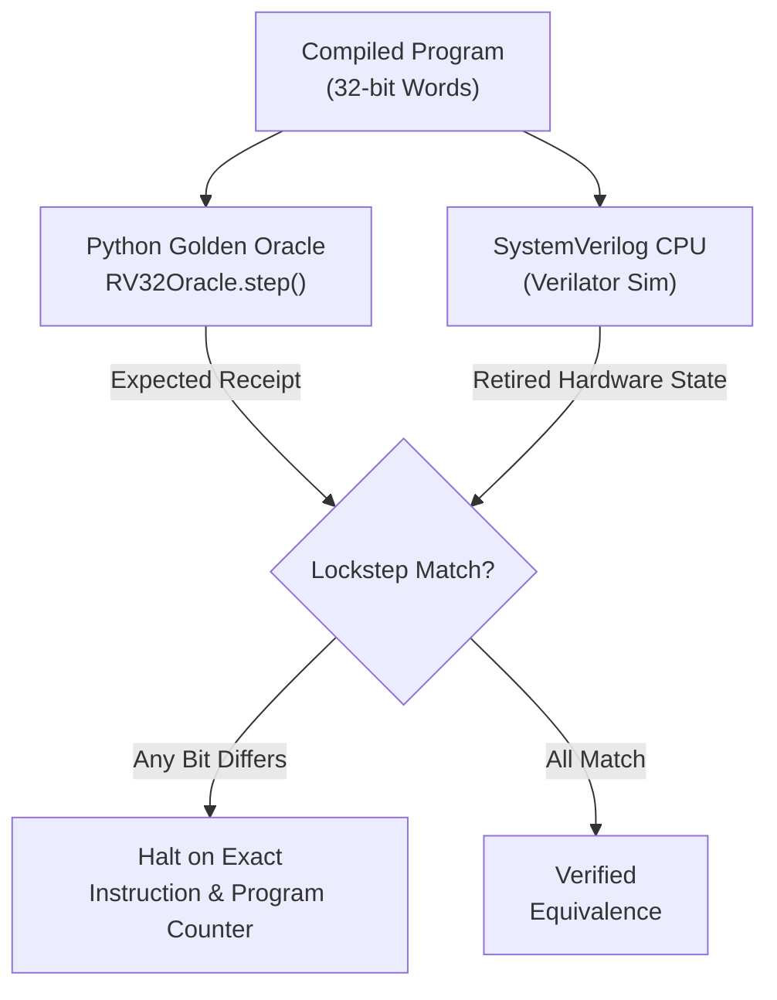
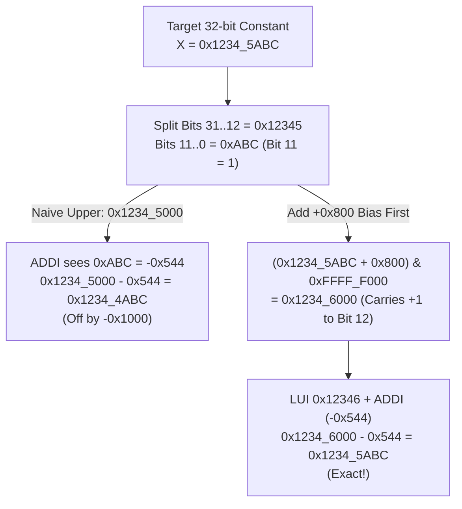
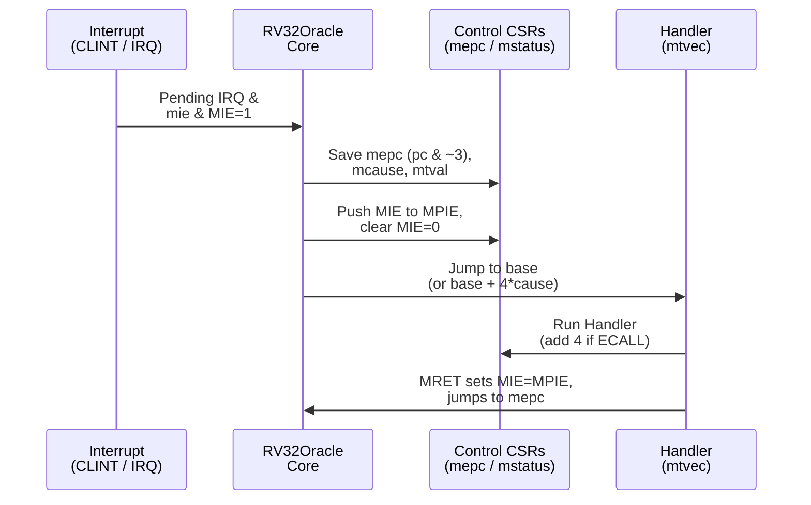

# Chapter 1: Instruction Set Architecture & Fixed-Width Binary Arithmetic

> **Part I: Digital Logic & Processor Architecture · Chapter 1 (`brain-01`) · Reading Time**: about 55 minutes  
> **Primary Modules**: [`oracle.py`](../sim/oracle.py) (`1,278` lines) & [`test_oracle.py`](../tb/test_oracle.py) (`1,336` lines)  
> **Interactive Figures**: *4-Bit Modular Ring Adder*, *Sign Extension & Right-Shift Comparator*, *32-Bit Instruction Inspector*, *6-Format Hardware Wire Matrix*, *64-Bit Product Splitter*, *Truncating Division Comparator*, *Xapex MAC Hardware Datapath*, and *`RV32Oracle.step()` Trace Explorer*

---

## 1. Why Chip Design Starts in Software: The Golden Reference Model

Consider building a production database storage engine or distributed consensus protocol without a formal specification—jumping straight into lock-free pointer arithmetic and hoping unit tests written alongside the optimizations catch subtle ordering bugs. Experienced systems engineers recognize the hazard: when an optimization and its test share the same flawed assumption, both pass while silently corrupting state.

Designing a custom processor in a **Hardware Description Language (`HDL`)** such as `SystemVerilog` multiplies that hazard tenfold. In sequential software, statements execute one after another; in physical silicon, thousands of boolean logic gates, hardware selector switches—the circuit equivalent of `cond ? a : b` (**multiplexers**)—and 1-bit clocked storage latches (**flip-flops**) evaluate **simultaneously on every tick of a `50 MHz` crystal oscillator**. When a pipelined processor fetches Instruction #5 while decoding Instruction #4, computing arithmetic for Instruction #3, reading RAM for Instruction #2, and writing a register for Instruction #1—and an external timer alarm fires mid-flight—we need an unambiguous specification defining what the hardware ought to have done.

Commercial chip teams solve this before writing a single logic gate by building an unambiguous, sequential software model of the processor called a **Golden Reference Model—or Oracle**. [`oracle.py`](../sim/oracle.py) is that golden specification for the `brain` processor. Before we turn the specification into logic gates, software tests execute programs directly against the oracle; later, when the `SystemVerilog` hardware runs inside an open-source hardware simulator that compiles register-transfer designs into fast C++ executables (**Verilator**), both engines execute the exact same machine code in lockstep. On every instruction, [`RV32Oracle.step()`](../sim/oracle.py) compares its architectural state transition against the hardware's retired output:

To verify that equivalence without slowing down the pipeline, [`RV32Oracle.step()`](../sim/oracle.py) emits a structured commit receipt after each executed instruction—[`StepTrace`](../sim/oracle.py):

<!-- book-sync: StepTrace -->
<<< @/systems/brain/sim/oracle.py#L475-L496

`StepTrace` works like a **write-ahead database log entry**. Instead of waiting for a 10,000-instruction test to finish and produce a wrong final sum, co-simulation compares five fields on every single completed and committed (**retired**) instruction: the fetched instruction address (`pc`, the **Program Counter**) and raw `32`-bit word (`insn`), the post-instruction `next_pc`, the destination register (`rd`) and committed value (`rd_val`), any memory bus payload (`mem_addr`, `mem_val`, `mem_write`), and any exception or interrupt code (`trap_cause`, `interrupt`).

### What an Instruction Set Architecture (`ISA`) Separates

Software relies on crisp abstraction layers: a **POSIX system-call contract** separates user programs from how the Linux kernel schedules threads or lays out disk blocks, and the **Java Virtual Machine (`JVM`) bytecode specification** separates `javac` from how `HotSpot` optimizes loops at runtime. In processor engineering, the boundary separating **all software** (compilers, bootloaders, real-time schedulers, control loops) from **physical silicon** (pipelines, logic gates, clock frequencies) is the **Instruction Set Architecture (`ISA`)**.

An `ISA` defines strictly what machine code can observe:
1. **Architectural State**: The persistent storage containers (registers, program counter, control registers, and addressable memory) that survive from one instruction to the next.
2. **Instruction Binary Encoding**: How operations, register selectors, and constants pack into `32`-bit integers (`0`s and `1`s).
3. **State-Transition Semantics**: Given any prior state `S_t` and the 32-bit word fetched at `pc`, the deterministic next state:

$$S_{t+1} = \text{step}(S_t)$$

Because an `ISA` omits internal microarchitecture details—such as whether an operation takes 1 cycle or 32 cycles, or how five pipeline stages overlap—[`oracle.py`](../sim/oracle.py) expresses the entire `brain` processor and its peripherals cleanly in sequential Python. Across the rest of this chapter, we build the `brain` architecture layer by layer: fixed-width binary arithmetic first, registers and instruction families next, 32-bit instruction packing, corner cases in integer and neural math, the memory and peripheral bus, and finally interrupts, traps, and the full execution loop.

---

## 2. Fixed-Width Binary Arithmetic from First Principles

When you evaluate `2**200` or `-5` in Python, the runtime allocates variable-length byte arrays on the heap so integers never overflow. Physical silicon has no heap allocator inside an arithmetic circuit. A 32-bit processor register is **32 parallel copper wires** driven by 32 clocked flip-flops, each holding either a low voltage (`0`) or a high voltage (`1`). Every integer, memory pointer, and packed sensor reading must fit inside those `32` wires (`2^32 = 4,294,967,296` distinct bit patterns).

Before walking through the algebra, explore a miniature **4-bit version** (`16` patterns) in the interactive clock-face adder below to see how both positive and negative integers wrap seamlessly around one shared circle:

<ModularRingAdder />

### Unsigned Binary Integers & Modular Rings (`u32`)

Every general-purpose register starts out as an ordered strip of binary wires with no built-in negative sign. Assigning each wire its power-of-two place value gives us our first numeric interpretation—mapping raw wire voltages directly onto non-negative integers.

Consider a hardware register of width $N \ge 1$ bits holding wires $b_{N-1}, b_{N-2}, \dots, b_0 \in \{0, 1\}$. Summing those weighted bits defines the **unsigned integer interpretation**:

$$U_N(b) = \sum_{i=0}^{N-1} b_i \cdot 2^i$$

When all bits are `0`, `U_N = 0`; when all bits are `1`, summing the geometric series $\sum_{i=0}^{N-1} 2^i = 2^N - 1$ gives the maximum value. An `N`-bit unsigned register therefore spans `[0, 2^N - 1]` (for `N = 32`, `0` through `4,294,967,295`).

Now suppose an arithmetic step produces an integer `x` outside `[0, 2^N - 1]`—such as adding two 32-bit numbers whose true sum has a 33rd carry-out bit. By integer division with remainder (*Euclidean division*: dividing any integer `x` by `2^N` leaves a unique non-negative remainder `r` strictly below `2^N`), we write:

$$x = q \cdot 2^N + r, \qquad q \in \mathbb{Z},\quad 0 \le r < 2^N$$

Multiplying `q` by `2^N` pushes every bit of `q` to bit positions $i \ge N$, leaving $r = x \bmod 2^N$ in the bottom `N` bits `0` through `N - 1`. Because a physical 32-bit register only has wires `0..31`, any upper bits simply vanish off the left edge of the adder. Wrapping integers around `[0, 2^N - 1]` creates a **modular ring** `Z_{2^N}`: a finite clock face like the 4-bit `0000`–`1111` wheel above where stepping `1` past `2^N - 1` lands back at `0`, and two integers belong to the same **residue class** whenever they differ by a multiple of `2^N` and therefore occupy the same clock slot.

In Python, masking with `MASK32 = 0xFFFF_FFFF` (`2^32 - 1`) projects any Python `int` onto that 32-bit modular ring:

<!-- book-sync: u32 -->
<<< @/systems/brain/sim/oracle.py#L260-L262

### Why Two's Complement Won: Negative Numbers on Clock-Face Wires

Physical registers still need negative integers for loop offsets, velocities, and neural weights, yet adding a dedicated `"+"`/`"-"` circuit wire would break single-adder uniformity. How should those same `2^N` bit patterns represent **signed** integers cleanly on `N = 4` bits (`16` patterns)? Compare the two historical candidates against our clock face:

- **Sign-Magnitude** (*top bit = sign, bottom `N - 1` bits = magnitude*): Wastes one pattern on `-0` (`1000` alongside `+0 = 0000`) and breaks binary addition (`+3` [`0011`] `+` `-5` [`1101`] gives `0000` instead of `-2`), forcing hardware to inspect signs and subtract magnitudes separately.
- **Ones' Complement** (*negate by flipping all bits, so `-5` is `1010`*): Still suffers from two zeros (`0000` and `1111`) and requires routing the top carry-out bit back around into `Bit 0` ("end-around carry").

**Two's complement (`s32` and `s16`)** takes its cue directly from the clock face: stepping **backward by 1** modulo `16` from `0000` lands on `1111` ($15 \equiv -1 \pmod{16}$), and stepping backward by `5` lands on `1011` ($11 \equiv -5 \pmod{16}$). Algebraically, two's complement keeps positive weights $+2^0, \dots, +2^{N-2}$ on the bottom `N - 1` bits and assigns the **most-significant bit (`Bit N - 1`) a negative weight `-2^{N-1}`**:

$$S_N(b) = -b_{N-1} \cdot 2^{N-1} + \sum_{i=0}^{N-2} b_i \cdot 2^i$$

Writing $L = \sum_{i=0}^{N-2} b_i 2^i$ in `[0, 2^{N-1} - 1]`, patterns with $b_{N-1} = 0$ cover `[0, 2^{N-1} - 1]` while patterns with $b_{N-1} = 1$ cover `[-2^{N-1}, -1]`—mapping all `2^N` patterns one-to-one onto `[-2^{N-1}, 2^{N-1} - 1]` with **only one zero** (`000...0`). For `N = 32`, that gives `INT32_MIN = -2,147,483,648` (`0x8000_0000`) through `INT32_MAX = +2,147,483,647` (`0x7FFF_FFFF`).

### Contiguous Derivations: `u32`↔`s32`, Negation (`~x + 1`), and Sign-Agnostic Adders

Before writing hardware rules for arithmetic, we need an exact bridge between unsigned wire patterns (`u32`) and signed values (`s32`). Comparing the two weighted sums `U_N(b)` and `S_N(b)` side by side yields a single conversion identity—implemented in [`sign_extend`](../sim/oracle.py)—plus why a single binary adder works for both signed and unsigned math:

$$\begin{aligned}
U_N(b) - S_N(b)
&= \left(b_{N-1} 2^{N-1} + \sum_{i=0}^{N-2} b_i 2^i\right)
 - \left(-b_{N-1} 2^{N-1} + \sum_{i=0}^{N-2} b_i 2^i\right)
&& \text{(split } i = N-1 \text{ term; lower sums match)} \\
&= 2 \cdot b_{N-1} \cdot 2^{N-1}
&& \text{(lower } N-1 \text{ terms cancel identically)} \\
&= b_{N-1} \cdot 2^N
&& \text{(combine powers of } 2 \text{)} \\
\implies\quad S_N(b) &= U_N(b) - b_{N-1} \cdot 2^N
&& \text{(exact } \text{s32} \text{ / } \text{s16} \text{ conversion identity)}
\end{aligned}$$

Two hardware corollaries follow directly from this derivation:

1. **Why Bitwise Negation Is `~x + 1`**: Let $\bar{b}_i = 1 - b_i$ be the bitwise complement of wire pattern `b`:

$$\begin{aligned}
U_N(\bar{b}) + 1
&= \sum_{i=0}^{N-1} (1 - b_i) 2^i + 1
&& \text{(substitute } \bar{b}_i = 1 - b_i \text{)} \\
&= \left(2^N - 1 - U_N(b)\right) + 1
&& \text{(evaluate } \sum_{i=0}^{N-1} 2^i = 2^N - 1 \text{)} \\
&= 2^N - U_N(b) \equiv -S_N(b) \pmod{2^N}
&& \text{(since } U_N(b) \equiv S_N(b) \pmod{2^N} \text{)}
\end{aligned}$$

Hardware therefore computes subtraction `A - B` on the **exact same adder circuit** as `A + ~B + 1` by inverting `B`'s wires and driving carry-in `= 1`.

2. **Why Addition, Subtraction, and Left Shifts Need No Signed/Unsigned Variants**: Because $U_N(b) - S_N(b) = b_{N-1} 2^N$ is always a multiple of `2^N`, any `N`-bit word satisfies $U_N(b) \equiv S_N(b) \pmod{2^N}$. Adding, subtracting, or shifting left (`× 2^k`) any two 32-bit operands modulo `2^32` yields the exact same bottom 32 bits regardless of whether software interprets those bits as `u32` or `s32`.

### Right Shifts & Widening Narrow Constants (`sign_extend`)

Unlike addition and left shifts, three fundamental bit operations **do** depend on signedness: ordered comparisons (`<`, `>=`), right shifts (`>>`), and widening narrow bit widths (`8`, `12`, `16`, or `21` bits) up to `32` bits. Before inspecting the proof below, explore how `Bit 11` fans out across `Bits 31..12`—and how logical versus arithmetic right shifts refill vacated top wires:

<SignExtensionShifter />

Notice the sharp split between the two right-shift behaviors shown above: a **logical right shift** pulls in `0`s from the left to compute unsigned floor division $\lfloor U_{32}(x) / 2^k \rfloor$ (`u32(x) >> k` in Python), whereas an **arithmetic right shift** copies the original sign wire (`Bit 31`) into every vacated upper bit to preserve negative signs when computing signed division toward `-∞` ($\lfloor S_{32}(x) / 2^k \rfloor$). Because Python's built-in right-shift (`>>`) performs arithmetic sign-replication automatically on negative numbers, [`oracle.py`](../sim/oracle.py) separates unsigned (`u32(val) >> k`) from signed (`s32(val) >> k`) right shifts explicitly.

Suppose hardware needs to widen a `k`-bit signed constant ($1 \le k \le 31$, such as a 12-bit instruction constant or 8-bit loaded byte) into a `32`-bit register by copying its top sign bit `b_{k-1}` onto every upper wire $i \in [k, 31]$. Evaluating the two's-complement sum directly proves that zero logic gates are needed—wire `b_{k-1}` simply fans out to wires `31..k`:

$$\begin{aligned}
S_{32}(\text{extended } b)
&= -b_{k-1} 2^{31} + \sum_{i=k}^{30} b_{k-1} 2^i + b_{k-1} 2^{k-1} + \sum_{i=0}^{k-2} b_i 2^i
&& \text{(assign } b_{k-1} \text{ to Bits } 31\dots k \text{)} \\
&= b_{k-1}\!\left(-2^{31} + (2^{31} - 2^k) + 2^{k-1}\right) + \sum_{i=0}^{k-2} b_i 2^i
&& \text{(geometric series } \sum_{i=k}^{30} 2^i = 2^{31} - 2^k \text{)} \\
&= -b_{k-1} 2^{k-1} + \sum_{i=0}^{k-2} b_i 2^i = S_k(b)
&& \text{(telescope } {-2^k + 2^{k-1}} = -2^{k-1} \text{)}
\end{aligned}$$

In software, [`sign_extend`](../sim/oracle.py) executes this widening without conditional branches using two bit operations, and [`s32`](../sim/oracle.py) / [`s16`](../sim/oracle.py) apply it directly for 32-bit and 16-bit two's-complement conversion:

<!-- book-sync: sign_extend..s16 -->
<<< @/systems/brain/sim/oracle.py#L265-L281

Writing the masked `k`-bit unsigned value as $\text{val} = b_{k-1} s + L$, where `s = 2^{k-1}` (`sign_bit`) and $L = \sum_{i=0}^{k-2} b_i 2^i$ lies in `[0, s - 1]`, bit `k - 1` of `L` is `0`. XORing with `s` therefore flips *only* bit `k - 1` without touching `L`:

$$\begin{aligned}
(\text{val} \oplus s) - s
&= \left((1 - b_{k-1}) s + L\right) - s
&& \text{(XOR toggles only } b_{k-1} \mapsto 1 - b_{k-1} \text{)} \\
&= -b_{k-1} s + L = -b_{k-1} 2^{k-1} + \sum_{i=0}^{k-2} b_i 2^i = S_k(b)
&& \text{(cancel } s - s = 0 \text{)}
\end{aligned}$$

### Wrap-Around Overflow vs. Saturating Clamping (`sat32`)

Standard integer addition wraps silently modulo `2^32`: `INT32_MAX + 1` flips to `INT32_MIN` (`-2,147,483,648`). While wrap-around works well for memory pointers and ring buffers, a wrap from maximum positive torque to maximum negative torque inside a leg-control neural network would slam a robot joint in the wrong direction. For custom neural accumulation, [`sat32`](../sim/oracle.py) therefore clamps out-of-range sums to `[INT32_MIN, INT32_MAX]`:

<!-- book-sync: sat32 -->
<<< @/systems/brain/sim/oracle.py#L284-L290

---

## 3. Core Architectural State and the Six Instruction Families

With 32-bit wire math established, we now introduce the minimal persistent storage containers inside the processor that survive from one step to the next, followed by the six functional groups of machine operations that read and update them. *(Later sections add the neural accumulator `mac_acc`, the memory bus and peripherals, and privileged control registers right as we derive their mechanics.)*

Inside [`RV32Oracle.reset()`](../sim/oracle.py), core computation revolves around two state elements:
1. **The Program Counter (`self.pc`)**: A single 32-bit register holding the byte address of the *next* instruction to fetch. At boot, `reset()` initializes `self.pc = BOOT_ROM_BASE` (`0x0000_0000`).
2. **The General-Purpose Register File (`self.regs[0..31]`)**: An array of `32` fast 32-bit integer registers named `x0` through `x31` (`128` bytes total). Choosing `32` registers rather than `8` or `256` balances storage against instruction-word bit budget: addressing any of `32` entries requires $\log_2(32) = 5\text{ bits}$ per operand, so three register operands consume `15` of the `32` wires while leaving `17` bits for operation codes and constants.

### Physical Wiring of Register `x0`

In physical silicon, `x0` is not a general-purpose flip-flop register initialized to zero at power-on and kept untouched by software convention—it is literally missing storage cells altogether. Its read wires tie permanently to `0V` (`0`), and its write-enable wire ignores incoming values, enforced in software by [`_set_reg`](../sim/oracle.py):

<!-- book-sync: RV32Oracle._set_reg -->
<<< @/systems/brain/sim/oracle.py#L881-L887

Having one register guaranteed to read `0`—and one safe write-discard sink—keeps the instruction set remarkably small: instead of dedicating separate hardware opcodes for *"do nothing"*, *"move register"*, *"load zero"*, *"compare to zero"*, or *"jump without saving a return address"*, software reuses ordinary instructions with `x0` plugged into a source or destination slot. We will see those exact `x0` idioms appear naturally in Section 5 (arithmetic shortcuts) and Section 8 (branch and subroutine-return shortcuts) as soon as those instructions are defined.

### Top-Down Map: The Six Instruction Families of `RV32IM + Zicsr + Xapex`

The `brain` processor implements **Reduced Instruction Set Computer — Fifth Generation (`RISC-V`)**, an open hardware specification built around a minimal **RISC-V 32-bit Base Integer (`RV32I`)** core plus two standard extensions—integer **Multiply and Divide (`M`)** and **Control and Status Registers (`Zicsr`)**—alongside our custom **Apex neural Multiply-Accumulate (`Xapex MAC`)** extension. Every hardware instruction has a short human-readable keyword called an **instruction mnemonic** (such as `add` for integer addition or `lw` for Load Word) that names one specific 32-bit binary pattern, and Family 1 routes through the **Integer Arithmetic Logic Unit (`ALU`)**—the combinational circuit block (computational logic switches whose outputs compute continuously from current inputs with no clock delay) that performs integer arithmetic, bitwise logic, and shifts. Every valid machine word belongs to one of **six functional groups**:

| # | Functional Group | Representative Mnemonics | What Software Uses It For | Derived In |
| :-: | :--- | :--- | :--- | :---: |
| **1** | **Integer `ALU`, Shifts & Upper Constants (`RV32I`)** | `add`, `sub`, `addi`, `and`, `or`, `xor`, `sll`, `srl`, `sra`, `slt`, `sltu`, `lui`, `auipc` | Loop counters, array offsets, bit masks, comparisons, building 32-bit constants | Sec. 4–5 |
| **2** | **Multiply & Divide (`RV32M`)** | `mul`, `mulh`, `mulhsu`, `mulhu`, `div`, `divu`, `rem`, `remu` | Full 64-bit products, fixed-point scaling, quotient/remainder without loops | Sec. 5 |
| **3** | **Memory Loads & Stores (`RV32I`)** | `lb`, `lbu`, `lh`, `lhu`, `lw`, `sb`, `sh`, `sw` | Reading/writing bytes, halfwords, and 32-bit words in RAM and device registers | Sec. 7 |
| **4** | **Branches & Subroutine Jumps (`RV32I`)** | `beq`, `bne`, `blt`, `bge`, `bltu`, `bgeu`, `jal`, `jalr` | `if`/`while` loops, function calls (saving return address `PC + 4`), indirect pointers | Sec. 4, 8 |
| **5** | **System, Barriers & Control Registers (`RV32I + Zicsr`)** | `ecall`, `ebreak`, `mret`, `wfi`, `fence`, `fence.i`, `csrrw`, `csrrs`, `csrrc` | Syscalls, debugger halts, trap returns, memory ordering, interrupt/timer setup | Sec. 8–9 |
| **6** | **Dual-`int16` Saturating Neural `MAC` (`Xapex`)** | `mac`, `mac.clr`, `mac.set`, `mac.get` | Running the robot's quantized walking neural network within a `< 0.6 ms` control tick | Sec. 6 |

---

## 4. Instruction Encoding: Packing 32-Bit Control Words

Before the processor can execute any operation, hardware must extract who participates and what happens from a single `32`-bit integer fetched out of memory. Unlike variable-length architectures with prefix bytes and multi-byte opcodes, every `RISC-V` instruction fits inside one `32`-bit unsigned word decoded purely by slicing fixed bit columns: a **7-bit primary operation code (`opcode`, Bits 6..0)** naming the family, up to three **5-bit register indices (`rd` destination, `rs1` source 1, `rs2` source 2)**, **3-bit and 7-bit sub-operation selectors (`funct3` and `funct7`)** choosing the exact operation inside that family, and any remaining bits holding a **constant (*immediate*)**.

All standard 32-bit `RISC-V` opcodes end with `Bits 1..0 = 0b11` (`3`), reserving other 2-bit endings for optional 16-bit compressed instructions omitted by this core under strict 4-byte **Instruction Address Alignment (`IALIGN = 32`)**. Inside [`RV32Oracle.step()`](../sim/oracle.py), the decoder slices all five common fields simultaneously before inspecting which family just arrived:

<!-- book-sync: RV32Oracle.step['opcode = insn & OPCODE_MASK'..'funct7 = (insn >> 25) & FUNCT7_MASK'] -->
<<< @/systems/brain/sim/oracle.py#L1197-L1202

Explore all six standard `RISC-V` instruction formats—**Register (`R`-type)**, **Immediate (`I`-type)**, **Store (`S`-type)**, **Branch (`B`-type)**, **Upper Immediate (`U`-type)**, and **Jump (`J`-type)**—plus our custom `Xapex` format interactively in the decoder below. Click any instruction preset or flip individual bits to see how each field lines up across `Bits 31..0`:

<RiscvBitfieldDecoder />

### Why `S`, `B`, and `J` Formats Scramble Constant Bits

Notice a curious layout pattern when switching between `I`-type (**Immediate**), `S`-type (**Store**), `B`-type (**Branch**), `U`-type (**Upper Immediate**), and `J`-type (**Jump**) presets above: `I`-type keeps its 12-bit constant contiguous in `Bits 31..20`, whereas `S`, `B`, and `J` split and rearrange their constant bits across non-adjacent positions. Explore all six 32-bit wire layouts stacked by column below—use the filter buttons to highlight stationary register columns (`rs1`, `rs2`, `rd`) versus constant slices:

<RiscvFormatMatrix />

If an architect designed each format on paper in isolation, every immediate would sit in one tidy contiguous span. **Physical hardware pays a heavy multiplexer delay tax for moving register selectors across wires**: if `rs1` sat at `Bits 19..15` on `R`-type (**Register-Register**) instructions but moved to `Bits 27..23` on `S`-type (**Store**) instructions, every single wire feeding the `32`-entry register file read port would need an extra selector switch—lengthening the critical clock path on every cycle. `RISC-V` instead **locks the register columns (`rd` at `Bits 11..7`, `rs1` at `Bits 19..15`, `rs2` at `Bits 24..20`) and pins the constant's sign bit at `Bit 31` across every format**:

- **Sign bit pinned to `Bit 31`**: Hardware taps `Bit 31` of the instruction directly into the sign-extension fan-out tree *in parallel* with opcode decoding—zero gate delay waiting to discover the instruction format first.
- **`S`-type (`Store`)**: Stores read two registers (`rs1` base pointer and `rs2` data) and write no destination register, so the upper 7 bits (`Bits 11..5`) and lower 5 bits (`Bits 4..0`) of the 12-bit byte offset split cleanly around `rs2`, `rs1`, and `funct3` into instruction `Bits 31..25` and `Bits 11..7`.
- **`B`-type (`Branch`) & `J`-type (`Jump`)**: Conditional branches and program-counter jumps target 2-byte (even) instruction addresses, so `Bit 0` of the byte offset is always `0` and omitted from the encoding. Pinning the sign bit at `Bit 31` and keeping the middle/low offset bits aligned with `S`-type (`Bits 30..25` and `Bits 11..8`) and `U`-type (**Upper Immediate**, `Bits 19..12`) wires collapses immediate routing down to just **two 1-bit wire swaps** (`Bit 7` in `B`-type and `Bit 20` in `J`-type).

The six encoder functions ([`enc_r`](../sim/oracle.py), [`enc_i`](../sim/oracle.py), [`enc_s`](../sim/oracle.py), [`enc_b`](../sim/oracle.py), [`enc_u`](../sim/oracle.py), [`enc_j`](../sim/oracle.py)) plus the custom [`enc_mac`](../sim/oracle.py) packer implement these exact wire placements.

---

## 5. Integer Arithmetic, Upper Constants & Hardware Multiply/Divide (`RV32I + RV32M`)

Once a 32-bit instruction word is sliced into `opcode`, `rd`, `rs1`, `rs2`, `funct3`, `funct7`, and its sign-extended constant, the **Arithmetic Logic Unit (`ALU`)**—the combinational adder, comparator, bitwise logic, and barrel-shifter datapath whose outputs compute continuously from current inputs with no internal clock latch—executes register-immediate (`OP-IMM`, `opcode = 0x13`) and register-register (`OP`, `opcode = 0x33`) operations inside [`_exec_op_imm`](../sim/oracle.py) and [`_exec_op_reg`](../sim/oracle.py). Five design details govern exact hardware behavior:

1. **5-Bit Masked Barrel Shifter (`& 0x1F`)**: Hardware shifts use a logarithmic multi-stage routing circuit (**barrel shifter**) shifting by `16`, `8`, `4`, `2`, and `1` bits in parallel. Only the bottom 5 bits (`0..31`) of `rs2` (`rs2_u & 0x1F`) or the immediate field (`(insn >> 20) & 0x1F`) wire to the shift control lines, so a shift distance of `35` executes a shift by `3` (`35 & 31 = 3`). On immediate shifts—**Shift Left Logical Immediate (`SLLI`)**, **Shift Right Logical Immediate (`SRLI`)**, and **Shift Right Arithmetic Immediate (`SRAI`)**—`Bits 31..25` (`funct7`) hold mode bits (`0x00` logical vs. `0x20` arithmetic); any unrecognized `funct7` returns an illegal-instruction trap (`CAUSE_ILLEGAL_INSN = 2`).
2. **Signed vs. Unsigned Set-Less-Than (`SLT`, `SLTU`, `SLTI`, `SLTIU`)**: Comparisons write `1` into `rd` if `rs1 < operand` and `0` otherwise. Beware **`SLTIU`**: hardware **always sign-extends the 12-bit immediate first** (`imm = sign_extend(insn >> 20, 12)`), then reinterprets `u32(imm)` as unsigned! Thus `sltiu rd, rs1, 1` compares `rs1 < 1` unsigned (`rd = 1` iff `rs1 == 0`, forming the **Set if Equal to Zero / `seqz`** idiom), while `sltiu rd, rs1, -1` extends `-1` to `0xFFFF_FFFF` (`4,294,967,295`).
3. **Bitwise Immediate Promotion (`XORI`, `ORI`, `ANDI`)**: Logical immediates likewise sign-extend their 12-bit constant (`Bits 11..0`) to 32 bits (`u32(imm)`), turning `xori rd, rs1, -1` into a full 32-bit bitwise `NOT` (`^ 0xFFFF_FFFF`).
4. **Addition (`ADDI`), Register-Register Operations (`OP`) & `x0` Idioms**: Inside [`_exec_op_imm`](../sim/oracle.py), **Add Immediate (`ADDI`)** computes `u32(rs1 + imm)` from a sign-extended 12-bit constant (`-2048..+2047`); inside [`_exec_op_reg`](../sim/oracle.py), `funct7 = 0x00` dispatches eight register-register integer ops (`ADD`, `SLL`, `SLT`, `SLTU`, `XOR`, `SRL`, `OR`, `AND` keyed by `funct3 = 0..7`), while `funct7 = 0x20` selects **`SUB`** (`funct3 = 0`) and arithmetic right-shift **`SRA`** (`funct3 = 5`). Pairing `ADDI` and `SUB` with our hardwired zero register `x0` yields everyday idioms without adding extra opcodes:
   - **`nop`** (do nothing) → `addi x0, x0, 0` (discards result into `x0`)
   - **`mv rd, rs1`** (copy register) → `addi rd, rs1, 0`
   - **`li rd, imm12`** (load small signed constant) → `addi rd, x0, imm12`
   - **`neg rd, rs1`** (two's-complement negation) → `sub rd, x0, rs1` (`0 - rs1`)
5. **Unified Illegal-Instruction Trap**: Whenever `funct7` fails validation inside [`_exec_op_imm`](../sim/oracle.py) or [`_exec_op_reg`](../sim/oracle.py), the helper emits `StepTrace` via `_trap_trace(..., CAUSE_ILLEGAL_INSN, insn)`, recording an illegal-instruction trap without altering `rd` (Section 8 derives how traps transfer control to the trap handler).

### Building Full 32-Bit Constants (`LUI`, `AUIPC`, and the `+0x800` Sequence)

An `I`-type instruction like `ADDI` only holds a `12`-bit signed constant (`-2048` to `+2047`), yet real programs constantly synthesize full `32`-bit memory addresses, peripheral pointers, and bit masks. Because an entire `32`-bit instruction word must reserve `7` bits for `opcode` and `5` bits for `rd`, no single instruction can carry a `32`-bit literal inside itself. `RISC-V` solves this using two `U`-type instructions that load a `20`-bit payload straight into the upper `Bits 31..12` of `rd` while clearing `Bits 11..0` to zero:
- **`LUI` (*Load Upper Immediate*)**: Writes `(imm20 << 12)` into `rd`.
- **`AUIPC` (*Add Upper Immediate to PC*)**: Writes `u32(cur_pc + (imm20 << 12))` into `rd` for position-independent code and data pointers.

To construct an arbitrary `32`-bit constant `X`, machine code executes a two-instruction sequence: **`LUI`** loads the upper `20` bits first, and **`ADDI`** adds the lower `12` bits next. However, splitting `X` naively into `(X >> 12)` for `LUI` and `(X & 0xFFF)` for `ADDI` fails whenever `Bit 11` of `X` is `1` (`lo12 >= 0x800`). Because `ADDI` **always sign-extends** its 12-bit immediate before adding, any `lo12 >= 0x800` turns negative (`-2048..-1`), borrowing `1` from `Bit 12` unless we pre-add `0x800` (`2^11`) first:

Using our Section 2 identity $U_{12}(\text{lo}_{12}) = S_{12}(\text{lo}_{12}) + b_{11} \cdot 2^{12}$ (where $b_{11} \in \{0, 1\}$ is `Bit 11` of `X`) proves this closed-form rule for every 32-bit unsigned constant `X`:

$$\begin{aligned}
X &= \text{hi}_{20} \cdot 2^{12} + U_{12}(\text{lo}_{12})
&& \text{(split } X \text{ at Bit 12)} \\
&= \text{hi}_{20} \cdot 2^{12} + \left(S_{12}(\text{lo}_{12}) + b_{11} \cdot 2^{12}\right)
&& \text{(substitute } U_{12} = S_{12} + b_{11} 2^{12} \text{)} \\
&= (\text{hi}_{20} + b_{11}) \cdot 2^{12} + S_{12}(\text{lo}_{12})
&& \text{(factor } 2^{12} \text{ across upper bits)} \\
\implies\quad \text{hi}_{\text{lui}} &= \left\lfloor \frac{X + 2^{11}}{2^{12}} \right\rfloor \bmod 2^{20} = \frac{u32(X + \texttt{0x800}) \mathbin{\&} \texttt{0xFFFF\_F000}}{2^{12}}
&& \text{(adding } 2^{11} \text{ carries } 1 \iff b_{11} = 1 \text{)}
\end{aligned}$$

Notice that adding `0x800` (`2^11`) does nothing when `Bit 11 = 0`, and carries `1` into `Bit 12` precisely when `Bit 11 = 1` (wrapping modulo `2^32` when `X >= 0xFFFF_F800`).

### Full 64-Bit Multiplication (`RV32M`): Why `MUL` Has Four Variants

Multiplying two `32`-bit integers produces an exact **`64`-bit product** ($2^{32} \cdot 2^{32} = 2^{64}$). Since each `RISC-V` instruction can write only one `32`-bit register `rd`, the **Hardware Multiply and Divide Extension (`RV32M`, `funct7 = 0x01`)** pairs one low-half instruction (**`MUL`**, returning `Bits 31..0`) with three upper-half instructions (**`MULH`**, **`MULHSU`**, and **`MULHU`**, returning `Bits 63..32`). Explore the full 64-bit product bar below across signed and unsigned presets to see immediately why the bottom 32 wires never change while the top 32 wires diverge:

<Product64Inspector />

Apply our Section 2 identity $U_{32}(x) = S_{32}(x) + x_{31} \cdot 2^{32}$ to any two 32-bit bit patterns `a, b` with sign bits $a_{31}, b_{31} \in \{0, 1\}$ to see why hardware needs only one `MUL` opcode but three `MULH*` variants:

$$\begin{aligned}
U_{32}(a) \cdot U_{32}(b)
&= \left(S_{32}(a) + a_{31} 2^{32}\right)\!\left(S_{32}(b) + b_{31} 2^{32}\right)
&& \text{(substitute } U_{32} = S_{32} + b_{31} 2^{32} \text{)} \\
&= S_{32}(a) \cdot S_{32}(b) + 2^{32}\!\left(a_{31} S_{32}(b) + b_{31} S_{32}(a) + a_{31} b_{31} 2^{32}\right)
&& \text{(expand cross-terms of } 2^{32} \text{)}
\end{aligned}$$

Notice the immediate consequences of that expansion:
- **Identical Low `32` Bits (`MUL`)**: Every sign-correction term carries a factor of `2^32`, touching only `Bits 63..32`. Thus signed × signed, signed × unsigned, and unsigned × unsigned always produce the **exact same low 32 bits**.
- **Divergent Upper `32` Bits (`MULH`, `MULHSU`, `MULHU`)**: Evaluating `a = 0xFFFF_FFFF` (`s32 = -1`, `u32 = 2^32 - 1`) and `b = 0x8000_0000` (`s32 = -2^31`, `u32 = 2^31`) yields three completely different upper halves (`>> 32`):
  - **`MULH` (`signed × signed`)**: $(-1) \times (-2^{31}) = +2^{31} = \texttt{0x0000\_0000\_8000\_0000}$ → **`0x0000_0000`**.
  - **`MULHSU` (`signed × unsigned`)**: $(-1) \times (+2^{31}) = -2^{31} = \texttt{0xFFFF\_FFFF\_8000\_0000}$ → **`0xFFFF_FFFF`**.
  - **`MULHU` (`unsigned × unsigned`)**: $(2^{32} - 1) \times 2^{31} = 2^{63} - 2^{31} = \texttt{0x7FFF\_FFFF\_8000\_0000}$ → **`0x7FFF_FFFF`**.

Because Python's right-shift `P >> 32` evaluates $\lfloor P / 2^{32} \rfloor$ on arbitrary-precision signed integers, `(rs1_s * rs2_s) >> 32` extracts exact two's-complement `Bits 63..32` automatically.

### Hardware Division Without Traps (`DIV`, `DIVU`, `REM`, `REMU`)

**`RISC-V` integer division never throws a hardware trap** on divide-by-zero or signed overflow (`INT32_MIN / -1`, whose true quotient `+2^31` overflows `INT32_MAX = 2^31 - 1`). Eliminating runtime divide faults lets pipelined hardware avoid speculative trap rollback on multi-cycle divider circuits; software checks for zero divisors explicitly when language semantics demand an exception.

Watch one critical Python pitfall before writing emulator division: Python's `//` and `%` **floor toward `-∞`** (`-7 // 3 == -3` with remainder `+2`), whereas C, `SystemVerilog`, and `RISC-V` **truncate quotients toward zero** (`-7 / 3 == -2` with remainder `-1`, preserving `q * divisor + rem == dividend`). Compare both conventions and the non-trapping sentinel cases interactively below:

<TruncatingDivisionComparator />

Inside [`trunc_div_s32`](../sim/oracle.py) and [`RV32Oracle._exec_muldiv`](../sim/oracle.py), the oracle implements exact magnitude truncation toward zero alongside all four non-trapping sentinel rules:

<!-- book-sync: trunc_div_s32 -->
<<< @/systems/brain/sim/oracle.py#L293-L301

<!-- book-sync: RV32Oracle._exec_muldiv['elif funct3 == F3_DIV:'..'res = rs1_u if rs2_u == 0'] -->
<<< @/systems/brain/sim/oracle.py#L1056-L1068

| Instruction | Operand Signedness | Divide by Zero (`rs2 == 0`) | Overflow (`INT32_MIN / -1`) | Normal Rule |
| :--- | :--- | :--- | :--- | :--- |
| **`DIV`** | `s32 / s32` | `-1` (`0xFFFF_FFFF`) | `INT32_MIN` (`0x8000_0000`) | Truncate quotient magnitude toward `0` |
| **`DIVU`** | `u32 / u32` | `0xFFFF_FFFF` (`UINT32_MAX`) | *(impossible)* | Unsigned floor `rs1_u // rs2_u` |
| **`REM`** | `s32 % s32` | `rs1_s` (dividend) | `0` | Sign matches **dividend** `rs1_s` |
| **`REMU`** | `u32 % u32` | `rs1_u` (dividend) | *(impossible)* | Unsigned modulo `rs1_u % rs2_u` |

---

## 6. Custom Neural `MAC` Instruction (`Xapex`) & Softcore Real-Time Physics

During autonomous locomotion, the `brain` CPU runs a real-time neural walking policy (**Multilayer Perceptron / `MLP`**) at `200 Hz`, finishing each inference inside `< 0.6 ms` within every `5 ms` control tick. Physically, the robot has `12` leg motors (`3` joints per leg across `4` legs); `48` normalized proprioceptive inputs (joint angles, angular velocities, prior actions, body pitch/roll, and desired velocity commands) feed two `128`-neuron hidden layers to produce `12` target joint commands (`48 -> 128 -> 128 -> 12`). Summing weights across the three fully connected layers yields:

$$48 \times 128 + 128 \times 128 + 128 \times 12 = 6{,}144 + 16{,}384 + 1{,}536 = 24{,}064\text{ weights}$$

Storing each neural weight as a quantized signed 16-bit integer (**`int16`**) occupies $24{,}064 \times 2 = 48{,}128\text{ bytes}$ (`47.0 KB`), fitting completely inside the `64 KB` fast on-chip **Block RAM (`BRAM`)** with single-cycle read latency. Why add a custom **`Xapex` Multiply-Accumulate (`MAC`)** instruction (`custom-0`, `opcode = 0x0B`) instead of running standard `RV32IM`?

Unlike fixed application-specific chips, our `brain` CPU is a **softcore**: a processor written in `SystemVerilog` and mapped (**synthesized**) onto reprogrammable logic fabric inside a **Field-Programmable Gate Array (`FPGA`)**. That physical `FPGA` fabric creates two natural hardware constraints and opportunities:
1. **Two Register-File Read Ports**: Compact `FPGA` memory blocks build our `32`-register file using 4-input **Look-Up Tables (`LUT4`)** or dual-port `BRAM` with **two read ports (`rs1`, `rs2`) and one write port (`rd`)**, never three simultaneous read ports (`rs1`, `rs2`, `acc`). Accumulating `acc += a * b` in a single cycle without shuffling registers requires keeping the running sum inside a dedicated internal `mac_acc` register.
2. **2× Parallel Packing on `18 × 18` Hardware Multipliers (`DSP` Slices)**: Reprogrammable `FPGA` chips embed dedicated **Digital Signal Processing (`DSP`)** arithmetic blocks featuring **`18 × 18`-bit signed multiplier arrays**, which ingest two `int16` operands with zero wasted bit width. Packing **two `int16` lanes** inside every `32`-bit register (`Bits 15..0` and `Bits 31..16`) lets one instruction execute two products plus saturating accumulation per cycle—replacing about `12–20` plain `RV32IM` unpack, `MUL`, `ADD`, and overflow-clamp instructions (roughly **`12×–20×` faster** in arithmetic compute and **`5×–9×` faster** end-to-end with memory loads and activations).

Step through the hardware datapath stages interactively below—switch presets to watch `mac`, `mac.clr` with `rd = x0`, and `sat32` overflow protection in action:

<XapexMacDatapath />

Inside [`RV32Oracle._exec_mac`](../sim/oracle.py), `funct7 = 0x00` selects one of four `Xapex` sub-operations packed via [`enc_mac`](../sim/oracle.py), returning either an [`ExecOutcome`](../sim/oracle.py) pending-commit record (`rd`, `rd_val`) or an illegal-instruction trap [`StepTrace`](../sim/oracle.py):

<!-- book-sync: RV32Oracle._exec_mac -->
<<< @/systems/brain/sim/oracle.py#L1158-L1176

- **`mac` (`funct3 = 0`)**: Unpacks `(a0, a1)` and `(b0, b1)`, computes `sat32(mac_acc + a0*b0 + a1*b1)`, updates `self.mac_acc`, and writes the clamped value to `rd`. Even when `rd == x0`, hardware still updates `self.mac_acc` while `x0` simply discards the register copy.
- **`mac.clr` (`funct3 = 1`)**: Starts a fresh neuron dot product from `base_acc = 0` (`sat32(a0*b0 + a1*b1)`), removing any separate zero-clear step before each neuron loop.
- **`mac.set` (`funct3 = 2`)**: Preloads a `32`-bit signed neuron bias `s32(rs1_u)` straight into `self.mac_acc` (and returns it in `rd`) before looping over weight pairs.
- **`mac.get` (`funct3 = 3`)**: Copies `self.mac_acc` cleanly into `rd` without modifying the accumulator.

### Proof: Even a Single `mac.clr` Can Overflow `INT32_MAX`

Notice how tempting it is to assume overflow clamping (`sat32`) is only needed after accumulating hundreds of neuron weights. In fact, **even the very first instruction (`mac.clr`, starting from `base_acc = 0`) can exceed `INT32_MAX`**, because two's-complement `int16` extends one step farther on the negative side (`-32,768 = -2^15`) than on the positive side (`+32,767 = +2^15 - 1`):

$$\begin{aligned}
\min(a_0 b_0 + a_1 b_1)
&= 2 \cdot (-2^{15}) \cdot (2^{15} - 1) = -2^{31} + 2^{16} = -2{,}147{,}418{,}112 \ge \text{INT32\_MIN} \\
\max(a_0 b_0 + a_1 b_1)
&= 2 \cdot (-2^{15}) \cdot (-2^{15}) = +2^{31} = 2{,}147{,}483{,}648 = \text{INT32\_MAX} + 1
\end{aligned}$$

When `rs1` and `rs2` both pack `(-32768, -32768)` (`0x8000_8000`), `(-32768)^2 + (-32768)^2 = +2^31` exceeds `INT32_MAX` by `1`. Without [`sat32`](../sim/oracle.py) clamping down to `INT32_MAX`, standard two's-complement wrap-around would flip max positive excitation straight into `-2,147,483,648`!

---

## 7. Unified Memory Map, Endianness, Alignment & Peripherals

With CPU arithmetic and neural execution complete, instructions need persistent storage to hold programs, weights, telemetry buffers, and peripheral registers. Rather than building separate I/O port opcodes, `RISC-V` maps every storage array and hardware peripheral into a **single 32-bit byte-addressed physical space (`0x0000_0000`–`0xFFFF_FFFF`)** using **Memory-Mapped Input/Output (`MMIO`)**. Standard **Load (`LB` Byte, `LH` Halfword, `LW` Word)** and **Store (`SB` Byte, `SH` Halfword, `SW` Word)** instructions therefore drive RAM, timers, serial ports, and motor buses across one unified system bus:

| Region | Address Range | Size | Permissions | Role in `brain` System-on-Chip |
| :--- | :--- | :--- | :--- | :--- |
| **`Boot ROM`** | `0x0000_0000`–`0x0000_3FFF` | `16 KB` | Read-Only (loader bypassable) | Immutable power-on **Read-Only Memory (`Boot ROM`)** bootloader |
| **`BRAM`** | `0x1000_0000`–`0x1000_FFFF` | `64 KB` | Read / Write | Single-cycle on-chip **Block RAM** for stack, trap handlers & MLP weights |
| **`QSPI Flash`** | `0x2000_0000`–`0x20FF_FFFF` | `16 MB` | Read-Only (**Execute-In-Place / `XIP`**) | **Quad Serial Peripheral Interface (`QSPI`)** 4-wire storage executed directly without RAM copy |
| **`SDRAM`** | `0x4000_0000`–`0x41FF_FFFF` | `32 MB` | Read / Write | Off-chip **Synchronous Dynamic RAM (`SDRAM`)** for heap & telemetry buffers |
| **`CLINT`** | `0x8000_0000`–`0x8000_FFFF` | `64 KB` (`32b` only) | `R/W` MMIO (`0x00`..`0x0F`) | **Core-Local Interruptor (`CLINT`)** `64`-bit monotonic clock & timer alarm |
| **`UART0`** | `0x8001_0000`–`0x8001_FFFF` | `64 KB` (`8b`/`32b` queue) | `R/W` MMIO (`0x00`..`0x0F`) | **Universal Asynchronous Receiver-Transmitter (`UART0`)** serial debug console |
| **`mmio_stub`** | `0x8002_0000`–`0x8006_FFFF` | `320 KB` (`5 × 64 KB`) | Read / Write | Five reserved spine peripheral pages stubbed as scratch RAM |

The five reserved pages inside `mmio_stub` pre-allocate addresses for peripherals added in later chapters without shifting any early software pointers: **`SPI0`** (*Serial Peripheral Interface* fast sensor bus), **`CAN0` / `CAN1`** (*Controller Area Network Flexible Data-Rate* differential `5 Mbps` motor buses), **`SYNC`** (*hardware camera synchronization pulse* generator), and **`GPIO`** (*General-Purpose Input/Output* pins).

For simulation bring-up, [`RV32Oracle`](../sim/oracle.py) exposes host-side loader and console helpers: [`load_bytes`](../sim/oracle.py) and [`load_words`](../sim/oracle.py) populate `rom`, `bram`, `qspi`, and `sdram` (`_mem_regions`) using `bypass_ro=True` while intentionally excluding `mmio_stub` and `CLINT`/`UART0` so firmware images never execute instructions out of live device registers (for example, fetching from a live serial receive register must trap cleanly without popping queued bytes); [`push_uart_rx`](../sim/oracle.py), [`read_uart_tx`](../sim/oracle.py), and `uart_tx_callback` inject test console input and capture transmitted bytes. Calling [`RV32Oracle.reset()`](../sim/oracle.py) clears registers, **Control and Status Registers (`CSRs`, Section 8)**, timers, and `UART0` queues while keeping backing memory intact; accessing any unmapped address or invalid `MMIO` width raises `MemoryAccessFault`, which [`step()`](../sim/oracle.py) converts into a fetch, load, or store access fault.

### Alignment Masks & Little-Endian Sparse Demand Paging

Physical 32-bit static memory chips wire four independent byte-enable lanes across aligned 4-byte rows; unaligned multi-byte reads spanning row boundaries complicate hardware buses. The `brain` oracle enforces **strict natural alignment** for instructions (`4`-byte aligned) and data (`width`-byte aligned, $w \in \{1, 2, 4\}$). Writing $w = 2^k$ ($k \in \{0, 1, 2\}$):

$$\text{addr} \equiv 0 \pmod{2^k} \iff \text{bottom } k \text{ bits of } \text{addr} = 0 \iff \text{addr} \mathbin{\&} (w - 1) = 0$$

Inside [`_exec_load`](../sim/oracle.py) and [`_exec_store`](../sim/oracle.py), alignment (`(addr & (width - 1)) != 0`) is checked **before** probing the memory bus so an unaligned pointer inside unmapped space deterministically raises `CAUSE_LOAD_MISALIGNED` (`4`) or `CAUSE_STORE_MISALIGNED` (`6`) rather than an access fault (`5`/`7`).

All mapped storage uses **Little-Endian byte order** (identical to `x86-64` and standard `ARM`): the least-significant byte of a multi-byte integer sits at the lowest address (`addr + 0`):

$$\text{val} = \sum_{i=0}^{w-1} \text{mem}[\text{addr} + i] \cdot 2^{8i}$$

Because `SDRAM` spans `32 MB` and `QSPI Flash` spans `16 MB`, pre-allocating `48 MB` of Python bytearrays per test instance would waste gigabytes of RAM across thousands of tests. Instead, [`SparseMemory`](../sim/oracle.py) mimics virtual-memory **4 KB demand paging**: untouched pages read `0`, and allocating pages dynamically on write preserves multi-byte accesses that cross a `4096`-byte boundary (`SparseMemory.read_bytes` loops byte-by-byte across `i = 0..width-1`):

<!-- book-sync: SparseMemory.read_bytes -->
<<< @/systems/brain/sim/oracle.py#L450-L461

Notice also how [`StepTrace`](../sim/oracle.py) logs **`mem_val`** differently on loads versus stores for lockstep comparison:
- On **loads** (`LB`/`LH`/`LW` sign-extending vs. `LBU`/`LHU`, where **`U`** selects unsigned zero-extension): `mem_val = u32(val)` holds the final 32-bit extended register value (`lb` of `0xFF` logs `0xFFFF_FFFF`, whereas `lbu` logs `0x0000_00FF`).
- On **stores** (`SB`/`SH`/`SW`): `mem_val` logs the width-truncated bus payload (`rs2_u & 0xFF` for `sb`, `& 0xFFFF` for `sh`, full `u32` for `sw`).

### `CLINT` (`64`-Bit Monotonic Clock) & `UART0` Byte Queues (`FIFOs`)

Every autonomous robot needs two core peripherals wired onto the bus from day one: a monotonic hardware clock capable of scheduling deterministic control interrupts, and a byte-stream debug console (`UART0`). Both live at fixed addresses inside `0x8000_0000`–`0x8001_FFFF`:

1. **`CLINT` (`0x8000_0000`, strictly `4`-byte aligned)**: Exposes four 32-bit registers covering a `64`-bit monotonic tick counter (`mtime` at offsets `0x00`/`0x04`) and a `64`-bit comparator alarm (`mtimecmp` at offsets `0x08`/`0x0C`). At the `brain` crystal rate of `50 MHz` (`50,000,000` ticks/s), a `32`-bit counter wraps every $2^{32} / 50{,}000{,}000 \approx 85.9\text{ seconds}$, forcing fragile rollover code mid-walk—whereas a `64`-bit counter runs for $2^{64} / (50 \times 10^6 \times 86{,}400 \times 365.25) \approx 11{,}691\text{ years}$ without overflowing! Because the CPU bus is 32 bits wide, [`_clint_write`](../sim/oracle.py) updates one half via `_set_u64_lo` / `_set_u64_hi` while keeping the other 32 bits intact, and `reset()` initializes `mtimecmp = UINT64_MAX` so `mtime >= mtimecmp` never triggers a phantom boot interrupt. Unused offsets inside the `64 KB` window read `0` and ignore writes.
2. **`UART0` (`0x8001_0000`, `FIFO` Serial Console)**: Connects to two byte-oriented **First-In, First-Out (`FIFO`)** hardware queues:
   - **`TXDATA` (`0x00`)**: Accepts `1`-byte (`sb`) or `4`-byte (`sw`) writes pushing `val & 0xFF` onto `uart_tx_buf`; reads return `0`.
   - **`RXDATA` (`0x04`)**: Accepts `1`-byte (`lbu`/`lb`) or `4`-byte (`lw`) reads destructively popping the oldest queued byte (returning `0` when empty).
   - **`STATUS` (`0x08`, `4`-byte aligned only)**: Read-only `0x03 | (rx_valid << 2)` (Bit `0` = TX ready, Bit `1` = TX empty, Bit `2` = RX queue non-empty); writes are silently ignored.
   - **`BAUDDIV` (`0x0C`, `4`-byte aligned only)**: Holds clock ticks per serial bit (initialized to `50_000_000 // 115_200 = 434`; writes clamp `max(1, u32(val))` to prevent divide-by-zero in hardware). Attempting a `1`-byte access on `STATUS` or `BAUDDIV`—or any `2`-byte halfword access anywhere in `UART0`—raises `MemoryAccessFault` inside [`_uart_offset`](../sim/oracle.py).

---

## 8. Control Flow, Privileged Control Registers (`Zicsr`) & Trap Choreography

Sequential programs break out of linear `pc + 4` execution in two distinct ways: **explicit software control transfers** (conditional branches and subroutine jumps) and **traps** (synchronous hardware faults and asynchronous external interrupts). Both modify `self.pc` atomically before the next instruction fetch.

### Conditional Branches & Register-Indirect Jumps (`JAL`, `JALR`)

Software implements `if`/`while` loops, function calls, and virtual dispatch using B-type conditional branches alongside direct (`JAL`) and register-indirect (`JALR`) jumps. Watch three hardware edge rules inside [`_exec_branch`](../sim/oracle.py), [`_exec_jal`](../sim/oracle.py), and [`_exec_jalr`](../sim/oracle.py):

- **Conditional Branches (`BEQ` [=], `BNE` [≠], `BLT` [<], `BGE` [≥], `BLTU` [unsigned <], `BGEU` [unsigned ≥])**: Inside [`_exec_branch`](../sim/oracle.py), hardware compares `rs1` and `rs2` using signed or unsigned ordering and adds a `13`-bit signed even byte offset to `cur_pc` only when the condition holds. Crucially, **an untaken branch ignores target alignment**—even if `bne x0, x0, +2` points to a misaligned halfword offset, because the branch is *not* taken, [`_exec_branch`](../sim/oracle.py) skips the alignment check and advances cleanly to `cur_pc + 4`.
- **Direct Jump-and-Link (`JAL`)**: Inside [`_exec_jal`](../sim/oracle.py), hardware computes `target = u32(cur_pc + imm21)`, verifies 4-byte alignment (`target & WORD_ALIGN_LOW_BITS == 0`), and commits the next-instruction return address (**link address**, `cur_pc + 4`) to `rd` (`x1` for standard function calls).
- **Indirect Jump-and-Link (`JALR`)**: Inside [`_exec_jalr`](../sim/oracle.py), hardware computes `rs1_u + sign_extend(imm12, 12)` and **clears `Bit 0` first (`& JALR_TARGET_MASK`)**, then checks `(target & WORD_ALIGN_LOW_BITS) != 0`. Clearing `Bit 0` follows the `RISC-V` rule allowing odd byte pointers to snap down to 2-byte boundaries before `IALIGN = 32` raises `CAUSE_INSN_MISALIGNED` if `Bit 1` remains set. Notice also that `rs1_u` is latched before `_set_reg(rd, link_pc)` executes, so self-overwriting calls such as `jalr x1, 0(x1)` jump to the **old** `x1` while saving `cur_pc + 4` into `x1`.
- **Control-Flow `x0` Idioms**: Now that `BEQ`, `JAL`, and `JALR` are defined, `x0` eliminates extra opcodes here too:
  - **Branch if zero (`beqz rs1, off`)** → `beq rs1, x0, off` (compares directly against `x0`—eliminating any hidden CPU flags register like `Zero`/`Carry` that complicates pipelining!)
  - **Unconditional jump (`j off`)** → `jal x0, off` (jumps while discarding the unused link address into `x0`)
  - **Return from function (`ret`)** → `jalr x0, 0(x1)` (returns to link register `x1` while discarding `cur_pc + 4` into `x0`)

### Privileged Control & Status Registers (`Zicsr` & `WARL`)

To configure interrupt masks, trap handler addresses, and hardware cycle counters without polluting general-purpose registers `x0..x31`, `RISC-V` defines a private `12`-bit address space (`4,096` slots) of **Control and Status Registers (`CSRs`)**, each accessed atomically on one **Hardware Thread (`hart`)**. Most `CSR` fields follow **`WARL` (*Write Any Values, Reads Legal Values*)**: software may write arbitrary 32-bit bit masks without trapping, and hardware silently masks out unsupported bits so subsequent reads return only valid configurations. One special capability-discovery register, **`misa` (Machine ISA register)**, encodes which base width (`Bits 31..30 = 0b01` for `32`-bit) and extensions (`Bits 25..0`, mapping alphabet letters `A = 0` through `Z = 25`: `I` = `Bit 8`, `M` = `Bit 12`, `X` = `Bit 23` for custom instructions → `0x4080_1100`) are baked into silicon:

| CSR Addr | Name | Access / `WARL` Rule | Role in the `brain` CPU |
| :---: | :--- | :--- | :--- |
| `0x300` | **`mstatus`** | `WARL`: `MIE` (Bit 3) & `MPIE` (Bit 7) writable; `MPP` fixed `0b11` | Global interrupt enable (`MIE`), saved enable (`MPIE`), Machine privilege (`MPP`) |
| `0x301` | **`misa`** | Read-Only (`0x4080_1100`); writes **trap** | Machine ISA capability mask (`RV32`, plus `I=8, M=12, X=23`) |
| `0x304` | **`mie`** | `WARL`: only `MSIE` (3), `MTIE` (7), `MEIE` (11) writable | Per-source enable gates for Software, Timer, and External interrupts |
| `0x305` | **`mtvec`** | `WARL`: `Bits 31..2` base; `mode` snaps `> 1` → `0` | Trap vector base address + dispatch mode (`0 = Direct`, `1 = Vectored`) |
| `0x340` | **`mscratch`** | Full 32-bit `R/W` | Fast scratch pointer swapped on entry to trap handlers |
| `0x341` | **`mepc`** | `WARL`: clears `Bits 1..0` (`IALIGN = 32`) | Return `PC` saved automatically on exception or interrupt entry |
| `0x342` | **`mcause`** | Full 32-bit `R/W` | `Bit 31 = 1` (interrupt) or `0` (exception) + numeric cause ID |
| `0x343` | **`mtval`** | Full 32-bit `R/W` | Fault details: misaligned `PC`/address or offending 32-bit word |
| `0x344` | **`mip`** | `MSIP` (3) & `MEIP` (11) latched; **`MTIP` (7) live wire** | Pending interrupt flags; `_live_mip()` wires `MTIP = (mtime >= mtimecmp)` live |
| `0xB00/B80` | **`mcycle`/`h`** | Full 64-bit `R/W` split across two 32-bit CSRs | Total stepped clock cycles (increments on instructions and traps) |
| `0xB02/B82` | **`minstret`/`h`** | Full 64-bit `R/W` split across two 32-bit CSRs | Retired non-trapping instructions (explicit writes suppress step tick) |
| `0xF11..F14` | **`mvendorid`..`mhartid`** | Read-Only `0`; writes **trap** | Static Machine vendor, architecture, implementation, and core (`0`) IDs |

Inspect [`_exec_zicsr`](../sim/oracle.py) for how `funct3` decodes immediate versus register `Zicsr` variants and prevents spurious traps when reading read-only CSRs such as `misa`:

<!-- book-sync: RV32Oracle._exec_zicsr['src_val = rs1'..'csr_addr in (CSR_MINSTRET'] -->
<<< @/systems/brain/sim/oracle.py#L1115-L1129

Notice how `Bit 2` of `funct3` (`funct3 & ZICSR_IMM_BIT`) selects a 5-bit zero-extended immediate (`uimm`) packed inside `Bits 19..15` (`rs1`), while `op = funct3 & ZICSR_OP_MASK` selects one of three atomic operations:
- **`CSRRW` / `CSRRWI` (`op = 1`)**: Atomic read-and-swap—**always** attempts a write, so both `csrrw x0, misa, x0` and `csrrwi x10, misa, 0` trap cleanly with `CAUSE_ILLEGAL_INSN`.
- **`CSRRS` / `CSRRSI` (`op = 2`)** & **`CSRRC` / `CSRRCI` (`op = 3`)**: Read-and-set / read-and-clear bitmasks. Whenever the *register index* `rs1 == 0` (`x0`) or *immediate value* `uimm == 0`, `do_write` is `False`: hardware skips `_write_csr()`, turning `csrrs rd, misa, x0` (often written with the two-operand shorthand `csrr rd, misa`) into a **safe read-only query**—whereas specifying a non-zero source register `x2` (even when `regs[2]` happens to hold `0` at runtime!) **still attempts the write and traps** on read-only CSRs. Meanwhile, `CSRRC` clears bits via `MASK32 ^ src_val` rather than Python's `~src_val`, and system instructions **Environment Call (`ECALL`)**, **Environment Breakpoint (`EBREAK`)**, **Machine-Mode Return (`MRET`)**, and **Wait For Interrupt (`WFI`)** are matched by **exact 32-bit word equality** inside [`_exec_system`](../sim/oracle.py).

### Synchronous Exceptions vs. Asynchronous Interrupts & Trap Choreography

When an instruction faults (`EBREAK`, `ECALL`, illegal opcode, misaligned fetch/load/store, or access fault), execution halts at that instruction and jumps straight to the trap handler. Asynchronous external or timer **Interrupt Requests (`IRQ`s)** work differently: when global interrupts are enabled (`mstatus.MIE == 1`) and a source bit in `_live_mip() & mie` is active, hardware selects the highest-priority pending line—**External (`MEIP`, cause `11`) > Software (`MSIP`, cause `3`) > Timer (`MTIP`, cause `7`)**. In both cases, [`_take_trap`](../sim/oracle.py) executes the entire architectural context switch atomically inside a single `step()` call before transferring control to `mtvec`:

Inspect [`_take_trap`](../sim/oracle.py) carefully—notice how `mepc`, `mtval`, and `mtvec.mode` interact across exceptions versus interrupts:

<!-- book-sync: RV32Oracle._take_trap -->
<<< @/systems/brain/sim/oracle.py#L848-L866

1. **`mepc` `Bits 1..0 = 0` vs. `mtval` Precision**: Because this core fixes `IALIGN = 32`, `mepc` clears `Bits 1..0` (`self.pc & WORD_ALIGN_MASK`). If software jumps to an unaligned fetch address like `BOOT_ROM_BASE + 2`, `mtval` preserves the exact offending address `0x0000_0002` for diagnostics while `mepc` stores `0x0000_0000`.
2. **Direct vs. Vectored Dispatch (`mtvec.mode`)**: Synchronous exceptions **always** jump to `base = mtvec & WORD_ALIGN_MASK`. Asynchronous interrupts (`is_interrupt == True`) in **Vectored mode (`mode == 1`)** jump directly into a dedicated 4-byte jump-table slot `base + 4 * cause_code`, bypassing a software dispatch `if/else` chain (e.g., Timer cause `7` jumps straight to `base + 28`).
3. **`MIE -> MPIE` Stack & `MRET` Return Address (`mepc` vs. `mepc + 4`)**: Saving `MIE` into `MPIE` and setting `MIE = 0` prevents nested interrupt corruption while running early handler prologue code. Before executing **`MRET`** (**Machine-Mode Return**, which pops `MIE <- MPIE`, sets `MPIE <- 1`, and jumps to `mepc & WORD_ALIGN_MASK`), an **Interrupt Service Routine (`ISR`)** leaves `mepc` untouched so the preempted instruction re-executes cleanly, whereas an **`ECALL` / `EBREAK` trap handler** advances `mepc += 4` so the program does not re-execute the same syscall forever.

---

## 9. Single-Cycle Execution Loop (`step()` & `run()`) and Lockstep Verification

Every mechanism derived across Sections 2 through 8—modular 32-bit wire math, 32-bit format decoding, ALU and neural `MAC` operations, natural-aligned memory accesses, and atomic trap choreography—converges inside a single method: [`RV32Oracle.step()`](../sim/oracle.py). Stepping through the full loop sequentially reveals how combinational instruction decode, synchronous state retirement, and pre-fetch timer preemption fit together cleanly before we wrap multi-instruction execution inside [`RV32Oracle.run()`](../sim/oracle.py).

Use the interactive trace explorer below to step through four complete multi-instruction scenarios (`JAL`/`JALR` + `x0`, little-endian byte/halfword memory lanes, `CSR` trap entry / `CLINT` timer preemption, and custom `Xapex MAC` dot products):

<OracleStepTracer />

Watch the exact pre-fetch ordering at the top of [`RV32Oracle.step()`](../sim/oracle.py):

<!-- book-sync: RV32Oracle.step['cur_pc = self.pc'..'insn = fetched'] -->
<<< @/systems/brain/sim/oracle.py#L1183-L1194

Every iteration of `step()` enforces five invariants:
1. **Pre-Fetch Clock Advance (`mcycle`, `mtime`)**: Both `self.mcycle = (self.mcycle + 1) & MASK64` and `self.mtime = (self.mtime + 1) & MASK64` tick **before** sampling interrupts (`_check_pending_interrupt`). That way, if `mtime` reaches `mtimecmp` on cycle `t`, hardware detects the live `MTIP` signal immediately before fetching the instruction at `cur_pc` (and wraps cleanly at `2^64`).
2. **Interrupt Preemption Skips `minstret`**: When an enabled interrupt fires (or when `_fetch_instruction` raises a misaligned/access fault), `step()` returns early via `_trap_trace()`—`mcycle` incremented, while `minstret` counts only non-trapping **retired instructions**.
3. **Decode & Operand Latch**: Register reads (`rs1_u`, `rs2_u`) latch before execution modifies `rd` or `pc`, mimicking combinational register-file read wires feeding clocked pipeline latches.
4. **Barriers (`FENCE`, `FENCE.I`, `WFI`)**: Because this golden oracle models strictly sequential execution with a coherent unified memory map, memory/instruction barriers (`FENCE` at `opcode = 0x0F, funct3 = 0`, `FENCE.I` at `funct3 = 1`) and **Wait For Interrupt (`WFI`, `0x1050_0073`)** commit cleanly as architectural no-ops advancing to `cur_pc + 4` (while invalid `funct3` bits on `0x0F` trap as illegal instructions).
5. **`minstret` Write Suppression & Trace Return**: At retirement, `self.minstret` increments (wrapped `& MASK64`) unless the instruction itself explicitly wrote `CSR_MINSTRET` or `CSR_MINSTRETH` (`result.suppress_minstret`), ensuring software counter initialization is not clobbered by `+1` on that same cycle.

For multi-instruction test execution, [`RV32Oracle.run()`](../sim/oracle.py) steps up to `max_steps` (default `10,000`), clearing `self.halted = False` at entry and optionally halting when `EBREAK` raises `CAUSE_BREAKPOINT` (`stop_on_ebreak=True`) or when `self.pc` reaches a target address (`stop_on_pc`). Passing `stop_on_ebreak=False` lets unit tests inspect trap-handler execution immediately after an `EBREAK` transfers control to `mtvec`. Recording every returned [`StepTrace`](../sim/oracle.py) into an ordered receipt list also gives downstream hardware chapters the exact cycle-by-cycle reference vector fed directly into the `Verilator` lockstep harness: any divergence in `next_pc`, `rd_val`, `mem_val`, `trap_cause`, or `interrupt` halts simulation at the exact offending instruction before we ever commit logic gates to silicon.

---

## 10. Exercises & Self-Check Verification

Work each exercise with pencil and paper first before expanding the worked solution and cross-checking against [`test_oracle.py`](../tb/test_oracle.py).

### Exercise 1: Two's Complement Arithmetic & `LUI + ADDI` Bias
1. Given the `32`-bit bit pattern `x = 0x8000_0005`, compute `U_32(x)` and `S_32(x)` using the derived relation $S_{32}(b) = U_{32}(b) - b_{31} \cdot 2^{32}$.
2. Decompose `C = 0xDEAD_BEEF` into a (`LUI`, `ADDI`) instruction pair (`hi20`, `lo12`), showing both decimal signed values and hexadecimal machine operands. Why would omitting `+ 0x800` corrupt the result?

Worked Solution — Exercise 1

1. **Unsigned vs. Signed Conversion**:
   - $U_{32}(\texttt{0x8000\_0005}) = 2^{31} + 5 = 2{,}147{,}483{,}648 + 5 = 2{,}147{,}483{,}653$.
   - Since `Bit 31 = 1` ($b_{31} = 1$), subtract $2^{32} = 4{,}294{,}967{,}296$:
     $$S_{32}(\texttt{0x8000\_0005}) = 2^{31} + 5 - 2^{32} = -2^{31} + 5 = -2{,}147{,}483{,}643$$
2. **`LUI + ADDI` Decomposition of `0xDEAD_BEEF`**:
   - The bottom 12 bits are `0xEEF` (`3823`). Since `Bit 11 = 1` (`0xEEF >= 0x800`), `ADDI` sign-extends `0xEEF` into $S_{12}(\texttt{0xEEF}) = 3823 - 4096 = -273 = -\texttt{0x111}$.
   - Apply the `+ 0x800` bias rule:
     $$(\texttt{0xDEAD\_BEEF} + \texttt{0x800}) \mathbin{\&} \texttt{0xFFFF\_F000} = \texttt{0xDEAD\_C6EF} \mathbin{\&} \texttt{0xFFFF\_F000} = \texttt{0xDEAD\_C000}$$
   - Verify: `LUI rd, 0xDEADC` loads `0xDEAD_C000`, and `ADDI rd, rd, -273` adds `-0x111`:
     $$\texttt{0xDEAD\_C000} - \texttt{0x111} = \texttt{0xDEAD\_BEEF}$$
   - Without `+ 0x800`, `LUI` would load `0xDEAD_B000`, yielding `0xDEAD_B000 - 0x111 = 0xDEAD_AEEF`—off by `4096` (`-0x1000`). Verified by [`test_rv32i_arithmetic_shifts_and_x0`](../tb/test_oracle.py).

### Exercise 2: Full `64`-Bit Products (`MULH*`) & Hardware Division (`DIV` / `REM`)
1. Let `rs1 = 0xFFFF_FFFF` and `rs2 = 0x8000_0000`. Compute the `32`-bit results written to `rd` by `MUL`, `MULH`, `MULHSU`, and `MULHU`.
2. Let `rs1 = -7` (`0xFFFF_FFF9`) and `rs2 = -3` (`0xFFFF_FFFD`). Compare Python's `(-7) // (-3)` and `(-7) % (-3)` against `RISC-V` `DIV` and `REM`, and evaluate both pairs (`//`, `%` vs. `DIV`, `REM`) when `rs1 = +7, rs2 = -3`.

Worked Solution — Exercise 2

1. **Multiplication (`rs1 = 0xFFFF_FFFF`, `rs2 = 0x8000_0000`)**:
   - Interpretations: $S_{32}(\texttt{rs1}) = -1$, $U_{32}(\texttt{rs1}) = 2^{32} - 1$; $S_{32}(\texttt{rs2}) = -2^{31}$, $U_{32}(\texttt{rs2}) = +2^{31}$.
   - **`MUL`** (all share lower 32 bits): `0x8000_0000`.
   - **`MULH`** (`-1 * -2^31 = +2^31 = 0x0000_0000_8000_0000`): upper 32 bits = **`0x0000_0000`**.
   - **`MULHSU`** (`-1 * +2^31 = -2^31 = 0xFFFF_FFFF_8000_0000`): upper 32 bits = **`0xFFFF_FFFF`**.
   - **`MULHU`** (`(2^32 - 1) * 2^31 = 2^63 - 2^31 = 0x7FFF_FFFF_8000_0000`): upper 32 bits = **`0x7FFF_FFFF`**. Verified in [`test_rv32m_multiplication_variants_and_truncation`](../tb/test_oracle.py).
2. **Truncation Toward Zero (`DIV` / `REM`) vs. Python Floor (`//`)**:
   - For `7 / (-3)`: true quotient is `-2.333...`. Python evaluates `7 // (-3) == -3` (rem `-2`), whereas [`_exec_muldiv`](../sim/oracle.py) truncates magnitude toward `0`: **`DIV = -2` (`0xFFFF_FFFE`), `REM = +1`** (`(-2)*(-3) + 1 = 7`).
   - For `(-7) / (-3)`: true quotient is `+2.333...`. Both Python and `RISC-V` give `DIV = +2`, while `REM` follows dividend sign: `(-7) - 2 * (-3) =` **`-1` (`0xFFFF_FFFF`)**. Verified in [`test_rv32m_division_truncation_overflow_and_div_by_zero`](../tb/test_oracle.py).

### Exercise 3: `Xapex MAC` Bias Preloading & Saturation Corner
Define `pack_i16(lo, hi) = (lo & 0xFFFF) | ((hi & 0xFFFF) << 16)` (packing two signed 16-bit integers with `lo` in `Bits 15..0` and `hi` in `Bits 31..16`). Suppose firmware loads `x2 = u32(-500)`, `x3 = pack_i16(3, 4)`, and `x4 = pack_i16(10, 20)`, executes `mac.set x7, x2` followed by `mac x8, x3, x4`, and then loads `x1 = pack_i16(-32768, -32768)` and runs `mac.clr x10, x1, x1`. What values do `x7`, `x8`, `x10`, and `cpu.mac_acc` hold after each step?

Worked Solution — Exercise 3

1. `mac.set x7, x2`: sets `mac_acc = s32(x2) = -500`, and copies `u32(-500) = 0xFFFF_FE0C` into `x7`.
2. `mac x8, x3, x4`: unpacks `(3, 4)` and `(10, 20)`, computes `-500 + 3*10 + 4*20 = -500 + 30 + 80 = -390`, updates `mac_acc = -390`, and writes `u32(-390) = 0xFFFF_FE7A` to `x8`.
3. `mac.clr x10, x1, x1`: resets `base_acc = 0`, computes `(-32768)*(-32768) + (-32768)*(-32768) = 2 * 2^30 = 2^31 = 2,147,483,648 = INT32_MAX + 1`, and clamps via [`sat32`](../sim/oracle.py) to **`INT32_MAX = 2,147,483,647` (`0x7FFF_FFFF`)** in both `mac_acc` and `x10`. Verified in [`test_xapex_custom_mac_dot_product_and_saturation`](../tb/test_oracle.py).

### Exercise 4: `UART0` Bus Width Guards & `CLINT` `32`-Bit Carry
1. Predict which of these bus transactions succeed vs. raise `MemoryAccessFault`: (a) `lbu UART0_RXDATA`, (b) `lw UART0_TXDATA`, (c) `lbu UART0_STATUS`, (d) `sh BRAM_BASE + 1`.
2. If `cpu.mtime = 0xFFFF_FFFF` before calling `cpu.step()`, what do `cpu.read_u32(CLINT_BASE + CLINT_MTIME_LO)` and `cpu.read_u32(CLINT_BASE + CLINT_MTIME_HI)` return afterward?

Worked Solution — Exercise 4

1. **Bus Access Predictions**:
   - **(a) `lbu UART0_RXDATA`** (`addr = 0x8001_0004, width = 1`): **Succeeds**, popping 1 byte from `uart_rx_fifo` (or returning `0` if empty).
   - **(b) `lw UART0_TXDATA`** (`addr = 0x8001_0000, width = 4`): **Succeeds**, returning `0` (`_uart_read` returns `0` for `TXDATA`).
   - **(c) `lbu UART0_STATUS`** (`addr = 0x8001_0008, width = 1`): **Faults (`MemoryAccessFault`)** because [`_uart_offset`](../sim/oracle.py) explicitly requires `4`-byte access on `UART0_STATUS` and `UART0_BAUDDIV` (converting to `CAUSE_LOAD_ACCESS_FAULT` inside `step()`).
   - **(d) `sh BRAM_BASE + 1`** (`width = 2`): **Raises `CAUSE_STORE_MISALIGNED`** inside [`_exec_store`](../sim/oracle.py) (`(addr & 1) == 1 != 0`).
2. **`CLINT` Carry**: Calling `step()` increments `mtime` pre-fetch from `0x0000_0000_FFFF_FFFF` to `0x0000_0001_0000_0000`. Thus `MTIME_LO` reads **`0x0000_0000`** and `MTIME_HI` reads **`0x0000_0001`**. Verified in [`test_uart0_console_tx_rx_and_mmio_bounds`](../tb/test_oracle.py), [`test_cpu_mmio_width_traps_and_non_executable_fetches`](../tb/test_oracle.py), [`test_load_store_alignment_and_ro_traps`](../tb/test_oracle.py), and [`test_counter_carry_and_64bit_rollover`](../tb/test_oracle.py).

### Exercise 5: `JALR` Bit-0 Clearing, Untaken Misaligned Branches & `mepc` `Bits 1..0`
Suppose `x2 = BRAM_BASE` (`0x1000_0000`), and `BRAM_BASE` holds `bne x0, x0, +2` (`enc_b(2, 0, 0, 1)`). If the core executes `jalr x2, 1(x2)` followed by that `bne`:
1. Why does `jalr x2, 1(x2)` not trap even though `BRAM_BASE + 1` is odd, and why does overwriting `x2` not corrupt the jump target?
2. Why does `bne x0, x0, +2` not trap with `CAUSE_INSN_MISALIGNED`?
3. What happens differently if software sets `self.pc = BOOT_ROM_BASE + 2` directly and calls `step()`? What are `mepc` and `mtval`?

Worked Solution — Exercise 5

1. Inside [`_exec_jalr`](../sim/oracle.py), hardware reads `rs1_u = 0x1000_0000` *before* writing `rd`, computes `(0x1000_0000 + 1) & JALR_TARGET_MASK = 0x1000_0000` (clearing `Bit 0`), sees `(target & 3) == 0`, jumps to `0x1000_0000`, and saves `BOOT_ROM_BASE + 4` in `x2`.
2. Because `x0 == x0`, `bne x0, x0, +2` evaluates `False`; [`_exec_branch`](../sim/oracle.py) returns `ExecOutcome()` immediately so `step()` advances to `cur_pc + 4` without inspecting `(cur_pc + 2) & 3`.
3. Setting `self.pc = 0x0000_0002` fails [`_fetch_instruction`](../sim/oracle.py) with `CAUSE_INSN_MISALIGNED` (`0`). Inside [`_take_trap`](../sim/oracle.py), `mtval` preserves the exact offending PC (**`0x0000_0002`**) while `mepc` clears `Bits 1..0` under `IALIGN = 32` (**`0x0000_0000`**). Verified in [`test_jalr_bit0_snap_and_untaken_misaligned_branch`](../tb/test_oracle.py), [`test_step_trace_store_load_and_misalign_payloads`](../tb/test_oracle.py), and [`test_illegal_instructions_and_misaligned_pc_traps`](../tb/test_oracle.py).

### Exercise 6: `Zicsr` Safety Rules & Asynchronous Timer Trap Latency
1. Explain why `csrrw x0, misa, x0` raises `CAUSE_ILLEGAL_INSN` while `csrrsi x6, misa, 0` succeeds with `x6 = 0x4080_1100`.
2. Suppose `mstatus.MIE = 1`, `mie.MTIE = 1`, `mtvec = BRAM_BASE | 1` (Vectored mode), `mtime = 99`, `mtimecmp = 100`, and `pc = BOOT_ROM_BASE + 8` pointing to an `ADDI` instruction. Walk through every CSR update (`mcycle`, `minstret`, `mtime`, `mepc`, `mcause`, `mstatus`, `pc`) across the next single `step()`, and state what the ISR must or must *not* add to `mepc` before `MRET`.

Worked Solution — Exercise 6

1. `CSRRW` (`op = 1`) sets `do_write = True` unconditionally, calling `_write_csr(CSR_MISA, 0)` which returns `False` and traps. `CSRRSI` (`op = 2` with `uimm = 0`) sets `do_write = (rs1 != 0) = False`, skipping `_write_csr()` and writing `old_val = 0x4080_1100` cleanly to `x6`.
2. In [`RV32Oracle.step()`](../sim/oracle.py):
   - Pre-fetch increments tick `mcycle += 1` and **`mtime: 99 -> 100`**.
   - `_live_mip()` immediately sees `mtime (100) >= mtimecmp (100)`, asserting `MTIP` (`Bit 7`).
   - `_check_pending_interrupt` preempts `ADDI` **before fetch**, leaving **`minstret` unchanged**:
     - `mepc = BOOT_ROM_BASE + 8` (address of preempted `ADDI`).
     - `mcause = CAUSE_INT_M_TIMER = 0x8000_0007` (`Bit 31 = 1`, cause `7`).
     - `mtval = 0`.
     - `mstatus`: `MIE -> MPIE` (`1`), `MIE -> 0` (`MPIE=1, MIE=0, MPP=0b11`).
     - `pc`: Vectored target `BRAM_BASE + 4 * 7 = BRAM_BASE + 28` (`0x1000_001C`).
   - Because an interrupt preempted `ADDI` before it executed, the timer ISR **must NOT add `4` to `mepc`**—it clears the alarm (`mtimecmp = future`) and runs `MRET` directly to execute `ADDI` at `BOOT_ROM_BASE + 8`. Verified in [`test_clint_timer_interrupt_and_ecall_handler`](../tb/test_oracle.py), [`test_vectored_mtvec_dispatch_and_sync_ecall_fallback`](../tb/test_oracle.py), and [`test_ro_and_unimplemented_csr_trap_rules`](../tb/test_oracle.py).

