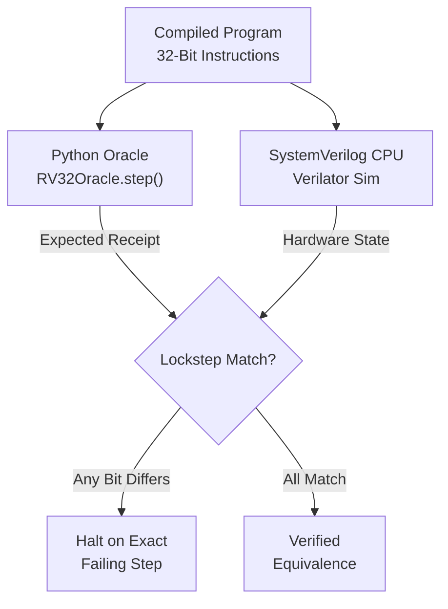
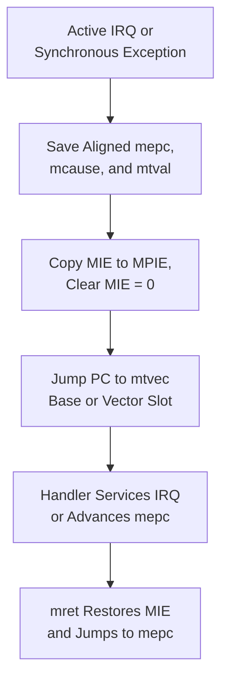

# Chapter 1 Instruction Set Architecture

Every program that runs on a robot ultimately reduces to fixed-width binary numbers moving between small hardware storage cells and memory addresses.
Before designing a single physical logic gate for the `brain` processor, we must specify the exact contract governing those binary instructions, storage containers, memory regions, and external timer or device interruptions.
In this chapter, we derive that hardware-software contract from first principles and implement it as a self-contained, executable Python specification in [`oracle.py`](../sim/oracle.py) verified by [`test_oracle.py`](../tb/test_oracle.py).

## 1. Software Golden Reference Models

When you write an ordinary program in Python or C, statements execute one after another in a single predictable sequence.
A physical processor core (**Central Processing Unit**, or CPU) is instead built in a text-based circuit specification language (**Hardware Description Language**, or HDL) such as SystemVerilog.
Under the hood, that description wires together boolean logic gates, selector switches (**multiplexers**, the circuit equivalent of `cond ? a : b`), and clocked 1-bit storage cells (**flip-flops**).
Between consecutive ticks of a periodic clock signal (one **clock cycle**), logic gates and multiplexers continuously compute new wire voltages in parallel, and on each tick all flip-flops sample those wires and update their stored bits at the exact same instant.

Testing a concurrent circuit design solely with hand-written test scripts mixes circuit timing with expected instruction behavior and leaves complex multi-instruction or external-signal corner cases unchecked.
Processor teams separate those concerns before writing any circuit code by building an unambiguous sequential software specification called a **golden reference model**, or **oracle**, which is verified independently in software and then supplies automatic instruction-by-instruction expected states for arbitrary compiled programs.
[`oracle.py`](../sim/oracle.py) implements that golden 32-bit reference specification for the `brain` CPU in the Python class `RV32Oracle`, named for the open-source fifth-generation processor standard built around a small, uniform set of simple 32-bit operations (**Reduced Instruction Set Computer, Fifth Generation**, or RISC-V).
Before any hardware exists, unit tests in [`test_oracle.py`](../tb/test_oracle.py) verify the Python oracle's arithmetic bounds, memory-access rules, and timer alarms directly.
Later, when our SystemVerilog CPU runs inside an open-source simulator that compiles circuit descriptions into fast C++ executables (**Verilator**), our verification harness feeds the exact same machine-code program to both engines in lockstep.
After every completed (**retired**) instruction, hardware fault, or external interruption, [`RV32Oracle.step()`](../sim/oracle.py#L1194-L1273) returns a structured step receipt recording updated internal CPU storage, next-instruction address, and memory state, so the harness can compare each receipt against the simulated hardware state and halt on the exact step where they diverge.

### Instruction Set Architecture Boundaries

Every large software system relies on clean interface boundaries: a function signature tells callers what inputs a function accepts and what result it returns without exposing the temporary variables inside its body.
In computer engineering, the boundary separating software (compilers, startup programs, control loops) from physical chip hardware (logic gates, wire routing, multi-cycle arithmetic units) is the **Instruction Set Architecture**, or ISA.

An ISA defines only what machine-code programs can observe between instructions:
1. **Architectural State**: The persistent storage containers (fast on-chip storage cells called **registers**, the active instruction address, addressable memory, and modeled device state) whose values survive from one instruction to the next.
2. **Binary Instruction Encoding**: The exact bit positions that pack an operation selector, register indices, and small constants into a fixed-width binary integer (a hardware **word**).
3. **Atomic Step Outcomes**: Given any current architectural state $S_t$, [`step`](../sim/oracle.py#L1194-L1273) deterministically computes the next state $S_{t+1} = \texttt{step}(S_t)$ through exactly one of two indivisible outcomes:
   - **Normal Retirement**: The current instruction completes cleanly, updating the active instruction address and committing the instruction's defined register or memory writes.
   - **Precise Trap**: An abrupt control-flow handover (**trap**) triggered by an illegal encoding, invalid memory access, or pending external/timer request aborts any partial writes of the current instruction and redirects execution to a dedicated handler address.

Because an ISA intentionally hides internal circuit timing—such as whether integer division takes one clock cycle or thirty-two clock cycles—[`oracle.py`](../sim/oracle.py) can model instruction execution sequentially in Python rather than cycle by cycle.
To keep timer alarms and external interruptions equally reproducible without cycle-level simulation, the oracle advances its external hardware-device models at those same deterministic instruction boundaries.
This separation lets us build and verify the complete software oracle independently before designing the physical circuit and running lockstep checks.

---

## 2. Fixed-Width Binary Arithmetic

In Python, evaluating `2**200` or `-5` allocates a variable-length object in memory so integers grow until system memory runs out.
Inside a physical CPU, there is no dynamic memory allocator for numbers.
A 32-bit hardware register is 32 parallel metal wires driven by 32 flip-flops, where each wire carries either a low voltage representing zero or a high voltage representing one.
Every loop counter, memory address, and sensor reading must fit inside those $2^{32} = 4{,}294{,}967{,}296$ distinct bit patterns, so arithmetic that steps past the ends of the representable range must obey a strict mathematical rule.

### Unsigned Integers and Modular Congruence

Every hardware register begins as an ordered row of $N$ binary wires $b_{N-1}, b_{N-2}, \dots, b_0 \in \{0, 1\}$ with no dedicated sign wire.
Hardware manuals label individual wire $b_i$ as Bit $i$ and a contiguous slice from $b_{\text{hi}}$ down to $b_{\text{lo}}$ as Bits $\text{hi}..\text{lo}$.
Assigning standard base-two place weights $2^0, 2^1, \dots, 2^{N-1}$ from right to left maps those wire voltages onto non-negative integers.
On a 4-bit register ($N = 4$), place weights evaluate three sample patterns directly:

$$\begin{aligned}
\texttt{0011} &\;\mapsto\; 0 \cdot 8 + 0 \cdot 4 + 1 \cdot 2 + 1 \cdot 1 = 3 \\
\texttt{1011} &\;\mapsto\; 1 \cdot 8 + 0 \cdot 4 + 1 \cdot 2 + 1 \cdot 1 = 11 \\
\texttt{1111} &\;\mapsto\; 1 \cdot 8 + 1 \cdot 4 + 1 \cdot 2 + 1 \cdot 1 = 15
\end{aligned}$$

Generalizing from 4 wires to any width $N \ge 1$ defines the **unsigned integer interpretation** $U_N(b)$:

$$U_N(b) = \sum_{i=0}^{N-1} b_i \cdot 2^i$$

When every wire carries zero, $U_N(b) = 0$.

Before bounding the full $N$-bit range, we confirm that setting every wire to one evaluates to $S = \sum_{i=0}^{N-1} 2^i = 2^N - 1$.
When $N = 1$, $S = 2^0 = 2^1 - 1$ holds directly.
For any $N \ge 2$, subtracting $S$ from $2S$ reduces the sum to its boundary endpoints:

$$\begin{aligned}
S = 2S - S
&= \sum_{i=0}^{N-1} 2^{i+1} - \sum_{i=0}^{N-1} 2^i \\
&= \left(2^N + \sum_{i=1}^{N-1} 2^i\right) - \left(\sum_{i=1}^{N-1} 2^i + 2^0\right) \\
&= 2^N - 1
\end{aligned}$$

Every interior term in $\sum_{i=1}^{N-1} 2^i$ cancels directly, leaving only the two boundary powers.

For $N = 4$, this matches $1 + 2 + 4 + 8 = 15 = 2^4 - 1$.
Because every wire satisfies $0 \le b_i \le 1$ and every weight $2^i$ is positive, every $N$-bit unsigned integer lies inside $[0, 2^N - 1]$.

We also need to verify that distinct bit patterns never collide on the same unsigned integer.
Compare any two distinct $N$-bit patterns at their highest differing wire $k$, where all matching upper bits cancel.
When $k = 0$, Bit 0 differs by $1$; when $k \ge 1$, the pattern with `1` at Bit $k$ contributes at least $2^k$ on Bits $k..0$, beating the pattern with `0` there because all $k$ lower bits sum to at most $2^k - 1 < 2^k$.
Because all $2^N$ patterns land on distinct integers inside the $2^N$-element interval $[0, 2^N - 1]$, $U_N$ maps every pattern one-to-one and onto $[0, 2^N - 1]$ (a **bijection**).

To write wide 32-bit constants concisely, programmers use base-16 notation (**hexadecimal**), prefixed with `0x`, where each digit `0`–`9` or `A`–`F` packs four binary wires and underscores visually separate 4-digit groups.
For $N = 32$, [`oracle.py`](../sim/oracle.py) names that upper bound `UINT32_MAX = 0xFFFF_FFFF` ($2^{32} - 1 = 4{,}294{,}967{,}295$).

When adding two $N$-bit unsigned integers produces a true sum $x$ outside $[0, 2^N - 1]$, as when $11 + 7 = 18$ on a 4-bit adder, hardware wraps the result using integer division with a non-negative remainder (**Euclidean division**).
Dividing any integer $x \in \mathbb{Z}$ (positive, zero, or negative) by a positive integer modulus $m \in \mathbb{Z}_{>0}$ yields a unique integer quotient $q \in \mathbb{Z}$ and a unique integer remainder $r \in \mathbb{Z}$:

$$x = q \cdot m + r, \qquad 0 \le r < m$$

Setting $m = 2^N$ partitions any integer $x \in \mathbb{Z}$ into a multiple $q \cdot 2^N$ and an $N$-bit remainder $r = x \bmod 2^N \in [0, 2^N - 1]$ carried in wires $0$ through $N - 1$.
For any non-negative sum ($q \ge 0$), every bit of $q \cdot 2^N$ sits at position $N$ or higher and drops off the left end of an $N$-wire register, turning $18 = 1 \cdot 16 + 2$ into remainder $2$ (`0010`).

Arithmetic that wraps every result modulo $m$ forms the **modular ring** $\mathbb{Z}_m$: a closed cycle of $m$ slots arranged like a clock face where stepping $+1$ past $m - 1$ returns to $0$.
Any two integers $a$ and $b$ differing by an integer multiple of $m$ occupy the same **residue class** on the ring, written $a \equiv b \pmod{m}$.
For example, $18 \equiv 2 \pmod{16}$ because $18 - 2 = 1 \cdot 16$, and $-5 \equiv 11 \pmod{16}$ because $-5 - 11 = (-1) \cdot 16$.

<UnsignedClockRing />

Crucially, walking any $m$ consecutive integers around an $m$-slot clock visits every slot once, so two integers inside any single $m$-number window $[a, a + m - 1]$ share the same residue modulo $m$ only when they are equal.
Any difference inside that window has magnitude strictly below $m$, so being a multiple of $m$ forces that difference to zero.

Before applying this clock-face equivalence to signed encodings and hardware adders, let us verify why **modular congruence** passes cleanly through addition, subtraction, and multiplication for any positive modulus $m$.
For a concrete check on our 16-slot ring ($m = 16$), swapping $19 \equiv 3 \pmod{16}$ and $14 \equiv -2 \pmod{16}$ preserves both sum and product residues:

$$\begin{aligned}
19 + 14 &= 33 \equiv 3 + (-2) = 1 \pmod{16} \\
19 \cdot 14 &= 266 \equiv 3 \cdot (-2) = -6 \equiv 10 \pmod{16}
\end{aligned}$$

To prove this holds in general for any $x \equiv x' \pmod{m}$ and $y \equiv y' \pmod{m}$, write $x = x' + k_1 m$ and $y = y' + k_2 m$ for integers $k_1, k_2 \in \mathbb{Z}$, then expand both $x \pm y$ and $x \cdot y$:

$$\begin{aligned}
x \pm y
&= (x' + k_1 m) \pm (y' + k_2 m) \\
&= (x' \pm y') + (k_1 \pm k_2)m \\
x \cdot y
&= (x' + k_1 m)(y' + k_2 m) \\
&= x' y' + k_1 y' m + k_2 x' m + k_1 k_2 m^2 \\
&= x' y' + (k_1 y' + k_2 x' + k_1 k_2 m)m
\end{aligned}$$

Because $k_1 \pm k_2$ and $k_1 y' + k_2 x' + k_1 k_2 m$ are integers, congruence modulo $m$ is preserved under addition, subtraction, and multiplication: $x \pm y \equiv x' \pm y' \pmod{m}$ and $x \cdot y \equiv x' \cdot y' \pmod{m}$.
Setting $y = y' = c$ shows that multiplying by any integer constant $c$ likewise preserves congruence modulo $m$ ($c \cdot x \equiv c \cdot x' \pmod{m}$).

Multiplying both operands and the ring size together by a positive integer $c > 0$ also preserves equivalence on the wider ring (**modulus scaling**): $c \cdot x \equiv c \cdot x' \pmod{c \cdot m}$.
Here $c$ must stay strictly positive so the scaled modulus $cm \in \mathbb{Z}_{>0}$ remains valid for Euclidean division; writing $x - x' = k m$ for some $k \in \mathbb{Z}$ gives the scaled congruence directly:

$$\begin{aligned}
x - x' &= k m && \text{(congruence def)} \\
\implies\quad c x - c x' &= k (c m) && \text{(scale by }c > 0\text{)} \\
\implies\quad c x &\equiv c x' \pmod{c m} && \text{(multiple of }cm\text{)}
\end{aligned}$$

In practice, this theorem lets you treat $\equiv \pmod{m}$ as a drop-in substitution rule—once you know its boundaries:
- **Safe Term-Wise Substitution**: Inside any formula built strictly from $+$, $-$, $\times$, and integer scaling under one shared modulus $m$, you may swap *every* congruent sub-term freely for any simpler representative (such as swapping $14$ for $-2$ modulo $16$) without re-proving the step.
- **Modulus Scaling via Positive Multipliers**: Multiplying an entire congruence—every term *and* its modulus—by the same positive integer $c > 0$ always stays valid (scaling $5 \equiv 1 \pmod{4}$ by $c = 4$ yields $20 \equiv 4 \pmod{16}$), whereas scaling only the modulus ($5 \not\equiv 1 \pmod{16}$) or only one side ($20 \not\equiv 1 \pmod{16}$) breaks equivalence.
- **Every Replaced Term Must Match**: Safe substitution is no longer guaranteed if *any* replaced term is not congruent modulo $m$ (swapping $14 \to 13$ modulo $16$ breaks the sum congruence, yielding $19 + 14 = 33 \not\equiv 16 = 3 + 13 \pmod{16}$) or if terms from different moduli are mixed.
- **Operations That Break Congruence**: Unlike $+$, $-$, and $\times$, discarding remainders under integer division does not preserve congruence even when divisors share no common factor greater than $1$ with $m$: $19 \equiv 3 \pmod{16}$, yet whole-number division by $3$ yields $6 \not\equiv 1 \pmod{16}$.
  Even exact factor cancellation fails whenever a cancelled factor shares a common factor greater than $1$ with $m$, as in $2 \cdot 3 \equiv 2 \cdot 11 \pmod{16}$ yet $3 \not\equiv 11 \pmod{16}$.

#### Exercise 2.1: Modular Congruence and Substitution

Build fluency with symbolic congruence identities, integer-division pitfalls, cancellation boundaries, and modulus-scaling preconditions.

1. Let $a \equiv a' \pmod{m}$ for integers $a, a'$ and modulus $m > 0$.
   - **(a)** Prove symbolically that $(a + mk)^2 \equiv (a')^2 \pmod{m}$ holds for every integer $k \in \mathbb{Z}$ (taking $k = 0$ shows squaring preserves congruence: $a^2 \equiv (a')^2 \pmod{m}$).

     

Solution

     Writing $a = a' + mq$ for $q \in \mathbb{Z}$ gives $a + mk = a' + m(q + k)$, so $(a + mk)^2 = (a')^2 + \left(2a'(q + k) + m(q + k)^2\right)m \equiv (a')^2 \pmod{m}$.

     

   - **(b)** Construct a concrete modulus $m > 1$ and integers $x, y$ where $x^2 \equiv y^2 \pmod{m}$ holds even though $x \not\equiv y \pmod{m}$ (showing the converse of squaring preservation fails).

     

Solution

     With $m = 8$, $x = 1$, and $y = 3$, both squares satisfy $1^2 = 1 \equiv 9 = 3^2 \pmod{8}$, yet $1 \not\equiv 3 \pmod{8}$.

     

2. Using concrete positive integers other than $19$ and $3$, construct a counterexample showing that $a \equiv b \pmod{16}$ does *not* survive whole-number division by $d$ (discarding the remainder) even when $d$ shares no common factor greater than $1$ with $16$.

   

Solution

   Pick $a = 17$, $b = 1$, and $d = 5$ (sharing no common factor greater than $1$ with $16$): $17 \equiv 1 \pmod{16}$, yet dividing by $5$ and discarding remainders gives $3 \not\equiv 0 \pmod{16}$ ($17 = 3 \cdot 5 + 2$ versus $1 = 0 \cdot 5 + 1$).

   

3. Confirm $6 \cdot 5 \equiv 6 \cdot 13 \pmod{16}$ holds yet dividing both sides by $6$ breaks congruence modulo $16$.

   

Solution

   $6 \cdot 13 - 6 \cdot 5 = 48 = 3 \cdot 16$ holds, yet $13 - 5 = 8 \not\equiv 0 \pmod{16}$ ($5 \not\equiv 13 \pmod{16}$); cancelling $6$ fails here because $6$ and $16$ share common factor $2 > 1$, letting $6 \cdot 8 = 48$ reach a multiple of $16$ even though $8$ is not.

   

4. Explain why the modulus-scaling law $c \cdot a \equiv c \cdot b \pmod{c \cdot m}$ requires $c > 0$ rather than allowing $c = 0$ or $c < 0$.

   

Solution

   Setting $c = 0$ yields modulus $c m = 0$, violating the positive-modulus requirement ($c m > 0$) for Euclidean division, while $c < 0$ produces a negative modulus $c m < 0$ outside our positive-modulus definition unless replaced by $|c|m$.

   

### Bitwise Wire Gates and Bit Shifts

Before representing negative integers or instruction fields across 32 wires, hardware combines and shifts raw bit patterns using six elementary operators—four bitwise gates and two bit shifts—that operate without carrying sums from Bit $i$ into Bit $i + 1$.
Unlike addition, every **bitwise gate** evaluates each wire position $i$ strictly from Bit $i$ of its inputs (with `~` inverting one wire pattern and `&`, `|`, `^` combining two), while **bit shifts** slide every bit left (`<<`) or right (`>>`) across wire positions:

| Operator | Python / Equation Token | Single-Bit Rule (`0` / `1`) | Primary Hardware Role |
| :--- | :---: | :--- | :--- |
| **Bitwise AND** | `a & b` | `1` only when both input bits equal `1` | Clears bits where a selector pattern (**bitmask**) holds `0`, keeping bits where it holds `1` |
| **Bitwise OR** | `a \| b` | `1` whenever either input bit equals `1` | Sets flag bits or combines non-overlapping packed fields |
| **Bitwise Exclusive-OR** (XOR) | `a ^ b` / $\oplus$ | `1` when the two input bits differ | Toggles bits paired with `1` and leaves bits paired with `0` unchanged |
| **Bitwise NOT** | `~a` / $\bar{a}$ | Flips every bit (`0` $\leftrightarrow$ `1`, $\bar{a}_i = 1 - a_i$) | Inverts all wires in parallel |
| **Left / Right Shift** | `a << k`, `a >> k` / $\ll$, $\gg$ | Slides bits left or right by $k \ge 0$ positions | `a << k` zero-fills vacated bottom bits (`1 << k` equals $2^k$ for $0 \le k < N$ on an $N$-bit word, or any $k \ge 0$ in Python); on unsigned $u$, `u >> k` zero-fills top bits |

### Two's Complement Signed Integers

Robot control software also needs negative integers for joint velocity errors, signed sensor readings, and backward memory offsets, yet building separate positive and negative adder circuits would waste chip area and slow every clock cycle.
Modern processors solve this with **two's complement**, reading negative integers counter-clockwise from zero on the modular clock ring so zero has a single representation and an ordinary unsigned adder handles both positive and negative sums without extra logic.
Earlier alternatives failed both requirements: dedicating the top wire as a separate sign bit creates two zeros and breaks plain addition, while inverting every bit leaves a duplicate negative zero (`1111`) and forces the overflow carry bit emerging past the top wire (**carry-out**) back into Bit 0:

| Encoding | Rule for Negatives | $+5$ / $-5$ (4-Bit) | Zeros | Plain Unsigned Adder Works? |
| :--- | :--- | :--- | :--- | :--- |
| **Sign-Magnitude** | Dedicates top wire as sign flag ($1 = -$) on unsigned magnitude | `0101` / `1101` | `0000`, `1000` | No ($+3 + (-5)$: $\texttt{0011} + \texttt{1101} = \texttt{0000}$, not $-2$) |
| **Ones' Complement** | Inverts every bit (`0` $\leftrightarrow$ `1`) to negate | `0101` / `1010` | `0000`, `1111` | No (must wrap top carry-out into Bit 0) |
| **Two's Complement** | Assigns negative weight $-2^{N-1}$ to top wire | `0101` / `1011` | `0000` only | Yes ($+3 + (-5)$: $\texttt{0011} + \texttt{1011} = \texttt{1110}$, which is $-2$) |

Starting at `0000` ($0$) on a 16-slot ring and stepping counter-clockwise by $1$ lands on `1111` ($15 \equiv -1 \pmod{16}$), while stepping counter-clockwise by $5$ lands on `1011` ($11 \equiv -5 \pmod{16}$).
Algebraically, two's complement keeps positive place weights $+2^0, \dots, +2^{N-2}$ on the lower $N - 1$ wires and assigns the leftmost wire (**Most Significant Bit**, or MSB, at Bit $N - 1$) a negative weight of $-2^{N-1}$.
On 4 bits, `1011` evaluates to $-1 \cdot 8 + 0 \cdot 4 + 1 \cdot 2 + 1 \cdot 1 = -5$, and adding `0011` ($+3$) in ordinary binary gives $\texttt{1011} + \texttt{0011} = \texttt{1110}$ ($-8 + 4 + 2 = -2$) with zero sign-checking logic.
Whenever a true signed sum exits $[-8, +7]$ across the discontinuity between $+7$ (`0111`) and $-8$ (`1000`)—stepping clockwise past $+7$ or counter-clockwise past $-8$—it wraps around the 16-slot clock to produce **signed overflow**, leaving hardware addition modulo $16$ unchanged.

The interactive 4-bit ring adder below displays both interpretations on the shared wheel—pairing raw bit toggles with unsigned ($0..15$) and signed ($-8..+7$) sums—before we generalize to $N$ bits.

<ModularRingAdder />

Generalizing that negative MSB weight to any bit width $N \ge 1$ defines the **signed two's-complement interpretation** $S_N(b)$:

$$S_N(b) = -b_{N-1} \cdot 2^{N-1} + \sum_{i=0}^{N-2} b_i \cdot 2^i$$

Checking the top sign wire confirms that every $N$-bit pattern maps to a unique signed integer with only a single zero.
At the 1-bit edge case $N = 1$, the lower sum has no terms, giving $S_1(b_0) = -b_0 \in \{-1, 0\}$.
For $N \ge 2$, the lower $N - 1$ wires form an $(N - 1)$-bit unsigned integer $L = U_{N-1}(b_{N-2..0}) = \sum_{i=0}^{N-2} b_i 2^i$, which maps bijectively onto $[0, 2^{N-1} - 1]$; patterns with $b_{N-1} = 0$ therefore map one-to-one onto $[0, 2^{N-1} - 1]$ and yield zero only on the all-zero pattern (`00...0`).
Meanwhile, adding $-2^{N-1}$ to each distinct lower-wire sum $L$ for patterns with $b_{N-1} = 1$ maps them one-to-one onto $[-2^{N-1}, -1]$, sitting strictly below the non-negative half without duplicating zero.
An $N$-bit two's-complement integer therefore maps every distinct bit pattern to one unique signed integer across the asymmetric interval $[-2^{N-1}, 2^{N-1} - 1]$ for every $N \ge 1$.
For $N = 32$, [`oracle.py`](../sim/oracle.py) defines those endpoints using Python's left-shift syntax (`1 << 31` places a single `1` bit at Bit 31 for $2^{31}$) as `INT32_MIN = -(1 << 31)` ($-2{,}147{,}483{,}648$, 32-bit bit pattern `0x8000_0000`) and `INT32_MAX = (1 << 31) - 1` ($+2{,}147{,}483{,}647$, 32-bit bit pattern `0x7FFF_FFFF`).

Because Python integers grow arbitrarily wide instead of wrapping at 32 wires, [`oracle.py`](../sim/oracle.py) must project every positive, zero, or negative intermediate result back onto the 32-bit unsigned ring $[0, 2^{32} - 1]$.
A single bitwise AND with 32 one-bits (`MASK32 = 0xFFFF_FFFF`) computes that exact modulo-$2^{32}$ remainder for every sign.

Python evaluates bitwise operators on arbitrary integers—including negatives—as two's-complement bit patterns of any sufficiently large width $N \ge 33$.
Choosing $N \ge 33$ wide enough for $x$ (so $x \in [-2^{N-1}, 2^{N-1} - 1]$) ensures both $x$ and non-negative `MASK32` ($2^{32} - 1$) fit in $N$-bit two's complement with a zero sign wire on `MASK32`.
Splitting $x = S_N(b)$ at Bit 32 factors $2^{32}$ out of all upper wires while isolating the unsigned low 32-bit slice $U_{32}(b_{31..0}) \in [0, 2^{32} - 1]$:

$$\begin{aligned}
x = S_N(b)
&= 2^{32}\!\left(-b_{N-1} 2^{N-33} + \sum_{i=32}^{N-2} b_i 2^{i-32}\right) + \sum_{i=0}^{31} b_i 2^i \\
&= q \cdot 2^{32} + U_{32}(b_{31..0})
\end{aligned}$$

Because $N \ge 33$ keeps exponents $N - 33 \ge 0$ and $i - 32 \ge 0$ non-negative (with $\sum_{i=32}^{N-2}$ empty when $N = 33$), the parenthesized factor $q$ is an integer.
Together with $0 \le U_{32}(b_{31..0}) < 2^{32}$, Euclidean division uniqueness yields $U_{32}(b_{31..0}) = x \bmod 2^{32}$ for every positive, zero, or negative $x$.
Masking with `MASK32 = 0xFFFF_FFFF` places `1` on Bits 31..0 and `0` on Bit 32 and above—clearing the negative Most Significant Bit $b_{N-1}$—so `x & MASK32` discards all upper wires and returns $U_{32}(b_{31..0})$ directly.
For example, $-5 = (-1) \cdot 2^{32} + (2^{32} - 5)$ masks via `-5 & 0xFFFF_FFFF` to `0xFFFF_FFFB`, and `0x1_0000_0002 & 0xFFFF_FFFF` masks directly to `2`.
[`u32`](../sim/oracle.py#L267-L269) implements that 32-bit modular projection in a single mask operation:

<!-- book-sync: u32 -->
<<< @/systems/brain/sim/oracle.py#L267-L269

### Shared Adder, Negation, and Left-Shift Circuits

Comparing the unsigned sum $U_N(b)$ and signed sum $S_N(b)$ on the exact same $N$-bit wire pattern explains why hardware needs only one binary adder circuit—plus bitwise inversion for negation and one zero-filling left shifter for power-of-two scaling—across both unsigned and signed integers.
Because two's complement places $U_N(b)$ and $S_N(b)$ in the same residue class modulo $2^N$, and adding, subtracting, negating, and left-shifting depend only on modular congruence modulo $2^N$, every one of those operations preserves signed meaning without separate signed hardware.
On our 4-bit pattern `1011`, $U_4(\texttt{1011}) = 11$ and $S_4(\texttt{1011}) = -5$, which differ by $11 - (-5) = 16 = 2^4$.

Separating wire $N - 1$ from the lower $N - 1$ wires cancels every lower place weight and isolates $U_N(b) - S_N(b)$:

$$\begin{aligned}
U_N(b) - S_N(b)
&= \left(b_{N-1} 2^{N-1} + \sum_{i=0}^{N-2} b_i 2^i\right) \\
&\quad - \left(-b_{N-1} 2^{N-1} + \sum_{i=0}^{N-2} b_i 2^i\right) \\
&= 2 \cdot b_{N-1} \cdot 2^{N-1} = b_{N-1} \cdot 2^N \\
\implies\quad S_N(b) &= U_N(b) - b_{N-1} \cdot 2^N
\end{aligned}$$

When $N = 1$, the lower sum has no terms and the same difference holds directly.
Because $b_{N-1} \in \{0, 1\}$, that difference equals $2^N$ when $b_{N-1} = 1$ and $0$ when $b_{N-1} = 0$, so both readings of *every* $N$-bit pattern sit at the *exact same slot* on the $2^N$-hour modular clock:

$$U_N(b) \equiv S_N(b) \pmod{2^N}$$

Since each slot on that $2^N$-hour clock belongs to a single unique bit pattern (under both $U_N$ and $S_N$), showing that a circuit's output wires $w$ satisfy $S_N(w) \equiv \text{target} \pmod{2^N}$ guarantees those exact bits $w$ already hold the wrapped signed answer with no translation or mode bit.
Starting from each circuit's output wires $w$ and stepping back to the signed target proves how five arithmetic contracts reuse unsigned circuits unchanged:

1. **Sign-Agnostic Addition**: Wrapping unsigned binary addition produces identical output bits for signed two's-complement addition because shifting negative operands upward by $2^N$ adds only multiples of $2^N$, which vanish upon wrap-around.
   On 4-bit patterns `1011` ($11$ unsigned, $-5$ signed) and `1110` ($14$ unsigned, $-2$ signed), the low 4 bits (`1001`) satisfy both views simultaneously:

   $$\begin{aligned}
   U_4:\quad 11 + 14 &= 25 \equiv 9 \pmod{16} && (\texttt{1001}) \\
   S_4:\quad (-5) + (-2) &= -7 \equiv 9 \pmod{16} && (\texttt{1001})
   \end{aligned}$$

   An unsigned $N$-bit adder computes output wire pattern $w$ with $U_N(w) \equiv U_N(a) + U_N(b) \pmod{2^N}$, so evaluating $S_N(w)$ yields the signed sum modulo $2^N$ directly:

   $$\begin{aligned}
   S_N(w)
   &\equiv U_N(w) && \text{(}U_N\text{--}S_N\text{ congruence on }w\text{)} \\
   &\equiv U_N(a) + U_N(b) && \text{(unsigned adder definition)} \\
   &\equiv S_N(a) + S_N(b) \pmod{2^N} && \text{(term-wise }U_N \equiv S_N\text{ in }+\text{)}
   \end{aligned}$$

2. **Sign-Agnostic Subtraction Congruence**: Exact signed and unsigned differences obey the same modular wrap-around, ensuring any circuit matching $U_N(a) - U_N(b)$ modulo $2^N$ also computes signed subtraction.
   On the same 4-bit patterns `1011` and `1110`, wrapping modulo $16$ produces `1101` under both readings:

   $$\begin{aligned}
   U_4:\quad 11 - 14 &= -3 \equiv 13 \pmod{16} && (\texttt{1101}) \\
   S_4:\quad (-5) - (-2) &= -3 && (\texttt{1101})
   \end{aligned}$$

   Whenever hardware outputs wire pattern $w$ satisfying $U_N(w) \equiv U_N(a) - U_N(b) \pmod{2^N}$, evaluating $S_N(w)$ returns the wrapped signed difference:

   $$\begin{aligned}
   S_N(w)
   &\equiv U_N(w) && \text{(}U_N\text{--}S_N\text{ congruence on }w\text{)} \\
   &\equiv U_N(a) - U_N(b) && \text{(circuit matches unsigned diff)} \\
   &\equiv S_N(a) - S_N(b) \pmod{2^N} && \text{(term-wise }U_N \equiv S_N\text{ in }-\text{)}
   \end{aligned}$$

3. **Negation via Invert Plus One**: Negating a two's-complement word applies bitwise NOT (written `~b` in C and SystemVerilog) and adds `1`.
   On 4 bits, inverting $+5$ (`0101`) and adding $1$ lands directly on $-5$ (`1011`):

   $$\overline{\texttt{0101}} + 1 = \texttt{1010} + \texttt{0001} = \texttt{1011} \quad (S_4 = -5)$$

   Define each inverted wire $\bar{b}_i = 1 - b_i$, and feed $\bar{b}$ and $1$ into the unsigned adder so output $w$ obeys $U_N(w) \equiv U_N(\bar{b}) + 1 \pmod{2^N}$, giving $-S_N(b) \pmod{2^N}$:

   $$\begin{aligned}
   S_N(w)
   &\equiv U_N(w) \equiv U_N(\bar{b}) + 1 && \text{(}U_N \equiv S_N\text{; adder spec)} \\
   &= \left(\sum_{i=0}^{N-1} 2^i - \sum_{i=0}^{N-1} b_i 2^i\right) + 1 && \text{(}\bar{b}_i = 1 - b_i\text{)} \\
   &= (2^N - 1 - U_N(b)) + 1 = 2^N - U_N(b) && \text{(}\sum 2^i = 2^N - 1\text{)} \\
   &\equiv -U_N(b) \equiv -S_N(b) \pmod{2^N} && \text{(drop }2^N\text{; }U_N \equiv S_N\text{)}
   \end{aligned}$$

   Two boundary patterns confirm wrap-around cleanly.
   For all-zero pattern $U_N(b) = 0$ (`00...0`), $U_N(\bar{b}) + 1 = 2^N$ drops its top carry-out bit past Bit $N - 1$ modulo $2^N$ to return zero.
   For extremal negative value $S_N(b) = -2^{N-1}$ (`1000` on 4 bits, or `INT32_MIN` in hex `0x8000_0000` on 32 bits), exact negation $+2^{N-1}$ exceeds $2^{N-1} - 1$ by $1$ and wraps modulo $2^N$ right back to $-2^{N-1}$.

4. **Subtraction via Invert Plus One**: Rather than building a separate subtractor unit alongside the binary adder, hardware computes $a - b$ on the *same* unsigned adder by inverting $b$ and adding $1$.
   On 4-bit operands `1011` ($-5$) and `1110` ($-2$), adding `1011` to inverted `1110` (`0001`) plus $1$ yields `1101` ($13$ unsigned, $-3$ signed):

   $$\texttt{1011} + \overline{\texttt{1110}} + 1 = \texttt{1011} + \texttt{0001} + \texttt{0001} = \texttt{1101}$$

   With adder output $w$ satisfying $U_N(w) \equiv U_N(a) + U_N(\bar{b}) + 1 \pmod{2^N}$, substituting Item 3's negation sum yields signed subtraction modulo $2^N$:

   $$\begin{aligned}
   S_N(w)
   &\equiv U_N(w) \equiv U_N(a) + U_N(\bar{b}) + 1 && \text{(}U_N \equiv S_N\text{; adder spec)} \\
   &= U_N(a) + 2^N - U_N(b) && \text{(Item 3 sum)} \\
   &\equiv U_N(a) - U_N(b) && \text{(drop }2^N\text{)} \\
   &\equiv S_N(a) - S_N(b) \pmod{2^N} && \text{(}U_N \equiv S_N\text{)}
   \end{aligned}$$

5. **Sign-Agnostic Left Shifts**: Processors multiply integers by powers of two via a **left shift** ($a \ll k$ for shift distance $0 \le k < N$), sliding every bit $k$ positions toward higher place weights and zero-filling the vacated lower $k$ wires.
   Shifting 4-bit `1011` ($11$ unsigned, $-5$ signed) left by $k = 1$ drops Bit 3 (`1`) and fills Bit 0 with `0` to give `0110` ($+6$):

   $$\begin{aligned}
   U_4:\quad 11 \cdot 2 &= 22 \equiv 6 \pmod{16} && (\texttt{0110}) \\
   S_4:\quad (-5) \cdot 2 &= -10 \equiv 6 \pmod{16} && (\texttt{0110})
   \end{aligned}$$

   To verify that shifted wire pattern $a \ll k$ satisfies signed scaling $2^k S_N(a) \pmod{2^N}$, first evaluate $U_N(a \ll k)$.
   When $k = 0$, no wires move ($a \ll 0 = a$), so $U_N(a \ll 0) = 2^0 U_N(a)$ holds immediately.
   For $1 \le k < N$, shifting $a$ left by $k$ wires keeps only the lower $N - k$ bits at $2^k$-scaled weights and drops the top $k$ bits; adding and subtracting those dropped upper terms isolates $2^k U_N(a)$ modulo $2^N$:

   $$\begin{aligned}
   U_N(a \ll k)
   &= \sum_{i=0}^{N-1-k} a_i 2^{i+k} && \text{(surviving shifted weights)} \\
   &= \sum_{i=0}^{N-1} a_i 2^{i+k} - \sum_{i=N-k}^{N-1} a_i 2^{i+k} && \text{(add and drop top }k\text{ terms)} \\
   &= 2^k U_N(a) - 2^N \sum_{i=N-k}^{N-1} a_i 2^{i+k-N} && \text{(factor }2^k\text{ and }2^N\text{)} \\
   &\equiv 2^k U_N(a) \pmod{2^N} && \text{(drop }2^N\text{ multiple)}
   \end{aligned}$$

   In the subtracted upper sum, every index satisfies $i \ge N - k$, so every exponent $i + k - N \ge 0$ is a non-negative integer, keeping every term $2^{i+k-N}$ a whole integer rather than a fraction.
   That integrality guarantees $\sum_{i=N-k}^{N-1} a_i 2^{i+k-N}$ is a whole integer, making its product with $2^N$ an integer multiple of $2^N$ that drops cleanly to zero modulo $2^N$.
   Evaluating $S_N(a \ll k)$ via that unsigned scaling identity completes the signed bridge directly:

   $$\begin{aligned}
   S_N(a \ll k)
   &\equiv U_N(a \ll k) && \text{(}U_N\text{--}S_N\text{ congruence on }a \ll k\text{)} \\
   &\equiv 2^k U_N(a) && \text{(proved above for }0 \le k < N\text{)} \\
   &\equiv 2^k S_N(a) \pmod{2^N} && \text{(constant scaling by }2^k\text{)}
   \end{aligned}$$

Notice the architectural breakthrough we just proved using pure algebra.
Even though unsigned values ($[0, 2^N - 1]$) and signed two's-complement values ($[-2^{N-1}, 2^{N-1} - 1]$) assign incompatible numeric meanings to every bit pattern with $b_{N-1} = 1$, modular congruence collapses five distinct contracts—unsigned add, signed add, unsigned subtract, signed subtract, and two's-complement negation—onto one single unsigned binary adder augmented only by optional inverters and an extra $+1$ input bit injected into Bit 0 of the adder chain (a **carry-in** of `1`), plus one zero-filling left-shifter for powers of two.
Hardware carries zero signedness mode bits, zero separate signed adders or subtractors, and zero special-case sign-branch multiplexers inside the adder circuit—whereas operations that break modular congruence must split into separate unsigned and signed circuits when introduced alongside their instructions below.

#### Exercise 2.2: Modular Algebra Manipulations

Practice symbolic negation, left-shift wrap boundaries, power-of-two cancellation, and adder representation offsets across arbitrary width $N$.

1. Derive $S_N(\bar{b})$ symbolically in terms of $S_N(b)$ without modular reduction ($\pmod{2^N}$), proving bitwise inversion alone produces $-S_N(b) - 1$.

   

Solution

   $$\begin{aligned}
   S_N(\bar{b})
   &= -(1 - b_{N-1})2^{N-1} + \sum_{i=0}^{N-2}(1 - b_i)2^i \\
   &= \left(-2^{N-1} + (2^{N-1} - 1)\right) - \left(-b_{N-1}2^{N-1} + \sum_{i=0}^{N-2} b_i 2^i\right) \\
   &= -1 - S_N(b)
   \end{aligned}$$

   Adding $+1$ is required to complete exact negation.

   

2. Let $a$ be an $N$-bit two's-complement pattern ($N \ge 2$) and $1 \le k < N$.
   - **(a)** Recall the exact unsigned shift expansion:

     $$U_N(a \ll k) = 2^k U_N(a) - 2^N \sum_{i=N-k}^{N-1} a_i 2^{i+k-N}$$

     State the condition on top wires $a_{N-1}, \dots, a_{N-1-k}$ guaranteeing exact un-wrapped scaling $S_N(a \ll k) = 2^k S_N(a)$, and prove why.

     

Solution

     When all $k + 1$ top wires match sign bit $s = a_{N-1}$, the dropped top $k$ bits satisfy $\sum_{i=N-k}^{N-1} s \cdot 2^{i+k-N} = s(2^k - 1)$ and the new sign wire $(a \ll k)_{N-1} = a_{N-1-k}$ equals $s$:

     $$\begin{aligned}
     S_N(a \ll k)
     &= U_N(a \ll k) - s 2^N \\
     &= 2^k U_N(a) - s(2^k - 1)2^N - s 2^N \\
     &= 2^k\left(U_N(a) - s 2^N\right) = 2^k S_N(a)
     \end{aligned}$$

     

   - **(b)** Give one 4-bit negative pattern ($b_3 = 1$) other than `1011` where $S_4(b \ll 1) \neq 2 \cdot S_4(b)$.

     

Solution

     For `1001` ($S_4 = -7$, with $b_3 = 1 \neq 0 = b_2$), `1001 << 1 = 0010` evaluates to $S_4 = +2 \neq -14$.

     

3. Prove the power-of-two factor cancellation law for integers $x, y \in \mathbb{Z}$ and $0 \le k < N$:

   $$2^k x \equiv 2^k y \pmod{2^N} \iff x \equiv y \pmod{2^{N-k}}$$

   

Solution

   By definition $2^k x \equiv 2^k y \pmod{2^N}$ means $2^k(x - y) = q \cdot 2^N$ for some $q \in \mathbb{Z}$; dividing both sides by positive $2^k$ yields the equivalent integer identity $x - y = q \cdot 2^{N-k}$, which is $x \equiv y \pmod{2^{N-k}}$.

   

4. Suppose hardware uses $N$-bit Ones' Complement ($N \ge 2$), where $S^{\text{1c}}_N(b) = U_N(b) - b_{N-1}(2^N - 1)$.
   Find a congruence for $S^{\text{1c}}_N(b)$ modulo $2^N$ in terms of $U_N(b)$ and $b_{N-1}$ to explain why an ordinary modulo-$2^N$ adder fails when adding negative Ones'-Complement numbers.

   

Solution

   Let $a, b$ be $N$-bit operands ($N \ge 2$) and let $w$ be the unsigned modulo-$2^N$ adder output satisfying $U_N(w) \equiv U_N(a) + U_N(b) \pmod{2^N}$.
   Reducing $-(2^N - 1) \equiv +1 \pmod{2^N}$ gives:

   $$\begin{aligned}
   S^{\text{1c}}_N(b) &\equiv U_N(b) + b_{N-1} \pmod{2^N} \\
   S^{\text{1c}}_N(a) + S^{\text{1c}}_N(b) &\equiv U_N(a) + U_N(b) + a_{N-1} + b_{N-1} \pmod{2^N} \\
   S^{\text{1c}}_N(w) &\equiv U_N(w) + w_{N-1} \equiv U_N(a) + U_N(b) + w_{N-1} \pmod{2^N}
   \end{aligned}$$

   The output residue carries offset $w_{N-1} \in \{0, 1\}$ instead of $a_{N-1} + b_{N-1} \in \{0, 1, 2\}$, so their offset difference has magnitude at most $2$; because $N \ge 2$ implies $2^N \ge 4 > 2$, distinct offsets cannot collide modulo $2^N$, and the residues disagree whenever $w_{N-1} \neq a_{N-1} + b_{N-1}$—in particular, for every pair of negative inputs where $a_{N-1} + b_{N-1} = 2$.

   

---

## 3. Core Registers and Instruction Encoding

With fixed-width binary arithmetic established, we can define the core processor storage initialized in [`RV32Oracle.reset()`](../sim/oracle.py#L563-L593) and organize how a 32-bit machine word encodes operations, registers, and embedded constants.
Separating core registers and instruction bit layouts from external memory and hardware timers keeps instruction decoding self-contained before adding attached devices.

### Program Counter and Hardwired Zero Register

A CPU requires one dedicated register to remember where it is in a running program and a small scratchpad of fast working variables right next to the execution circuits.
Separating that sequential instruction pointer from working data keeps instruction fetching independent of arithmetic operands on every clock tick.
Core integer execution therefore revolves around two fast storage structures inside the CPU:
1. **Program Counter** (PC): `self.pc`, a single 32-bit register holding the memory byte address of the next instruction to fetch.
2. **General-Purpose Register File**: `self.regs`, an array of 32 fast 32-bit integer registers named `x0` through `x31` (128 bytes of storage in total).

Choosing 32 registers rather than 8 or 256 balances fast circuit access against instruction bit budget.
Naming one of 32 registers takes $\log_2(32) = 5$ bits, so specifying one destination register (`rd`) and two source registers consumes $3 \times 5 = 15$ bits of a 32-bit instruction word and leaves 17 bits for operation selectors and embedded constants.

In hardware, register `x0` (`rd == 0`) is not a writable storage cell initialized to zero at reset.
Instead, `x0` omits flip-flops altogether: its read wires tie permanently to zero, and any write targeting `rd == 0` is silently discarded rather than updating storage, modeled in [`RV32Oracle._set_reg`](../sim/oracle.py#L893-L899):

<!-- book-sync: RV32Oracle._set_reg -->
<<< @/systems/brain/sim/oracle.py#L893-L899

Dedicating one register index permanently to zero keeps the instruction set compact without losing expressiveness.
Rather than adding separate hardware instructions to clear, copy, or negate values, software reuses standard instructions with `x0` as a constant zero source or a safe discard destination.

### Six Functional Instruction Families

The `brain` CPU executes instructions belonging to six functional groups, each solving a core programming need in [`oracle.py`](../sim/oracle.py) using the open RISC-V hardware specification.
The **32-bit Base Integer** (RV32I) instruction set handles arithmetic, control flow, and memory access, while **Integer Multiply and Divide** (RV32M) adds single-instruction multiplication and division.
Combining the base integer set with the multiply-divide extension defines the **RV32IM** target implemented by our simulator and processor.
System management adds special processor-control instructions to read hardware settings and handle external or timer alert (interrupt) state, while a custom neural extension adds domain acceleration for real-time motor inference.

| Group | Functional Category | Everyday Programming Role |
| :---: | :--- | :--- |
| **1** | **Integer Arithmetic, Shifts, and Constants** | Integer math, bit masks, shifts, comparisons, and 32-bit constants |
| **2** | **Hardware Multiply and Divide** | Up to 64-bit integer products, plus 32-bit quotients and remainders |
| **3** | **Memory Loads and Stores** | Reading and writing 8-bit, 16-bit, and 32-bit values in memory and devices |
| **4** | **Conditional Branches and Jumps** | Loops, `if`/`else` branches, direct calls, and function-pointer jumps |
| **5** | **System and Control Registers** | System calls, debugger breakpoints, enabling or disabling timer and device interrupts, and cycle counters |
| **6** | **Custom Neural Multiply-Accumulate** | Two-lane clamped dot products for real-time robot motor control |

### Bitfield Layouts and Offset Reach

Before executing an operation, the CPU decoder must slice the fetched 32-bit unsigned word (`insn`) into register indices, operation selectors, and embedded constants (writing `insn[hi..lo]` for Bits $\text{hi}..\text{lo}$ of `insn`).
In human-readable textual notation (**assembly syntax**), instructions list destination register `rd` first followed by source registers `rs1` and `rs2`, as in **Add** (`add rd, rs1, rs2`), whereas instructions carrying a literal constant (**immediate**, or `imm`) replace `rs2` with that constant, as in **Add Immediate** (`addi rd, rs1, imm`).

All standard 32-bit RISC-V primary operation codes (`opcode`, Bits 6..0) end with Bits 1..0 equal to `0b11` (decimal 3), reserving the other three 2-bit endings for optional 16-bit compressed instructions.
Alongside `opcode`, instructions reuse two secondary sub-operation selectors—a 3-bit function code (`funct3`, Bits 14..12) and a 7-bit function code (`funct7`, Bits 31..25)—to distinguish individual operations sharing the same primary `opcode`.
Every 32-bit instruction conforms to one of six standard bitfield layouts (**Register** / R-type, **Immediate** / I-type, **Store** / S-type, **Branch** / B-type, **Upper Immediate** / U-type, and **Jump** / J-type):

| Format | Primary Software Role | Registers and Selectors | Signed Constant & Byte Reach | Constant Bit Mapping Across `insn[31..0]` |
| :---: | :--- | :--- | :--- | :--- |
| **R-Type** | Register-register integer arithmetic and multiply/divide (combines `rs1` and `rs2` into `rd`) | `funct7` (31..25), `rs2` (24..20), `rs1` (19..15), `funct3` (14..12), `rd` (11..7) | None (all bits spent on selectors and registers) | None |
| **I-Type** | Immediate integer math, memory loads, and function-pointer (indirect) jumps (`rs1 + imm`) | `rs1` (19..15), `funct3` (14..12), `rd` (11..7) | 12-bit signed ($[-2{,}048, +2{,}047]$) | Bits 11..0 $\to$ `insn[31..20]` |
| **S-Type** | Memory stores (write `rs2` to `rs1 + imm`) | `rs2` (24..20), `rs1` (19..15), `funct3` (14..12) | 12-bit signed ($[-2{,}048, +2{,}047]$) | Bits 11..5 $\to$ `insn[31..25]`; Bits 4..0 $\to$ `insn[11..7]` |
| **B-Type** | Conditional PC-relative branches (`pc + offset`) | `rs2` (24..20), `rs1` (19..15), `funct3` (14..12) | 13-bit even ($[-4{,}096, +4{,}094]$ bytes, Bit 0 = 0) | Bit 12 $\to$ `insn[31]`; Bits 10..5 $\to$ `insn[30..25]`; Bits 4..1 $\to$ `insn[11..8]`; Bit 11 $\to$ `insn[7]` |
| **U-Type** | Load 20-bit upper slice (Bits 31..12) into `rd` | `rd` (11..7) | 20-bit upper payload (`payload << 12`) | Bits 31..12 $\to$ `insn[31..12]` |
| **J-Type** | Direct PC-relative subroutine call (`pc + offset`, save next 4-byte instruction address `pc + 4` in `rd`) | `rd` (11..7) | 21-bit even ($[-1{,}048{,}576, +1{,}048{,}574]$ bytes, Bit 0 = 0) | Bit 20 $\to$ `insn[31]`; Bits 10..1 $\to$ `insn[30..21]`; Bit 11 $\to$ `insn[20]`; Bits 19..12 $\to$ `insn[19..12]` |

The wire matrix below aligns all six 32-bit RISC-V layouts across Columns 31..0 so you can filter pinned register columns, the Bit 31 sign wire, and split constant slices side by side.

<RiscvFormatMatrix />

Notice two quantitative properties embedded directly in the bitfield layout table above:
1. **Offset Reach Scaling**: An unscaled 12-bit signed immediate spans $[-2^{11}, 2^{11} - 1]$, or $[-2{,}048, +2{,}047]$ bytes (about $\pm 2\text{ KB}$), while an unscaled 20-bit signed immediate spans $[-2^{19}, 2^{19} - 1]$ bytes.
   Because optional 16-bit compressed RISC-V instructions sit on even 2-byte addresses, the difference between any two instruction addresses is even (guaranteeing Bit 0 equals zero), letting hardware drop Bit 0 and double byte reach onto even offsets without spending an instruction wire.
   Consequently, B-type encodes 12 stored wires to cover $2 \times [-2^{11}, 2^{11} - 1]$ ($[-4{,}096, +4{,}094]$ even bytes, about $\pm 4\text{ KB}$), while J-type encodes 20 stored wires to cover $2 \times [-2^{19}, 2^{19} - 1]$ ($[-1{,}048{,}576, +1{,}048{,}574]$ even bytes, about $\pm 1\text{ MB}$).
   Because the `brain` CPU implements only fixed 32-bit instructions without 16-bit compressed encodings, the RISC-V specification tightens runtime fetch alignment to 32 bits, or 4-byte multiples (**Instruction Address Alignment**, or IALIGN = 32).
2. **Decoder Multiplexer Wire-Sharing**: Hardware designers permuted B-type and J-type immediate bits deliberately to keep register indices (`rs1` at 19..15, `rs2` at 24..20, `rd` at 11..7) and the sign bit (Bit 31) stationary so the register file and sign-bit wires can start settling immediately in parallel with `opcode` decoding (before the instruction format is even determined), shortening the longest logic chain within one clock tick (the **critical timing path**).
   Even further, B-type shares 11 of its 12 stored immediate wires with S-type (`insn[31]` as sign, `insn[30..25]` as Bits 10..5, and `insn[11..8]` as Bits 4..1), repurposing only `insn[7]` from S-type Bit 0 to B-type Bit 11.
   Similarly, J-type shares all 8 middle wires `insn[19..12]` with U-type and all 10 low wires `insn[30..21]` with I-type (matching S-type and B-type on the upper 6 of those wires, `insn[30..25]`).
   Every shared wire eliminates a multi-way multiplexer input in the immediate reconstruction circuit.

Because register columns (`rd` at 11..7, `rs1` at 19..15, `rs2` at 24..20) and selector columns (`opcode` at 6..0, `funct3` at 14..12, `funct7` at 31..25) stay pinned across formats, software can slice all six fields upfront before dispatching on `opcode` (formats omitting a field simply ignore its pre-sliced bits).
To pull an upper bitfield down to Bit 0, an unsigned right shift (`insn >> lo`) moves every bit right by `lo` positions, discarding the lowest `lo` bits and zero-filling the vacated upper slots on non-negative words like `insn` (signed right shifts arrive with arithmetic instructions in Section 4).
Inside [`RV32Oracle.step()`](../sim/oracle.py#L1194-L1273), combining that right shift with a $w$-bit mask $2^w - 1$ (holding `1` in Bits $w - 1..0$ and `0` above) clears every higher bit in parallel.
Grouping those masks by field width—7-bit `OPCODE_MASK = 0x7F` and `FUNCT7_MASK = 0x7F`, 5-bit `REG_MASK = 0x1F`, and 3-bit `FUNCT3_MASK = 0x7`—extracts all six fields in six lines:

<!-- book-sync: RV32Oracle.step['opcode = insn & OPCODE_MASK'..'funct7 = (insn >> 25) & FUNCT7_MASK'] -->
<<< @/systems/brain/sim/oracle.py#L1210-L1215

In [`oracle.py`](../sim/oracle.py), [`enc_r`](../sim/oracle.py#L322-L331), [`enc_i`](../sim/oracle.py#L334-L342), [`enc_s`](../sim/oracle.py#L345-L356), [`enc_b`](../sim/oracle.py#L359-L372), [`enc_u`](../sim/oracle.py#L375-L378), and [`enc_j`](../sim/oracle.py#L381-L392) assemble bit-exact test instructions across all six formats.
These encoders position each field with left shifts (`<<`) and merge non-overlapping slices with bitwise OR (`|`).
During execution, [`_dec_imm_s`](../sim/oracle.py#L400-L402), [`_dec_imm_b`](../sim/oracle.py#L405-L413), and [`_dec_imm_j`](../sim/oracle.py#L416-L424) reassemble those permuted slices into signed Python integers (whose bit-widening rule we prove next).

### Widening Narrow Signed and Unsigned Integers

In the previous subsection, instruction decoders unpacked narrow 12-bit, 13-bit, and 21-bit immediate payloads that must expand to full 32-bit operands before entering the processor execution unit.
When widening a narrow integer from $k \ge 1$ bits to a strictly wider register of $M > k$ bits, **sign extension** preserves the signed value across all bit widths by copying the sign wire into every added upper position, whereas **zero extension** preserves unsigned values while corrupting negative numbers.
For example, widening 12-bit $-5$ (`0xFFB`, with $U_{12} = 4{,}091$ and sign wire Bit 11 = `1`) to 32 bits separates the two rules cleanly:

$$\begin{aligned}
\text{Zero-extend } \texttt{0xFFB} &\;\mapsto\; \texttt{0x0000\_0FFB} && (U_{32} = +4{,}091,\; S_{32} = +4{,}091) \\
\text{Sign-extend } \texttt{0xFFB} &\;\mapsto\; \texttt{0xFFFF\_FFFB} && (S_{32} = -5,\; U_{32} = 2^{32} - 5)
\end{aligned}$$

The interactive wire schematic below shows 4-bit to 8-bit widening—contrasting constant-`0` tie-offs against passive sign-wire copying across added upper lanes—before we prove both rules for arbitrary target width $M > k$.

<SignExtensionWidener />

Padding Bits $M - 1..k$ with zero keeps the unsigned value unchanged ($U_M = U_k$) and forces the wider signed reading non-negative, shifting negative inputs upward by $2^k$ and preventing one shared widener from serving both interpretations.

Because $M > k$, zero-filling Bits $M - 1..k$ sets Bit $M - 1$ and every upper wire above Bit $k - 1$ to zero:

$$\begin{aligned}
U_M(\text{zero-extended } b)
&= \sum_{i=k}^{M-1} 0 \cdot 2^i + \sum_{i=0}^{k-1} b_i 2^i = U_k(b) \\
S_M(\text{zero-extended } b)
&= -0 \cdot 2^{M-1} + \sum_{i=k}^{M-2} 0 \cdot 2^i + \sum_{i=0}^{k-1} b_i 2^i \\
&= U_k(b) = S_k(b) + b_{k-1} 2^k
\end{aligned}$$

When $M = k + 1$, the middle sum $\sum_{i=k}^{M-2} 0 \cdot 2^i$ has no terms and equals $0$.

Conversely, replicating Bit $k - 1$ into every added upper position preserves the exact signed value ($S_M = S_k$) across arbitrary target widths $M > k$ using zero logic gates—only passive wire copying.

For any $k \ge 1$, first widen a $k$-bit pattern $b$ by one wire to $k + 1$ bits ($b'$), copying $b'_k = b_{k-1}$ and keeping $b'_i = b_i$ for $0 \le i \le k - 1$, which reduces the signed sum directly:

$$\begin{aligned}
S_{k+1}(b')
&= -b_{k-1} 2^k + b_{k-1} 2^{k-1} + \sum_{i=0}^{k-2} b_i 2^i \\
&= -b_{k-1} 2^{k-1} + \sum_{i=0}^{k-2} b_i 2^i = S_k(b)
\end{aligned}$$

When $k = 1$, the lower sum has zero terms and $-b_0 2^1 + b_0 2^0 = -b_0 = S_1(b)$ still holds directly.
Repeating this single-wire copy by induction up to any target width $M \ge k$ proves $S_M(\text{extended } b) = S_k(b)$ using only passive wire splitting (**fan-out**, connecting one source output wire to multiple destination wires) from Bit $k - 1$.

Relating the unsigned and signed views via $U_N(x) = S_N(x) + x_{N-1} 2^N$ (where sign extension places $b_{k-1}$ on top wire Bit $M - 1$) shows why sign extension shifts the unsigned interpretation of negative inputs upward by $2^M - 2^k$:

$$\begin{aligned}
U_M(\text{extended } b)
&= S_M(\text{extended } b) + b_{k-1} 2^M = S_k(b) + b_{k-1} 2^M \\
&= \left(U_k(b) - b_{k-1} 2^k\right) + b_{k-1} 2^M \\
&= U_k(b) + b_{k-1}\left(2^M - 2^k\right)
\end{aligned}$$

Whereas physical hardware widens a $k$-bit integer to 32 wires by passively fanning out Bit $k - 1$, Python's arbitrary-precision integers carry no fixed upper wire count to replicate into.
Instead, software masks the input down to its low $k$ bits using bitwise AND (`&`) with $2^k - 1$ so all bits at positions $\ge k$ become zero.
It then flips Bit $k - 1$ ($s = 2^{k-1}$) using bitwise XOR (`^` in Python and $\oplus$ in equations) and subtracts $s$ to evaluate $S_k(b)$ directly.

On 12-bit `0xFFB` ($-5$, where $s = 2^{11} = \texttt{0x800} = 2{,}048$), flipping Bit 11 and subtracting $s$ recovers $-5$ directly:

$$(\texttt{0xFFB} \oplus \texttt{0x800}) - \texttt{0x800} = \texttt{0x7FB} - \texttt{0x800} = 2{,}043 - 2{,}048 = -5$$

Decomposing any masked $k$-bit value into its top bit and low payload proves this single-expression XOR-and-subtract formula matches $S_k(b)$ for every width $k \ge 1$.

Write $v = b_{k-1} s + L$ after masking bits $\ge k$ to zero with $2^k - 1$, where $L = \sum_{i=0}^{k-2} b_i 2^i \in [0, s - 1]$ has `0` at Bit $k - 1$.
XOR with $s = 2^{k-1}$ flips only Bit $k - 1$ to $1 - b_{k-1}$ while leaving $L$ untouched:

$$\begin{aligned}
(v \oplus s) - s
&= \left((1 - b_{k-1}) s + L\right) - s \\
&= -b_{k-1} s + L = -b_{k-1} 2^{k-1} + \sum_{i=0}^{k-2} b_i 2^i = S_k(b)
\end{aligned}$$

At the boundary $k = 1$, $L$ is an empty sum equal to $0$ and $s = 1$, so $(v \oplus 1) - 1 = (1 - b_0) - 1 = -b_0 = S_1(b)$ still holds directly.

In [`oracle.py`](../sim/oracle.py), [`sign_extend`](../sim/oracle.py#L272-L279) binds $2^k - 1$ to `mask` and $2^{k-1}$ to `sign_bit` to evaluate `(val ^ sign_bit) - sign_bit` on masked input `val`, and [`s32`](../sim/oracle.py#L282-L284) specializes that helper to 32-bit words:

<!-- book-sync: sign_extend..s32 -->
<<< @/systems/brain/sim/oracle.py#L272-L284

---

## 4. Integer Arithmetic, Multiplication, and Division

Once the decoder slices an instruction word, integer operations flow into an arithmetic and bitwise execution circuit (**Arithmetic Logic Unit**, or ALU) built from memoryless logic gates whose output wires settle purely as a function of current inputs (**combinational logic**).
Before dispatching to the ALU, [`RV32Oracle.step()`](../sim/oracle.py#L1194-L1273) reads and holds both prior source register values (`rs1_u, rs2_u = self.regs[rs1], self.regs[rs2]`) and derives signed views via [`s32`](../sim/oracle.py#L282-L284) (`rs1_s`, `rs2_s`).
Because source values are captured before writing the result to `rd`, an in-place addition such as `add x3, x3, x3` (adding `x3` to itself) reads the prior `x3` on both inputs and writes double that value back to `x3`.

### Base Integer Operations and Zero Idioms

Every integer instruction set pairs two-register arithmetic (for dynamic variables) with register-immediate operations so programs can apply loop increments, bit masks, and bounds checks without spending an extra register to hold a small constant.
Combining Section 3's primary `opcode` (Bits 6..0) with secondary function-selector fields `funct3` (Bits 14..12) and `funct7` (Bits 31..25), valid base ALU instructions execute cleanly in one step, while any unassigned pattern aborts before modifying `rd` and routes to Section 1's atomic trap handler.
In [`oracle.py`](../sim/oracle.py), [`_exec_op_imm`](../sim/oracle.py#L1023-L1055) executes register-immediate ALU instructions (`opcode` `0x13`), while [`_exec_op_reg`](../sim/oracle.py#L1083-L1115) executes register-register instructions (`opcode` `0x33`).

Across the base operations table below, write `op2_u` for the 32-bit unsigned second operand (`rs2_u` in register-register instructions or `u32(imm)` after sign-extending 12-bit `imm` in register-immediate instructions) and `op2_s` for its signed view (`s32(op2_u)`).
Because architectural registers `self.regs[rd]` store raw 32-bit unsigned patterns (`0..0xFFFF_FFFF`), the oracle normalizes arithmetic and shift outputs through `u32(...)` (preserving each signed view `s32(self.regs[rd])` by Section 2's modular congruence) across four base categories:
- **Modular Addition and Subtraction**: `add`, `addi`, and `sub` compute wrapped 32-bit sums or differences on Section 2's shared adder (`addi` accepts signed constants, so no separate subtract-immediate instruction is needed).
- **Single-Word Bit Shifts**: Because only shift distances from 0 to 31 retain any original bit positions of a 32-bit word, RISC-V defines a 5-bit unsigned **shift amount** (`shamt`, 0 to 31) via `insn[24..20]` or `rs2_u & 0x1F` rather than spending clamping circuitry on Bits 31..5.
  Because `0x1F` is the 5-bit mask $2^5 - 1 = 31$ (retaining Bits 4..0 modulo 32), a register value of 35 ($32 + 3$) wraps to `35 & 31` equal to 3.
- **Set-Less-Than Comparisons**: Signed comparisons (`slt`, `slti`) and unsigned comparisons (`sltu`, `sltiu`) compare two 32-bit values and write boolean flag `1` or `0` to `rd` after sign-extending any 12-bit immediate first.
- **Parallel Bitwise Gates**: `xor`/`xori`, `or`/`ori`, and `and`/`andi` apply Section 2's column-wise boolean gates (`^`, `|`, `&`) across all 32 wires in parallel.

In immediate-shift encodings (detailed in the table below), Bits 24..20 hold the 5-bit `shamt` so Bits 31..25 remain free for `funct7`, unlike other I-type instructions that spend Bits 31..25 on the 12-bit immediate.
In Python's reference formulas below, `rs1_u >> shamt` models zero-filling right shifts, whereas `u32(rs1_s >> shamt)` wraps Python's signed downward-rounded right shift to match hardware Bit 31 replication (a correspondence derived in the next subsection).

| Category | Register / Immediate Mnemonic | Selector (`funct3` / `funct7`) | 32-Bit Output Stored in `rd` | Key Hardware Rule |
| :--- | :--- | :--- | :--- | :--- |
| **Add / Subtract** | `add`, `addi` / `sub` | 0 / `0x00` (R-type; `sub`: `0x20`) | `u32(rs1_u + op2_u)` / `u32(rs1_u - rs2_u)` | Shared adder; `sub` inverts `rs2_u` and adds 1; negative constants use `addi` |
| **Shift Left Logical** | `sll`, `slli` | 1 / `0x00` | `u32(rs1_u << shamt)` | Zero-fills low wires; `shamt` is `rs2_u & 0x1F` or `insn[24..20]`; invalid `funct7` traps |
| **Shift Right Logical** | `srl`, `srli` | 5 / `0x00` | `rs1_u >> shamt` | Zero-fills upper wires (unsigned divide by $2^{\texttt{shamt}}$, derived next); invalid `funct7` traps |
| **Shift Right Arithmetic** | `sra`, `srai` | 5 / `0x20` | `u32(rs1_s >> shamt)` | Replicates Bit 31 into upper wires (signed downward-rounded divide by $2^{\texttt{shamt}}$, derived next); invalid `funct7` traps |
| **Set Less Than (Signed)** | `slt`, `slti` | 2 / `0x00` (R-type) | `1 if rs1_s < op2_s else 0` | Compares signed views `rs1_s` and `op2_s` |
| **Set Less Than (Unsigned)** | `sltu`, `sltiu` | 3 / `0x00` (R-type) | `1 if rs1_u < op2_u else 0` | `sltiu` sign-extends 12-bit `imm` first, so $-1$ becomes `UINT32_MAX` |
| **Bitwise Gates** | `xor`/`xori`, `or`/`ori`, `and`/`andi` | 4, 6, 7 / `0x00` (R-type) | `rs1_u ^ op2_u`, `rs1_u \| op2_u`, `rs1_u & op2_u` | Sign-extends 12-bit `imm` first (`xori rd, rs1, -1` flips all 32 bits) |

Wiring `x0` or small constants into those base operations yields six everyday assembly shorthands (**pseudoinstructions**) that translate directly into existing base encodings without spending extra opcodes:

| Assembly Shorthand | Underlying Machine Encoding | Architectural Effect |
| :--- | :--- | :--- |
| **No Operation** (`nop`) | `addi x0, x0, 0` | Advances `self.pc` by 4 bytes and discards $0 + 0$ into `x0` |
| **Move** (`mv rd, rs1`) | `addi rd, rs1, 0` | Copies 32-bit word from `rs1` into `rd` |
| **Load Immediate** (`li rd, imm`) | `addi rd, x0, imm` | Loads signed 12-bit constant ($[-2{,}048, +2{,}047]$) into `rd` |
| **Bitwise Not** (`not rd, rs1`) | `xori rd, rs1, -1` | Computes ones' complement (`rs1_u ^ 0xFFFF_FFFF`) using sign-extended `0xFFFF_FFFF` |
| **Negate** (`neg rd, rs1`) | `sub rd, x0, rs1` | Stores raw negation pattern `u32(0 - rs1_u)` (when `rs1` holds `1`, stores `0xFFFF_FFFF`, whose signed view `s32` is $-1$) |
| **Set if Equal to Zero** (`seqz rd, rs1`) | `sltiu rd, rs1, 1` | Writes 1 if `rs1_u == 0` (`rs1_u < 1`), else 0 |

### Right Shifts and Integer Floor Division

Unlike addition, subtraction, or `sll`/`slli`, shifting every wire right by $k \ge 1$ positions discards the lower $k$ bits and leaves the top $k$ wire slots (Bits $N-1\dots N-k$) empty, forcing the processor to split into `srl`/`srli` and `sra`/`srai`.
A **logical right shift** ($b \gg_{\text{log}} k$) fills those upper slots with zeros to divide unsigned values by $2^k$, whereas an **arithmetic right shift** ($b \gg_{\text{arith}} k$) replicates original sign wire $b_{N-1}$ to preserve the sign of two's-complement values.
One shared right-shift circuit cannot serve both instructions because zero-filling a negative two's-complement word flips its sign wire to positive, whereas sign-replicating a large unsigned word injects phantom high bits.

Both right shifts match exact division rounded downward toward $-\infty$ (**floor division** $\lfloor x / d \rfloor$, where the floor $\lfloor y \rfloor$ is the unique integer satisfying $\lfloor y \rfloor \le y < \lfloor y \rfloor + 1$).
Shifting 4-bit `1011` ($11$ unsigned, $-5$ signed) right by $k = 1$ drops Bit 0 (`1`) and separates the two fill rules cleanly:

$$\begin{aligned}
\texttt{1011} \gg_{\text{log}} 1 &= \texttt{0101} && (U_4 = 5 = \lfloor 11 / 2 \rfloor) \\
\texttt{1011} \gg_{\text{arith}} 1 &= \texttt{1101} && (S_4 = -3 = \lfloor -5 / 2 \rfloor)
\end{aligned}$$

The interactive 8-bit wire schematic below shows kept bits sliding right by $k$, discarded low bits dropping into remainder $R$, and vacated upper slots receiving `0` versus Bit 7 before we prove the rule for arbitrary width $N$.

<RightShiftComparator />

When $k = 0$, no bits drop and both shifts return $b$ unchanged, giving exact division for both interpretations $x \in \{U_N(b), S_N(b)\}$ ($x / 2^0 = \lfloor x / 1 \rfloor$).

For $1 \le k \le N - 1$, splitting $b$ at Bit $k$ separates its kept upper bits from the dropped low remainder.

Let $H$ be the kept $(N - k)$-bit slice ($H_j = b_{j+k}$, top bit $H_{N-k-1} = b_{N-1}$) and $R = \sum_{m=0}^{k-1} b_m 2^m \in [0, 2^k - 1]$ the dropped remainder.
Factoring $2^k$ out of the kept upper terms into $H$ and applying Section 3's widening rules connects $U_N(b)$ and $S_N(b)$ directly to the shifted words:

$$\begin{aligned}
U_N(b)
&= \sum_{i=k}^{N-1} b_i 2^i + R = \left(\sum_{j=0}^{N-k-1} H_j 2^j\right) 2^k + R \\
&= U_{N-k}(H) \cdot 2^k + R = U_N(b \gg_{\text{log}} k) \cdot 2^k + R \\
S_N(b)
&= -b_{N-1} 2^{N-1} + \sum_{i=k}^{N-2} b_i 2^i + R \\
&= \left(-b_{N-1} 2^{N-k-1} + \sum_{j=0}^{N-k-2} H_j 2^j\right) 2^k + R \\
&= S_{N-k}(H) \cdot 2^k + R = S_N(b \gg_{\text{arith}} k) \cdot 2^k + R
\end{aligned}$$

At the extremal shift $k = N - 1$, the middle sum $\sum_{i=k}^{N-2} b_i 2^i$ (equivalently $\sum_{j=0}^{N-k-2} H_j 2^j$) has no terms and equals $0$, leaving the 1-bit slice $S_1(H) = -b_{N-1}$.

Writing $(x, q)$ for either pair $(U_N(b), U_N(b \gg_{\text{log}} k))$ or $(S_N(b), S_N(b \gg_{\text{arith}} k))$ gives $x = q \cdot 2^k + R$, and dividing $0 \le R \le 2^k - 1 < 2^k$ by $2^k$ traps $x / 2^k$ inside $[q, q + 1)$:

$$0 \le \frac{R}{2^k} < 1 \implies q \le q + \frac{R}{2^k} = \frac{x}{2^k} < q + 1 \implies q = \left\lfloor \frac{x}{2^k} \right\rfloor$$

That also closes our Python oracle formula from the base-operations table above: Python's `rs1_s >> shamt` computes $\lfloor S_{32}(b) / 2^{\texttt{shamt}} \rfloor = S_{32}(b \gg_{\text{arith}} \texttt{shamt})$, so wrapping through `u32(rs1_s >> shamt)` recovers the exact hardware bit pattern via $U_{32} \equiv S_{32} \pmod{2^{32}}$.
On 32-bit `0xFFFF_FFFB` ($-5$ signed, $2^{32} - 5$ unsigned), shifting right by $k = 1$ drops Bit 0 ($R = 1$) and highlights the sign split:

$$\begin{aligned}
\texttt{srai}:&\quad \texttt{0xFFFF\_FFFB} \gg_{\text{arith}} 1 = \texttt{0xFFFF\_FFFD}\; (-3,\text{ not }-2) \\
\texttt{srli}:&\quad \texttt{0xFFFF\_FFFB} \gg_{\text{log}} 1 = \texttt{0x7FFF\_FFFD}\; (+2{,}147{,}483{,}645)
\end{aligned}$$

Finally, comparing the two unsigned output words modulo $2^N$ confirms algebraically why `srl` and `sra` always produce distinct bit patterns whenever $b_{N-1} = 1$ and $1 \le k \le N - 1$:

$$\begin{aligned}
U_N(b \gg_{\text{log}} k) &- U_N(b \gg_{\text{arith}} k) \\
&\equiv U_N(b \gg_{\text{log}} k) - S_N(b \gg_{\text{arith}} k) && \text{(}S_N \equiv U_N\text{ mod }2^N\text{)} \\
&= U_{N-k}(H) - S_{N-k}(H) && \text{(slice }H\text{ values)} \\
&= b_{N-1} \cdot 2^{N-k} \pmod{2^N} && \text{(}2^{N-k}\text{ offset on }H\text{)}
\end{aligned}$$

Because $1 \le k \le N - 1$ bounds $2 \le 2^{N-k} \le 2^{N-1} < 2^N$, setting $b_{N-1} = 1$ leaves a non-zero difference modulo $2^N$, guaranteeing the two shifts output different bit patterns (visible directly at Bit $N - 1$, where `srl` writes `0` while `sra` writes `1`).

### Equality and Ordered Comparisons

Whether two register operands match under equality (`==`) never depends on signedness, whereas whether one operand is strictly less than another (`<`, requiring separate `slt`/`slti` versus `sltu`/`sltiu` instructions) flips whenever their top sign bits differ.
Because both $U_N$ onto $[0, 2^N - 1]$ and $S_N$ onto $[-2^{N-1}, 2^{N-1} - 1]$ are one-to-one bijections on the $2^N$ bit patterns, $U_N(a) = U_N(b)$ and $S_N(a) = S_N(b)$ both hold if and only if bit vectors $a$ and $b$ match wire-for-wire, so hardware compares equality using one shared circuit with zero signedness mode bits.

For **ordered comparisons** ($<$ and $\ge$), express the signed difference $S_N(a) - S_N(b)$ in terms of the unsigned difference using $S_N(x) = U_N(x) - x_{N-1} \cdot 2^N$:

$$\begin{aligned}
S_N(a) - S_N(b)
&= \left(U_N(a) - a_{N-1} 2^N\right) - \left(U_N(b) - b_{N-1} 2^N\right) \\
&= \left(U_N(a) - U_N(b)\right) - \left(a_{N-1} - b_{N-1}\right) 2^N
\end{aligned}$$

When two patterns share the same top wire ($a_{N-1} = b_{N-1}$), the $2^N$ offset cancels ($a_{N-1} - b_{N-1} = 0$) so signed and unsigned ordering match identically.
When they differ ($a_{N-1} = 1$ and $b_{N-1} = 0$), unsigned place weights guarantee $U_N(a) \ge 2^{N-1} > 2^{N-1} - 1 \ge U_N(b)$, whereas the negative Most Significant Bit gives $S_N(a) < 0 \le S_N(b)$ so signed comparison flips direction.
Swapping $a$ and $b$ reverses both inequalities identically whenever $a_{N-1} = 0$ and $b_{N-1} = 1$.
For example, comparing $a$ equal to `1011` ($a_3 = 1$) against $b$ equal to `0011` ($b_3 = 0$) pulls $S_4(a)$ down by $16$: $U_4(\texttt{1011}) = 11 > 3 = U_4(\texttt{0011})$, yet $S_4(\texttt{1011}) = -5 < +3 = S_4(\texttt{0011})$.

### Base Integer Hardware Equivalence

With all six fundamental base integer operations derived alongside their processor instructions, algebraic invariance determines cleanly when one circuit serves both unsigned and signed interpretations versus when hardware must split.
The table below compiles all six base integer operation classes above (multiplication and division follow after 32-bit constant construction):

| Operation | Same Bits for Unsigned & Signed? | Algebraic Reason |
| :--- | :--- | :--- |
| **Equality** (`==`, `!=`) | Yes | Both $U_N$ and $S_N$ are one-to-one bijections, so values match if and only if bit patterns match |
| **Add / Subtract** ($+$, $-$) | Yes | $U_N(b) \equiv S_N(b) \pmod{2^N}$ passes through $\pm$ |
| **Left Shift** ($\ll$) | Yes | Discards multiples of $2^N$; shifts factor $2^k$ on residue class |
| **Ordered Compare** ($<$, $\ge$) | No | Subtracting $b_{N-1} 2^N$ pulls $b_{N-1} = 1$ patterns below zero ($11 > 3$ versus $-5 < +3$) |
| **Widening ($k \to 32$ bits)** | No | Zero-fill preserves $U_k(b)$ while sign-bit replication preserves $S_k(b)$ |
| **Right Shift** ($\gg$) | No | For $1 \le k \le N - 1$ and $b_{N-1} = 1$, outputs differ by $2^{N-k} \not\equiv 0 \pmod{2^N}$ (`0` vs. `1` in top wires) |

### Full 32-Bit Constant Construction

Because every 32-bit instruction spends at least 12 bits on `opcode` and non-immediate control or register fields, no single instruction can hold an arbitrary 32-bit constant inside itself.
Instead, RISC-V provides two U-type instructions that place a 20-bit immediate into Bits 31..12 of `rd` while clearing Bits 11..0 to zero: **Load Upper Immediate** (`lui`) writes `imm20 << 12`, and **Add Upper Immediate to PC** (`auipc`) writes `u32(cur_pc + (imm20 << 12))`, where `cur_pc` denotes the current instruction's `self.pc`.

Software materializes any 32-bit target word $X = U_{32}(x) \in [0, 2^{32} - 1]$ in two instructions: `lui` loads a 20-bit upper payload, and `addi` adds the remaining sign-extended 12-bit slice modulo $2^{32}$.
However, splitting $X$ naively at Bit 12 fails whenever Bit 11 equals `1`, because `addi` sign-extends those low 12 bits as a negative offset—subtracting `0x1000` ($2^{12}$) and undershooting $X$ unless `lui` increments its upper 20 bits by 1 to compensate.
Software triggers that $+1$ adjustment automatically by adding carry bias `0x800` ($2^{11} = 2{,}048$) to $X$ before extracting Bits 31..12.
When Bit 11 of $X$ is `0`, the lower 12 bits are at most `0x7FF`, so adding `0x800` stays strictly below `0x1000` and leaves Bits 31..12 untouched.
When Bit 11 of $X$ is `1`—as in `0x1234_5ABC`, whose low 12 bits `0xABC` sign-extend to $-1{,}348$ ($-\texttt{0x544}$)—adding `0x800` carries $+1$ across the Bit 11 to Bit 12 seam to pre-compensate for `addi`'s subtraction:

<LuiBiasCarryDiagram />

Adding `0x800` before slicing Bits 31..12 reconstructs every 32-bit target $X$—including wrap-around words near `0xFFFF_FFFF`—exactly modulo $2^{32}$.

Split $X$ at Bit 12 into upper 20-bit quotient $\text{hi}_{20} = \lfloor X / 2^{12} \rfloor$ and lower 12-bit pattern $\text{lo}_{12}$ ($U_{12}(\text{lo}_{12}) = X \bmod 2^{12}$, Bit 11 denoted $b_{11} \in \{0, 1\}$).
Adding $2^{11}$ (`0x800`) carries into Bit 12 if and only if $U_{12}(\text{lo}_{12}) \ge 2^{11}$ ($b_{11} = 1$), so `hi_lui = (u32(X + 0x800) & 0xFFFF_F000) >> 12` equals $(\text{hi}_{20} + b_{11}) \bmod 2^{20}$.

Scaling $\texttt{hi}_{\texttt{lui}} \equiv \text{hi}_{20} + b_{11} \pmod{2^{20}}$ by $2^{12}$ and substituting $S_{12}(\text{lo}_{12}) = U_{12}(\text{lo}_{12}) - b_{11} 2^{12}$ cancels the carry term modulo $2^{32}$:

$$\begin{aligned}
\texttt{hi}_{\texttt{lui}} \cdot 2^{12} &+ S_{12}(\text{lo}_{12}) \\
&\equiv (\text{hi}_{20} + b_{11}) \cdot 2^{12} + \left(U_{12}(\text{lo}_{12}) - b_{11} 2^{12}\right) && \text{(scale by }2^{12}\text{)} \\
&= \text{hi}_{20} \cdot 2^{12} + U_{12}(\text{lo}_{12}) = X \pmod{2^{32}} && \text{(}b_{11} 2^{12}\text{ cancels)}
\end{aligned}$$

Wrapping through `u32` lands directly on the unique residue $X \in [0, 2^{32} - 1]$, even when `X + 0x800` carries out past Bit 31 and wraps `hi_lui` modulo $2^{20}$ back to `0x00000`.
Applying this same `0x800` split to a `target - cur_pc` offset and pairing `auipc` with `addi` lets programs compute any address relative to `self.pc` across the full 32-bit address space.

#### Exercise 4.1: Splitting Constants With Carry Bias

Practice algebraic constant decomposition, centered remainders, and generalized carry-bias proofs.

1. Let $X = q \cdot 2^{12} + s$ with centered remainder $s \in [-2^{11}, 2^{11} - 1]$.
   - **(a)** Prove $(X + 2^{11}) \bmod 2^{12} = s + 2^{11}$ and explain why every centered remainder falls inside $[0, 2^{12} - 1]$ after adding $2^{11}$.

     

Solution

     $X + 2^{11} = q \cdot 2^{12} + (s + 2^{11})$, where adding $2^{11}$ shifts $s \in [-2^{11}, 2^{11} - 1]$ into $[0, 2^{12} - 1]$, making $s + 2^{11}$ the unique Euclidean remainder modulo $2^{12}$.

     

   - **(b)** Why does replacing constant `0x800` ($2^{11}$) with `0x7FF` ($2^{11} - 1$) break `X = 0x0000_1800`?

     

Solution

     `0x1800 + 0x7FF = 0x1FFF` gives $\texttt{hi}_{\texttt{lui}} = \texttt{0x1}$ instead of `0x2`, so adding negative `addi` offset $-2{,}048$ (`0x800`) produces `0x1000 - 2048 = 0x0800`, undershooting by `0x1000`.

     

2. Generalize the carry-bias split from 12 bits to an arbitrary lower signed immediate width $k$ ($1 \le k < 32$) inside a 32-bit word $X = \text{hi} \cdot 2^k + U_k(\text{lo})$, with top bit $b_{k-1} \in \{0, 1\}$ of $\text{lo}$.
   State the exact carry bias $B_k$ added to $X$ before wrapping `u32(X + B_k)` and shifting right by $k$ to form $\texttt{hi}_{\text{biased}} = (\text{hi} + b_{k-1}) \bmod 2^{32-k}$, and prove $\texttt{hi}_{\text{biased}} \cdot 2^k + S_k(\text{lo}) \equiv X \pmod{2^{32}}$.

   

Solution

   The required bias is $B_k = 2^{k-1}$, because $U_k(\text{lo}) + 2^{k-1} \ge 2^k \iff U_k(\text{lo}) \ge 2^{k-1} \iff b_{k-1} = 1$, producing upper slice $\texttt{hi}_{\text{biased}} = (\text{hi} + b_{k-1}) \bmod 2^{32-k}$.
   Scaling modulo $2^{32-k}$ by $2^k$ and substituting $S_k(\text{lo}) = U_k(\text{lo}) - b_{k-1} 2^k$ cancels $b_{k-1} 2^k$:

   $$\begin{aligned}
   \texttt{hi}_{\text{biased}} \cdot 2^k + S_k(\text{lo})
   &\equiv (\text{hi} + b_{k-1}) \cdot 2^k + \left(U_k(\text{lo}) - b_{k-1} 2^k\right) \\
   &= \text{hi} \cdot 2^k + U_k(\text{lo}) = X \pmod{2^{32}}
   \end{aligned}$$

   

### Full 64-Bit Integer Multiplication

Multiplying two 32-bit integers spans up to 64 bits across unsigned, signed, and mixed operands, yet each instruction in the Integer Multiply and Divide extension (**RV32M**, `opcode` `0x33`, `funct7` `0x01`) writes one 32-bit register `rd`.
RISC-V therefore splits every 64-bit product into one shared lower-word instruction (**Multiply**, or `mul`, whose Bits 31..0 match across every signedness mode) and three upper-word instructions (**Multiply High** `mulh`, **Multiply High Signed-Unsigned** `mulhsu`, and **Multiply High Unsigned** `mulhu`).
Unsigned-by-signed multiplication needs no fourth upper instruction because swapping `rs1` and `rs2` reduces $U_{32}(a) S_{32}(b) = S_{32}(b) U_{32}(a)$ directly to `mulhsu`:

| Instruction | `funct3` | Operands (`rs1`, `rs2`) | Exact 64-Bit Product Range | Returned 32-Bit Slice |
| :--- | :---: | :--- | :--- | :--- |
| **Multiply** (`mul`) | 0 | Any ($S_{32}$ or $U_{32}$) | Shares low 32 bits across all combinations | Bits 31..0 |
| **Multiply High** (`mulh`) | 1 | $S_{32} \times S_{32}$ | $[-2^{62} + 2^{31},\; 2^{62}] \subset [-2^{63}, 2^{63} - 1]$ | Bits 63..32 |
| **Multiply High Signed-Unsigned** (`mulhsu`) | 2 | $S_{32} \times U_{32}$ | $[(-2^{31})(2^{32} - 1),\; (2^{31} - 1)(2^{32} - 1)] \subset [-2^{63}, 2^{63} - 1]$ | Bits 63..32 |
| **Multiply High Unsigned** (`mulhu`) | 3 | $U_{32} \times U_{32}$ | $[0,\; (2^{32} - 1)^2] = [0,\; 2^{64} - 2^{33} + 1] \subset [0, 2^{64} - 1]$ | Bits 63..32 |

Each extremal product sits cleanly within 64 bits: signed pairs span $[-2^{62} + 2^{31},\; 2^{62}]$, mixed pairs span $[-2^{63} + 2^{31},\; 2^{63} - 2^{32} - 2^{31} + 1]$ inside $[-2^{63}, 2^{63} - 1]$, and unsigned pairs reach $(2^{32} - 1)^2 = 2^{64} - 2^{33} + 1 < 2^{64}$.

Evaluating `rs1` equal to `0xFFFF_FFFF` ($-1$ signed, $2^{32} - 1$ unsigned) and `rs2` equal to `0x8000_0000` ($-2^{31}$ signed, $+2^{31}$ unsigned) shows all three modes sharing `0x8000_0000` in Bits 31..0 while diverging in Bits 63..32:

$$\begin{aligned}
\texttt{mulh}:\quad (-1) \times (-2^{31}) &= +2^{31} &&= \texttt{0x0000\_0000\_8000\_0000} \\
\texttt{mulhsu}:\quad (-1) \times (+2^{31}) &= -2^{31} &&= \texttt{0xFFFF\_FFFF\_8000\_0000} \\
\texttt{mulhu}:\quad (2^{32} - 1) \times 2^{31} &= 2^{63} - 2^{31} &&= \texttt{0x7FFF\_FFFF\_8000\_0000}
\end{aligned}$$

<Product64SplitDiagram />

Expanding every unsigned operand via $U_{32}(x) = S_{32}(x) + x_{31} \cdot 2^{32}$ expresses both mixed (`mulhsu`) and unsigned (`mulhu`) products in terms of $S_{32}(a) \cdot S_{32}(b)$, isolating every sign-correction term with a factor of $2^{32}$ so it alters only Bits 63..32:

$$\begin{aligned}
S_{32}(a) U_{32}(b)
&= S_{32}(a) S_{32}(b) + 2^{32} b_{31} S_{32}(a) \\
U_{32}(a) U_{32}(b)
&= \left(S_{32}(a) + a_{31} 2^{32}\right)\!\left(S_{32}(b) + b_{31} 2^{32}\right) \\
&= S_{32}(a) S_{32}(b) + 2^{32}\!\left(a_{31} S_{32}(b) + b_{31} S_{32}(a) + a_{31} b_{31} 2^{32}\right)
\end{aligned}$$

Because every $2^{32}$-scaled correction vanishes modulo $2^{32}$, any signedness pair's product $P$ obeys $P \equiv S_{32}(a) \cdot S_{32}(b) \pmod{2^{32}}$, so all three pairs share the exact same low 32-bit pattern $v$ ($U_{32}(v) = P \bmod 2^{32}$):

$$\begin{aligned}
S_{32}(v)
&\equiv U_{32}(v) \equiv P && \text{(}U_{32} \equiv S_{32}\text{; low 32 bits)} \\
&\equiv S_{32}(a) \cdot S_{32}(b) \pmod{2^{32}} && \text{(drop }2^{32}\text{ multiples)}
\end{aligned}$$

Because every operand-signedness pair collapses to that identical 32-bit pattern $v$ satisfying both $U_{32}(v) \equiv P \pmod{2^{32}}$ and $S_{32}(v) \equiv P \pmod{2^{32}}$, hardware implements one single `mul` circuit—zero signedness mode bits and zero separate low-half multiplier paths—while differing high-word correction terms above Bit 31 force three separate upper instructions (`mulh`, `mulhsu`, and `mulhu`).

Writing $P = H \cdot 2^{32} + L$ with low remainder $L \in [0, 2^{32} - 1]$ and upper quotient $H = \lfloor P / 2^{32} \rfloor$ confirms why Python's `u32(P >> 32)` (where `P` is `rs1_s * rs2_s`, `rs1_s * rs2_u`, or `rs1_u * rs2_u` in `oracle.py`) extracts exact hardware Bits 63..32 even when $P < 0$.
Because Python right shift floors toward $-\infty$, `P >> 32` evaluates $\lfloor H + L / 2^{32} \rfloor = H$ directly.

Wrapping $H$ into a 32-bit register via `u32(H)` places $H \bmod 2^{32}$ in Bits 63..32 of a 64-bit word $w$ alongside $L$ in Bits 31..0; scaling $H \bmod 2^{32} \equiv H \pmod{2^{32}}$ by $2^{32}$ lifts equivalence straight to modulo $2^{64}$:

$$\begin{aligned}
S_{64}(w) \equiv U_{64}(w)
&= (H \bmod 2^{32}) \cdot 2^{32} + L \\
&\equiv H \cdot 2^{32} + L = P \pmod{2^{64}}
\end{aligned}$$

Because exact 32-bit products never exceed one 64-bit lap ($[0, 2^{64} - 1]$ for `mulhu`, or $[-2^{63}, 2^{63} - 1]$ for `mulh` and `mulhsu`), that congruence uniquely forces $U_{64}(w) = P$ (for `mulhu`) and $S_{64}(w) = P$ (for `mulh` and `mulhsu`), proving `u32(H)` equals Bits 63..32 committed to `rd` by [`_set_reg`](../sim/oracle.py#L893-L899).

#### Exercise 4.2: High-Half and Low-Word Multiplication

Derive upper-word sign corrections symbolically and verify 64-bit multiplication edge cases.

1. Use $S_{32}(x) = U_{32}(x) - x_{31} \cdot 2^{32}$ to compare unsigned and signed products of two 32-bit patterns $a$ and $b$.
   - **(a)** Expand the exact algebraic difference $U_{32}(a)U_{32}(b) - S_{32}(a)S_{32}(b)$ in terms of $U_{32}(a)$, $U_{32}(b)$, $a_{31}$, and $b_{31}$.

     

Solution

     Substituting $S_{32}(a) = U_{32}(a) - a_{31} 2^{32}$ and $S_{32}(b) = U_{32}(b) - b_{31} 2^{32}$ gives $U_{32}(a)U_{32}(b) - S_{32}(a)S_{32}(b) = \left(a_{31} U_{32}(b) + b_{31} U_{32}(a) - a_{31} b_{31} 2^{32}\right) \cdot 2^{32}$.

     

   - **(b)** Identify which hardware bits of the 64-bit product change under this correction term and why `mul` is invariant.

     

Solution

     The entire correction carries a factor of $2^{32}$, so it shifts only Bits 63..32 (`mulhu` vs. `mulh`) while leaving low 32 bits (`mul`) identically equal.

     

2. Determine whether `mulhsu` on `rs1` equal to `0x8000_0000` ($-2^{31}$ signed) and `rs2` equal to `0xFFFF_FFFF` ($2^{32} - 1$ unsigned) overflows 64-bit two's complement, and write the upper word returned in `rd`.

   

Solution

   No; $(-2^{31})(2^{32} - 1) = -2^{63} + 2^{31} = (-2^{31}) \cdot 2^{32} + 2^{31}$ stays inside $[-2^{63}, 2^{63} - 1]$, returning `mulhsu` equal to `0x8000_0000` ($-2^{31}$).

   

### Truncating Integer Division Semantics

RV32M completes integer arithmetic with signed **Divide** (`div`) and **Divide Unsigned** (`divu`), paired with signed **Remainder** (`rem`) and **Remainder Unsigned** (`remu`).
Python's integer operators (`a // b` and `a % b`) use floor division ($\lfloor a / b \rfloor$), rounding negative quotients downward toward $-\infty$ (`-7 // 3 == -3` with remainder $+2$).
In contrast, C, SystemVerilog, and RISC-V define **truncating division** toward zero, yielding quotient $-2$ and remainder $-1$ for $-7 / 3$ (unlike the arithmetic right shift earlier in Section 4, which rounds `-5 >> 1 == -3`).

The interactive number line below contrasts RISC-V truncation toward zero against Python floor division across all four dividend/divisor sign combinations before we derive the remainder sign rule and sentinel corner cases:

<TruncatingDivisionComparator />

For any integer dividend $a \in \mathbb{Z}$ and nonzero divisor $b \neq 0$, write $\operatorname{sgn}(x) \in \{-1, 0, +1\}$ for the sign of $x$ ($+1$ if $x > 0$, $-1$ if $x < 0$, and $0$ if $x = 0$), which determines quotient $q$ and remainder $r$:

$$q = \operatorname{sgn}(a)\operatorname{sgn}(b) \left\lfloor \frac{|a|}{|b|} \right\rfloor, \qquad r = a - q b$$

Splitting integer magnitude $|a|$ with positive Euclidean division guarantees $|r| < |b|$ and shows why `rem` keeps the dividend's sign rather than the divisor's sign used by Python's `%` operator.

Write $|a| = k |b| + r_0$ with $k = \lfloor |a| / |b| \rfloor$ and $0 \le r_0 < |b|$, then substitute $a = \operatorname{sgn}(a)|a|$ and $|b| = \operatorname{sgn}(b)b$ to isolate $qb$ plus a dividend-signed remainder:

$$\begin{aligned}
a &= \operatorname{sgn}(a)\left(k|b| + r_0\right) \\
&= \operatorname{sgn}(a)\operatorname{sgn}(b) k b + \operatorname{sgn}(a) r_0 && \text{(}|b| = \operatorname{sgn}(b)b\text{)} \\
&= q b + \operatorname{sgn}(a) r_0 && \text{(}q = \operatorname{sgn}(a)\operatorname{sgn}(b)k\text{)}
\end{aligned}$$

Therefore remainder $r = \operatorname{sgn}(a) r_0$ satisfies $|r| = r_0 < |b|$, equals $0$ when $r_0 = 0$, and matches the sign of dividend $a$ (`rs1_s`) otherwise.

Rather than raising a hardware fault on division by zero (`rs2_u == 0`) or signed division overflow, RISC-V defines deterministic sentinel outputs so divider circuits never need trap-abort wiring; software inserts an explicit branch check before `div` only when a compiled program requires an exception.
Bounding quotient magnitude $|q| = \lfloor |a| / |b| \rfloor$ across all signed 32-bit operands proves why `INT32_MIN` divided by $-1$ is the unique overflow pair:
- Whenever $|b| \ge 2$, $|q| \le \lfloor 2^{31} / 2 \rfloor = 2^{30} \le \texttt{INT32\_MAX}$.
- When $b = +1$, $q = a$ already lies inside $[\texttt{INT32\_MIN}, \texttt{INT32\_MAX}]$.
- When $b = -1$ and $a > -2^{31}$, $|q| = |a| \le 2^{31} - 1 = \texttt{INT32\_MAX}$ fits cleanly.
- Only $a = -2^{31}$ (`INT32_MIN`) divided by $b = -1$ produces mathematical quotient $+2^{31} = \texttt{INT32\_MAX} + 1$, which wraps modulo $2^{32}$ to $+2^{31} \equiv -2^{31}$ (`INT32_MIN`).

Two sentinel rules keep every hardware corner case deterministic without raising traps.
When dividing by zero (`rs2_u == 0`), `div` returns `-1` (`0xFFFF_FFFF`) and `divu` returns `UINT32_MAX` (`0xFFFF_FFFF`), while `rem` returns `rs1_s` and `remu` returns `rs1_u` unchanged so any quotient $q$ satisfies $q \cdot 0 + a = a$.
On signed overflow (`INT32_MIN` divided by $-1$), `div` wraps $+2^{31}$ to `INT32_MIN` and `rem` returns $0$ because $-1$ divides $-2^{31}$ evenly, satisfying $-2^{31} \equiv (-2^{31})(-1) + 0 \pmod{2^{32}}$.

Inside [`oracle.py`](../sim/oracle.py), [`trunc_div_s32`](../sim/oracle.py#L301-L309) evaluates `abs(dividend) // abs(divisor)` first and uses Python's boolean XOR (`(dividend < 0) ^ (divisor < 0)`) to negate `q` whenever exactly one operand is negative (producing `-0 == 0` whenever `q == 0`, including `dividend == 0` with `divisor < 0`).
[`RV32Oracle._exec_muldiv`](../sim/oracle.py#L1057-L1081) then dispatches `div`, `divu`, `rem`, and `remu` via selector constants `F3_DIV` through `F3_REMU` (`funct3` 4 through 7):

<!-- book-sync: trunc_div_s32 -->
<<< @/systems/brain/sim/oracle.py#L301-L309

<!-- book-sync: RV32Oracle._exec_muldiv['elif funct3 == F3_DIV:'..'res = rs1_u if rs2_u == 0'] -->
<<< @/systems/brain/sim/oracle.py#L1068-L1080

| Instruction | `funct3` | Operand Interpretation | Divide by Zero (`rs2_u == 0`) | Signed Overflow (`INT32_MIN` by $-1$) | Standard Rule |
| :--- | :---: | :--- | :--- | :--- | :--- |
| **`div`** | 4 | Signed quotient of `rs1_s` by `rs2_s` | $-1$ (`0xFFFF_FFFF`) | `INT32_MIN` (`0x8000_0000`) | Truncate quotient magnitude toward 0 |
| **`divu`** | 5 | Unsigned quotient of `rs1_u` by `rs2_u` | `0xFFFF_FFFF` (`UINT32_MAX`) | Not applicable | Unsigned quotient `rs1_u // rs2_u` |
| **`rem`** | 6 | Signed remainder of `rs1_s` by `rs2_s` | `rs1_s` (original dividend) | 0 | Remainder sign matches `rs1_s` when non-zero |
| **`remu`** | 7 | Unsigned remainder of `rs1_u` by `rs2_u` | `rs1_u` (original dividend) | Not applicable | Unsigned remainder `rs1_u % rs2_u` |

#### Exercise 4.3: Truncating Division and Edge Cases

Contrast truncating versus floor remainders symbolically, and check signed quotient corners.

1. Let dividend $a < 0$ and divisor $b > 0$ satisfy that $b$ does not divide $a$, with floor quotient $q_{\text{floor}} = \lfloor a / b \rfloor$ and remainder $r_{\text{floor}} = a - q_{\text{floor}} b \in (0, b)$.
   - **(a)** Express truncating quotient $q_{\text{trunc}}$ in terms of $q_{\text{floor}}$.

     

Solution

     Because $b$ does not divide $a$, $a/b$ is strictly negative and non-integer, so truncating toward zero sits one step above the floor: $q_{\text{trunc}} = q_{\text{floor}} + 1$.

     

   - **(b)** Derive truncating remainder $r_{\text{trunc}} = a - q_{\text{trunc}} b$ in terms of $r_{\text{floor}}$ and $b$, confirming $r_{\text{trunc}} < 0$.

     

Solution

     $r_{\text{trunc}} = a - (q_{\text{floor}} + 1)b = (a - q_{\text{floor}} b) - b = r_{\text{floor}} - b < 0$ since $r_{\text{floor}} < b$.

     

2. Evaluate `div` and `rem` on `0x8000_0001` ($-2^{31} + 1$) divided by `0xFFFF_FFFF` ($-1$), explaining why this does not overflow.

   

Solution

   Quotient is $+2^{31} - 1$ (`0x7FFF_FFFF`), which equals `INT32_MAX` and fits in signed 32 bits with `rem` = $0$.

   

---

## 5. Memory Map and Bus Peripherals

General-purpose registers hold only 32 words at a time, so programs rely on addressable memory to hold machine code, neural weights, call stacks, and hardware device registers.
Every memory access transfers one of three standard widths: an 8-bit **byte** (1 byte), a 16-bit **halfword** (2 bytes), or a 32-bit **word** (4 bytes).

### Memory Instructions, Regions, and Prefix Decoding

Real programs store arrays, nested data structures, and function call stacks across addressable memory regions and device registers.
Rather than forcing firmware to compute explicit `add` instructions before every read or write, RISC-V load and store instructions add a sign-extended 12-bit constant offset directly to base register `rs1` (`offset(rs1)`), reaching roughly $\pm 2\text{ KB}$ ($-2{,}048$ to $+2{,}047$ bytes) around any pointer in one instruction.
Eight memory instructions pair those base-plus-offset addresses with the three transfer widths and signed/unsigned extension rules (whose address-alignment bit checks we derive in the next subsection):

| Mnemonic | Direction & Width | `funct3` | Required Alignment | Register / Bus Extension Rule |
| :--- | :--- | :---: | :--- | :--- |
| **Load Byte** (`lb`) / **Load Byte Unsigned** (`lbu`) | Load 1 byte | 0 / 4 | Any byte address | Sign-extends (`lb`) or zero-extends (`lbu`) Bits 7..0 to 32 bits |
| **Load Halfword** (`lh`) / **Load Halfword Unsigned** (`lhu`) | Load 2 bytes | 1 / 5 | Even (2-byte aligned) | Sign-extends (`lh`) or zero-extends (`lhu`) Bits 15..0 to 32 bits |
| **Load Word** (`lw`) | Load 4 bytes | 2 | 4-byte aligned | Copies full 32-bit word into `rd` |
| **Store Byte** (`sb`) | Store 1 byte | 0 | Any byte address | Writes low 8 bits (`rs2 & 0xFF`) to memory |
| **Store Halfword** (`sh`) | Store 2 bytes | 1 | Even (2-byte aligned) | Writes low 16 bits (`rs2 & 0xFFFF`) to memory |
| **Store Word** (`sw`) | Store 4 bytes | 2 | 4-byte aligned | Writes full 32-bit word `rs2` to memory |

Rather than adding separate input/output opcodes for timers or serial ports, peripheral controllers attach their registers to fixed address ranges on the shared address, data, and control wires linking the CPU to memory (the hardware **bus**) in a design called **Memory-Mapped Input/Output** (MMIO).
Combining the CPU core, local memory arrays, and MMIO peripherals inside one integrated design creates a complete **System-on-Chip** (SoC).
On our `brain` SoC, four memory regions and seven 64 KB peripheral windows occupy disjoint ranges inside the 32-bit byte address space (`0x0000_0000` through `0xFFFF_FFFF`).
Two primary peripheral blocks lead that window map: a timer and alarm unit (**Core-Local Interruptor**, or CLINT) and a serial console port (**Universal Asynchronous Receiver-Transmitter**, or UART).
Startup instructions reside in permanent **Read-Only Memory** (ROM), while inner-loop neural weights live in fast on-chip scratchpad **Block Random-Access Memory** (BRAM).
Larger program images reside in a soldered 4-wire external persistent flash chip (**Quad Serial Peripheral Interface**, or QSPI, flash).
Fetching instructions directly from that flash chip without first copying code into BRAM is called **Execute-In-Place** (XIP).
Finally, high-capacity external **Synchronous Dynamic Random-Access Memory** (SDRAM) supplies 32 MB for larger heaps and sensor and debug logs:

| Region | Byte Address Range | Capacity ($2^K$) | Access Rule | Hardware Role |
| :--- | :--- | :--- | :--- | :--- |
| **Boot ROM** | `0x0000_0000`–`0x0000_3FFF` | 16 KB ($2^{14}$) | Read-Only | Permanent startup ROM (`BOOT_ROM_BASE`) |
| **BRAM** | `0x1000_0000`–`0x1000_FFFF` | 64 KB ($2^{16}$) | Read / Write | Fast internal BRAM (`BRAM_BASE`) for stack and weights |
| **QSPI Flash** | `0x2000_0000`–`0x20FF_FFFF` | 16 MB ($2^{24}$) | Read-Only | External 4-wire XIP flash (`QSPI_BASE`) |
| **SDRAM** | `0x4000_0000`–`0x41FF_FFFF` | 32 MB ($2^{25}$) | Read / Write | External dynamic working memory (`SDRAM_BASE`) for heap and logs |
| **CLINT** | `0x8000_0000`–`0x8000_FFFF` | 64 KB ($2^{16}$) | 32-bit MMIO | 64-bit monotonic timer and alarm unit (`CLINT_BASE`) |
| **UART0** | `0x8001_0000`–`0x8001_FFFF` | 64 KB ($2^{16}$) | 8/32-bit MMIO | Primary two-wire serial console (`UART0_BASE`) |
| **MMIO Stubs** | `0x8002_0000`–`0x8006_FFFF` | Five 64 KB blocks ($2^{16}$ each) | Read / Write | Reserved windows for sensor serial links, dual differential motor buses, camera trigger sync, and general-purpose digital pins (`MMIO_STUB_BASE`) |

Each SoC memory or peripheral window above (treating the five MMIO stub blocks as individual 64 KB windows) uses a power-of-two capacity $2^K$ ($1 \le K < 32$) aligned to a base address $B = m \cdot 2^K$ for an integer $m \ge 0$ so address decoding needs zero subtractions or magnitude comparators.
For example, BRAM ($K = 16$, $B = \texttt{0x1000\_0000}$) decodes any incoming byte address `addr` using only a 16-bit prefix check `(addr >> 16) == 0x1000` while wiring the low 16 bits directly as the offset inside BRAM.

Splitting any byte address into its upper prefix and low $K$-bit offset turns an aligned memory range test into simple prefix equality for every window.
For any 32-bit address $a$ (`addr`) in $[0, 2^{32} - 1]$ and aligned base $B = m \cdot 2^K$ (so $m = B / 2^K = B \gg K$), dividing by $2^K$ isolates the integer prefix directly:

$$\begin{aligned}
B \le a < B + 2^K
&\iff m \cdot 2^K \le a < (m + 1) \cdot 2^K \\
&\iff m \le \frac{a}{2^K} < m + 1 \\
&\iff \left\lfloor \frac{a}{2^K} \right\rfloor = m \iff (a \gg K) = (B \gg K)
\end{aligned}$$

The third equivalence follows directly from the definition of floor for integer $m$, and the final step uses Section 4's unsigned right-shift floor identity $\lfloor a / 2^K \rfloor = a \gg K$.
Whenever $\lfloor a / 2^K \rfloor = m$, Euclidean division gives $a = m \cdot 2^K + (a \bmod 2^K) = B + (a \bmod 2^K)$, so the window offset $a - B = a \bmod 2^K$ is simply the low $K$ bits of `addr` with zero subtraction.
Because $B$ is an exact multiple of $2^K$, a full range test $B \le a < B + 2^K$—which would otherwise require two 32-bit magnitude comparators (or a 32-bit subtractor and comparator)—collapses into comparing only the upper $32 - K$ wires (Bits $31..K$) via `(addr >> K) == (B >> K)`.

To inspect and drive memory from Python tests, [`RV32Oracle`](../sim/oracle.py#L528-L1291) provides [`load_bytes`](../sim/oracle.py#L605-L612) and [`load_words`](../sim/oracle.py#L614-L621) (internally passing `bypass_ro=True` to populate read-only code regions while rejecting MMIO windows).
Calling [`reset`](../sim/oracle.py#L563-L593) clears CPU registers while keeping loaded program bytes intact, whereas any invalid CPU access triggers [`MemoryAccessFault`](../sim/oracle.py#L430-L431) inside [`bus_read`](../sim/oracle.py#L713-L726) or [`bus_write`](../sim/oracle.py#L728-L745) to raise a load or store access-fault trap.

### Natural Alignment and Little-Endian Storage

Physical 32-bit memory buses wire four byte lanes across aligned 4-byte rows, so reading a 4-byte word split across two rows would require two bus transfers and extra byte-steering multiplexers.
Our CPU instead enforces **natural alignment**: instruction fetches and word accesses (`lw`, `sw`) require addresses divisible by 4, while halfword accesses (`lh`, `lhu`, `sh`) require even addresses divisible by 2.

For any access width $w = 2^k$ ($k \in \{0, 1, 2\}$), Euclidean division writes $\texttt{addr} = q \cdot 2^k + r$ ($0 \le r < 2^k$) with remainder $r = \texttt{addr} \mathbin{\&} (w - 1)$ in the low $k$ wires:

$$\texttt{addr} \equiv 0 \pmod{2^k} \iff \texttt{addr} \mathbin{\&} (w - 1) = 0$$

Inside [`RV32Oracle._exec_load`](../sim/oracle.py#L973-L1000) and [`RV32Oracle._exec_store`](../sim/oracle.py#L1002-L1021), hardware checks `(addr & (width - 1)) != 0` before calling [`bus_read`](../sim/oracle.py#L713-L726) or [`bus_write`](../sim/oracle.py#L728-L745).
That ordering guarantees an unaligned pointer into unmapped memory deterministically reports a load- or store-misaligned trap ahead of a load- or store-access fault.

All memory regions store multi-byte integers in **little-endian byte order**, placing Bits 7..0 at the lowest byte address and successively higher bytes at increasing addresses (`0x1122_80FF` at `0x1000_0000` stores `0xFF`, `0x80`, `0x22`, `0x11`).
For any width $w \in \{1, 2, 4\}$, reassembling those $w$ bytes gives $\texttt{val} = \sum_{i=0}^{w-1} \texttt{mem}[\texttt{addr} + i] \cdot 2^{8i}$.
Because SDRAM (32 MB) and QSPI flash (16 MB) span 48 MB combined, [`SparseMemory`](../sim/oracle.py#L434-L480) allocates 4,096-byte chunks lazily in [`_get_or_alloc_page`](../sim/oracle.py#L450-L456) on [`write_bytes`](../sim/oracle.py#L471-L480) and returns zero for untouched chunks in [`read_bytes`](../sim/oracle.py#L458-L469):

<!-- book-sync: SparseMemory.read_bytes -->
<<< @/systems/brain/sim/oracle.py#L458-L469

### Monotonic Timer and Serial Console

Autonomous control firmware relies on CLINT for deterministic timing and UART0 for ordered diagnostic byte streams whose bytes leave in arrival order (**First-In, First-Out** queues, or FIFOs).
CLINT exposes a 64-bit monotonic tick counter (`mtime`) and alarm compare threshold (`mtimecmp`) over 32-bit bus registers, while UART0 exposes outgoing bytes (`uart_tx_buf`), incoming bytes (`uart_rx_fifo`), and a clock divider setting its serial bit rate (**baud rate**) without a shared clock wire (driven in Python tests via [`push_uart_rx`](../sim/oracle.py#L623-L627) and [`read_uart_tx`](../sim/oracle.py#L629-L634), both cleared by [`reset`](../sim/oracle.py#L563-L593)).
Inside [`oracle.py`](../sim/oracle.py), [`_clint_offset`](../sim/oracle.py#L643-L648), [`_clint_read`](../sim/oracle.py#L650-L661), and [`_clint_write`](../sim/oracle.py#L663-L674) enforce 4-byte aligned 32-bit-only access across CLINT's four registers.
Serial register validation in [`_uart_offset`](../sim/oracle.py#L680-L688), [`_uart_read`](../sim/oracle.py#L690-L700), and [`_uart_write`](../sim/oracle.py#L702-L711) permits 1- or 4-byte transfers on byte streams while enforcing 4-byte width on status and baud-divider words:

| Peripheral | Offset | Register Constant | Valid Widths | Read Behavior | Write Behavior | Reset Default |
| :--- | :---: | :--- | :---: | :--- | :--- | :--- |
| **CLINT** | `0x00` | `CLINT_MTIME_LO` | 4-byte only | Returns `mtime` Bits 31..0 | Updates low 32 bits of `mtime` | 0 |
| **CLINT** | `0x04` | `CLINT_MTIME_HI` | 4-byte only | Returns `mtime` Bits 63..32 | Updates high 32 bits of `mtime` | 0 |
| **CLINT** | `0x08` | `CLINT_MTIMECMP_LO` | 4-byte only | Returns `mtimecmp` Bits 31..0 | Updates low 32 bits of `mtimecmp` | `0xFFFF_FFFF` |
| **CLINT** | `0x0C` | `CLINT_MTIMECMP_HI` | 4-byte only | Returns `mtimecmp` Bits 63..32 | Updates high 32 bits of `mtimecmp` | `0xFFFF_FFFF` |
| **UART0** | `0x00` | `UART0_TXDATA` | 1- or 4-byte | Returns 0 (write-only) | Appends `val & 0xFF` to transmit (TX) queue `uart_tx_buf` | Empty |
| **UART0** | `0x04` | `UART0_RXDATA` | 1- or 4-byte | Pops oldest receive (RX) byte from `uart_rx_fifo` (0 if empty) | Ignored | Empty |
| **UART0** | `0x08` | `UART0_STATUS` | 4-byte only | Returns `0x03 \| rx_flag` where `rx_flag` equals `UART0_STATUS_RX_VALID` (`0x04`) when `uart_rx_fifo` is non-empty (Bits 1..0 keep transmitter ready/empty asserted; Bit 2 signals an unread received serial byte) | Ignored | `0x03` |
| **UART0** | `0x0C` | `UART0_BAUDDIV` | 4-byte only | Returns divider ticks per serial bit | Sets `max(1, u32(val))` (prevents divide-by-0) | 434 (115,200 baud default, derived below) |

Three quantitative hardware invariants explain the CLINT and UART0 design choices in [`oracle.py`](../sim/oracle.py):
1. **64-Bit Counter Lifetime and Rollover Tearing**: On the `brain` board, a 50 MHz crystal oscillator (`SYS_CLK_HZ = 50_000_000`) ticks 50 million times per second, so a 32-bit counter wraps quickly while a 64-bit counter never rolls over in service:

   $$\begin{aligned}
   T_{32} &= \frac{2^{32}}{50 \times 10^6\text{ Hz}} \approx 85.899\text{ s} \\
   T_{64} &= \frac{2^{64}}{50 \times 10^6\text{ Hz} \times 86{,}400\text{ s/day} \times 365.25\text{ days/yr}} \approx 11{,}691\text{ years}
   \end{aligned}$$

   Because a 32-bit bus reads `mtime` in two separate instructions, a carry tick landing between the low-word and high-word reads stitches halves from different ticks into a bogus timestamp (**rollover tear hazard**).
   Firmware eliminates tearing with a 3-read **tear-free retry loop** (`hi1` from `CLINT_MTIME_HI`, `lo` from `CLINT_MTIME_LO`, and `hi2` from `CLINT_MTIME_HI`, retrying while `hi1 != hi2`):

   <TimerRolloverTearDiagram />

   Because `mtime` increments monotonically and takes $2^{64}$ ticks (about $11{,}691$ years) to wrap `CLINT_MTIME_HI` back to its starting value, `hi1 == hi2` guarantees zero carries occurred between those two reads, and the 85.9-second spacing between carries bounds retries to at most one extra pass.

2. **Glitch-Free 3-Store Alarm Updates**: CLINT compares the two 64-bit registers continuously and asserts an alarm signal whenever `mtime >= mtimecmp` (`mtimecmp` resets to `UINT64_MAX`, `0xFFFF_FFFF_FFFF_FFFF`, so alarms never fire before firmware arms them).
   Because a 32-bit CPU cannot update both halves of `mtimecmp` in one store, either 2-store order briefly exposes a half-updated hybrid value that can dip to or below `mtime` and fire a false alarm—even when both the old and new 64-bit thresholds sit safely in the future.
   Writing the new low word first dips to or below `mtime` when the old high word matches `mtime`'s upper half and the new low word is at or below `mtime`'s lower half.
   Conversely, writing the new high word first dips to or below `mtime` when the new high word matches `mtime`'s upper half and the old low word is at or below `mtime`'s lower half.

   Representing 64-bit thresholds by combining non-overlapping high and low halves via bitwise OR (`|`), write:

   $$\begin{aligned}
   T_{\text{old}} &= (\text{old}_{\text{hi}} \ll 32) \mid \text{old}_{\text{lo}} > \texttt{mtime} \\
   T_{\text{new}} &= (\text{new}_{\text{hi}} \ll 32) \mid \text{new}_{\text{lo}} > \texttt{mtime}
   \end{aligned}$$

   To eliminate spurious alarms throughout the transition, firmware writes `0xFFFF_FFFF` to `CLINT_MTIMECMP_LO` first (pushing the threshold upward), $\text{new}_{\text{hi}}$ to `CLINT_MTIMECMP_HI` second, and $\text{new}_{\text{lo}}$ to `CLINT_MTIMECMP_LO` third.
   Because `0xFFFF_FFFF` is at least both $\text{old}_{\text{lo}}$ and $\text{new}_{\text{lo}}$, every intermediate threshold stays strictly above `mtime`:

   $$\begin{aligned}
   T_1 &= (\text{old}_{\text{hi}} \ll 32) \mid \texttt{0xFFFF\_FFFF} \ge T_{\text{old}} > \texttt{mtime} \\
   T_2 &= (\text{new}_{\text{hi}} \ll 32) \mid \texttt{0xFFFF\_FFFF} \ge T_{\text{new}} > \texttt{mtime}
   \end{aligned}$$

3. **UART Baud Quantization Drift**: Without a shared clock wire, a UART transmitter wraps each 8-bit byte inside a 10-bit frame (1 start bit, 8 data bits, 1 stop bit); the receiver synchronizes on the start edge and samples the center of every bit cell, succeeding as long as cumulative timing drift stays within $\pm 0.5$ bit-periods ($\pm 50\%$).

   At `SYS_CLK_HZ = 50_000_000` and $115{,}200$ baud, dividing $50{,}000{,}000$ by $115{,}200$ yields exact divider period $15{,}625 / 36$ ($\approx 434.0278$) ticks per serial bit, so rounding to default integer divider `self.uart_bauddiv` (434, stored in `UART0_BAUDDIV`) introduces per-bit relative timing error:

   $$\epsilon = \frac{434 - \tfrac{15{,}625}{36}}{\tfrac{15{,}625}{36}} = -\frac{1}{15{,}625} = -0.0064\%$$

   Across all 10 bits of a frame, cumulative phase drift reaches only $10|\epsilon| = 0.064\%$—nearly three orders of magnitude inside the $\pm 50\%$ half-bit sampling window.

---

## 6. Control Flow and Trap Handling

In straight-line execution, `self.pc` advances by 4 bytes after every 32-bit instruction.
Execution departs from sequential `pc + 4` flow in two ways: explicit control-flow instructions (conditional branches and subroutine jumps) and **traps**, which split into **synchronous exceptions** (deterministic faults or firmware calls caused by the active instruction) and **asynchronous interrupts** (external or timer **Interrupt Requests**, or IRQs, that preempt execution between instructions).

### Conditional Branches and Subroutine Jumps

Every non-trivial robot controller needs conditional `if`/`else` choices, counting loops, direct subroutine calls, and jump tables through function pointers.
RISC-V splits explicit control-flow transfers cleanly into two groups: six conditional B-type branches compare two registers and jump when the relation holds, while two unconditional jump instructions save return **link address** `cur_pc + 4` in `rd` (conventionally `x1`, the subroutine return-link register) so subroutines can return cleanly.
In [`oracle.py`](../sim/oracle.py), [`RV32Oracle._exec_branch`](../sim/oracle.py#L950-L971) handles conditional branches (`opcode` `0x63`), [`_exec_jal`](../sim/oracle.py#L929-L935) (`opcode` `0x6F`) handles direct jumps, and [`_exec_jalr`](../sim/oracle.py#L937-L948) (`opcode` `0x67`) handles indirect jumps:

| Mnemonic | Format / `funct3` | Branch / Jump Condition and Target | Link Writeback and Alignment Rule |
| :--- | :--- | :--- | :--- |
| **Branch if Equal** (`beq`) | B-type / 0 | Jump to `u32(cur_pc + imm13)` if `rs1_u == rs2_u` | Traps with an instruction-misaligned fault if taken and `(target & 3) != 0` |
| **Branch if Not Equal** (`bne`) | B-type / 1 | Jump to `u32(cur_pc + imm13)` if `rs1_u != rs2_u` | Untaken branches advance to `cur_pc + 4` without checking target alignment |
| **Branch if Less Than** (`blt`) | B-type / 4 | Jump to `u32(cur_pc + imm13)` if `rs1_s < rs2_s` | Signed 32-bit comparison; alignment checked only if taken |
| **Branch Greater or Equal** (`bge`) | B-type / 5 | Jump to `u32(cur_pc + imm13)` if `rs1_s >= rs2_s` | Signed 32-bit comparison; alignment checked only if taken |
| **Branch Less Than Unsigned** (`bltu`) | B-type / 6 | Jump to `u32(cur_pc + imm13)` if `rs1_u < rs2_u` | Unsigned 32-bit comparison; alignment checked only if taken |
| **Branch Greater or Equal Unsigned** (`bgeu`) | B-type / 7 | Jump to `u32(cur_pc + imm13)` if `rs1_u >= rs2_u` | Unsigned 32-bit comparison; alignment checked only if taken |
| **Jump and Link** (`jal`) | J-type / none | Unconditional `u32(cur_pc + imm21)` | Saves `cur_pc + 4` to `rd`; traps before writeback if `(target & 3) != 0` |
| **Jump and Link Register** (`jalr`) | I-type / 0 | `u32((rs1_u + imm12) & JALR_TARGET_MASK)` (`0xFFFF_FFFE`) | Sign-extends `imm12`, clears Bit 0 first, checks `(target & 3) != 0`, and latches `rs1_u` before saving `cur_pc + 4` |

Because `jalr` clears Bit 0 (`JALR_TARGET_MASK = 0xFFFF_FFFE`) *before* testing 4-byte alignment, an odd sum such as `x1 + 1` snaps down cleanly onto 4-byte-aligned address `x1` without trapping, whereas setting Bit 1 (`(target & 2) != 0`) triggers an instruction-misaligned fault on our 4-byte-aligned core.
Latching `rs1_u` before saving `cur_pc + 4` also ensures self-updating calls such as `jalr x1, 0(x1)` read their jump target safely before overwriting link register `x1`.

Wiring `x0` into `beq`, `jal`, and `jalr` provides standard control pseudoinstructions without extra opcodes, while swapping `rs1` and `rs2` in the six B-type branches covers all ten signed and unsigned relational comparisons:

| Pseudoinstruction | Machine Encoding | Algebraic / Control Equivalence |
| :--- | :--- | :--- |
| **Branch if Equal to Zero** (`beqz rs1, off`) | `beq rs1, x0, off` | Branches when `rs1 == 0` |
| **Branch if Greater Than** (`bgt rs1, rs2, off`) | `blt rs2, rs1, off` | Commutes operands: $a > b \iff b < a$ |
| **Branch if Less or Equal** (`ble rs1, rs2, off`) | `bge rs2, rs1, off` | Commutes operands: $a \le b \iff b \ge a$ |
| **Unconditional Jump** (`j off`) | `jal x0, off` | Unconditional jump discarding return link into `x0` |
| **Return from Subroutine** (`ret`) | `jalr x0, 0(x1)` | Returns to link register `x1` without saving a new link |

Why do six branch instructions suffice for all ten comparisons ($=$, $\neq$, $<$, $\ge$, $>$, $\le$ across signed and unsigned)?
Equality and inequality ($=$ and $\neq$, handled by `beq` and `bne`) are identical for signed and unsigned operands per Section 4's equality invariance, leaving two shared equality relations plus eight ordered inequalities ($<$, $\ge$, $>$, $\le$ in signed and unsigned variants)—ten distinct comparisons in total.
Operand commutation ($a > b \iff b < a$ and $a \le b \iff b \ge a$) maps the four $>$ and $\le$ relations onto the four base $<$ and $\ge$ instructions (`blt`, `bge`, `bltu`, `bgeu`) by swapping `rs1` and `rs2` in software at zero hardware cost, so $2 + 4 = 6$ branch instructions suffice.
Inside hardware, because integer ordering is total ($\neg(a < b) \iff a \ge b$), each $\ge$ branch reuses the corresponding $<$ comparator through a single 1-bit inverter wire.

### Control Registers and System Instructions

To configure interrupt masks, trap vector addresses, and cycle counters without consuming `x0`–`x31`, each processor core (**hardware thread**, or **hart**) provides a dedicated bank of 32-bit **Control and Status Registers** (CSRs).
The RISC-V **Zicsr** extension organizes those registers into a 12-bit address space (`0x000`–`0xFFF`, 4,096 slots).
Our single-core CPU runs permanently in **Machine privilege mode** (M-mode, binary `0b11`), the highest RISC-V privilege level with direct access to physical memory and control registers.
Most writable CSR fields silently mask unsupported bits rather than faulting, a convention called **Write Any Values, Reads Legal Values** (WARL).
In contrast, writes to read-only CSRs (`misa` and the static identification registers) raise an illegal-instruction trap in [`_write_csr`](../sim/oracle.py#L807-L858) (paired with reads in [`_read_csr`](../sim/oracle.py#L775-L805)):

| CSR Address | Register | Access and WARL Masking | Architectural Role |
| :---: | :--- | :--- | :--- |
| `0x300` | `mstatus` | WARL: Interrupt Enable (Bit 3) and Previous Interrupt Enable (Bit 7) writable; Previous Privilege (Bits 12..11) fixed `0b11` | **Machine Status**: global interrupt switch and saved trap state |
| `0x301` | `misa` | Read-Only `0x4080_1100`; writes trap | **Machine ISA**: reports 32-bit base plus I (integer), M (multiply/divide), and X (custom) extensions |
| `0x304` | `mie` | WARL: Software (Bit 3), Timer (Bit 7), and External (Bit 11) writable | **Machine Interrupt Enable**: per-channel interrupt masks |
| `0x305` | `mtvec` | WARL: Bits 31..2 base; Bits 1..0 snaps modes $> 1$ to 0 | **Machine Trap Vector**: handler base and dispatch mode (0 Direct, 1 Vectored) |
| `0x340` | `mscratch` | Full 32-bit Read / Write | **Machine Scratch**: dedicated word for trap handlers to swap a stack pointer |
| `0x341` | `mepc` | WARL: clears Bits 1..0 (`val & 0xFFFF_FFFC`) | **Machine Exception PC**: saved resume address across traps |
| `0x342` | `mcause` | Full 32-bit Read / Write | **Machine Trap Cause**: Bit 31 (1 interrupt / 0 exception) + cause code |
| `0x343` | `mtval` | Full 32-bit Read / Write | **Machine Trap Value**: offending address or raw instruction word |
| `0x344` | `mip` | Software (Bit 3) and External (Bit 11) writable; Timer (Bit 7) live wire | **Machine Interrupt Pending**: software/external latches and `mtime >= mtimecmp` |
| `0xB00` / `0xB80` | `mcycle` / `mcycleh` | Two 32-bit Read / Write halves (low / high) | **Machine Cycle Counter**: 64-bit counter incrementing on every step (instructions and traps) |
| `0xB02` / `0xB82` | `minstret` / `minstreth` | Two 32-bit Read / Write halves (low / high) | **Machine Instructions Retired**: 64-bit counter for completed non-trapping instructions |
| `0xF11`–`0xF14` | `mvendorid`, `marchid`, `mimpid`, `mhartid` | Read-Only zero; writes trap | Static vendor, architecture, implementation, and core (0) IDs |

Inside `mstatus`, the global **Machine Interrupt Enable** (MIE, Bit 3) switch gates all interrupts.
Hardware preserves prior state across trap entry and return in **Machine Previous Interrupt Enable** (MPIE, Bit 7) and fixed **Machine Previous Privilege** (MPP, Bits 12..11 equal to `0b11`).
Meanwhile, read-only **Machine ISA** (`misa`) returns `0x4080_1100`: Bits 31..30 equal `0b01` for 32-bit width, Bit 8 encodes base integer extension I, Bit 12 encodes multiply/divide extension M, and Bit 23 indicates custom extensions X.

Notice how `mie` and **Machine Interrupt Pending** (`mip`) align every interrupt source onto the exact same bit column so hardware evaluates all enabled requests in one bitwise AND (`self._live_mip() & self.mie`):

| Interrupt Channel | Bit Index | `mie` Mask Bit | `mip` Pending Bit | Trigger Source |
| :--- | :---: | :--- | :--- | :--- |
| **Software** | Bit 3 | **Machine Software Interrupt Enable** (MSIE) | **Machine Software Interrupt Pending** (MSIP) | Software write to `mip` Bit 3 |
| **Timer** | Bit 7 | **Machine Timer Interrupt Enable** (MTIE) | **Machine Timer Interrupt Pending** (MTIP) | Live wire `mtime >= mtimecmp` |
| **External** | Bit 11 | **Machine External Interrupt Enable** (MEIE) | **Machine External Interrupt Pending** (MEIP) | External peripheral interrupt line |

Inside [`RV32Oracle._exec_zicsr`](../sim/oracle.py#L1117-L1144), six Zicsr instructions (`opcode` `0x73`) perform indivisible (**atomic**) CSR **Read and Write** (`csrrw`), **Read and Set** (`csrrs`), and **Read and Clear** (`csrrc`) updates on `csr_addr` (Bits 31..20).
Their immediate counterparts (`csrrwi`, `csrrsi`, `csrrci`) replace register operand `rs1_u` with a zero-extended **5-bit unsigned immediate** (`uimm`, stored in Bits 19..15), where `src` denotes whichever source value (`rs1_u` or `uimm`) supplies the update:

| Mnemonic | `funct3` | Atomic Operation (Reads `old`, Writes New Value) | Write Suppression Rule |
| :--- | :---: | :--- | :--- |
| **`csrrw`** / **`csrrwi`** | 1 / 5 | Atomically writes `src` to `csr` and returns `old` into `rd` (leaving `rd` untouched on trap) | Never suppressed (always attempts the CSR write; `csrrw x0, misa, x0` traps) |
| **`csrrs`** / **`csrrsi`** | 2 / 6 | Atomically writes `old \| src` to `csr` and returns `old` into `rd` (leaving `rd` untouched on trap) | Writes only if source field `rs1` (or 5-bit `uimm`) is non-zero (`csrr rd, csr` aliases `csrrs rd, csr, x0` to read safely) |
| **`csrrc`** / **`csrrci`** | 3 / 7 | Atomically clears every bit set to 1 in `src` (32-bit `old & ~src`) and returns `old` into `rd` (leaving `rd` untouched on trap) | Writes only if source field `rs1` (or 5-bit `uimm`) is non-zero |

Inside [`_exec_zicsr`](../sim/oracle.py#L1117-L1144), `funct3` factors cleanly by bit position: Bit 2 (`ZICSR_IMM_BIT`, `funct3` 5–7 vs. 1–3) selects the immediate variant, while Bits 1..0 (`ZICSR_OP_MASK`) select `rw` (`1`), `rs` (`2`), or `rc` (`3`).
Because `uimm` occupies the exact same Bits 19..15 slice as `rs1`, the method reuses the 5-bit integer `rs1` directly as `src_val` and checks `rs1 != 0` uniformly for both `rs1 == x0` and `uimm == 0` write suppression.
For bit-clear (`rc`), XORing `src_val` with all-ones `MASK32` flips Bits 31..0 as an unsigned 32-bit NOT without producing Python's negative `~src_val`.
Finally, `wrote_minstret` suppresses the normal retirement increment whenever an explicit CSR write targets `minstret` or `minstreth`:

<!-- book-sync: RV32Oracle._exec_zicsr['src_val = rs1'..'csr_addr in (CSR_MINSTRET'] -->
<<< @/systems/brain/sim/oracle.py#L1127-L1142

Under `opcode` `0x73` (`funct3` equal to 0) in [`RV32Oracle._exec_system`](../sim/oracle.py#L1146-L1169) and `opcode` `0x0F` in [`step()`](../sim/oracle.py#L1194-L1273), six fixed system and ordering instructions handle system traps, debugging, trap return, and bus barriers:

| Instruction | Opcode / Encoding | Architectural Effect |
| :--- | :--- | :--- |
| **Environment Call** (`ecall`) | `0x0000_0073` (`opcode` `0x73`) | Raises synchronous request trap (`mcause` equals 11 in M-mode) |
| **Environment Breakpoint** (`ebreak`) | `0x0010_0073` (`opcode` `0x73`) | Sets `self.halted = True` and raises breakpoint trap (`mcause` equals 3) |
| **Machine Trap Return** (`mret`) | `0x3020_0073` (`opcode` `0x73`) | Copies MPIE into MIE, sets MPIE to 1, and jumps to `mepc` |
| **Wait for Interrupt** (`wfi`) | `0x1050_0073` (`opcode` `0x73`) | Retires cleanly as a sequential no-op in our single-step oracle |
| **Memory Ordering Barrier** (`fence`) | `opcode` `0x0F`, `funct3` 0 | Retires as a no-op since all accesses commit strictly in order |
| **Instruction-Stream Barrier** (`fence.i`) | `opcode` `0x0F`, `funct3` 1 | Flushes fetched instruction buffers if separate; no-op here (`funct3` above 1 traps) |

### Trap Entry and Return Choreography

Whenever an enabled asynchronous interrupt or synchronous exception fires, hardware switches into the trap handler atomically without modifying any general-purpose register `x1`–`x31`.
In one step, the processor saves the word-aligned resume address into `mepc` (alongside `mcause` and `mtval`), copies global MIE into MPIE while clearing MIE to 0 to shield the handler from nested preemption, and jumps `pc` to the handler address encoded in `mtvec`.
After the handler services the interrupt source (or advances `mepc` past a synchronous trap such as `ecall`), executing `mret` restores MIE from MPIE and resumes normal execution at `mepc`.

In [`oracle.py`](../sim/oracle.py), [`RV32Oracle._check_pending_interrupt`](../sim/oracle.py#L904-L918) runs before every instruction fetch to check whether global MIE equals 1 and any enabled request in `self._live_mip() & self.mie` is active, arbitrating external ahead of software ahead of timer.
Whether triggered by a pre-fetch interrupt or a synchronous exception, [`RV32Oracle._take_trap`](../sim/oracle.py#L860-L878) executes that atomic transition—clearing the low two address bits with `WORD_ALIGN_MASK` (`0xFFFF_FFFC`) and extracting the lower 31-bit trap number from `mcause` with `MCAUSE_CODE_MASK` (`0x7FFF_FFFF`).
When `mtvec` selects Direct dispatch (`mode == 0`), every trap jumps to `base`; when `mtvec` selects Vectored dispatch (`mode == 1`), synchronous exceptions still enter at `base` whereas asynchronous interrupts index into a contiguous jump table of 4-byte instruction slots starting at `base`, entering at `u32(base + 4 * code)`:

<!-- book-sync: RV32Oracle._take_trap -->
<<< @/systems/brain/sim/oracle.py#L860-L878

Every trap source in [`oracle.py`](../sim/oracle.py) obeys one strict single-step priority order and `(mcause, mepc, mtval)` contract:

| Step Priority | Trap Event | `mcause` | Kind | Saved `mepc` | Saved `mtval` |
| :---: | :--- | :---: | :---: | :--- | :--- |
| **1** | External Interrupt (**MEIP**) | `0x8000_000B` | Asynchronous IRQ | `cur_pc & 0xFFFF_FFFC` (unexecuted next instruction) | 0 |
| **2** | Software Interrupt (**MSIP**) | `0x8000_0003` | Asynchronous IRQ | `cur_pc & 0xFFFF_FFFC` (unexecuted next instruction) | 0 |
| **3** | Timer Interrupt (**MTIP**) | `0x8000_0007` | Asynchronous IRQ | `cur_pc & 0xFFFF_FFFC` (unexecuted next instruction) | 0 |
| **4** | Fetch PC Misaligned (`(cur_pc & 3) != 0`) | 0 (`CAUSE_INSN_MISALIGNED`) | Synchronous Fault | `cur_pc & 0xFFFF_FFFC` | `cur_pc` (offending PC) |
| **5** | Fetch Access Fault (unmapped or MMIO fetch) | 1 | Synchronous Fault | `cur_pc & 0xFFFF_FFFC` | `cur_pc` (offending PC) |
| **6** | Illegal Instruction (`opcode`/`funct3`/`funct7`/`misa` fault) | 2 (`CAUSE_ILLEGAL_INSN`) | Synchronous Fault | `cur_pc & 0xFFFF_FFFC` | `insn` (raw 32-bit word) |
| **7** | Breakpoint (`ebreak`) / Environment Call (`ecall`) | 3 / 11 | Synchronous Trap | `cur_pc & 0xFFFF_FFFC` | `cur_pc` (`ebreak`) / 0 (`ecall`) |
| **8** | Taken Branch or Jump Target Misaligned | 0 (`CAUSE_INSN_MISALIGNED`) | Synchronous Fault | `cur_pc & 0xFFFF_FFFC` | `target` (misaligned target) |
| **9** | Load / Store Misaligned (`(addr & (width - 1)) != 0`) | 4 (`CAUSE_LOAD_MISALIGNED`) / 6 (`CAUSE_STORE_MISALIGNED`) | Synchronous Fault | `cur_pc & 0xFFFF_FFFC` | `addr` (bad byte address) |
| **10** | Load / Store Access Fault (`MemoryAccessFault`) | 5 (`CAUSE_LOAD_ACCESS_FAULT`) / 7 (`CAUSE_STORE_ACCESS_FAULT`) | Synchronous Fault | `cur_pc & 0xFFFF_FFFC` | `addr` (bad byte address) |

Writing trap entry and `mret` as explicit state-transition equations over $(\texttt{pc}, \texttt{mepc}, \texttt{MIE}, \texttt{MPIE})$—alongside the rule that hardware leaves all 31 general-purpose registers `x1`–`x31` untouched—clarifies both resumption and interrupt stack bootstrapping.
Here primed symbols ($\texttt{pc}'$, $\texttt{mepc}'$, $\texttt{MIE}'$, $\texttt{MPIE}'$, $\texttt{mcause}'$) denote post-transition state values immediately after trap entry or `mret`:
- $\text{irq} \in \{0, 1\}$ is Bit 31 of $\texttt{mcause}'$ (1 for asynchronous interrupts, 0 for synchronous exceptions).
- $\texttt{base} = \texttt{mtvec} \mathbin{\&} \texttt{0xFFFF\_FFFC}$ (`WORD_ALIGN_MASK`) and $\texttt{mode} = \texttt{mtvec} \mathbin{\&} 3$.
- $\texttt{code} = \texttt{mcause}' \mathbin{\&} \texttt{0x7FFF\_FFFF}$ (`MCAUSE_CODE_MASK`).
- Indicator $\mathbb{I}[\text{cond}]$ evaluates to 1 if $\text{cond}$ holds and 0 otherwise.

$$\begin{aligned}
\text{Trap Entry:}\quad \texttt{mepc}' &= \texttt{pc} \mathbin{\&} \texttt{0xFFFF\_FFFC} \\
\texttt{MPIE}' &= \texttt{MIE}, \qquad \texttt{MIE}' = 0 \\
\texttt{pc}' &= \left(\texttt{base} + 4 \cdot \mathbb{I}[\text{irq} = 1 \land \texttt{mode} = 1] \cdot \texttt{code}\right) \bmod 2^{32} \\
\text{mret:}\quad \texttt{MIE}' &= \texttt{MPIE}, \qquad \texttt{MPIE}' = 1 \\
\texttt{pc}' &= \texttt{mepc} \mathbin{\&} \texttt{0xFFFF\_FFFC}
\end{aligned}$$

Three architectural consequences follow from these state-transition equations together with hardware leaving `x1`–`x31` untouched:
1. **Atomic Interrupt Masking and Restore**: Clearing MIE to zero after copying it into MPIE shields the handler (**Interrupt Service Routine**, or ISR) from re-entrant preemption while saving registers, and `mret` atomically restores MIE to its prior value (1 when interrupting normal execution) upon return.
2. **Exact Resume Offset**: Because an asynchronous interrupt preempted the instruction at `mepc` *before* it ran, the ISR clears the IRQ source (for example, advancing `mtimecmp`) and executes `mret` with `mepc` unchanged, whereas a synchronous `ecall` or `ebreak` handler advances `mepc` to `mepc + 4` so `mret` resumes at the next instruction instead of repeating the trap.
3. **Zero-Clobber `mscratch` Bootstrap**: When an asynchronous timer or external interrupt fires, *all 31* writable registers `x1`–`x31` hold live interrupted program state, so an ISR cannot even execute `lui`/`addi` to load a stack pointer (conventionally `x2`) without overwriting a live register.
   Executing the single atomic swap `csrrw x2, mscratch, x2` saves the interrupted program's stack pointer `x2` into `mscratch` while loading the dedicated ISR stack pointer from `mscratch` into `x2` in the exact same instruction—freeing `x2` to push the remaining registers onto the ISR stack with zero register loss.

---

## 7. Custom Neural Multiply-Accumulate Extension

Running real-time neural inference on an embedded robot control loop reduces mathematically to dense matrix-vector multiplication and vector dot products plus a constant per-neuron offset (**bias**) of the form $c + \sum_{j} a_j b_j$.
Computing one element of that sum with base integer instructions (`lw`, `lh`, `mul`, `add`, and conditional overflow-clamping branches `blt`/`bge`) requires roughly six to eight instructions per weight—plus loop-counter updates and branch overhead.
Doubling throughput while eliminating inner-loop overflow branches frees real-time processor budget for sensor filtering and motor safety checks.

Our `brain` robot controller solves a concrete instance of this workload inside a 50 Hz (20 ms period) quadruped walking policy.
The controller feeds a 48-element sensor state vector (joint angles, velocities, body orientation, and gait clock phase) through a compact neural network (**Multi-Layer Perceptron**, or MLP) with layer widths 48, 128, 128, and 12 motor targets, holding $48 \times 128 + 128 \times 128 + 128 \times 12 = 24{,}064$ signed 16-bit weights (47.0 KB, fitting completely inside the 64 KB on-chip BRAM introduced in Section 5).
The `brain` CPU is implemented as a **softcore processor**, meaning its logic blocks and wiring are configured onto a reprogrammable **Field-Programmable Gate Array** (FPGA) chip rather than etched into fixed custom silicon.
Two physical limits of that reprogrammable chip directly motivate our custom neural instructions.

### Saturating Clamping and Dual-Lane Datapath

In general modular arithmetic, overflowing a signed 32-bit sum wraps silently from $+2{,}147{,}483{,}647$ to $-2{,}147{,}483{,}648$, which would command a robot joint actuator at full reverse torque instead of full forward torque.
Control datapaths prevent violent sign inversions using **saturating arithmetic**, clamping any sum falling outside $[\texttt{INT32\_MIN}, \texttt{INT32\_MAX}]$ cleanly to the nearest endpoint via [`sat32`](../sim/oracle.py#L292-L298):

<!-- book-sync: sat32 -->
<<< @/systems/brain/sim/oracle.py#L292-L298

Two physical limits on the target FPGA chip shape our custom instruction encoding (`opcode` `0x0B`):
1. **Register-File Port Limit**: Programmable logic blocks inside our FPGA implement a two-read, one-write (2R1W) general-purpose register file efficiently, whereas feeding a running accumulator alongside two source operand registers (`rs1`, `rs2`) would demand three simultaneous register reads (3R1W).
   Keeping a dedicated 32-bit signed architectural accumulator (`self.mac_acc`) alongside `x0`–`x31` supplies the third operand internally inside [`RV32Oracle`](../sim/oracle.py#L528-L1291) with zero extra register-file ports.
2. **Hardwired 18-Bit Multiplier Blocks**: Embedded FPGA dedicated arithmetic blocks (**Digital Signal Processing** slices, or DSP slices) contain hardwired $18 \times 18$-bit signed multipliers, making two parallel 16-bit signed lanes packed inside one 32-bit register nearly free alongside existing 32-bit multiplier hardware.
   Packing lower halfword Bits 15..0 (`a0`, `b0`) and upper halfword Bits 31..16 (`a1`, `b1`) into `rs1` and `rs2` delivers two signed 16-bit multiply-accumulates in a single instruction (**Single Instruction, Multiple Data**, or SIMD), sign-extending each 16-bit lane via [`s16`](../sim/oracle.py#L287-L289):

<!-- book-sync: s16 -->
<<< @/systems/brain/sim/oracle.py#L287-L289

All four instructions of our custom neural extension (**Apex Neural Multiply-Accumulate**, or Xapex) share primary `opcode` `0x0B` (custom-0) and `funct7` `0x00`, constructed in [`enc_mac`](../sim/oracle.py#L395-L397) and dispatched by `funct3`:

| Mnemonic | `funct3` | Inputs Used | Hardware Operation | Register Writeback |
| :--- | :---: | :--- | :--- | :--- |
| **`mac rd, rs1, rs2`** | 0 | `rs1`, `rs2`, `mac_acc` | Sets `mac_acc` to `sat32(mac_acc + a0*b0 + a1*b1)` | Writes `u32(mac_acc)` into `rd` (discarded if `rd == 0`) |
| **`mac.clr rd, rs1, rs2`** | 1 | `rs1`, `rs2` (clears prior accumulator) | Sets `mac_acc` to `sat32(a0*b0 + a1*b1)` | Writes `u32(mac_acc)` into `rd` (discarded if `rd == 0`) |
| **`mac.set rd, rs1`** | 2 | `rs1` | Sets `mac_acc` to `s32(rs1)` (preloads bias) | Writes `u32(rs1)` into `rd` (discarded if `rd == 0`) |
| **`mac.get rd`** | 3 | `mac_acc` | Reads accumulator without modifying it | Writes `u32(mac_acc)` into `rd` (discarded if `rd == 0`) |

The interactive datapath schematic below routes packed dual-16-bit vectors across `mac`, `mac.clr`, `mac.set`, and `mac.get` to illustrate lane slicing, twin multipliers, accumulator multiplexing, saturation clamping, and `x0` write discard.

<XapexMacDatapath />

Inside [`RV32Oracle._exec_mac`](../sim/oracle.py#L1171-L1189), hardware verifies `funct7 == 0x00` (trapping otherwise) and handles scalar bias preloads (`mac.set`), readbacks (`mac.get`), and the dual-lane dot-product accumulation below: slicing Bits 15..0 and Bits 31..16 through [`s16`](../sim/oracle.py#L287-L289), adding both signed products onto `base_acc` (0 for `mac.clr` or prior `self.mac_acc` for `mac`), and committing through [`sat32`](../sim/oracle.py#L292-L298):

<!-- book-sync: RV32Oracle._exec_mac['if funct3 in (MAC_F3_ACC, MAC_F3_CLR):'..'self.mac_acc = sat32'] -->
<<< @/systems/brain/sim/oracle.py#L1177-L1182

Notice one crucial subtlety about hardwired-zero write discard: `mac.clr x0, x1, x2` sets `base_acc` to zero (ignoring prior `self.mac_acc`) on the first weight pair while discarding the intermediate register copy into `x0`, subsequent weight pairs accumulate with `mac x0, x1, x2`, and a final `mac.get rd` reads the clamped result out of `self.mac_acc`.

### First-Step Accumulator Overflow Proof

Because `mac.clr` starts each dot product from a cleared accumulator (`base_acc = 0`), a natural hardware question is whether the saturation clamp can ever be bypassed on that first step.
Starting from zero can still saturate positively on the very first step for one unique extremal input pair, whereas no input pair can saturate negatively:

$$\begin{aligned}
\texttt{mac.clr}(\texttt{0x8000\_8000}, \texttt{0x8000\_8000}):&\quad (-32{,}768)^2 + (-32{,}768)^2 \\
&= +2^{31} = \texttt{INT32\_MAX} + 1 \\
\texttt{mac.clr}(\texttt{0x8000\_8000}, \texttt{0x7FFF\_7FFF}):&\quad 2(-32{,}768)(+32{,}767) \\
&= -2^{31} + 65{,}536 > \texttt{INT32\_MIN}
\end{aligned}$$

Because every unpacked signed 16-bit lane lies in $[-2^{15}, 2^{15} - 1]$, each lane product $p_i = a_i b_i$ ($i \in \{0, 1\}$) is tightly bounded by its asymmetric endpoints, which sum directly to the two-lane extrema $S_{\min}$ and $S_{\max}$:

$$\begin{aligned}
(-2^{15})(2^{15} - 1) = -2^{30} + 2^{15} &\le p_i \le (-2^{15})(-2^{15}) = +2^{30} \\
S_{\min} &= -2^{31} + 2^{16} > \texttt{INT32\_MIN} \\
S_{\max} &= +2^{31} = \texttt{INT32\_MAX} + 1
\end{aligned}$$

Those bounds immediately establish both asymmetry properties:
1. **No First-Step Negative Saturation**: $S_{\min} = -2^{31} + 65{,}536$ sits $65{,}536$ above `INT32_MIN`, so `mac.clr` can never clamp negatively in one instruction.
2. **Unique First-Step Positive Saturation**: Whenever lane $i$ avoids $(-2^{15}, -2^{15})$, opposite-sign or zero-factor pairs yield $p_i \le 0$ and same-sign pairs peak at $(-2^{15})(-2^{15} + 1)$ rather than $(2^{15} - 1)^2$:

   $$\begin{aligned}
   p_i &\le \max\bigl((-2^{15})(-2^{15} + 1),\; (2^{15} - 1)^2\bigr) \\
   &= \max\bigl(2^{30} - 2^{15},\; 2^{30} - 2^{16} + 1\bigr) = 2^{30} - 2^{15}
   \end{aligned}$$

   Combined with $p_{1-i} \le 2^{30}$ on the other lane, the two-lane sum stays strictly below `INT32_MAX`:

   $$p_0 + p_1 \le (2^{30} - 2^{15}) + 2^{30} = 2^{31} - 2^{15} < \texttt{INT32\_MAX}$$

   Only when all four halfwords equal $-2^{15}$ (`0x8000_8000` paired with `0x8000_8000`) does `sat32` clamp to `INT32_MAX` (`0x7FFF_FFFF`).

---

## 8. Unified Decoding and Lockstep Verification

With every instruction family, memory window, trap priority, and custom neural instruction specified, we must now close Section 1's verification contract before writing any hardware circuit code.
That verification contract rests on two pillars: proving that every possible 32-bit machine word decodes deterministically without ambiguity, and bounding per-step comparison work so clock-by-clock hardware circuit simulation matches our Python oracle in constant time per cycle.

### Unified 32-Bit Instruction Decoder

Every machine word fetched by the `brain` CPU maps onto one of twelve disjoint 7-bit primary `opcode` values—all ending in `0b11`—or falls immediately into `CAUSE_ILLEGAL_INSN = 2`.
Because primary opcodes partition the 7-bit `opcode` space (`0x00`..`0x7F`) without overlap, and secondary selectors (`funct3`, `funct7`, or full 32-bit system constants) partition each major group disjointly, every 32-bit integer word has a single unique decoding across all $2^{32}$ bit patterns.
Under opcodes `0x0F` and `0x73`, the ordering barriers, wait hint, and environment traps specified in Section 6 integrate directly into that same disjoint `funct3` dispatch with zero decoding overlap:

| Primary `opcode` | Format & Group | Secondary Partition Rule | Unassigned / Illegal Patterns |
| :---: | :--- | :--- | :--- |
| `0x03` | I-Type Loads | `funct3` in `{0, 1, 2, 4, 5}` (`lb`, `lh`, `lw`, `lbu`, `lhu`) | `funct3` in `{3, 6, 7}` traps (`mcause` 2) |
| `0x0B` | R-Type Xapex | `funct7 == 0x00` and `funct3` in `{0, 1, 2, 3}` | Any other `funct7` or `funct3 >= 4` traps |
| `0x0F` | I-Type Ordering | `funct3` in `{0, 1}` (`fence`, `fence.i`) | `funct3 >= 2` traps |
| `0x13` | I-Type Integer | `funct3` in `{0, 2, 3, 4, 6, 7}`; shifts 1 (`0x00`) and 5 (`0x00`/`0x20`) | `funct3 == 1` traps for `funct7 != 0x00`; `funct3 == 5` traps for `funct7` outside `{0x00, 0x20}` |
| `0x17` | U-Type PC Offset | Unique `auipc` encoding (no `funct3`/`funct7`) | None (all upper 25 bits legal) |
| `0x23` | S-Type Stores | `funct3` in `{0, 1, 2}` (`sb`, `sh`, `sw`) | `funct3 >= 3` traps |
| `0x33` | R-Type Integer / RV32M | `funct7 == 0x00` (all 8 `funct3`), `0x01` (all 8 RV32M), `0x20` (`funct3` 0 or 5) | Any other `funct7` or `0x20` sub-code traps |
| `0x37` | U-Type Upper Load | Unique `lui` encoding (no `funct3`/`funct7`) | None (all upper 25 bits legal) |
| `0x63` | B-Type Branches | `funct3` in `{0, 1, 4, 5, 6, 7}` (`beq`..`bgeu`) | `funct3` in `{2, 3}` traps |
| `0x67` | I-Type Indirect Jump | `funct3 == 0` (`jalr`) | `funct3 != 0` traps |
| `0x6F` | J-Type Direct Jump | Unique `jal` encoding (no `funct3`/`funct7`) | None (all upper 25 bits legal) |
| `0x73` | I-Type System / CSR | `funct3 == 0` exact `ecall`/`ebreak`/`mret`/`wfi`; `funct3` in `{1, 2, 3, 5, 6, 7}` valid CSR | Privileged encodings (`funct3 == 0` outside those four words), `funct3 == 4`, unimplemented CSR addresses, or read-only CSR writes trap |

The interactive wire decoder below splits any 32-bit word across all twelve opcode partitions, letting you flip individual wires to verify how opcode, sub-selector, and illegal-trap boundaries respond.

<RiscvBitfieldDecoder />

### Deterministic Fetch and Retirement Priority

Real processors interact continuously with live peripheral wires such as timer alarms and external serial interrupts, so a single clock tick can face competing events at the exact same instant.
If hardware and our golden model disagreed on whether to increment timers before checking interrupts or whether a misaligned `pc` fails before reading memory, lockstep verification would fail immediately on subtle timing boundaries.
[`RV32Oracle.step()`](../sim/oracle.py#L1194-L1273) wraps 64-bit counters modulo $2^{64}$ with `MASK64` (`0xFFFF_FFFF_FFFF_FFFF`), runs one fixed sequence of pre-fetch checks, and always returns a 10-field [`StepTrace`](../sim/oracle.py#L483-L504) commit receipt summarizing the step's observable state delta.
Internally, dispatch helpers return either an early trapping [`StepTrace`](../sim/oracle.py#L483-L504) or a pending non-trapping [`ExecOutcome`](../sim/oracle.py#L507-L522) record holding proposed register writeback (`rd`, `rd_val`), next `pc` (`next_pc`), memory delta (`mem_addr`, `mem_val`, `mem_write`), and a boolean `suppress_minstret` flag so explicit Zicsr writes to `minstret`/`minstreth` are not overwritten by normal retirement.
The opening slice of [`step()`](../sim/oracle.py#L1194-L1273) below shows the pre-fetch clock advance, pending-interrupt preemption check, and instruction fetch:

<!-- book-sync: RV32Oracle.step['cur_pc = self.pc'..'insn = fetched'] -->
<<< @/systems/brain/sim/oracle.py#L1196-L1207

Four strict ordering guarantees govern every clock tick inside [`step()`](../sim/oracle.py#L1194-L1273):
1. **Pre-Fetch Clock Advance**: `mcycle` and `mtime` increment modulo $2^{64}$ (`MASK64`) *before* checking pending interrupts so a timer deadline expiring on cycle $k$ triggers preemption immediately on step $k$ (`mcycle` counts every step, trapping or retiring).
2. **Pre-Fetch Interrupt Priority**: Enabled external, software, and timer interrupts preempt `cur_pc` before instruction fetch runs, guaranteeing zero speculative memory reads when an interrupt fires.
3. **Fault-Checked Operand Latching and Dispatch**: Unsigned 32-bit source register reads (`rs1_u`, `rs2_u` from `self.regs[rs1]` and `self.regs[rs2]`) latch prior values before writeback, and dispatch helpers validate instruction legality, alignment, bus bounds, and CSR write permissions *before* executing any validated store, CSR, `mstatus`, or `mac_acc` mutation—returning either an early [`StepTrace`](../sim/oracle.py#L483-L504) trap receipt or a pending [`ExecOutcome`](../sim/oracle.py#L507-L522).
4. **Atomic Retirement Commit**: Only non-trapping instructions reach commit, applying hardwired `x0` protection via [`_set_reg`](../sim/oracle.py#L893-L899), updating `self.pc`, and incrementing `minstret` (unless `suppress_minstret` preserves an explicit Zicsr write targeting `minstret` or `minstreth`).
   Because every step increments `mcycle` modulo $2^{64}$ while only non-trapping retirements increment `minstret`, $(\texttt{mcycle} - \texttt{minstret}) \bmod 2^{64}$ equals the cumulative trap count modulo $2^{64}$ whenever software leaves `mcycle`/`mcycleh` and `minstret`/`minstreth` untouched.

### Precise Faults and Inductive Trace Equivalence

Comparing every bit of state across 32 general-purpose registers, control registers, and 48 MB of memory after each executed instruction would require millions of comparisons per simulated clock cycle.
Instead, [`RV32Oracle.step()`](../sim/oracle.py#L1194-L1273) normalizes every numeric commit delta as an unsigned 32-bit integer inside the 10-field [`StepTrace`](../sim/oracle.py#L483-L504) record (alongside optional `int | None` fields and boolean flags):

<!-- book-sync: StepTrace -->
<<< @/systems/brain/sim/oracle.py#L483-L504

Because each normal retirement writes at most one register and at most one memory address while traps write none, those 10 fields capture every directly observable register, PC, memory, and trap transition of a single step.
The table below maps how each field populates across normal instruction retirement versus traps and interrupts:

| Trace Fields | Populated On Normal Retirement | Populated On Trap / Interrupt | Verification Purpose |
| :--- | :--- | :--- | :--- |
| `pc`, `insn` | Executed instruction address and 32-bit word | Offending `cur_pc` and fetched word (or 0 on a fetch fault or interrupt) | Pinpoints exact instruction pointer and fetched opcode |
| `next_pc` | `cur_pc + 4` or resolved branch/jump/`mret` target | Handler vector address derived from `mtvec` | Verifies control flow and vector table dispatch |
| `rd`, `rd_val` | Destination index and written `u32` value (0 if `x0`) | 0 and 0 (zero architectural register mutation) | Enforces single-register writeback equality and `x0` lock |
| `mem_addr`, `mem_val`, `mem_write` | Byte address, written (masked) or extended read value, direction flag (or `None`, `None`, `False` for non-memory instructions) | `None`, `None`, `False` (no partial memory mutation on fault) | Audits load/store data width, endianness, and MMIO ordering |
| `trap_cause`, `interrupt` | `None`, `False` | `mcause` word (Bit 31 equals 1 on asynchronous interrupt) and boolean interrupt flag | Confirms exact priority and trap cause attribution |

Two formal invariants close the mathematical loop opened in Section 1 ($S_{t+1} = \texttt{step}(S_t)$):
1. **Precise Exception Atomicity**: Any step that traps leaves architectural registers, `mac_acc`, memory contents, and `minstret` untouched.
   Because [`RV32Oracle.step()`](../sim/oracle.py#L1194-L1273) defers register writeback, PC updates, and `minstret` increments behind [`ExecOutcome`](../sim/oracle.py#L507-L522) and validates alignment, CSR permissions, and bus bounds before mutating memory, CSRs, or `mac_acc`, any step returning a non-`None` `trap_cause` enforces $\text{regs}_{t+1} = \text{regs}_t$, $\text{mac\_acc}_{t+1} = \text{mac\_acc}_t$, $\text{mem}_{t+1} = \text{mem}_t$, and $\text{minstret}_{t+1} = \text{minstret}_t$.
2. **$O(1)$ Inductive Lockstep Sufficiency**: Comparing the 10-field [`StepTrace`](../sim/oracle.py#L483-L504) receipt on every step verifies full register, `pc`, memory, and trap lockstep in constant work per cycle.
   Aside from deterministic per-step counter ticks (`mcycle`, `mtime`, and non-suppressed `minstret`), every non-trapping instruction mutates `pc`, at most one architectural register `rd`, at most one $w \in \{1, 2, 4\}$-byte memory or peripheral slice, and at most one explicit target CSR or `mac_acc` register (including `mac.clr x0, x1, x2`, which updates `mac_acc` while discarding `rd` into `x0`).
   Starting hardware and oracle from identical reset state $S_0^{\text{hardware}} = S_0^{\text{oracle}}$ under identical external peripheral inputs, step-by-step comparison of `StepTrace` therefore verifies `pc`, all 32 general-purpose registers, every memory write, and every trap transition in $O(1)$ comparisons per step.
   In a conforming implementation, deterministic transition rules keep unlogged internal CSR, peripheral, and `mac_acc` state synchronized across steps; any hardware divergence in those internal registers surfaces in `StepTrace` as soon as a subsequent trap, interrupt, readback (`csrrw`, `csrrs`, `csrrc`, `csrrwi`, `csrrsi`, `csrrci`, `lw`, `mac.get`), or non-`x0` `mac` writeback depends on it.

The interactive trace explorer below pairs a live single-step flow schematic with real scenarios from [`RV32Oracle.step()`](../sim/oracle.py#L1194-L1273)—highlighting clock ticks, pre-fetch interrupt preemption, normal retirement, and emitted `StepTrace` receipts side by side.

<OracleStepTracer />

---

## 9. Problems

The problems below consolidate every architectural invariant across Sections 2 through 8 using real instruction encodings and regression tests in [`test_oracle.py`](../tb/test_oracle.py).
Each problem isolates one hardware corner case—signed constant splitting, non-trapping arithmetic exceptions, timer rollover tearing, alignment precedence, interrupt dispatch, or saturating dot products—with collapsible worked solutions directly beneath each sub-part.

### Problem 1: Two's Complement and Constant Bias

Verify why decomposing `0xFFFF_F800` into an upper 20-bit load (`lui`) and a signed 12-bit adjustment (`addi`) requires a carry correction—and identify the exact boundary where `addi` switches from positive to negative sign extension.

1. Convert the unsigned 32-bit word $X = \texttt{0xFFFF\_F800}$ (representing signed $-2{,}048$) using Section 4's carry-bias split (`hi20`, matching $\texttt{hi}_{\texttt{lui}}$, equal to `((X + 0x800) >> 12) & 0xFFFFF`, and `lo12`, matching $S_{12}(\text{lo}_{12})$, equal to `sign_extend(X & 0xFFF, 12)`), and verify `u32((hi20 << 12) + lo12) == 0xFFFF_F800`.

   

Worked Solution

   Adding bias `0x800` ($2^{11}$) wraps the upper slice to zero while `0x800` (Bit 11 = `1`, immediately following $+2{,}047$ at `0x7FF`) sign-extends to $-2{,}048$:

   $$\begin{aligned}
   \texttt{hi20} &= (\texttt{u32}(\texttt{0xFFFF\_F800} + \texttt{0x800}) \gg 12) = \texttt{0x00000} \\
   \texttt{lo12} &= S_{12}(\texttt{0x800}) = -2{,}048 \\
   \texttt{u32}(0 + (-2{,}048)) &= 2^{32} - 2{,}048 = \texttt{0xFFFF\_F800}
   \end{aligned}$$

   

2. Repeat the calculation for $X = \texttt{0x1234\_5FFF}$ (decimal 305,422,335), explaining why raw slicing without adding `0x800` fails even when `lui` writes the true top 20 bits.

   

Worked Solution

   Because low 12 bits `0xFFF` have Bit 11 = `1`, `addi` sign-extends them to $-1$ (subtracting `0x1000` relative to unsigned `0xFFF`).
   Adding `0x800` carries $+1$ into Bit 12 (`0x1234_5FFF + 0x800 = 0x1234_67FF`), giving exact reconstruction whereas unbiased slicing undershoots by `0x1000` ($4{,}096$):

   $$\begin{aligned}
   \text{Biased:}&\quad \texttt{0x1234\_6000} + (-1) = \texttt{0x1234\_5FFF} \\
   \text{Unbiased:}&\quad \texttt{0x1234\_5000} + (-1) = \texttt{0x1234\_4FFF}\; (\text{off by } -\texttt{0x1000})
   \end{aligned}$$

   

### Problem 2: Shifts, Comparisons, 64-Bit Products, and Division

Contrast arithmetic right shift against truncating division, verify immediate sign-extension in unsigned comparisons, and trace signed/unsigned upper-half products in [`_exec_muldiv`](../sim/oracle.py#L1057-L1081).

1. On negative dividend $-7$ and the *same* divisor 2, contrast `srai` (`-7 >> 1`) against `div` (`-7 / 2`).

   

Worked Solution

   Arithmetic right shift rounds downward toward $-\infty$ ($-7 = (-4) \cdot 2 + 1 \implies \texttt{srai} = -4$), whereas truncating `div` rounds toward $0$ ($-7 = (-3) \cdot 2 + (-1) \implies q = -3,\; r = -1$).

   

2. Evaluate `sltiu rd, rs1, -1` (12-bit `imm` equal to `0xFFF`) when `rs1` holds `0xFFFF_FFFC`.

   

Worked Solution

   `sltiu` sign-extends 12-bit `0xFFF` to `0xFFFF_FFFF` (`UINT32_MAX`) *before* comparing unsigned 32-bit integers: `0xFFFF_FFFC < 0xFFFF_FFFF` holds, writing `1` into `rd`.

   

3. Compute the 32-bit `mulhu` and `mulhsu` outputs for inputs `a` equal to `0xFFFF_FFFC` ($-4$ signed, $2^{32} - 4$ unsigned) and `b` equal to `0x0000_0003` ($+3$).

   

Worked Solution

   $$\begin{aligned}
   \texttt{mulhu}:\quad (2^{32} - 4) \cdot 3 &= 2 \cdot 2^{32} + (2^{32} - 12) \\
   &\implies \texttt{0x0000\_0002}\; (2) \\
   \texttt{mulhsu}:\quad (-4) \cdot 3 &= (-1) \cdot 2^{32} + (2^{32} - 12) \\
   &\implies \texttt{0xFFFF\_FFFF}\; (-1)
   \end{aligned}$$

   

4. Evaluate `div`, `divu`, `rem`, and `remu` on dividend $-7$, divisor $3$ and on unsigned inputs `rs1_u` equal to `0x8000_0000` (`INT32_MIN` signed) and `rs2_u` equal to `0xFFFF_FFFF` ($-1$ signed), showing how RISC-V avoids overflow traps while preserving the remainder identity.

   

Worked Solution

   Inside [`trunc_div_s32`](../sim/oracle.py#L301-L309) and [`test_rv32m_division_truncation_overflow_and_div_by_zero`](../tb/test_oracle.py#L433-L486):

   | Inputs (`rs1`, `rs2`) | `div` | `rem` | `divu` | `remu` |
   | :--- | :--- | :--- | :--- | :--- |
   | `-7` (`0xFFFF_FFF9`), `3` | `-2` (`0xFFFF_FFFE`) | `-1` (`0xFFFF_FFFF`) | `0x5555_5553` ($1{,}431{,}655{,}763$) | `0` ($2^{32} - 7 = 3 \cdot 1{,}431{,}655{,}763$) |
   | `0x8000_0000`, `0xFFFF_FFFF` | `INT32_MIN` (`0x8000_0000`) | `0` | `0` ($2^{31} < 2^{32} - 1$) | `0x8000_0000` ($2^{31}$) |

   For `INT32_MIN` divided by $-1$, exact quotient $+2^{31}$ wraps modulo $2^{32}$ to `INT32_MIN` with `rem` = `0`, preserving $\texttt{INT32\_MIN} \equiv \texttt{INT32\_MIN} \cdot (-1) + 0 \pmod{2^{32}}$ without trapping.

   

### Problem 3: Address Decoding, Alignment, and 64-Bit Timers

Analyze prefix address decoding, alignment precedence, 64-bit counter carry, and glitch-free timer updates in [`_clint_read`](../sim/oracle.py#L650-L661) and [`_exec_load`](../sim/oracle.py#L973-L1000).

1. Suppose firmware executes `lh x5, 1(x1)` with `x1` equal to `0x8000_0000` (`CLINT_BASE`).
   Verify CLINT's prefix match `(addr >> 16) == 0x8000`, and determine which trap fires (`CAUSE_LOAD_MISALIGNED` at code 4 or `CAUSE_LOAD_ACCESS_FAULT` at code 5).

   

Worked Solution

   `0x8000_0001 >> 16` equals `0x8000`, matching CLINT's 64 KB prefix.
   However, [`_exec_load`](../sim/oracle.py#L973-L1000) checks natural alignment (`(addr & 1) != 0` for `lh`) *before* `bus_read`, so `lh` at `0x8000_0001` raises `CAUSE_LOAD_MISALIGNED` (`mcause` = 4, `mtval` = `0x8000_0001`), whereas `lh` at even `0x8000_0000` passes alignment and fails CLINT's 32-bit-only width check in [`_clint_offset`](../sim/oracle.py#L643-L648) (`mcause` = 5).

   

2. Suppose `mtime` equals `0x0000_0000_FFFF_FFFF` ([`test_counter_carry_and_64bit_rollover`](../tb/test_oracle.py#L1053-L1076)).
   Compute the buggy timestamp reconstructed if firmware reads `CLINT_MTIME_LO` before the next tick and `CLINT_MTIME_HI` after it, and explain how the 3-read retry loop catches the carry.

   

Worked Solution

   Reading `CLINT_MTIME_LO` before the tick returns `0xFFFF_FFFF`; after `step()` rolls `mtime` to `0x0000_0001_0000_0000`, reading `CLINT_MTIME_HI` returns `0x0000_0001`, forming torn timestamp `0x0000_0001_FFFF_FFFF` (overshooting true post-tick time by $+2^{32} - 1 \approx 4.29 \times 10^9$ ticks, or about 85.9 s at 50 MHz).
   With the 3-read loop (`hi1`, `lo`, `hi2`), `hi1 = 0x0000_0000` disagrees with `hi2 = 0x0000_0001`, forcing a retry that captures a consistent post-rollover pair with `hi1 == hi2 == 0x0000_0001` and a small post-carry low word (specifically `(0x0000_0001, 0x0000_0003)` under one `mtime` tick per instruction across `bne`, `lw hi1`, and `lw lo`, or `(0x0000_0001, 0x0000_0000)` only if `mtime` ticks slower than the CPU loop).

   

3. Starting from `mtime` equal to `0x0000_0000_FFFF_FF00` and prior `mtimecmp` equal to `0x0000_0000_FFFF_FF80`, trace the 3-store update to `0x0000_0001_0000_0010` and explain why writing `CLINT_MTIMECMP_LO` to `0x0000_0010` directly would fire a spurious interrupt.

   

Worked Solution

   Writing `0x0000_0010` to `CLINT_MTIMECMP_LO` first would form `0x0000_0000_0000_0010 <= mtime` and immediately trigger a false alarm.
   Writing `0xFFFF_FFFF` to `CLINT_MTIMECMP_LO` first keeps every intermediate 64-bit threshold strictly above `mtime`:

   | Store Step | Target Register | Written Word | Resulting 64-Bit `mtimecmp` | Relation to `mtime` |
   | :---: | :--- | :---: | :---: | :--- |
   | **1** | `CLINT_MTIMECMP_LO` | `0xFFFF_FFFF` | `0x0000_0000_FFFF_FFFF` | `> mtime` (safe) |
   | **2** | `CLINT_MTIMECMP_HI` | `0x0000_0001` | `0x0000_0001_FFFF_FFFF` | `> mtime` (safe) |
   | **3** | `CLINT_MTIMECMP_LO` | `0x0000_0010` | `0x0000_0001_0000_0010` | `> mtime` (target) |

   

### Problem 4: Indirect Jumps, Decoding, and Fault Atomicity

Trace [`_exec_jalr`](../sim/oracle.py#L937-L948) and decoder illegal-instruction partitioning tested in [`test_jalr_bit0_snap_and_untaken_misaligned_branch`](../tb/test_oracle.py#L745-L757).

1. Suppose `x2` equals `0x1000_0000` (`BRAM_BASE`) and the CPU executes `jalr x2, 1(x2)` at `pc` equal to `0x0000_0000`.
   Does `jalr` trap, and what values remain in `pc` and `x2` immediately after retirement?

   

Worked Solution

   No trap: hardware clears Bit 0 unconditionally via `(0x1000_0000 + 1) & 0xFFFF_FFFE = 0x1000_0000`, which is 4-byte aligned.
   Because source `x2` is latched before writeback, `self.pc` jumps to `0x1000_0000` and `x2` receives return link address `0x0000_0004` (`cur_pc + 4`).

   

2. Change the offset to `jalr x2, 2(x2)`.
   Does `x2` receive `0x0000_0004`, or does it preserve `0x1000_0000`?

   

Worked Solution

   Clearing Bit 0 leaves `0x1000_0002` (Bit 1 = `1`), triggering `CAUSE_INSN_MISALIGNED` (`mcause` = 0, `mepc` = `0x0000_0000`, `mtval` = `0x1000_0002`).
   By Precise Exception Atomicity (Section 8), `_exec_jalr` returns the trap before writeback, so `x2` keeps `0x1000_0000` untouched.

   

3. Inspect word `0x4210_8013` (`opcode` equal to `0x13`, `funct3` equal to `0`, `funct7` equal to `0x21`) versus word `0x0210_9013` (`opcode` equal to `0x13`, `funct3` equal to `1`, `funct7` equal to `0x01`).
   Which instruction is legal (`addi` or `slli`), and which traps with `CAUSE_ILLEGAL_INSN` (`mcause` equal to 2)?

   

Worked Solution

   `0x4210_8013` (`funct3 == 0`, `addi`) is legal because all upper 12 bits (`0x421`, $+1{,}057$) form a valid signed immediate, whereas `0x0210_9013` (`funct3 == 1`, `slli`) requires `funct7 == 0x00` and traps with `CAUSE_ILLEGAL_INSN` (`mcause` = 2) because `funct7 == 0x01`.

   

### Problem 5: Control Registers, Preemption, and Step Traces

Trace WARL mode snapping, Vectored dispatch, timer preemption, and [`StepTrace`](../sim/oracle.py#L483-L504) receipts verified in [`test_clint_timer_interrupt_and_ecall_handler`](../tb/test_oracle.py#L781-L839) and [`test_vectored_mtvec_dispatch_and_sync_ecall_fallback`](../tb/test_oracle.py#L842-L876).

1. Firmware writes `0x1000_0103` to `mtvec`, `1 << 7` (MTIE) to `mie`, `1 << 3` (MIE) to `mstatus`, sets `mtimecmp` to 5 while `mtime` equals 4, and has both `mcycle` and `minstret` at 10.
   On the next `step()` at `pc` equal to `0x0000_0020`, determine `mtvec`, `mcause`, `mepc`, `mstatus` (MIE/MPIE), `pc`, `(mcycle - minstret)`, and the emitted `StepTrace` fields (`rd`, `mem_write`, `interrupt`).

   

Worked Solution

   Because Bits 1..0 of `0x1000_0103` equal `0b11` (mode 3 > 1), Section 6's WARL rule in [`_write_csr`](../sim/oracle.py#L807-L858) snaps `mtvec` to Direct mode `0x1000_0100`.
   On the next `step()`:
   - **Pre-fetch clock and interrupt**: `mcycle` advances to 11 and `mtime` advances to 5 (`mtime >= mtimecmp` asserts MTIP), preempting `0x0000_0020` before fetch.
   - **Trap CSRs and PC**: `mcause = 0x8000_0007`, `mepc = 0x0000_0020`, `MPIE = 1`, `MIE = 0`, `pc = 0x1000_0100`, and `minstret` stays 10 so `(mcycle - minstret) = 1`.
   - **Emitted `StepTrace`**: `rd = 0`, `rd_val = 0`, `mem_write = False`, `trap_cause = 0x8000_0007`, `interrupt = True`.

   

2. Now repeat the same timer preemption with `mtvec` set to `0x1000_0101` (Vectored mode 1), and then execute `ecall` from inside that Vectored handler.
   Compare the timer-interrupt entry address against the `ecall` entry address, explain why the vector offset drops to zero on `ecall`, and state `(mcycle - minstret)` after both traps.

   

Worked Solution

   With `mtvec = 0x1000_0101` (`base = 0x1000_0100`, `mode = 1`):
   - **Timer interrupt** (`code = 7`, `interrupt = True`): Enters at vectored slot `base + 4 * 7 = 0x1000_011C` (`(mcycle - minstret) = 1`).
   - **Synchronous `ecall`** (`code = 11`, `interrupt = False`): RISC-V vectors *only* asynchronous interrupts ($\mathbb{I}[\text{irq} = 1 \land \texttt{mode} = 1] = 0$), so `ecall` drops its vector offset to zero and enters at `base = 0x1000_0100` (`mcycle = 12`, `minstret = 10`, giving `(mcycle - minstret) = 2`).

   

### Problem 6: Neural Accumulator Preloading and Saturation

Trace dual-16-bit lane extraction, bias preloading, and saturating clamp boundaries inside [`_exec_mac`](../sim/oracle.py#L1171-L1189) and [`test_xapex_custom_mac_dot_product_and_saturation`](../tb/test_oracle.py#L1273-L1313).

1. Execute `mac.set x10, x1` with `x1` holding `0xFFFF_FC00` ($-1{,}024$), followed by `mac x11, x2, x3` where `x2` holds `0xFFEC_000A` (packed $-20$, $+10$) and `x3` holds `0x0006_0005` (packed $+6$, $+5$).
   Compute `mac_acc`, `x10`, and `x11`.

   

Worked Solution

   `mac.set` preloads `mac_acc = s32(0xFFFF_FC00)` ($-1{,}024$) and writes `x10 = 0xFFFF_FC00`; then `mac` unpacks $(a_1, a_0) = (-20, +10)$ and $(b_1, b_0) = (+6, +5)$:

   $$\begin{aligned}
   \texttt{mac\_acc} &= -1{,}024 + (10 \cdot 5) + (-20 \cdot 6) = -1{,}024 - 70 = -1{,}094 \\
   \texttt{x11} &= \texttt{u32}(-1{,}094) = \texttt{0xFFFF\_FBBA}
   \end{aligned}$$

   

2. Next, execute `mac.clr x0, x4, x4` with `x4` holding `0x8000_8000` (packed $-32{,}768$, $-32{,}768$), followed by `mac.get x12`.
   What values remain in `x0`, `mac_acc`, and `x12` after retirement?

   

Worked Solution

   `mac.clr` starts from `base_acc = 0` and computes $(-32{,}768)^2 + (-32{,}768)^2 = +2^{31} = \texttt{INT32\_MAX} + 1$, so `sat32` clamps `mac_acc` to `INT32_MAX` (`0x7FFF_FFFF`), `rd = x0` discards writeback (`x0` stays `0`), and `mac.get x12` copies `0x7FFF_FFFF` into `x12` without modifying `mac_acc`.

   

