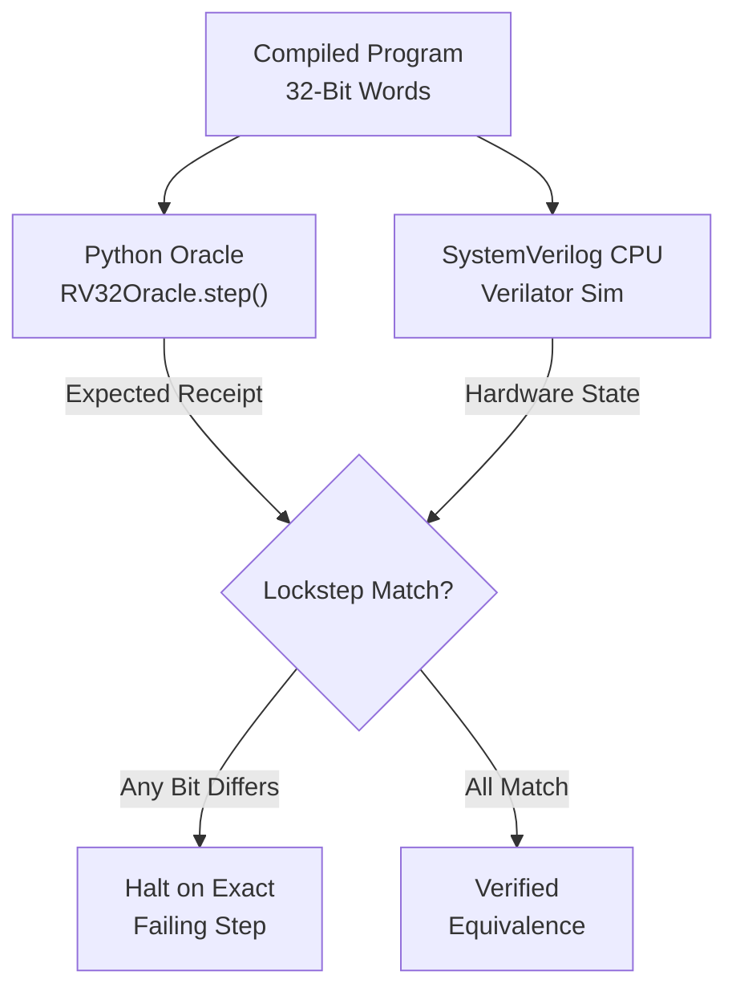
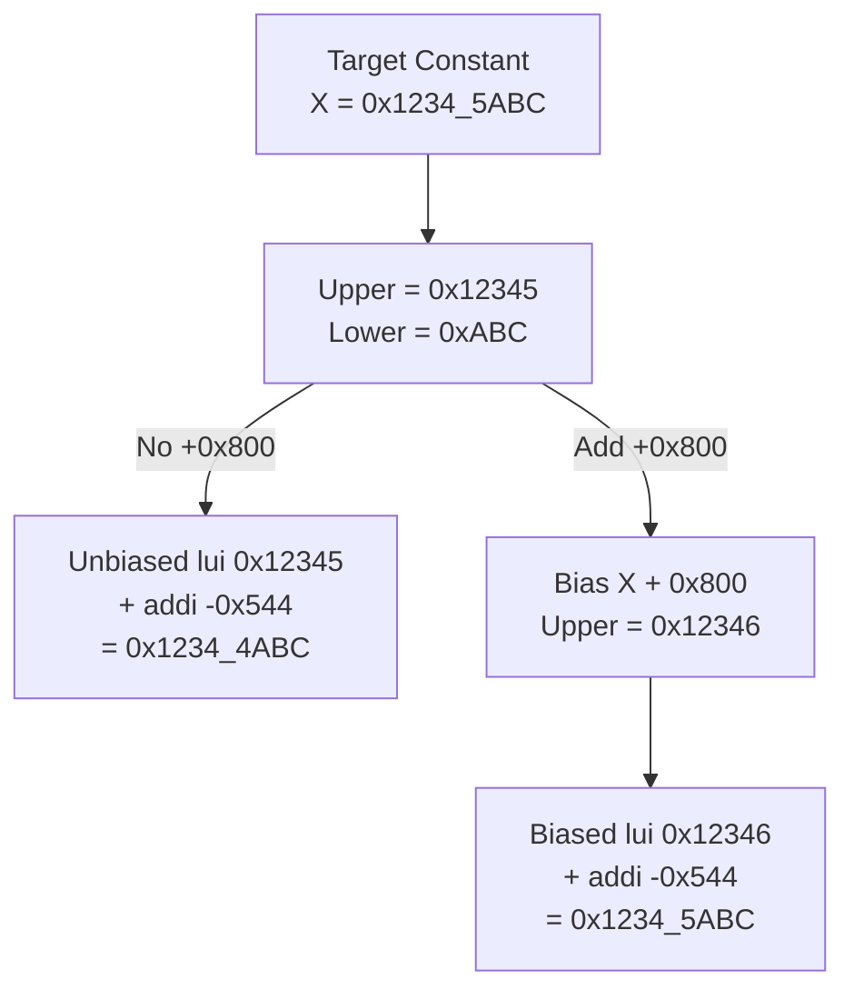
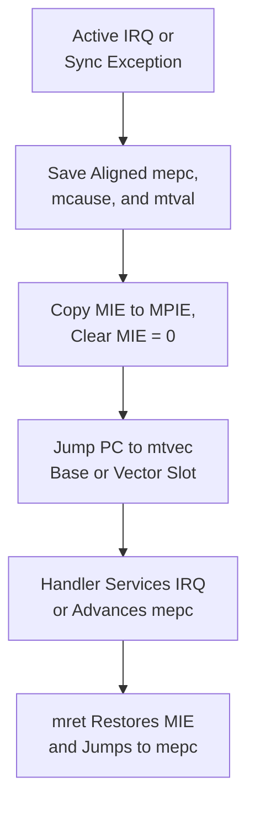

# Chapter 1: Instruction Set Architecture

Every program that runs on a robot ultimately reduces to fixed-width binary numbers moving between small hardware storage cells and memory addresses.
Before designing a single physical logic gate for the `brain` processor, we must specify the exact contract governing those binary instructions, registers, memory regions, and hardware interrupts.
In this chapter, we derive that hardware-software contract from first principles and implement it as a self-contained, executable Python specification in [`oracle.py`](../sim/oracle.py) verified by [`test_oracle.py`](../tb/test_oracle.py).

## 1. Software Golden Reference Models

When you write an ordinary program in Python or C, statements execute one after another in a single predictable sequence.
Built in a text-based circuit specification language (**Hardware Description Language**, or HDL) such as SystemVerilog, a physical processor core (**Central Processing Unit**, or CPU) instead consists of thousands of boolean logic gates, hardware selector switches (**multiplexers**, the circuit equivalent of `cond ? a : b`), and 1-bit clocked storage cells (**flip-flops**).
On every tick of a periodic clock signal, all of those circuits evaluate their input wires and update their stored bits at the exact same instant.
Testing a concurrent circuit design only against hand-written test scripts creates a classic engineering blind spot: whenever the circuit and its test script share a subtle misunderstanding of an arithmetic or interrupt corner case, both agree on the wrong answer.

Processor teams eliminate that blind spot before writing any circuit code by building an unambiguous sequential software specification called a **golden reference model**, or **oracle**.
[`oracle.py`](../sim/oracle.py) serves as that golden specification for the `brain` CPU.
Before any hardware exists, unit tests in [`test_oracle.py`](../tb/test_oracle.py) verify arithmetic bounds, memory alignment rules, and timer alarms directly against the Python oracle.
Later, when our SystemVerilog CPU runs inside an open-source simulator that compiles circuit descriptions into fast C++ executables (**Verilator**), our verification harness feeds the exact same machine-code program to both engines in lockstep.
After every completed (**retired**) instruction, [`RV32Oracle.step()`](../sim/oracle.py#L1195-L1274) returns a structured receipt recording the updated instruction pointer, any modified register value, any memory read or write, and any fault code so the harness halts on the exact step where hardware diverges.

### Instruction Set Architecture Boundaries

Every large software system relies on clean interface boundaries: a function signature tells callers what inputs a function accepts and what result it returns without exposing the temporary variables inside its body.
In computer engineering, the boundary separating software (compilers, startup programs, control loops) from physical chip hardware (logic gates, wire routing, multi-cycle arithmetic units) is the **Instruction Set Architecture**, or ISA.

An ISA defines only what machine-code programs can observe between instructions:
1. **Architectural State**: The persistent storage containers (general-purpose registers, the current instruction address, control registers, and addressable memory) whose values survive from one instruction to the next.
2. **Binary Instruction Encoding**: The exact bit positions that pack an operation selector, register numbers, and small constants into a fixed-width integer word.
3. **State-Transition Rules**: Given any current architectural state $S_t$, the deterministic function mapping $S_t$ to the next state after one step:

   $$S_{t+1} = \texttt{step}(S_t)$$

Because an ISA intentionally hides internal circuit timing—such as whether integer division takes one clock tick or thirty-two clock ticks—[`oracle.py`](../sim/oracle.py) can express the complete `brain` CPU and its peripherals in clean sequential Python.
Across the sections ahead, we build that contract piece by piece: fixed-width binary arithmetic first, core registers and instruction families second, 32-bit instruction bitfields third, integer and neural arithmetic fourth, memory and peripherals fifth, and finally control flow, hardware interrupts, and lockstep stepping.

---

## 2. Fixed-Width Binary Arithmetic

In Python, evaluating `2**200` or `-5` allocates a variable-length object in memory so integers grow until system memory runs out.
Inside a physical CPU, there is no dynamic memory allocator for numbers.
A 32-bit hardware register is 32 parallel metal wires driven by 32 flip-flops, where each wire carries either a low voltage representing `0` or a high voltage representing `1`.
Every loop counter, memory pointer, and sensor reading must fit inside those $2^{32} = 4{,}294{,}967{,}296$ distinct bit patterns, so arithmetic that steps past the ends of the representable range must obey a strict mathematical rule.

### Unsigned Integers and Modular Rings

Every hardware register begins as an ordered row of $N$ binary wires $b_{N-1}, b_{N-2}, \dots, b_0 \in \{0, 1\}$ with no dedicated sign wire.
Hardware manuals label individual wire $b_i$ as Bit $i$ and a contiguous slice from $b_{\text{hi}}$ down to $b_{\text{lo}}$ as Bits $\text{hi}..\text{lo}$.
Assigning standard base-two place weights $2^0, 2^1, \dots, 2^{N-1}$ from right to left maps those wire voltages onto non-negative integers.
On a 4-bit register ($N = 4$), pattern `0011` represents $0 \cdot 8 + 0 \cdot 4 + 1 \cdot 2 + 1 \cdot 1 = 3$, pattern `1011` represents $1 \cdot 8 + 0 \cdot 4 + 1 \cdot 2 + 1 \cdot 1 = 11$, and pattern `1111` represents $8 + 4 + 2 + 1 = 15$.

Generalizing from 4 wires to any width $N \ge 1$ defines the **unsigned integer interpretation** $U_N(b)$:

$$U_N(b) = \sum_{i=0}^{N-1} b_i \cdot 2^i$$

When every wire is `0`, $U_N(b) = 0$.
When every wire is `1`, let $S = \sum_{i=0}^{N-1} 2^i = 1 + 2 + \dots + 2^{N-1}$ denote their total weight.
Multiplying every term by $2$ shifts the sum to $2S = 2 + 4 + \dots + 2^N$, so subtracting $S$ cancels every interior power of two and leaves $S = 2S - S = 2^N - 1$ (for $N = 4$, $1 + 2 + 4 + 8 = 15 = 2^4 - 1$).
Therefore, $N$-bit unsigned integers span $[0, 2^N - 1]$.
For $N = 32$, [`oracle.py`](../sim/oracle.py) names that upper bound `UINT32_MAX = 0xFFFF_FFFF` ($2^{32} - 1 = 4{,}294{,}967{,}295$).

When adding two $N$-bit unsigned integers produces a true sum $x$ outside $[0, 2^N - 1]$—such as $11 + 7 = 18$ on a 4-bit adder—hardware wraps the result by **Euclidean division** (integer division with non-negative remainder).
Dividing any integer $x \in \mathbb{Z}$ (positive, zero, or negative) by a positive modulus $2^N$ yields a unique integer quotient $q \in \mathbb{Z}$ and a unique remainder $r$:

$$x = q \cdot 2^N + r, \qquad 0 \le r < 2^N$$

In base two, multiplying $q$ by $2^N$ places every bit of $q$ at wire position $N$ or higher, leaving the remainder $r = x \bmod 2^N$ in the lower $N$ wires $0$ through $N - 1$.
Because an $N$-bit register physically stops at wire $N - 1$, the carry term $q \cdot 2^N$ drops off the left end, turning $18 = 1 \cdot 16 + 2$ into remainder $2$ (`0010`) and turning negative $-5 = (-1) \cdot 16 + 11$ into non-negative remainder $11$ (`1011`).
Arithmetic that wraps every result modulo $2^N$ forms the **modular ring** $\mathbb{Z}_{2^N}$: a closed cycle of $2^N$ slots arranged like a clock face where stepping $+1$ past $2^N - 1$ returns to $0$.
Any two integers $a$ and $b$ differing by an integer multiple of $2^N$ occupy the same **residue class** on the ring, written $a \equiv b \pmod{2^N}$ (so $18 \equiv 2 \pmod{16}$ and $-5 \equiv 11 \pmod{16}$).

In Python, bitwise AND (`&`) with `MASK32 = 0xFFFF_FFFF` ($2^{32} - 1$) keeps only the lower 32 bit positions, projecting any integer modulo $2^{32}$ into $[0, 2^{32} - 1]$ (`0x1_0000_0002 & MASK32 == 2`).
[`u32`](../sim/oracle.py#L267-L269) implements that 32-bit modular projection in a single mask operation:

<!-- book-sync: u32 -->
<<< @/systems/brain/sim/oracle.py#L267-L269

### Two's Complement Signed Integers

Robot control software also needs negative integers for backward branch offsets, signed joint velocities, and neural network weights, yet adding a separate sign wire or building separate positive and negative adder circuits would waste chip area and slow every clock cycle.
On a 4-bit register (16 bit patterns), early computers tested two encodings that both complicated hardware adders:
- **Sign-Magnitude**: Uses Bit 3 as a plus-or-minus sign flag and Bits 2..0 as magnitude, wasting pattern `1000` on $-0$ alongside $+0$ (`0000`) and breaking plain binary addition (`0011` for $+3$ plus `1101` for $-5$ sums to `0000` instead of $-2$).
- **Ones' Complement**: Negates numbers by inverting every bit ($+5$ is `0101`, so $-5$ is `1010`), which still leaves two encodings for zero (`0000` and `1111`) and forces adders to loop their top carry-out wire back into Bit 0.

**Two's complement** eliminates both flaws by reading negative numbers directly off the modular clock ring.
Starting at `0000` ($0$) on a 16-slot ring and stepping counter-clockwise by $1$ lands on `1111` ($15 \equiv -1 \pmod{16}$), while stepping counter-clockwise by $5$ lands on `1011` ($11 \equiv -5 \pmod{16}$).
Algebraically, two's complement keeps positive place weights $+2^0, \dots, +2^{N-2}$ on the lower $N - 1$ wires and assigns the leftmost wire (**Most Significant Bit**, or MSB, at bit $N - 1$) a negative weight of $-2^{N-1}$.
On 4 bits, `1011` evaluates to $-1 \cdot 8 + 0 \cdot 4 + 1 \cdot 2 + 1 \cdot 1 = -5$, and adding `0011` ($+3$) in ordinary binary gives `1011 + 0011 = 1110`, which evaluates to $-8 + 4 + 2 + 0 = -2$ with zero sign-checking logic.
Python's bitwise `&` acts on negative integers using this exact two's-complement expansion, so `u32(-5)` evaluates `-5 & 0xFFFF_FFFF` to `0xFFFF_FFFB` ($2^{32} - 5 = 4{,}294{,}967{,}291$).

The interactive 4-bit ring adder below displays all 16 clock slots simultaneously, pairing raw bit toggles with both unsigned ($0..15$) and signed ($-8..+7$) interpretations before we generalize to $N$ bits.

<ModularRingAdder />

Generalizing that negative MSB weight to any width $N \ge 1$ (with the lower sum empty and equal to $0$ when $N = 1$) defines the **signed two's-complement interpretation** $S_N(b)$:

$$S_N(b) = -b_{N-1} \cdot 2^{N-1} + \sum_{i=0}^{N-2} b_i \cdot 2^i$$

Writing $L = \sum_{i=0}^{N-2} b_i 2^i \in [0, 2^{N-1} - 1]$ for the lower $N - 1$ wires shows that all $2^N$ patterns partition cleanly with a single all-zero encoding (`00...0`): patterns with $b_{N-1} = 0$ span $[0, 2^{N-1} - 1]$, and patterns with $b_{N-1} = 1$ evaluate to $-2^{N-1} + L$, spanning $[-2^{N-1}, -1]$.
Because $0$ occupies one slot in the $b_{N-1} = 0$ half, an $N$-bit signed integer covers the slightly asymmetric range $[-2^{N-1}, 2^{N-1} - 1]$.
For $N = 32$, [`oracle.py`](../sim/oracle.py) defines those endpoints using Python's left-shift operator (`1 << 31` shifts `1` left by 31 bit positions to compute $2^{31}$) as `INT32_MIN = -(1 << 31)` ($-2{,}147{,}483{,}648$, hex `0x8000_0000`) and `INT32_MAX = (1 << 31) - 1` ($+2{,}147{,}483{,}647$, hex `0x7FFF_FFFF`).

### Two's Complement Negation and Shared Adders

Comparing the unsigned sum $U_N(b)$ and signed sum $S_N(b)$ on the exact same $N$-bit wire pattern explains why hardware needs only one binary adder circuit for both unsigned and signed integers.
On our 4-bit pattern `1011`, $U_4(\texttt{1011}) = 11$ and $S_4(\texttt{1011}) = -5$, which differ by $11 - (-5) = 16 = 2^4$.
Separating wire $N - 1$ from the lower $N - 1$ wires in $U_N(b)$ and $S_N(b)$ cancels every lower wire weight and proves that this $2^N$ offset holds whenever $b_{N-1} = 1$:

$$\begin{aligned}
U_N(b) - S_N(b)
&= \left(b_{N-1} 2^{N-1} + \sum_{i=0}^{N-2} b_i 2^i\right) \\
&\quad - \left(-b_{N-1} 2^{N-1} + \sum_{i=0}^{N-2} b_i 2^i\right) \\
&= 2 \cdot b_{N-1} \cdot 2^{N-1} = b_{N-1} \cdot 2^N \\
\implies\quad S_N(b) &= U_N(b) - b_{N-1} \cdot 2^N
\end{aligned}$$

Two structural consequences follow immediately from $U_N(b) - S_N(b) = b_{N-1} \cdot 2^N$.
First, because $b_{N-1} \in \{0, 1\}$, the difference $b_{N-1} \cdot 2^N$ is always an integer multiple of $2^N$, so the unsigned and signed interpretations of *every* $N$-bit pattern occupy the same residue class modulo $2^N$:

$$U_N(b) \equiv S_N(b) \pmod{2^N}$$

Second, because $U_N$ assigns distinct power-of-two weights $2^i$ across $\{0, 1\}^N$ (any two patterns differing first at highest wire $k$ have lower bits summing to at most $2^k - 1 < 2^k$), $U_N$ maps all $2^N$ bit patterns one-to-one onto $[0, 2^N - 1]$.
Consequently, any two integer expressions congruent modulo $2^N$ share the exact same unique Euclidean remainder $r \in [0, 2^N - 1]$ and select the exact same $N$-bit wire pattern.
Before applying this ring equivalence to hardware adders, let us refresh why modular congruence passes through addition, subtraction, and multiplication for any positive integer modulus $m$.
Suppose $x \equiv x' \pmod{m}$ and $y \equiv y' \pmod{m}$.
By definition of congruence, $x$ and $x'$ differ by an integer multiple of $m$, as do $y$ and $y'$, so $x = x' + k_1 m$ and $y = y' + k_2 m$ for some integers $k_1, k_2 \in \mathbb{Z}$.
Combining those explicit equations yields:

$$\begin{aligned}
x \pm y &= (x' \pm y') + (k_1 \pm k_2)m \\
x \cdot y &= x' y' + (k_1 y' + k_2 x' + k_1 k_2 m)m
\end{aligned}$$

Because $k_1 \pm k_2$ and $k_1 y' + k_2 x' + k_1 k_2 m$ are both integers, adding, subtracting, or multiplying operands preserves congruence modulo $m$, giving $x \pm y \equiv x' \pm y' \pmod{m}$ and $x \cdot y \equiv x' \cdot y' \pmod{m}$ (including scaling by any fixed integer $c \cdot x \equiv c \cdot x' \pmod{m}$).
For a concrete check on our 16-slot ring ($m = 16$), $19 \equiv 3 \pmod{16}$ and $14 \equiv -2 \pmod{16}$ give $19 + 14 = 33 \equiv 1 \equiv 3 + (-2) \pmod{16}$ and $19 \cdot 14 = 266 \equiv -6 \equiv 3 \cdot (-2) \pmod{16}$.

With that congruence bridge established, we can prove both circuit simplifications directly:
1. **Negation via Invert Plus One**: Let $\bar{b}_i = 1 - b_i$ denote inverting every wire of $b$ (written `~x` in C and SystemVerilog).
   On 4 bits, inverting $+5$ (`0101`) gives `1010` ($10$ unsigned, $-6$ signed), and adding $1$ gives `1011` ($11 \equiv -5 \pmod{16}$, which evaluates directly to $-5$ in $S_4$).
   We evaluate the inverted bit pattern under $U_N(\bar{b}) + 1$ because it models the physical unsigned adder wires directly while avoiding the minimum negative boundary case where exact $-S_N(\texttt{10...0}) = +2^{N-1}$ overflows $N$-bit signed range prior to wrapping:

   $$\begin{aligned}
   U_N(\bar{b}) + 1
   &= \sum_{i=0}^{N-1} (1 - b_i) 2^i + 1 \\
   &= \left(2^N - 1 - U_N(b)\right) + 1 \\
   &= 2^N - U_N(b) \equiv -S_N(b) \pmod{2^N}
   \end{aligned}$$

   Dropping $2^N \equiv 0 \pmod{2^N}$ and substituting $U_N(b) \equiv S_N(b) \pmod{2^N}$ shows that $U_N(\bar{b}) + 1$ lands in the exact residue class $-S_N(b)$, and since $S_N(\bar{b}) \equiv U_N(\bar{b}) \pmod{2^N}$, the same congruence immediately gives $S_N(\bar{b}) + 1 \equiv -S_N(b) \pmod{2^N}$ for the signed interpretation without needing a separate derivation.
   Two edge patterns illustrate modular wrap-around cleanly: when $b = 0$, $U_N(\bar{b}) + 1 = 2^N$ drops its top carry-out bit modulo $2^N$ to return `0`; when $S_N(b) = -2^{N-1}$ (`1000` on 4 bits, or `INT32_MIN = 0x8000_0000` on 32 bits), the mathematical negation $+2^{N-1}$ exceeds $2^{N-1} - 1$ by $1$ and wraps modulo $2^N$ right back to $-2^{N-1}$ (`INT32_MIN`).
   Extending this identity to two inputs explains subtraction on the same adder: inverting $B$ and driving `1` onto the adder's bottom carry-in wire computes $U_N(A) + U_N(\bar{B}) + 1$, giving $U_N(A) + 2^N - U_N(B)$, which is congruent to $S_N(A) - S_N(B) \pmod{2^N}$.
2. **Sign-Agnostic Addition, Subtraction, and Left Shifts**: For 4-bit patterns `1011` ($U_4 = 11, S_4 = -5$) and `1110` ($U_4 = 14, S_4 = -2$), binary addition wraps `1011 + 1110 = 1001` ($9 \equiv -7 \pmod{16}$, matching $11 + 14 = 25 \equiv 9$ and $-5 + (-2) = -7$).
   On the same inputs, subtraction wraps `1011 - 1110 = 1101` ($13 \equiv -3 \pmod{16}$, matching $11 - 14 \equiv 13$ and $-5 - (-2) = -3$), and shifting `1011` left by $k = 1$ yields `0110` ($6 \equiv -10 \pmod{16}$, matching $11 \cdot 2 = 22 \equiv 6$ and $-5 \cdot 2 = -10$).
   In general, let $a \ll k$ denote a **left shift** by $0 \le k < N$ bit positions, which moves each wire $a_i$ to position $i + k$, discards bits $a_{N-1} \dots a_{N-k}$ past wire $N - 1$, and feeds `0` into Bits $k-1..0$.
   Substituting $U_N \equiv S_N \pmod{2^N}$ for each operand and factoring $2^N$ out of the discarded top wires proves congruence across all three operations:

   $$\begin{aligned}
   U_N(a) \pm U_N(b)
   &\equiv S_N(a) \pm S_N(b) \pmod{2^N} \\
   U_N(a \ll k)
   &= \sum_{i=0}^{N-1-k} a_i 2^{i+k} \\
   &= 2^k U_N(a) - 2^N \sum_{i=N-k}^{N-1} a_i 2^{i+k-N} \\
   &\equiv 2^k U_N(a) \equiv 2^k S_N(a) \pmod{2^N}
   \end{aligned}$$

   Since identical residues modulo $2^N$ map bijectively to the exact same $N$-bit register pattern, addition, subtraction, and left-shifting produce identical hardware output bits whether software interprets them as unsigned or signed.

### Operations Dependent on Signedness and Right Shifts

While addition, subtraction, and left shifts preserve congruence modulo $2^N$, three foundational bit-level operations—alongside the upper-half multiplications and division rules in Section 5—depend directly on whether a pattern is unsigned or signed: ordered comparisons (`<` and `>=`), widening narrow integers to 32 bits, and right shifts (`>>`).
Each breaks modular invariance for a specific algebraic reason:
- **Ordered Comparisons Break Under $2^N$ Shifts**: Congruence modulo $2^N$ preserves equality on the ring, not `<` order on the number line.
  Comparing 4-bit `1011` ($U_4 = 11, S_4 = -5$) against `0011` ($U_4 = 3, S_4 = +3$) gives $11 > 3$ unsigned yet $-5 < +3$ signed.
  In general, whenever $a$ and $b$ differ in their MSB ($a_{N-1} = 1$ and $b_{N-1} = 0$), subtracting $a_{N-1} \cdot 2^N$ pulls $a$ across zero so $U_N(a) \ge 2^{N-1} > U_N(b)$ flips to $S_N(a) = U_N(a) - 2^N < 0 \le S_N(b) = U_N(b)$.
  To translate signed order into unsigned order in hardware, we use an operation that outputs `1` where two bits differ and `0` where they match (**bitwise exclusive-OR**, or XOR, written `^` in Python and $\oplus$ in equations).
  Flipping only the MSB with mask $m_{N-1}$ (`1` solely at Bit $N - 1$) shifts $S_N(x)$ upward by $+2^{N-1}$ to $(1 - x_{N-1})2^{N-1} + \sum_{i=0}^{N-2} x_i 2^i$, matching $U_N(x \oplus m_{N-1})$.
  On 4 bits with $m_3 = \texttt{1000}$ ($8$), `1011 ^ 1000 = 0011` maps $-5 \mapsto -5 + 8 = 3$ and `0011 ^ 1000 = 1011` maps $+3 \mapsto +3 + 8 = 11$, preserving $-5 < +3$ as $3 < 11$.
- **Zero Extension Breaks Negative Narrow Integers**: Narrow 8-bit, 12-bit, 13-bit, 16-bit, 20-bit, and 21-bit signed values appear throughout instructions and memory loads, and widening a $k$-bit pattern ($1 \le k < 32$) raises the modulus from $2^k$ to $2^{32}$, where $b_{k-1} \cdot 2^k$ is no longer a multiple of $2^{32}$ when $b_{k-1} = 1$.
  On 12 bits ($2^{12} = 4096$), $-5$ encodes as $4096 - 5 = 4091$, or `0xFFB` (`1111_1111_1011`, with sign wire Bit 11 equal to `1`).
  Padding the new upper wires Bits 31..12 with `0` bits (**zero extension**) produces `0x0000_0FFB` ($+4091$), keeping both $U_{32}(\text{extended } b)$ and $S_{32}(\text{extended } b)$ equal to $U_k(b)$ yet shifting negative signed numbers upward by $+b_{k-1} \cdot 2^k$ ($-5 + 4096 = +4091$).
  **Sign extension** instead copies Bit 11 across all upper wires Bits 31..12, turning `0xFFB` ($-5$ signed, $4091$ unsigned) into `0xFFFF_FFFB` ($2^{32} - 5 = 4{,}294{,}967{,}291$), whose 32-bit signed value stays $4{,}294{,}967{,}291 - 2^{32} = -5$ while shifting its unsigned value upward by $2^{32} - 2^{12} = 4{,}294{,}963{,}200$.
- **Right Shifts Perform Integer Floor Division**: On a ring $\mathbb{Z}_m$, a **modular inverse** of an integer $a$ is an integer $u$ satisfying $a \cdot u \equiv 1 \pmod{m}$ so dividing by $a$ on the ring equals multiplying by $u$.
  For $a = 2^k$ ($k \ge 1$) and $m = 2^N$ ($N \ge 1$), every product $2^k \cdot u$ is even whereas every integer congruent to $1$ modulo $2^N$ is odd ($1 + q \cdot 2^N$), so $2^k$ has no modular inverse modulo $2^N$.
  For example, on our 16-slot ring, doubling maps both $3$ and $11$ to $6 \pmod{16}$, so $\times 2$ cannot be uniquely reversed on the ring.
  Consequently, the upper bit positions vacated at the left end during a right shift (Bits $N - 1\dots N - k$) cannot discard carries like left shifts and must be filled according to signedness.
  Shifting 32-bit `0xFFFF_FFFB` ($4{,}294{,}967{,}291$ unsigned, $-5$ signed) right by $k = 1$ drops Bit 0 ($b_0 = 1$) and exposes two distinct behaviors:
  - A **logical right shift** fills vacated upper bits with `0` bits, turning `0xFFFF_FFFB` into `0x7FFF_FFFD` ($+2{,}147{,}483{,}645 = \lfloor 4{,}294{,}967{,}291 / 2 \rfloor$), which breaks negative signed inputs by turning Bit 31 to `0`.
  - An **arithmetic right shift** copies the original Bit 31 sign bit (`1`) into the vacated upper positions, turning `0xFFFF_FFFB` into `0xFFFF_FFFD` ($-3 = \lfloor -5 / 2 \rfloor$) so negative values remain negative and always round downward toward $-\infty$ rather than toward $0$.

In Python, [`sign_extend(val, bits)`](../sim/oracle.py#L272-L279) computes widened signed values without an `if`/`else` branch using bitwise XOR (`^`, written $\oplus$ below): on `val = 0xFFB` ($4091$) with `bits = 12`, setting `sign_bit = 1 << 11` ($2048$, hex `0x800`), flipping Bit 11 via `4091 ^ 2048` to get $2043$, and subtracting $2048$ via `2043 - 2048` yields $-5$.
The interactive shifter below pairs 12-to-32-bit wire fan-out with `sign_extend(val, 12)` and both right-shift modes across positive and negative presets before we prove sign extension and both right-shift division identities in general.

<SignExtensionShifter />

When $k = M$, a $k$-bit value already fills Bits $M - 1\dots 0$ so zero upper wires are added and $S_M(b) = S_k(b)$ trivially.
For any narrow width $1 \le k < M$ (for example $M = 32$), copying sign wire $b_{k-1}$ onto every upper wire $i \in [k, M - 1]$ replaces $\sum_{i=k}^{M-2} 2^i$ with $(2^{M-1} - 1) - (2^k - 1)$, simplifying to $2^{M-1} - 2^k$ (empty when $k = M - 1$), while the lower sum $\sum_{i=0}^{k-2} b_i 2^i$ is empty when $k = 1$ (so all $M$ wires equal $b_0$, yielding $-b_0 2^{M-1} + b_0(2^{M-1} - 1) = -b_0 = S_1(b)$):

$$\begin{aligned}
S_M(\text{extended } b)
&= -b_{k-1} 2^{M-1} + \sum_{i=k}^{M-2} b_{k-1} 2^i \\
&\quad + b_{k-1} 2^{k-1} + \sum_{i=0}^{k-2} b_i 2^i \\
&= b_{k-1}\!\left(-2^{M-1} + (2^{M-1} - 2^k) + 2^{k-1}\right)
+ \sum_{i=0}^{k-2} b_i 2^i \\
&= -b_{k-1} 2^{k-1} + \sum_{i=0}^{k-2} b_i 2^i = S_k(b)
\end{aligned}$$

Notice that $-2^{M-1} + 2^{M-1}$ cancels cleanly and $-2^k + 2^{k-1} = -2^{k-1}$, proving hardware sign extension requires zero logic gates—only metal wire fan-out across *any* widening $k \le M$.
For $M = 32$, adding $b_{k-1} 2^{32}$ to the left side via our earlier unsigned-to-signed identity $U_{32}(x) = S_{32}(x) + x_{31} 2^{32}$ and substituting $S_k(b) = U_k(b) - b_{k-1} 2^k$ on the right yields the unsigned offset $U_{32}(\text{extended } b) = U_k(b) + b_{k-1}(2^{32} - 2^k)$.

In [`oracle.py`](../sim/oracle.py), [`sign_extend`](../sim/oracle.py#L272-L279) implements that branchless XOR formula, and [`s32`](../sim/oracle.py#L282-L284) and [`s16`](../sim/oracle.py#L287-L289) specialize it to 32-bit and 16-bit signed integers:

<!-- book-sync: sign_extend..s16 -->
<<< @/systems/brain/sim/oracle.py#L272-L289

To see why `(val ^ sign_bit) - sign_bit` equals $S_k(b)$ for every width $1 \le k \le 32$, write the masked unsigned integer as $\texttt{val} = b_{k-1} s + L$, where $s = 2^{k-1}$ (`sign_bit` has `1` solely at Bit $k - 1$ and `0` elsewhere) and $L = \sum_{i=0}^{k-2} b_i 2^i \in [0, s - 1]$ (with $L = 0$ when $k = 1$).
Because $L < s$, Bit $k - 1$ of $L$ is `0`, so exclusive-OR with $s$ flips Bit $k - 1$ from $b_{k-1}$ to $1 - b_{k-1}$ without touching $L$:

$$\begin{aligned}
(\texttt{val} \oplus s) - s
&= \left((1 - b_{k-1}) s + L\right) - s \\
&= -b_{k-1} s + L \\
&= -b_{k-1} 2^{k-1} + \sum_{i=0}^{k-2} b_i 2^i = S_k(b)
\end{aligned}$$

To prove why logical and arithmetic right shifts compute **floor division** $\lfloor x / 2^k \rfloor$—and why signed arithmetic right shifts round negative integers downward toward $-\infty$ rather than toward $0$—recall the definition of the floor function: for any real number $y$, $\lfloor y \rfloor$ is the unique integer satisfying $\lfloor y \rfloor \le y < \lfloor y \rfloor + 1$.
Partition any $N$-bit register $b$ across shift distance $1 \le k \le N - 1$ (with $k = 0$ leaving $b$ unchanged) into its kept upper $(N - k)$-bit slice $H = b_{N-1}\dots b_k$ and its discarded lower $k$ bits $R = \sum_{m=0}^{k-1} b_m 2^m \in [0, 2^k - 1]$.
Zero-padding the vacated upper $k$ wires adds $0$ under $U_N$, so $U_N(b \gg_{\text{log}} k) = U_{N-k}(H)$.
For signed inputs, replicating $b_{N-1}$ into Bits $N - 1\dots N - k$ is simply sign-extending the $(N - k)$-bit slice $H$ up to $M = N$ bits, so our sign-extension lemma gives $S_N(b \gg_{\text{arith}} k) = S_{N-k}(H)$ immediately, and factoring $2^k$ out of the upper $N - k$ wires of $b$ relates both shifts to $\lfloor x / 2^k \rfloor$:

$$\begin{aligned}
U_N(b)
&= \left(\sum_{j=0}^{N-1-k} b_{j+k} 2^j\right) 2^k + R \\
&= U_N(b \gg_{\text{log}} k) \cdot 2^k + R \\
S_N(b)
&= \left(-b_{N-1} 2^{N-1-k} + \sum_{j=0}^{N-2-k} b_{j+k} 2^j\right) 2^k + R \\
&= S_N(b \gg_{\text{arith}} k) \cdot 2^k + R
\end{aligned}$$

Dividing either equation by $2^k$ gives $x / 2^k = q + R / 2^k$.
In both shifts, every discarded wire weight $+2^m$ is positive, so the dropped remainder satisfies $0 \le R < 2^k$ and therefore $0 \le R / 2^k < 1$ regardless of the sign of $b$.
Adding a non-negative fraction $R / 2^k \in [0, 1)$ places $q$ strictly in $q \le x / 2^k < q + 1$, proving $q = \lfloor x / 2^k \rfloor$ for *every* integer $x$.
Thus logical right shift computes $\lfloor U_N(b) / 2^k \rfloor$ (breaking negative signed inputs when $b_{N-1} = 1$ because zeroing Bit $N - 1$ makes $S_N \ge 0$), whereas arithmetic right shift computes $\lfloor S_N(b) / 2^k \rfloor$.
In particular, arithmetic right-shifting $-5 = (-3) \cdot 2 + 1$ yields quotient $-3$ rather than truncating toward $0$ to $-2$, while altering unsigned $U_N$ whenever $b_{N-1} = 1$ inserts `1` bits from the left.

### Saturating Clamping Versus Modular Wrapping

Modular wrap-around modulo $2^{32}$ is ideal for pointer arithmetic and loop counters, where stepping $+1$ past `INT32_MAX` ($+2{,}147{,}483{,}647$) wraps around the ring to `INT32_MIN` ($-2{,}147{,}483{,}648$).
Inside a leg-motor control loop or neural network layer, however, wrapping a large positive torque command into the largest possible negative command would violently reverse a joint.
Neural accumulation instructions instead use **saturating arithmetic**, clamping any sum above `INT32_MAX` or below `INT32_MIN` to the nearest representable endpoint via [`sat32`](../sim/oracle.py#L292-L298):

<!-- book-sync: sat32 -->
<<< @/systems/brain/sim/oracle.py#L292-L298

---

## 3. Core Registers and Instruction Families

With 32-bit unsigned, signed, and saturating representations defined, we can introduce the core architectural state initialized in [`RV32Oracle.reset()`](../sim/oracle.py#L564-L594) and organize all valid machine instructions into six functional groups.
Dedicated state for neural accumulation, addressable memory, timers, and interrupt control enters one piece at a time in Sections 6 through 8 as each subsystem is built.

Core integer execution revolves around two state structures:
1. **Program Counter** (PC): `self.pc`, a single 32-bit register holding the byte address in memory of the next instruction to fetch; at reset, `self.pc` starts at `0x0000_0000` (mapped to startup read-only memory in Section 7).
2. **General-Purpose Register File**: `self.regs`, an array of 32 fast 32-bit integer registers named `x0` through `x31` (128 bytes of on-chip storage in total).
   Choosing 32 registers rather than 8 or 256 balances fast access against instruction bit width: naming one of 32 registers takes $\log_2(32) = 5$ bits, so specifying one destination register (`rd`, indexed 0 to 31) and two source registers consumes $3 \times 5 = 15$ bits of a 32-bit instruction word and leaves 17 bits for operation selectors and embedded constants.

### Hardwired Zero Register Mechanics

In hardware, register `x0` (`rd == 0`) is not a writable storage cell initialized to zero at reset.
Instead, `x0` omits flip-flops altogether: its read wires tie permanently to ground (`0`), and any write targeting `rd == 0` is discarded at writeback, modeled in [`RV32Oracle._set_reg`](../sim/oracle.py#L894-L900):

<!-- book-sync: RV32Oracle._set_reg -->
<<< @/systems/brain/sim/oracle.py#L894-L900

Dedicating one register index permanently to `0` keeps the instruction set small without losing expressiveness.
Rather than adding separate hardware instructions for *"do nothing"*, *"copy a register"*, *"negate an integer"*, *"compare against zero"*, or *"jump without saving a return address"*, software reuses standard arithmetic, branch, and jump instructions with `x0` as a zero source or a safe discard destination.
Sections 5 and 8 derive each of those `x0` shorthands alongside the instructions that power them.

### Six Functional Instruction Groups

The `brain` CPU executes instructions belonging to six functional groups, each solving a core software need in [`oracle.py`](../sim/oracle.py).
Those groups span scalar integer instructions from an open instruction specification alongside dedicated extensions for arithmetic, control registers, and neural locomotion math.

Specifically, the architecture combines four instruction layers expressed in human-readable **assembly language** using short lowercase **instruction mnemonics** (such as `add` for integer addition):
- **Base Integer Core**: Built on an open hardware specification (**Reduced Instruction Set Computer, Fifth Generation**, or RISC-V), starting from its **32-bit Base Integer** (RV32I) instruction set.
- **Hardware Multiply and Divide**: Adds single-instruction integer hardware multiplication and division (**Integer Multiply and Divide**, or RV32M, combined with RV32I as RV32IM) for scaled-integer robot physics.
- **System and Control Registers**: Uses a dedicated bank of internal configuration and status cells (**Control and Status Registers**, or CSRs) updated safely through the **Control and Status Register Instructions** (Zicsr) extension.
- **Neural Dot-Product Extension**: Adds our custom two-lane 16-bit multiply-accumulate extension (**Apex Neural Multiply-Accumulate**, or Xapex) for neural locomotion control.

| Group | Functional Category | Everyday Programming Role | Covered In |
| :---: | :--- | :--- | :---: |
| **1** | **Integer Arithmetic, Shifts, and Constants** | `if`/`else` comparisons, loop counters, bit masks, shifts, and 32-bit constants | Sec. 4–5 |
| **2** | **Hardware Multiply and Divide** | Single-instruction 64-bit integer products, quotients, and remainders | Sec. 5 |
| **3** | **Memory Loads and Stores** | Reading and writing 8-bit, 16-bit, and 32-bit values in memory and device registers | Sec. 7 |
| **4** | **Conditional Branches and Jumps** | `while`/`for` loops, direct function calls, and function-pointer jumps | Sec. 4, 8 |
| **5** | **System and Control Registers** | System calls, debugger breakpoints, interrupt masks, and hardware cycle counters | Sec. 8–9 |
| **6** | **Dual-16-Bit Neural Multiply-Accumulate** | Two-lane saturating dot products for real-time robot motor control networks | Sec. 6 |

---

## 4. Instruction Word Bitfield Encoding

Before the CPU can execute an instruction, its decoder must slice a 32-bit unsigned word (`insn`) fetched from memory into register indices, operation codes, and constants.
In RISC-V assembly syntax, register-to-register instructions list destination register `rd` first followed by first and second source registers `rs1` and `rs2` (`add rd, rs1, rs2`), whereas instructions with an embedded constant (**immediate**, or `imm`) replace `rs2` with that constant, as in **Add Immediate** (`addi rd, rs1, imm`).
At the wire level, every instruction word occupies 32 bits (Bits 31..0) built from four recurring field roles:
- **Primary Operation Code**: `opcode` at Bits 6..0, a 7-bit selector identifying which major instruction family arrived.
- **Register Indices**: Up to three 5-bit register numbers (0 to 31) naming destination `rd` (Bits 11..7), first source `rs1` (Bits 19..15), and second source `rs2` (Bits 24..20).
- **Sub-Operation Selectors**: `funct3` at Bits 14..12 (3 bits) and, on register or shift instructions, `funct7` at Bits 31..25 (7 bits), narrowing down the exact operation inside an `opcode` family.
- **Embedded Immediate Constant**: Signed or unsigned literal bits packed into whichever upper bit columns a format does not spend on `rs2` or `rd`.

All standard 32-bit RISC-V `opcode` values end with Bits 1..0 equal to `0b11` (decimal 3), reserving the other three 2-bit endings for optional 16-bit compressed instructions.
Because the `brain` CPU implements only 32-bit instructions, every valid instruction address is a multiple of 4 bytes, enforcing RISC-V 32-bit **Instruction Address Alignment** (IALIGN = 32).
Inside [`RV32Oracle.step()`](../sim/oracle.py#L1195-L1274), fixed shifts and bitmasks (`OPCODE_MASK = 0x7F`, `REG_MASK = 0x1F`, `FUNCT3_MASK = 0x7`, and `FUNCT7_MASK = 0x7F`) extract all common fields in parallel before dispatching on `opcode`:

<!-- book-sync: RV32Oracle.step['opcode = insn & OPCODE_MASK'..'funct7 = (insn >> 25) & FUNCT7_MASK'] -->
<<< @/systems/brain/sim/oracle.py#L1211-L1216

### Split Constants and Pinned Register Wires

RISC-V encodes all 32-bit instructions using six standard bitfield layouts: **Register** (R-type), **Immediate** (I-type), **Store** (S-type), **Branch** (B-type), **Upper Immediate** (U-type), and **Jump** (J-type), with our custom Xapex neural instructions reusing the R-type layout under a dedicated custom `opcode`.
While I-type places a 12-bit constant in Bits 31..20 and U-type places a 20-bit upper constant in Bits 31..12 alongside destination `rd` (Bits 11..7, with no `funct3`, `rs1`, or `rs2`), S-type, B-type, and J-type split and permute their constant bits across non-adjacent slices.

Hardware designers scrambled those constant bits deliberately to keep register and sign wires motionless across formats.
If `rs1` sat at Bits 19..15 in R-type instructions but moved to Bits 27..23 in store instructions, physical hardware would need extra multiplexer switches in front of the register file's read-address ports, stretching the **critical timing path** (the longest chain of logic gates electrical signals must settle through within a single clock tick).
Pinning register columns and the top sign bit simplifies the circuit in three ways:
- **Pinned Register Columns**: Every format that uses `rd`, `rs1`, or `rs2` places them at Bits 11..7, Bits 19..15, and Bits 24..20 respectively, so the register file can begin reading `rs1` and `rs2` the instant an instruction word arrives.
- **Sign Wire Fixed at Bit 31**: Every format carrying a signed immediate places its sign bit at Bit 31, allowing sign-extension wires to fan out from instruction Bit 31 unconditionally.
- **Split Store and Scaled Branch Offsets**: S-type memory stores read both `rs1` (Bits 19..15) and `rs2` (Bits 24..20) with `funct3` (Bits 14..12) and no `rd`, placing Offset Bits 11..5 in Bits 31..25 and Offset Bits 4..0 in Bits 11..7.
  B-type conditional branches keep the same `rs1`, `rs2`, and `funct3` layout without `rd`, whereas J-type unconditional jumps write `rd` (Bits 11..7) with no `funct3`, `rs1`, or `rs2` (matching U-type's register footprint).
  Even when IALIGN = 32 requires 4-byte instruction addresses, B-type encodes 13-bit offsets and J-type encodes 21-bit offsets as multiples of 2 bytes with Offset Bit 0 implicitly `0` for binary compatibility with optional 16-bit compressed instructions.
  Specifically, B-type places Offset Bit 12 (sign) at Bit 31, Offset Bits 10..5 in Bits 30..25, Offset Bits 4..1 in Bits 11..8, and Offset Bit 11 at Bit 7.
  By the same layout rule, J-type places Offset Bit 20 (sign) at Bit 31, Offset Bits 10..1 in Bits 30..21, Offset Bit 11 at Bit 20, and Offset Bits 19..12 in Bits 19..12 (matching Bits 19..12 of U-type's Bits 31..12 upper immediate).

The wire matrix below aligns all six 32-bit RISC-V layouts across Columns 31..0 so you can filter pinned register columns, the Bit 31 sign wire, and split constant slices side by side.

<RiscvFormatMatrix />

In [`oracle.py`](../sim/oracle.py), the encoder functions [`enc_r`](../sim/oracle.py#L322-L331), [`enc_i`](../sim/oracle.py#L334-L342), [`enc_s`](../sim/oracle.py#L345-L356), [`enc_b`](../sim/oracle.py#L359-L372), [`enc_u`](../sim/oracle.py#L375-L378), [`enc_j`](../sim/oracle.py#L381-L392), and [`enc_mac`](../sim/oracle.py#L395-L397) (for our custom neural multiply-accumulate instruction, covered in Section 6) pack operands into these 32-bit layouts for unit tests.
During execution, [`_decode_imm_s`](../sim/oracle.py#L400-L402), [`_decode_imm_b`](../sim/oracle.py#L405-L413), and [`_decode_imm_j`](../sim/oracle.py#L416-L424) reassemble and sign-extend the split slices into 32-bit signed offsets.
Section 9 pairs these encoders with a live interactive 32-bit instruction decoder once every instruction family and control register has been derived.

---

## 5. Integer Arithmetic and Multiplication

Once the decoder slices an instruction word, integer operations flow into an arithmetic and bitwise execution circuit (**Arithmetic Logic Unit**, or ALU) built from **combinational logic**, meaning its output wires settle purely as a function of its current input wires with no internal clock memory.
Before dispatching to the ALU, [`RV32Oracle.step()`](../sim/oracle.py#L1195-L1274) reads the two source registers as unsigned 32-bit words (`rs1_u = self.regs[rs1]` and `rs2_u = self.regs[rs2]`), and ALU helpers derive their signed counterparts via `rs1_s = s32(rs1_u)` and `rs2_s = s32(rs2_u)`.
[`_exec_op_imm`](../sim/oracle.py#L1024-L1056) executes register-immediate ALU instructions (`opcode = 0x13`), while [`_exec_op_reg`](../sim/oracle.py#L1084-L1116) executes register-register instructions (`opcode = 0x33`).
Whenever an instruction carries an unassigned `opcode`, `funct3`, or `funct7` bit pattern, the CPU aborts that instruction before modifying `rd` and raises a synchronous hardware fault redirect called a **trap** (`CAUSE_ILLEGAL_INSN = 2`; Section 8 derives the full trap mechanism).

Five hardware rules govern all base RV32I ALU operations:
1. **Five-Bit Barrel Shifter**: Because any 5-bit unsigned shift count $s = 16 s_4 + 8 s_3 + 4 s_2 + 2 s_1 + s_0$ decomposes into powers of two, hardware shifts in one pass through a five-stage cascade of multiplexers shifting by 16, 8, 4, 2, or 1 bit position depending on each bit $s_i$ (**barrel shifter**).
   Only the bottom 5 bits (`& 0x1F`, spanning 0 to 31) of the shift count wire into those five stages, so requesting a shift by 35 shifts by `35 & 31 = 3`.
   Register shifts provide **Shift Left Logical** (`sll`) and **Shift Right Logical** (`srl`) under `funct7 = 0x00`, plus **Shift Right Arithmetic** (`sra`) under `funct7 = 0x20`.
   Immediate shifts place a 5-bit count (`shamt`) in Bits 24..20 for **Shift Left Logical Immediate** (`slli`) and **Shift Right Logical Immediate** (`srli`) under `funct7 = 0x00`, and **Shift Right Arithmetic Immediate** (`srai`) under `funct7 = 0x20`; any other `funct7` value traps with `CAUSE_ILLEGAL_INSN`.
2. **Signed and Unsigned Comparisons**: Register comparisons **Set Less Than** (`slt`) and **Set Less Than Unsigned** (`sltu`) write `1` into `rd` when `rs1` is strictly less than `rs2` and `0` otherwise.
   Immediate comparisons **Set Less Than Immediate** (`slti`) and **Set Less Than Immediate Unsigned** (`sltiu`) compare `rs1` against a sign-extended 12-bit constant (`imm = sign_extend(insn >> 20, 12)`).
   Because `sltiu` sign-extends `imm` to 32 bits first before comparing `rs1_u < u32(imm)` unsigned, `sltiu rd, rs1, 1` tests `rs1_u < 1` (writing `1` if and only if `rs1 == 0`, written in assembly shorthand as **Set if Equal to Zero**, or `seqz`), while `sltiu rd, rs1, -1` tests `rs1_u < 0xFFFF_FFFF` (writing `1` if and only if `rs1_u != UINT32_MAX`, checking whether any bit in `rs1` is `0`).
3. **Sign-Extended Bitwise Operations**: Register bitwise gates provide **Bitwise Exclusive-OR** (`xor`) and **Bitwise OR** (`or`), paired with **Bitwise AND** (`and`).
   Their immediate counterparts **Exclusive-OR Immediate** (`xori`) and **OR Immediate** (`ori`), together with **AND Immediate** (`andi`), sign-extend their 12-bit constant to 32 bits before applying the gate.
   Writing `xori rd, rs1, -1` therefore XORs `rs1` against `0xFFFF_FFFF`, inverting all 32 bits without needing a separate bitwise-NOT opcode.
4. **Addition, Subtraction, and Zero Idioms**: Alongside `addi` and `add` (`funct7 = 0x00`, `funct3 = 0`), register **Subtract** (`sub`) selects `funct7 = 0x20` (`funct3 = 0`) to invert `rs2` and add `1` on the shared adder.
   Assembly programmers routinely write readable shorthands called **pseudoinstructions** that map onto a single machine instruction wired to `x0` or `0`:
   - **No Operation**: `nop` encodes as `addi x0, x0, 0`, advancing `self.pc` by 4 bytes while discarding `0 + 0` into `x0`.
   - **Move Register**: `mv rd, rs1` encodes as `addi rd, rs1, 0`, copying `rs1` into `rd`.
   - **Load Immediate**: `li rd, imm12` encodes as `addi rd, x0, imm12`, loading any constant in $[-2048, +2047]$.
   - **Negate Register**: `neg rd, rs1` encodes as `sub rd, x0, rs1`, computing `0 - rs1` modulo $2^{32}$.
5. **Source Latching Before Writeback**: Both `rs1_u` and `rs2_u` are read from `self.regs` before `rd` is written, so an in-place instruction like `sub x3, x3, x3` reads the prior `x3` on both inputs and writes `0`.

### Full 32-Bit Constant Construction

Because every 32-bit instruction spends at least 12 bits on `opcode` (7 bits) and `rd` (5 bits), no single 32-bit instruction can hold an arbitrary 32-bit constant inside itself.
Instead, RISC-V provides two U-type instructions that load a 20-bit immediate into Bits 31..12 of `rd` while clearing Bits 11..0 to zero:
- **Load Upper Immediate**: `lui` writes `imm20 << 12` directly into `rd`.
- **Add Upper Immediate to PC**: `auipc` writes `u32(cur_pc + (imm20 << 12))` into `rd` to form addresses relative to the current Program Counter (`cur_pc`).

Software materializes any 32-bit target word $x$ in two instructions: `lui` loads an upper 20-bit value into `rd`, and `addi` adds the remaining 12-bit slice modulo $2^{32}$.
Representing $x$ by its unsigned value $X = U_{32}(x) \in [0, 2^{32} - 1]$ directly matches the unsigned 20-bit slice that `lui` places in Bits 31..12.
Consider the concrete target constant $X = \texttt{0x1234\_5ABC}$, whose lower 12 bits are $\texttt{0xABC}$ (Bit 11 is `1`).
Because `addi` sign-extends its 12-bit immediate from Bit 11, hardware interprets $\texttt{0xABC}$ ($2748$) as negative $2748 - 4096 = -1348$ ($-\texttt{0x544}$).
Loading the unadjusted upper slice `0x1234_5000` with `lui` would cause `addi` to compute $\texttt{0x1234\_5000} - \texttt{0x544} = \texttt{0x1234\_4ABC}$, undershooting $X$ by $4096$ (`0x1000`).
Adding $\texttt{0x800}$ ($2^{11} = 2048$) before extracting Bits 31..12 carries $+1$ into Bit 12 whenever Bit 11 is `1`, raising the `lui` payload to `0x1234_6000` so `0x1234_6000 - 0x544` lands on `0x1234_5ABC` exactly.

To prove why this `+ 0x800` bias yields the exact upper 20-bit `lui` payload $\texttt{hi}_{\texttt{lui}}$ for every 32-bit word $X$, split $X = \text{hi}_{20} \cdot 2^{12} + U_{12}(\text{lo}_{12})$ at Bit 12.
Next, separate Bit 11 ($b_{11} \in \{0, 1\}$) from the low 11 bits $r = \sum_{i=0}^{10} b_i 2^i \in [0, 2^{11} - 1]$ so $U_{12}(\text{lo}_{12}) = b_{11} \cdot 2^{11} + r$.
Using the identity $b_{11} + 1 = 2 b_{11} + (1 - b_{11})$ for $b_{11} \in \{0, 1\}$ rewrites $X + 2^{11}$ with an explicit remainder $R' = (1 - b_{11}) 2^{11} + r$.
When $b_{11} = 0$, $R' = 2^{11} + r \in [2^{11}, 2^{12} - 1]$, and when $b_{11} = 1$, $R' = r \in [0, 2^{11} - 1]$; either way, $0 \le R' < 2^{12}$, so $R'$ occupies Bits 11..0 exclusively and stays invariant when wrapping modulo $2^{32}$:

$$\begin{aligned}
X + 2^{11}
&= \text{hi}_{20} \cdot 2^{12} + (b_{11} + 1) \cdot 2^{11} + r \\
&= (\text{hi}_{20} + b_{11}) \cdot 2^{12} + \underbrace{(1 - b_{11}) 2^{11} + r}_{0 \le R' < 2^{12}} \\
\implies\quad \left\lfloor \frac{X + 2^{11}}{2^{12}} \right\rfloor
&= \text{hi}_{20} + b_{11} \\
\texttt{hi}_{\texttt{lui}}
&= \left(\text{hi}_{20} + b_{11}\right) \bmod 2^{20} \\
&= \frac{\texttt{u32}(X + \texttt{0x800}) \mathbin{\&} \texttt{0xFFFF\_F000}}{2^{12}}
\end{aligned}$$

In software, evaluating $\texttt{u32}(X + \texttt{0x800}) \mathbin{\&} \texttt{0xFFFF\_F000}$ clears Bits 11..0 (dropping $R'$ modulo $2^{32}$) and dividing by $2^{12}$ isolates the biased 20-bit immediate $\texttt{hi}_{\texttt{lui}}$.
Multiplying $\texttt{hi}_{\texttt{lui}} \equiv \text{hi}_{20} + b_{11} \pmod{2^{20}}$ by $2^{12}$ lifts the modulus from $2^{20}$ to $2^{32}$, and substituting $S_{12}(\text{lo}_{12}) = U_{12}(\text{lo}_{12}) - b_{11} 2^{12}$ confirms reconstruction modulo $2^{32}$ across both cases of $b_{11}$ (including when $X \ge \texttt{0xFFFF\_F800}$ wraps $\texttt{hi}_{\texttt{lui}}$ modulo $2^{20}$ cleanly to `0x00000` so negative `addi` rolls right back onto $X$):

$$\begin{aligned}
\texttt{hi}_{\texttt{lui}} \cdot 2^{12} + S_{12}(\text{lo}_{12})
&\equiv (\text{hi}_{20} + b_{11}) \cdot 2^{12}
+ \left(U_{12}(\text{lo}_{12}) - b_{11} \cdot 2^{12}\right) \\
&\equiv X \pmod{2^{32}}
\end{aligned}$$

Evaluating under $S_{32}(x) = X - b_{31} \cdot 2^{32}$ instead of $U_{32}(x)$ would shift that biased quotient by $-b_{31} \cdot 2^{20} \equiv 0 \pmod{2^{20}}$, leaving the exact same 20-bit $\texttt{hi}_{\texttt{lui}}$ payload.

### Full 64-Bit Integer Multiplication

Multiplying two 32-bit integers spans at most 64 bits across every signedness combination.
Two unsigned inputs span $[0, (2^{32} - 1)^2]$, or $[0, 2^{64} - 2^{33} + 1]$ inside $[0, 2^{64} - 1]$.
Two signed inputs span $[(-2^{31})(2^{31} - 1), (-2^{31})^2]$, matching $[-2^{62} + 2^{31}, 2^{62}]$ inside $[-2^{63}, 2^{63} - 1]$, while mixed signed-by-unsigned inputs span $[(-2^{31})(2^{32} - 1), (2^{31} - 1)(2^{32} - 1)]$, also inside $[-2^{63}, 2^{63} - 1]$.
Because each RV32M instruction (`opcode = 0x33`, `funct7 = 0x01`) writes one 32-bit register `rd`, RISC-V pairs **Multiply Lower 32 Bits** (`mul`, returning Bits 31..0) with **Multiply High Signed-Signed** (`mulh`, returning Bits 63..32 of $S_{32} \times S_{32}$).
Mixed and unsigned full-width products use **Multiply High Signed-Unsigned** (`mulhsu`, returning Bits 63..32 of $S_{32} \times U_{32}$) and **Multiply High Unsigned-Unsigned** (`mulhu`, returning Bits 63..32 of $U_{32} \times U_{32}$).

To see why hardware needs three upper-half instructions yet only one `mul` instruction, evaluate the concrete inputs `rs1 = 0xFFFF_FFFF` ($-1$ signed, or $2^{32} - 1$ unsigned) and `rs2 = 0x8000_0000` ($-2^{31}$ signed, or $+2^{31}$ unsigned):
- **Signed by Signed**: `mulh` computes $(-1) \times (-2^{31}) = +2^{31}$ (`0x0000_0000_8000_0000`), returning `0x0000_0000` in Bits 63..32 and `0x8000_0000` in Bits 31..0.
- **Signed by Unsigned**: `mulhsu` computes $(-1) \times (+2^{31}) = -2^{31}$ (`0xFFFF_FFFF_8000_0000`), returning `0xFFFF_FFFF` in Bits 63..32 and `0x8000_0000` in Bits 31..0.
- **Unsigned by Unsigned**: `mulhu` computes $(2^{32} - 1) \times 2^{31} = 2^{63} - 2^{31}$ (`0x7FFF_FFFF_8000_0000`), returning `0x7FFF_FFFF` in Bits 63..32 and `0x8000_0000` in Bits 31..0.

The interactive multiplier below compares all three 64-bit upper halves alongside the shared lower 32 bits (`mul`) across negative and carry-generating presets before we verify the general identity.

<Product64Inspector />

Expanding every unsigned operand via $U_{32}(x) = S_{32}(x) + x_{31} \cdot 2^{32}$ expresses both mixed (`mulhsu`) and unsigned (`mulhu`) products in terms of the signed product $S_{32}(a) \cdot S_{32}(b)$, isolating every sign-correction term with a factor of $2^{32}$ so it alters only Bits 63..32:

$$\begin{aligned}
S_{32}(a) \cdot U_{32}(b)
&= S_{32}(a) \cdot \left(S_{32}(b) + b_{31} 2^{32}\right) \\
&= S_{32}(a) \cdot S_{32}(b) + 2^{32} \cdot b_{31} S_{32}(a) \\
U_{32}(a) \cdot U_{32}(b)
&= \left(S_{32}(a) + a_{31} 2^{32}\right)\!\left(S_{32}(b) + b_{31} 2^{32}\right) \\
&= S_{32}(a) \cdot S_{32}(b) \\
&\quad + 2^{32}\!\left(a_{31} S_{32}(b) + b_{31} S_{32}(a) + a_{31} b_{31} 2^{32}\right)
\end{aligned}$$

Modulo $2^{32}$, every factor of $2^{32}$ vanishes, proving why `mul` returns the identical lower 32 bits across every signedness combination.
To verify Bits 63..32 in Python, write any 64-bit product in unbounded Python integers as $P = H \cdot 2^{32} + L$ with low 32-bit remainder $L \in [0, 2^{32} - 1]$ and upper 32-bit quotient $H$ ($H \in [-2^{31}, 2^{31} - 1]$ for `mulh`/`mulhsu` and $H \in [0, 2^{32} - 1]$ for `mulhu`).
Because Python stores exact signed integers with no upper bit limit, evaluating `(rs1_s * rs2_s) >> 32` or `(rs1_s * rs2_u) >> 32` shifts $P$ without overflowing a fixed register width, leaving $P / 2^{32} = H + L / 2^{32}$ with $0 \le L / 2^{32} < 1$ so `>> 32` equals $\lfloor P / 2^{32} \rfloor = H$ even when $P < 0$.
In [`RV32Oracle._exec_muldiv`](../sim/oracle.py#L1058-L1082), `mulh` and `mulhsu` return that signed quotient $H$ (for example $-1$ on $(-1) \cdot 2^{31}$), and [`_set_reg`](../sim/oracle.py#L894-L900) applies `u32` at writeback to project $H$ modulo $2^{32}$ into the exact unsigned 32-bit Bits 63..32 pattern (`0xFFFF_FFFF`).

### Truncating Integer Division Semantics

RV32M completes integer arithmetic with signed **Divide** (`div`) and **Divide Unsigned** (`divu`), paired with signed **Remainder** (`rem`) and **Remainder Unsigned** (`remu`).
Rather than raising a hardware fault on division by zero (`rs2 == 0`) or signed division overflow (`INT32_MIN / -1`), RISC-V defines deterministic sentinel outputs so divider circuits never need trap-abort wiring; software inserts an explicit branch check before `div` only when a language runtime requires an exception.
Testing all 32-bit signed divisors $b \neq 0$ shows why `INT32_MIN / -1` is the sole overflow pair.
Every divisor with $|b| \ge 2$ bounds the integer quotient magnitude below $\lfloor 2^{31} / 2 \rfloor = 2^{30} \le \texttt{INT32\_MAX}$, while $b = +1$ returns $a \in [\texttt{INT32\_MIN}, \texttt{INT32\_MAX}]$ unchanged and $b = -1$ produces $-a \le 2^{31} - 1$ for every $a > -2^{31}$.
That leaves only $a = -2^{31}$ (`INT32_MIN`) divided by $b = -1$, whose mathematical quotient $+2^{31}$ exceeds `INT32_MAX` by $1$.

Signed integer division in Python and RISC-V also differ in how negative quotients round.
Python's `//` and `%` operators use floor division ($\lfloor a / b \rfloor$), rounding quotients downward toward $-\infty$ (`-7 // 3 == -3` with remainder $+2$), whereas C, SystemVerilog, and RISC-V use **truncating division** toward 0:

$$q = \operatorname{sgn}(a)\operatorname{sgn}(b) \left\lfloor \frac{|a|}{|b|} \right\rfloor, \qquad r = a - q b$$

Applying Euclidean division to the magnitudes $|a| = k |b| + r_0$ with $k = \lfloor |a| / |b| \rfloor$ and $0 \le r_0 < |b|$, then multiplying through by $\operatorname{sgn}(a)$ (noting $\operatorname{sgn}(a) k |b| = (\operatorname{sgn}(a)\operatorname{sgn}(b) k) b = q b$), yields $a = q b + \operatorname{sgn}(a) r_0$.
Therefore the remainder $r = \operatorname{sgn}(a) r_0$ satisfies $|r| = r_0 < |b|$ and matches the sign of dividend `rs1_s` whenever $r \neq 0$ (or $0$ when $r_0 = 0$).
Truncating gives $\operatorname{trunc}(-7 / 3) = -2$ with remainder $-1$, whereas Section 2 proved arithmetic right shift (`srai`) always drops a non-negative remainder $0 \le R < 2^k$ and therefore floors *any* negative integer not divisible by $2^k$ downward toward $-\infty$ (`-5 >> 1 == -3` and `-6 >> 2 == -2`, while `div` yields $-2$ and $-1$).
The number-line comparator below contrasts RISC-V truncation toward zero in [`trunc_div_s32`](../sim/oracle.py#L301-L309) against Python floor division and displays all hardware sentinel outputs.

<TruncatingDivisionComparator />

Inside [`oracle.py`](../sim/oracle.py), [`trunc_div_s32`](../sim/oracle.py#L301-L309) and [`RV32Oracle._exec_muldiv`](../sim/oracle.py#L1058-L1082) dispatch on 3-bit `funct3` selectors (`F3_DIV = 4`, `F3_DIVU = 5`, `F3_REM = 6`, `F3_REMU = 7`) and package the destination register and result into an [`ExecOutcome`](../sim/oracle.py#L507-L523) record for retirement:

<!-- book-sync: trunc_div_s32 -->
<<< @/systems/brain/sim/oracle.py#L301-L309

<!-- book-sync: RV32Oracle._exec_muldiv['elif funct3 == F3_DIV:'..'res = rs1_u if rs2_u == 0'] -->
<<< @/systems/brain/sim/oracle.py#L1069-L1081

| Instruction | Operand Interpretation | Divide by Zero (`rs2 == 0`) | Signed Overflow (`INT32_MIN / -1`) | Standard Rule |
| :--- | :--- | :--- | :--- | :--- |
| **`div`** | Signed quotient of `rs1_s` by `rs2_s` | $-1$ (`0xFFFF_FFFF`) | `INT32_MIN` (`0x8000_0000`) | Truncate quotient magnitude toward 0 |
| **`divu`** | Unsigned quotient of `rs1_u` by `rs2_u` | `0xFFFF_FFFF` (`UINT32_MAX`) | Not applicable | Unsigned quotient `rs1_u // rs2_u` |
| **`rem`** | Signed remainder of `rs1_s` by `rs2_s` | `rs1_s` (original dividend) | `0` | Remainder sign matches `rs1_s` when non-zero |
| **`remu`** | Unsigned remainder of `rs1_u` by `rs2_u` | `rs1_u` (original dividend) | Not applicable | Unsigned remainder `rs1_u % rs2_u` |

---

## 6. Custom Neural Multiply-Accumulate Extension

Standard RV32IM instructions handle control flow and scalar arithmetic cleanly, but autonomous walking adds a dense matrix-vector inner loop on the `brain` CPU.
Our quadruped updates target joint angles for all 12 leg joints (3 joints per leg across 4 legs) every 20 ms (50 Hz), evaluating 50 neural-network passes per second—over 1.2 million weight multiply-accumulates per second before counting activation functions or scalar loop overhead.
Every 20 ms, the walking controller collects 48 scaled sensor and command values—joint angles, joint velocities, prior motor commands, body orientation, and target velocity—and evaluates a three-layer feed-forward neural network (**Multilayer Perceptron**, or MLP) with layer widths $48 \to 128 \to 128 \to 12$.
Counting the connection weights across all three dense layers gives:

$$\begin{aligned}
\text{weights}
&= 48 \times 128 + 128 \times 128 + 128 \times 12 \\
&= 6{,}144 + 16{,}384 + 1{,}536 = 24{,}064
\end{aligned}$$

Representing trained parameters as scaled signed 16-bit integers (**quantized** `int16` weights) stores all $24{,}064$ weights in $24{,}064 \times 2 = 48{,}128$ bytes (47.0 KB).
Rather than fabricating a fixed-function silicon chip, we translate circuit code into logic gates (**synthesize**) onto a reprogrammable logic chip (**Field-Programmable Gate Array**, or FPGA) as a CPU built from configurable FPGA logic cells (**softcore processor**).
On our target FPGA, all 47.0 KB of weights fit inside 64 KB of single-cycle on-chip static memory (**Block Random-Access Memory**, or BRAM).

Two physical characteristics of the FPGA fabric shape our custom **Multiply-Accumulate** (MAC) instructions, which occupy the RISC-V custom-0 extension slot (`opcode = 0x0B`):
1. **Two Register-File Read Ports**: Compact FPGA register files built from 4-input boolean truth-table cells (**Look-Up Tables**, or LUT4) or dual-port BRAM provide two simultaneous read ports (`rs1` and `rs2`) and one write port (`rd`), rather than three read ports.
   Holding the running 32-bit signed sum in a dedicated internal accumulator register (`self.mac_acc`) lets one instruction read packed inputs from `rs1` and `rs2` and accumulate into `self.mac_acc` in a single cycle.
2. **Dual 16-Bit Multiplier Lanes**: FPGAs embed hardwired arithmetic blocks (**Digital Signal Processing** slices, or DSPs) containing fast signed multipliers (such as the $18 \times 18$-bit multipliers on our target FPGA).
   Packing two signed 16-bit integers into `rs1` (`a0` in Bits 15..0 and `a1` in Bits 31..16) and two into `rs2` (`b0` in Bits 15..0 and `b1` in Bits 31..16) feeds two DSP multipliers in parallel, replacing over a dozen scalar unpack, multiply, add, and clamp instructions with one instruction.

Under `funct7 = 0x00` (`F7_BASE`), four Xapex mnemonics manage neuron evaluation, while any unassigned `funct7` or `funct3` bit pattern faults via [`_trap_trace`](../sim/oracle.py#L881-L892) (which records the trap and returns a [`StepTrace`](../sim/oracle.py#L483-L504) receipt, defined in Section 9):
- **Multiply and Accumulate**: `mac` (`funct3 = 0`, `MAC_F3_ACC`) unpacks `(a0, a1)` and `(b0, b1)`, updates `self.mac_acc = sat32(self.mac_acc + a0 * b0 + a1 * b1)`, and writes `self.mac_acc` to `rd` (targeting `rd = x0` still updates `self.mac_acc` while discarding the register copy).
- **Clear and Accumulate**: `mac.clr` (`funct3 = 1`, `MAC_F3_CLR`) starts from `base_acc = 0` to compute `sat32(a0 * b0 + a1 * b1)`, opening a zero-bias dot product without a separate clear instruction.
- **Preload Bias**: `mac.set` (`funct3 = 2`, `MAC_F3_SET`) loads a 32-bit signed neuron bias `s32(rs1_u)` into `self.mac_acc` and `rd` before looping over weight pairs.
- **Read Accumulator**: `mac.get` (`funct3 = 3`, `MAC_F3_GET`) copies `self.mac_acc` into `rd` without modifying `self.mac_acc`.

The datapath explorer below traces how `rs1` and `rs2` unpack into `(a0, a1)` and `(b0, b1)`, sum onto `base_acc`, and clamp through `sat32` across normal and overflow presets.

<XapexMacDatapath />

[`RV32Oracle._exec_mac`](../sim/oracle.py#L1172-L1190) implements all four custom-0 operations cleanly in nineteen lines:

<!-- book-sync: RV32Oracle._exec_mac -->
<<< @/systems/brain/sim/oracle.py#L1172-L1190

### First-Step Accumulator Overflow Proof

At first glance, clamping via [`sat32`](../sim/oracle.py#L292-L298) might appear necessary only after dozens of `mac` iterations have accumulated into `self.mac_acc`.
Consider what happens on the very first step (`mac.clr` with `base_acc = 0`) when both `rs1` and `rs2` hold `0x8000_8000`, so all four 16-bit lanes equal the most negative 16-bit integer $-32{,}768$ ($-2^{15}$).
Lane 0 computes $(-32{,}768) \times (-32{,}768) = +1{,}073{,}741{,}824$ ($+2^{30}$), and Lane 1 computes another $+1{,}073{,}741{,}824$ ($+2^{30}$), giving a two-lane sum of $+2{,}147{,}483{,}648$ ($+2^{31}$)—which exceeds `INT32_MAX` ($2^{31} - 1$) by $1$.

Bounding each lane product $a_i b_i$ across the full 16-bit signed range $[-2^{15}, 2^{15} - 1]$ gives lower limit $(-2^{15})(2^{15} - 1) = -2^{30} + 2^{15}$ and upper limit $(-2^{15})(-2^{15}) = +2^{30}$.
Unless both factors in a lane equal $-2^{15}$, either both have magnitude at most $2^{15} - 1$ (giving $a_i b_i \le (2^{15} - 1)^2$, or $2^{30} - 2^{16} + 1$) or one factor equals $-2^{15}$ and the other is at least $-2^{15} + 1$ (giving $a_i b_i \le (-2^{15})(-2^{15} + 1)$, or $2^{30} - 2^{15}$).
Combining both lanes evaluates the minimum sum, next-highest sum, and unique overflowing maximum directly:

$$\begin{aligned}
\min(a_0 b_0 + a_1 b_1)
&= 2 \cdot (-2^{15}) \cdot (2^{15} - 1) \\
&= -2^{31} + 2^{16} = -2{,}147{,}418{,}112 \ge \texttt{INT32\_MIN} \\
\text{next highest sum}
&= 2^{30} + \left(2^{30} - 2^{15}\right) \\
&= 2^{31} - 2^{15} = 2{,}147{,}450{,}880 < \texttt{INT32\_MAX} \\
\max(a_0 b_0 + a_1 b_1)
&= 2 \cdot (-2^{15}) \cdot (-2^{15}) \\
&= +2^{31} = 2{,}147{,}483{,}648 = \texttt{INT32\_MAX} + 1
\end{aligned}$$

Because every other lane assignment stays at or below $2^{31} - 2^{15} < \texttt{INT32\_MAX}$, $a_0 = b_0 = a_1 = b_1 = -2^{15}$ is the unique first-step overflow case, and [`sat32`](../sim/oracle.py#L292-L298) pins $+2^{31}$ at $+2{,}147{,}483{,}647$ (`0x7FFF_FFFF`) instead of wrapping modulo $2^{32}$ to $-2{,}147{,}483{,}648$.

---

## 7. Memory Map and Bus Peripherals

General-purpose registers hold only 32 words at a time, so programs use addressable memory to store machine code, neural weights, call stacks, and hardware device registers.
Memory instructions transfer three standard widths: an 8-bit **byte** (1 byte), a 16-bit **halfword** (2 bytes), or a 32-bit **word** (4 bytes).

In RISC-V assembly, loads and stores write their effective byte address as `offset(rs1)`, adding a sign-extended 12-bit constant offset to base register `rs1`.
Signed loads **Load Byte** (`lb`) and **Load Halfword** (`lh`) sign-extend 8-bit and 16-bit memory values to 32 bits, unsigned loads **Load Byte Unsigned** (`lbu`) and **Load Halfword Unsigned** (`lhu`) zero-extend them to 32 bits, and **Load Word** (`lw`) reads a full 32-bit word into `rd`.
Store instructions **Store Byte** (`sb`) and **Store Halfword** (`sh`), along with **Store Word** (`sw`), write the low 8, 16, or 32 bits of `rs2` to memory without modifying any register.

Rather than adding dedicated input/output opcodes for timers or serial ports, peripheral controllers wire their registers onto fixed address ranges of the shared hardware **bus** (the address, data, and read/write wires connecting the CPU to memory and peripherals), a design called **Memory-Mapped Input/Output** (MMIO).
Combining the CPU core, on-chip memory, and MMIO peripherals onto one FPGA forms a complete **System-on-Chip** (SoC).

On the `brain` SoC, four memory regions and seven 64 KB peripheral windows partition the 32-bit byte address space (`0x0000_0000` through `0xFFFF_FFFF`):
- **On-Chip Startup and Fast Memory**: Execution begins at `0x0000_0000` in 16 KB of startup **Read-Only Memory** (ROM), paired with 64 KB of single-cycle read/write BRAM at `0x1000_0000` for the call stack and neural weights.
- **External Flash and Dynamic Memory**: A 16 MB soldered flash storage chip (**Quad Serial Peripheral Interface**, or QSPI) maps to `0x2000_0000` and translates CPU reads directly into 4-wire flash transfers without copying firmware into working memory first (**Execute-In-Place**, or XIP).
  Larger runtime buffers and telemetry logs live in a 32 MB off-chip dynamic memory chip (**Synchronous Dynamic Random-Access Memory**, or SDRAM) at `0x4000_0000`.
- **Built-In Timer and Serial Console**: At `0x8000_0000`, a 64-bit hardware timer unit (**Core-Local Interruptor**, or CLINT) tracks elapsed clock ticks and alarm thresholds, while at `0x8001_0000` a two-wire serial controller (**Universal Asynchronous Receiver-Transmitter**, or UART, mapped as UART0 at `UART0_BASE`) exchanges diagnostic bytes with a host computer.
- **Reserved Peripheral Windows**: Five 64 KB windows starting at `0x8002_0000` (`MMIO_STUB_BASE`) reserve fixed bus addresses for controllers built in later chapters: a 4-wire sensor link (**Serial Peripheral Interface**, or SPI) and dual noise-immune differential leg-motor buses (**Controller Area Network with Flexible Data-Rate**, or CAN-FD).
  Those reserved windows also hold a stereo camera shutter-sync bridge and digital status pin banks (**General-Purpose Input/Output**, or GPIO).

| Region | Byte Address Range | Capacity | Access Rule | Hardware Role |
| :--- | :--- | :--- | :--- | :--- |
| **Boot ROM** | `0x0000_0000`–`0x0000_3FFF` | 16 KB | Read-Only | On-chip startup ROM (`BOOT_ROM_BASE`) |
| **BRAM** | `0x1000_0000`–`0x1000_FFFF` | 64 KB | Read / Write | Single-cycle on-chip BRAM (`BRAM_BASE`) for stack and weights |
| **QSPI Flash** | `0x2000_0000`–`0x20FF_FFFF` | 16 MB | Read-Only | External 4-wire XIP flash (`QSPI_BASE`) |
| **SDRAM** | `0x4000_0000`–`0x41FF_FFFF` | 32 MB | Read / Write | Off-chip dynamic RAM (`SDRAM_BASE`) for heap and logs |
| **CLINT** | `0x8000_0000`–`0x8000_FFFF` | 64 KB | 32-bit MMIO | 64-bit monotonic timer and alarm comparator (`CLINT_BASE`) |
| **UART0** | `0x8001_0000`–`0x8001_FFFF` | 64 KB | 8/32-bit MMIO | Two-wire serial debug console (`UART0_BASE`) |
| **MMIO Stubs** | `0x8002_0000`–`0x8006_FFFF` | 320 KB | Read / Write | Five reserved 64 KB windows for SPI, CAN-FD, camera sync, and GPIO (`MMIO_STUB_BASE`) |

To preload programs and inspect serial output from Python tests, [`RV32Oracle`](../sim/oracle.py#L529-L1292) provides helper methods covering memory and serial queues.
[`load_bytes`](../sim/oracle.py#L606-L613) and [`load_words`](../sim/oracle.py#L615-L622) populate read-only `rom` and `qspi` with `bypass_ro=True` while rejecting MMIO addresses so code never executes from device registers, while [`push_uart_rx`](../sim/oracle.py#L624-L628) and [`read_uart_tx`](../sim/oracle.py#L630-L635) manage UART receive (rx) and transmit (tx) queues.
Calling [`RV32Oracle.reset()`](../sim/oracle.py#L564-L594) resets CPU registers, timers, and serial queues while keeping loaded memory intact.
Any CPU read or write targeting an unmapped gap, a read-only memory region, or an unsupported peripheral width raises [`MemoryAccessFault`](../sim/oracle.py#L430-L431) inside [`bus_read`](../sim/oracle.py#L714-L727) or [`bus_write`](../sim/oracle.py#L729-L746), which the CPU converts into a load or store access-fault trap.

### Natural Alignment and Little-Endian Storage

Physical 32-bit memory buses wire four byte lanes across aligned 4-byte rows, so reading a 4-byte word split across two rows would require two bus transfers and extra byte-steering multiplexers.
Our CPU instead enforces **natural alignment**: instruction fetches require an address divisible by 4, halfword accesses (`lh`, `lhu`, `sh`) require an even address divisible by 2, and word accesses (`lw`, `sw`) require an address divisible by 4.

For a concrete check, executing `lw` at `0x1000_0002` tests the bottom two address bits via `(0x1000_0002 & 3) == 2` (`!= 0`) and immediately traps as misaligned, whereas `(0x1000_0004 & 3) == 0` is aligned and proceeds to the bus.
In general, because every access width $w \in \{1, 2, 4\}$ is a power of two ($w = 2^k$ for $k \in \{0, 1, 2\}$) dividing $2^{32}$, Euclidean division writes $\texttt{addr} = q \cdot 2^k + r$ ($0 \le r < 2^k$) with remainder $r = \texttt{addr} \mathbin{\&} (w - 1)$ in the low $k$ wires (invariant modulo $2^{32}$ since $2^k \mid 2^{32}$):

$$\texttt{addr} \equiv 0 \pmod{2^k} \iff \texttt{addr} \mathbin{\&} (w - 1) = 0$$

Inside [`RV32Oracle._exec_load`](../sim/oracle.py#L974-L1001) and [`RV32Oracle._exec_store`](../sim/oracle.py#L1003-L1022), hardware checks `(addr & (width - 1)) != 0` before calling [`bus_read`](../sim/oracle.py#L714-L727) or [`bus_write`](../sim/oracle.py#L729-L746), guaranteeing that an unaligned pointer into unmapped memory deterministically reports a misaligned trap (`CAUSE_LOAD_MISALIGNED = 4` or `CAUSE_STORE_MISALIGNED = 6`) ahead of a load or store access fault (`CAUSE_LOAD_ACCESS_FAULT = 5` or `CAUSE_STORE_ACCESS_FAULT = 7`).

All memory regions store multi-byte integers in **little-endian byte order**, placing the least-significant byte (Bits 7..0) at the lowest byte address and successively higher bytes at increasing addresses.
For example, storing the 4-byte word `0x1122_80FF` at `0x1000_0000` writes `0xFF` at `0x1000_0000`, `0x80` at `0x1000_0001`, `0x22` at `0x1000_0002`, and `0x11` at `0x1000_0003`.
For any width $w \in \{1, 2, 4\}$, reassembling those $w$ bytes gives:

$$\texttt{val} = \sum_{i=0}^{w-1} \texttt{mem}[\texttt{addr} + i] \cdot 2^{8i}$$

Because SDRAM (32 MB) and QSPI flash (16 MB) span 48 MB combined, allocating full byte arrays upfront for every unit test would waste gigabytes of host memory.
[`SparseMemory`](../sim/oracle.py#L434-L480) instead keeps an on-demand 4 KB chunk dictionary (`self._pages: dict[int, bytearray]` with `PAGE_SIZE = 4096`), allocating a zero-filled 4,096-byte `bytearray` via [`_get_or_alloc_page`](../sim/oracle.py#L450-L456) only when [`write_bytes`](../sim/oracle.py#L471-L480) touches a chunk and returning `0` for unwritten chunks in [`read_bytes`](../sim/oracle.py#L458-L469):

<!-- book-sync: SparseMemory.read_bytes -->
<<< @/systems/brain/sim/oracle.py#L458-L469

Stepping one byte at a time across `range(width)` also handles any multi-byte access that crosses a 4,096-byte chunk boundary cleanly.

### Monotonic Timer and Serial Console

Autonomous control firmware relies on two built-in MMIO peripherals from its very first boot test: a monotonic clock to schedule control ticks and a serial console to stream diagnostics.
Both enforce explicit alignment and access-width rules on the bus:
1. **CLINT Timer and Alarm**: Mapped at `0x8000_0000` with strictly 4-byte aligned 32-bit accesses, CLINT exposes a 64-bit free-running tick counter `mtime` (`CLINT_MTIME_LO = 0x00` for Bits 31..0, `CLINT_MTIME_HI = 0x04` for Bits 63..32) and a 64-bit alarm threshold `mtimecmp` (`CLINT_MTIMECMP_LO = 0x08`, `CLINT_MTIMECMP_HI = 0x0C`).
   On the `brain` board, a 50 MHz crystal oscillator (`SYS_CLK_HZ = 50_000_000`, or 50,000,000 ticks per second) drives the clock: a 32-bit counter at 50 MHz would wrap every $2^{32} / 50{,}000{,}000 \approx 85.9$ seconds, whereas a 64-bit counter runs for $2^{64} / (50 \times 10^6 \times 86{,}400 \times 365.25) \approx 11{,}691$ years without rolling over.
   Because each CPU store is 32 bits wide, [`_clint_write`](../sim/oracle.py#L664-L675) updates one half via [`_set_u64_lo`](../sim/oracle.py#L312-L314) or [`_set_u64_hi`](../sim/oracle.py#L317-L319) while preserving the other half, and [`reset`](../sim/oracle.py#L564-L594) initializes `mtimecmp` to `UINT64_MAX = 0xFFFF_FFFF_FFFF_FFFF` ($2^{64} - 1$) so `mtime >= mtimecmp` does not fire prematurely at reset.
   Any 1-byte, 2-byte, or unaligned access inside CLINT raises `MemoryAccessFault` in [`_clint_offset`](../sim/oracle.py#L644-L649), while unused aligned 32-bit offsets read `0` and ignore writes in [`_clint_read`](../sim/oracle.py#L651-L662) and [`_clint_write`](../sim/oracle.py#L664-L675).
2. **UART0 Serial Console**: Mapped at `0x8001_0000` on 4-byte aligned register addresses, the console exchanges bytes through two **First-In, First-Out** (FIFO) queues validated by [`_uart_offset`](../sim/oracle.py#L681-L689), which requires `(addr & 3) == 0` and rejects 2-byte halfword accesses across the window:
   - **Transmit Data Register**: `UART0_TXDATA = 0x00` (1-byte or 4-byte access) appends `val & 0xFF` to `uart_tx_buf` on `sb` or `sw` (invoking `uart_tx_callback` if attached) and returns `0` on reads.
   - **Receive Data Register**: `UART0_RXDATA = 0x04` (1-byte or 4-byte access) pops and returns the oldest byte from `uart_rx_fifo` on `lb`, `lbu`, or `lw` (returning `0` when empty) and ignores writes.
   - **Channel Status Register**: `UART0_STATUS = 0x08` (4-byte access only) returns read-only status `0x03 | (rx_valid << 2)` (Bit 0 transmit ready, Bit 1 transmit empty, Bit 2 receive byte waiting), ignores 4-byte writes, and faults on 1-byte accesses.
   - **Baud Rate Divider**: `UART0_BAUDDIV = 0x0C` (4-byte access only) stores clock ticks per serial bit (**baud** counts symbol transmissions per second; at 50 MHz and 115,200 bits per second, `50_000_000 // 115_200 = 434` ticks per bit), clamping writes via `max(1, u32(val))` in [`_uart_write`](../sim/oracle.py#L703-L712) so hardware never divides by zero.

---

## 8. Control Flow and Trap Handling

In straight-line execution, `self.pc` advances by 4 bytes after every 32-bit instruction.
Execution departs from sequential `pc + 4` progression through explicit control-flow instructions (conditional branches and jumps chosen by the program) and **traps**, which divide into **synchronous exceptions** (deterministic faults or system calls caused by the current instruction) and **asynchronous interrupts** (external or timer **Interrupt Requests**, or IRQs, that preempt execution between instructions).

### Conditional Branches and Subroutine Jumps

Structured control flow in software—`if`/`else` decisions, loops, direct function calls, and indirect calls through function pointers—maps onto eight RISC-V branch and jump instructions.
Six B-type conditional branches (`opcode = 0x63`) steer local loops and branches without altering registers, while one J-type relative jump (`opcode = 0x6F`) and one I-type register-indirect jump (`opcode = 0x67`) save a return address for subroutine calls:

- **Conditional Branches**: Inside [`RV32Oracle._exec_branch`](../sim/oracle.py#L951-L972), **Branch if Equal** (`beq`) and **Branch if Not Equal** (`bne`) test 32-bit equality between `rs1` and `rs2`.
  Signed ordering branches **Branch if Less Than** (`blt`) and **Branch Greater or Equal** (`bge`) compare `rs1_s` against `rs2_s`, while unsigned branches **Branch Less Than Unsigned** (`bltu`) and **Branch Greater or Equal Unsigned** (`bgeu`) compare `rs1_u` against `rs2_u`.
  Comparing two general-purpose registers directly inside the branch instruction avoids maintaining a shared implicit condition-flags register across instructions.
  Whenever the branch condition is true, hardware computes `target = u32(cur_pc + imm13)` (where `imm13` is the sign-extended 13-bit byte offset assembled from 12 encoded bits plus implicit Bit 0) and traps with `CAUSE_INSN_MISALIGNED = 0` if `(target & 3) != 0`; when false, an untaken branch ignores target alignment and steps cleanly to `cur_pc + 4` (even on `bne x0, x0, +2`).
- **Direct Jump and Link**: Inside [`RV32Oracle._exec_jal`](../sim/oracle.py#L930-L936), **Jump and Link** (`jal`) computes `target = u32(cur_pc + imm21)` (where `imm21` is the sign-extended 21-bit byte offset), traps with `CAUSE_INSN_MISALIGNED = 0` if `(target & 3) != 0` under IALIGN = 32, and otherwise sets `self.pc = target` while saving the return **link address** (`cur_pc + 4`, the address of the following instruction) into `rd` (conventionally `x1`).
- **Indirect Jump and Link Register**: Inside [`RV32Oracle._exec_jalr`](../sim/oracle.py#L938-L949), **Jump and Link Register** (`jalr`) adds `rs1_u + sign_extend(imm12, 12)` for function pointers and jump tables, clears Bit 0 via `& JALR_TARGET_MASK` (`0xFFFF_FFFE`, allowing low-bit pointer tags or 2-byte compressed targets before IALIGN = 32 checks Bit 1), and traps with `CAUSE_INSN_MISALIGNED = 0` before modifying `rd` if `(target & 3) != 0`, or else writes `cur_pc + 4` into `rd`.
  Because `rs1_u` is latched before `rd` is written, a self-overwriting call `jalr x1, 0(x1)` jumps to the old address in `x1` while saving `cur_pc + 4` into `x1`.
- **Zero-Register Control Idioms**: Wiring `x0` into `beq`, `jal`, and `jalr` yields three standard control-flow pseudoinstructions with zero extra opcodes:
  - **Branch if Equal to Zero**: `beqz rs1, offset` encodes as `beq rs1, x0, offset`.
  - **Unconditional Jump**: `j offset` encodes as `jal x0, offset`, discarding the unused return link into `x0`.
  - **Subroutine Return**: `ret` encodes as `jalr x0, 0(x1)`, jumping back to return register `x1` while discarding `cur_pc + 4` into `x0`.

### Control and Status Registers

To manage interrupt masks, trap handler addresses, and hardware cycle counters without spending any of the 32 integer registers `x0`–`x31`, the Zicsr extension provides a dedicated 12-bit address space (`0x000`–`0xFFF`, 4,096 slots) of 32-bit Control and Status Registers (CSRs) local to each processor core (**hardware thread**, or **hart**).
Our single-core CPU executes all firmware in **Machine privilege mode** (M-mode, encoded in binary as `0b11`), the foundational RISC-V privilege level with direct access to physical memory and CSRs.

Most writable CSR bitfields follow the RISC-V **Write Any Values, Reads Legal Values** (WARL) rule: software may write any 32-bit word without faulting, and hardware masks unsupported bits so subsequent reads return only legal bit combinations.
Writing to an architectural read-only CSR such as `misa` (**Machine ISA Register** at `0x301`, which returns `0x4080_1100`: Bits 31..30 equal `0b01` for 32-bit width plus alphabet bit flags at Bit 8 for base integer I, Bit 12 for multiply/divide M, and Bit 23 for custom X extensions) raises `CAUSE_ILLEGAL_INSN` in [`RV32Oracle._write_csr`](../sim/oracle.py#L808-L859).

Nine interrupt control and status bitfields span three CSRs, namely global status register `mstatus` (**Machine Status**), per-source mask register `mie` (**Machine Interrupt Enable**), and active-request register `mip` (**Machine Interrupt Pending**), summarized alongside the remaining Machine-mode CSRs implemented in [`_read_csr`](../sim/oracle.py#L776-L806) and [`_write_csr`](../sim/oracle.py#L808-L859):
- **Global Interrupt Status Bits**: Inside `mstatus`, Bit 3 holds the global **Machine Interrupt Enable** (MIE) switch, and Bit 7 saves the prior enable state across traps (**Machine Previous Interrupt Enable**, or MPIE).
  Bits 12..11 of `mstatus` record the interrupted privilege mode (**Machine Previous Privilege**, or MPP), which stays fixed to `0b11` on our M-mode-only core.
- **Individual Interrupt Enable Gates**: Inside `mie`, Bit 3 gates software interrupts (**Machine Software Interrupt Enable**, or MSIE) and Bit 7 gates the CLINT timer alarm (**Machine Timer Interrupt Enable**, or MTIE).
  Bit 11 of `mie` gates off-core device interrupts (**Machine External Interrupt Enable**, or MEIE).
- **Pending Interrupt Flags**: Inside `mip`, Bit 3 reports pending software requests (**Machine Software Interrupt Pending**, or MSIP) and Bit 7 reflects the live CLINT timer comparison (**Machine Timer Interrupt Pending**, or MTIP).
  Bit 11 of `mip` reports pending external device requests (**Machine External Interrupt Pending**, or MEIP).

| CSR Address | Register | Access and WARL Masking | Architectural Role |
| :---: | :--- | :--- | :--- |
| `0x300` | `mstatus` | WARL: MIE (Bit 3) and MPIE (Bit 7) writable; MPP (Bits 12..11) fixed `0b11` | **Machine Status**: global MIE switch, saved MPIE, and fixed M-mode MPP |
| `0x301` | `misa` | Read-Only `0x4080_1100`; writes trap | **Machine ISA**: reports 32-bit base plus I, M, and X extension flags |
| `0x304` | `mie` | WARL: MSIE (Bit 3), MTIE (Bit 7), MEIE (Bit 11) writable | **Machine Interrupt Enable**: individual software, timer, and external IRQ gates |
| `0x305` | `mtvec` | WARL: Bits 31..2 base; Bits 1..0 mode snaps values above `1` to `0` | **Machine Trap Vector**: handler base address and dispatch mode (`0` Direct, `1` Vectored) |
| `0x340` | `mscratch` | Full 32-bit Read / Write | **Machine Scratch**: dedicated word for trap handlers to save a register pointer |
| `0x341` | `mepc` | WARL: clears Bits 1..0 (`& 0xFFFF_FFFC`) | **Machine Exception PC**: saved instruction address on exception or interrupt entry |
| `0x342` | `mcause` | Full 32-bit Read / Write | **Machine Trap Cause**: Bit 31 is `1` for interrupt or `0` for exception, plus cause code |
| `0x343` | `mtval` | Full 32-bit Read / Write | **Machine Trap Value**: offending byte address or raw 32-bit instruction word |
| `0x344` | `mip` | MSIP (Bit 3) and MEIP (Bit 11) writable; MTIP (Bit 7) live wire | **Machine Interrupt Pending**: software/external latches OR live `mtime >= mtimecmp` |
| `0xB00` / `0xB80` | `mcycle` / `mcycleh` | Full 64-bit Read / Write across low/high 32-bit CSRs | **Machine Cycle Counter**: increments on every `step()` (instructions and traps) |
| `0xB02` / `0xB82` | `minstret` / `minstreth` | Full 64-bit Read / Write across low/high 32-bit CSRs | **Machine Instructions Retired**: counts completed non-trapping instructions |
| `0xF11`–`0xF14` | `mvendorid`, `marchid`, `mimpid`, `mhartid` | Read-Only `0`; writes trap | Static vendor, architecture, implementation, and core (`0`) ID registers |

Inside [`RV32Oracle._exec_zicsr`](../sim/oracle.py#L1118-L1145), six Zicsr instructions (`opcode = 0x73`) perform indivisible (**atomic**) read-modify-write updates on the CSR selected by 12-bit `csr_addr` (Bits 31..20), reading its initial value into `old_val` via `_read_csr` and writing the updated word in one uninterruptible step.
The 3-bit `funct3` field packs a 2-bit operation selector (`ZICSR_OP_MASK = 0x3`: `1` for `ZICSR_OP_RW`, `2` for `ZICSR_OP_RS`, and `3` for bit-clear) alongside an immediate-source flag (`ZICSR_IMM_BIT = 0x4`).
Register forms (`funct3` values `1`, `2`, and `3`) provide **Atomic CSR Read-Write** (`csrrw`) and **Atomic CSR Read-Set** (`csrrs`), along with **Atomic CSR Read-Clear** (`csrrc`).
Immediate forms **Atomic CSR Read-Write Immediate** (`csrrwi`) and **Atomic CSR Read-Set Immediate** (`csrrsi`), along with **Atomic CSR Read-Clear Immediate** (`csrrci`, `funct3` values `5`, `6`, and `7`), replace `rs1_u` with the zero-extended 5-bit constant `uimm` encoded directly in the `rs1` field (Bits 19..15), and `wrote_minstret` records explicit writes to `CSR_MINSTRET` or `CSR_MINSTRETH` so `step()` does not overwrite them at retirement:

<!-- book-sync: RV32Oracle._exec_zicsr['src_val = rs1'..'csr_addr in (CSR_MINSTRET'] -->
<<< @/systems/brain/sim/oracle.py#L1128-L1143

Two write-suppression rules govern Zicsr instructions:
- **Unconditional Write**: `csrrw` and `csrrwi` (`ZICSR_OP_RW`) always set `do_write = True`, so even `csrrw x0, misa, x0` or `csrrwi x10, misa, 0` attempts to write read-only `misa` and traps with `CAUSE_ILLEGAL_INSN`.
- **Conditional Set and Clear**: `csrrs`, `csrrsi`, `csrrc`, and `csrrci` set `do_write = (rs1 != 0)`, checking whether the 5-bit register index `rs1` (or 5-bit constant `uimm`) in Bits 19..15 is literally zero.
  Consequently, `csrrs rd, misa, x0` (written in assembly shorthand as **CSR Read**, or `csrr rd, misa`) skips `_write_csr` and reads `misa` cleanly without trapping, whereas `csrrs rd, misa, x2` still attempts the write and traps even when `self.regs[2]` happens to hold `0` at runtime.
  In addition, `csrrc` clears bits via `MASK32 ^ src_val` rather than Python's signed `~src_val`.

Under the same `opcode = 0x73` with `funct3 = 0`, [`RV32Oracle._exec_system`](../sim/oracle.py#L1147-L1170) matches four fixed 32-bit privileged instructions by exact full-word equality:
- **Environment Call**: `ecall` (`0x0000_0073`) raises synchronous cause 11 (`CAUSE_ECALL_M`) to invoke a system or firmware service handler.
- **Environment Breakpoint**: `ebreak` (`0x0010_0073`) sets `self.halted = True` (allowing test harnesses to stop cleanly) and raises breakpoint cause 3 (`CAUSE_BREAKPOINT`).
- **Machine Trap Return**: `mret` (`0x3020_0073`) restores interrupt state and jumps `self.pc` back to `self.mepc`.
- **Wait for Interrupt**: `wfi` (`0x1050_0073`) hints that physical hardware may pause its clock until an interrupt arrives, retiring as a sequential no-op in single-step simulation.

Finally, under `opcode = 0x0F` (`OPCODE_MISC_MEM`), RISC-V defines two memory-synchronization barriers.
The **Memory Ordering Barrier** (`fence`, `funct3 = 0`) orders reads and writes across multiple cores or direct-memory peripherals, while the **Instruction-Stream Barrier** (`fence.i`, `funct3 = 1`) flushes newly written instructions when small fast copies of memory (**caches**) are split between instructions and data.
Because our single-core sequential oracle reads and writes one unified memory space without caches or pending write queues, `fence` and `fence.i` retire cleanly as sequential no-ops advancing to `cur_pc + 4`, while any other `funct3` value under `0x0F` traps with `CAUSE_ILLEGAL_INSN`.

### Trap Entry and Return Choreography

Before fetching each instruction, [`RV32Oracle._check_pending_interrupt`](../sim/oracle.py#L905-L919) checks whether global MIE in `mstatus` is `1` and any enabled interrupt bit in `self._live_mip() & self.mie` is active, arbitrating in fixed RISC-V priority order: Machine External (MEIP, cause `0x8000_000B`) ahead of Machine Software (MSIP, cause `0x8000_0003`) ahead of Machine Timer (MTIP, cause `0x8000_0007`).
Whether triggered by a pre-fetch asynchronous interrupt or a synchronous exception during fetch, decode, or execute, [`RV32Oracle._take_trap`](../sim/oracle.py#L861-L879) switches context atomically in one step.

Inside [`_take_trap`](../sim/oracle.py#L861-L879), `WORD_ALIGN_MASK` (`0xFFFF_FFFC`) aligns 4-byte instruction addresses, `MTVEC_MODE_MASK` (`0x3`) extracts the 2-bit dispatch mode (`MTVEC_MODE_VECTORED = 1`), `INSN_SIZE_BYTES` (`4`) scales each table entry, and `MCAUSE_CODE_MASK` (`0x7FFF_FFFF`) strips Bit 31 from `cause`:

<!-- book-sync: RV32Oracle._take_trap -->
<<< @/systems/brain/sim/oracle.py#L861-L879

Three hardware invariants govern trap entry and return:
1. **Aligned Saved PC Versus Exact Fault**: Because `mepc` clears Bits 1..0 (`self.pc & WORD_ALIGN_MASK`), fetching from a misaligned address such as `0x0000_0002` stores `0x0000_0000` in `mepc` while preserving `0x0000_0002` in `mtval`.
   Across all trap causes, `mtval` records `0` on interrupts and `ecall`, `cur_pc` on `ebreak` and fetch faults, the misaligned target on taken branch or jump faults, the bad byte address on load or store faults, and the raw 32-bit `insn` word on illegal instructions.
2. **Direct Versus Vectored Dispatch**: Synchronous exceptions always jump to `base = mtvec & WORD_ALIGN_MASK`.
   Asynchronous interrupts also jump to `base` in **Direct mode** (`mode == 0`), whereas in **Vectored mode** (`mode == 1`) they jump directly to `base + 4 * cause_code` (timer cause 7 jumps straight to `base + 28`), eliminating software dispatch branches on high-rate control loops.
3. **Interrupt Stack and Resume Address**: Copying MIE into MPIE and clearing MIE to `0` disables further maskable interrupts while the handler saves registers.
   Executing `mret` in [`_exec_system`](../sim/oracle.py#L1147-L1170) copies MPIE back into MIE, sets MPIE to `1`, and jumps to `self.mepc & WORD_ALIGN_MASK`.
   Because an asynchronous interrupt preempted the instruction at `mepc` before it ran, its handler function (**Interrupt Service Routine**, or ISR) clears the interrupt source (such as advancing `mtimecmp`) and executes `mret` with `mepc` unchanged—whereas a synchronous `ecall` or `ebreak` handler adds 4 bytes to `mepc` before `mret` so execution resumes at the next instruction rather than repeating the trap.

---

## 9. Single-Step Execution and Lockstep Verification

Every mechanism derived across Sections 2 through 8—two's-complement and saturating arithmetic, six 32-bit bitfield formats, RV32IM and Xapex execution, natural-aligned memory and MMIO peripherals, and atomic trap choreography—converges inside [`RV32Oracle.step()`](../sim/oracle.py#L1195-L1274).
Before tracing multi-step execution receipts and clock ordering, we can inspect how every instruction family in our architecture decodes side by side across Bits 31..0.

### Unified 32-Bit Instruction Decoder

With integer ALU operations, shifts, 64-bit multiplies, truncating divides, Xapex neural MACs, loads, stores, branches, jumps, memory barriers, and Zicsr/system calls all defined, every bit pattern in our ISA now has a concrete hardware meaning.
In the B-type (`blt`) and J-type (`jal`) presets, Bit 31 remains pinned as the sign wire while single-bit slices at Bit 7 or Bit 20 reassemble cleanly into the signed byte offset.
The interactive decoder below unpacks any 32-bit hexadecimal word—or any single-bit toggle across Bits 31..0—into its format slices and exact [`RV32Oracle.step()`](../sim/oracle.py#L1195-L1274) behavior.

<RiscvBitfieldDecoder />

### Deterministic Fetch and Retirement Order

Real hardware evaluates clock counters, interrupt wires, and instruction fetches concurrently, so the software oracle must fix an unambiguous priority order when two events occur on the same step.
At the top of [`RV32Oracle.step()`](../sim/oracle.py#L1195-L1274), 64-bit clock advancement (`MASK64 = 0xFFFF_FFFF_FFFF_FFFF`), interrupt sampling, and instruction fetch execute in sequence:

<!-- book-sync: RV32Oracle.step['cur_pc = self.pc'..'insn = fetched'] -->
<<< @/systems/brain/sim/oracle.py#L1197-L1208

Four ordering invariants govern every step:
1. **Pre-Fetch Clock Advance**: Both `self.mcycle` and `self.mtime` increment modulo $2^{64}$ (`& MASK64`) before [`_check_pending_interrupt`](../sim/oracle.py#L905-L919) runs, so when `mtime` reaches `mtimecmp` on step $t$, live MTIP asserts immediately before fetching the instruction at `cur_pc`.
2. **Preemption Skips Retired Count**: Whenever an enabled interrupt preempts execution—or [`_fetch_instruction`](../sim/oracle.py#L921-L928) faults on a misaligned `cur_pc` (`CAUSE_INSN_MISALIGNED = 0`) or non-executable MMIO/unmapped address (`CAUSE_INSN_ACCESS_FAULT = 1`)—`step()` returns early: `mcycle` counts the elapsed step while `minstret` increments only on non-trapping retired instructions.
3. **Source Latching Before Dispatch**: Reading `rs1_u` and `rs2_u` prior to dispatch guarantees that in-place instructions see pre-step register values just like clocked flip-flops.
4. **Retirement Counter Suppression**: When dispatch returns an [`ExecOutcome`](../sim/oracle.py#L507-L523), `step()` commits `wb_val = self._set_reg(result.rd, result.rd_val)`, updates `self.pc`, and increments `self.minstret` modulo $2^{64}$ unless `result.suppress_minstret` is `True` (preserving explicit software writes to `minstret` or `minstreth`).

### Step-by-Step Verification Receipts

Lockstep hardware verification compares the software oracle against the SystemVerilog CPU after every single instruction rather than waiting for an entire program to finish.
On each call, [`RV32Oracle.step()`](../sim/oracle.py#L1195-L1274) advances architectural state by one retired instruction (or one trap entry) and returns an immutable [`StepTrace`](../sim/oracle.py#L483-L504) receipt so unit tests and our Verilator testbench can pinpoint the exact step of any mismatch:

<!-- book-sync: StepTrace -->
<<< @/systems/brain/sim/oracle.py#L483-L504

Those ten fields organize lockstep verification into five checks:
- **Fetched Instruction**: `pc` records the byte address `cur_pc`, and `insn` records the 32-bit instruction word (`0` when an interrupt or fetch fault occurs before a word is read).
- **Control Target**: `next_pc` records the updated `self.pc` after a 4-byte advance, branch/jump redirection, `mret`, or trap vectoring.
- **Register Writeback**: `rd` (0 to 31) and `rd_val` record the committed unsigned 32-bit value returned by [`_set_reg`](../sim/oracle.py#L894-L900) (`0` whenever `rd == 0` or the instruction writes no register).
- **Memory Bus Payload**: `mem_addr`, `mem_val`, and `mem_write` record non-trapping loads (`mem_write = False`, storing the final 32-bit extended value written to `rd`) and stores (`mem_write = True`, storing the 8-, 16-, or 32-bit value driven onto the bus).
- **Trap Outcome**: `trap_cause` and `interrupt` stay `None` and `False` on normal retirement, or record `mcause` and whether the trap came from an asynchronous interrupt.

The trace explorer below steps through four multi-instruction programs—subroutine `jal`/`jalr` linkage with `x0`, little-endian byte and halfword lanes, `ecall` and CLINT timer preemption, and saturating Xapex neural dot products—showing all input registers, CSRs, memory lanes, and `StepTrace` receipts on each cycle.

<OracleStepTracer />

Finally, [`RV32Oracle.run()`](../sim/oracle.py#L1276-L1292) executes up to `max_steps` steps (default `10_000`), clearing `self.halted = False` on entry and stopping early when `ebreak` raises `CAUSE_BREAKPOINT` (`stop_on_ebreak=True`) or when `self.pc` reaches `stop_on_pc`.
Passing `stop_on_ebreak=False` lets tests step directly through the `mtvec` breakpoint handler to verify end-to-end trap recovery.

---

## 10. Graded Engineering Exercises

The six exercises below test each architectural invariant from two's-complement constant construction through timer-interrupt preemption against [`test_oracle.py`](../tb/test_oracle.py).
Working out the exact hexadecimal bit patterns and register transitions by hand before expanding each worked solution mirrors how processor engineers diagnose lockstep waveform mismatches.

### Exercise 1: Two's Complement and Constant Bias

1. Given the 32-bit pattern `x = 0x8000_0005`, compute unsigned $U_{32}(x)$ and signed $S_{32}(x)$ using $S_{32}(b) = U_{32}(b) - b_{31} \cdot 2^{32}$.
2. Decompose the 32-bit constant `C = 0xDEAD_BEEF` into a `lui` upper 20-bit operand and an `addi` signed 12-bit operand (`hi20`, `lo12`), showing both hexadecimal slices and signed decimal values, and compute the wrong 32-bit result produced if `+ 0x800` is omitted.

Worked Solution

1. **Unsigned and Signed Values**:
   - In `x = 0x8000_0005`, Bit 31 ($b_{31}$), Bit 2, and Bit 0 are `1`, so $U_{32}$ on `0x8000_0005` computes $2^{31} + 5$, giving $2{,}147{,}483{,}648 + 5 = 2{,}147{,}483{,}653$.
   - Subtracting $b_{31} \cdot 2^{32} = 4{,}294{,}967{,}296$ gives $S_{32}$ equal to $2{,}147{,}483{,}653 - 4{,}294{,}967{,}296$, or $-2{,}147{,}483{,}643$.
2. **Biased Upper and Lower Slices**:
   - The bottom 12 bits of `0xDEAD_BEEF` are `0xEEF` ($3823$ unsigned).
   - Because Bit 11 is `1` (`0xEEF >= 0x800`), [`sign_extend`](../sim/oracle.py#L272-L279) interprets `0xEEF` as $3823 - 4096 = -273$ (`-0x111`).
   - Adding `+ 0x800` before masking Bits 31..12 evaluates `(0xDEAD_BEEF + 0x800) & 0xFFFF_F000` to `0xDEAD_C000`, so `hi20 = 0xDEADC` ($912{,}092$ unsigned, or $-136{,}484$ as signed 20-bit) and `lo12 = -273` (`-0x111`).
   - Executing `lui rd, 0xDEADC` writes `0xDEAD_C000`, and `addi rd, rd, -273` computes `0xDEAD_C000 - 0x111 == 0xDEAD_BEEF` (each underlying `lui` and `addi` instruction is tested independently in [`test_rv32i_arithmetic_shifts_and_x0`](../tb/test_oracle.py#L275-L336)).
   - Omitting `+ 0x800` loads `0xDEAD_B000`, producing `0xDEAD_B000 - 0x111 == 0xDEAD_AEEF` (undershooting by $4096$).

### Exercise 2: 64-Bit Products and Truncating Division

1. For `rs1 = 0xFFFF_FFFF` and `rs2 = 0x8000_0000`, determine the 32-bit hexadecimal result written to `rd` by `mul`, `mulh`, `mulhsu`, and `mulhu`.
2. Evaluate Python's `//` and `%` versus RISC-V `div` and `rem` for `rs1 = 7`, `rs2 = -3` and `rs1 = -7`, `rs2 = -3`.

Worked Solution

1. **64-Bit Product Variants**:
   - Here $S_{32}(\texttt{rs1}) = -1$, $U_{32}(\texttt{rs1}) = 2^{32} - 1$, $S_{32}(\texttt{rs2}) = -2^{31}$, and $U_{32}(\texttt{rs2}) = +2^{31}$.
   - `mul` returns the shared lower 32 bits `0x8000_0000`.
   - `mulh` computes $(-1) \times (-2^{31}) = +2^{31}$ (`0x0000_0000_8000_0000`), returning upper 32 bits `0x0000_0000`.
   - `mulhsu` computes $(-1) \times (+2^{31}) = -2^{31}$ (`0xFFFF_FFFF_8000_0000`), returning upper 32 bits `0xFFFF_FFFF`.
   - `mulhu` computes $(2^{32} - 1) \times 2^{31} = 2^{63} - 2^{31}$ (`0x7FFF_FFFF_8000_0000`), returning upper 32 bits `0x7FFF_FFFF` (verified in [`test_rv32m_multiplication_variants_and_truncation`](../tb/test_oracle.py#L392-L430)).
2. **Truncating Versus Floor Division**:
   - For $a = +7$ and $b = -3$ (exact quotient $-2.333\dots$), Python floors toward $-\infty$ (`7 // -3 == -3`, `7 % -3 == -2`), whereas [`trunc_div_s32`](../sim/oracle.py#L301-L309) truncates toward 0 to return quotient $-2$ (`0xFFFF_FFFE`) and remainder $+1$ (`(-2) * (-3) + 1 == 7`).
   - For $a = -7$ and $b = -3$ (exact quotient $+2.333\dots$), both Python (`-7 // -3 == 2`, `-7 % -3 == -1`) and RISC-V yield quotient $+2$, while `rem` matches the dividend sign with remainder $-1$ (`0xFFFF_FFFF`, verified in [`test_rv32m_division_truncation_overflow_and_div_by_zero`](../tb/test_oracle.py#L433-L486)).

### Exercise 3: Neural Accumulator Preloading and Saturation

Define `pack_i16(lo, hi) = (lo & 0xFFFF) | ((hi & 0xFFFF) << 16)`.
Suppose a program sets `x2 = u32(-500)`, `x3 = pack_i16(3, 4)`, and `x4 = pack_i16(10, 20)`, executes `mac.set x7, x2` followed by `mac x8, x3, x4`, and then sets `x1 = pack_i16(-32768, -32768)` and executes `mac.clr x10, x1, x1`.
Find the values held in `x7`, `x8`, `x10`, and `cpu.mac_acc` after each step.

Worked Solution

1. `mac.set x7, x2` sets `cpu.mac_acc = s32(x2) = -500` and writes `u32(-500) = 0xFFFF_FE0C` into `x7`.
2. `mac x8, x3, x4` unpacks lane pairs `(3, 4)` and `(10, 20)`, computes `-500 + 3 * 10 + 4 * 20 = -390`, updates `cpu.mac_acc = -390`, and writes `u32(-390) = 0xFFFF_FE7A` into `x8`.
3. `mac.clr x10, x1, x1` starts from `base_acc = 0`, computes `(-32768) * (-32768) + (-32768) * (-32768) = 2_147_483_648` ($\texttt{INT32\_MAX} + 1$), and clamps via [`sat32`](../sim/oracle.py#L292-L298) to `INT32_MAX` ($+2{,}147{,}483{,}647$, hex `0x7FFF_FFFF`) in both `cpu.mac_acc` and `x10` (verified in [`test_xapex_custom_mac_dot_product_and_saturation`](../tb/test_oracle.py#L1273-L1313)).

### Exercise 4: Peripheral Alignment and Timer Carry

1. State whether each CPU memory instruction succeeds or traps (naming the exact trap cause): (a) `lbu` at `UART0_BASE + UART0_RXDATA`, (b) `lbu` at `UART0_BASE + UART0_RXDATA + 1`, (c) `lw` at `UART0_BASE + UART0_TXDATA`, (d) `lbu` at `UART0_BASE + UART0_STATUS`, and (e) `sh` at `BRAM_BASE + 1`.
2. Suppose `cpu.mtime = 0x0000_0000_FFFF_FFFF` right before calling `cpu.step()` on a `nop` instruction; what 32-bit values do `CLINT_MTIME_LO` and `CLINT_MTIME_HI` return afterward?

Worked Solution

1. **Alignment and Peripheral Width Checks**:
   - **Case (a)**: `lbu` at `0x8001_0004` succeeds (`width = 1`, `(addr & 3) == 0`), popping the oldest byte from `uart_rx_fifo` or returning `0` if empty.
   - **Case (b)**: `lbu` at `0x8001_0005` passes 1-byte natural alignment in [`_exec_load`](../sim/oracle.py#L974-L1001) (`width - 1 == 0`), then fails `(addr & 3) != 0` inside [`_uart_offset`](../sim/oracle.py#L681-L689), raising `CAUSE_LOAD_ACCESS_FAULT` (cause 5).
   - **Case (c)**: `lw` at `0x8001_0000` succeeds (`width = 4`, `(addr & 3) == 0`), returning `0` from write-only `UART0_TXDATA` in [`_uart_read`](../sim/oracle.py#L691-L701).
   - **Case (d)**: `lbu` at `0x8001_0008` traps with `CAUSE_LOAD_ACCESS_FAULT` (cause 5) because [`_uart_offset`](../sim/oracle.py#L681-L689) requires 4-byte access on `UART0_STATUS` and `UART0_BAUDDIV`.
   - **Case (e)**: `sh` at `0x1000_0001` traps with `CAUSE_STORE_MISALIGNED` (cause 6) in [`_exec_store`](../sim/oracle.py#L1003-L1022) before touching the bus because `(0x1000_0001 & 1) != 0`.
2. **64-Bit Timer Rollover**:
   - Pre-fetch clock advance increments `cpu.mtime` from `0x0000_0000_FFFF_FFFF` to `0x0000_0001_0000_0000`, so `CLINT_MTIME_LO` returns `0x0000_0000` and `CLINT_MTIME_HI` returns `0x0000_0001` (verified across [`test_uart0_console_tx_rx_and_mmio_bounds`](../tb/test_oracle.py#L1155-L1212), [`test_cpu_mmio_width_traps_and_non_executable_fetches`](../tb/test_oracle.py#L1238-L1270), [`test_load_store_alignment_and_ro_traps`](../tb/test_oracle.py#L686-L717), and [`test_counter_carry_and_64bit_rollover`](../tb/test_oracle.py#L1053-L1076)).

### Exercise 5: Indirect Jumps and Misaligned Targets

Suppose `x2 = BRAM_BASE` (`0x1000_0000`) and memory at `BRAM_BASE` contains `bne x0, x0, +2`.
1. When the CPU executes `jalr x2, 1(x2)` from `0x0000_0000`, why does the odd offset +1 not trap, and what values end up in `self.pc` and `x2`?
2. On the next step at `0x1000_0000`, why does `bne x0, x0, +2` not raise `CAUSE_INSN_MISALIGNED`?
3. If test code sets `cpu.pc = 0x0000_0002` directly and calls `cpu.step()`, what values are recorded in `mepc` and `mtval`?

Worked Solution

1. In [`_exec_jalr`](../sim/oracle.py#L938-L949), `rs1_u` (`0x1000_0000`) is latched before `x2` is written, `(0x1000_0000 + 1) & 0xFFFF_FFFE` clears Bit 0 to `0x1000_0000` (satisfying `(target & 3) == 0`), `self.pc` becomes `0x1000_0000`, and `x2` receives the return link `0x0000_0004`.
2. Because `x0 == x0`, `bne x0, x0, +2` is not taken; [`_exec_branch`](../sim/oracle.py#L951-L972) skips target alignment checking on untaken branches and advances `self.pc` to `0x1000_0004`.
3. Fetching at `0x0000_0002` fails `(cur_pc & 3) != 0` in [`_fetch_instruction`](../sim/oracle.py#L921-L928) with `CAUSE_INSN_MISALIGNED` (cause 0); [`_take_trap`](../sim/oracle.py#L861-L879) masks `mepc` to `0x0000_0000` (`& 0xFFFF_FFFC`) while storing the exact misaligned address `0x0000_0002` in `mtval` (verified in [`test_jalr_bit0_snap_and_untaken_misaligned_branch`](../tb/test_oracle.py#L745-L757) and [`test_illegal_instructions_and_misaligned_pc_traps`](../tb/test_oracle.py#L1316-L1363)).

### Exercise 6: Read-Only Registers and Timer Preemption

1. Explain why `csrrw x0, misa, x0` raises `CAUSE_ILLEGAL_INSN` whereas `csrrsi x6, misa, 0` succeeds and writes `0x4080_1100` into `x6`.
2. Suppose MIE in `mstatus` is `1`, MTIE in `mie` is `1`, `mtvec = 0x1000_0001` (Vectored mode at `BRAM_BASE`), `mtime = 99`, `mtimecmp = 100`, and `self.pc = 0x0000_0008` pointing to an `addi` instruction.
   Trace the exact updates to `mcycle`, `minstret`, `mtime`, `mepc`, `mcause`, `mtval`, `mstatus`, and `self.pc` during the next `cpu.step()`, and explain whether the timer ISR should modify `mepc` before `mret`.

Worked Solution

1. In [`_exec_zicsr`](../sim/oracle.py#L1118-L1145), `csrrw` sets `do_write = True` unconditionally, so [`_write_csr`](../sim/oracle.py#L808-L859) rejects read-only `misa` and traps; `csrrsi` with `uimm = 0` evaluates `do_write = (rs1 != 0)` to `False`, skipping `_write_csr` and returning `0x4080_1100` in `x6`.
2. During [`RV32Oracle.step()`](../sim/oracle.py#L1195-L1274):
   - Pre-fetch increments `mcycle` by 1 and `mtime` from 99 to 100.
   - [`_live_mip`](../sim/oracle.py#L759-L763) sees `mtime >= mtimecmp` (`100 >= 100`) and asserts MTIP (Bit 7).
   - [`_check_pending_interrupt`](../sim/oracle.py#L905-L919) preempts the `addi` before fetch, leaving `minstret` unchanged while [`_take_trap`](../sim/oracle.py#L861-L879) sets `mepc = 0x0000_0008`, `mcause = 0x8000_0007`, `mtval = 0`, `mstatus` with MPIE equal to `1` and MIE equal to `0` (MPP remains `0b11`), and vectored `self.pc = 0x1000_0000 + 4 * 7 = 0x1000_001C`.
   - Because the `addi` at `0x0000_0008` has not executed yet, the timer ISR leaves `mepc` at `0x0000_0008`, raises `mtimecmp` into the future, and executes `mret` to resume `addi` cleanly (verified in [`test_clint_timer_interrupt_and_ecall_handler`](../tb/test_oracle.py#L781-L839), [`test_vectored_mtvec_dispatch_and_sync_ecall_fallback`](../tb/test_oracle.py#L842-L876), and [`test_ro_and_unimplemented_csr_trap_rules`](../tb/test_oracle.py#L1121-L1152)).

