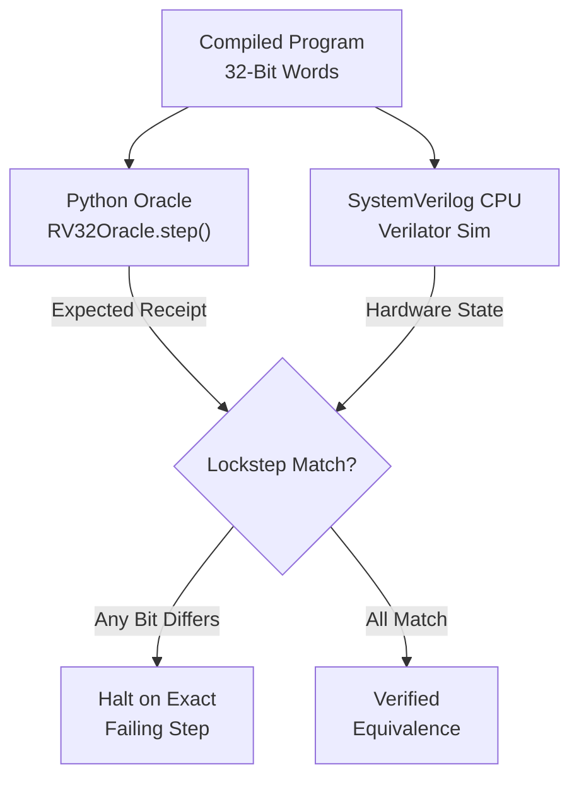
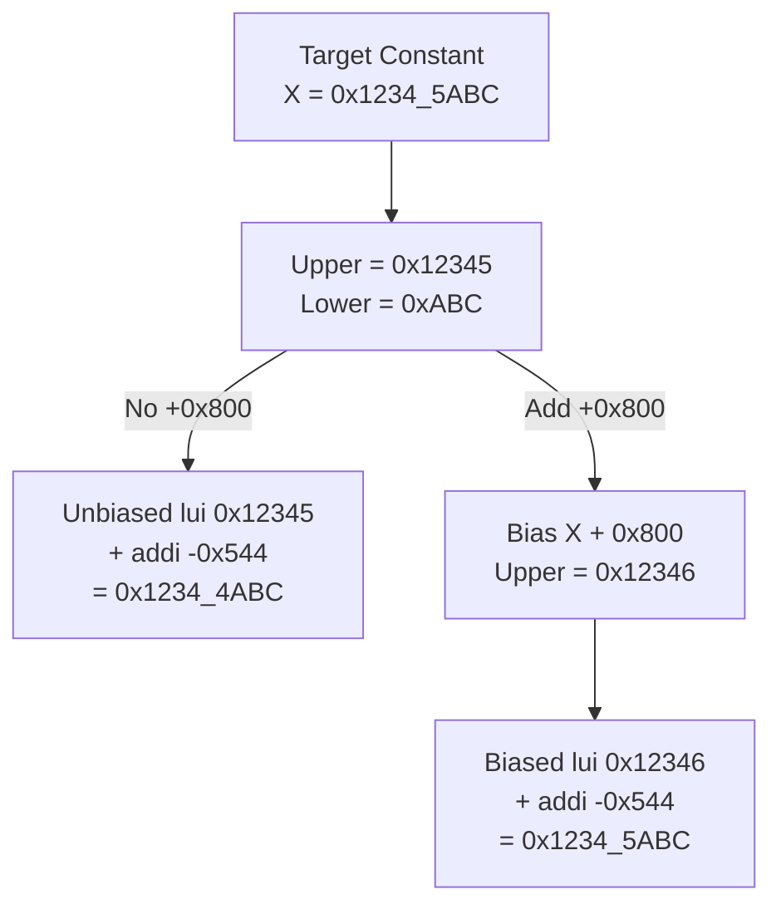
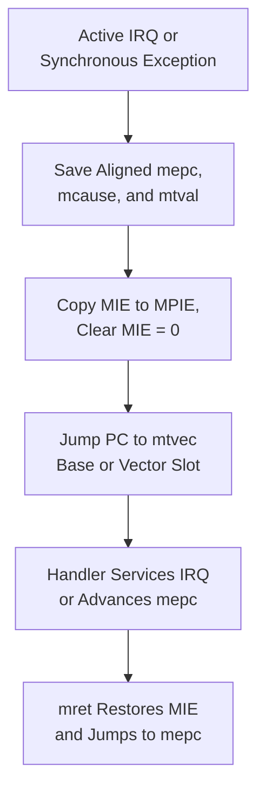

# Chapter 1: Instruction Set Architecture

Every program that runs on a robot ultimately reduces to fixed-width binary numbers moving between small hardware storage cells and memory addresses.
Before designing a single physical logic gate for the `brain` processor, we must specify the exact contract governing those binary instructions, registers, memory regions, and hardware interrupts.
In this chapter, we derive that hardware-software contract from first principles and implement it as a self-contained, executable Python specification in [`oracle.py`](../sim/oracle.py) verified by [`test_oracle.py`](../tb/test_oracle.py).

## 1. Software Golden Reference Models

When you write an ordinary program in Python or C, statements execute one after another in a single predictable sequence.
A physical processor core (**Central Processing Unit**, or CPU) is instead built in a text-based circuit specification language (**Hardware Description Language**, or HDL) such as SystemVerilog.
That hardware core consists of thousands of boolean logic gates, hardware selector switches (**multiplexers**, the circuit equivalent of `cond ? a : b`), and clocked 1-bit storage cells (**flip-flops**).
On every tick of a periodic clock signal, all of those circuits evaluate their input wires and update their stored bits at the exact same instant.
Testing a concurrent circuit design only against hand-written test scripts creates a classic engineering blind spot: whenever the circuit and its test script share a subtle misunderstanding of an arithmetic or interrupt corner case, both agree on the wrong answer.

Processor teams eliminate that blind spot before writing any circuit code by building an unambiguous sequential software specification called a **golden reference model**, or **oracle**.
[`oracle.py`](../sim/oracle.py) implements that golden 32-bit reference specification (`RV32Oracle`) for the `brain` CPU.
Before any hardware exists, unit tests in [`test_oracle.py`](../tb/test_oracle.py) verify arithmetic bounds, memory alignment rules, and timer alarms directly against the Python oracle.
Later, when our SystemVerilog CPU runs inside an open-source simulator that compiles circuit descriptions into fast C++ executables (**Verilator**), our verification harness feeds the exact same machine-code program to both engines in lockstep.
After every completed (**retired**) instruction or hardware fault, [`RV32Oracle.step()`](../sim/oracle.py#L1195-L1274) returns a structured step receipt recording updated architectural state so the harness halts on the exact step where hardware diverges.

### Instruction Set Architecture Boundaries

Every large software system relies on clean interface boundaries: a function signature tells callers what inputs a function accepts and what result it returns without exposing the temporary variables inside its body.
In computer engineering, the boundary separating software (compilers, startup programs, control loops) from physical chip hardware (logic gates, wire routing, multi-cycle arithmetic units) is the **Instruction Set Architecture**, or ISA.

An ISA defines only what machine-code programs can observe between instructions:
1. **Architectural State**: The persistent storage containers (general-purpose registers, the active instruction address, control registers, and addressable memory) whose values survive from one instruction to the next.
2. **Binary Instruction Encoding**: The exact bit positions that pack an operation selector, register indices, and small constants into a fixed-width integer word.
3. **Atomic Step Outcomes**: Given any current architectural state $S_t$, [`step`](../sim/oracle.py#L1195-L1274) deterministically computes the next state $S_{t+1} = \texttt{step}(S_t)$ through exactly one of two indivisible outcomes:
   - **Normal Retirement**: The current instruction completes cleanly, advancing the active instruction address and updating at most one destination register or memory slice.
   - **Precise Trap**: An illegal encoding, invalid memory access, or pending external/timer request aborts any partial writes of the current instruction and redirects execution to a dedicated handler address (**trap**).

Because an ISA intentionally hides internal circuit timing—such as whether integer division takes one clock tick or thirty-two clock ticks—[`oracle.py`](../sim/oracle.py) can express the complete `brain` CPU and its peripherals in clean sequential Python.
Across the sections ahead, we first complete the base integer machine step by step: fixed-width binary arithmetic in Section 2, registers and instruction encoding in Section 3, arithmetic and multiplication in Section 4, memory and peripherals in Section 5, and control flow and traps in Section 6, before adding our custom neural extension in Section 7 and proving lockstep equivalence in Section 8.

---

## 2. Fixed-Width Binary Arithmetic

In Python, evaluating `2**200` or `-5` allocates a variable-length object in memory so integers grow until system memory runs out.
Inside a physical CPU, there is no dynamic memory allocator for numbers.
A 32-bit hardware register is 32 parallel metal wires driven by 32 flip-flops, where each wire carries either a low voltage representing zero or a high voltage representing one.
Every loop counter, memory address, and sensor reading must fit inside those $2^{32} = 4{,}294{,}967{,}296$ distinct bit patterns, so arithmetic that steps past the ends of the representable range must obey a strict mathematical rule.

### Unsigned Integers and Modular Congruence

Every hardware register begins as an ordered row of $N$ binary wires $b_{N-1}, b_{N-2}, \dots, b_0 \in \{0, 1\}$ with no dedicated sign wire.
Hardware manuals label individual wire $b_i$ as Bit $i$ and a contiguous slice from $b_{\text{hi}}$ down to $b_{\text{lo}}$ as Bits $\text{hi}..\text{lo}$.
Assigning standard base-two place weights $2^0, 2^1, \dots, 2^{N-1}$ from right to left maps those wire voltages onto non-negative integers.
On a 4-bit register ($N = 4$), pattern `0011` represents $0 \cdot 8 + 0 \cdot 4 + 1 \cdot 2 + 1 \cdot 1 = 3$, pattern `1011` represents $1 \cdot 8 + 0 \cdot 4 + 1 \cdot 2 + 1 \cdot 1 = 11$, and pattern `1111` represents $8 + 4 + 2 + 1 = 15$.

Generalizing from 4 wires to any width $N \ge 1$ defines the **unsigned integer interpretation** $U_N(b)$:

$$U_N(b) = \sum_{i=0}^{N-1} b_i \cdot 2^i$$

When every wire carries zero, $U_N(b) = 0$.
When every wire carries one, let $S = \sum_{i=0}^{N-1} 2^i = 1 + 2 + \dots + 2^{N-1}$ denote their total weight.
Multiplying every term by $2$ shifts the sum to $2S = 2 + 4 + \dots + 2^N$, so subtracting $S$ cancels every interior power of two and leaves $S = 2S - S = 2^N - 1$ (for $N = 4$, $1 + 2 + 4 + 8 = 15 = 2^4 - 1$).
Therefore, $N$-bit unsigned integers span $[0, 2^N - 1]$.
For $N = 32$, [`oracle.py`](../sim/oracle.py) names that upper bound `UINT32_MAX = 0xFFFF_FFFF` ($2^{32} - 1 = 4{,}294{,}967{,}295$).

When adding two $N$-bit unsigned integers produces a true sum $x$ outside $[0, 2^N - 1]$—such as $11 + 7 = 18$ on a 4-bit adder—hardware wraps the result by **Euclidean division** (integer division with non-negative remainder).
Dividing any integer $x \in \mathbb{Z}$ (positive, zero, or negative) by a positive modulus $m$ yields a unique integer quotient $q \in \mathbb{Z}$ and a unique remainder $r$:

$$x = q \cdot m + r, \qquad 0 \le r < m$$

Setting $m = 2^N$ in base two multiplies $q$ by $2^N$, placing every bit of $q$ at wire position $N$ or higher and leaving the remainder $r = x \bmod 2^N$ in the lower $N$ wires $0$ through $N - 1$.
Because an $N$-bit register physically stops at wire $N - 1$, the carry term $q \cdot 2^N$ drops off the left end, turning $18 = 1 \cdot 16 + 2$ into remainder $2$ (`0010`).
Arithmetic that wraps every result modulo $m$ forms the **modular ring** $\mathbb{Z}_m$: a closed cycle of $m$ slots arranged like a clock face where stepping $+1$ past $m - 1$ returns to $0$.
Any two integers $a$ and $b$ differing by an integer multiple of $m$ occupy the same **residue class** on the ring, written $a \equiv b \pmod{m}$ (for instance, $18 \equiv 2 \pmod{16}$ and $-5 \equiv 11 \pmod{16}$ because $18 - 2 = 1 \cdot 16$ and $-5 - 11 = (-1) \cdot 16$).

Before applying this clock-face equivalence to signed encodings and hardware adders, let us verify why **modular congruence** passes cleanly through addition, subtraction, and multiplication for any positive modulus $m$.
For a concrete check on our 16-slot ring ($m = 16$), $19 \equiv 3 \pmod{16}$ and $14 \equiv -2 \pmod{16}$ give $19 + 14 = 33 \equiv 1 \equiv 3 + (-2) \pmod{16}$ and $19 \cdot 14 = 266 \equiv -6 \equiv 3 \cdot (-2) \pmod{16}$.
To prove this holds in general for any $x \equiv x' \pmod{m}$ and $y \equiv y' \pmod{m}$, note that $x$ and $x'$ differ by an integer multiple of $m$, as do $y$ and $y'$, so $x = x' + k_1 m$ and $y = y' + k_2 m$ for some integers $k_1, k_2 \in \mathbb{Z}$.
Adding, subtracting, or multiplying those two equations groups every multiple of $m$ cleanly:

$$\begin{aligned}
x \pm y &= (x' \pm y') + (k_1 \pm k_2)m \\
x \cdot y &= x' y' + (k_1 y' + k_2 x' + k_1 k_2 m)m
\end{aligned}$$

Because $k_1 \pm k_2$ and $k_1 y' + k_2 x' + k_1 k_2 m$ are integers, congruence modulo $m$ is preserved under addition, subtraction, and multiplication: $x \pm y \equiv x' \pm y' \pmod{m}$ and $x \cdot y \equiv x' \cdot y' \pmod{m}$ (including scaling by any fixed integer $c \cdot x \equiv c \cdot x' \pmod{m}$).

### Two's Complement Signed Integers

Robot control software also needs negative integers for joint velocity errors, signed sensor readings, and backward memory offsets, yet building separate positive and negative adder circuits would waste chip area and slow every clock cycle.
Early computers tested two negative-number encodings on fixed-width wires before converging on a representation that matches our modular clock ring directly:

| Encoding | $+5$ / $-5$ (4-Bit) | Representations of Zero | Plain Unsigned Adder Works? |
| :--- | :--- | :--- | :--- |
| **Sign-Magnitude** | `0101` / `1101` | Two (`0000` and `1000`) | No ($\texttt{0011} + \texttt{1101} = \texttt{0000}$, not $-2$) |
| **Ones' Complement** | `0101` / `1010` | Two (`0000` and `1111`) | No (must wrap top carry-out into Bit 0) |
| **Two's Complement** | `0101` / `1011` | One (`0000` only) | Yes ($\texttt{0011} + \texttt{1011} = \texttt{1110}$, which is $-2$) |

**Two's complement** eliminates both duplicate zeros and special carry wiring by reading negative numbers counter-clockwise from zero on the modular ring.
Starting at `0000` ($0$) on a 16-slot ring and stepping counter-clockwise by $1$ lands on `1111` ($15 \equiv -1 \pmod{16}$), while stepping counter-clockwise by $5$ lands on `1011` ($11 \equiv -5 \pmod{16}$).
Algebraically, two's complement keeps positive place weights $+2^0, \dots, +2^{N-2}$ on the lower $N - 1$ wires and assigns the leftmost wire (**Most Significant Bit**, or MSB, at Bit $N - 1$) a negative weight of $-2^{N-1}$.
On 4 bits, `1011` evaluates to $-1 \cdot 8 + 0 \cdot 4 + 1 \cdot 2 + 1 \cdot 1 = -5$, and adding `0011` ($+3$) in ordinary binary gives $\texttt{1011} + \texttt{0011} = \texttt{1110}$ ($-8 + 4 + 2 = -2$) with zero sign-checking logic.

The interactive 4-bit ring adder below displays all 16 clock slots simultaneously, pairing raw bit toggles with both unsigned ($0..15$) and signed ($-8..+7$) interpretations before we generalize to $N$ bits.

<ModularRingAdder />

Generalizing that negative MSB weight to any bit width $N \ge 1$ defines the **signed two's-complement interpretation** $S_N(b)$ (with empty lower sum for $N = 1$, giving $S_1(b_0) = -b_0 \in \{0, -1\}$):

$$S_N(b) = -b_{N-1} \cdot 2^{N-1} + \sum_{i=0}^{N-2} b_i \cdot 2^i$$

For $N \ge 2$, writing $L = \sum_{i=0}^{N-2} b_i 2^i \in [0, 2^{N-1} - 1]$ for the lower $N - 1$ wires partitions all $2^N$ patterns with a single all-zero encoding (`00...0`): patterns with $b_{N-1} = 0$ span $[0, 2^{N-1} - 1]$, while patterns with $b_{N-1} = 1$ evaluate to $-2^{N-1} + L$, spanning $[-2^{N-1}, -1]$ (matching $[-2^0, 2^0 - 1] = [-1, 0]$ at $N = 1$ as well).
Because zero occupies one slot in the $b_{N-1} = 0$ half, an $N$-bit signed integer covers the asymmetric interval $[-2^{N-1}, 2^{N-1} - 1]$.
For $N = 32$, [`oracle.py`](../sim/oracle.py) defines those endpoints using Python's left-shift operator (`1 << 31` computes $2^{31}$) as `INT32_MIN = -(1 << 31)` ($-2{,}147{,}483{,}648$, hex `0x8000_0000`) and `INT32_MAX = (1 << 31) - 1` ($+2{,}147{,}483{,}647$, hex `0x7FFF_FFFF`).

In Python, bitwise AND (written `val & MASK32`) with `MASK32 = 0xFFFF_FFFF` ($2^{32} - 1$) keeps only the lower 32 bits of any integer—whether positive overflow such as `0x1_0000_0002` or a negative Python integer such as -5, whose unbounded two's-complement expansion wraps modulo $2^{32}$ to `0xFFFF_FFFB` ($2^{32} - 5 = 4{,}294{,}967{,}291$).
[`u32`](../sim/oracle.py#L267-L269) implements that 32-bit modular projection in a single mask operation:

<!-- book-sync: u32 -->
<<< @/systems/brain/sim/oracle.py#L267-L269

### Negation and Shared Adder Circuits

Comparing the unsigned sum $U_N(b)$ and signed sum $S_N(b)$ on the exact same $N$-bit wire pattern explains why hardware needs only one binary adder circuit for both unsigned and signed integers.
On our 4-bit pattern `1011`, $U_4(\texttt{1011}) = 11$ and $S_4(\texttt{1011}) = -5$, which differ by $11 - (-5) = 16 = 2^4$.
Separating wire $N - 1$ from the lower $N - 1$ wires cancels every lower wire weight and proves that this $2^N$ offset holds whenever $b_{N-1} = 1$:

$$\begin{aligned}
U_N(b) - S_N(b)
&= \left(b_{N-1} 2^{N-1} + \sum_{i=0}^{N-2} b_i 2^i\right) \\
&\quad - \left(-b_{N-1} 2^{N-1} + \sum_{i=0}^{N-2} b_i 2^i\right) \\
&= 2 \cdot b_{N-1} \cdot 2^{N-1} = b_{N-1} \cdot 2^N \\
\implies\quad S_N(b) &= U_N(b) - b_{N-1} \cdot 2^N
\end{aligned}$$

Two structural consequences follow immediately from $U_N(b) - S_N(b) = b_{N-1} \cdot 2^N$.
First, because $b_{N-1} \in \{0, 1\}$, the difference $b_{N-1} \cdot 2^N$ is always an integer multiple of $2^N$, so the unsigned and signed interpretations of *every* $N$-bit pattern occupy the same residue class modulo $2^N$:

$$U_N(b) \equiv S_N(b) \pmod{2^N}$$

Second, because $U_N$ assigns distinct power-of-two weights $2^i$ across $\{0, 1\}^N$ (any two patterns differing first at highest wire $k$ have lower bits summing to at most $2^k - 1 < 2^k$), $U_N$ maps all $2^N$ bit patterns one-to-one onto $[0, 2^N - 1]$.
Consequently, any two integer expressions congruent modulo $2^N$ share the exact same Euclidean remainder $r \in [0, 2^N - 1]$ and select the exact same $N$-bit wire pattern.
Our modular congruence preservation rule now proves both hardware adder simplifications in one pass:

1. **Negation via Invert Plus One**: Let $\bar{b}_i = 1 - b_i$ denote inverting every wire of $b$ (written `~x` in C and SystemVerilog).
   On 4 bits, inverting $+5$ (`0101`) gives `1010` ($10$ unsigned, $-6$ signed), and adding $1$ gives `1011` ($11 \equiv -5 \pmod{16}$, which evaluates directly to $-5$ under $S_4$).
   We evaluate the inverted bit pattern under $U_N(\bar{b}) + 1$ because it models the physical unsigned adder wires directly while avoiding the minimum negative boundary case where exact $-S_N(\texttt{10...0}) = +2^{N-1}$ overflows $N$-bit signed range prior to wrapping:

   $$\begin{aligned}
   U_N(\bar{b}) + 1
   &= \sum_{i=0}^{N-1} (1 - b_i) 2^i + 1 \\
   &= \left(2^N - 1 - U_N(b)\right) + 1 \\
   &= 2^N - U_N(b) \equiv -S_N(b) \pmod{2^N}
   \end{aligned}$$

   Dropping $2^N \equiv 0 \pmod{2^N}$ and substituting $U_N(b) \equiv S_N(b) \pmod{2^N}$ shows $U_N(\bar{b}) + 1 \equiv -S_N(b) \pmod{2^N}$, and $S_N(\bar{b}) \equiv U_N(\bar{b}) \pmod{2^N}$ immediately transfers that same congruence to $S_N(\bar{b}) + 1$ without re-expanding the sum.
   Two boundary patterns confirm wrap-around cleanly: for $b = 0$, $U_N(\bar{b}) + 1 = 2^N$ drops its top carry-out bit modulo $2^N$ to return zero; for $S_N(b) = -2^{N-1}$ (`1000` on 4 bits, or `INT32_MIN`, hex `0x8000_0000`, on 32 bits), exact negation $+2^{N-1}$ exceeds $2^{N-1} - 1$ by $1$ and wraps modulo $2^N$ right back to $-2^{N-1}$.
   Extending this identity to two inputs explains subtraction on the same adder by inverting $B$ and driving one onto the adder's bottom carry-in wire:

   $$\begin{aligned}
   U_N(A) + U_N(\bar{B}) + 1
   &= U_N(A) + 2^N - U_N(B) \\
   &\equiv S_N(A) - S_N(B) \pmod{2^N}
   \end{aligned}$$

2. **Sign-Agnostic Addition, Subtraction, and Left Shifts**: On 4-bit patterns `1011` ($U_4 = 11, S_4 = -5$) and `1110` ($U_4 = 14, S_4 = -2$), addition wraps $\texttt{1011} + \texttt{1110} = \texttt{1001}$ ($9 \equiv -7 \pmod{16}$), subtraction wraps $\texttt{1011} - \texttt{1110} = \texttt{1101}$ ($13 \equiv -3 \pmod{16}$), and shifting `1011` left by $k = 1$ yields `0110` ($6 \equiv -10 \pmod{16}$, matching $11 \cdot 2 = 22 \equiv 6$ and $-5 \cdot 2 = -10$).
   In general, a **left shift** $a \ll k$ ($0 \le k < N$) moves each wire $a_i$ to position $i + k$, discards bits $a_{N-1} \dots a_{N-k}$ past wire $N - 1$, and feeds zero into Bits $k-1..0$.
   Substituting $U_N \equiv S_N \pmod{2^N}$ into addition/subtraction and factoring $2^N$ out of the discarded top wires proves congruence across all three operations:

   $$\begin{aligned}
   U_N(a) \pm U_N(b)
   &\equiv S_N(a) \pm S_N(b) \pmod{2^N} \\
   U_N(a \ll k)
   &= \sum_{i=0}^{N-1-k} a_i 2^{i+k} \\
   &= 2^k U_N(a) - 2^N \sum_{i=N-k}^{N-1} a_i 2^{i+k-N} \\
   &\equiv 2^k U_N(a) \equiv 2^k S_N(a) \pmod{2^N}
   \end{aligned}$$

   Since identical residues modulo $2^N$ map bijectively to the same $N$-bit register pattern, addition, subtraction, and left-shifting produce identical hardware bits whether interpreted as unsigned or signed.

### Widening Narrow Signed and Unsigned Integers

Real processors frequently pack compact constants inside 32-bit instructions or fetch narrow 8-bit bytes and 16-bit halfwords from memory into full 32-bit registers.
Widening a $k$-bit pattern ($1 \le k < M$, such as $k = 12$ to $M = 32$) raises the modulus from $2^k$ to $2^M$, where the $b_{k-1} \cdot 2^k$ gap between $U_k(b)$ and $S_k(b)$ is no longer a multiple of $2^M$ when $b_{k-1} = 1$.
For example, on 12 bits ($2^{12} = 4096$), $-5$ encodes as `0xFFB` ($4091$ unsigned, with sign wire Bit 11 equal to 1).
**Zero extension** fills upper wires Bits 31..12 with zero bits to produce `0x0000_0FFB` ($+4091$), preserving $U_{12}(b)$ while shifting $-5$ upward by $+4096$ to $+4091$, whereas **sign extension** copies Bit 11 across Bits 31..12 to produce `0xFFFF_FFFB` ($-5$ signed, $4{,}294{,}967{,}291$ unsigned).

The interactive width widener below contrasts zero extension and sign extension across 8-bit, 12-bit, and 16-bit inputs alongside the branchless Python formula in [`sign_extend`](../sim/oracle.py#L272-L279), where bitwise exclusive-OR (**XOR**, written `val ^ sign_bit`) flips any bit paired with a 1 mask bit.

<SignExtensionWidener />

To prove hardware sign extension in general for any $k \ge 1$, widen a $k$-bit two's-complement pattern $b$ by one single wire to $k + 1$ bits by copying sign bit $b_{k-1}$ into new Bit $k$.
Comparing $S_{k+1}$ against $S_k$ cancels every lower wire $i \le k - 2$ and combines the top two negative/positive powers of $2^{k-1}$:

$$\begin{aligned}
S_{k+1}(b_{k-1}, b_{k-1}, b_{k-2}, \dots, b_0)
&= -b_{k-1} 2^k + b_{k-1} 2^{k-1} + \sum_{i=0}^{k-2} b_i 2^i \\
&= -b_{k-1} 2^{k-1} + \sum_{i=0}^{k-2} b_i 2^i = S_k(b)
\end{aligned}$$

Because $-2^k + 2^{k-1} = -2^{k-1}$, repeating this single-wire copy by induction up to any target width $M \ge k$ proves $S_M(\text{extended } b) = S_k(b)$ with zero logic gates—only metal wire fan-out from Bit $k - 1$.
Adding $b_{k-1} 2^M$ to the left side via $U_M(x) = S_M(x) + x_{M-1} 2^M$ and substituting $S_k(b) = U_k(b) - b_{k-1} 2^k$ on the right gives the unsigned shift $U_M(\text{extended } b) = U_k(b) + b_{k-1}(2^M - 2^k)$.

In Python, [`sign_extend`](../sim/oracle.py#L272-L279) evaluates signed widening without an `if`/`else` branch using bitwise XOR (`val ^ sign_bit` in Python and $\oplus$ in equations, outputting 1 where two bits differ and 0 where they match), and [`s32`](../sim/oracle.py#L282-L284) specializes it to 32-bit words:

<!-- book-sync: sign_extend..s32 -->
<<< @/systems/brain/sim/oracle.py#L272-L284

For a concrete 12-bit check on `0xFFB` ($-5$, where $s = 2^{11} = \texttt{0x800} = 2{,}048$), flipping Bit 11 evaluates `(0xFFB ^ 0x800) - 0x800`, which gives `0x7FB - 0x800` ($2{,}043 - 2{,}048 = -5$).
In general, writing the masked $k$-bit unsigned integer as $\texttt{val} = b_{k-1} s + L$ where $s = 2^{k-1}$ (`sign_bit`) and $L = \sum_{i=0}^{k-2} b_i 2^i \in [0, s - 1]$ shows why `(val ^ sign_bit) - sign_bit` returns $S_k(b)$ for every width: since $L < s$, Bit $k - 1$ of $L$ is zero, so XOR with $s$ flips only Bit $k - 1$ from $b_{k-1}$ to $1 - b_{k-1}$ without touching $L$:

$$\begin{aligned}
(\texttt{val} \oplus s) - s
&= \left((1 - b_{k-1}) s + L\right) - s \\
&= -b_{k-1} s + L \\
&= -b_{k-1} 2^{k-1} + \sum_{i=0}^{k-2} b_i 2^i = S_k(b)
\end{aligned}$$

### Right Shifts and Integer Floor Division

Unlike left shifts, right shifts by $k \ge 1$ bit positions cannot recover uniqueness from congruence modulo $2^N$.
On a modular ring $\mathbb{Z}_m$, a **modular inverse** of an integer $a$ is an integer $u$ satisfying $a \cdot u \equiv 1 \pmod{m}$ so dividing by $a$ equals multiplying by $u$—for example, $3$ has modular inverse $11$ on our 16-slot ring because $3 \cdot 11 = 33 \equiv 1 \pmod{16}$.
By contrast, for $a = 2^k$ ($k \ge 1$) and $m = 2^N$, every product $2^k \cdot u$ is even whereas every integer congruent to $1$ modulo $2^N$ is odd ($1 + q \cdot 2^N$), so $2^k$ has no modular inverse modulo $2^N$ (doubling maps both $3$ and $11$ to $6 \pmod{16}$).
Consequently, the upper $k$ wires vacated at the left end during a right shift must be filled explicitly according to signedness: a **logical right shift** ($b \gg_{\text{log}} k$) inserts zeros into Bits $N-1\dots N-k$, whereas an **arithmetic right shift** ($b \gg_{\text{arith}} k$) replicates original sign wire $b_{N-1}$.

The interactive right-shift comparator below contrasts both modes across 32-bit positive and negative inputs and highlights the dropped lower wires that determine floor rounding.

<RightShiftComparator />

To see both rounding rules in action before deriving the general formula, take the 4-bit pattern `1011` ($11$ unsigned, $-5$ signed) shifted right by $k = 1$, which drops lower wire $R = 1$: a logical right shift inserts zero at Bit 3 to yield `0101` ($5 = \lfloor 11 / 2 \rfloor$), whereas an arithmetic right shift copies Bit 3 (1) to yield `1101` ($-3 = \lfloor -5 / 2 \rfloor$).
To prove why this **floor division** rule $\lfloor x / 2^k \rfloor$—rounding negative integers downward toward $-\infty$ rather than toward zero—holds for every width $N$ and shift distance $1 \le k \le N - 1$, recall that $\lfloor y \rfloor$ is the unique integer satisfying $\lfloor y \rfloor \le y < \lfloor y \rfloor + 1$.
Partition any $N$-bit register $b$ into its kept upper $(N - k)$-bit slice $H = b_{N-1}\dots b_k$ and its discarded lower $k$ bits $R = \sum_{m=0}^{k-1} b_m 2^m \in [0, 2^k - 1]$.
Splitting both $U_N(b)$ and $S_N(b)$ at index $k$ and re-indexing the upper wires by $i = j + k$ ($j = 0, \dots, N - k - 1$) factors $2^k$ out of $H$:

$$\begin{aligned}
U_N(b)
&= \left(\sum_{j=0}^{N-k-1} b_{j+k} 2^j\right) 2^k + R = U_{N-k}(H) \cdot 2^k + R \\
S_N(b)
&= \left(-b_{N-1} 2^{N-k-1} + \sum_{j=0}^{N-k-2} b_{j+k} 2^j\right) 2^k + R \\
&= S_{N-k}(H) \cdot 2^k + R
\end{aligned}$$

Zero-padding the upper $k$ wires leaves $U_N(b \gg_{\text{log}} k) = U_{N-k}(H)$, while replicating $b_{N-1}$ into Bits $N - 1\dots N - k$ sign-extends the $(N - k)$-bit pattern $H$ to $N$ bits, so our sign-extension lemma gives $S_N(b \gg_{\text{arith}} k) = S_{N-k}(H)$ directly:

$$\begin{aligned}
U_N(b) &= U_N(b \gg_{\text{log}} k) \cdot 2^k + R \\
S_N(b) &= S_N(b \gg_{\text{arith}} k) \cdot 2^k + R
\end{aligned}$$

Dividing either identity by $2^k$ yields $x / 2^k = q + R / 2^k$.
Because every discarded bit weight $+2^m$ is positive, $0 \le R < 2^k$ holds regardless of sign, placing $R / 2^k \in [0, 1)$ and forcing $q \le x / 2^k < q + 1$, which is the exact definition of $q = \lfloor x / 2^k \rfloor$.
On 32-bit $-5$ (`0xFFFF_FFFB`), shifting right by $k = 1$ drops $R = 1$: arithmetic shift computes $-5 = (-3) \cdot 2 + 1$ and yields $-3$ (rounding $-2.5$ toward $-\infty$, not $-2$), whereas logical shift zeros Bit 31 to produce `0x7FFF_FFFD` ($+2{,}147{,}483{,}645 = \lfloor (2^{32} - 5) / 2 \rfloor$).

Equally, **ordered comparisons** ($<$ and $\ge$) break congruence modulo $2^N$ because $S_N(b) = U_N(b) - b_{N-1} \cdot 2^N$ pulls every pattern with $b_{N-1} = 1$ downward by $2^N$ relative to nonnegative patterns with $b_{N-1} = 0$.
Thus when two patterns share the same MSB ($a_{N-1} = b_{N-1}$), both shift equally and preserve order, whereas comparing `1011` ($b_3 = 1$) against `0011` ($b_3 = 0$) reverses order cleanly: $U_4(\texttt{1011}) = 11 > 3 = U_4(\texttt{0011})$, yet $S_4(\texttt{1011}) = -5 < +3 = S_4(\texttt{0011})$.
The summary below distinguishes which fixed-width operations share identical hardware bits across unsigned and signed interpretations from those that diverge:

| Operation | Same Bits for Unsigned & Signed? | Algebraic Reason |
| :--- | :--- | :--- |
| **Add / Subtract** ($+$, $-$) | Yes | $U_N(b) \equiv S_N(b) \pmod{2^N}$ passes through $\pm$ |
| **Left Shift** ($\ll$) | Yes | Discards top $q \cdot 2^N$ terms; shifts factor $2^k$ on residue class |
| **Ordered Compare** ($<$, $\ge$) | No | Subtracting $b_{N-1} 2^N$ pulls $b_{N-1} = 1$ patterns below zero ($11 > 3$ versus $-5 < +3$) |
| **Widening ($k \to 32$ bits)** | No | Zero-fill preserves $U_k(b)$ while sign-bit fan-out preserves $S_k(b)$ |
| **Right Shift** ($\gg$) | No | $2^k$ lacks an inverse $\bmod 2^N$; vacated top wires must be $0$ or $b_{N-1}$ |

---

## 3. Core Registers and Instruction Encoding

With fixed-width binary arithmetic established, we can define the core processor storage initialized in [`RV32Oracle.reset()`](../sim/oracle.py#L564-L594) and organize how a 32-bit machine word encodes operations, registers, and embedded constants.
Separating core registers and instruction bit layouts from memory buses and peripheral timers keeps instruction decoding self-contained before adding external devices.

### Program Counter and Hardwired Zero Register

A CPU requires one dedicated register to remember where it is in a running program and a small scratchpad of fast working variables right next to the execution circuits.
Separating that sequential instruction pointer from working data keeps instruction fetching independent of arithmetic operands on every clock tick.
Core integer execution therefore revolves around two fast storage structures inside the CPU:
1. **Program Counter** (PC): `self.pc`, a single 32-bit register holding the memory byte address of the next instruction to fetch.
2. **General-Purpose Register File**: `self.regs`, an array of 32 fast 32-bit integer registers named `x0` through `x31` (128 bytes of storage in total).

Choosing 32 registers rather than 8 or 256 balances fast circuit access against instruction bit budget: naming one of 32 registers takes $\log_2(32) = 5$ bits, so specifying one destination register (`rd`) and two source registers consumes $3 \times 5 = 15$ bits of a 32-bit instruction word and leaves 17 bits for operation selectors and embedded constants.

In hardware, register `x0` (`rd == 0`) is not a writable storage cell initialized to zero at reset.
Instead, `x0` omits flip-flops altogether: its read wires tie permanently to zero, and any write targeting `rd == 0` is discarded at writeback, modeled in [`RV32Oracle._set_reg`](../sim/oracle.py#L894-L900):

<!-- book-sync: RV32Oracle._set_reg -->
<<< @/systems/brain/sim/oracle.py#L894-L900

Dedicating one register index permanently to zero keeps the instruction set compact without losing expressiveness.
Rather than adding separate hardware opcodes to clear, copy, or negate values, software reuses standard instructions with `x0` as a constant zero source or a safe discard destination.

### Six Functional Instruction Families

The `brain` CPU executes instructions belonging to six functional groups, each solving a core programming need in [`oracle.py`](../sim/oracle.py).
The design builds on an open hardware specification (**Reduced Instruction Set Computer, Fifth Generation**, or RISC-V), beginning with its **32-bit Base Integer** (RV32I) instruction set.
A standard math extension adds single-instruction **Integer Multiply and Divide** (RV32M, combining with RV32I as RV32IM).
System management adds **Control and Status Register Instructions** (Zicsr) to inspect configuration and interrupt state.
Finally, a custom neural extension covered in Section 7 accelerates robot motor inference.

| Group | Functional Category | Everyday Programming Role | Covered In |
| :---: | :--- | :--- | :---: |
| **1** | **Integer Arithmetic, Shifts, and Constants** | Integer math, bit masks, shifts, comparisons, and 32-bit constants | Section 4 |
| **2** | **Hardware Multiply and Divide** | Single-instruction 64-bit integer products, quotients, and remainders | Section 4 |
| **3** | **Memory Loads and Stores** | Reading and writing 8-bit, 16-bit, and 32-bit values in memory and devices | Section 5 |
| **4** | **Conditional Branches and Jumps** | Loops, `if`/`else` branches, direct calls, and function-pointer jumps | Section 6 |
| **5** | **System and Control Registers** | System calls, debugger breakpoints, interrupt masks, and cycle counters | Section 6 |
| **6** | **Custom Neural Multiply-Accumulate** | Two-lane clamped dot products for real-time robot motor control | Section 7 |

### Bitfield Layouts and Offset Reach

Before executing an operation, the CPU decoder must slice the fetched 32-bit unsigned word (`insn`) into register indices, operation selectors, and embedded constants.
In RISC-V assembly syntax, instructions list destination register `rd` first followed by source registers `rs1` and `rs2` (`add rd, rs1, rs2`), whereas instructions carrying a literal constant (**immediate**, or `imm`) replace `rs2` with that constant, as in **Add Immediate** (`addi rd, rs1, imm`).

All standard 32-bit RISC-V primary operation codes (`opcode`, Bits 6..0) end with Bits 1..0 equal to `0b11` (decimal 3), reserving the other three 2-bit endings for optional 16-bit compressed instructions.
Because the `brain` CPU implements only 32-bit instructions, every valid instruction address is a multiple of 4 bytes, enforcing 32-bit **Instruction Address Alignment** (IALIGN = 32).
Alongside `opcode`, instructions reuse two secondary sub-operation selectors—a 3-bit function code (`funct3`, Bits 14..12) and a 7-bit function code (`funct7`, Bits 31..25)—to distinguish individual operations sharing the same primary `opcode`.
Inside [`RV32Oracle.step()`](../sim/oracle.py#L1195-L1274), fixed shifts and bitmasks (`OPCODE_MASK = 0x7F`, `REG_MASK = 0x1F`, `FUNCT3_MASK = 0x7`, and `FUNCT7_MASK = 0x7F`) extract the recurring operation and register fields in parallel before dispatching on `opcode`:

<!-- book-sync: RV32Oracle.step['opcode = insn & OPCODE_MASK'..'funct7 = (insn >> 25) & FUNCT7_MASK'] -->
<<< @/systems/brain/sim/oracle.py#L1211-L1216

Every 32-bit instruction conforms to one of six standard bitfield layouts (**Register** / R-type, **Immediate** / I-type, **Store** / S-type, **Branch** / B-type, **Upper Immediate** / U-type, and **Jump** / J-type):

| Format | Primary Software Role | Registers and Selectors | Signed Constant & Byte Reach | Constant Bit Mapping Across `insn[31..0]` |
| :---: | :--- | :--- | :--- | :--- |
| **R-Type** | Register-register integer arithmetic and multiply/divide (combines `rs1` and `rs2` into `rd`) | `rs2` (24..20), `rs1` (19..15), `funct3` (14..12), `rd` (11..7), `funct7` (31..25) | None (all bits spent on selectors and registers) | None |
| **I-Type** | Immediate integer math, memory loads (`rs1 + imm`), indirect jumps | `rs1` (19..15), `funct3` (14..12), `rd` (11..7) | 12-bit signed ([-2,048, +2,047]) | Bits 11..0 $\to$ `insn[31..20]` |
| **S-Type** | Memory stores (write `rs2` to `rs1 + imm`) | `rs2` (24..20), `rs1` (19..15), `funct3` (14..12) | 12-bit signed ([-2,048, +2,047]) | Bits 11..5 $\to$ `insn[31..25]`; Bits 4..0 $\to$ `insn[11..7]` |
| **B-Type** | Conditional PC-relative branches (`pc + offset`) | `rs2` (24..20), `rs1` (19..15), `funct3` (14..12) | 13-bit even ([-4,096, +4,094] bytes, Bit 0 = 0) | Bit 12 $\to$ `insn[31]`; Bits 10..5 $\to$ `insn[30..25]`; Bits 4..1 $\to$ `insn[11..8]`; Bit 11 $\to$ `insn[7]` |
| **U-Type** | Load 20-bit upper slice (Bits 31..12) into `rd` | `rd` (11..7) | 20-bit upper payload (`imm20 << 12`) | Bits 31..12 $\to$ `insn[31..12]` |
| **J-Type** | Direct PC-relative subroutine call (`pc + offset`, save `pc + 4` in `rd`) | `rd` (11..7) | 21-bit even ([-1,048,576, +1,048,574] bytes, Bit 0 = 0) | Bit 20 $\to$ `insn[31]`; Bits 10..1 $\to$ `insn[30..21]`; Bit 11 $\to$ `insn[20]`; Bits 19..12 $\to$ `insn[19..12]` |

The wire matrix below aligns all six 32-bit RISC-V layouts across Columns 31..0 so you can filter pinned register columns, the Bit 31 sign wire, and split constant slices side by side.

<RiscvFormatMatrix />

Notice two quantitative properties embedded directly in the bitfield layout table above:
1. **Offset Reach Scaling**: An unscaled 12-bit signed immediate spans $[-2^{11}, 2^{11} - 1] = [-2{,}048, +2{,}047]$ bytes ($\approx \pm 2\text{ KB}$).
   Because even 16-bit compressed RISC-V instructions align to 2-byte boundaries, every valid branch or jump offset has Bit 0 equal to zero.
   Omitting that implicit Bit 0 doubles byte reach without spending an instruction bit: B-type encodes 12 stored bits to span $2 \times [-2^{11}, 2^{11} - 1] = [-4{,}096, +4{,}094]$ bytes ($\approx \pm 4\text{ KB}$), and J-type encodes 20 stored bits to span $2 \times [-2^{19}, 2^{19} - 1]$, or $[-1{,}048{,}576, +1{,}048{,}574]$ bytes ($\approx \pm 1\text{ MB}$).
2. **Decoder Multiplexer Wire-Sharing**: Hardware designers permuted B-type and J-type immediate bits deliberately to keep register indices (`rs1` at 19..15, `rs2` at 24..20, `rd` at 11..7) and the sign bit (Bit 31) stationary so the register file and sign-extension wires start settling immediately, shortening the **critical timing path** (the longest logic chain within one clock tick).
   Even further, B-type matches S-type on 10 of 12 stored immediate wires (`insn[30..25]` and `insn[11..8]`), repurposing only `insn[7]` from S-type Bit 0 to B-type Bit 11 while keeping the sign bit fixed at `insn[31]`.
   Similarly, J-type shares all 8 middle wires `insn[19..12]` with U-type and all 10 low wires `insn[30..21]` with I-type (matching S-type and B-type on the upper 6 of those wires, `insn[30..25]`).
   Every shared wire eliminates a multi-way multiplexer input in the immediate reconstruction circuit.

In [`oracle.py`](../sim/oracle.py), [`enc_r`](../sim/oracle.py#L322-L331), [`enc_i`](../sim/oracle.py#L334-L342), [`enc_s`](../sim/oracle.py#L345-L356), [`enc_b`](../sim/oracle.py#L359-L372), [`enc_u`](../sim/oracle.py#L375-L378), and [`enc_j`](../sim/oracle.py#L381-L392) assemble bit-exact test instructions across all six formats.
During execution, [`_decode_imm_s`](../sim/oracle.py#L400-L402), [`_decode_imm_b`](../sim/oracle.py#L405-L413), and [`_decode_imm_j`](../sim/oracle.py#L416-L424) reassemble and sign-extend those permuted slices back into signed Python integers.

---

## 4. Integer Arithmetic and Multiplication

Once the decoder slices an instruction word, integer operations flow into an arithmetic and bitwise execution circuit (**Arithmetic Logic Unit**, or ALU) built from **combinational logic**, meaning its output wires settle purely as a function of current inputs with no internal clock memory.
Before dispatching to the ALU, [`RV32Oracle.step()`](../sim/oracle.py#L1195-L1274) latches both source registers (`rs1_u, rs2_u = self.regs[rs1], self.regs[rs2]`) and derives signed views via [`s32`](../sim/oracle.py#L282-L284) (`rs1_s`, `rs2_s`).
Because source values are latched before writeback, an in-place instruction like `sub x3, x3, x3` reads the prior `x3` on both inputs and writes zero.

### Base Integer Operations and Zero Idioms

Every integer instruction set pairs two-register arithmetic (for dynamic variables) with register-immediate operations so programs can apply loop increments, bit masks, and bounds checks without spending an extra register to hold a small constant.
All base ALU operations execute cleanly in one step, routing any invalid encoding to Section 1's atomic trap handler.
In [`oracle.py`](../sim/oracle.py), [`_exec_op_imm`](../sim/oracle.py#L1024-L1056) executes register-immediate ALU instructions (`opcode` `0x13`), while [`_exec_op_reg`](../sim/oracle.py#L1084-L1116) executes register-register instructions (`opcode` `0x33`).
Whenever an instruction carries an unassigned `opcode`, `funct3`, or `funct7` pattern, execution aborts before modifying `rd` and takes an illegal-instruction trap (`CAUSE_ILLEGAL_INSN = 2`, whose full handler rules we derive in Section 6).

For shifts, any 5-bit unsigned shift count $s = 16 s_4 + 8 s_3 + 4 s_2 + 2 s_1 + s_0$ decomposes into powers of two, so hardware shifts in one pass through a five-stage cascade of multiplexers (**barrel shifter**).
Across the table below, write `op2` for the second operand (`rs2_u` in register-register instructions or sign-extended 12-bit `imm` in register-immediate instructions) and `op2_s` for its signed view `s32(op2)`.
Both register shifts and 5-bit immediate shifts (encoded as a 5-bit **shift amount**, or `shamt`, in Bits 24..20) wire only the bottom 5 bits (`op2 & 0x1F`, spanning 0..31) into those five stages, so requesting a shift by 35 evaluates `35 & 31` (3).
Notice also that `funct7` distinguishes R-type operations and immediate right-shifts, whereas non-shift I-type operations spend Bits 31..25 as the upper portion of their 12-bit signed immediate:

| Category | Register / Immediate Mnemonic | Selector (`funct3` / `funct7`) | 32-Bit Output Written to `rd` | Key Hardware Rule |
| :--- | :--- | :--- | :--- | :--- |
| **Add / Subtract** | `add`, `addi` / `sub` | 0 / `0x00` (`sub`: `0x20`, R-type) | `u32(rs1_u + op2)` / `u32(rs1_u - rs2_u)` | Shared adder; `sub` inverts `rs2_u` and sets carry-in to 1 (`addi` has no `subi`) |
| **Shift Left** | `sll`, `slli` | 1 / `0x00` | `u32(rs1_u << shamt)` | Zero-fills lower wires; `shamt` equals `op2 & 0x1F` |
| **Shift Right Logical** | `srl`, `srli` | 5 / `0x00` | `rs1_u >> shamt` | Zero-fills upper wires (unsigned floor $\lfloor U_{32}/2^k \rfloor$) |
| **Shift Right Arithmetic** | `sra`, `srai` | 5 / `0x20` | `u32(rs1_s >> shamt)` | Replicates Bit 31 (signed floor $\lfloor S_{32}/2^k \rfloor$); other `funct7` traps |
| **Set Less Than (Signed)** | `slt`, `slti` | 2 / `0x00` (R-type) | `1 if rs1_s < op2_s else 0` | Sign-extends 12-bit `imm` for `slti` before signed compare |
| **Set Less Than (Unsigned)** | `sltu`, `sltiu` | 3 / `0x00` (R-type) | `1 if rs1_u < u32(op2) else 0` | `sltiu` sign-extends 12-bit `imm` first, so immediate $-1$ tests `rs1_u != UINT32_MAX` |
| **Bitwise Gates** | `xor`/`xori`, `or`/`ori`, `and`/`andi` | 4, 6, 7 / `0x00` (R-type) | `rs1_u ^ u32(op2)`, `rs1_u \| u32(op2)`, `rs1_u & u32(op2)` | Sign-extends 12-bit `imm` first (`xori rd, rs1, -1` flips all 32 bits) |

Wiring `x0` or small constants into those base operations yields six everyday assembly pseudoinstructions without spending extra opcodes:

| Assembly Shorthand | Underlying Machine Encoding | Architectural Effect |
| :--- | :--- | :--- |
| **No Operation** (`nop`) | `addi x0, x0, 0` | Advances `self.pc` by 4 bytes and discards $0 + 0$ into `x0` |
| **Move** (`mv rd, rs1`) | `addi rd, rs1, 0` | Copies 32-bit word from `rs1` into `rd` |
| **Load Immediate** (`li rd, imm12`) | `addi rd, x0, imm12` | Loads signed 12-bit constant (-2,048..+2,047) into `rd` |
| **Bitwise Not** (`not rd, rs1`) | `xori rd, rs1, -1` | Computes one's complement (`rs1_u ^ 0xFFFF_FFFF`) using sign-extended `0xFFFF_FFFF` |
| **Negate** (`neg rd, rs1`) | `sub rd, x0, rs1` | Computes modular negation `u32(0 - rs1_u)` |
| **Set if Equal to Zero** (`seqz rd, rs1`) | `sltiu rd, rs1, 1` | Writes 1 if `rs1_u == 0` (`rs1_u < 1`), else 0 |

### Full 32-Bit Constant Construction

Because every 32-bit instruction spends at least 12 bits on `opcode` and `rd`, no single instruction can hold an arbitrary 32-bit constant inside itself.
Instead, RISC-V provides two U-type instructions that place a 20-bit immediate into Bits 31..12 of `rd` while clearing Bits 11..0 to zero: **Load Upper Immediate** (`lui`) writes `imm20 << 12`, and **Add Upper Immediate to PC** (`auipc`) writes `u32(cur_pc + (imm20 << 12))`.

Software materializes any 32-bit target constant $x$ in two instructions: `lui` loads an upper 20-bit slice into `rd`, and `addi` adds the remaining 12-bit slice modulo $2^{32}$.
Representing $x$ by its unsigned value $X = U_{32}(x) \in [0, 2^{32} - 1]$ directly matches the unsigned 20-bit upper payload loaded by `lui`.
Consider the concrete target constant $X = \texttt{0x1234\_5ABC}$, whose lower 12 bits are $\texttt{0xABC}$ (Bit 11 is 1).
Because `addi` sign-extends its 12-bit immediate from Bit 11, hardware reads $\texttt{0xABC}$ ($2748$) as negative $2748 - 4096 = -1348$ ($-\texttt{0x544}$).
Loading the unadjusted upper slice `0x1234_5000` with `lui` would make `addi` compute $\texttt{0x1234\_5000} - \texttt{0x544} = \texttt{0x1234\_4ABC}$, undershooting $X$ by $4096$ (`0x1000`).
Adding $\texttt{0x800}$ ($2^{11} = 2048$) before extracting Bits 31..12 carries $+1$ into Bit 12 whenever Bit 11 is 1, raising the `lui` payload to `0x1234_6000` so `0x1234_6000 - 0x544` lands on `0x1234_5ABC` exactly.

Applying Section 2's Euclidean division theorem directly to $X + 2^{11}$ proves this `0x800` bias for *every* 32-bit word $X \in [0, 2^{32} - 1]$.
Divide $X + 2^{11}$ by $2^{12}$ to obtain unique quotient $q$ and non-negative remainder $0 \le r' < 2^{12}$, then shift both sides back by $-2^{11}$ and set $s = r' - 2^{11}$:

$$\begin{aligned}
X + 2^{11} &= q \cdot 2^{12} + r', \qquad 0 \le r' < 2^{12} \\
\implies\quad X &= q \cdot 2^{12} + \underbrace{(r' - 2^{11})}_{s \in [-2^{11}, 2^{11} - 1]}
\end{aligned}$$

Because $s \equiv X \pmod{2^{12}}$ and $s \in [-2^{11}, 2^{11} - 1]$ fits inside a signed 12-bit two's-complement immediate, $s$ equals $S_{12}(\text{lo}_{12})$ for the lower 12-bit slice $\text{lo}_{12} = X \bmod 2^{12}$, while setting $\texttt{hi}_{\texttt{lui}} = q \bmod 2^{20} = \lfloor (X + 2^{11}) / 2^{12} \rfloor \bmod 2^{20}$ matches `u32(X + 0x800) & 0xFFFF_F000` shifted right by 12.
Multiplying $\texttt{hi}_{\texttt{lui}} \equiv q \pmod{2^{20}}$ by $2^{12}$ lifts the modulus to $2^{32}$, giving $\texttt{hi}_{\texttt{lui}} \cdot 2^{12} + S_{12}(\text{lo}_{12})$ congruent to $q \cdot 2^{12} + s = X \pmod{2^{32}}$ for all $2^{32}$ words (including $X \ge \texttt{0xFFFF\_F800}$, where $q$ wraps modulo $2^{20}$ to `0x00000` and negative `addi` wraps back onto $X$).
Pairing `auipc` with `addi`, loads, or indirect jumps using this same `0x800` bias extends PC-relative addressing from $\pm 2\text{ KB}$ across the entire $\pm 2\text{ GB}$ 32-bit address space.

### Full 64-Bit Integer Multiplication

Multiplying two 32-bit integers spans up to 64 bits across unsigned, signed, and mixed operands, yet each RV32M instruction (`opcode` `0x33`, `funct7` `0x01`) writes one 32-bit register `rd`.
RISC-V therefore pairs one shared lower-word instruction (**Multiply**, or `mul`) with three upper-word instructions (**Multiply High** `mulh`, **Multiply High Signed-Unsigned** `mulhsu`, and **Multiply High Unsigned** `mulhu`) matching every signedness combination:

| Instruction | `funct3` | Operands (`rs1`, `rs2`) | Exact 64-Bit Product Range | Returned 32-Bit Slice |
| :--- | :---: | :--- | :--- | :--- |
| **Multiply** (`mul`) | 0 | Any ($S_{32}$ or $U_{32}$) | Shares low 32 bits across all combinations | Bits 31..0 |
| **Multiply High** (`mulh`) | 1 | $S_{32} \times S_{32}$ | $[-2^{62} + 2^{31},\; 2^{62}] \subset [-2^{63}, 2^{63} - 1]$ | Bits 63..32 |
| **Multiply High Signed-Unsigned** (`mulhsu`) | 2 | $S_{32} \times U_{32}$ | $[(-2^{31})(2^{32} - 1),\; (2^{31} - 1)(2^{32} - 1)] \subset [-2^{63}, 2^{63} - 1]$ | Bits 63..32 |
| **Multiply High Unsigned** (`mulhu`) | 3 | $U_{32} \times U_{32}$ | $[0,\; (2^{32} - 1)^2] = [0,\; 2^{64} - 2^{33} + 1] \subset [0, 2^{64} - 1]$ | Bits 63..32 |

To see why hardware needs three upper-half instructions yet only one `mul` instruction, evaluate `rs1` equal to `0xFFFF_FFFF` ($-1$ signed, or $2^{32} - 1$ unsigned) and `rs2` equal to `0x8000_0000` ($-2^{31}$ signed, or $+2^{31}$ unsigned):
- **Signed by Signed**: `mulh` computes $(-1) \times (-2^{31}) = +2^{31}$ (`0x0000_0000_8000_0000`), returning `0x0000_0000` in Bits 63..32 and `0x8000_0000` in Bits 31..0.
- **Signed by Unsigned**: `mulhsu` computes $(-1) \times (+2^{31}) = -2^{31}$ (`0xFFFF_FFFF_8000_0000`), returning `0xFFFF_FFFF` in Bits 63..32 and `0x8000_0000` in Bits 31..0.
- **Unsigned by Unsigned**: `mulhu` computes $(2^{32} - 1) \times 2^{31} = 2^{63} - 2^{31}$ (`0x7FFF_FFFF_8000_0000`), returning `0x7FFF_FFFF` in Bits 63..32 and `0x8000_0000` in Bits 31..0.

The interactive multiplier below compares all three 64-bit upper halves alongside the shared lower 32 bits (`mul`) across negative and carry-generating presets before we verify the general identity.

<Product64Inspector />

Expanding every unsigned operand via $U_{32}(x) = S_{32}(x) + x_{31} \cdot 2^{32}$ expresses both mixed (`mulhsu`) and unsigned (`mulhu`) products in terms of the signed product $S_{32}(a) \cdot S_{32}(b)$, isolating every sign-correction term with a factor of $2^{32}$ so it alters only Bits 63..32:

$$\begin{aligned}
S_{32}(a) \cdot U_{32}(b)
&= S_{32}(a) \cdot \left(S_{32}(b) + b_{31} 2^{32}\right) \\
&= S_{32}(a) \cdot S_{32}(b) + 2^{32} \cdot b_{31} S_{32}(a) \\
U_{32}(a) \cdot U_{32}(b)
&= \left(S_{32}(a) + a_{31} 2^{32}\right)\!\left(S_{32}(b) + b_{31} 2^{32}\right) \\
&= S_{32}(a) \cdot S_{32}(b) \\
&\quad + 2^{32}\!\left(a_{31} S_{32}(b) + b_{31} S_{32}(a) + a_{31} b_{31} 2^{32}\right)
\end{aligned}$$

Modulo $2^{32}$, every factor of $2^{32}$ vanishes, proving why `mul` returns the identical lower 32 bits across every signedness combination.
To verify Bits 63..32 in Python, write any exact 64-bit product as $P = H \cdot 2^{32} + L$ with low remainder $L \in [0, 2^{32} - 1]$ and upper slice $H$.
Because Python integers do not overflow, evaluating `(rs1_s * rs2_s) >> 32` or `(rs1_s * rs2_u) >> 32` yields $\lfloor P / 2^{32} \rfloor = \lfloor H + L / 2^{32} \rfloor = H$ even when $P < 0$, and [`_set_reg`](../sim/oracle.py#L894-L900) applies `u32` at writeback to return the exact 32-bit Bits 63..32 pattern.

### Truncating Integer Division Semantics

RV32M completes integer arithmetic with signed **Divide** (`div`) and **Divide Unsigned** (`divu`), paired with signed **Remainder** (`rem`) and **Remainder Unsigned** (`remu`).
Python's integer operators (`a // b` and `a % b`) use floor division ($\lfloor a / b \rfloor$), rounding negative quotients downward toward $-\infty$ (`-7 // 3 == -3` with remainder $+2$), whereas C, SystemVerilog, and RISC-V define **truncating division** toward zero (yielding quotient $-2$ and remainder $-1$ for $-7 / 3$, contrasting also with Section 2's `srai` which floors `-5 >> 1 == -3`):

$$q = \operatorname{sgn}(a)\operatorname{sgn}(b) \left\lfloor \frac{|a|}{|b|} \right\rfloor, \qquad r = a - q b$$

The number-line comparator below contrasts RISC-V truncation toward zero in [`trunc_div_s32`](../sim/oracle.py#L301-L309) against Python floor division and displays all hardware corner-case outputs.

<TruncatingDivisionComparator />

Applying Euclidean division to magnitudes $|a| = k |b| + r_0$ with $k = \lfloor |a| / |b| \rfloor$ and $0 \le r_0 < |b|$, then multiplying through by $\operatorname{sgn}(a)$ (noting $\operatorname{sgn}(a) k |b| = q b$), yields $a = q b + \operatorname{sgn}(a) r_0$.
Therefore remainder $r = \operatorname{sgn}(a) r_0$ satisfies $|r| = r_0 < |b|$ and matches the sign of dividend `rs1_s` whenever $r \neq 0$ (or zero when $r_0 = 0$).

Rather than raising a hardware fault on division by zero (`rs2 == 0`) or signed division overflow, RISC-V defines deterministic sentinel outputs so divider circuits never need trap-abort wiring; software inserts an explicit branch check before `div` only when a language runtime requires an exception.
Bounding quotient magnitude $|q| = \lfloor |a| / |b| \rfloor$ directly from our truncating formula across all signed 32-bit operands proves why `INT32_MIN` divided by -1 is the unique overflow pair:
- Whenever $|b| \ge 2$, $|q| \le \lfloor 2^{31} / 2 \rfloor = 2^{30} \le \texttt{INT32\_MAX}$.
- When $b = +1$, $q = a \in [\texttt{INT32\_MIN}, \texttt{INT32\_MAX}]$ fits cleanly, and when $b = -1$ with $a > -2^{31}$, $|q| = |a| \le 2^{31} - 1 = \texttt{INT32\_MAX}$.
- Only $a = -2^{31}$ (`INT32_MIN`) divided by $b = -1$ yields mathematical quotient $+2^{31} = \texttt{INT32\_MAX} + 1$, overflowing signed 32-bit range by $1$ and wrapping to `INT32_MIN`.

Inside [`oracle.py`](../sim/oracle.py), [`trunc_div_s32`](../sim/oracle.py#L301-L309) and [`RV32Oracle._exec_muldiv`](../sim/oracle.py#L1058-L1082) dispatch on 3-bit `funct3` selectors (`F3_DIV = 4`, `F3_DIVU = 5`, `F3_REM = 6`, `F3_REMU = 7`):

<!-- book-sync: trunc_div_s32 -->
<<< @/systems/brain/sim/oracle.py#L301-L309

<!-- book-sync: RV32Oracle._exec_muldiv['elif funct3 == F3_DIV:'..'res = rs1_u if rs2_u == 0'] -->
<<< @/systems/brain/sim/oracle.py#L1069-L1081

| Instruction | Operand Interpretation | Divide by Zero (`rs2 == 0`) | Signed Overflow (`INT32_MIN` by -1) | Standard Rule |
| :--- | :--- | :--- | :--- | :--- |
| **`div`** | Signed quotient of `rs1_s` by `rs2_s` | $-1$ (`0xFFFF_FFFF`) | `INT32_MIN` (`0x8000_0000`) | Truncate quotient magnitude toward 0 |
| **`divu`** | Unsigned quotient of `rs1_u` by `rs2_u` | `0xFFFF_FFFF` (`UINT32_MAX`) | Not applicable | Unsigned quotient `rs1_u // rs2_u` |
| **`rem`** | Signed remainder of `rs1_s` by `rs2_s` | `rs1_s` (original dividend) | 0 | Remainder sign matches `rs1_s` when non-zero |
| **`remu`** | Unsigned remainder of `rs1_u` by `rs2_u` | `rs1_u` (original dividend) | Not applicable | Unsigned remainder `rs1_u % rs2_u` |

---

## 5. Memory Map and Bus Peripherals

General-purpose registers hold only 32 words at a time, so programs rely on addressable memory to hold machine code, neural weights, call stacks, and hardware device registers.
Every memory access transfers one of three standard widths: an 8-bit **byte** (1 byte), a 16-bit **halfword** (2 bytes), or a 32-bit **word** (4 bytes).

### Address Decoding and Memory Regions

Real programs store arrays, nested data structures, and function call stacks at contiguous offsets relative to a base address held in a register (such as stack pointer `x2` or a struct pointer).
Rather than forcing firmware to compute explicit `add` instructions before every single read or write, RISC-V load and store instructions add a sign-extended 12-bit constant offset directly to base register `rs1` (`offset(rs1)`), reaching $\pm 2\text{ KB}$ around any pointer in one instruction.
Six memory instructions pair those base-plus-offset addresses with the three transfer widths and signed/unsigned extension rules:

| Mnemonic | Direction & Width | `funct3` | Required Alignment | Register / Bus Extension Rule |
| :--- | :--- | :---: | :--- | :--- |
| **`lb`** / **`lbu`** | Load 1 byte | 0 / 4 | Any byte address | Sign-extends (`lb`) or zero-extends (`lbu`) Bits 7..0 to 32 bits |
| **`lh`** / **`lhu`** | Load 2 bytes | 1 / 5 | Even (`(addr & 1) == 0`) | Sign-extends (`lh`) or zero-extends (`lhu`) Bits 15..0 to 32 bits |
| **`lw`** | Load 4 bytes | 2 | 4-byte (`(addr & 3) == 0`) | Copies full 32-bit little-endian word into `rd` |
| **`sb`** | Store 1 byte | 0 | Any byte address | Writes low 8 bits (`rs2 & 0xFF`) to memory |
| **`sh`** | Store 2 bytes | 1 | Even (`(addr & 1) == 0`) | Writes low 16 bits (`rs2 & 0xFFFF`) to memory |
| **`sw`** | Store 4 bytes | 2 | 4-byte (`(addr & 3) == 0`) | Writes full 32-bit word `rs2` to memory |

Rather than adding separate input/output opcodes for timers or serial ports, peripheral controllers wire their configuration registers onto fixed address ranges of the shared hardware **bus** (the address, data, and control wires linking the CPU to memory), a design called **Memory-Mapped Input/Output** (MMIO).
Combining the CPU core, local memory arrays, and MMIO peripherals inside one integrated hardware design creates a complete **System-on-Chip** (SoC).
On our `brain` SoC, four memory regions and seven 64 KB peripheral windows partition the 32-bit byte address space (`0x0000_0000` through `0xFFFF_FFFF`).
Startup instructions reside in permanent **Read-Only Memory** (ROM), while fast inner-loop neural weights live in single-cycle internal scratchpad memory called **Block Random-Access Memory** (BRAM).
Larger program images reside in a soldered-on external persistent storage chip (**Quad Serial Peripheral Interface**, or QSPI, flash) allowing direct **Execute-In-Place** (XIP) instruction fetches without copying code into BRAM.
High-capacity external **Synchronous Dynamic Random-Access Memory** (SDRAM) supplies 32 MB for larger heaps and telemetry logs:

| Region | Byte Address Range | Capacity ($2^K$) | Access Rule | Hardware Role |
| :--- | :--- | :--- | :--- | :--- |
| **Boot ROM** | `0x0000_0000`–`0x0000_3FFF` | 16 KB ($2^{14}$) | Read-Only | Permanent startup ROM (`BOOT_ROM_BASE`) |
| **BRAM** | `0x1000_0000`–`0x1000_FFFF` | 64 KB ($2^{16}$) | Read / Write | Single-cycle internal BRAM (`BRAM_BASE`) for stack and weights |
| **QSPI Flash** | `0x2000_0000`–`0x20FF_FFFF` | 16 MB ($2^{24}$) | Read-Only | External 4-wire XIP flash (`QSPI_BASE`) |
| **SDRAM** | `0x4000_0000`–`0x41FF_FFFF` | 32 MB ($2^{25}$) | Read / Write | External dynamic working memory (`SDRAM_BASE`) for heap and logs |
| **CLINT** | `0x8000_0000`–`0x8000_FFFF` | 64 KB ($2^{16}$) | 32-bit MMIO | 64-bit monotonic timer and alarm unit (**Core-Local Interruptor**, or CLINT) |
| **UART0** | `0x8001_0000`–`0x8001_FFFF` | 64 KB ($2^{16}$) | 8/32-bit MMIO | Two-wire serial console (**Universal Asynchronous Receiver-Transmitter**, or UART) |
| **MMIO Stubs** | `0x8002_0000`–`0x8006_FFFF` | $5 \times 64$ KB | Read / Write | Reserved windows for sensor serial links, dual differential motor buses, camera trigger sync, and general-purpose digital pins (`MMIO_STUB_BASE`) |

Every SoC memory window above chooses a power-of-two capacity $2^K$ aligned to a base address $B = m \cdot 2^K$ so address decoding needs zero subtractions or magnitude comparators.
For example, BRAM ($K = 16$, $B = \texttt{0x1000\_0000}$) decodes any incoming address using only a 16-bit prefix check `(addr >> 16) == 0x1000` while wiring the low 16 bits directly as the offset inside BRAM.
To see why this holds in general, write any 32-bit address $a \in [0, 2^{32} - 1]$ via Euclidean division by $2^K$ as $a = q \cdot 2^K + r$ ($0 \le r < 2^K$), where the upper $32 - K$ wires (Bits 31..K) hold quotient $q = \lfloor a / 2^K \rfloor$ and the lower $K$ wires (Bits $(K - 1)..0$) hold offset $r$:

$$\begin{aligned}
B \le a < B + 2^K
&\iff m \cdot 2^K \le q \cdot 2^K + r < (m + 1) \cdot 2^K \\
&\iff \left\lfloor \frac{a}{2^K} \right\rfloor = m
\end{aligned}$$

Because $B$ is an exact multiple of $2^K$, a full range test $B \le a < B + 2^K$—which would otherwise require two 32-bit magnitude comparators and a 32-bit subtractor—collapses into a single $(32 - K)$-bit prefix equality check `(addr >> K) == (B >> K)`.

To inspect and drive memory from Python tests, [`RV32Oracle`](../sim/oracle.py#L529-L1292) provides [`load_bytes`](../sim/oracle.py#L606-L613) and [`load_words`](../sim/oracle.py#L615-L622) (populating read-only code regions with `bypass_ro=True` while rejecting MMIO windows), alongside [`push_uart_rx`](../sim/oracle.py#L624-L628) and [`read_uart_tx`](../sim/oracle.py#L630-L635) for serial buffers.
Calling [`reset`](../sim/oracle.py#L564-L594) clears CPU registers and queues while keeping loaded program bytes intact, whereas any invalid CPU access triggers [`MemoryAccessFault`](../sim/oracle.py#L430-L431) inside [`bus_read`](../sim/oracle.py#L714-L727) or [`bus_write`](../sim/oracle.py#L729-L746) to raise a load or store access-fault trap.

### Natural Alignment and Little-Endian Storage

Physical 32-bit memory buses wire four byte lanes across aligned 4-byte rows, so reading a 4-byte word split across two rows would require two bus transfers and extra byte-steering multiplexers.
Our CPU instead enforces **natural alignment**: instruction fetches and word accesses (`lw`, `sw`) require addresses divisible by 4, while halfword accesses (`lh`, `lhu`, `sh`) require even addresses divisible by 2.
For any access width $w = 2^k$ ($k \in \{0, 1, 2\}$), Euclidean division writes $\texttt{addr} = q \cdot 2^k + r$ ($0 \le r < 2^k$) with remainder $r = \texttt{addr} \mathbin{\&} (w - 1)$ in the low $k$ wires:

$$\texttt{addr} \equiv 0 \pmod{2^k} \iff \texttt{addr} \mathbin{\&} (w - 1) = 0$$

Inside [`RV32Oracle._exec_load`](../sim/oracle.py#L974-L1001) and [`RV32Oracle._exec_store`](../sim/oracle.py#L1003-L1022), hardware checks `(addr & (width - 1)) != 0` before calling [`bus_read`](../sim/oracle.py#L714-L727) or [`bus_write`](../sim/oracle.py#L729-L746).
That check guarantees an unaligned pointer into unmapped memory deterministically reports a misaligned trap (`CAUSE_LOAD_MISALIGNED = 4` or `CAUSE_STORE_MISALIGNED = 6`) ahead of an access fault (`CAUSE_LOAD_ACCESS_FAULT = 5` or `CAUSE_STORE_ACCESS_FAULT = 7`).

All memory regions store multi-byte integers in **little-endian byte order**, placing Bits 7..0 at the lowest byte address and successively higher bytes at increasing addresses (`0x1122_80FF` at `0x1000_0000` stores `0xFF`, `0x80`, `0x22`, `0x11`).
For any width $w \in \{1, 2, 4\}$, reassembling those $w$ bytes gives $\texttt{val} = \sum_{i=0}^{w-1} \texttt{mem}[\texttt{addr} + i] \cdot 2^{8i}$.
Because SDRAM (32 MB) and QSPI flash (16 MB) span 48 MB combined, [`SparseMemory`](../sim/oracle.py#L434-L480) allocates 4,096-byte chunks lazily in [`_get_or_alloc_page`](../sim/oracle.py#L450-L456) on [`write_bytes`](../sim/oracle.py#L471-L480) and returns zero for untouched chunks in [`read_bytes`](../sim/oracle.py#L458-L469):

<!-- book-sync: SparseMemory.read_bytes -->
<<< @/systems/brain/sim/oracle.py#L458-L469

### Monotonic Timer and Serial Console

Autonomous control firmware relies on CLINT for deterministic timing and UART0 for diagnostic byte streams (**First-In, First-Out** queues, or FIFOs).
Because serial lines transmit bytes asynchronously without a shared clock wire, both endpoints agree on a common serial bit rate (**baud**) governed by a clock divider register.
Inside [`oracle.py`](../sim/oracle.py), [`_clint_offset`](../sim/oracle.py#L644-L649), [`_clint_read`](../sim/oracle.py#L651-L662), and [`_clint_write`](../sim/oracle.py#L664-L675) enforce 4-byte aligned 32-bit-only access across CLINT's four registers.
Serial register validation in [`_uart_offset`](../sim/oracle.py#L681-L689), [`_uart_read`](../sim/oracle.py#L691-L701), and [`_uart_write`](../sim/oracle.py#L703-L712) permits 1- or 4-byte transfers on byte streams while enforcing 4-byte width on status and baud-divider words:

| Peripheral | Offset | Register Constant | Valid Widths | Read Behavior | Write Behavior | Reset Default |
| :--- | :---: | :--- | :---: | :--- | :--- | :--- |
| **CLINT** | `0x00` | `CLINT_MTIME_LO` | 4-byte only | Returns `mtime` Bits 31..0 | Updates low 32 bits (`_set_u64_lo`) | 0 |
| **CLINT** | `0x04` | `CLINT_MTIME_HI` | 4-byte only | Returns `mtime` Bits 63..32 | Updates high 32 bits (`_set_u64_hi`) | 0 |
| **CLINT** | `0x08` | `CLINT_MTIMECMP_LO` | 4-byte only | Returns `mtimecmp` Bits 31..0 | Updates low 32 bits (`_set_u64_lo`) | `0xFFFF_FFFF` |
| **CLINT** | `0x0C` | `CLINT_MTIMECMP_HI` | 4-byte only | Returns `mtimecmp` Bits 63..32 | Updates high 32 bits (`_set_u64_hi`) | `0xFFFF_FFFF` |
| **UART0** | `0x00` | `UART0_TXDATA` | 1- or 4-byte | Returns 0 (write-only) | Appends `val & 0xFF` to transmit (TX) queue `uart_tx_buf` | Empty |
| **UART0** | `0x04` | `UART0_RXDATA` | 1- or 4-byte | Pops oldest byte from `uart_rx_fifo` (0 if empty) | Ignored | Empty |
| **UART0** | `0x08` | `UART0_STATUS` | 4-byte only | Returns `0x03 \| rx_flag` where `rx_flag` equals `UART0_STATUS_RX_VALID` (`0x04`) when `uart_rx_fifo` is non-empty (Bits 1..0 keep transmitter ready/empty asserted; Bit 2 signals an unread received serial byte) | Ignored | `0x03` |
| **UART0** | `0x0C` | `UART0_BAUDDIV` | 4-byte only | Returns divider ticks per serial bit | Sets `max(1, u32(val))` (prevents divide-by-0) | 434 (115,200 baud default, derived below) |

Three quantitative hardware invariants explain the CLINT and UART0 design choices in [`oracle.py`](../sim/oracle.py):
1. **64-Bit Counter Lifetime and Rollover Tearing**: On the `brain` board, a 50 MHz crystal oscillator (`SYS_CLK_HZ = 50_000_000`) ticks 50 million times per second.
   A 32-bit counter wraps every $2^{32} / 50{,}000{,}000 \approx 85.9$ seconds, whereas a 64-bit counter runs for $2^{64} / (50 \times 10^6 \times 86{,}400 \times 365.25) \approx 11{,}691$ years without rolling over (`mtimecmp` resets to `UINT64_MAX`, `0xFFFF_FFFF_FFFF_FFFF`, so alarms never fire prematurely).
   Reading 64-bit `mtime` over a 32-bit bus creates a classic **rollover tear hazard**: if firmware executes `lw` on `CLINT_MTIME_LO` when `mtime` equals `0x0000_0000_FFFF_FFFF` (`0xFFFF_FFFF`) and `mtime` increments to `0x0000_0001_0000_0000` before `lw` reads `CLINT_MTIME_HI` (`0x0000_0001`), the combined pair `0x0000_0001_FFFF_FFFF` overshoots post-tick true time (`0x0000_0001_0000_0000`) by $+2^{32} - 1$ ticks (about 85.9 seconds)!
   Firmware eliminates tearing with a 3-instruction **tear-free retry loop**: read `hi1` from `CLINT_MTIME_HI`, `lo` from `CLINT_MTIME_LO`, and `hi2` from `CLINT_MTIME_HI`, looping while `hi1 != hi2`.
   When `hi1 == hi2`, no carry propagated between the two `CLINT_MTIME_HI` reads, guaranteeing `(hi1, lo)` is an exact snapshot.
2. **Glitch-Free 3-Store Alarm Updates**: Writing a new 64-bit threshold $T_{\text{new}} > \texttt{mtime}$ to `mtimecmp` across two 32-bit stores faces the symmetric hazard: updating `CLINT_MTIMECMP_LO` first when `new_lo < old_lo` (with `new_hi > old_hi`) passes through intermediate threshold `(old_hi << 32) | new_lo < mtime`, triggering a spurious interrupt!
   Whenever both prior threshold $T_{\text{old}}$ and new threshold $T_{\text{new}}$ strictly exceed `mtime`, writing `0xFFFF_FFFF` to `CLINT_MTIMECMP_LO` first creates intermediate threshold $T_1 = (\texttt{old\_hi} \ll 32) \mid \texttt{0xFFFF\_FFFF}$, which satisfies $T_1 \ge T_{\text{old}} > \texttt{mtime}$.
   Writing `new_hi` to `CLINT_MTIMECMP_HI` second installs $T_2 = (\texttt{new\_hi} \ll 32) \mid \texttt{0xFFFF\_FFFF}$, which satisfies $T_2 \ge T_{\text{new}} > \texttt{mtime}$, and writing `new_lo` to `CLINT_MTIMECMP_LO` third installs $T_{\text{new}}$ cleanly—guaranteeing no spurious interrupt whether `new_hi` increases, decreases, or equals `old_hi`.
3. **UART Baud Quantization Drift**: At `SYS_CLK_HZ = 50_000_000` and $115{,}200$ baud, exact ticks per serial bit equals $50{,}000{,}000 / 115{,}200 \approx 434.0278$.
   Rounding to default integer divider `self.uart_bauddiv` (434, stored in `UART0_BAUDDIV`) introduces per-bit relative timing error:

   $$\epsilon = \frac{434 - 434.0278}{434.0278} = -0.0064\%$$

   Across a 10-bit serial frame (1 start bit, 8 data bits, 1 stop bit), cumulative phase drift reaches only $10|\epsilon| = 0.064\%$—nearly three orders of magnitude inside the $\pm 50\%$ half-bit sampling window.

---

## 6. Control Flow and Trap Handling

In straight-line execution, `self.pc` advances by 4 bytes after every 32-bit instruction.
Execution departs from sequential `pc + 4` flow in two ways: explicit control-flow instructions (conditional branches and subroutine jumps) and **traps**, which split into **synchronous exceptions** (deterministic faults or firmware calls caused by the active instruction) and **asynchronous interrupts** (external or timer **Interrupt Requests**, or IRQs, that preempt execution between instructions).

### Conditional Branches and Subroutine Jumps

Every non-trivial robot controller needs conditional `if`/`else` choices, counting loops, direct subroutine calls, and jump tables through function pointers.
RISC-V separates those two departures from `pc + 4` cleanly: six conditional B-type branches compare two registers and jump when the relation holds, while two unconditional jump instructions save return **link address** `cur_pc + 4` in `rd` so subroutines can return cleanly.
In [`oracle.py`](../sim/oracle.py), [`RV32Oracle._exec_branch`](../sim/oracle.py#L951-L972) handles conditional branches (`opcode` `0x63`), [`_exec_jal`](../sim/oracle.py#L930-L936) (`opcode` `0x6F`) handles direct jumps, and [`_exec_jalr`](../sim/oracle.py#L938-L949) (`opcode` `0x67`) handles indirect jumps:

| Mnemonic | Format / `funct3` | Branch / Jump Condition and Target | Link Writeback and Alignment Rule |
| :--- | :--- | :--- | :--- |
| **Branch if Equal** (`beq`) | B-type / 0 | Jump to `u32(cur_pc + imm13)` if `rs1_u == rs2_u` | Traps with `CAUSE_INSN_MISALIGNED` if taken and `(target & 3) != 0` |
| **Branch if Not Equal** (`bne`) | B-type / 1 | Jump to `u32(cur_pc + imm13)` if `rs1_u != rs2_u` | Untaken branches advance to `cur_pc + 4` without checking target alignment |
| **Branch if Less Than** (`blt`) | B-type / 4 | Jump to `u32(cur_pc + imm13)` if `rs1_s < rs2_s` | Signed 32-bit comparison; alignment checked only if taken |
| **Branch Greater or Equal** (`bge`) | B-type / 5 | Jump to `u32(cur_pc + imm13)` if `rs1_s >= rs2_s` | Signed 32-bit comparison; alignment checked only if taken |
| **Branch Less Than Unsigned** (`bltu`) | B-type / 6 | Jump to `u32(cur_pc + imm13)` if `rs1_u < rs2_u` | Unsigned 32-bit comparison; alignment checked only if taken |
| **Branch Greater or Equal Unsigned** (`bgeu`) | B-type / 7 | Jump to `u32(cur_pc + imm13)` if `rs1_u >= rs2_u` | Unsigned 32-bit comparison; alignment checked only if taken |
| **Jump and Link** (`jal`) | J-type / none | Unconditional `u32(cur_pc + imm21)` | Saves `cur_pc + 4` to `rd`; traps before writeback if `(target & 3) != 0` |
| **Jump and Link Register** (`jalr`) | I-type / 0 | `(rs1_u + imm12) & JALR_TARGET_MASK` (`0xFFFF_FFFE`) | Sign-extends `imm12`, clears Bit 0 first, checks `(target & 3) != 0`, and latches `rs1_u` before saving `cur_pc + 4` |

Wiring `x0` into `beq`, `jal`, and `jalr` provides standard control pseudoinstructions without extra opcodes, while swapping `rs1` and `rs2` in the six B-type branches covers all ten signed and unsigned relational comparisons:

| Pseudoinstruction | Machine Encoding | Algebraic / Control Equivalence |
| :--- | :--- | :--- |
| **Branch if Equal to Zero** (`beqz rs1, off`) | `beq rs1, x0, off` | Branches when `rs1 == 0` |
| **Branch if Greater Than** (`bgt rs1, rs2, off`) | `blt rs2, rs1, off` | Commutes operands: $a > b \iff b < a$ |
| **Branch if Less or Equal** (`ble rs1, rs2, off`) | `bge rs2, rs1, off` | Commutes operands: $a \le b \iff b \ge a$ |
| **Unconditional Jump** (`j off`) | `jal x0, off` | Unconditional jump discarding return link into `x0` |
| **Return from Subroutine** (`ret`) | `jalr x0, 0(x1)` | Returns to link register `x1` without saving a new link |

Why do six branch opcodes suffice for all ten comparisons ($=$, $\neq$, $<$, $\ge$, $>$, $\le$ across signed and unsigned)?
Because integer ordering is total, logical negation flips $<$ into $\ge$ ($\neg(a < b) \iff a \ge b$) using one 1-bit inverter wire on the comparator output, while operand commutation flips $<$ and $\ge$ into $>$ and $\le$ ($a > b \iff b < a$ and $a \le b \iff b \ge a$) by swapping `rs1` and `rs2` in software at zero hardware cost.

### Control and Status Registers

To configure interrupt masks, trap vector addresses, and cycle counters without consuming `x0`–`x31`, the Zicsr extension defines a 12-bit address space (`0x000`–`0xFFF`, 4,096 slots) of 32-bit Control and Status Registers (CSRs) local to each processor core (**hardware thread**, or **hart**).
Our single-core CPU runs permanently in **Machine privilege mode** (M-mode, binary `0b11`), the highest RISC-V privilege level with direct access to physical memory and control registers.
Inside the status register (`mstatus`), the global **Machine Interrupt Enable** (MIE, Bit 3) switch gates all interrupts.
Across every trap entry and return, hardware preserves prior state in **Machine Previous Interrupt Enable** (MPIE, Bit 7) and fixed **Machine Previous Privilege** (MPP, Bits 12..11 equal to `0b11`).
Most writable CSR fields follow **Write Any Values, Reads Legal Values** (WARL), silently masking unsupported bits rather than faulting, whereas writes to read-only identification registers raise `CAUSE_ILLEGAL_INSN` in [`_write_csr`](../sim/oracle.py#L808-L859) (and read in [`_read_csr`](../sim/oracle.py#L776-L806)).
In particular, the read-only **Machine ISA** register (`misa`) returns `0x4080_1100`: Bits 31..30 equal `0b01` for 32-bit width, Bit 8 encodes base integer extension I, Bit 12 encodes multiply/divide extension M, and Bit 23 encodes custom extensions X (detailed in Section 7):

| CSR Address | Register | Access and WARL Masking | Architectural Role |
| :---: | :--- | :--- | :--- |
| `0x300` | `mstatus` | WARL: MIE (Bit 3) and MPIE (Bit 7) writable; MPP (Bits 12..11) fixed `0b11` | **Machine Status**: global interrupt switch and saved trap state |
| `0x301` | `misa` | Read-Only `0x4080_1100`; writes trap | **Machine ISA**: reports 32-bit base plus I (integer), M (multiply/divide), and X (custom) extensions |
| `0x304` | `mie` | WARL: Software (Bit 3), Timer (Bit 7), and External (Bit 11) writable | **Machine Interrupt Enable**: per-channel IRQ masks |
| `0x305` | `mtvec` | WARL: Bits 31..2 base; Bits 1..0 snaps modes $> 1$ to 0 | **Machine Trap Vector**: handler base and dispatch mode (0 Direct, 1 Vectored) |
| `0x340` | `mscratch` | Full 32-bit Read / Write | **Machine Scratch**: dedicated word for trap handlers to swap a stack pointer |
| `0x341` | `mepc` | WARL: clears Bits 1..0 (`val & 0xFFFF_FFFC`) | **Machine Exception PC**: saved resume address across traps |
| `0x342` | `mcause` | Full 32-bit Read / Write | **Machine Trap Cause**: Bit 31 (1 IRQ / 0 exception) + cause code |
| `0x343` | `mtval` | Full 32-bit Read / Write | **Machine Trap Value**: offending address or raw instruction word |
| `0x344` | `mip` | Software (Bit 3) and External (Bit 11) writable; Timer (Bit 7) live wire | **Machine Interrupt Pending**: software/external latches and `mtime >= mtimecmp` |
| `0xB00` / `0xB80` | `mcycle` / `mcycleh` | Full 64-bit Read / Write | **Machine Cycle Counter**: increments on every step (instructions and traps) |
| `0xB02` / `0xB82` | `minstret` / `minstreth` | Full 64-bit Read / Write | **Machine Instructions Retired**: counts completed non-trapping instructions |
| `0xF11`–`0xF14` | `mvendorid`, `marchid`, `mimpid`, `mhartid` | Read-Only zero; writes trap | Static vendor, architecture, implementation, and core (0) IDs |

Notice how `mie` and **Machine Interrupt Pending** (`mip`) align every interrupt source onto the exact same bit column so hardware evaluates all enabled requests in one bitwise AND (`self._live_mip() & self.mie`):

| Interrupt Channel | Bit Index | `mie` Mask Bit | `mip` Pending Bit | Trigger Source |
| :--- | :---: | :--- | :--- | :--- |
| **Software** | Bit 3 | **MSIE** (Machine Software Interrupt Enable) | **MSIP** (Machine Software Interrupt Pending) | Software write to `mip` Bit 3 |
| **Timer** | Bit 7 | **MTIE** (Machine Timer Interrupt Enable) | **MTIP** (Machine Timer Interrupt Pending) | Live wire `mtime >= mtimecmp` |
| **External** | Bit 11 | **MEIE** (Machine External Interrupt Enable) | **MEIP** (Machine External Interrupt Pending) | External peripheral IRQ line |

Inside [`RV32Oracle._exec_zicsr`](../sim/oracle.py#L1118-L1145), six Zicsr instructions (`opcode` `0x73`) perform indivisible (**atomic**) CSR **Read and Write** (`csrrw`), **Read and Set** (`csrrs`), and **Read and Clear** (`csrrc`) updates on `csr_addr` (Bits 31..20).
Their immediate counterparts (`csrrwi`, `csrrsi`, `csrrci`) replace register operand `rs1_u` with a zero-extended **5-bit unsigned immediate** (`uimm`, stored in Bits 19..15):

| Mnemonic | `funct3` | Atomic Operation (Reads `old`, Writes New Value) | Write Suppression Rule |
| :--- | :---: | :--- | :--- |
| **`csrrw`** / **`csrrwi`** | 1 / 5 | Writes `old` to `rd`, then `src` to `csr` | Never suppressed (`do_write` set to `True`; `csrrw x0, misa, x0` traps!) |
| **`csrrs`** / **`csrrsi`** | 2 / 6 | Writes `old` to `rd`, then `old \| src` to `csr` | Writes only if source field `rs1` (or 5-bit `uimm`) is non-zero (`csrr rd, csr` aliases `csrrs rd, csr, x0` to read safely) |
| **`csrrc`** / **`csrrci`** | 3 / 7 | Writes `old` to `rd`, then `old & (MASK32 ^ src)` to `csr` | Writes only if source field `rs1` (or 5-bit `uimm`) is non-zero (uses `MASK32 ^ src` instead of signed `~src`) |

<!-- book-sync: RV32Oracle._exec_zicsr['src_val = rs1'..'csr_addr in (CSR_MINSTRET'] -->
<<< @/systems/brain/sim/oracle.py#L1128-L1143

Under `opcode` `0x73` (`funct3` equal to 0) in [`RV32Oracle._exec_system`](../sim/oracle.py#L1147-L1170) and `opcode` `0x0F` in [`step()`](../sim/oracle.py#L1195-L1274), six fixed system and ordering instructions handle kernel traps, debugging, trap return, and bus barriers:

| Instruction | Opcode / Encoding | Architectural Effect |
| :--- | :--- | :--- |
| **Environment Call** (`ecall`) | `0x0000_0073` (`opcode` `0x73`) | Raises synchronous request trap (`mcause` equals 11 in M-mode) |
| **Environment Breakpoint** (`ebreak`) | `0x0010_0073` (`opcode` `0x73`) | Sets `self.halted = True` and raises breakpoint trap (`mcause` equals 3) |
| **Machine Trap Return** (`mret`) | `0x3020_0073` (`opcode` `0x73`) | Copies MPIE into MIE, sets MPIE to 1, and jumps to `mepc` |
| **Wait for Interrupt** (`wfi`) | `0x1050_0073` (`opcode` `0x73`) | Retires cleanly as a sequential no-op in our single-step oracle |
| **Memory Ordering Barrier** (`fence`) | `opcode` `0x0F`, `funct3` 0 | Retires as a no-op since all accesses commit strictly in order |
| **Instruction-Stream Barrier** (`fence.i`) | `opcode` `0x0F`, `funct3` 1 | Flushes fetched instruction buffers if separate; no-op here (`funct3` above 1 traps) |

### Trap Entry and Return Choreography

Before fetching an instruction, [`RV32Oracle._check_pending_interrupt`](../sim/oracle.py#L905-L919) checks whether global MIE in `mstatus` equals 1 and any enabled request in `self._live_mip() & self.mie` is active, arbitrating external ahead of software ahead of timer.
Whether triggered by a pre-fetch interrupt or a synchronous exception, [`RV32Oracle._take_trap`](../sim/oracle.py#L861-L879) switches context atomically in one step—clearing the low two address bits with `WORD_ALIGN_MASK` (`0xFFFF_FFFC`) and extracting the lower 31-bit trap number from `mcause` with `MCAUSE_CODE_MASK` (`0x7FFF_FFFF`):

<!-- book-sync: RV32Oracle._take_trap -->
<<< @/systems/brain/sim/oracle.py#L861-L879

Every trap source in [`oracle.py`](../sim/oracle.py) obeys one strict single-step priority order and `(mcause, mepc, mtval)` contract:

| Step Priority | Trap Event | `mcause` | Kind | Saved `mepc` | Saved `mtval` |
| :---: | :--- | :---: | :---: | :--- | :--- |
| **1** | External Interrupt (**MEIP**) | `0x8000_000B` | Asynchronous IRQ | `cur_pc & 0xFFFF_FFFC` (unexecuted next instruction) | 0 |
| **2** | Software Interrupt (**MSIP**) | `0x8000_0003` | Asynchronous IRQ | `cur_pc & 0xFFFF_FFFC` (unexecuted next instruction) | 0 |
| **3** | Timer Interrupt (**MTIP**) | `0x8000_0007` | Asynchronous IRQ | `cur_pc & 0xFFFF_FFFC` (unexecuted next instruction) | 0 |
| **4** | Fetch PC Misaligned (`(cur_pc & 3) != 0`) | 0 | Synchronous Fault | `cur_pc & 0xFFFF_FFFC` | `cur_pc` (offending PC) |
| **5** | Fetch Access Fault (unmapped or MMIO fetch) | 1 | Synchronous Fault | `cur_pc & 0xFFFF_FFFC` | `cur_pc` (offending PC) |
| **6** | Illegal Instruction (`opcode`/`funct3`/`funct7`/`misa` fault) | 2 | Synchronous Fault | `cur_pc & 0xFFFF_FFFC` | `insn` (raw 32-bit word) |
| **7** | Breakpoint (`ebreak`) / Environment Call (`ecall`) | 3 / 11 | Synchronous Trap | `cur_pc & 0xFFFF_FFFC` | `cur_pc` (`ebreak`) / 0 (`ecall`) |
| **8** | Taken Branch or Jump Target Misaligned | 0 | Synchronous Fault | `cur_pc & 0xFFFF_FFFC` | `target` (misaligned target) |
| **9** | Load / Store Misaligned (`(addr & (width - 1)) != 0`) | 4 / 6 | Synchronous Fault | `cur_pc & 0xFFFF_FFFC` | `addr` (bad byte address) |
| **10** | Load / Store Access Fault (`MemoryAccessFault`) | 5 / 7 | Synchronous Fault | `cur_pc & 0xFFFF_FFFC` | `addr` (bad byte address) |

Writing trap entry and `mret` as explicit state-transition equations over `(pc, mepc, MIE, MPIE)` clarifies both resumption and interrupt stack bootstrapping, where `base` equals `mtvec & 0xFFFF_FFFC` (`WORD_ALIGN_MASK`), `mode` equals `mtvec & 3`, `code` equals `mcause & 0x7FFF_FFFF` (`MCAUSE_CODE_MASK`), and indicator $\mathbb{I}[\text{cond}]$ equals 1 if $\text{cond}$ holds and 0 otherwise:

$$\begin{aligned}
\text{Trap Entry:}\quad \texttt{mepc}' &= \texttt{pc} \mathbin{\&} \texttt{0xFFFF\_FFFC} \\
\texttt{MPIE}' &= \texttt{MIE}, \qquad \texttt{MIE}' = 0 \\
\texttt{pc}' &= \texttt{base} + 4 \cdot \mathbb{I}[\text{irq} \land \text{mode} = 1] \cdot \text{code} \\
\texttt{mret:}\quad \texttt{MIE}' &= \texttt{MPIE}, \qquad \texttt{MPIE}' = 1 \\
\texttt{pc}' &= \texttt{mepc} \mathbin{\&} \texttt{0xFFFF\_FFFC}
\end{aligned}$$

Two architectural consequences follow immediately from these equations:
1. **Exact Resume Offset and Stackable Interrupts**: Clearing MIE to zero after copying it into MPIE shields the handler (**Interrupt Service Routine**, or ISR) from re-entrant preemption while saving registers, and `mret` restores MIE to its prior value (1 when interrupting normal execution) before jumping back to `mepc`.
   Because an asynchronous interrupt preempted the instruction at `mepc` *before* it ran, the ISR clears the IRQ source (for example, advancing `mtimecmp`) and executes `mret` with `mepc` unchanged, whereas a synchronous `ecall` or `ebreak` handler advances `mepc` to `mepc + 4` so `mret` resumes at the next instruction instead of repeating the trap.
2. **Zero-Clobber `mscratch` Bootstrap**: When an asynchronous timer or external interrupt fires, *all 31* writable registers `x1`–`x31` hold live interrupted program state, so an ISR cannot even execute `lui`/`addi` to load a stack pointer without overwriting a live register!
   Executing the single atomic swap `csrrw x2, mscratch, x2` saves the interrupted program's stack pointer `x2` into `mscratch` while loading the dedicated ISR stack pointer from `mscratch` into `x2` in the exact same cycle—freeing `x2` to push the remaining registers onto the ISR stack with zero register loss.

---

## 7. Custom Neural Multiply-Accumulate Extension

Running real-time neural inference on an embedded robot control loop reduces mathematically to dense matrix-vector multiplication and vector dot products of the form $\sum_{j} a_j b_j$.
Computing one element of that sum with base integer instructions (`lw`, `lh`, `mul`, `add`, and conditional saturation branches `blt`/`bge`) requires roughly six to eight clock cycles per weight—plus loop-counter updates and branch overhead.
Doubling throughput while eliminating inner-loop overflow branches frees real-time processor budget for sensor filtering and motor safety checks.

Our `brain` robot controller solves a concrete instance of this workload inside a 50 Hz (20 ms period) quadruped walking policy.
The controller feeds a 48-element sensor state vector (joint angles, velocities, body orientation, and gait clock phase) through a compact neural network (**Multi-Layer Perceptron**, or MLP) with layer widths 48, 128, 128, and 12 motor targets, holding $48 \times 128 + 128 \times 128 + 128 \times 12 = 24{,}064$ signed 16-bit weights (47.0 KB, fitting completely inside the 64 KB on-chip BRAM introduced in Section 5).
The `brain` CPU is implemented as a **softcore processor**, meaning its logic blocks and wiring are configured onto a reprogrammable **Field-Programmable Gate Array** (FPGA) chip rather than etched into fixed custom silicon.
Two physical limits of that reprogrammable chip directly motivate our custom neural instructions.

### Saturating Clamping and Dual-Lane Datapath

In general modular arithmetic, overflowing a signed 32-bit sum wraps silently from $+2{,}147{,}483{,}647$ to $-2{,}147{,}483{,}648$, which would command a robot joint actuator at full reverse torque instead of full forward torque.
Control datapaths prevent violent sign inversions using **saturating arithmetic**, clamping any sum exceeding $[\texttt{INT32\_MIN}, \texttt{INT32\_MAX}]$ cleanly to the nearest endpoint via [`s16`](../sim/oracle.py#L287-L289) and [`sat32`](../sim/oracle.py#L292-L298):

<!-- book-sync: s16..sat32 -->
<<< @/systems/brain/sim/oracle.py#L287-L298

Two physical limits on the target FPGA lattice shape our custom instruction encoding (`opcode` `0x0B`):
1. **Register-File Port Limit**: Configurable FPGA lookup-table cells implement a two-read, one-write (2R1W) general-purpose register file efficiently, whereas feeding an accumulator (`acc + a0*b0 + a1*b1`) alongside two packed operand words (`rs1`, `rs2`) would demand three simultaneous register reads (3R1W).
   Keeping a dedicated 32-bit signed architectural accumulator (`self.mac_acc`) alongside `x0`–`x31` supplies the third operand internally inside [`RV32Oracle`](../sim/oracle.py#L529-L1292) with zero extra register-file ports.
2. **Hardwired 18-Bit Multiplier Blocks**: Embedded FPGA **Digital Signal Processing** (DSP) slices contain hardwired $18 \times 18$-bit signed multipliers, making two parallel 16-bit signed lanes packed inside one 32-bit register nearly free alongside existing 32-bit multiplier hardware.
   Packing lower halfword Bits 15..0 (`a0`, `b0`) and upper halfword Bits 31..16 (`a1`, `b1`) into `rs1` and `rs2` delivers two signed 16-bit multiply-accumulates per clock cycle (**Single Instruction, Multiple Data**, or SIMD).

All four instructions of our custom neural extension (**Apex Neural Multiply-Accumulate**, or Xapex) share primary `opcode` `0x0B` (custom-0) and `funct7` `0x00`, constructed in [`enc_mac`](../sim/oracle.py#L395-L397) and dispatched by `funct3`:

| Mnemonic | `funct3` | Inputs Used | Hardware Operation | Register Writeback |
| :--- | :---: | :--- | :--- | :--- |
| **`mac rd, rs1, rs2`** | 0 | `rs1`, `rs2`, `mac_acc` | Sets `mac_acc` to `sat32(mac_acc + a0*b0 + a1*b1)` | Writes clamped `mac_acc` into `rd` (unless `rd == 0`, register `x0`) |
| **`mac.clr rd, rs1, rs2`** | 1 | `rs1`, `rs2` (`base_acc` 0) | Sets `mac_acc` to `sat32(a0*b0 + a1*b1)` | Writes result into `rd` |
| **`mac.set rd, rs1`** | 2 | `rs1` | Sets `mac_acc` to `s32(rs1)` (preloads bias) | Copies `s32(rs1)` into `rd` |
| **`mac.get rd`** | 3 | `mac_acc` | Reads accumulator without modifying it | Writes `u32(mac_acc)` into `rd` |

The datapath inspector below lets you drive packed dual-16-bit vectors into `mac`, `mac.clr`, `mac.set`, and `mac.get` to observe lane splitting, exact intermediate sums, saturation clamping, and hardwired `x0` discard.

<XapexMacDatapath />

Inside [`RV32Oracle._exec_mac`](../sim/oracle.py#L1172-L1190), hardware slices Bits 15..0 and Bits 31..16 through [`s16`](../sim/oracle.py#L287-L289), sums both signed products onto `base_acc`, commits `self.mac_acc` through [`sat32`](../sim/oracle.py#L292-L298), and returns a pending non-trapping update record ([`ExecOutcome`](../sim/oracle.py#L507-L523), holding proposed register, address, and memory writes until retirement):

<!-- book-sync: RV32Oracle._exec_mac -->
<<< @/systems/brain/sim/oracle.py#L1172-L1190

Notice one crucial subtlety about hardwired-zero write discard: writing `rd` returns `u32(self.mac_acc)` directly into `x0`–`x31` via [`RV32Oracle._set_reg`](../sim/oracle.py#L894-L900), so `mac.clr x0, x1, x2` cleanly resets and accumulates into `self.mac_acc` on every weight pair while discarding the intermediate register copy into `x0`.

### First-Step Accumulator Overflow Proof

Although a single signed 16-bit product $a_i b_i$ appears tiny relative to 32-bit integers, starting from zero (`mac.clr` or `mac_acc` equal to 0) can still saturate on the very first clock cycle for a unique extremal input pair.
For instance, packing -32,768 into all four halfword lanes (`rs1` and `rs2` both equal `0x8000_8000`) computes $(-32{,}768)^2 + (-32{,}768)^2 = +2^{31}$, overflowing `INT32_MAX` by one, whereas mixing -32,768 with +32,767 (`0x8000_8000` times `0x7FFF_7FFF`) yields $-2^{31} + 65{,}536$, remaining safely above `INT32_MIN`.
Each signed 16-bit lane spans $[-2^{15}, 2^{15} - 1] = [-32{,}768, +32{,}767]$, so a single product $p_i = a_i b_i$ achieves its global maximum $(-2^{15})(-2^{15}) = +2^{30}$ and global minimum $(-2^{15})(2^{15} - 1) = -2^{30} + 2^{15}$.
Summing two lanes from `base_acc` equal to 0 proves those exact unclamped bounds for every possible 32-bit register pair:

$$\begin{aligned}
p_{\min} &= 2 \cdot (-2^{30} + 2^{15}) = -2^{31} + 2^{16} > -2^{31} = \texttt{INT32\_MIN} \\
p_{\max} &= 2 \cdot (+2^{30}) = +2^{31} = \texttt{INT32\_MAX} + 1
\end{aligned}$$

Notice the exact asymmetry between negative and positive endpoints:
1. **No First-Step Negative Saturation**: Because $p_{\min} = -2^{31} + 65{,}536$ exceeds `INT32_MIN` by $65{,}536$, no `mac.clr` invocation can ever saturate negatively in a single cycle.
2. **Unique First-Step Positive Saturation**: Only when all four inputs equal $-2^{15}$ (`0x8000_8000` times `0x8000_8000`) does `sat32` clamp to `INT32_MAX` (`0x7FFF_FFFF`), because replacing even one factor with $-2^{15} + 1$ lowers the sum to $2^{31} - 2^{15} < \texttt{INT32\_MAX}$.

---

## 8. Unified Decoding and Lockstep Verification

With every instruction family, memory window, trap priority, and custom neural instruction specified, we must now close Section 1's verification contract before writing any hardware circuit code.
That verification contract rests on two pillars: proving that every possible 32-bit machine word decodes deterministically without ambiguity, and bounding per-step comparison work so future hardware circuit simulation (**Register-Transfer Level**, or RTL) matches our Python oracle in constant time per cycle.

### Unified 32-Bit Instruction Decoder

Every machine word fetched by the `brain` CPU maps uniquely onto one of the 7-bit opcodes, 3-bit `funct3` selectors, and 7-bit `funct7` selectors covered across Sections 3 through 7.
Unassigned selector combinations must never fail silently or corrupt registers; every invalid pattern falls cleanly through to the illegal-instruction trap path (`CAUSE_ILLEGAL_INSN = 2`).
The interactive decoder below splits any 32-bit word across all RISC-V base formats, Zicsr control accesses, and Xapex neural instructions, letting you flip individual wires to verify how opcode and immediate boundaries respond.

<RiscvBitfieldDecoder />

### Deterministic Fetch and Retirement Priority

Real processors interact continuously with live peripheral wires such as timer alarms and external serial interrupts, so a single clock tick can face competing events at the exact same instant.
If hardware and our golden model disagreed on whether to increment timers before checking interrupts or whether a misaligned `pc` fails before reading memory, lockstep verification would fail immediately on subtle timing boundaries.
[`RV32Oracle.step()`](../sim/oracle.py#L1195-L1274) wraps 64-bit counters modulo $2^{64}$ with `MASK64` (`0xFFFF_FFFF_FFFF_FFFF`) and enforces one strict sequence of pre-fetch checks on every invocation, returning either an early trap receipt ([`StepTrace`](../sim/oracle.py#L483-L504), detailed in the next subsection) or a pending [`ExecOutcome`](../sim/oracle.py#L507-L523):

<!-- book-sync: RV32Oracle.step['cur_pc = self.pc'..'insn = fetched'] -->
<<< @/systems/brain/sim/oracle.py#L1197-L1208

Four strict ordering guarantees govern every clock tick inside [`step()`](../sim/oracle.py#L1195-L1274):
1. **Pre-Fetch Clock Advance**: `mcycle` and `mtime` increment modulo $2^{64}$ (`MASK64`) *before* checking pending interrupts so a timer deadline expiring on cycle $k$ triggers preemption immediately on step $k$ (`mcycle` counts every step, trapping or retiring).
2. **Pre-Fetch Interrupt Priority**: Enabled external, software, and timer interrupts preempt `cur_pc` before instruction fetch runs, guaranteeing zero speculative memory reads when an interrupt fires.
3. **Decode and Side-Effect-Free Evaluation**: Register reads (`rs1_u`, `rs2_u`) latch prior values before writeback, and dispatch helpers return either an explicit [`StepTrace`](../sim/oracle.py#L483-L504) trap receipt or a pending [`ExecOutcome`](../sim/oracle.py#L507-L523).
4. **Atomic Retirement Commit**: Only non-trapping instructions reach commit, applying hardwired `x0` protection via [`_set_reg`](../sim/oracle.py#L894-L900), updating `self.pc`, and incrementing `minstret` (unless suppressed by a Zicsr write targeting `minstret` or `minstreth`).

### Precise Faults and Inductive Trace Equivalence

Comparing every bit of state across 32 general-purpose registers, control registers, and 48 MB of memory after each executed instruction would require millions of comparisons per simulated clock cycle.
Instead, [`RV32Oracle.step()`](../sim/oracle.py#L1195-L1274) packages every clock tick's state delta into the 10-field [`StepTrace`](../sim/oracle.py#L483-L504) commit receipt, normalizing every numeric field to an unsigned 32-bit integer:

<!-- book-sync: StepTrace -->
<<< @/systems/brain/sim/oracle.py#L483-L504

Because each normal retirement writes at most one register and at most one memory address while traps write none, those 10 fields capture the complete architectural transition of any single step.
The table below maps how each field populates across normal instruction retirement versus traps and interrupts:

| Trace Fields | Populated On Normal Retirement | Populated On Trap / Interrupt | Verification Purpose |
| :--- | :--- | :--- | :--- |
| `pc`, `insn` | Executed instruction address and 32-bit word | Offending `cur_pc` and fetched word (or 0 on fetch/IRQ fault) | Pinpoints exact instruction pointer and fetched opcode |
| `next_pc` | `cur_pc + 4` or resolved branch/jump/`mret` target | Handler vector address derived from `mtvec` | Verifies control flow and vector table dispatch |
| `rd`, `rd_val` | Destination index and written `u32` value (0 if `x0`) | 0 and 0 (zero architectural register mutation) | Enforces single-register writeback equality and `x0` lock |
| `mem_addr`, `mem_val`, `mem_write` | Byte address, written/sign-extended read value, direction flag | `None`, `None`, `False` (no partial memory mutation on fault) | Audits load/store data width, endianness, and MMIO ordering |
| `trap_cause`, `interrupt` | `None`, `False` | `mcause` word (Bit 31 equals 1 on async IRQ) and boolean IRQ flag | Confirms exact priority and trap cause attribution |

Two formal invariants close the mathematical loop opened in Section 1 ($S_{t+1} = \texttt{step}(S_t)$):
1. **Precise Exception Atomicity**: Because [`RV32Oracle.step()`](../sim/oracle.py#L1195-L1274) isolates register writes, PC updates, and `minstret` increments behind a successful [`ExecOutcome`](../sim/oracle.py#L507-L523) check and validates alignment and bus bounds before mutating memory, any step returning a trap (`trap_cause` not `None`) preserves all architectural registers, `mac_acc`, memory contents, and retired count identically ($\text{regs}_{t+1} = \text{regs}_t$, $\text{mac\_acc}_{t+1} = \text{mac\_acc}_t$, $\text{mem}_{t+1} = \text{mem}_t$, $\text{minstret}_{t+1} = \text{minstret}_t$).
2. **$O(1)$ Inductive Lockstep Sufficiency**: Every non-trapping instruction mutates `pc`, at most one architectural register `rd`, at most one $w \in \{1, 2, 4\}$-byte memory or peripheral slice, and at most one internal control or accumulator register (such as `mstatus`, deterministic per-step `mcycle` and `mtime` counters, or `mac_acc` when `mac.clr x0, x1, x2` updates the accumulator while discarding `rd` into `x0`).
   Assuming software does not overwrite `mcycle` or `minstret` directly, `mcycle - minstret` tracks the exact cumulative count of traps taken (and whenever software does explicitly write `minstret` via Zicsr, `suppress_minstret` skips the +1 retirement increment on that single instruction so the written counter value is preserved).
   Consequently, starting hardware and oracle from identical reset state $S_0^{\text{hardware}} = S_0^{\text{oracle}}$ under identical external peripheral inputs, checking field-by-field equality on every 10-field [`StepTrace`](../sim/oracle.py#L483-L504) receipt proves lockstep agreement across `pc`, all 32 general-purpose registers, all addressable memory writes, and every trap transition in $O(1)$ comparisons per step, while deterministic transition rules keep internal CSR, peripheral, and `mac_acc` state synchronized and immediately expose any internal mismatch on subsequent `csrrw`, `csrrs`, `csrrc`, `lw`, or `mac.get` readbacks.

The multi-step trace explorer below runs real scenarios from [`RV32Oracle.run()`](../sim/oracle.py#L1276-L1292) step by step—including subroutine calls, a pre-fetch timer interrupt, and a saturating neural layer—showing each live register, CSR, memory write, and emitted `StepTrace` receipt side by side.

<OracleStepTracer />

---

## 9. Graded Engineering Exercises

The exercises below consolidate every mathematical derivation and architectural invariant from Sections 2 through 8 using real instruction encodings and regression tests in [`test_oracle.py`](../tb/test_oracle.py).
Each problem isolates one hardware corner case—signed constant splitting, non-trapping arithmetic exceptions, timer rollover tearing, alignment precedence, interrupt dispatch, or saturating dot products—before revealing the exact bit-level calculation verified in software simulation.

### Exercise 1: Two's Complement and Constant Bias

Verify why decomposing `0xFFFF_F800` into an upper 20-bit load (`lui`) and a signed 12-bit adjustment (`addi`) requires a carry correction—and identify the exact boundary where `addi` switches from positive to negative sign extension.

1. Convert the signed 32-bit constant $X = -2{,}048$ (`0xFFFF_F800`) using the centered division formula from Section 4 (`hi20` equal to `((X + 0x800) >> 12) & 0xFFFFF`, `lo12` equal to `sign_extend(X & 0xFFF, 12)`), and verify `u32((hi20 << 12) + lo12) == 0xFFFF_F800`.
2. Repeat the calculation for $X = \texttt{0x1234\_5FFF}$ (decimal 305,422,335), explaining why raw slicing without adding `0x800` fails even when `lui` writes the true top 20 bits.

Worked Solution

1. Adding centering bias `0x800` (2,048) to $X = \texttt{0xFFFF\_F800}$ computes `(0xFFFF_F800 + 0x0000_0800) & 0xFFFF_FFFF`, yielding `0x0000_0000` so `hi20` equals `0x00000` (`lui rd, 0` writes 0).
   Meanwhile, `lo12` equals `sign_extend(0x800, 12)`, evaluating to $-2{,}048$ (`0xFFFF_F800` unsigned).
   Their sum `(0 << 12) + (-2048)` wraps to `0xFFFF_F800` in one `addi rd, x0, -2048` instruction (`lui` contributes 0, matching [`test_rv32i_arithmetic_shifts_and_x0`](../tb/test_oracle.py#L275-L336)).
2. For $X = \texttt{0x1234\_5FFF}$, the low 12 bits are `0xFFF` ($-1$ signed, since Bit 11 equals 1 and sign extension subtracts `0x1000`).
   Adding `0x800` carries out of Bit 11 (`0x1234_5FFF + 0x800` equals `0x1234_67FF`), producing `hi20` equal to `0x12346` (`lui rd, 0x12346` sets `0x1234_6000`).
   Executing `addi rd, rd, -1` computes `0x1234_6000 + (-1)`, yielding `0x1234_5FFF`.
   Without adding `0x800`, `0x1234_5000 + (-1)` would undershoot by 4,096 and yield `0x1234_4FFF`.

### Exercise 2: 64-Bit Products and Truncating Division

Trace signed and unsigned upper-half products alongside RISC-V non-trapping division corner cases verified in [`_exec_muldiv`](../sim/oracle.py#L1058-L1082).

1. Compute the 32-bit `mulhu` and `mulhsu` outputs for unsigned/signed inputs `a` equal to `0xFFFF_FFFC` ($-4$ signed, $2^{32} - 4$ unsigned) and `b` equal to `0x0000_0003` ($+3$).
2. Evaluate `div`, `divu`, `rem`, and `remu` on dividend $-7$, divisor $3$ and on unsigned inputs `rs1_u` equal to `0x8000_0000` (`INT32_MIN` signed) and `rs2_u` equal to `0xFFFF_FFFF` ($-1$ signed), showing how RISC-V avoids arithmetic overflow exceptions while preserving the fundamental remainder identity.

Worked Solution

1. Using the algebraic identity $U_{32}(x) = S_{32}(x) + x_{31} \cdot 2^{32}$ from Sections 2 and 4:
   - `mulhu` treats both operands as unsigned: $(2^{32} - 4) \times 3 = 3 \cdot 2^{32} - 12$, which decomposes into $2 \cdot 2^{32} + (2^{32} - 12)$, so upper 32 bits equal 2 (`0x0000_0002`).
   - `mulhsu` treats `a` as signed ($-4$) and `b` as unsigned ($+3$): the exact product $(-4) \times 3 = -12$ equals $(-1) \cdot 2^{32} + (2^{32} - 12)$, so upper 32 bits equal `0xFFFF_FFFF` ($-1$).
2. Inside [`trunc_div_s32`](../sim/oracle.py#L301-L309) and [`test_rv32m_division_truncation_overflow_and_div_by_zero`](../tb/test_oracle.py#L433-L486):
   - For -7 divided by 3, truncating toward zero returns `div` equal to $-2$ (contrast Python's floor division `-7 // 3 == -3`) and `rem` equal to $-7 - (-2) \cdot 3 = -1$ (`0xFFFF_FFFF` unsigned), keeping remainder sign equal to dividend sign.
   - When dividing `INT32_MIN` by -1, the exact quotient $+2^{31}$ overflows signed 32 bits, so RISC-V returns `INT32_MIN` (`0x8000_0000`) and remainder 0, satisfying $\texttt{INT32\_MIN} \equiv \texttt{INT32\_MIN} \cdot (-1) + 0$ modulo $2^{32}$.
   - Meanwhile, `divu` and `remu` interpret `0x8000_0000` as $+2^{31}$ and `0xFFFF_FFFF` as $2^{32} - 1$, giving quotient 0 and remainder `0x8000_0000`.

### Exercise 3: Peripheral Alignment and 64-Bit Timers

Analyze alignment precedence, 64-bit counter carry, and bus tearing in [`_clint_read`](../sim/oracle.py#L651-L662) and [`_exec_load`](../sim/oracle.py#L974-L1001).

1. Suppose firmware executes `lh x5, 1(x1)` with `x1` equal to `0x8000_0000` (`CLINT_BASE`).
   Which trap fires (`CAUSE_LOAD_MISALIGNED` at code 4 or `CAUSE_LOAD_ACCESS_FAULT` at code 5), even though CLINT rejects 2-byte accesses?
2. Suppose `mtime` equals `0x0000_0000_FFFF_FFFF` ([`test_counter_carry_and_64bit_rollover`](../tb/test_oracle.py#L1053-L1076)).
   Explain what buggy timestamp firmware reconstructs if it reads `CLINT_MTIME_LO` before the next tick and `CLINT_MTIME_HI` after the next tick, and verify how the 3-read `hi1`, `lo`, and `hi2` retry loop eliminates that error.

Worked Solution

1. In [`_exec_load`](../sim/oracle.py#L974-L1001), hardware checks natural alignment (`(addr & 1) != 0` for `lh`) *before* dispatching to `bus_read`, so `lh` at odd offset `0x8000_0001` raises `CAUSE_LOAD_MISALIGNED` (`mcause` equals 4, `mtval` equals `0x8000_0001`).
   By contrast, reading `lh` at even offset `0x8000_0000` passes natural alignment and then fails CLINT's 32-bit-only width check inside [`_clint_offset`](../sim/oracle.py#L644-L649), raising `CAUSE_LOAD_ACCESS_FAULT` (`mcause` equals 5, `mtval` equals `0x8000_0000`).
2. Before the rollover step (`mtime` equal to `0x0000_0000_FFFF_FFFF`, verified in [`test_counter_carry_and_64bit_rollover`](../tb/test_oracle.py#L1053-L1076)), `CLINT_MTIME_LO` returns `0xFFFF_FFFF`.
   On the following `step()`, `mtime` rolls across the 32-bit boundary to `0x0000_0001_0000_0000`, so reading `CLINT_MTIME_HI` next returns `0x0000_0001`.
   Pairing them naively yields `0x0000_0001_FFFF_FFFF`, overshooting true time by $+2^{32} - 1 \approx 4.29 \times 10^9$ ticks (about 85.9 seconds at 50 MHz)!
   With the 3-read tear-free loop (reading `hi1` from `CLINT_MTIME_HI`, `lo` from `CLINT_MTIME_LO`, and `hi2` from `CLINT_MTIME_HI`), any carry between `hi1` and `lo` changes `CLINT_MTIME_HI` so `hi1` (0) differs from `hi2` (1), forcing firmware to retry until `hi1 == hi2` guarantees an exact 64-bit snapshot.

### Exercise 4: Indirect Jumps and Misaligned Targets

Trace [`_exec_jalr`](../sim/oracle.py#L938-L949) and [`_exec_branch`](../sim/oracle.py#L951-L972) on edge targets tested in [`test_jalr_bit0_snap_and_untaken_misaligned_branch`](../tb/test_oracle.py#L745-L757).

1. Suppose `x2` equals `0x1000_0000` (`BRAM_BASE`) and the CPU executes `jalr x2, 1(x2)` at `pc` equal to `0x0000_0000`.
   Does `jalr` trap, and what values remain in `pc` and `x2` immediately after retirement?
2. Change the offset to `jalr x2, 2(x2)`.
   Does `x2` receive `0x0000_0004`, or does it preserve `0x1000_0000`?

Worked Solution

1. Hardware computes `(x2 + 1) & 0xFFFF_FFFE`, which masks `0x1000_0001 & 0xFFFF_FFFE` to `0x1000_0000`, clearing Bit 0 unconditionally per the RISC-V spec.
   Because `0x1000_0000` is 4-byte aligned, `(target & 3) == 0` passes IALIGN = 32; `self.pc` jumps to `0x1000_0000` and `x2` receives return link address `0x0000_0004` (`cur_pc + 4`, read safely because source `x2` was latched before writeback).
2. With offset 2, clearing Bit 0 leaves `target` equal to `0x1000_0002`, whose Bit 1 equals 1, so `(target & 3) != 0` triggers `CAUSE_INSN_MISALIGNED` (`mcause` equals 0, `mepc` equals `0x0000_0000`, `mtval` equals `0x1000_0002`).
   By Precise Exception Atomicity in Section 8, `_exec_jalr` returns the trap before retirement writeback runs, so `x2` keeps its original value `0x1000_0000` untouched!

### Exercise 5: Control Registers and Timer Preemption

Trace Vectored mode dispatch and atomic timer preemption verified in [`test_clint_timer_interrupt_and_ecall_handler`](../tb/test_oracle.py#L781-L839) and [`test_vectored_mtvec_dispatch_and_sync_ecall_fallback`](../tb/test_oracle.py#L842-L876).

1. Firmware writes `0x1000_0103` to `mtvec`, `1 << 7` (MTIE) to `mie`, `1 << 3` (MIE) to `mstatus`, and sets `mtimecmp` to 5 while `mtime` equals 4.
   On the very next `step()` at `pc` equal to `0x0000_0020`, determine the exact saved `mtvec`, `mcause`, `mepc`, new `mstatus` (MIE and MPIE), and jumped `pc`.
2. Next, while inside the handler (with MIE equal to zero), an instruction executes `ecall`.
   To what address does `pc` jump now, and why does the vector offset drop to zero?

Worked Solution

1. Because Bits 1..0 of `0x1000_0103` equal `0b11` (decimal 3, which exceeds 1), WARL mode snapping in [`_write_csr`](../sim/oracle.py#L808-L859) collapses mode 3 to 0 (Direct), storing `0x1000_0100` in `mtvec`.
   On that `step()`, `mcycle` and `mtime` first advance to 5, triggering `mtime >= mtimecmp` (asserting timer pending bit MTIP in `mip`) pre-fetch: `mcause` becomes `0x8000_0007`, `mepc` becomes `0x0000_0020`, MPIE becomes 1, MIE clears to 0, and `pc` jumps to `0x1000_0100`, all with `minstret` unchanged.
   (Had firmware written `0x1000_0101` to `mtvec` for Vectored mode 1, the timer interrupt cause code 7 would instead vector to `base + 4 * 7`, or `0x1000_011C`.)
2. When a synchronous `ecall` executes even with `mtvec` holding `0x1000_0101` (Vectored mode), the RISC-V spec vectors only asynchronous interrupts (Bit 31 equals 1); every synchronous exception jumps directly to `base` (`0x1000_0100`) so one shared exception dispatcher handles synchronous faults uniformly.

### Exercise 6: Neural Accumulator Preloading and Saturation

Trace dual-16-bit lane extraction, bias preloading, and saturating clamp boundaries inside [`_exec_mac`](../sim/oracle.py#L1172-L1190) and [`test_xapex_custom_mac_dot_product_and_saturation`](../tb/test_oracle.py#L1273-L1313).

1. Execute `mac.set x10, x1` with `x1` holding `0xFFFF_FC00` (-1,024), followed by `mac x11, x2, x3` where `x2` holds `0xFFEC_000A` (packed -20, +10) and `x3` holds `0x0006_0005` (packed +6, +5).
   Compute `mac_acc`, `x10`, and `x11`.
2. Next, execute `mac.clr x0, x4, x4` with `x4` holding `0x8000_8000` (packed -32,768, -32,768), followed by `mac.get x12`.
   What values remain in `x0`, `mac_acc`, and `x12` after retirement?

Worked Solution

1. `mac.set x10, x1` sign-extends `x1` via `s32(0xFFFF_FC00)` ($-1{,}024$), sets `mac_acc` to $-1{,}024$, and writes `u32(-1024)` (`0xFFFF_FC00`) to `x10`.
   Then `mac x11, x2, x3` unpacks lower and upper lanes $a_0 = +10$, $a_1 = -20$, $b_0 = +5$, and $b_1 = +6$ and adds their dot product ($10 \times 5 + (-20) \times 6 = 50 - 120 = -70$) onto `mac_acc` ($-1{,}024$), yielding `mac_acc` equal to $-1{,}094$ and `x11` equal to `u32(-1094)` (`0xFFFF_FBBA`).
2. `mac.clr x0, x4, x4` resets `base_acc` to 0 and evaluates $(-32{,}768)^2 + (-32{,}768)^2 = +2^{31}$, equal to $\texttt{INT32\_MAX} + 1$.
   Calling `sat32` clamps `self.mac_acc` to `INT32_MAX` (`0x7FFF_FFFF`), while `rd` set to `x0` discards register writeback so `x0` stays 0.
   Finally, `mac.get x12` copies `self.mac_acc` into `x12` (`0x7FFF_FFFF`) without modifying `self.mac_acc`.

