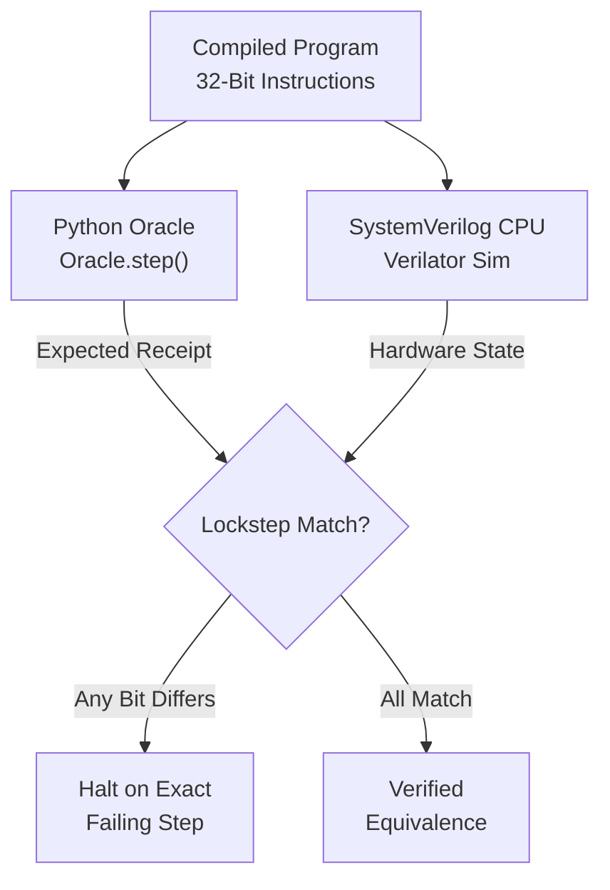
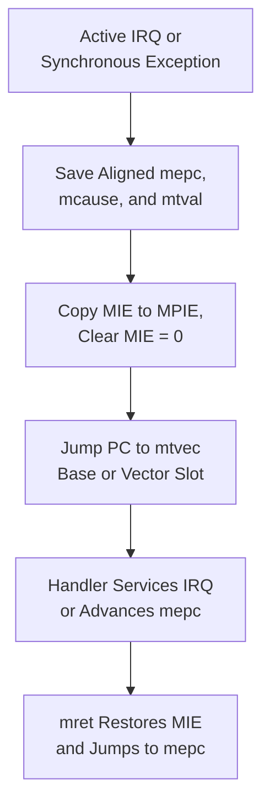

# Chapter 1 Instruction Set Architecture

Every program that runs on a robot ultimately reduces to fixed-width binary numbers moving between small hardware storage cells and memory addresses.
The `brain` processor contract specifies the exact rules governing those binary instructions, storage containers, memory regions, and external timer or device interruptions.
Building that hardware-software contract from first principles yields a self-contained, executable Python specification in [`oracle.py`](../sim/oracle.py) verified by [`test_oracle.py`](../tb/test_oracle.py).

## 1. Software Golden Reference Models

When you write an ordinary program in Python or C, statements execute one after another in a single predictable sequence.
A physical processor core (**Central Processing Unit**, or CPU) is instead built in a text-based circuit specification language (**Hardware Description Language**, or HDL) such as SystemVerilog.
Under the hood, that description wires together elementary true/false switches (**boolean logic gates**), selector switches (**multiplexers**, the circuit equivalent of `cond ? a : b`), and clocked 1-bit storage cells (**flip-flops**).
Between consecutive ticks of a periodic clock signal (one **clock cycle**), logic gates and multiplexers continuously compute new wire voltages in parallel, and on each tick all flip-flops sample those wires and update their stored bits at the exact same instant.

Testing a concurrent circuit design solely with hand-written test scripts mixes circuit timing with expected instruction behavior and leaves complex multi-instruction or external-signal corner cases unchecked.
Processor teams separate those concerns before writing any circuit code by building an unambiguous sequential software specification called a **golden reference model**, or **oracle**, which is verified independently in software and then supplies automatic instruction-by-instruction expected states for arbitrary compiled programs.
[`oracle.py`](../sim/oracle.py) implements that golden 32-bit reference specification for the `brain` CPU in the Python class `Oracle`, modeling the open-source fifth-generation processor standard built around a small, uniform set of simple 32-bit operations (**Reduced Instruction Set Computer, Fifth Generation**, or RISC-V).
Before any hardware exists, unit tests in [`test_oracle.py`](../tb/test_oracle.py) verify the Python oracle's arithmetic bounds, memory-access rules, and timer alarms directly.
Later, when our SystemVerilog CPU runs inside an open-source simulator that compiles circuit descriptions into fast C++ executables (**Verilator**), our verification harness feeds the exact same machine-code program to both engines in lockstep.
After every completed (**retired**) instruction, hardware fault, or external interruption, [`Oracle.step()`](../sim/oracle.py#L1194-L1273) returns a structured step receipt recording updated internal CPU storage, next-instruction address, and memory state, so the harness can compare each receipt against the simulated hardware state and halt on the exact step where they diverge.

### Instruction Set Architecture Boundaries

Every large software system relies on clean interface boundaries: a function signature tells callers what inputs a function accepts and what result it returns without exposing the temporary variables inside its body.
In computer engineering, the boundary separating software (compilers, startup programs, control loops) from physical chip hardware (logic gates, wire routing, multi-cycle arithmetic units) is the **Instruction Set Architecture**, or ISA.

An ISA defines only what machine-code programs can observe between instructions:
1. **Architectural State**: The persistent storage containers (fast on-chip storage cells called **registers**, the active instruction address, addressable memory, and modeled device state) whose values survive from one instruction to the next.
2. **Binary Instruction Encoding**: The exact bit positions that pack an operation selector, register indices, and small constants into a fixed-width binary integer (a hardware **word**).
3. **Atomic Step Outcomes**: Given any current architectural state $S_t$, [`step`](../sim/oracle.py#L1194-L1273) deterministically computes the next state $S_{t+1} = \texttt{step}(S_t)$ through exactly one of two indivisible outcomes:
   - **Normal Retirement**: The current instruction completes cleanly, updating the active instruction address and committing the instruction's defined register or memory writes.
   - **Precise Trap**: An abrupt control-flow handover (**trap**) triggered by an illegal encoding, invalid memory access, or pending external/timer request aborts any partial writes of the current instruction and redirects execution to a dedicated handler address.

Because an ISA intentionally hides internal circuit timing—such as whether integer division takes one clock cycle or thirty-two clock cycles—[`oracle.py`](../sim/oracle.py) can model instruction execution sequentially in Python rather than cycle by cycle.
To keep timer alarms and external interruptions equally reproducible without cycle-level simulation, the oracle advances its external hardware-device models at those same deterministic instruction boundaries.
This separation lets us build and verify the complete software oracle independently before designing the physical circuit and running lockstep checks.

## 2. Fixed-Width Binary Arithmetic

In Python, evaluating `2**200` or `-5` allocates a variable-length object in memory so integers grow until system memory runs out.
Inside a physical CPU, there is no dynamic memory allocator for numbers.
A 32-bit hardware register is 32 parallel metal wires driven by 32 flip-flops, where each wire carries either a low voltage representing zero or a high voltage representing one.
Every loop counter, memory address, and sensor reading must fit inside those $2^{32} = 4{,}294{,}967{,}296$ distinct bit patterns, so arithmetic that steps past the ends of the representable range must obey a strict mathematical rule.

### Bitwise Wire Gates and Bit Shifts

Every hardware register holds an ordered row of binary wires carrying `0` or `1` signals, read from left to right.
On a 4-wire register holding `1011` (Bits 3..0), Bit 0 sits at the rightmost `1` and Bit 3 sits at the leftmost `1`.
Generalizing to any width of $N$ wires labels individual wire $b_i \in \{0, 1\}$ as Bit $i$ ($b_{N-1}, \dots, b_0$) and any contiguous slice from $b_{\text{hi}}$ down to $b_{\text{lo}}$ as Bits $\text{hi}..\text{lo}$.

Hardware combines and slides raw bit patterns across wires using six elementary operators: four bitwise gates (`&`, `|`, `^`, `~`) and two bit shifts (`<<`, `>>`).
Each **bitwise gate** evaluates Bit $i$ solely from Bit $i$ of its inputs, while **bit shifts** slide every bit left or right across wire positions:

| Operator | Python / Equation Token | Single-Bit Rule (`0` / `1`) | Primary Hardware Role |
| :--- | :---: | :--- | :--- |
| **Bitwise AND** | `a & b` | `1` only when both input bits equal `1` | Clears bits where a selector pattern (**bitmask**) holds `0`, keeping bits where it holds `1` |
| **Bitwise OR** | `a \| b` | `1` whenever either input bit equals `1` | Sets flag bits or combines non-overlapping packed fields |
| **Bitwise Exclusive-OR** (XOR) | `a ^ b` / $\oplus$ | `1` when the two input bits differ | Toggles bits paired with `1` and leaves bits paired with `0` unchanged |
| **Bitwise NOT** | `~a` / $\bar{a}$ | Flips every bit (`0` $\leftrightarrow$ `1`, $\bar{a}_i = 1 - a_i$) | Inverts all wires in parallel |
| **Bitwise Left Shift** | `a << k` / $\ll$ | Slides every bit left by $k$ positions | Fills vacated bottom wires with `0` (or places `1` at Bit $k$ via `1 << k`) |
| **Bitwise Right Shift** | `a >> k` / $\gg$ | Slides every bit right by $k$ positions | Discards bottom wires and zero-fills vacated top wires |

Evaluating those rules concretely on four wires, Bitwise AND (`1011 & 0011`) zeroes the upper two bits where the mask holds `0` to keep `0011`, while Bitwise Left Shift (`1011 << 1`) drops the leftmost `1` and fills Bit 0 with `0` to produce `0110`.

### Unsigned Binary Integers

Assigning base-two place weights $2^0, 2^1, \dots, 2^{N-1}$ from right to left maps an $N$-wire pattern with no dedicated sign wire onto non-negative integers.
To write wide bit patterns compactly, programmers group every four wires (values 0–15) into one base-16 (**hexadecimal**) digit `0`–`9` (0–9) or `A`–`F` (10–15) prefixed with `0x`, separating 4-digit groups with underscores.
On a 4-bit register ($N = 4$), place weights evaluate three sample patterns directly alongside their hexadecimal digits:

| 4-Bit Pattern | Place-Weight Sum | Unsigned Decimal | Hexadecimal |
| :---: | :--- | :---: | :---: |
| `0011` | $0 \cdot 8 + 0 \cdot 4 + 1 \cdot 2 + 1 \cdot 1$ | $3$ | `0x3` |
| `1011` | $1 \cdot 8 + 0 \cdot 4 + 1 \cdot 2 + 1 \cdot 1$ | $11$ | `0xB` |
| `1111` | $1 \cdot 8 + 1 \cdot 4 + 1 \cdot 2 + 1 \cdot 1$ | $15$ | `0xF` |

Pairing `1011` (`0xB`) with `0101` (`0x5`) therefore writes the 8-wire pattern `1011_0101` compactly as `0xB5`.

Generalizing from 4 wires to any width $N \ge 1$ defines the **unsigned integer interpretation** $U_N(b)$:

$$U_N(b) = \sum_{i=0}^{N-1} b_i \cdot 2^i$$

When every wire carries zero, $U_N(b) = 0$; when every wire carries one, the finite geometric sum $S = 1 + 2 + \dots + 2^{N-1}$ satisfies $2S - S = 2^N - 1$, so the all-ones maximum equals $\sum_{i=0}^{N-1} 2^i = 2^N - 1$ (matching $1 + 2 + 4 + 8 = 15 = 2^4 - 1$ on 4 bits).
Because every bit sits in $\{0, 1\}$, every $N$-bit unsigned integer lies inside $[0, 2^N - 1]$.

Distinct bit patterns never collide on the same unsigned integer: at the highest wire $k$ where two patterns differ, all higher bits match and cancel, while the pattern carrying `1` at Bit $k$ contributes $2^k$—strictly more than the maximum $2^k - 1$ that all $k$ lower wires combined can ever reach.
Since all $2^N$ distinct patterns land on distinct values inside the $2^N$-element interval $[0, 2^N - 1]$, $U_N$ is a one-to-one mapping (**bijection**) onto $[0, 2^N - 1]$.
For $N = 32$, [`oracle.py`](../sim/oracle.py) names that upper bound `UINT32_MAX = 0xFFFF_FFFF` ($2^{32} - 1 = 4{,}294{,}967{,}295$).

### Binary Addition and Carry Propagation

**Binary addition** adds columns from Bit 0 upward using the exact same column-carry rule as base-ten arithmetic, rolling over at $2$ rather than $10$ whenever two input bits and any incoming carry sum to $2$ or $3$.
Adding the 4-bit unsigned pair `1011` ($11$) and `0111` ($7$) passes a carry from Bit 0 up through Bit 3, spilling the Bit-3 **carry-out** ($+16$) off the left end and leaving `0010` ($2$) on the four output wires.
The interactive 4-bit column adder below traces every carry wire across Bits 0 through 3 and lets you toggle inputs to see how carry-out drops off a fixed-width register.

<BinaryAdditionCarryDiagram />

On each column $i$, adding input bits $a_i, b_i \in \{0, 1\}$ and an incoming carry $c_i \in \{0, 1\}$ (starting with $c_0 = 0$) forms column total $t_i = a_i + b_i + c_i \in \{0, 1, 2, 3\}$, emitting kept bit $s_i \in \{0, 1\}$ and outgoing carry $c_{i+1} \in \{0, 1\}$ satisfying $a_i + b_i + c_i = s_i + 2 c_{i+1}$:
- **No Carry ($t_i \in \{0, 1\}$)**: Column sums $0$ and $1$ write $s_i = t_i$ with outgoing carry $c_{i+1} = 0$.
- **Generate Carry ($t_i \in \{2, 3\}$)**: Column sums $2$ and $3$ write $s_i = t_i - 2$ with outgoing carry $c_{i+1} = 1$.

Weighting each column identity by $2^i$ and summing across all $N \ge 1$ wires shows that every internal carry $c_i \cdot 2^i$ entering column $i$ cancels the outgoing carry $c_i \cdot 2^i$ leaving column $i - 1$, leaving only the kept $N$-bit sum and the final carry past Bit $N - 1$ (with no internal carries to cancel when $N = 1$):

$$\begin{aligned}
\sum_{i=0}^{N-1} (a_i + b_i + c_i) 2^i &= \sum_{i=0}^{N-1} s_i 2^i + \sum_{i=0}^{N-1} c_{i+1} 2^{i+1} \\
U_N(a) + U_N(b) + c_0 + \sum_{i=1}^{N-1} c_i 2^i &= U_N(s) + \sum_{j=1}^{N-1} c_j 2^j + c_N 2^N \\
U_N(a) + U_N(b) &= c_N \cdot 2^N + U_N(s)
\end{aligned}$$

Since $0 \le U_N(s) < 2^N$ and an $N$-bit register has only $N$ output wires (Bits $N - 1..0$), the final carry-out past Bit $N - 1$ ($c_N \in \{0, 1\}$ with place weight $2^N$) has no register wire to land on and drops off the left end.

### Modular Rings and Congruence

Arithmetic on a fixed-width register works like counting around a circular clock face: instead of growing without bound, stepping past slot $15$ on a 16-slot dial wraps back around to $0$ (just as a 12-hour wall clock wraps back past $12$).
On 4-bit wires (`0000` through `1111`), $11 + 7 = 18$ completes one full 16-slot lap plus $2$ extra steps to land on slot $2$ ($18 = 1 \cdot 16 + 2$), while stepping backward $5$ slots from slot $0$ lands on slot $11$ ($-5 = (-1) \cdot 16 + 11$).
Splitting any whole number into full $m$-slot laps (integer quotient $q$) plus a non-negative slot remainder $r$ between $0$ and $m - 1$ defines integer division with a non-negative remainder (**Euclidean division**) around an $m$-slot cycle (**modular ring**).
Two integers that differ by whole laps land on the exact same slot (**residue class**), written $a \equiv b \pmod{m}$—for instance, $18 \equiv 2 \pmod{16}$ and $-5 \equiv 11 \pmod{16}$.

<UnsignedClockRing />

Compactly, dividing any integer $x \in \mathbb{Z}$ by a positive integer modulus $m > 0$ yields a unique integer quotient $q$ and non-negative remainder $r = x \bmod m$ inside the modular ring $\mathbb{Z}_m$:

$$x = q \cdot m + r, \qquad 0 \le r < m, \qquad x \bmod m = r$$

Setting $m = 2^N$ partitions any integer $x$ into $q$ dropped $2^N$-laps and the exact $N$-bit remainder $r = x \bmod 2^N \in [0, 2^N - 1]$ carried on wires $0$ through $N - 1$—matching our 4-bit adder where $18 = 1 \cdot 16 + 2$ leaves $r = 2$ (`0010`) after dropping carry-out $c_4 = 1$.
Walking any $m$ consecutive integers around an $m$-slot clock visits every slot exactly once, so two integers inside any single $m$-number window $[a, a + m - 1]$ share the same residue modulo $m$ only when they are equal.
Any two integers in $[a, a + m - 1]$ differ by strictly less than $m$, so their difference can be a multiple of $m$ only when it equals zero.

**Modular congruence** passes cleanly through addition, subtraction, and multiplication for any positive modulus $m$, letting us swap congruent operands anywhere inside sums and products.
On our 16-slot ring ($m = 16$), swapping $19 \equiv 3 \pmod{16}$ and $14 \equiv -2 \pmod{16}$ leaves both sum and product slots unchanged:

$$\begin{aligned}
19 + 14 &= 33 \equiv 3 + (-2) = 1 \pmod{16} \\
19 \cdot 14 &= 266 \equiv 3 \cdot (-2) = -6 \equiv 10 \pmod{16}
\end{aligned}$$

In general, writing $x = x' + k_1 m$ and $y = y' + k_2 m$ (for integers $k_1, k_2$) keeps every extra term a multiple of $m$ after adding, subtracting, or multiplying:

$$\begin{aligned}
x \pm y &= (x' \pm y') + (k_1 \pm k_2)m \equiv x' \pm y' \pmod{m} \\
x \cdot y &= x' y' + (k_1 y' + k_2 x' + k_1 k_2 m)m \equiv x' y' \pmod{m}
\end{aligned}$$

Setting $y = y' = c$ likewise shows integer scaling ($c \cdot x \equiv c \cdot x' \pmod{m}$) preserves congruence.
In practice, $\equiv \pmod{m}$ acts as a drop-in substitution rule across $+$, $-$, and $\times$ once you respect four boundaries:

| Congruence Rule | Requirement | Valid vs. Broken Substitution |
| :--- | :--- | :--- |
| **Safe Term-Wise Substitution** | Replace congruent terms under one shared modulus $m$ across $+$, $-$, $\times$, and integer scaling | Swapping $14 \to -2$ modulo $16$ preserves sums and products directly |
| **Matching Terms and Modulus** | Every swapped term must match modulo $m$ without mixing distinct moduli | Swapping $14 \to 13$ modulo $16$ breaks $19 + 14 = 33 \not\equiv 16 = 3 + 13 \pmod{16}$ |
| **Integer Division** | Dropping integer-division remainders breaks congruence | Dividing $17 \equiv 1 \pmod{16}$ by $5$ drops remainders to quotients $3 \not\equiv 0$ |
| **Factor Cancellation** | Cancelling a factor sharing a divisor $> 1$ with $m$ breaks congruence | $6 \cdot 5 \equiv 6 \cdot 13 \pmod{16}$ yet $5 \not\equiv 13$ because $6$ and $16$ share factor $2$ |

### Two's Complement Signed Integers

Robot control software also needs negative integers for joint velocity errors, signed sensor readings, and backward memory offsets.
Dedicating the top wire as a separate sign flag—the intuitive **sign-magnitude** encoding—creates two zeros (`0000` for $+0$ and `1000` for $-0$) and breaks ordinary binary addition: adding `0011` ($+3$) and `1101` ($-5$ in sign-magnitude) produces `0000` ($0$) instead of $-2$.
Modern processors avoid both flaws with **two's complement**, reading negative integers counter-clockwise from zero on the modular clock ring so zero has a single representation and ordinary modular addition works unchanged across positive and negative numbers.

Starting at `0000` ($0$) on a 16-slot ring and stepping counter-clockwise by $1$ lands on `1111` ($15 \equiv -1 \pmod{16}$), while stepping counter-clockwise by $5$ lands on `1011` ($11 \equiv -5 \pmod{16}$).
Algebraically, two's complement keeps positive place weights $+2^0, \dots, +2^{N-2}$ on the lower $N - 1$ wires and assigns the leftmost wire (**Most Significant Bit**, or MSB, at Bit $N - 1$) a negative weight of $-2^{N-1}$.
On 4 bits, `1011` evaluates to $-1 \cdot 8 + 0 \cdot 4 + 1 \cdot 2 + 1 \cdot 1 = -5$, and adding `0011` ($+3$) in ordinary binary gives $\texttt{1011} + \texttt{0011} = \texttt{1110}$ ($-8 + 4 + 2 = -2$), matching $+3 + (-5) = -2$ directly.
Whenever a true signed sum exits $[-8, +7]$ across the discontinuity between $+7$ (`0111`) and $-8$ (`1000`)—stepping clockwise past $+7$ or counter-clockwise past $-8$—it wraps around the 16-slot clock to produce **signed overflow**, leaving addition modulo $16$ unchanged.

The interactive 4-bit ring adder below displays both interpretations on the shared wheel—pairing raw bit toggles with unsigned ($0..15$) and signed ($-8..+7$) sums—before we generalize to $N$ bits.

<ModularRingAdder />

Generalizing that negative MSB weight to any bit width $N \ge 1$ defines the **signed two's-complement interpretation** $S_N(b)$:

$$S_N(b) = -b_{N-1} \cdot 2^{N-1} + \sum_{i=0}^{N-2} b_i \cdot 2^i$$

Splitting on the top sign wire confirms that every $N$-bit pattern maps uniquely onto one signed integer with a single zero (with no lower wires when $N = 1$, giving $S_1(b_0) = -b_0 \in \{-1, 0\}$).
For $N \ge 2$, the lower $N - 1$ wires span $[0, 2^{N-1} - 1]$ bijectively, so patterns with $b_{N-1} = 0$ cover $[0, 2^{N-1} - 1]$ (with zero unique at `00...0`), while patterns with $b_{N-1} = 1$ shift downward by $-2^{N-1}$ to cover $[-2^{N-1}, -1]$.
Together, $S_N$ maps all $2^N$ patterns one-to-one onto the asymmetric interval $[-2^{N-1}, 2^{N-1} - 1]$.
For $N = 32$, [`oracle.py`](../sim/oracle.py) defines those endpoints using Python's left-shift syntax (`1 << 31` places a single `1` bit at Bit 31 for $2^{31}$) as `INT32_MIN = -(1 << 31)` ($-2{,}147{,}483{,}648$, bit pattern `0x8000_0000`) and `INT32_MAX = (1 << 31) - 1` ($+2{,}147{,}483{,}647$, bit pattern `0x7FFF_FFFF`).

Because Python integers grow arbitrarily wide instead of wrapping at 32 wires, [`oracle.py`](../sim/oracle.py) projects every intermediate result back onto the 32-bit unsigned ring $[0, 2^{32} - 1]$ using a single bitwise AND with 32 one-bits (`MASK32 = 0xFFFF_FFFF`).
Python evaluates bitwise operators on any integer—positive, zero, or negative—as a two's-complement bit pattern wide enough to hold it ($N \ge 33$): every wire at Bit 32 or above carries an integer multiple of $2^{32}$, while Bits 31..0 hold the non-negative remainder $U_{32}(b_{31..0}) \in [0, 2^{32} - 1]$.
Masking with `MASK32` places `1` on Bits 31..0 and `0` on Bit 32 and above, stripping every upper multiple of $2^{32}$—including the negative sign wire—so `x & MASK32` returns $x \bmod 2^{32}$ directly.
For example, $-5 = (-1) \cdot 2^{32} + (2^{32} - 5)$ masks via `-5 & 0xFFFF_FFFF` to `0xFFFF_FFFB`, and `0x1_0000_0002 & 0xFFFF_FFFF` masks directly to `2`.
[`u32`](../sim/oracle.py#L267-L269) implements that 32-bit modular projection in one line:

<!-- book-sync: u32 -->
<<< @/systems/brain/sim/oracle.py#L267-L269

### Unified Addition, Negation, and Subtraction

Comparing the unsigned sum $U_N(b)$ and signed sum $S_N(b)$ on the exact same $N$-bit wire pattern explains why a single modular arithmetic contract serves both unsigned and two's-complement integers across addition, negation, and subtraction.
On our 4-bit pattern `1011`, $U_4(\texttt{1011}) = 11$ and $S_4(\texttt{1011}) = -5$, which differ by $11 - (-5) = 16 = 2^4$.
Because the lower $N - 1$ wires carry identical positive weights under both readings, subtracting $S_N(b)$ from $U_N(b)$ leaves only the top wire's $+2^{N-1}$ versus $-2^{N-1}$ difference ($2 \cdot b_{N-1} 2^{N-1} = b_{N-1} 2^N$, valid for all $N \ge 1$):

$$S_N(b) = U_N(b) - b_{N-1} \cdot 2^N \;\implies\; U_N(b) \equiv S_N(b) \pmod{2^N}$$

Both readings of *every* $N$-bit pattern therefore occupy the *exact same slot* on the $2^N$-hour modular clock.
Because every slot corresponds to one unique bit pattern, any operation returning the correct unsigned residue modulo $2^N$ simultaneously holds the exact wrapped signed answer:

1. **Sign-Agnostic Addition and Subtraction**: Wrapping unsigned sums and differences produces identical output bits for signed operands because replacing any operand by a value congruent modulo $2^N$ leaves $\pm$ unchanged modulo $2^N$.
   On 4-bit `1011` ($11$ unsigned, $-5$ signed) and `1110` ($14$ unsigned, $-2$ signed), both readings produce `1001` for addition and `1101` for subtraction:

   | Operation & Reading | Exact Calculation | Modulo-16 Residue | 4-Bit Output |
   | :--- | :--- | :---: | :---: |
   | Unsigned add $U_4(+)$ | $11 + 14 = 25$ | $9$ | `1001` |
   | Signed add $S_4(+)$ | $(-5) + (-2) = -7$ | $9$ | `1001` |
   | Unsigned sub $U_4(-)$ | $11 - 14 = -3$ | $13$ | `1101` |
   | Signed sub $S_4(-)$ | $(-5) - (-2) = -3$ | $13$ | `1101` |

   Because $U_N \equiv S_N \pmod{2^N}$, any modular operation outputting $U_N(w) \equiv U_N(a) \pm U_N(b) \pmod{2^N}$ satisfies $S_N(w) \equiv S_N(a) \pm S_N(b) \pmod{2^N}$ directly.

2. **Negation via Invert Plus One**: Negating a two's-complement word flips every bit (`~b`) and adds $1$—on 4 bits, flipping $+5$ (`0101`) to `1010` and adding `0001` lands directly on $-5$ (`1011`).
   Because flipping every bit turns each $b_i$ into $1 - b_i$, the inverted pattern sums to the all-ones complement $(2^N - 1) - U_N(b)$, so adding $1$ yields $2^N - U_N(b)$:

   $$U_N(\bar{b}) + 1 = \left(2^N - 1 - U_N(b)\right) + 1 = 2^N - U_N(b) \equiv -S_N(b) \pmod{2^N}$$

   Checking both boundary patterns confirms wrap-around cleanly: negating `00...0` produces $2^N$, which drops its carry-out to return `00...0`, while negating extremal $-2^{N-1}$ (`1000` on 4 bits, or `INT32_MIN` `0x8000_0000` on 32 bits) produces $+2^{N-1}$, which exceeds the maximum positive value $2^{N-1} - 1$ by $1$ and wraps modulo $2^N$ right back to $-2^{N-1}$.

3. **Subtraction via Invert Plus One**: Modular subtraction $a - b$ reuses that exact addition rule by inverting $b$ ($\bar{b}$) and adding an extra $+1$ into Bit 0.
   On 4-bit `1011` ($-5$) minus `1110` ($-2$), $\texttt{1011} + \texttt{0001} + \texttt{0001} = \texttt{1101}$ ($13$ unsigned, $-3$ signed), because substituting Item 2's identity directly yields:

   $$\begin{aligned}
   U_N(a) + U_N(\bar{b}) + 1 &= U_N(a) + (2^N - U_N(b)) \\
   &\equiv U_N(a) - U_N(b) \equiv S_N(a) - S_N(b) \pmod{2^N}
   \end{aligned}$$

The ISA payoff is decisive: even though unsigned integers ($[0, 2^N - 1]$) and signed two's-complement integers ($[-2^{N-1}, 2^{N-1} - 1]$) assign different meanings whenever $b_{N-1} = 1$, one shared modular wrapping rule satisfies unsigned add, signed add, unsigned subtract, signed subtract, and two's-complement negation alike—eliminating signedness splits across addition and subtraction instructions.

### Sign-Agnostic Left-Shift Scaling

Processors multiply both unsigned and two's-complement integers by powers of two using one zero-filling **left shift** ($a \ll k$ for shift distance $0 \le k < N$), sliding every bit $k$ positions toward higher place weights and filling the vacated lower $k$ positions with zero.
Shifting 4-bit `1011` ($11$ unsigned, $-5$ signed) left by $k = 1$ drops Bit 3 (`1`) and fills Bit 0 with `0` to give `0110` ($+6$):

| Interpretation | True Scaled Product | Modulo-16 Residue | 4-Bit Output |
| :--- | :--- | :---: | :---: |
| Unsigned ($U_4$) | $11 \cdot 2 = 22$ | $6$ | `0110` |
| Signed ($S_4$) | $(-5) \cdot 2 = -10$ | $6$ | `0110` |

Shifting left by $k$ multiplies every surviving lower bit $a_i$ ($0 \le i \le N - 1 - k$) by $2^k$ while discarding the top $k$ bits whose shifted place weights $2^{i+k}$ ($i \ge N - k$) are all integer multiples of $2^N$:

$$U_N(a \ll k) = 2^k U_N(a) - 2^N \sum_{i=N-k}^{N-1} a_i 2^{i+k-N} \equiv 2^k U_N(a) \pmod{2^N}$$

Because $U_N \equiv S_N \pmod{2^N}$ passes through scaling by $2^k$, the exact same bit pattern satisfies $S_N(a \ll k) \equiv 2^k S_N(a) \pmod{2^N}$ (with $k = 0$ leaving $a$ unchanged).
For signed values, left-shifting by $k$ ($1 \le k < N$) stays exact whenever all $k$ discarded top bits match the incoming sign bit at Bit $N - 1 - k$ (making Bits $N - 1..N - 1 - k$ all `0` or all `1`).
When those leading bits are all `0`, the remaining $N - 1 - k$ lower bits keep $S_N(a) \in [0, 2^{N-1-k} - 1]$.
When they are all `1`, the negative MSB combines with the $k$ upper `1` weights across Bits $N - 2..N - 1 - k$, whose finite sum equals $2^{N-1} - 2^{N-1-k}$:

$$-2^{N-1} + \sum_{i=N-1-k}^{N-2} 2^i = -2^{N-1} + \left(2^{N-1} - 2^{N-1-k}\right) = -2^{N-1-k}$$

That collapse keeps $S_N(a) \in [-2^{N-1-k}, -1]$ (matching $-2^{N-1} + 2^{N-2} = -2^{N-2}$ when $k = 1$), so $2^k S_N(a)$ remains exact inside $[-2^{N-1}, 2^{N-1} - 1]$ across both cases.
On 4 bits, `1101` ($S_4 = -3$, with Bit 3 and Bit 2 both `1`) therefore shifts left by $1$ cleanly to `1010` ($S_4 = -6$).
As soon as a discarded bit differs from that incoming sign bit—such as 4-bit `1001` ($S_4 = -7$, where Bit 3 is `1` while Bit 2 is `0`)—shifting left by $1$ produces `0010` and wraps $-14$ around the 16-slot ring to $+2$.
One zero-filling left-shift instruction therefore scales both unsigned and signed operands identically, whereas operations that break modular congruence split into separate unsigned and signed instructions in Section 4.

## 3. Core Registers and Instruction Encoding

With fixed-width binary arithmetic established, we can define the core processor storage initialized in [`Oracle.reset()`](../sim/oracle.py#L563-L593) and organize how a 32-bit machine word encodes operations, registers, and embedded constants.
Separating core registers and instruction bit layouts from external memory and hardware timers keeps instruction decoding self-contained before adding attached devices.

### Program Counter and Hardwired Zero Register

A CPU requires one dedicated register to track the active address in a running program and a small bank of fast working variables.
Keeping that sequential instruction pointer separate from working data registers isolates control-flow state from arithmetic operands.
Core integer execution therefore revolves around two fast storage structures inside the CPU:
1. **Program Counter** (PC): `self.pc`, a single 32-bit register holding the memory byte address of the next instruction to fetch.
2. **General-Purpose Register File**: `self.regs`, an array of 32 fast 32-bit integer registers named `x0` through `x31` (128 bytes of storage in total).

Choosing 32 registers rather than 8 or 256 balances fast access against instruction bit budget.
Naming one of 32 registers takes $\log_2(32) = 5$ bits, so specifying one destination register (`rd`) and two source registers consumes $3 \times 5 = 15$ bits of a 32-bit instruction word and leaves 17 bits for operation selectors and embedded constants.

By ISA contract, reading register `x0` always returns zero, and any write targeting `x0` (`rd == 0`) is silently discarded.
The golden reference model captures this discard rule directly in [`Oracle._set_reg`](../sim/oracle.py#L893-L899):

<!-- book-sync: Oracle._set_reg -->
<<< @/systems/brain/sim/oracle.py#L893-L899

Dedicating one register index permanently to zero keeps the instruction set compact without losing expressiveness.
Assemblers and compilers reuse standard instructions with `x0` as a constant zero source or a safe discard destination to clear, copy, or negate values, eliminating separate dedicated instructions.

### Six Functional Instruction Families

The `brain` CPU executes instructions belonging to six functional groups, each solving a core programming need in [`oracle.py`](../sim/oracle.py) using the open RISC-V hardware specification.
The **32-bit Base Integer** (RV32I) instruction set handles arithmetic, control flow, and memory access, while **Integer Multiply and Divide** (RV32M) adds single-instruction multiplication and division.
Combining the base integer set with the multiply-divide extension defines the **RV32IM** target implemented by our simulator and processor.
System management adds special processor-control instructions to read hardware settings and handle external or timer alert (interrupt) state, while a custom neural extension adds domain acceleration for real-time motor inference.

| Group | Functional Category | Everyday Programming Role |
| :---: | :--- | :--- |
| **1** | **Integer Arithmetic, Shifts, and Constants** | Integer math, bit masks, shifts, comparisons, and 32-bit constants |
| **2** | **Hardware Multiply and Divide** | Up to 64-bit integer products, plus 32-bit quotients and remainders |
| **3** | **Memory Loads and Stores** | Reading and writing 8-bit, 16-bit, and 32-bit values in memory and devices |
| **4** | **Conditional Branches and Jumps** | Loops, `if`/`else` branches, direct calls, and function-pointer jumps |
| **5** | **System and Control Registers** | System calls, debugger breakpoints, enabling or disabling timer and device interrupts, and cycle counters |
| **6** | **Custom Neural Multiply-Accumulate** | Two-lane clamped dot products for real-time robot motor control |

### Bitfield Layouts and Offset Reach

The CPU decoder slices each fetched 32-bit unsigned word (`insn`) into register indices, operation selectors, and embedded constants before execution (writing `insn[hi..lo]` for Bits $\text{hi}..\text{lo}$ of `insn`).
In human-readable textual notation (**assembly syntax**), instructions list destination register `rd` first followed by source registers `rs1` and `rs2`, as in **Add** (`add rd, rs1, rs2`), whereas instructions carrying a literal constant (**immediate**, or `imm`) replace `rs2` with that constant, as in **Add Immediate** (`addi rd, rs1, imm`).

All standard 32-bit RISC-V primary operation codes (`opcode`, Bits 6..0) end with Bits 1..0 equal to binary `0b11` (decimal 3), reserving the other three 2-bit endings for optional 16-bit compressed instructions.
Alongside `opcode`, instructions reuse two secondary sub-operation selectors—a 3-bit function code (`funct3`, Bits 14..12) and a 7-bit function code (`funct7`, Bits 31..25)—to distinguish individual operations sharing the same primary `opcode`.
Every 32-bit instruction conforms to one of six standard bitfield layouts (**Register** / R-type, **Immediate** / I-type, **Store** / S-type, **Branch** / B-type, **Upper Immediate** / U-type, and **Jump** / J-type) that pack register indices, selectors, and signed offsets (omitting an always-zero Bit 0 on branch and jump targets as detailed right after the layout table) or upper constants across Bits 31..0.
The wire matrix below aligns all six 32-bit RISC-V layouts across Columns 31..0 so you can inspect pinned register columns, the Bit 31 sign bit (`S`), and immediate or offset slices side by side before reading the exact bit mappings.

<RiscvFormatMatrix />

Each format's software role, register fields, constant width, and bit mapping across `insn[31..0]` obey a compact six-row layout:

| Format | Primary Software Role | Registers and Selectors | Signed Constant & Byte Reach | Constant Bit Mapping Across `insn[31..0]` |
| :---: | :--- | :--- | :--- | :--- |
| **R-Type** | Register-register integer arithmetic and multiply/divide (combines `rs1` and `rs2` into `rd`) | `funct7` (31..25), `rs2` (24..20), `rs1` (19..15), `funct3` (14..12), `rd` (11..7) | None (all bits spent on selectors and registers) | None |
| **I-Type** | Immediate integer math, memory loads, and function-pointer (indirect) jumps (`rs1 + imm`) | `rs1` (19..15), `funct3` (14..12), `rd` (11..7) | 12-bit signed ($[-2{,}048, +2{,}047]$) | Bits 11..0 $\to$ `insn[31..20]` |
| **S-Type** | Memory stores (write `rs2` to `rs1 + imm`) | `rs2` (24..20), `rs1` (19..15), `funct3` (14..12) | 12-bit signed ($[-2{,}048, +2{,}047]$) | Bits 11..5 $\to$ `insn[31..25]`; Bits 4..0 $\to$ `insn[11..7]` |
| **B-Type** | Conditional PC-relative branches (`PC + offset`) | `rs2` (24..20), `rs1` (19..15), `funct3` (14..12) | 13-bit even ($[-4{,}096, +4{,}094]$ bytes, Bit 0 = 0) | Bit 12 $\to$ `insn[31]`; Bits 10..5 $\to$ `insn[30..25]`; Bits 4..1 $\to$ `insn[11..8]`; Bit 11 $\to$ `insn[7]` |
| **U-Type** | Load 20-bit upper slice (Bits 31..12) into `rd` | `rd` (11..7) | 20-bit upper payload (`payload << 12`) | Bits 31..12 $\to$ `insn[31..12]` |
| **J-Type** | Direct PC-relative subroutine call (`PC + offset`, save next 4-byte instruction address `PC + 4` in `rd`) | `rd` (11..7) | 21-bit even ($[-1{,}048{,}576, +1{,}048{,}574]$ bytes, Bit 0 = 0) | Bit 20 $\to$ `insn[31]`; Bits 10..1 $\to$ `insn[30..21]`; Bit 11 $\to$ `insn[20]`; Bits 19..12 $\to$ `insn[19..12]` |

Notice two quantitative properties embedded directly in the bitfield layout table above:
1. **Offset Reach Scaling**: An unscaled 12-bit signed immediate spans $[-2^{11}, 2^{11} - 1]$, or $[-2{,}048, +2{,}047]$ bytes (about $\pm 2\text{ KB}$), while an unscaled 20-bit signed immediate spans $[-2^{19}, 2^{19} - 1]$ bytes.
   Because optional 16-bit compressed RISC-V instructions sit on even 2-byte addresses, the difference between any two instruction addresses is even (guaranteeing Bit 0 equals zero), letting the ISA drop Bit 0 and double byte reach onto even offsets without spending an instruction bit.
   Consequently, B-type encodes 12 stored bits to cover $2 \times [-2^{11}, 2^{11} - 1]$ ($[-4{,}096, +4{,}094]$ even bytes, about $\pm 4\text{ KB}$), while J-type encodes 20 stored bits to cover $2 \times [-2^{19}, 2^{19} - 1]$ ($[-1{,}048{,}576, +1{,}048{,}574]$ even bytes, about $\pm 1\text{ MB}$).
   Because the `brain` CPU implements only fixed 32-bit instructions without 16-bit compressed encodings, the RISC-V specification tightens runtime fetch alignment to 32 bits, or 4-byte multiples (**Instruction Address Alignment**, or IALIGN = 32).
2. **Pinned Columns and Shared Offset Slices**: The encoding places register indices (`rs1` at 19..15, `rs2` at 24..20, `rd` at 11..7) and the immediate sign bit (Bit 31) in stationary columns across every format.
   Pinning those columns lets any decoder slice all register indices and sign bits uniformly before branching on `opcode`.
   Even further, B-type shares 11 of its 12 stored immediate bits with S-type (`insn[31]` as sign, `insn[30..25]` as Bits 10..5, and `insn[11..8]` as Bits 4..1), repurposing only `insn[7]` from S-type Bit 0 to B-type Bit 11.
   Similarly, J-type shares Bits 19..12 (`insn[19..12]`) with U-type and Bits 10..1 (`insn[30..21]`) with I-type.

Because register columns (`rd` at 11..7, `rs1` at 19..15, `rs2` at 24..20) and selector columns (`opcode` at 6..0, `funct3` at 14..12, `funct7` at 31..25) stay pinned across formats, [`Oracle.step()`](../sim/oracle.py#L1194-L1273) slices all six fields upfront before dispatching on `opcode` (formats omitting a field simply ignore its pre-sliced bits).
To pull an upper bitfield down to Bit 0, an unsigned right shift (`insn >> lo`) moves every bit right by `lo` positions, discarding the lowest `lo` bits and zero-filling the vacated upper slots on non-negative words like `insn` (signed right shifts arrive with arithmetic instructions in Section 4).
Inside [`Oracle.step()`](../sim/oracle.py#L1194-L1273), combining that right shift with a $w$-bit mask $2^w - 1$ (holding `1` in Bits $w - 1..0$ and `0` above) clears every higher bit in parallel.
Grouping those masks by field width—7-bit `OPCODE_MASK = 0x7F` and `FUNCT7_MASK = 0x7F`, 5-bit `REG_MASK = 0x1F`, and 3-bit `FUNCT3_MASK = 0x7`—extracts all six fields in six lines:

<!-- book-sync: Oracle.step['opcode = insn & OPCODE_MASK'..'funct7 = (insn >> 25) & FUNCT7_MASK'] -->
<<< @/systems/brain/sim/oracle.py#L1210-L1215

In [`oracle.py`](../sim/oracle.py), [`enc_r`](../sim/oracle.py#L322-L331), [`enc_i`](../sim/oracle.py#L334-L342), [`enc_s`](../sim/oracle.py#L345-L356), [`enc_b`](../sim/oracle.py#L359-L372), [`enc_u`](../sim/oracle.py#L375-L378), and [`enc_j`](../sim/oracle.py#L381-L392) assemble bit-exact test instructions across all six formats.
These encoders position each field with left shifts (`<<`) and merge non-overlapping slices with bitwise OR (`|`).
During execution, [`_dec_imm_s`](../sim/oracle.py#L400-L402), [`_dec_imm_b`](../sim/oracle.py#L405-L413), and [`_dec_imm_j`](../sim/oracle.py#L416-L424) reassemble those permuted slices into signed Python integers (whose bit-widening rule we explain in *Widening Narrow Signed and Unsigned Integers*).

### Widening Narrow Signed and Unsigned Integers

Instruction decoders unpack narrow 12-bit, 13-bit, and 21-bit immediate payloads that expand to full 32-bit operands.
When widening a narrow integer from $k \ge 1$ bits to a strictly wider word of $M > k$ bits, **sign extension** preserves the signed value across all bit widths by copying the sign bit into every added upper position, whereas **zero extension** preserves unsigned values while corrupting negative numbers.
For example, widening 12-bit $-5$ (`0xFFB`, with $U_{12} = 4{,}091$ and sign bit (Bit 11) equal to `1`) to 32 bits separates the two rules cleanly:

| Widening Rule | 32-Bit Word | Unsigned ($U_{32}$) | Signed ($S_{32}$) |
| :--- | :---: | :---: | :---: |
| **Zero-extend** `0xFFB` | `0x0000_0FFB` | $4{,}091$ | $+4{,}091$ |
| **Sign-extend** `0xFFB` | `0xFFFF_FFFB` | $2^{32} - 5$ | $-5$ |

The interactive wire schematic below shows 4-bit to 8-bit widening—contrasting constant-`0` tie-offs against sign-bit copying across added upper lanes—before we verify both rules for arbitrary target width $M > k$.

<SignExtensionWidener />

Padding Bits $M - 1..k$ with zero adds zero place weight above Bit $k - 1$, keeping the unsigned value unchanged ($U_M = U_k$) while clearing the new top sign bit (Bit $M - 1$) to `0`.
That zero sign bit forces the wider signed reading to match $U_k(b) = S_k(b) + b_{k-1} 2^k$, shifting negative numbers upward by $2^k$ and preventing one shared widening rule from preserving both unsigned and signed values.

Conversely, replicating Bit $k - 1$ into every added upper position preserves the exact signed value ($S_M = S_k$) across arbitrary widths $M > k$.
Widening a $k$-bit pattern $b$ by a single bit to $k + 1$ bits ($b'$, setting $b'_k = b_{k-1}$) replaces the old negative weight $-b_{k-1} 2^{k-1}$ with $-b_{k-1} 2^k + b_{k-1} 2^{k-1}$, which collapses right back to $-b_{k-1} 2^{k-1}$:

$$\begin{aligned}
S_{k+1}(b') &= -b_{k-1} 2^k + b_{k-1} 2^{k-1} + \sum_{i=0}^{k-2} b_i 2^i \\
&= -b_{k-1} 2^{k-1} + \sum_{i=0}^{k-2} b_i 2^i = S_k(b)
\end{aligned}$$

Repeating that single-bit copy up to any target width $M > k$ keeps $S_M(\text{extended } b) = S_k(b)$ for every $k \ge 1$ (with no lower sum when $k = 1$), while shifting the unsigned reading of negative inputs upward by $b_{k-1}(2^M - 2^k)$ since $U_M = S_M + b_{k-1} 2^M = U_k - b_{k-1} 2^k + b_{k-1} 2^M$.

Because the Python oracle stores raw bit patterns as unsigned integers (`0..0xFFFF_FFFF` in `self.regs`) and extracts field slices in `_dec_imm_s`, `_dec_imm_b`, and `_dec_imm_j` as non-negative values, Python operators such as `<`, `+`, `-`, and `*` would read `0xFFB` as $+4{,}091$ and `0xFFFF_FFFB` as $+4{,}294{,}967{,}291$ instead of $-5$.
Correct signed comparisons, backward offsets, and arithmetic inside Python therefore require converting raw $k$-bit bit patterns into Python's native signed `int` representation ($S_k(b)$).
Whereas a fixed 32-bit word widens a $k$-bit integer by replicating Bit $k - 1$ across Bits $31..k$, Python's arbitrary-precision integers have no top bit boundary to fill, so copying sign bits leaves negative two's-complement patterns strictly positive.
Instead, the oracle masks the input down to its low $k$ bits with $2^k - 1$, flips Bit $k - 1$ ($s = 2^{k-1}$) with bitwise XOR (`^` in Python and $\oplus$ in equations), and subtracts $s$ to shift negative inputs directly into Python's native signed range.
Evaluating both 12-bit branches ($s = 2^{11} = \texttt{0x800} = 2{,}048$) shows how XOR shifts non-negative inputs upward by $+s$ (cancelled by subtracting $s$) and negative inputs downward by $-s$ (turning $+2^{11}$ into $-2^{11}$):

| Sign Bit (Bit 11) | 12-Bit Input ($v$) | Flip Sign Bit ($v \oplus \texttt{0x800}$) | Subtract `0x800` ($2{,}048$) |
| :---: | :--- | :--- | :---: |
| **`0`** | `0x005` ($+5$) | `0x805` ($2{,}053$) | $+5$ |
| **`1`** | `0xFFB` ($4{,}091$) | `0x7FB` ($2{,}043$) | $-5$ |

Writing the masked $k$-bit value as $v = b_{k-1} s + L$ (where $L = \sum_{i=0}^{k-2} b_i 2^i$, or $0$ when $k = 1$) confirms the formula for every width $k \ge 1$, since XORing with $s$ flips only $b_{k-1}$ to $1 - b_{k-1}$:

$$(v \oplus s) - s = \left((1 - b_{k-1}) s + L\right) - s = -b_{k-1} s + L = S_k(b)$$

In [`oracle.py`](../sim/oracle.py), [`sign_extend`](../sim/oracle.py#L272-L279) binds $2^k - 1$ to `mask` and $2^{k-1}$ to `sign_bit` to evaluate `(val ^ sign_bit) - sign_bit` on masked input `val`, and [`s32`](../sim/oracle.py#L282-L284) specializes that helper to 32-bit words:

<!-- book-sync: sign_extend..s32 -->
<<< @/systems/brain/sim/oracle.py#L272-L284

## 4. Integer Arithmetic, Multiplication, and Division

Once the decoder slices an instruction word, integer operations compute a 32-bit result strictly from the captured operand values and instruction selectors.
Before executing any operation, [`Oracle.step()`](../sim/oracle.py#L1194-L1273) reads and holds both prior source register values (`rs1_u, rs2_u = self.regs[rs1], self.regs[rs2]`) and derives signed views via [`s32`](../sim/oracle.py#L282-L284) (`rs1_s`, `rs2_s`).
Because source values are captured before writing the result to `rd`, an in-place addition such as `add x3, x3, x3` (adding `x3` to itself) reads the prior `x3` on both inputs and writes double that value back to `x3`.

### Base Integer Operations and Zero Idioms

Every integer instruction set pairs two-register arithmetic (for dynamic variables) with register-immediate operations so programs can apply loop increments, bit masks, and bounds checks without spending an extra register to hold a small constant.
Combining Section 3's primary `opcode` (Bits 6..0) with secondary function-selector fields `funct3` (Bits 14..12) and `funct7` (Bits 31..25), valid base integer instructions execute cleanly in one step, while any unassigned pattern aborts before modifying `rd` and routes to Section 1's atomic trap handler.
In [`oracle.py`](../sim/oracle.py), [`_exec_op_imm`](../sim/oracle.py#L1023-L1055) executes register-immediate integer instructions (`opcode` `0x13`), while [`_exec_op_reg`](../sim/oracle.py#L1083-L1115) executes register-register instructions (`opcode` `0x33`).

Across the base operations table below, write `op2_u` for the 32-bit unsigned second operand (`rs2_u` in register-register instructions or `u32(imm)` after sign-extending 12-bit `imm` in register-immediate instructions) and `op2_s` for its signed view (`s32(op2_u)`).
Because architectural registers `self.regs[rd]` store raw 32-bit unsigned patterns (`0..0xFFFF_FFFF`), the oracle normalizes arithmetic and shift outputs through `u32(...)` while preserving signed views via Section 2's modular congruence.
For shifts, RISC-V defines a 5-bit unsigned **shift amount** (`shamt`, 0 to 31) via `rs2_u & 0x1F` in register shifts (wrapping `35 & 31` to `3` via `0x1F = 31`) or `insn[24..20]` in immediate shifts (leaving Bits 31..25 free for `funct7`).
In Python's reference formulas inside the table below, `rs1_u >> shamt` models zero-filling right shifts, whereas `u32(rs1_s >> shamt)` wraps Python's signed downward-rounded right shift to match Bit 31 replication (a correspondence explained in *Right Shifts and Integer Floor Division*).

| Category | Register / Immediate Mnemonic | Selector (`funct3` / `funct7`) | 32-Bit Output Stored in `rd` | Key Architectural Rule |
| :--- | :--- | :--- | :--- | :--- |
| **Add / Subtract** | `add`, `addi` / `sub` | 0 / `0x00` (R-type; `sub`: `0x20`) | `u32(rs1_u + op2_u)` / `u32(rs1_u - rs2_u)` | Shared modular arithmetic; `sub` inverts `rs2_u` and adds 1; negative constants use `addi` |
| **Shift Left Logical** | `sll`, `slli` | 1 / `0x00` | `u32(rs1_u << shamt)` | Zero-fills low bits; `shamt` is `rs2_u & 0x1F` or `insn[24..20]`; invalid `funct7` traps |
| **Shift Right Logical** | `srl`, `srli` | 5 / `0x00` | `rs1_u >> shamt` | Zero-fills upper bits (unsigned divide by $2^{\texttt{shamt}}$); invalid `funct7` traps |
| **Shift Right Arithmetic** | `sra`, `srai` | 5 / `0x20` | `u32(rs1_s >> shamt)` | Replicates Bit 31 into upper bits (signed downward-rounded divide by $2^{\texttt{shamt}}$); invalid `funct7` traps |
| **Set Less Than (Signed)** | `slt`, `slti` | 2 / `0x00` (R-type) | `1 if rs1_s < op2_s else 0` | Compares signed views `rs1_s` and `op2_s` |
| **Set Less Than (Unsigned)** | `sltu`, `sltiu` | 3 / `0x00` (R-type) | `1 if rs1_u < op2_u else 0` | `sltiu` sign-extends 12-bit `imm` first, so $-1$ becomes `0xFFFF_FFFF` (`UINT32_MAX`, $2^{32} - 1$) |
| **Bitwise Gates** | `xor`/`xori`, `or`/`ori`, `and`/`andi` | 4, 6, 7 / `0x00` (R-type) | `rs1_u ^ op2_u`, `rs1_u \| op2_u`, `rs1_u & op2_u` | Sign-extends 12-bit `imm` first (`xori rd, rs1, -1` flips all 32 bits) |

Using `x0` or small constants in those base operations yields six everyday assembly shorthands (**pseudoinstructions**) that the assembler translates offline into existing base encodings without spending extra opcodes:

| Assembly Shorthand | Underlying Machine Encoding | Architectural Effect |
| :--- | :--- | :--- |
| **No Operation** (`nop`) | `addi x0, x0, 0` | Advances `self.pc` by 4 bytes and discards $0 + 0$ into `x0` |
| **Move** (`mv rd, rs1`) | `addi rd, rs1, 0` | Copies 32-bit word from `rs1` into `rd` |
| **Load Immediate** (`li rd, imm`) | `addi rd, x0, imm` | Loads signed 12-bit constant ($[-2{,}048, +2{,}047]$) into `rd` |
| **Bitwise Not** (`not rd, rs1`) | `xori rd, rs1, -1` | Computes bitwise complement (`rs1_u ^ 0xFFFF_FFFF`) using sign-extended `0xFFFF_FFFF` |
| **Negate** (`neg rd, rs1`) | `sub rd, x0, rs1` | Stores raw negation pattern `u32(0 - rs1_u)` (when `rs1` holds `1`, stores `0xFFFF_FFFF`, whose signed view `s32` is $-1$) |
| **Set if Equal to Zero** (`seqz rd, rs1`) | `sltiu rd, rs1, 1` | Writes 1 if `rs1_u == 0` (`rs1_u < 1`), else 0 |

### Right Shifts and Integer Floor Division

Shifting every bit right by $1 \le k \le N - 1$ positions discards the lower $k$ bits and leaves the top $k$ positions (Bits $N-1\dots N-k$) empty, forcing the ISA to split into `srl`/`srli` and `sra`/`srai` (unlike addition, subtraction, or `sll`/`slli`).
A **logical right shift** ($b \gg_{\text{log}} k$) fills those upper positions with zeros to divide unsigned values by $2^k$, whereas an **arithmetic right shift** ($b \gg_{\text{arith}} k$) replicates original sign bit $b_{N-1}$ to preserve the sign of two's-complement values.
One shared right-shift rule cannot serve both instructions because zero-filling a negative two's-complement word flips its sign bit to positive, whereas sign-replicating a large unsigned word injects phantom high bits.

Both right shifts match exact division rounded downward toward $-\infty$ (**floor division** $\lfloor x / d \rfloor$, where the floor $\lfloor y \rfloor$ is the unique integer satisfying $\lfloor y \rfloor \le y < \lfloor y \rfloor + 1$).
Shifting 4-bit `1011` ($11$ unsigned, $-5$ signed) right by $k = 1$ drops Bit 0 (`1`) and separates the two fill rules cleanly:

| Right-Shift Rule | 4-Bit Output | Floor-Division Reading |
| :--- | :---: | :--- |
| Logical ($\texttt{1011} \gg_{\text{log}} 1$) | `0101` | $U_4 = 5 = \lfloor 11 / 2 \rfloor$ |
| Arithmetic ($\texttt{1011} \gg_{\text{arith}} 1$) | `1101` | $S_4 = -3 = \lfloor -5 / 2 \rfloor$ |

The interactive 8-bit wire schematic below shows kept bits sliding right by $k$, discarded low bits dropping into remainder $R$, and vacated upper slots receiving `0` versus Bit 7.

<RightShiftComparator />

Why does dropping the low $k$ bits always round *downward* toward $-\infty$, even for negative numbers?
For $k = 0$, no bits drop and both shifts leave $x = \lfloor x / 1 \rfloor$ untouched; for $1 \le k \le N - 1$, split $b$ at Bit $k$ into the kept $(N - k)$-bit upper slice $H$ ($H_j = b_{j+k}$, top bit $b_{N-1}$) and the non-negative dropped remainder $R = \sum_{m=0}^{k-1} b_m 2^m \in [0, 2^k - 1]$.
Factoring $2^k$ out of Bits $N-1\dots k$ writes both interpretations as a shifted upper slice plus $R$:

$$\begin{aligned}
U_N(b) &= U_{N-k}(H) \cdot 2^k + R \\
S_N(b) &= S_{N-k}(H) \cdot 2^k + R
\end{aligned}$$

Because $b \gg_{\text{log}} k$ zero-extends $H$ while $b \gg_{\text{arith}} k$ sign-extends $H$ to $N$ bits—holding through $k = N - 1$ where $S_1(H) = -b_{N-1}$—Section 3's widening rules preserve both values at full width:

$$\begin{aligned}
U_N(b) &= U_N(b \gg_{\text{log}} k) \cdot 2^k + R \\
S_N(b) &= S_N(b \gg_{\text{arith}} k) \cdot 2^k + R
\end{aligned}$$

Writing $(x, q)$ for either pair gives $x = q \cdot 2^k + R$, and dividing $0 \le R < 2^k$ by $2^k$ bounds the fractional remainder inside $0 \le R / 2^k < 1$.
Adding $q$ traps $x / 2^k = q + R / 2^k$ inside $[q, q + 1)$, which by definition forces the integer quotient $q = \lfloor x / 2^k \rfloor$:

$$q \le q + \frac{R}{2^k} = \frac{x}{2^k} < q + 1 \implies q = \left\lfloor \frac{x}{2^k} \right\rfloor$$

That also closes our Python oracle formula from the base-operations table in *Base Integer Operations and Zero Idioms*: Python's `rs1_s >> shamt` computes $\lfloor S_{32}(b) / 2^{\texttt{shamt}} \rfloor = S_{32}(b \gg_{\text{arith}} \texttt{shamt})$, so wrapping through `u32(rs1_s >> shamt)` recovers the exact 32-bit pattern via $U_{32} \equiv S_{32} \pmod{2^{32}}$.
On 32-bit `0xFFFF_FFFB` ($-5$ signed, $2^{32} - 5$ unsigned), shifting right by $k = 1$ drops Bit 0 ($R = 1$) and highlights the sign split:

| Instruction | Shifted 32-Bit Output | Decimal Value |
| :--- | :---: | :--- |
| **`srai`** ($\texttt{0xFFFF\_FFFB} \gg_{\text{arith}} 1$) | `0xFFFF_FFFD` | $-3$ (signed, not $-2$) |
| **`srli`** ($\texttt{0xFFFF\_FFFB} \gg_{\text{log}} 1$) | `0x7FFF_FFFD` | $+2{,}147{,}483{,}645$ (unsigned) |

Whenever $b_{N-1} = 1$ and $1 \le k \le N - 1$, `srl` fills every vacated upper bit (Bits $N-1\dots N-k$) with `0` while `sra` fills those exact same positions with `1`, guaranteeing distinct bit patterns (whose unsigned values differ by $2^N - 2^{N-k}$ per Section 3's sign-extension rule) and requiring two separate shift instructions.

### Equality and Ordered Comparisons

Whether two register operands match under equality (`==`) never depends on signedness, whereas whether one operand is strictly less than another (`<`, requiring separate `slt`/`slti` versus `sltu`/`sltiu` instructions) flips whenever their top sign bits differ.
For example, comparing $a$ equal to `1011` ($a_3 = 1$) against $b$ equal to `0011` ($b_3 = 0$) leaves $U_4(\texttt{1011}) = 11 > 3 = U_4(\texttt{0011})$ under unsigned comparison, yet pulls $S_4(\texttt{1011}) = -5 < +3 = S_4(\texttt{0011})$ under signed comparison.
Because both $U_N$ onto $[0, 2^N - 1]$ and $S_N$ onto $[-2^{N-1}, 2^{N-1} - 1]$ are one-to-one bijections on the $2^N$ bit patterns, $U_N(a) = U_N(b)$ and $S_N(a) = S_N(b)$ both hold if and only if bit patterns $a$ and $b$ match bit-for-bit, requiring only one unsigned equality rule.

For **ordered comparisons** ($<$ and $\ge$), substituting $S_N(x) = U_N(x) - x_{N-1} \cdot 2^N$ relates the signed and unsigned differences in one line:

$$S_N(a) - S_N(b) = \left(U_N(a) - U_N(b)\right) - \left(a_{N-1} - b_{N-1}\right) 2^N$$

When two patterns share the same top bit ($a_{N-1} = b_{N-1}$), the $2^N$ term vanishes and signed and unsigned ordering match identically.
When their top bits differ ($a_{N-1} = 1$ and $b_{N-1} = 0$), unsigned weights place $U_N(a) \ge 2^{N-1} > U_N(b)$, whereas the negative Most Significant Bit pulls $S_N(a) < 0 \le S_N(b)$ so signed comparison reverses direction (and symmetrically when $a_{N-1} = 0$ and $b_{N-1} = 1$).

Watch one subtle ordering rule on immediate unsigned comparison `sltiu rd, rs1, -1` (`imm` equal to 12-bit `0xFFF`): the ISA always sign-extends the 12-bit immediate to 32-bit `0xFFFF_FFFF` (`UINT32_MAX`) *before* performing the unsigned comparison, so `rs1` holding `0xFFFF_FFFC` ($2^{32} - 4$) satisfies `0xFFFF_FFFC < 0xFFFF_FFFF` and writes `1` into `rd` rather than comparing against `0x0000_0FFF`.
Sharing that single sign-extending immediate rule across every I-type instruction keeps immediate unpacking uniform across all base operations rather than special-casing `sltiu`.

### Base Integer Signedness Equivalence

With all six fundamental base integer operation classes examined, algebraic invariance determines cleanly when one instruction rule serves both unsigned and signed interpretations versus when operations must split.
The table below summarizes all six operation classes across Sections 2–4 (multiplication and division follow in *Full 64-Bit Integer Multiplication* and *Truncating Integer Division Semantics*):

| Operation | Same Bits for Unsigned & Signed? | Algebraic and Contract Reason |
| :--- | :--- | :--- |
| **Equality** (`==`, `!=`) | Yes | Both $U_N$ and $S_N$ are one-to-one bijections, so values match if and only if bit patterns match |
| **Add / Subtract** ($+$, $-$) | Yes | $U_N(b) \equiv S_N(b) \pmod{2^N}$ passes through $\pm$ |
| **Left Shift** ($\ll$) | Yes | Discards multiples of $2^N$; shifts factor $2^k$ on residue class |
| **Ordered Compare** ($<$, $\ge$) | No | Subtracting $b_{N-1} 2^N$ pulls $b_{N-1} = 1$ patterns below zero ($11 > 3$ versus $-5 < +3$) |
| **Widening ($k \to 32$ bits)** | No | Zero-fill preserves $U_k(b)$ while sign-bit replication preserves $S_k(b)$ |
| **Right Shift** ($\gg$) | No | For $1 \le k \le N - 1$ and $b_{N-1} = 1$, `srl` writes `0` while `sra` writes `1` into Bits $N-1\dots N-k$ |

### Full 32-Bit Constant Construction

Because every 32-bit instruction spends at least 12 bits on `opcode` and non-immediate control or register fields, no single instruction can embed an arbitrary 32-bit constant inside itself.
Instead, RISC-V provides two U-type instructions that place a 20-bit immediate (`imm20`) into Bits 31..12 of `rd` while clearing Bits 11..0 to zero: **Load Upper Immediate** (`lui`) writes `imm20 << 12`, and **Add Upper Immediate to PC** (`auipc`) writes `u32(cur_pc + (imm20 << 12))`, where `cur_pc` denotes the current instruction's `self.pc`.
When source code or assembly requests an arbitrary 32-bit constant via a pseudoinstruction such as `li x5, value`, the **compiler or assembler** computes a 20-bit upper payload `hi_lui` and a 12-bit offset `lo12` offline ahead of execution and emits two real machine instructions—`lui x5, hi_lui` followed by `addi x5, x5, lo12`—while the processor executes those two standard instructions verbatim at runtime without special bias instructions.

Why can the compiler or assembler not simply copy Bits 31..12 straight into `lui` and Bits 11..0 straight into `addi`?
Because `addi` sign-extends its 12-bit immediate before adding: Bits 11..0 act as non-negative offsets 0 through +2,047 when Bit 11 equals 0 (`0x000`–`0x7FF`), whereas Bits 11..0 act as negative offsets -2,048 through -1 (subtracting `0x1000`, or 4,096, from their unsigned value) whenever Bit 11 equals 1 (`0x800`–`0xFFF`).
A naive split on `0x1234_5ABC` (Bit 11 equals 1) would emit `lui x5, 0x12345` and `addi x5, x5, -1348` (`0xABC - 0x1000 = -0x544`), which executes `0x1234_5000 - 0x544 = 0x1234_4ABC` and undershoots by `0x1000`.

To cancel that `-0x1000` drop whenever Bit 11 equals 1 with one uniform offline recipe, the compiler or assembler runs two ordered steps:
1. **Step 1 (Extract Unbiased `lo12`)**: Slice Bits 11..0 directly from the original target constant *before* adding any bias.
2. **Step 2 (Bias and Slice `hi_lui`)**: Add `0x800` (2,048, half of `0x1000`) to the target constant modulo $2^{32}$, discard the altered low 12 bits of that sum, and take Bits 31..12 as `hi_lui`.

Two concrete constants trace both branches—notice how the bit-boundary diagram below tracks both fields across the Bit 11 to Bit 12 seam:
- **No Carry** (`0x1234_5123`, Bit 11 = `0`): Step 1 extracts `lo12 = 0x123` (+291); Step 2 adds `0x800` without carrying past Bit 11, yielding `hi_lui = 0x12345` so `lui` + `addi` compute `0x1234_5000 + 0x123 = 0x1234_5123`.
- **Carry +1** (`0x1234_5ABC`, Bit 11 = `1`): Step 1 extracts `lo12 = 0xABC` (-1,348, or `-0x544`); Step 2 adds `0x800`, carries $+1$ into Bit 12, and promotes `hi_lui` to `0x12346` so runtime pre-bumps `x5` to `0x1234_6000` and subtracts `0x544` to land on `0x1234_5ABC`.

<LuiBiasCarryDiagram />

Checking the algebra confirms this two-step recipe reconstructs *every* 32-bit target $X \in [0, 2^{32} - 1]$ exactly modulo $2^{32}$.
Split $X$ at Bit 12 as $X = \text{hi}_{20} \cdot 2^{12} + U_{12}(\text{lo}_{12})$, with Bit 11 denoted $b_{11} \in \{0, 1\}$.
Adding `0x800` ($2^{11}$) carries $+1$ into Bit 12 if and only if $U_{12}(\text{lo}_{12}) \ge 2^{11}$ ($b_{11} = 1$), so `hi_lui = u32(X + 0x800) >> 12` equals $(\text{hi}_{20} + b_{11}) \bmod 2^{20}$.
Because shifting any multiple of $2^{20}$ left by 12 bits produces a multiple of $2^{32}$ that drops off past Bit 31, combining `lui` with sign-extended `addi` ($S_{12}(\text{lo}_{12}) = U_{12}(\text{lo}_{12}) - b_{11} \cdot 2^{12}$) cancels the $\pm b_{11} \cdot 2^{12}$ carry directly:

$$\begin{aligned}
\texttt{hi\_lui} \cdot 2^{12} + S_{12}(\text{lo}_{12})
&\equiv (\text{hi}_{20} + b_{11}) \cdot 2^{12} + \left(U_{12}(\text{lo}_{12}) - b_{11} \cdot 2^{12}\right) \\
&= \text{hi}_{20} \cdot 2^{12} + U_{12}(\text{lo}_{12}) = X \pmod{2^{32}}
\end{aligned}$$

Two tight boundary checks confirm that `0x800` is exact down to a single unit.
Near `UINT32_MAX` (`X = 0xFFFF_F800`), adding `0x800` wraps `u32(0xFFFF_F800 + 0x800)` cleanly to `0`, emitting `lui x5, 0x00000` and `addi x5, x5, -2048` so runtime evaluates `u32(0 - 2048) = 0xFFFF_F800`.
Conversely, shrinking the bias by just 1 to `0x7FF` fails on `0x0000_1800` because `0x1800 + 0x7FF = 0x1FFF` misses the Bit 12 carry and undershoots to `0x0800`.
Applying that exact same offline `0x800` split to the 32-bit wrapped PC-relative offset `u32(target - cur_pc)` and emitting `auipc` followed by `addi` lets compiled programs reach any address relative to `self.pc` across the entire 32-bit address space.

### Full 64-Bit Integer Multiplication

Multiplying two 32-bit integers spans up to 64 bits across unsigned, signed, and mixed operands, yet each instruction in the Integer Multiply and Divide extension (**RV32M**, `opcode` `0x33`, `funct7` `0x01`) writes one 32-bit register `rd`.
RISC-V therefore splits every 64-bit product into one shared lower-word instruction (**Multiply**, or `mul`, whose Bits 31..0 match across every signedness mode) and three upper-word instructions (**Multiply High** `mulh`, **Multiply High Signed-Unsigned** `mulhsu`, and **Multiply High Unsigned** `mulhu`).
Unsigned-by-signed multiplication needs no fourth upper instruction because swapping `rs1` and `rs2` reduces $U_{32}(a) S_{32}(b) = S_{32}(b) U_{32}(a)$ directly to `mulhsu`:

| Instruction | `funct3` | Operands (`rs1`, `rs2`) | Operand Signedness Role | Returned 32-Bit Slice |
| :--- | :---: | :--- | :--- | :--- |
| **Multiply** (`mul`) | 0 | Any ($S_{32}$ or $U_{32}$) | Shares low 32 bits across all modes | Bits 31..0 |
| **Multiply High** (`mulh`) | 1 | $S_{32} \times S_{32}$ | Signed by signed upper word | Bits 63..32 |
| **Multiply High Signed-Unsigned** (`mulhsu`) | 2 | $S_{32} \times U_{32}$ | Signed by unsigned upper word | Bits 63..32 |
| **Multiply High Unsigned** (`mulhu`) | 3 | $U_{32} \times U_{32}$ | Unsigned by unsigned upper word | Bits 63..32 |

Evaluating `rs1` equal to `0xFFFF_FFFF` ($-1$ signed, $2^{32} - 1$ unsigned) and `rs2` equal to `0x8000_0000` ($-2^{31}$ signed, $+2^{31}$ unsigned) shows all three modes sharing `0x8000_0000` in Bits 31..0 while diverging in Bits 63..32:

| Instruction | Exact 64-Bit Product | Full 64-Bit Pattern |
| :--- | :--- | :---: |
| **`mulh`** | $(-1)(-2^{31}) = +2^{31}$ | `0x0000_0000_8000_0000` |
| **`mulhsu`** | $(-1)(+2^{31}) = -2^{31}$ | `0xFFFF_FFFF_8000_0000` |
| **`mulhu`** | $(2^{32} - 1)(2^{31}) = 2^{63} - 2^{31}$ | `0x7FFF_FFFF_8000_0000` |

<Product64SplitDiagram />

Expanding every unsigned operand via $U_{32}(x) = S_{32}(x) + x_{31} \cdot 2^{32}$ expresses both mixed (`mulhsu`) and unsigned (`mulhu`) products in terms of $S_{32}(a) \cdot S_{32}(b)$, isolating every sign-correction term with a factor of $2^{32}$ so it alters only Bits 63..32:

$$\begin{aligned}
S_{32}(a) U_{32}(b)
&= S_{32}(a) S_{32}(b) + 2^{32} b_{31} S_{32}(a) \\
U_{32}(a) U_{32}(b)
&= S_{32}(a) S_{32}(b) + 2^{32}\!\left(a_{31} S_{32}(b) + b_{31} S_{32}(a) + a_{31} b_{31} 2^{32}\right)
\end{aligned}$$

Because every $2^{32}$-scaled correction vanishes modulo $2^{32}$, all three signedness pairs produce the exact same low 32-bit pattern ($P \bmod 2^{32}$) for their 64-bit product $P$, holding both the unsigned and signed wrapped product via $U_{32} \equiv S_{32} \pmod{2^{32}}$.
The ISA therefore exposes only a single `mul` instruction for the low 32 bits across every signedness pair, while the differing correction terms above Bit 31 require three separate upper-half instructions (`mulh`, `mulhsu`, and `mulhu`).

To extract Bits 63..32 cleanly in [`oracle.py`](../sim/oracle.py) for any product $P$ (`rs1_s * rs2_s`, `rs1_s * rs2_u`, or `rs1_u * rs2_u`), apply Section 4's right-shift bit decomposition at $N = 64$ and $k = 32$: splitting $P = H \cdot 2^{32} + L$ ($0 \le L < 2^{32}$) identifies Bits 63..32 with $H = \lfloor P / 2^{32} \rfloor$.
Because Python's `P >> 32` computes $\lfloor P / 2^{32} \rfloor = H$ directly (even when $P < 0$), wrapping `u32(P >> 32)` returns the exact upper 32-bit register pattern committed to `rd` by [`_set_reg`](../sim/oracle.py#L893-L899) whenever $P$ stays inside its 64-bit word (keeping $H$ inside one 32-bit word).
Checking the extreme signed ($[-2^{31}, 2^{31} - 1]$) and unsigned ($[0, 2^{32} - 1]$) endpoint pairs confirms every product stays cleanly inside its 64-bit interval:

| Instruction | Exact Product Interval | Fits Within 64-Bit Range |
| :--- | :--- | :---: |
| **`mulh`** | $P \in [-2^{62} + 2^{31},\; 2^{62}]$ | $[-2^{63},\; 2^{63} - 1]$ |
| **`mulhsu`** | $P \in [-2^{63} + 2^{31},\; (2^{31} - 1)(2^{32} - 1)]$ | $[-2^{63},\; 2^{63} - 1]$ |
| **`mulhu`** | $P \in [0,\; (2^{32} - 1)^2]$ | $[0,\; 2^{64} - 1]$ |

On the tightest signed boundary, `mulhsu` on `0x8000_0000` $\times$ `0xFFFF_FFFF` evaluates $(-2^{31})(2^{32} - 1) = -2^{63} + 2^{31}$, which rewrites as $(-2^{31}) \cdot 2^{32} + 2^{31}$, fitting inside $[-2^{63}, 2^{63} - 1]$ and returning upper half $H = -2^{31}$ (`0x8000_0000`).

### Truncating Integer Division Semantics

RV32M completes integer arithmetic with four instructions pairing quotients and remainders across signed and unsigned operands: **Divide** (`div`), **Divide Unsigned** (`divu`), **Remainder** (`rem`), and **Remainder Unsigned** (`remu`).
For positive integers, integer division is completely unambiguous: dividing $7$ by $3$ gives quotient $q = 2$ and remainder $r = 1$, satisfying $a = q \cdot b + r$ with $0 \le r < b$.
When either operand is negative, however, the exact fraction $-7 / 3 \approx -2.33$ sits between $-3$ and $-2$, forcing every language and processor to pick a rounding direction.
Python's `//` and `%` operators use floor division ($\lfloor a / b \rfloor$), rounding downward toward $-\infty$ so `-7 // 3 == -3` and `-7 % 3 == +2` (matching the sign of divisor $b$).
In contrast, C, hardware description languages such as SystemVerilog, and RISC-V use **truncating division** toward zero—keeping quotient magnitude symmetric around zero (`-7 / 3` gives $q = -2$ and $r = -1$, rather than floor division's $-3$ as in Python `//` or the power-of-two arithmetic right shift from *Right Shifts and Integer Floor Division*).

The interactive number line below compares RISC-V truncation toward zero against Python floor division across all four dividend and divisor sign combinations.

<TruncatingDivisionComparator />

Writing the sign function $\operatorname{sgn}(x)$ piecewise makes the exact truncating quotient $q$ and remainder $r$ compact for every integer dividend $a$ and nonzero divisor $b \neq 0$:

$$\operatorname{sgn}(x) = \begin{cases} +1 & \text{if } x > 0 \\ 0 & \text{if } x = 0 \\ -1 & \text{if } x < 0 \end{cases}$$

$$q = \operatorname{sgn}(a)\operatorname{sgn}(b) \left\lfloor \frac{|a|}{|b|} \right\rfloor, \qquad r = a - q b$$

Why does `rem` always match the sign of dividend $a$ (when non-zero) rather than divisor $b$?
Dividing the non-negative magnitudes via ordinary positive division gives $|a| = k |b| + r_0$ with $k = \lfloor |a| / |b| \rfloor$ and $0 \le r_0 < |b|$; multiplying both sides by $\operatorname{sgn}(a)$ and substituting $|b| = \operatorname{sgn}(b) b$ restores $a$ directly:

$$\begin{aligned}
a &= \operatorname{sgn}(a)(k |b| + r_0) \\
&= \operatorname{sgn}(a)\operatorname{sgn}(b) k b + \operatorname{sgn}(a) r_0 = q b + \operatorname{sgn}(a) r_0
\end{aligned}$$

Thus $r = \operatorname{sgn}(a) r_0$ automatically obeys $|r| < |b|$ and inherits the sign of dividend $a$ whenever $r_0 > 0$—for $-7 / 3$, stepping $q$ up by $1$ from floor $-3$ to truncating $-2$ shifts the remainder down by $b = 3$ from $+2$ to $2 - 3 = -1$.

All four RV32M division and remainder instructions share `opcode` `0x33` and `funct7` `0x01`, dispatched by `funct3` (4 through 7) across standard inputs and two special corner-case rules:

| Instruction | `funct3` | Standard Rule (`rs2_u != 0`, No Overflow) | Divide by Zero (`rs2_u == 0`) | Signed Overflow (`INT32_MIN` by $-1$) |
| :--- | :---: | :--- | :--- | :--- |
| **`div`** | 4 | Signed quotient truncated toward 0 | $-1$ (`0xFFFF_FFFF`) | `INT32_MIN` (`0x8000_0000`) |
| **`divu`** | 5 | Unsigned quotient `rs1_u // rs2_u` | `UINT32_MAX` (`0xFFFF_FFFF`) | Not applicable |
| **`rem`** | 6 | Signed remainder (sign matches `rs1_s` if non-zero) | `rs1_s` (original dividend) | `0` |
| **`remu`** | 7 | Unsigned remainder `rs1_u % rs2_u` | `rs1_u` (original dividend) | Not applicable |

Two architectural rules explain those exact corner-case outputs without raising exceptions:
1. **Deterministic Divide-by-Zero Sentinels**: Rather than raising an exception on `rs2_u == 0`, RISC-V defines fixed sentinel results (leaving compilers to emit an explicit branch check only when a source language requires a divide-by-zero trap).
   Returning the original dividend for `rem`/`remu` preserves $q \cdot 0 + a = a$ for any quotient $q$, while returning all-ones (`0xFFFF_FFFF`, reading as $-1$ signed and `UINT32_MAX` unsigned) lets `div` and `divu` share one divide-by-zero output pattern—and `rem`/`remu` share unmodified `rs1`—under one uniform fallback rule.
2. **Unique Signed Overflow** (`INT32_MIN` divided by $-1$): Because signed 32-bit operands live in the discrete integer interval $a, b \in [-2^{31}, 2^{31} - 1]$ (`INT32_MIN` to `INT32_MAX`, so $|a| \le 2^{31}$), checking every nonzero divisor $b \neq 0$ shows why only one input pair overflows:
   - Whenever $|b| \ge 2$, the quotient magnitude $|q| = \lfloor |a| / |b| \rfloor$ is at most $\lfloor 2^{31} / 2 \rfloor = 2^{30} \le \texttt{INT32\_MAX}$.
   - When $b = +1$, $q = a$ already sits inside $[-2^{31}, 2^{31} - 1]$.
   - When $b = -1$ and $a > -2^{31}$, the smallest integer above $-2^{31}$ is $-2^{31} + 1$, so $|q| = |a| \le 2^{31} - 1 = \texttt{INT32\_MAX}$ fits cleanly (for example, `0x8000_0001 / -1` equals $+2^{31} - 1 = \texttt{INT32\_MAX}$ with remainder `0`).
   - Only $a = -2^{31}$ (`INT32_MIN`) divided by $b = -1$ yields mathematical quotient $+2^{31} = \texttt{INT32\_MAX} + 1$, so `div` wraps $+2^{31}$ modulo $2^{32}$ back to `INT32_MIN` (`0x8000_0000`) while `rem` returns `0`, preserving $-2^{31} \equiv (-2^{31})(-1) + 0 \pmod{2^{32}}$.

Inside [`oracle.py`](../sim/oracle.py), [`trunc_div_s32`](../sim/oracle.py#L301-L309) evaluates `abs(dividend) // abs(divisor)` first and uses Python's boolean XOR (`(dividend < 0) ^ (divisor < 0)`) to negate `q` whenever exactly one operand is negative (producing `-0 == 0` whenever `q == 0`, including `dividend == 0` with `divisor < 0`).
[`Oracle._exec_muldiv`](../sim/oracle.py#L1057-L1081) then dispatches `div`, `divu`, `rem`, and `remu` via selector constants `F3_DIV` through `F3_REMU` (verified across truncation, sign, near-extremal `0x8000_0001 / -1`, overflow, and divide-by-zero boundaries in [`test_rv32m_division_truncation_overflow_and_div_by_zero`](../tb/test_oracle.py#L433-L486)):

<!-- book-sync: trunc_div_s32 -->
<<< @/systems/brain/sim/oracle.py#L301-L309

<!-- book-sync: Oracle._exec_muldiv['elif funct3 == F3_DIV:'..'res = rs1_u if rs2_u == 0'] -->
<<< @/systems/brain/sim/oracle.py#L1068-L1080

## 5. Memory Map and Bus Peripherals

General-purpose registers hold only 32 words at a time, so programs rely on addressable memory and peripheral devices connected to the CPU over shared address, data, and control wires (the hardware **bus**) to hold machine code, neural weights, call stacks, and device registers.
Every bus transfer moves one of three standard widths: an 8-bit **byte** (1 byte), a 16-bit **halfword** (2 bytes), or a 32-bit **word** (4 bytes).

### Load and Store Memory Instructions

To index into arrays, structs, and stack frames without extra `add` instructions, RISC-V load and store instructions add a sign-extended 12-bit constant offset directly to base register `rs1` (`offset(rs1)`), reaching roughly $\pm 2\text{ KB}$ ($-2{,}048$ to $+2{,}047$ bytes) around any pointer in one instruction.
Eight memory instructions (I-type loads on `opcode` `0x03` and S-type stores on `opcode` `0x23`) pair those base-plus-offset addresses with the three transfer widths and signed/unsigned extension rules (whose address-alignment bit checks we derive in *Natural Alignment and Little-Endian Storage*):

| Mnemonic | Direction & Width | `funct3` | Required Alignment | Register / Bus Extension Rule |
| :--- | :--- | :---: | :--- | :--- |
| **Load Byte** (`lb`) / **Load Byte Unsigned** (`lbu`) | Load 1 byte | 0 / 4 | Any byte address | Sign-extends (`lb`) or zero-extends (`lbu`) Bits 7..0 to 32 bits |
| **Load Halfword** (`lh`) / **Load Halfword Unsigned** (`lhu`) | Load 2 bytes | 1 / 5 | Even (2-byte aligned) | Sign-extends (`lh`) or zero-extends (`lhu`) Bits 15..0 to 32 bits |
| **Load Word** (`lw`) | Load 4 bytes | 2 | 4-byte aligned | Copies full 32-bit word into `rd` |
| **Store Byte** (`sb`) | Store 1 byte | 0 | Any byte address | Writes low 8 bits (`rs2 & 0xFF`) to memory |
| **Store Halfword** (`sh`) | Store 2 bytes | 1 | Even (2-byte aligned) | Writes low 16 bits (`rs2 & 0xFFFF`) to memory |
| **Store Word** (`sw`) | Store 4 bytes | 2 | 4-byte aligned | Writes full 32-bit word `rs2` to memory |

Notice why only narrow loads (`lb`/`lbu` and `lh`/`lhu`) split by signedness: 32-bit `lw` performs no widening, and stores (`sb`, `sh`, `sw` of $w \in \{1, 2, 4\}$ bytes) simply copy the low $8w$ bits identically for unsigned and signed integers (via $U_{32} \equiv S_{32} \pmod{2^{8w}}$), avoiding duplicate signed and unsigned store opcodes.

### System-on-Chip Memory Map

Peripheral controllers attach their registers to fixed address ranges on the hardware bus in a design called **Memory-Mapped Input/Output** (MMIO), avoiding separate input/output opcodes for timers or serial ports.
Combining the CPU core, local memory arrays, and MMIO peripherals inside one integrated design creates a complete **System-on-Chip** (SoC).
On our `brain` SoC, four memory regions and seven 64 KB peripheral windows occupy disjoint ranges inside the 32-bit byte address space (`0x0000_0000` through `0xFFFF_FFFF`).
Two primary peripheral blocks lead that window map: a timer and alarm unit (**Core-Local Interruptor**, or CLINT) and a serial console port (**Universal Asynchronous Receiver-Transmitter**, or UART).
Startup instructions reside in permanent **Read-Only Memory** (ROM), while inner-loop neural weights live in fast on-chip scratchpad **Block Random-Access Memory** (BRAM).
Larger program images reside in a soldered 4-wire external persistent flash chip (**Quad Serial Peripheral Interface**, or QSPI, flash).
Fetching instructions directly from that flash chip without first copying code into BRAM is called **Execute-In-Place** (XIP).
Finally, high-capacity external **Synchronous Dynamic Random-Access Memory** (SDRAM) supplies 32 MB for larger heaps and sensor and debug logs:

| Region | Byte Address Range | Capacity | Access Rule | Hardware Role |
| :--- | :--- | :--- | :--- | :--- |
| **Boot ROM** | `0x0000_0000`–`0x0000_3FFF` | 16 KB ($2^{14}$) | Read-Only | Permanent startup ROM (`BOOT_ROM_BASE`) |
| **BRAM** | `0x1000_0000`–`0x1000_FFFF` | 64 KB ($2^{16}$) | Read / Write | Fast internal BRAM (`BRAM_BASE`) for stack and weights |
| **QSPI Flash** | `0x2000_0000`–`0x20FF_FFFF` | 16 MB ($2^{24}$) | Read-Only | External 4-wire XIP flash (`QSPI_BASE`) |
| **SDRAM** | `0x4000_0000`–`0x41FF_FFFF` | 32 MB ($2^{25}$) | Read / Write | External dynamic working memory (`SDRAM_BASE`) for heap and logs |
| **CLINT** | `0x8000_0000`–`0x8000_FFFF` | 64 KB ($2^{16}$) | 32-bit MMIO | 64-bit monotonic timer and alarm unit (`CLINT_BASE`) |
| **UART0** | `0x8001_0000`–`0x8001_FFFF` | 64 KB ($2^{16}$) | 8/32-bit MMIO | Primary two-wire serial console (`UART0_BASE`) |
| **MMIO Stubs** | `0x8002_0000`–`0x8006_FFFF` | Five 64 KB blocks ($2^{16}$ each) | Read / Write | Reserved windows for sensor serial links, dual differential motor buses, camera trigger sync, and general-purpose digital pins (`MMIO_STUB_BASE`) |

To inspect and drive memory from Python tests, [`Oracle`](../sim/oracle.py#L528-L1291) provides [`load_bytes`](../sim/oracle.py#L605-L612) and [`load_words`](../sim/oracle.py#L614-L621) (internally passing `bypass_ro=True` to populate read-only code regions while rejecting MMIO windows).
Calling [`reset`](../sim/oracle.py#L563-L593) clears CPU registers while keeping loaded program bytes intact, whereas any invalid CPU access triggers [`MemoryAccessFault`](../sim/oracle.py#L430-L431) inside [`bus_read`](../sim/oracle.py#L713-L726) or [`bus_write`](../sim/oracle.py#L728-L745) to raise a load or store access-fault trap (an abnormal control transfer to a handler, detailed in Section 6).

### Power-of-Two Prefix Decoding

Aligning a power-of-two memory block to an exact multiple of its byte capacity gives every address inside that window the same upper bit prefix, eliminating subtractions and magnitude range checks.
For example, every byte address inside 64 KB BRAM (`0x1000_0000`–`0x1000_FFFF`) begins with `0x1000`, so address decoding detects a BRAM hit using only a 16-bit prefix equality check `(addr >> 16) == 0x1000` while taking the low 16 bits directly as the offset inside BRAM.
More generally, each SoC memory or peripheral window (treating the five MMIO stub blocks as individual 64 KB windows) uses a capacity $2^K$ ($1 \le K < 32$) aligned to base address $B = m \cdot 2^K$ ($m \ge 0$, integer).

Splitting any byte address into its upper prefix and low $K$-bit offset turns an aligned memory range test into simple prefix equality for every window.
For any 32-bit address $a$ (`addr`) in $[0, 2^{32} - 1]$ and aligned base $B = m \cdot 2^K$ (so $m = B / 2^K = B \gg K$), substituting $B$ and dividing by positive $2^K$ turns the byte-window bounds into a normalized quotient interval:

$$B \le a < B + 2^K \iff m \cdot 2^K \le a < (m + 1) \cdot 2^K \iff m \le \frac{a}{2^K} < m + 1$$

Because $m$ is an integer, $m \le a / 2^K < m + 1$ holds if and only if $\lfloor a / 2^K \rfloor = m$, and Section 4's unsigned right-shift floor identity $\lfloor a / 2^K \rfloor = a \gg K$ equates the prefix slices directly:

$$\left\lfloor \frac{a}{2^K} \right\rfloor = m \iff (a \gg K) = (B \gg K)$$

Whenever $\lfloor a / 2^K \rfloor = m$, Euclidean division gives $a = m \cdot 2^K + (a \bmod 2^K) = B + (a \bmod 2^K)$, so the window offset $a - B = a \bmod 2^K$ is simply the low $K$ bits of `addr` with zero subtraction.
Because $B$ is an exact multiple of $2^K$, a full range test $B \le a < B + 2^K$ collapses cleanly into comparing only the upper $32 - K$ bits (Bits $31..K$) via `(addr >> K) == (B >> K)`.

### Natural Alignment and Little-Endian Storage

Aligned 32-bit word memory accesses keep every 4-byte transfer inside one 4-byte slot rather than splitting words across two consecutive rows.
Our CPU therefore enforces **natural alignment**: instruction fetches and word accesses (`lw`, `sw`) require addresses divisible by 4, while halfword accesses (`lh`, `lhu`, `sh`) require even addresses divisible by 2.
For example, testing 4-byte word alignment inspects only the lowest two bits: `0x1000_0004` ends in binary `0b00` (`0x1000_0004 & 3 == 0`, aligned), whereas `0x1000_0005` ends in binary `0b01` (`0x1000_0005 & 3 == 1`, misaligned).

For any access width $w = 2^k$ ($k \in \{0, 1, 2\}$), Euclidean division writes $\texttt{addr} = q \cdot 2^k + r$ ($0 \le r < 2^k$) with remainder $r = \texttt{addr} \mathbin{\&} (w - 1)$ in the low $k$ bits:

$$\texttt{addr} \equiv 0 \pmod{2^k} \iff \texttt{addr} \mathbin{\&} (w - 1) = 0$$

Inside [`Oracle._exec_load`](../sim/oracle.py#L973-L1000) and [`Oracle._exec_store`](../sim/oracle.py#L1002-L1021), the oracle checks `(addr & (width - 1)) != 0` before calling [`bus_read`](../sim/oracle.py#L713-L726) or [`bus_write`](../sim/oracle.py#L728-L745).
That ordering guarantees alignment traps preempt bus width or unmapped-address faults: targeting 32-bit-only CLINT (`0x8000_0000`) with odd halfword load `lh x5, 1(x1)` (`x1 = 0x8000_0000`) fails `(addr & 1) != 0` first and raises a load-misaligned trap, whereas even `lh x5, 0(x1)` passes alignment and then triggers CLINT's [`MemoryAccessFault`](../sim/oracle.py#L430-L431) load-access fault.

All memory regions store multi-byte integers in **little-endian byte order**, placing Bits 7..0 at the lowest byte address and successively higher bytes at increasing addresses (`0x1122_80FF` at `0x1000_0000` stores `0xFF`, `0x80`, `0x22`, `0x11`).
For any width $w \in \{1, 2, 4\}$, reassembling those $w$ bytes gives $\texttt{val} = \sum_{i=0}^{w-1} \texttt{mem}[\texttt{addr} + i] \cdot 2^{8i}$.
Because SDRAM (32 MB) and QSPI flash (16 MB) span 48 MB combined, [`SparseMemory`](../sim/oracle.py#L434-L480) allocates 4,096-byte chunks lazily in [`_get_or_alloc_page`](../sim/oracle.py#L450-L456) on [`write_bytes`](../sim/oracle.py#L471-L480) and returns zero for untouched chunks in [`read_bytes`](../sim/oracle.py#L458-L469):

<!-- book-sync: SparseMemory.read_bytes -->
<<< @/systems/brain/sim/oracle.py#L458-L469

### Monotonic Timer and Serial Console

Autonomous control firmware relies on CLINT for deterministic timing and UART0 for ordered diagnostic byte streams whose bytes leave in arrival order (**First-In, First-Out** queues, or FIFOs).
CLINT exposes a 64-bit monotonic tick counter (`mtime`) and alarm compare threshold (`mtimecmp`) over 32-bit bus registers, while UART0 exposes outgoing bytes (`uart_tx_buf`), incoming bytes (`uart_rx_fifo`), and a clock divider setting its serial bit rate (**baud rate**) without a shared clock wire (driven in Python tests via [`push_uart_rx`](../sim/oracle.py#L623-L627) and [`read_uart_tx`](../sim/oracle.py#L629-L634), both cleared by [`reset`](../sim/oracle.py#L563-L593)).
Inside [`oracle.py`](../sim/oracle.py), [`_clint_offset`](../sim/oracle.py#L643-L648), [`_clint_read`](../sim/oracle.py#L650-L661), and [`_clint_write`](../sim/oracle.py#L663-L674) enforce 4-byte aligned 32-bit-only access across CLINT's four registers.
Serial register validation in [`_uart_offset`](../sim/oracle.py#L680-L688), [`_uart_read`](../sim/oracle.py#L690-L700), and [`_uart_write`](../sim/oracle.py#L702-L711) permits 1- or 4-byte transfers on byte streams while enforcing 4-byte width on status and baud-divider words:

| Peripheral | Offset | Register Constant | Valid Widths | Read Behavior | Write Behavior | Reset Default |
| :--- | :---: | :--- | :---: | :--- | :--- | :--- |
| **CLINT** | `0x00` | `CLINT_MTIME_LO` | 4-byte only | Returns `mtime` Bits 31..0 | Updates low 32 bits of `mtime` | 0 |
| **CLINT** | `0x04` | `CLINT_MTIME_HI` | 4-byte only | Returns `mtime` Bits 63..32 | Updates high 32 bits of `mtime` | 0 |
| **CLINT** | `0x08` | `CLINT_MTIMECMP_LO` | 4-byte only | Returns `mtimecmp` Bits 31..0 | Updates low 32 bits of `mtimecmp` | `0xFFFF_FFFF` |
| **CLINT** | `0x0C` | `CLINT_MTIMECMP_HI` | 4-byte only | Returns `mtimecmp` Bits 63..32 | Updates high 32 bits of `mtimecmp` | `0xFFFF_FFFF` |
| **UART0** | `0x00` | `UART0_TXDATA` | 1- or 4-byte | Returns 0 (write-only) | Appends `val & 0xFF` to transmit (TX) queue `uart_tx_buf` | Empty |
| **UART0** | `0x04` | `UART0_RXDATA` | 1- or 4-byte | Pops oldest receive (RX) byte from `uart_rx_fifo` (0 if empty) | Ignored | Empty |
| **UART0** | `0x08` | `UART0_STATUS` | 4-byte only | Returns `0x03 \| rx_flag` where `rx_flag` equals `UART0_STATUS_RX_VALID` (`0x04`) when `uart_rx_fifo` is non-empty and `0` otherwise (Bits 1..0 keep transmitter ready/empty asserted; Bit 2 signals an unread received serial byte) | Ignored | `0x03` |
| **UART0** | `0x0C` | `UART0_BAUDDIV` | 4-byte only | Returns divider ticks per serial bit | Sets `max(1, u32(val))` (prevents divide-by-0) | 434 (115,200 baud default, derived in *UART Baud Quantization Drift*) |

Three quantitative hardware invariants explain the CLINT and UART0 design choices in [`oracle.py`](../sim/oracle.py):
1. **64-Bit Counter Lifetime and Rollover Tearing**: On the `brain` board, a 50 MHz crystal oscillator (`SYS_CLK_HZ = 50_000_000`) ticks 50 million times per second, so a 32-bit counter wraps in seconds while a 64-bit counter (converting at 86,400 seconds per day and 365.25 days per year) never rolls over in service:

   $$\begin{aligned}
   T_{32} &= \frac{2^{32}}{50 \times 10^6\text{ Hz}} \approx 85.899\text{ s} \\
   T_{64} &= \frac{2^{64}}{50\text{ MHz} \times 86{,}400\text{ s/d} \times 365.25\text{ d/yr}} \approx 11{,}691\text{ years}
   \end{aligned}$$

   Because a 32-bit bus reads `mtime` in two separate instructions, a carry tick landing between the low-word and high-word reads stitches halves from different ticks into a bogus timestamp (**rollover tear hazard**).
   Firmware eliminates tearing with a 3-read **tear-free retry loop** (`hi1` from `CLINT_MTIME_HI`, `lo` from `CLINT_MTIME_LO`, and `hi2` from `CLINT_MTIME_HI`, retrying while `hi1 != hi2`, verified at the 32-bit carry boundary in [`test_counter_carry_and_64bit_rollover`](../tb/test_oracle.py#L1053-L1076)):

   <TimerRolloverTearDiagram />

   Because `mtime` increments monotonically and takes $2^{64}$ ticks (about $11{,}691$ years) to wrap `CLINT_MTIME_HI` back to its starting value, `hi1 == hi2` guarantees zero carries occurred between those two reads, and the 85.9-second spacing between carries bounds retries to at most one extra pass.

2. **Glitch-Free 3-Store Alarm Updates**: CLINT compares the two 64-bit registers continuously and asserts an alarm signal whenever `mtime >= mtimecmp` (`mtimecmp` resets to `UINT64_MAX`, `0xFFFF_FFFF_FFFF_FFFF`, so alarms never fire before firmware arms them).
   Because a 32-bit CPU cannot update both halves of `mtimecmp` in one store, either naive 2-store order briefly exposes a hybrid threshold that can dip to or below `mtime` and fire a false alarm—even when both the old and new 64-bit thresholds sit safely in the future.
   With `mtime` at `0x0000_0001_8000_0000`, both naive orders briefly expose the exact same false-alarm hybrid `0x0000_0001_0000_0010 <= mtime`:

   | Naive Order | Old $\to$ New `mtimecmp` | First Store | Exposed Hybrid ($\le \texttt{mtime}$) |
   | :--- | :---: | :--- | :---: |
   | **HI First** (pulling earlier) | `0x0000_0002_0000_0010` $\to$ `0x0000_0001_C000_0000` | `0x0000_0001` to `CLINT_MTIMECMP_HI` | `0x0000_0001_0000_0010` |
   | **LO First** (raising across carry) | `0x0000_0001_C000_0000` $\to$ `0x0000_0002_0000_0010` | `0x0000_0010` to `CLINT_MTIMECMP_LO` | `0x0000_0001_0000_0010` |

   Split any future thresholds $T_{\text{old}} > \texttt{mtime}$ and $T_{\text{new}} > \texttt{mtime}$ into their upper and lower 32-bit halves ($\text{old}_{\text{hi}}$, $\text{old}_{\text{lo}}$) and ($\text{new}_{\text{hi}}$, $\text{new}_{\text{lo}}$).
   Executing three stores in order—first `0xFFFF_FFFF` to `CLINT_MTIMECMP_LO`, second $\text{new}_{\text{hi}}$ to `CLINT_MTIMECMP_HI`, and third $\text{new}_{\text{lo}}$ to `CLINT_MTIMECMP_LO`—pushes the low half to its maximum before swapping the high word so both intermediate 64-bit thresholds stay strictly above `mtime`:

   $$\begin{aligned}
   T_1 &= (\text{old}_{\text{hi}} \ll 32) \mid \texttt{0xFFFF\_FFFF} \ge T_{\text{old}} > \texttt{mtime} \\
   T_2 &= (\text{new}_{\text{hi}} \ll 32) \mid \texttt{0xFFFF\_FFFF} \ge T_{\text{new}} > \texttt{mtime}
   \end{aligned}$$

   Tracing that exact earlier-alarm update (`mtime = 0x0000_0001_8000_0000`, `0x0000_0002_0000_0010` to `0x0000_0001_C000_0000`) confirms zero spurious alarms across all three stores:

   | Store Step | Target Register | Written Word | Resulting 64-Bit `mtimecmp` | Relation to `mtime` |
   | :---: | :--- | :---: | :---: | :--- |
   | **1** | `CLINT_MTIMECMP_LO` | `0xFFFF_FFFF` | `0x0000_0002_FFFF_FFFF` | Strictly above `mtime` ($T_1 > \texttt{mtime}$) |
   | **2** | `CLINT_MTIMECMP_HI` | `0x0000_0001` | `0x0000_0001_FFFF_FFFF` | Strictly above `mtime` ($T_2 > \texttt{mtime}$) |
   | **3** | `CLINT_MTIMECMP_LO` | `0xC000_0000` | `0x0000_0001_C000_0000` | Reaches final target ($T_{\text{new}} > \texttt{mtime}$) |

3. **UART Baud Quantization Drift**: Without a shared clock wire, a UART transmitter wraps each 8-bit byte inside a 10-bit frame (1 start bit, 8 data bits, 1 stop bit); the receiver synchronizes on the start edge and samples the center of every bit cell, succeeding as long as cumulative timing drift stays within $\pm 0.5$ bit-periods ($\pm 50\%$).

   At `SYS_CLK_HZ = 50_000_000` and $115{,}200$ baud, dividing $50{,}000{,}000$ by $115{,}200$ yields exact divider period $15{,}625 / 36$ ($\approx 434.0278$) ticks per serial bit, so rounding to default integer divider `self.uart_bauddiv` (434, stored in `UART0_BAUDDIV`) introduces per-bit relative timing error:

   $$\epsilon = \frac{434 - \tfrac{15{,}625}{36}}{\tfrac{15{,}625}{36}} = -\frac{1}{15{,}625} = -0.0064\%$$

   Across all 10 bits of a frame, cumulative phase drift reaches only $10|\epsilon| = 0.064\%$—nearly three orders of magnitude inside the $\pm 50\%$ half-bit sampling window.

## 6. Control Flow and Trap Handling

In straight-line execution, `self.pc` advances by 4 bytes after every 32-bit instruction.
Execution departs from sequential `pc + 4` flow in two ways: explicit control-flow instructions (conditional branches and subroutine jumps) and **traps**, which split into **synchronous exceptions** (deterministic faults or firmware calls caused by the active instruction) and **asynchronous interrupts** (external, software, or timer **Interrupt Requests**, or IRQs, that preempt execution between instructions).

### Conditional Branches and Subroutine Jumps

Every non-trivial robot controller needs conditional `if`/`else` choices, counting loops, direct subroutine calls, and jump tables through function pointers.
RISC-V splits explicit control-flow transfers cleanly into two groups: six conditional B-type branches compare two registers and jump when the relation holds, while two unconditional jump instructions save return **link address** `cur_pc + 4` in `rd` (conventionally `x1`, the subroutine return-link register) so subroutines can return cleanly.
In [`oracle.py`](../sim/oracle.py), [`Oracle._exec_branch`](../sim/oracle.py#L950-L971) handles conditional branches (`opcode` `0x63` with decoded 13-bit B-type signed offset `imm13`), [`_exec_jal`](../sim/oracle.py#L929-L935) (`opcode` `0x6F` with decoded 21-bit J-type signed offset `imm21`) handles direct jumps, and [`_exec_jalr`](../sim/oracle.py#L937-L948) (`opcode` `0x67` with decoded 12-bit I-type signed offset `imm12`) handles indirect jumps:

| Mnemonic | Format / `funct3` | Branch / Jump Condition and Target | Link Writeback and Alignment Rule |
| :--- | :--- | :--- | :--- |
| **Branch if Equal** (`beq`) | B-type / 0 | Jump to `u32(cur_pc + imm13)` if `rs1_u == rs2_u` | Traps with an instruction-misaligned fault if taken and `(target & 3) != 0` |
| **Branch if Not Equal** (`bne`) | B-type / 1 | Jump to `u32(cur_pc + imm13)` if `rs1_u != rs2_u` | Untaken branches advance to `cur_pc + 4` without checking target alignment |
| **Branch if Less Than** (`blt`) | B-type / 4 | Jump to `u32(cur_pc + imm13)` if `rs1_s < rs2_s` | Signed 32-bit comparison; alignment checked only if taken |
| **Branch Greater or Equal** (`bge`) | B-type / 5 | Jump to `u32(cur_pc + imm13)` if `rs1_s >= rs2_s` | Signed 32-bit comparison; alignment checked only if taken |
| **Branch Less Than Unsigned** (`bltu`) | B-type / 6 | Jump to `u32(cur_pc + imm13)` if `rs1_u < rs2_u` | Unsigned 32-bit comparison; alignment checked only if taken |
| **Branch Greater or Equal Unsigned** (`bgeu`) | B-type / 7 | Jump to `u32(cur_pc + imm13)` if `rs1_u >= rs2_u` | Unsigned 32-bit comparison; alignment checked only if taken |
| **Jump and Link** (`jal`) | J-type / none | Unconditional `u32(cur_pc + imm21)` | Saves `cur_pc + 4` to `rd`; traps before writeback if `(target & 3) != 0` |
| **Jump and Link Register** (`jalr`) | I-type / 0 | `u32((rs1_u + imm12) & JALR_TARGET_MASK)` (`0xFFFF_FFFE`) | Sign-extends `imm12`, clears Bit 0 first, checks `(target & 3) != 0`, and captures (latches) `rs1_u` before saving `cur_pc + 4` |

RISC-V defines `jalr` to clear Bit 0 (`JALR_TARGET_MASK = 0xFFFF_FFFE`) *before* checking alignment so function pointers can carry a 1-bit metadata tag in their least-significant bit and stay compatible with optional 16-bit compressed instructions, while 32-bit-only cores like ours still trap whenever Bit 1 remains set.
Because `jalr` also captures (latches) `rs1_u` before writing `rd`, self-overwriting calls behave deterministically across both alignment outcomes (verified in [`test_jalr_bit0_snap_and_untaken_misaligned_branch`](../tb/test_oracle.py#L745-L757)).
Starting from `cur_pc` equal to `0x0000_0000` and `x2` equal to `0x1000_0000`, `jalr x2, 1(x2)` clears Bit 0 to snap `(0x1000_0000 + 1) & 0xFFFF_FFFE` cleanly onto `0x1000_0000` while writing link address `0x0000_0004` into `x2`.
In contrast, `jalr x2, 2(x2)` from that same state leaves Bit 1 set at `0x1000_0002`, trapping *before* writeback so `x2` remains untouched at `0x1000_0000`.

Wiring `x0` into `beq`, `jal`, and `jalr` provides standard control pseudoinstructions without extra opcodes, while swapping `rs1` and `rs2` in the six B-type branches covers all ten signed and unsigned relational comparisons:

| Pseudoinstruction | Machine Encoding | Algebraic / Control Equivalence |
| :--- | :--- | :--- |
| **Branch if Equal to Zero** (`beqz rs1, off`) | `beq rs1, x0, off` | Branches when `rs1 == 0` |
| **Branch if Greater Than** (`bgt rs1, rs2, off`) | `blt rs2, rs1, off` | Commutes operands: $a > b \iff b < a$ |
| **Branch if Less or Equal** (`ble rs1, rs2, off`) | `bge rs2, rs1, off` | Commutes operands: $a \le b \iff b \ge a$ |
| **Unconditional Jump** (`j off`) | `jal x0, off` | Unconditional jump discarding return link into `x0` |
| **Return from Subroutine** (`ret`) | `jalr x0, 0(x1)` | Returns to link register `x1` without saving a new link |

Why do six branch instructions suffice for all ten comparisons ($=$, $\neq$, $<$, $\ge$, $>$, $\le$ across signed and unsigned)?
Equality and inequality ($=$ and $\neq$, handled by `beq` and `bne`) are identical for signed and unsigned operands per Section 4's equality invariance, leaving two shared equality relations plus eight ordered inequalities ($<$, $\ge$, $>$, $\le$ in signed and unsigned variants)—ten distinct comparisons in total.
Operand commutation ($a > b \iff b < a$ and $a \le b \iff b \ge a$) maps the four $>$ and $\le$ relations onto the four base $<$ and $\ge$ instructions (`blt`, `bge`, `bltu`, `bgeu`) by swapping `rs1` and `rs2` in the assembler or compiler, so $2 + 4 = 6$ branch instructions suffice.

### Control Registers and System Instructions

To configure interrupt masks, trap vector addresses, and cycle counters without consuming `x0`–`x31`, each processor core (**hardware thread**, or **hart**) provides a dedicated bank of 32-bit **Control and Status Registers** (CSRs).
The RISC-V **Zicsr** extension organizes those registers into a 12-bit address space (`0x000`–`0xFFF`, 4,096 slots).
Our single-core CPU runs permanently in **Machine privilege mode** (M-mode, binary `0b11`), the highest RISC-V privilege level with direct access to physical memory and control registers.
Most writable CSR fields silently mask unsupported bits rather than faulting, a convention called **Write Any Values, Reads Legal Values** (WARL).
In contrast, writes to read-only CSRs (`misa` and the static identification registers) raise an illegal-instruction trap in [`_write_csr`](../sim/oracle.py#L807-L858) (paired with reads in [`_read_csr`](../sim/oracle.py#L775-L805)):

| CSR Address | Register | Access and WARL Masking | Architectural Role |
| :---: | :--- | :--- | :--- |
| `0x300` | `mstatus` | WARL: Interrupt Enable (Bit 3) and Previous Interrupt Enable (Bit 7) writable; Previous Privilege (Bits 12..11) fixed `0b11` | **Machine Status**: global interrupt switch and saved trap state |
| `0x301` | `misa` | Read-Only `0x4080_1100`; writes trap | **Machine ISA**: reports 32-bit base plus I (integer), M (multiply/divide), and X (custom) extensions |
| `0x304` | `mie` | WARL: Software (Bit 3), Timer (Bit 7), and External (Bit 11) writable | **Machine Interrupt Enable**: per-channel interrupt masks |
| `0x305` | `mtvec` | WARL: Bits 31..2 base; Bits 1..0 snaps modes $> 1$ to 0 | **Machine Trap Vector**: handler base and dispatch mode (0 Direct, 1 Vectored) |
| `0x340` | `mscratch` | Full 32-bit Read / Write | **Machine Scratch**: dedicated word for trap handlers to swap a stack pointer |
| `0x341` | `mepc` | WARL: clears Bits 1..0 (`val & 0xFFFF_FFFC`) | **Machine Exception PC**: saved resume address across traps |
| `0x342` | `mcause` | Full 32-bit Read / Write | **Machine Trap Cause**: Bit 31 (1 interrupt / 0 exception) + cause code |
| `0x343` | `mtval` | Full 32-bit Read / Write | **Machine Trap Value**: offending address or raw instruction word |
| `0x344` | `mip` | Software (Bit 3) and External (Bit 11) writable; Timer (Bit 7) live wire | **Machine Interrupt Pending**: software/external latches and `mtime >= mtimecmp` |
| `0xB00` / `0xB80` | `mcycle` / `mcycleh` | Two 32-bit Read / Write halves (low / high) | **Machine Cycle Counter**: 64-bit counter incrementing on every step (instructions and traps) |
| `0xB02` / `0xB82` | `minstret` / `minstreth` | Two 32-bit Read / Write halves (low / high) | **Machine Instructions Retired**: 64-bit counter for completed non-trapping instructions |
| `0xF11`–`0xF14` | `mvendorid`, `marchid`, `mimpid`, `mhartid` | Read-Only zero; writes trap | Static vendor, architecture, implementation, and core (0) IDs |

Inside `mstatus`, the global **Machine Interrupt Enable** (MIE, Bit 3) switch gates all interrupts.
Hardware preserves prior state across trap entry and return in **Machine Previous Interrupt Enable** (MPIE, Bit 7) and fixed **Machine Previous Privilege** (MPP, Bits 12..11 equal to `0b11`).
Meanwhile, read-only **Machine ISA** (`misa`) returns `0x4080_1100`: Bits 31..30 equal `0b01` for 32-bit width, Bit 8 encodes base integer extension I, Bit 12 encodes multiply/divide extension M, and Bit 23 indicates custom extensions X.

Notice how `mie` and **Machine Interrupt Pending** (`mip`) align every interrupt source onto the exact same bit column so hardware evaluates all enabled requests in one bitwise AND (`self._live_mip() & self.mie`):

| Interrupt Channel | Bit Index | `mie` Mask Bit | `mip` Pending Bit | Trigger Source |
| :--- | :---: | :--- | :--- | :--- |
| **Software** | Bit 3 | **Machine Software Interrupt Enable** (MSIE) | **Machine Software Interrupt Pending** (MSIP) | Software write to `mip` Bit 3 |
| **Timer** | Bit 7 | **Machine Timer Interrupt Enable** (MTIE) | **Machine Timer Interrupt Pending** (MTIP) | Live wire `mtime >= mtimecmp` |
| **External** | Bit 11 | **Machine External Interrupt Enable** (MEIE) | **Machine External Interrupt Pending** (MEIP) | External peripheral interrupt line |

Splitting a control-register update across separate read, modify, and write instructions breaks whenever an interrupt fires mid-sequence and modifies the same CSR, because the resuming write silently overwrites the handler's update.
To eliminate that race, [`Oracle._exec_zicsr`](../sim/oracle.py#L1117-L1144) fuses read and update into six indivisible (**atomic**) Zicsr instructions (`opcode` `0x73`) performing **Read and Write** (`csrrw`), **Read and Set** (`csrrs`), and **Read and Clear** (`csrrc`) on `csr_addr` (Bits 31..20).
Their immediate counterparts (`csrrwi`, `csrrsi`, `csrrci`) replace register operand `rs1_u` with a zero-extended **5-bit unsigned immediate** (`uimm`, stored in Bits 19..15), where `src` denotes whichever source value (`rs1_u` or `uimm`) supplies the update:

| Mnemonic | `funct3` | Atomic Operation (Reads `old`, Writes New Value) | Write Suppression Rule |
| :--- | :---: | :--- | :--- |
| **`csrrw`** / **`csrrwi`** | 1 / 5 | Atomically writes `src` to `csr` and returns `old` into `rd` (leaving `rd` untouched on trap) | Never suppressed (always attempts the CSR write; `csrrw x0, misa, x0` traps) |
| **`csrrs`** / **`csrrsi`** | 2 / 6 | Atomically writes `old \| src` to `csr` and returns `old` into `rd` (leaving `rd` untouched on trap) | Writes only if source field `rs1` (or 5-bit `uimm`) is non-zero (`csrr rd, csr` aliases `csrrs rd, csr, x0` to read safely) |
| **`csrrc`** / **`csrrci`** | 3 / 7 | Atomically clears every bit set to 1 in `src` (32-bit `old & ~src`) and returns `old` into `rd` (leaving `rd` untouched on trap) | Writes only if source field `rs1` (or 5-bit `uimm`) is non-zero |

Inside [`_exec_zicsr`](../sim/oracle.py#L1117-L1144), `funct3` factors cleanly by bit position: Bit 2 (`ZICSR_IMM_BIT`, `funct3` 5–7 vs. 1–3) selects the immediate variant, while Bits 1..0 (`ZICSR_OP_MASK`) select `rw` (1), `rs` (2), or `rc` (3).
Because `uimm` occupies the exact same Bits 19..15 slice as `rs1`, the method reuses the 5-bit integer `rs1` directly as `src_val` and checks `rs1 != 0` uniformly for both `rs1 == x0` and `uimm == 0` write suppression.
For bit-clear (`rc`), XORing `src_val` with all-ones `MASK32` flips Bits 31..0 as an unsigned 32-bit NOT without producing Python's negative `~src_val`.
Finally, `wrote_minstret` suppresses the normal retirement `+1` whenever an explicit CSR write targets `minstret` or `minstreth`, because `minstret` increments at retirement *after* CSR execution (whereas `mcycle` increments *before* execution and is overwritten directly by a CSR write):

<!-- book-sync: Oracle._exec_zicsr['src_val = rs1'..'csr_addr in (CSR_MINSTRET'] -->
<<< @/systems/brain/sim/oracle.py#L1127-L1142

Under `opcode` `0x73` (`funct3` equal to 0) in [`Oracle._exec_system`](../sim/oracle.py#L1146-L1169) and `opcode` `0x0F` in [`step()`](../sim/oracle.py#L1194-L1273), six fixed system and ordering instructions handle system traps, debugging, trap return, and bus barriers:

| Instruction | Opcode / Encoding | Architectural Effect |
| :--- | :--- | :--- |
| **Environment Call** (`ecall`) | `0x0000_0073` (`opcode` `0x73`) | Raises synchronous request trap (`mcause` equals 11 in M-mode) |
| **Environment Breakpoint** (`ebreak`) | `0x0010_0073` (`opcode` `0x73`) | Sets host-runner stop flag `self.halted = True` and raises breakpoint trap (`mcause` equals 3) without halting `step()` |
| **Machine Trap Return** (`mret`) | `0x3020_0073` (`opcode` `0x73`) | Copies MPIE into MIE, sets MPIE to 1, and jumps to `mepc` |
| **Wait for Interrupt** (`wfi`) | `0x1050_0073` (`opcode` `0x73`) | Retires cleanly as a sequential no-op in our single-step oracle |
| **Memory Ordering Barrier** (`fence`) | `opcode` `0x0F`, `funct3` 0 | Retires as a no-op since all accesses commit strictly in order |
| **Instruction-Stream Barrier** (`fence.i`) | `opcode` `0x0F`, `funct3` 1 | Flushes fetched instruction buffers if separate; no-op here (`funct3` above 1 traps) |

### Trap Entry and Return Choreography

Whenever an enabled asynchronous interrupt or synchronous exception fires, hardware switches into the trap handler atomically without modifying any general-purpose register `x1`–`x31`.
In one step, the processor saves the word-aligned resume address into `mepc` (alongside `mcause` and `mtval`), copies global MIE into MPIE while clearing MIE to 0 to shield the handler from nested preemption, and jumps `pc` to the handler address encoded in `mtvec`.
After the handler services the interrupt source (or advances `mepc` past a synchronous trap such as `ecall`), executing `mret` restores MIE from MPIE and resumes normal execution at `mepc`.

In [`oracle.py`](../sim/oracle.py), [`Oracle._check_pending_interrupt`](../sim/oracle.py#L904-L918) runs before every instruction fetch to check whether global MIE equals 1 and any enabled request in `self._live_mip() & self.mie` is active, arbitrating external ahead of software ahead of timer.
Whether triggered by a pre-fetch interrupt or a synchronous exception, [`Oracle._take_trap`](../sim/oracle.py#L860-L878) executes that atomic transition—clearing the low two address bits with `WORD_ALIGN_MASK` (`0xFFFF_FFFC`) and extracting the lower 31-bit trap number (`code`) from `mcause` with `MCAUSE_CODE_MASK` (`0x7FFF_FFFF`).
When `mtvec` selects Direct dispatch (`mode == 0`), every trap jumps to `base`; when `mtvec` selects Vectored dispatch (`mode == 1`), synchronous exceptions still enter at `base` whereas asynchronous interrupts index into a contiguous jump table of 4-byte instruction slots starting at `base`, entering at `u32(base + 4 * code)`:

<!-- book-sync: Oracle._take_trap -->
<<< @/systems/brain/sim/oracle.py#L860-L878

Every trap source in [`oracle.py`](../sim/oracle.py) obeys one strict single-step priority order and `(mcause, mepc, mtval)` contract:

| Step Priority | Trap Event | `mcause` | Kind | Saved `mepc` | Saved `mtval` |
| :---: | :--- | :---: | :---: | :--- | :--- |
| **1** | External Interrupt (**MEIP**) | `0x8000_000B` | Asynchronous IRQ | `cur_pc & 0xFFFF_FFFC` (unexecuted next instruction) | 0 |
| **2** | Software Interrupt (**MSIP**) | `0x8000_0003` | Asynchronous IRQ | `cur_pc & 0xFFFF_FFFC` (unexecuted next instruction) | 0 |
| **3** | Timer Interrupt (**MTIP**) | `0x8000_0007` | Asynchronous IRQ | `cur_pc & 0xFFFF_FFFC` (unexecuted next instruction) | 0 |
| **4** | Fetch PC Misaligned (`(cur_pc & 3) != 0`) | 0 (`CAUSE_INSN_MISALIGNED`) | Synchronous Fault | `cur_pc & 0xFFFF_FFFC` | `cur_pc` (offending PC) |
| **5** | Fetch Access Fault (unmapped or MMIO fetch) | 1 | Synchronous Fault | `cur_pc & 0xFFFF_FFFC` | `cur_pc` (offending PC) |
| **6** | Illegal Instruction (`opcode`/`funct3`/`funct7`/CSR fault) | 2 (`CAUSE_ILLEGAL_INSN`) | Synchronous Fault | `cur_pc & 0xFFFF_FFFC` | `insn` (raw 32-bit word) |
| **7** | Breakpoint (`ebreak`) / Environment Call (`ecall`) | 3 / 11 | Synchronous Trap | `cur_pc & 0xFFFF_FFFC` | `cur_pc` (`ebreak`) / 0 (`ecall`) |
| **8** | Taken Branch or Jump Target Misaligned | 0 (`CAUSE_INSN_MISALIGNED`) | Synchronous Fault | `cur_pc & 0xFFFF_FFFC` | `target` (misaligned target) |
| **9** | Load / Store Misaligned (`(addr & (width - 1)) != 0`) | 4 (`CAUSE_LOAD_MISALIGNED`) / 6 (`CAUSE_STORE_MISALIGNED`) | Synchronous Fault | `cur_pc & 0xFFFF_FFFC` | `addr` (bad byte address) |
| **10** | Load / Store Access Fault (`MemoryAccessFault`) | 5 (`CAUSE_LOAD_ACCESS_FAULT`) / 7 (`CAUSE_STORE_ACCESS_FAULT`) | Synchronous Fault | `cur_pc & 0xFFFF_FFFC` | `addr` (bad byte address) |

Writing trap entry and `mret` as explicit state-transition equations over $(\texttt{pc}, \texttt{mepc}, \texttt{MIE}, \texttt{MPIE})$—alongside the rule that hardware leaves all 31 general-purpose registers `x1`–`x31` untouched—clarifies both resumption and interrupt stack bootstrapping.
Here primed symbols ($\texttt{pc}'$, $\texttt{mepc}'$, $\texttt{MIE}'$, $\texttt{MPIE}'$, $\texttt{mcause}'$) denote post-transition state values immediately after trap entry or `mret`:
- $\text{irq} \in \{0, 1\}$ is Bit 31 of $\texttt{mcause}'$ (1 for asynchronous interrupts, 0 for synchronous exceptions).
- $\texttt{base} = \texttt{mtvec} \mathbin{\&} \texttt{0xFFFF\_FFFC}$ (`WORD_ALIGN_MASK`) and $\texttt{mode} = \texttt{mtvec} \mathbin{\&} 3$.
- $\texttt{code} = \texttt{mcause}' \mathbin{\&} \texttt{0x7FFF\_FFFF}$ (`MCAUSE_CODE_MASK`).
- Indicator $\mathbb{I}[\text{cond}]$ evaluates to 1 if $\text{cond}$ holds and 0 otherwise.

For trap entry:

$$\begin{aligned}
\texttt{mepc}' &= \texttt{pc} \mathbin{\&} \texttt{0xFFFF\_FFFC} \\
\texttt{MPIE}' &= \texttt{MIE}, \qquad \texttt{MIE}' = 0 \\
\texttt{pc}' &= \left(\texttt{base} + 4 \cdot \mathbb{I}[\text{irq} = 1 \land \texttt{mode} = 1] \cdot \texttt{code}\right) \bmod 2^{32}
\end{aligned}$$

For trap return (`mret`):

$$\begin{aligned}
\texttt{MIE}' &= \texttt{MPIE}, \qquad \texttt{MPIE}' = 1 \\
\texttt{pc}' &= \texttt{mepc} \mathbin{\&} \texttt{0xFFFF\_FFFC}
\end{aligned}$$

Plugging three concrete `mtvec` scenarios from `pc = 0x0000_0020` (with global `MIE = 1`) into those rules traces WARL masking and Vectored dispatch side by side (verified in [`test_clint_timer_interrupt_and_ecall_handler`](../tb/test_oracle.py#L781-L839) and [`test_vectored_mtvec_dispatch_and_sync_ecall_fallback`](../tb/test_oracle.py#L842-L876)):

| Written `mtvec` | Stored `mtvec` (WARL) | Trap Event (`mcause`) | Saved State | Next `pc'` |
| :---: | :---: | :--- | :--- | :---: |
| `0x1000_0103` | `0x1000_0100` (Direct, mode 0) | Timer IRQ 7 (`0x8000_0007`) | `mepc = 0x0000_0020`, `MPIE = 1`, `MIE = 0` | `0x1000_0100` |
| `0x1000_0101` | `0x1000_0101` (Vectored, mode 1) | Timer IRQ 7 (`0x8000_0007`) | `mepc = 0x0000_0020`, `MPIE = 1`, `MIE = 0` | `0x1000_011C` (`base + 4 * 7`) |
| `0x1000_0101` | `0x1000_0101` (Vectored, mode 1) | Sync `ecall` (`0x0000_000B`) | `mepc = 0x0000_0020`, `MPIE = 1`, `MIE = 0` | `0x1000_0100` (`irq = 0` uses `base`) |

Three architectural consequences follow from these state-transition equations together with hardware leaving `x1`–`x31` untouched:
1. **Atomic Interrupt Masking and Restore**: Clearing MIE to zero after copying it into MPIE shields the handler (**Interrupt Service Routine**, or ISR) from re-entrant preemption while saving registers, and `mret` atomically restores MIE to its prior value (1 when interrupting normal execution) upon return.
2. **Exact Resume Offset**: Because an asynchronous interrupt preempted the instruction at `mepc` *before* it ran, the ISR clears the IRQ source (for example, advancing `mtimecmp`) and executes `mret` with `mepc` unchanged, whereas a synchronous `ecall` or `ebreak` handler advances `mepc` to `mepc + 4` so `mret` resumes at the next instruction instead of repeating the trap.
3. **Zero-Clobber `mscratch` Bootstrap**: When an asynchronous timer or external interrupt fires, *all 31* writable registers `x1`–`x31` hold live interrupted program state, so an ISR cannot even execute `lui`/`addi` to load a stack pointer (conventionally `x2`) without overwriting a live register.
   Executing the single atomic swap `csrrw x2, mscratch, x2` saves the interrupted program's stack pointer `x2` into `mscratch` while loading the dedicated ISR stack pointer from `mscratch` into `x2` in the exact same instruction—freeing `x2` to push the remaining registers onto the ISR stack with zero register loss.

## 7. Custom Neural Multiply-Accumulate Extension

Running real-time neural inference on an embedded robot control loop reduces mathematically to dense matrix-vector multiplication and vector dot products plus a constant per-neuron offset (**bias**) of the form $c + \sum_{j} a_j b_j$.
Computing one element of that sum with base integer instructions (`lw`, `lh`, `mul`, `add`, and conditional overflow-clamping branches `blt`/`bge`) requires roughly six to eight instructions per weight—plus loop-counter updates and branch overhead.
Doubling throughput while eliminating inner-loop overflow branches frees real-time processor budget for sensor filtering and motor safety checks.

Our `brain` robot controller solves a concrete instance of this workload inside a 50 Hz (20 ms period) quadruped walking policy.
The controller feeds a 48-element sensor state vector (joint angles, velocities, body orientation, and gait clock phase) through a compact neural network (**Multi-Layer Perceptron**, or MLP) with layer widths 48, 128, 128, and 12 motor targets, holding $48 \times 128 + 128 \times 128 + 128 \times 12 = 24{,}064$ signed 16-bit weights (47.0 KB, fitting completely inside the 64 KB on-chip BRAM introduced in Section 5).
The `brain` CPU is implemented as a **softcore processor**, meaning its logic blocks and wiring are configured onto a reprogrammable **Field-Programmable Gate Array** (FPGA) chip rather than etched into fixed custom silicon.
Preventing actuator-torque sign inversions and fitting within two physical limits of that reprogrammable chip together shape our custom neural instructions.

### Saturating Clamping and Dual-Lane Datapath

In general modular arithmetic, overflowing a signed 32-bit sum wraps silently from $+2{,}147{,}483{,}647$ to $-2{,}147{,}483{,}648$, which would command a robot joint actuator at full reverse torque instead of full forward torque.
Control datapaths prevent violent sign inversions using **saturating arithmetic**, clamping any sum falling outside $[\texttt{INT32\_MIN}, \texttt{INT32\_MAX}]$ cleanly to the nearest endpoint via [`sat32`](../sim/oracle.py#L292-L298):

<!-- book-sync: sat32 -->
<<< @/systems/brain/sim/oracle.py#L292-L298

Two physical limits on the target FPGA chip shape our custom instruction encoding (`opcode` `0x0B`):
1. **Register-File Port Limit**: Programmable logic blocks inside our FPGA implement a two-read, one-write (2R1W) general-purpose register file efficiently, whereas feeding a running accumulator alongside two source operand registers (`rs1`, `rs2`) would demand three simultaneous register reads (3R1W).
   Keeping a dedicated 32-bit signed architectural accumulator (`self.mac_acc`) alongside `x0`–`x31` supplies the third operand internally inside [`Oracle`](../sim/oracle.py#L528-L1291) with zero extra register-file ports.
2. **Hardwired 18-Bit Multiplier Blocks**: Embedded FPGA dedicated arithmetic blocks (**Digital Signal Processing** slices, or DSP slices) contain hardwired $18 \times 18$-bit signed multipliers, making two parallel 16-bit signed lanes packed inside one 32-bit register nearly free alongside existing 32-bit multiplier hardware.
   Packing lower halfword Bits 15..0 (`a0`, `b0`) and upper halfword Bits 31..16 (`a1`, `b1`) into `rs1` and `rs2` delivers two signed 16-bit multiply-accumulates in a single instruction (**Single Instruction, Multiple Data**, or SIMD), sign-extending each 16-bit lane via [`s16`](../sim/oracle.py#L287-L289):

<!-- book-sync: s16 -->
<<< @/systems/brain/sim/oracle.py#L287-L289

All four instructions of our custom neural extension (**Apex Neural Multiply-Accumulate**, or Xapex) share primary `opcode` `0x0B` (custom-0) and `funct7` `0x00`, constructed in [`enc_mac`](../sim/oracle.py#L395-L397) and dispatched by `funct3`:

| Mnemonic | `funct3` | Inputs Used | Hardware Operation | Register Writeback |
| :--- | :---: | :--- | :--- | :--- |
| **`mac rd, rs1, rs2`** | 0 | `rs1`, `rs2`, `mac_acc` | Sets `mac_acc` to `sat32(mac_acc + a0*b0 + a1*b1)` | Writes `u32(mac_acc)` into `rd` (discarded if `rd == 0`) |
| **`mac.clr rd, rs1, rs2`** | 1 | `rs1`, `rs2` (clears prior accumulator) | Sets `mac_acc` to `sat32(a0*b0 + a1*b1)` | Writes `u32(mac_acc)` into `rd` (discarded if `rd == 0`) |
| **`mac.set rd, rs1`** | 2 | `rs1` | Sets `mac_acc` to `s32(rs1)` (preloads bias) | Writes `u32(rs1)` into `rd` (discarded if `rd == 0`) |
| **`mac.get rd`** | 3 | `mac_acc` | Reads accumulator without modifying it | Writes `u32(mac_acc)` into `rd` (discarded if `rd == 0`) |

The interactive datapath schematic below routes packed dual-16-bit vectors across `mac`, `mac.clr`, `mac.set`, and `mac.get` to illustrate lane slicing, twin multipliers, accumulator multiplexing, saturation clamping, and `x0` write discard.

<XapexMacDatapath />

Inside [`Oracle._exec_mac`](../sim/oracle.py#L1171-L1189), the method verifies `funct7 == 0x00` (trapping otherwise) and handles scalar bias preloads (`mac.set`), readbacks (`mac.get`), and the dual-lane dot-product code slice that follows: slicing Bits 15..0 and Bits 31..16 through [`s16`](../sim/oracle.py#L287-L289), adding both signed products onto `base_acc` (0 for `mac.clr` or prior `self.mac_acc` for `mac`), and committing through [`sat32`](../sim/oracle.py#L292-L298):

<!-- book-sync: Oracle._exec_mac['if funct3 in (MAC_F3_ACC, MAC_F3_CLR):'..'self.mac_acc = sat32'] -->
<<< @/systems/brain/sim/oracle.py#L1177-L1182

Notice one crucial subtlety about hardwired-zero write discard: `mac.clr x0, x1, x2` sets `base_acc` to zero (ignoring prior `self.mac_acc`) on the first weight pair while discarding the intermediate register copy into `x0`, subsequent weight pairs accumulate with `mac x0, x1, x2`, and a final `mac.get rd` reads the clamped result out of `self.mac_acc` (verified end-to-end in [`test_xapex_custom_mac_dot_product_and_saturation`](../tb/test_oracle.py#L1273-L1313)).

### First-Step Accumulator Overflow Bounds

Because `mac.clr` starts each dot product from a cleared accumulator (`base_acc = 0`), a natural hardware question is whether the saturation clamp can ever be bypassed on that first step.
Starting from zero can still saturate positively on the very first step for one unique extremal input pair, whereas no input pair can saturate negatively:

| Input Pair (`rs1`, `rs2`) | Exact Sum of Lane Products | Saturation Outcome |
| :--- | :--- | :--- |
| `0x8000_8000`, `0x8000_8000` | $(-32{,}768)^2 + (-32{,}768)^2 = +2^{31}$ | Clamps ($\texttt{INT32\_MAX} + 1 \to \texttt{INT32\_MAX}$) |
| `0x8000_8000`, `0x7FFF_7FFF` | $2(-32{,}768)(+32{,}767) = -2^{31} + 65{,}536$ | Stays strictly inside ($> \texttt{INT32\_MIN}$) |

Because every unpacked signed 16-bit lane lives in the discrete integer interval $[-2^{15}, 2^{15} - 1]$, each lane product $p_i = a_i b_i$ ($i \in \{0, 1\}$) obeys:

$$-2^{30} + 2^{15} = (-2^{15})(2^{15} - 1) \le p_i \le (-2^{15})^2 = +2^{30}$$

Summing both lanes gives the two-lane extrema $S_{\min}$ and $S_{\max}$:

$$\begin{aligned}
S_{\min} &= -2^{31} + 2^{16} > \texttt{INT32\_MIN} \\
S_{\max} &= +2^{31} = \texttt{INT32\_MAX} + 1
\end{aligned}$$

Those bounds immediately establish both asymmetry properties:
1. **No First-Step Negative Saturation**: $S_{\min} = -2^{31} + 65{,}536$ sits $65{,}536$ above `INT32_MIN`, so `mac.clr` can never clamp negatively in one instruction.
2. **Unique First-Step Positive Saturation**: Whenever lane $i$ avoids $(-2^{15}, -2^{15})$, any negative-by-negative pair has at least one integer factor $\ge -2^{15} + 1$, any positive-by-positive pair peaks at $(2^{15} - 1)^2 = 2^{30} - 2^{16} + 1$, and any opposite-sign or zero pair gives $p_i \le 0$:

   $$\begin{aligned}
   p_i &\le (-2^{15})(-2^{15} + 1) = 2^{30} - 2^{15} \\
   p_0 + p_1 &\le (2^{30} - 2^{15}) + 2^{30} = 2^{31} - 2^{15} < \texttt{INT32\_MAX}
   \end{aligned}$$

   Thus `sat32` clamps to `INT32_MAX` (`0x7FFF_FFFF`) on step one if and only if all four halfwords equal $-2^{15}$ (`0x8000_8000` paired with `0x8000_8000`).

Across multi-step dot products, clamping after *every* `mac` instruction via [`sat32`](../sim/oracle.py#L292-L298) also makes accumulation order-sensitive whenever an intermediate peak crosses `INT32_MAX`.
Starting from `mac_acc = INT32_MAX - 255` (`0x7FFF_FF00`) with term $A$ adding $+500$ ($50 \cdot 10$) and term $B$ adding $-400$ ($-40 \cdot 10$), reversing those two instructions yields two distinct final values:
- **Positive Peak First** ($A$ then $B$): Adding $+500$ clamps `INT32_MAX + 245` down to `INT32_MAX` (discarding 245 units of positive overshoot), so adding $-400$ finishes at `INT32_MAX - 400`.
- **Negative Offset First** ($B$ then $A$): Adding $-400$ dips cleanly to `INT32_MAX - 655`, keeping the subsequent $+500$ unclamped at exact total `INT32_MAX - 155`.

## 8. Unified Decoding and Lockstep Verification

With every instruction family, memory window, trap priority, and custom neural instruction specified, we must now close Section 1's verification contract before writing any hardware circuit code.
That verification contract rests on two pillars: confirming that every possible 32-bit machine word decodes deterministically without ambiguity, and bounding per-step comparison work so hardware circuit simulation matches our Python oracle in constant work per step.

### Unified 32-Bit Instruction Decoder

Every machine word fetched by the `brain` CPU maps onto one of twelve disjoint 7-bit primary `opcode` values—all ending in `0b11`—or falls immediately into `CAUSE_ILLEGAL_INSN = 2`.
Because those twelve primary opcodes and the unassigned-opcode trap class partition the 7-bit `opcode` space (`0x00`..`0x7F`) without overlap, and secondary selectors (`funct3`, `funct7`, 12-bit CSR addresses with write-enable `rs1` checks, or full 32-bit system constants) partition each major group disjointly, every 32-bit integer word has a single unique decoding across all $2^{32}$ bit patterns.
That disjoint partition guarantees a deterministic contract: every 32-bit word maps to at most one operation or the default illegal-instruction trap—with zero overlapping encodings or priority ambiguities—while reusing standard R-Type register-index fields directly for custom Xapex (`0x0B`).
The table below partitions all twelve primary `opcode` groups, their secondary selectors, and every unassigned or illegal pattern routed to `CAUSE_ILLEGAL_INSN`:

| Primary `opcode` | Format & Group | Secondary Partition Rule | Unassigned / Illegal Patterns |
| :---: | :--- | :--- | :--- |
| `0x03` | I-Type Loads | `funct3` in `{0, 1, 2, 4, 5}` (`lb`, `lh`, `lw`, `lbu`, `lhu`) | `funct3` in `{3, 6, 7}` traps (`mcause` 2) |
| `0x0B` | R-Type Xapex | `funct7 == 0x00` and `funct3` in `{0, 1, 2, 3}` | Any other `funct7` or `funct3 >= 4` traps |
| `0x0F` | I-Type Ordering | `funct3` in `{0, 1}` (`fence`, `fence.i`) | `funct3 >= 2` traps |
| `0x13` | I-Type Integer | `funct3` in `{0, 2, 3, 4, 6, 7}`; shifts 1 (`0x00`) and 5 (`0x00`/`0x20`) | `funct3 == 1` traps for `funct7 != 0x00`; `funct3 == 5` traps for `funct7` outside `{0x00, 0x20}` |
| `0x17` | U-Type PC Offset | Unique `auipc` encoding (no `funct3`/`funct7`) | None (all upper 25 bits legal) |
| `0x23` | S-Type Stores | `funct3` in `{0, 1, 2}` (`sb`, `sh`, `sw`) | `funct3 >= 3` traps |
| `0x33` | R-Type Integer / RV32M | `funct7 == 0x00` (all 8 `funct3`), `0x01` (all 8 RV32M), `0x20` (`funct3` 0 or 5) | Any other `funct7` or `0x20` sub-code traps |
| `0x37` | U-Type Upper Load | Unique `lui` encoding (no `funct3`/`funct7`) | None (all upper 25 bits legal) |
| `0x63` | B-Type Branches | `funct3` in `{0, 1, 4, 5, 6, 7}` (`beq`..`bgeu`) | `funct3` in `{2, 3}` traps |
| `0x67` | I-Type Indirect Jump | `funct3 == 0` (`jalr`) | `funct3 != 0` traps |
| `0x6F` | J-Type Direct Jump | Unique `jal` encoding (no `funct3`/`funct7`) | None (all upper 25 bits legal) |
| `0x73` | I-Type System / CSR | `funct3 == 0` exact `ecall`/`ebreak`/`mret`/`wfi`; `funct3` in `{1, 2, 3, 5, 6, 7}` valid CSR | Privileged encodings (`funct3 == 0` outside those four words), `funct3 == 4`, unimplemented CSR addresses, or read-only CSR writes trap |

The interactive wire decoder below splits any 32-bit word across all twelve opcode partitions, letting you flip individual wires to verify how opcode, sub-selector, and illegal-trap boundaries respond.

<RiscvBitfieldDecoder />

### Deterministic Fetch and Retirement Priority

Real processors interact continuously with live peripheral wires such as timer alarms and external serial interrupts, so a single clock tick can face competing events at the exact same instant.
If hardware and our golden model disagreed on whether to increment timers before checking interrupts or whether a misaligned `pc` fails before reading memory, lockstep verification would fail immediately on subtle timing boundaries.
[`Oracle.step()`](../sim/oracle.py#L1194-L1273) wraps 64-bit counters modulo $2^{64}$ with `MASK64` (`0xFFFF_FFFF_FFFF_FFFF`), runs one fixed sequence of pre-fetch checks, and always returns a 10-field [`StepTrace`](../sim/oracle.py#L483-L504) commit receipt summarizing the step's observable state delta.
The opening slice of [`step()`](../sim/oracle.py#L1194-L1273) below shows the pre-fetch clock advance, pending-interrupt preemption check, and instruction fetch:

<!-- book-sync: Oracle.step['cur_pc = self.pc'..'insn = fetched'] -->
<<< @/systems/brain/sim/oracle.py#L1196-L1207

Five strict ordering guarantees govern every clock tick inside [`step()`](../sim/oracle.py#L1194-L1273):
1. **Pre-Fetch Clock Advance**: `mcycle` and `mtime` increment modulo $2^{64}$ (`MASK64`) *before* checking pending interrupts so a timer deadline expiring on cycle $k$ triggers preemption immediately on step $k$ (`mcycle` counts every step, trapping or retiring).
2. **Pre-Fetch Interrupt Priority**: Enabled external, software, and timer interrupts preempt `cur_pc` before instruction fetch runs, guaranteeing zero speculative memory reads when an interrupt fires.
3. **Instruction-Fetch Alignment and Access Check**: [`_fetch_instruction`](../sim/oracle.py#L920-L927) checks 4-byte `cur_pc` alignment *before* reading the bus and returns an early fetch-fault [`StepTrace`](../sim/oracle.py#L483-L504) on misalignment or unmapped/MMIO access before decode or operand latching runs.
4. **Fault-Checked Operand Latching and Dispatch**: Unsigned 32-bit source register reads (`rs1_u`, `rs2_u` from `self.regs[rs1]` and `self.regs[rs2]`) latch prior values before writeback, and dispatch helpers validate instruction legality, alignment, bus bounds, and CSR write permissions *before* executing any validated store, CSR, `mstatus`, or `mac_acc` mutation—returning either an early [`StepTrace`](../sim/oracle.py#L483-L504) trap receipt or a pending non-trapping [`ExecOutcome`](../sim/oracle.py#L507-L522) commit record (including `suppress_minstret` for explicit `minstret`/`minstreth` writes).
5. **Atomic Retirement Commit**: Only non-trapping instructions reach commit, applying hardwired `x0` protection via [`_set_reg`](../sim/oracle.py#L893-L899), updating `self.pc`, and incrementing `minstret` unless `suppress_minstret` preserves an explicit Zicsr write targeting `minstret` or `minstreth`.
   Because every step increments `mcycle` modulo $2^{64}$ while only non-trapping retirements increment `minstret`, $(\texttt{mcycle} - \texttt{minstret}) \bmod 2^{64}$ equals the cumulative trap count modulo $2^{64}$ whenever execution starts from reset (`mcycle = minstret = 0`) and software leaves `mcycle`/`mcycleh` and `minstret`/`minstreth` untouched.

### Precise Faults and Inductive Trace Equivalence

Comparing every bit of state across 32 general-purpose registers, control registers, and 48 MB of memory after each executed instruction would require millions of comparisons per step.
Instead, [`Oracle.step()`](../sim/oracle.py#L1194-L1273) normalizes every numeric commit delta as an unsigned 32-bit integer inside the 10-field [`StepTrace`](../sim/oracle.py#L483-L504) record (alongside optional `int | None` fields and boolean flags):

<!-- book-sync: StepTrace -->
<<< @/systems/brain/sim/oracle.py#L483-L504

Because each normal retirement writes at most one general-purpose register and at most one memory address while traps write none, those 10 fields capture every directly observable register, PC, memory, and trap transition of a single step.
The table below maps how each field populates across normal instruction retirement versus traps and interrupts:

| Trace Fields | Populated On Normal Retirement | Populated On Trap / Interrupt | Verification Purpose |
| :--- | :--- | :--- | :--- |
| `pc`, `insn` | Executed instruction address and 32-bit word | Offending `cur_pc` and fetched word (or 0 on a fetch fault or interrupt) | Pinpoints exact instruction pointer and fetched opcode |
| `next_pc` | `cur_pc + 4` or resolved branch/jump/`mret` target | Handler vector address derived from `mtvec` | Verifies control flow and vector table dispatch |
| `rd`, `rd_val` | Destination index and written `u32` value (0 and 0 if `x0` or no destination register) | 0 and 0 (zero architectural register mutation) | Enforces single-register writeback equality and `x0` lock |
| `mem_addr`, `mem_val`, `mem_write` | Byte address, written (masked) or extended read value, direction flag (or `None`, `None`, `False` for non-memory instructions) | `None`, `None`, `False` (no partial memory mutation on fault) | Audits load/store data width, endianness, and MMIO ordering |
| `trap_cause`, `interrupt` | `None`, `False` | `mcause` word (Bit 31 equals 1 on asynchronous interrupt) and boolean interrupt flag | Confirms exact priority and trap cause attribution |

The interactive trace explorer below pairs a live single-step flow schematic with real scenarios from [`Oracle.step()`](../sim/oracle.py#L1194-L1273)—highlighting clock ticks, pre-fetch interrupt preemption, normal retirement, and emitted `StepTrace` receipts side by side.

<OracleStepTracer />

Two invariants close the verification loop opened in Section 1 ($S_{t+1} = \texttt{step}(S_t)$):
1. **Precise Exception Atomicity**: Any step that traps leaves architectural registers, `mac_acc`, memory contents, and `minstret` untouched.
   Because [`Oracle.step()`](../sim/oracle.py#L1194-L1273) defers register writeback, PC updates, and `minstret` increments behind [`ExecOutcome`](../sim/oracle.py#L507-L522) and validates alignment, CSR permissions, and bus bounds before mutating memory, CSRs, or `mac_acc`, any step returning a non-`None` `trap_cause` enforces $\text{regs}_{t+1} = \text{regs}_t$, $\text{mac\_acc}_{t+1} = \text{mac\_acc}_t$, $\text{mem}_{t+1} = \text{mem}_t$, and $\text{minstret}_{t+1} = \text{minstret}_t$.
2. **$O(1)$ Inductive Lockstep Sufficiency**: Comparing the 10-field [`StepTrace`](../sim/oracle.py#L483-L504) receipt on every step verifies full register, `pc`, memory, and trap lockstep in constant work per step.
   Aside from deterministic per-step counter ticks (`mcycle`, `mtime`, and non-suppressed `minstret`), every non-trapping instruction mutates `pc`, at most one architectural register `rd`, at most one $w \in \{1, 2, 4\}$-byte memory or peripheral slice, and at most one CSR (`mstatus` on `mret` or the Zicsr target) or `mac_acc` register (including `mac.clr x0, x1, x2`, which updates `mac_acc` while discarding `rd` into `x0`).
   Starting hardware and oracle from identical reset state $S_0^{\text{hardware}} = S_0^{\text{oracle}}$ under identical external peripheral inputs, step-by-step comparison of `StepTrace` therefore verifies `pc`, all 32 general-purpose registers, every memory write, and every trap transition in $O(1)$ comparisons per step.
   In a conforming implementation, deterministic transition rules keep unlogged internal CSR, peripheral, and `mac_acc` state synchronized across steps; any hardware divergence in those internal registers surfaces in `StepTrace` as soon as a subsequent trap, `mret`, interrupt, non-`x0` readback (`csrrw`, `csrrs`, `csrrc`, `csrrwi`, `csrrsi`, `csrrci`, `lb`, `lbu`, `lh`, `lhu`, `lw`, `mac.get`), or non-`x0` `mac` writeback depends on it.

